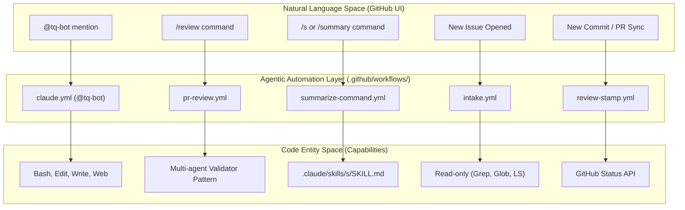
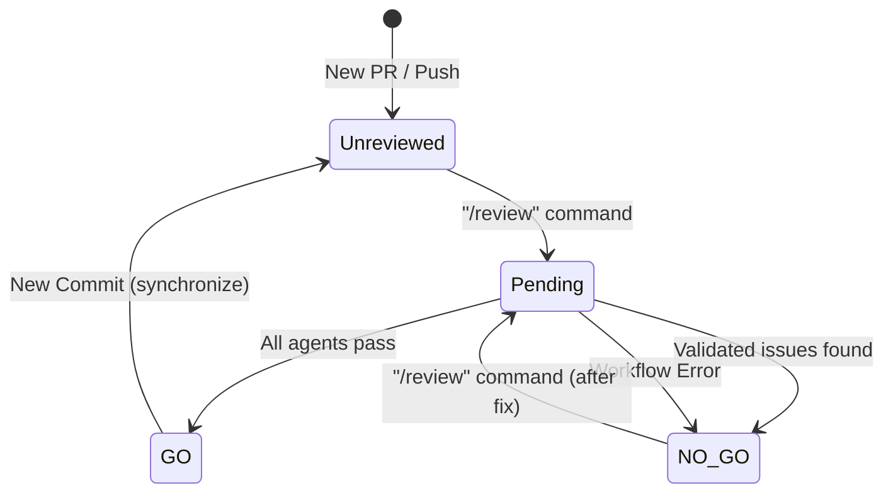

<!-- source: DeepWiki mcp.deepwiki.com · repo RyanCodrai/turbovec · page 6.3 AI-Assisted Development — @tq-bot and PR Review · fetched 2026-10-30 -->

# AI-Assisted Development — @tq-bot and PR Review

Relevant source files

The following files were used as context for generating this wiki page:

- [.claude/skills/s/SKILL.md](.claude/skills/s/SKILL.md)
- [.github/workflows/ci.yml](.github/workflows/ci.yml)
- [.github/workflows/claude.yml](.github/workflows/claude.yml)
- [.github/workflows/intake.yml](.github/workflows/intake.yml)
- [.github/workflows/pr-review.yml](.github/workflows/pr-review.yml)
- [.github/workflows/release-crates.yml](.github/workflows/release-crates.yml)
- [.github/workflows/release-pypi.yml](.github/workflows/release-pypi.yml)
- [.github/workflows/review-stamp.yml](.github/workflows/review-stamp.yml)
- [.github/workflows/security-audit.yml](.github/workflows/security-audit.yml)
- [.github/workflows/summarize-command.yml](.github/workflows/summarize-command.yml)
- [.github/workflows/supply-chain.yml](.github/workflows/supply-chain.yml)

This page documents the agentic automation layer of the `turbovec` repository. The system leverages Anthropic's Claude models to provide interactive development assistance, automated code reviews, issue triage, and plain-English summarization of technical diffs.

## Agentic Architecture Overview

The automation layer is composed of five specialized GitHub Actions workflows that interact with the codebase, issues, and pull requests. These agents use a combination of standard GitHub Actions, the `claude-code-action`, and custom scripts to execute tasks ranging from read-only triage to full-parity development with shell access.

### Component Relationship Diagram

The following diagram illustrates how natural language triggers in GitHub (Issues/PRs) map to specific workflow executions and their corresponding toolsets.

"Natural Language Space to Code Entity Space Mapping"

Sources: [.github/workflows/claude.yml:27-34](), [.github/workflows/pr-review.yml:77-86](), [.github/workflows/summarize-command.yml:38-40](), [.github/workflows/intake.yml:8-10](), [.github/workflows/review-stamp.yml:29-31]()

---

## Interactive Assistant: @tq-bot (`claude.yml`)

The `@tq-bot` is a full-capability agent that responds to mentions in issues and pull requests. It is designed to act as a remote pair programmer.

### Security and Permissions
*   **Actor Guard:** Restricted to the repository owner (`RyanCodrai`) and the `turbovec-bot` machine account to prevent unauthorized subscription spend and code execution [.github/workflows/claude.yml:27-28]().
*   **Toolset:** Enabled with `Bash`, `Edit`, `Write`, `Read`, `Grep`, `Glob`, `LS`, `WebSearch`, `WebFetch`, `Task`, and `TodoWrite` [.github/workflows/claude.yml:101]().
*   **Environment:** Installs `libopenblas-dev` and `pkg-config` so the agent can compile and test the Rust crate [.github/workflows/claude.yml:77-78]().

### Data Flow
1.  **Trigger:** A comment containing `@tq-bot` is posted.
2.  **Acknowledge:** The workflow reacts with 👀 (`eyes`) [.github/workflows/claude.yml:46-62]().
3.  **Execution:** The `claude-code-action` runs using a dedicated `CLAUDE_CODE_OAUTH_TOKEN` [.github/workflows/claude.yml:81-86]().
4.  **Outcome:** Success results in a 🚀 reaction; failure results in 😕 [.github/workflows/claude.yml:105-123]().

Sources: [.github/workflows/claude.yml:1-123]()

---

## Automated PR Review (`pr-review.yml`)

The PR review workflow implements a blocking "Agent code review" merge gate. It uses a multi-agent pattern to find and validate potential issues in code changes.

### Multi-Agent Pattern
The workflow orchestrates parallel agents:
*   **Finder Agents:** Four parallel agents (2x `CLAUDE.md` compliance, 2x bug/logic) identify candidate issues [.github/workflows/pr-review.yml:3-6]().
*   **Validator Subagents:** One validation subagent per candidate issue confirms the finding before it is posted as an inline comment [.github/workflows/pr-review.yml:5-6]().

### Blocking Protocol (`REVIEW_VERDICT`)
The workflow manages a required status check named `Agent code review`.
*   **Pending:** Upon start, the status is set to `pending` [.github/workflows/pr-review.yml:131-140]().
*   **Verdict:** The final status is a `GO/NO-GO` decision. A failure to record a verdict or an error in the run results in a `NO-GO`, keeping the merge button disabled [.github/workflows/pr-review.yml:8-17]().

### Review Stamp (`review-stamp.yml`)
To ensure every new commit is reviewed, `review-stamp.yml` immediately marks any new push (`synchronize`) or PR reopening as `failure` (Review required) [.github/workflows/review-stamp.yml:74-76](). This forces a manual re-trigger via the `/review` command [.github/workflows/review-stamp.yml:15]().

"PR Review Status Transition Logic"

Sources: [.github/workflows/pr-review.yml:1-28](), [.github/workflows/review-stamp.yml:1-76]()

---

## Plain-English Summarization (`summarize-command.yml`)

The `/s` and `/summary` commands provide instant, non-technical summaries of technical content using a specialized skill definition.

### Skill Definition (`.claude/skills/s/SKILL.md`)
The `s` skill is configured to:
*   Write in flowing prose, aimed at non-experts [.claude/skills/s/SKILL.md:21-22]().
*   Support arguments for scope (`all`) and length (`w N`, `l N`, `p N`) [.claude/skills/s/SKILL.md:13-17]().
*   Maintain technical substance while simplifying language [.claude/skills/s/SKILL.md:27]().

### Implementation Details
The workflow parses the command body using a shell script to extract arguments and range-check numeric values [.github/workflows/summarize-command.yml:73-128](). It intelligently resolves the target for summarization based on context:
*   **Issue Comment:** The newest comment or the description [.github/workflows/summarize-command.yml:133-135]().
*   **Review Comment Reply:** The root of the thread [.github/workflows/summarize-command.yml:147-156]().
*   **Fresh Review Comment:** The diff hunk associated with the comment [.github/workflows/summarize-command.yml:157-162]().

Sources: [.claude/skills/s/SKILL.md:1-27](), [.github/workflows/summarize-command.yml:1-162]()

---

## Issue Intake and Triage (`intake.yml`)

`intake.yml` is designed for automated triage of newly opened issues. Unlike the owner-restricted workflows, this is intended to fire for any contributor.

### Read-Only Constraints
To safely handle untrusted content from external users, the intake agent is strictly locked down:
*   **Permissions:** `contents: read`, `issues: write` [.github/workflows/intake.yml:26-28]().
*   **Tools:** Only `Read`, `Grep`, `Glob`, `LS`, and the `Skill` tool are allowed [.github/workflows/intake.yml:69]().
*   **Disallowed:** `Bash`, `Edit`, `Write`, `WebFetch`, and `WebSearch` are explicitly blocked [.github/workflows/intake.yml:70]().

### Triage Process
The agent is instructed to classify the issue (bug, feature, or question), identify relevant files, and then invoke the `s` skill with the `all` argument to provide a summary [.github/workflows/intake.yml:59-65]().

Sources: [.github/workflows/intake.yml:1-70]()

---

