# Page: Overview

# Overview

<details>
<summary>Relevant source files</summary>

The following files were used as context for generating this wiki page:

- [CHANGELOG.md](CHANGELOG.md)
- [README.md](README.md)
- [docs/api.md](docs/api.md)
- [docs/recall_d1536.svg](docs/recall_d1536.svg)
- [docs/recall_d3072.svg](docs/recall_d3072.svg)
- [docs/recall_glove.svg](docs/recall_glove.svg)
- [turbovec/src/id_map.rs](turbovec/src/id_map.rs)
- [turbovec/src/io.rs](turbovec/src/io.rs)
- [turbovec/src/lib.rs](turbovec/src/lib.rs)

</details>


`turbovec` is a high-performance Rust vector index designed for efficient similarity search using Google Research's **TurboQuant** algorithm. It provides a data-oblivious quantization scheme that achieves near-optimal distortion without requiring codebook training or multiple data passes [README.md:14-16]().

The project is designed to solve the memory and latency challenges of large-scale Retrieval-Augmented Generation (RAG) by offering up to 16x compression (e.g., shrinking 31 GB of FP32 vectors to 4 GB) while maintaining search speeds that beat FAISS IndexPQFastScan by an average of 3.4× at 4-bit width [README.md:14-19]().

## Design Goals

*   **Online Ingest:** Unlike Product Quantization (PQ), `turbovec` requires no data-dependent training step. Vectors are indexed immediately upon addition [README.md:18-18]().
*   **Hardware Acceleration:** Includes hand-written SIMD kernels for ARM (NEON SDOT/SMMLA) and x86 (AVX-512 VNNI, AVX2) to maximize throughput [README.md:19-19]().
*   **Crash-Safe Persistence:** The `sync()` method provides durable incremental saves, persisting only changed rows using an A/B dual-slot header protocol to remain crash-safe at any byte [README.md:20-20](), [CHANGELOG.md:31-34]().
*   **In-Kernel Filtering:** Search directly honors ID allowlists or slot bitmasks inside the SIMD kernels, short-circuiting blocks that do not match to avoid unnecessary scoring costs [README.md:21-21](), [README.md:86-86]().
*   **Pure Local:** Designed for air-gapped or privacy-sensitive environments where data must remain on-premise [README.md:22-22]().

## System Architecture

The following diagrams bridge the high-level conceptual components to the specific entities found in the codebase.

### Conceptual to Code Mapping
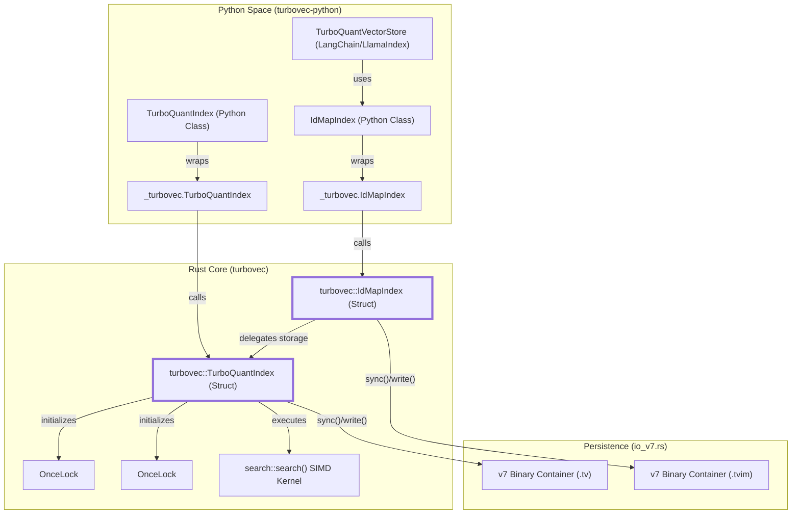
Sources: [turbovec/src/lib.rs:87-87](), [turbovec/src/id_map.rs:1-13](), [README.md:33-64](), [docs/api.md:5-9]()

### Build and Distribution Pipeline
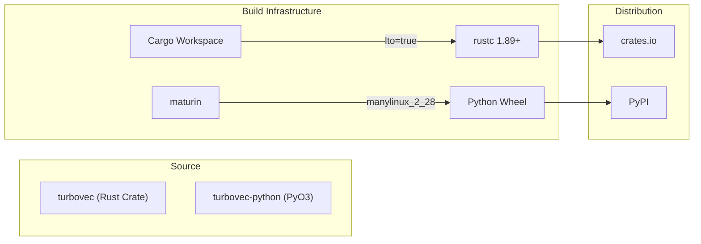
Sources: [CHANGELOG.md:7-10](), [turbovec/src/lib.rs:54-61](), [README.md:101-105]()

## Repository Organization

The repository is organized as a Cargo workspace containing the core library, Python bindings, and extensive benchmarking tools.

| Component | Path | Description |
| :--- | :--- | :--- |
| **Core Library** | `turbovec/` | The primary Rust crate containing the quantization logic, SIMD kernels, and v7 I/O [turbovec/src/lib.rs:63-73](). |
| **Python Bindings** | `turbovec-python/` | PyO3-based extension module and Python utility layer including interruptible chunking [README.md:92-99](). |
| **Benchmarks** | `benchmarks/` | Suite for measuring recall and speed against FAISS, including the hillclimb optimization log [README.md:130-140](). |
| **Documentation** | `docs/` | SVG charts, integration guides for LangChain/LlamaIndex/Haystack/Agno, and API references [README.md:90-99](). |
| **Examples** | `examples/` | Smoke tests and utility scripts like `convert.rs` for migrating older file formats [CHANGELOG.md:25-29](). |

## Next Steps

For detailed technical information, please refer to the following child pages:

*   **[Getting Started](#1.1)**: Step-by-step guide for installing `turbovec` via pip or cargo, building from source, and basic index usage.
*   **[Repository Layout](#1.2)**: A detailed map of the directory structure, build configurations, and the two-crate workspace architecture.

For implementation details of the Rust core, SIMD kernels, or Python framework integrations, see the respective sections in the main Wiki table of contents.

---

# Page: Getting Started

# Getting Started

<details>
<summary>Relevant source files</summary>

The following files were used as context for generating this wiki page:

- [.github/CODEOWNERS](.github/CODEOWNERS)
- [.github/PULL_REQUEST_TEMPLATE.md](.github/PULL_REQUEST_TEMPLATE.md)
- [CONTRIBUTING.md](CONTRIBUTING.md)
- [Cargo.lock](Cargo.lock)
- [README.md](README.md)
- [docs/recall_d1536.svg](docs/recall_d1536.svg)
- [docs/recall_d3072.svg](docs/recall_d3072.svg)
- [docs/recall_glove.svg](docs/recall_glove.svg)
- [examples/downstream-smoke/Cargo.lock](examples/downstream-smoke/Cargo.lock)
- [turbovec-python/Cargo.toml](turbovec-python/Cargo.toml)
- [turbovec-python/pyproject.toml](turbovec-python/pyproject.toml)
- [turbovec-python/python/turbovec/__init__.py](turbovec-python/python/turbovec/__init__.py)
- [turbovec-python/python/turbovec/_interruptible.py](turbovec-python/python/turbovec/_interruptible.py)
- [turbovec-python/tests/test_interruptible.py](turbovec-python/tests/test_interruptible.py)
- [turbovec/Cargo.toml](turbovec/Cargo.toml)

</details>


`turbovec` is a high-performance vector index designed for memory-efficient similarity search using the **TurboQuant** algorithm. It achieves up to 16x compression (at 2-bit) with zero codebook training, while outperforming established libraries like FAISS IndexPQFastScan on ARM and matching/beating them on x86 architectures [README.md:14-22]().

## Installation

### Python
The Python package provides a high-level API and integrations for RAG frameworks. It requires Python >= 3.9 [turbovec-python/pyproject.toml:10]().

**Standard Installation:**
```bash
pip install turbovec
```
[README.md:28-30]()

**With Framework Support:**
```bash
# For LangChain, LlamaIndex, Haystack, or Agno users
pip install "turbovec[langchain]"
pip install "turbovec[llama-index]"
pip install "turbovec[haystack]"
pip install "turbovec[agno]"
```
[turbovec-python/pyproject.toml:53-57](), [README.md:96-99]()

### Rust
Add `turbovec` to your `Cargo.toml` or via the CLI. Note that `turbovec` requires **Rust 1.89+** to support stabilized AVX-512 intrinsics [turbovec/Cargo.toml:5-15](), [turbovec/Cargo.toml:76]().
```bash
cargo add turbovec
```

---

## Building from Source

Building from source requires a Rust toolchain (1.89+) and `maturin` for Python bindings [turbovec-python/Cargo.toml:10](), [turbovec-python/pyproject.toml:2-3]().

### Hardware Targets and SIMD
The build system is configured to optimize for modern SIMD instruction sets. The Rust core includes hand-written kernels for:
*   **x86_64:** AVX-512 VNNI, AVX-512BW (`vpermb`), and AVX2 [README.md:19](), [turbovec/Cargo.toml:7-11]().
*   **ARM (aarch64):** NEON SDOT and SMMLA [README.md:19]().

### Build Commands
To build the Python wheel and install it (uses `pyo3` with `abi3-py39` features) [turbovec-python/Cargo.toml:31]():
```bash
pip install maturin
cd turbovec-python
maturin build --release
pip install target/wheels/*.whl
```
[turbovec-python/pyproject.toml:59-63]()

To build the Rust library:
```bash
cargo build --release
```

---

## Minimal End-to-End Example

### Python Example
The Python API uses `numpy` for vector input. It includes an interruptible chunking layer controlled by `BATCH_CHUNK_SIZE` (default: 1000) which ensures long operations can be halted by `Ctrl-C` [turbovec-python/python/turbovec/_interruptible.py:10-15](), [turbovec-python/python/turbovec/_interruptible.py:90-94]().

```python
from turbovec import TurboQuantIndex, IdMapIndex
import numpy as np

# 1. Initialize (1536 dimensions, 4-bit quantization)
index = TurboQuantIndex(dim=1536, bit_width=4)

# 2. Add vectors (must be C-contiguous float32)
vectors = np.random.rand(1000, 1536).astype(np.float32)
index.add(vectors) 

# 3. Calibrate (optional: improves recall by fitting to data distribution)
# index.calibrate(vectors[:512])

# 4. Search
query = np.random.rand(1, 1536).astype(np.float32)
scores, indices = index.search(query, k=10)

# 5. Persist and Incremental Sync
index.write("index.tv")         # Full snapshot
index.sync("index.tv")          # Crash-safe incremental update
```
[README.md:32-45](), [turbovec-python/python/turbovec/_interruptible.py:124-131]()

### Rust Example
```rust
use turbovec::{TurboQuantIndex, IdMapIndex};

// 1. Initialize
let mut index = TurboQuantIndex::new(1536, 4).unwrap();

// 2. Add and Search
index.add(&vectors); // vectors is &[f32]
let results = index.search(&queries, 10);

// 3. Persist
index.write("index.tv").unwrap();
let loaded = TurboQuantIndex::load("index.tv").unwrap();
```
[README.md:107-115](), [README.md:120-128]()

---

## Implementation Overview

### Data Flow: Natural Language to Code Entities
The following diagram maps the high-level operational flow to the specific classes and functions in the codebase.

**End-to-End Search Pipeline**
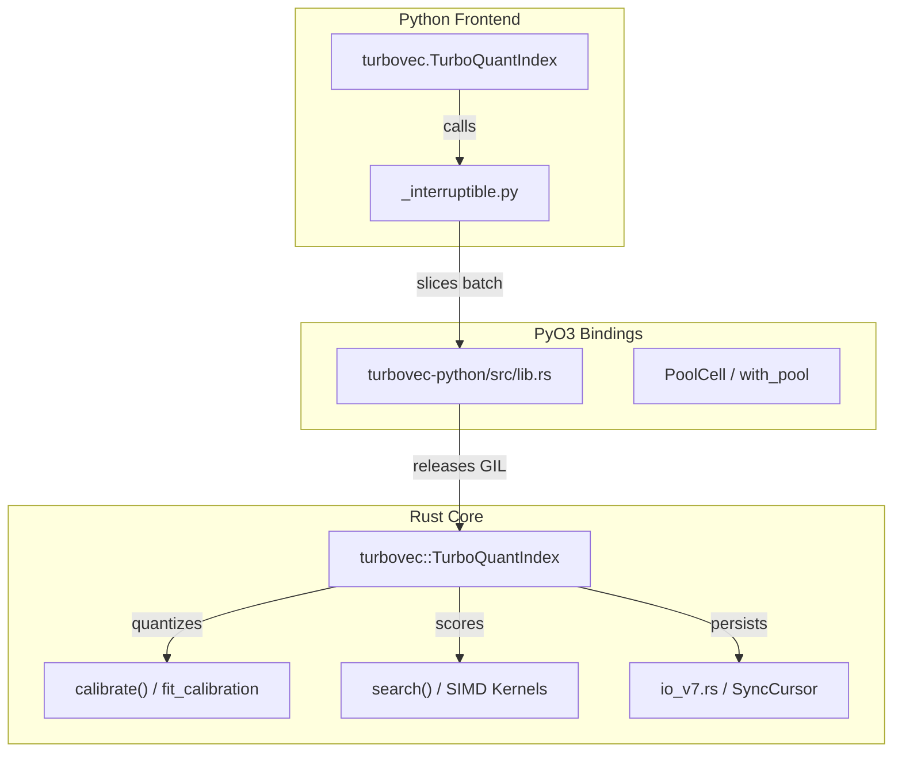
Sources: [turbovec-python/python/turbovec/_interruptible.py:10-15](), [turbovec-python/Cargo.toml:12-14](), [README.md:18-20](), [turbovec-python/Cargo.toml:35-40]()

### Key Components

| Component | Role | Logic Pointer |
| :--- | :--- | :--- |
| `TurboQuantIndex` | Core index using 0-based internal slots. | [README.md:32-35]() |
| `IdMapIndex` | Wrapper for `TurboQuantIndex` providing stable `uint64` IDs and O(1) removals. | [README.md:49-59]() |
| `calibrate()` | Fits shift/scale parameters to improve recall (TQ+). | [README.md:140-143]() |
| `sync()` | Incremental persistence using the v7 file format; crash-safe at any byte. | [README.md:20]() |
| `BATCH_CHUNK_SIZE` | Default size (1000) for splitting large batches to allow signal processing in Python. | [turbovec-python/python/turbovec/_interruptible.py:90-94]() |

### SIMD Architecture Support
`turbovec` detects hardware features at runtime to select the most efficient search kernel.

**Kernel Selection Logic**
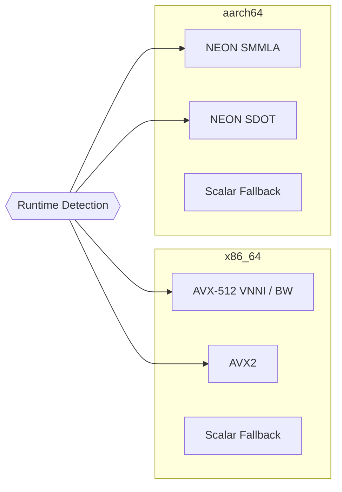
Sources: [README.md:19](), [turbovec/Cargo.toml:7-11]()

### Performance and Recall
*   **Recall:** TurboQuant (TQ+) typically beats FAISS `IndexPQ` at R@1 on high-dimensional datasets (d=1536, d=3072) [README.md:132-143]().
*   **Interruptibility:** For large `add` or `search` operations, `turbovec` slices batches on the Python side. While this adds ~1–10 µs per vector in overhead, it reduces `Ctrl-C` latency from seconds to milliseconds [turbovec-python/python/turbovec/_interruptible.py:21-28]().

Sources: [README.md:14-22](), [turbovec-python/python/turbovec/_interruptible.py:1-15]()

---

# Page: Repository Layout

# Repository Layout

<details>
<summary>Relevant source files</summary>

The following files were used as context for generating this wiki page:

- [.cargo/config.toml](.cargo/config.toml)
- [.gitignore](.gitignore)
- [Cargo.lock](Cargo.lock)
- [Cargo.toml](Cargo.toml)
- [examples/downstream-smoke/Cargo.lock](examples/downstream-smoke/Cargo.lock)
- [examples/downstream-smoke/Cargo.toml](examples/downstream-smoke/Cargo.toml)
- [examples/downstream-smoke/src/main.rs](examples/downstream-smoke/src/main.rs)
- [turbovec-python/Cargo.toml](turbovec-python/Cargo.toml)
- [turbovec-python/build.rs](turbovec-python/build.rs)
- [turbovec-python/pyproject.toml](turbovec-python/pyproject.toml)
- [turbovec/Cargo.toml](turbovec/Cargo.toml)

</details>


This page provides a comprehensive map of the `turbovec` repository, detailing the organization of its core Rust components, Python bindings, benchmarking suite, and infrastructure configurations. The project is structured as a Cargo workspace to manage the high-performance Rust core and its high-level language interfaces efficiently.

## Workspace Overview

The repository is managed as a multi-crate Rust workspace, defined in the root `Cargo.toml`. This structure allows for shared compilation artifacts and unified dependency management across the core library and its bindings.

| Component | Path | Description |
| :--- | :--- | :--- |
| **Core Library** | `turbovec/` | The primary Rust implementation of the TurboQuant algorithm and SIMD search engine. Requires MSRV 1.89 for AVX-512. |
| **Python Bindings** | `turbovec-python/` | PyO3-based extension module (`_turbovec`) and the `turbovec` Python package. |
| **Benchmarks** | `benchmarks/` | Performance suite, hillclimb logs, and the SVG diagram generator. |
| **Documentation** | `docs/` | Static assets, including SVG performance charts and integration docs. |
| **Examples** | `examples/` | Downstream smoke tests and kernel verification tools. |
| **CI/CD** | `.github/` | GitHub Actions workflows for automated testing, @tq-bot, and PyPI/Crates.io releases. |

Sources: [Cargo.toml:1-3](), [turbovec/Cargo.toml:27-28](), [turbovec-python/Cargo.toml:1-13](), [turbovec-python/pyproject.toml:59-63]()

## Directory Structure and Data Flow

The following diagram illustrates the relationship between the major directories and how data flows from the Rust core through the Python bindings to the end-user integrations.

### System Entity Map: Repository to Code

```mermaid
graph TD
    subgraph "Workspace Root"
        RootConfig["Cargo.toml"]
        LockFile["Cargo.lock"]
        CargoEnv[".cargo/config.toml"]
    end

    subgraph "turbovec/ (Core Crate)"
        CoreLib["src/lib.rs"]
        TQIndex["TurboQuantIndex"]
        IdMap["IdMapIndex"]
        SIMD["src/simd/"]
        IO["src/io_v7.rs"]
    end

    subgraph "turbovec-python/ (Binding Crate)"
        PyLib["src/lib.rs (PyO3)"]
        PyWrapper["python/turbovec/"]
        Integrations["python/turbovec/langchain/ & llama_index/"]
        Interrupt["_interruptible.py"]
    end

    subgraph "benchmarks/"
        Suite["suite/"]
        Results["results/"]
        Hillclimb["hillclimb/"]
        Visualizer["create_diagrams.py"]
    end

    %% Data and Logic Flow
    CoreLib -->|Provides| TQIndex
    CoreLib -->|Provides| IdMap
    TQIndex -->|Exposed via| PyLib
    PyLib -->|Imported by| PyWrapper
    PyWrapper -->|Uses| Interrupt
    PyWrapper -->|Used in| Integrations
    TQIndex -->|Evaluated by| Suite
    Suite -->|Generates| Results
    Results -->|Visualized by| Visualizer
    Visualizer -->|Writes to| "docs/"
```
Sources: [Cargo.toml:1-3](), [turbovec-python/pyproject.toml:62-63](), [turbovec-python/Cargo.toml:30-31](), [turbovec/Cargo.toml:1-3]()

## Crate Descriptions

### 1. turbovec (Core)
The `turbovec` directory contains the standalone Rust crate. It is responsible for the heavy lifting of vector quantization and search.
*   **Implementation**: Utilizes `rayon` for thread-parallel search [turbovec/Cargo.toml:39](). It requires Rust 1.89+ to support stabilized AVX-512 intrinsics used in `search.rs` and `rotation.rs` [turbovec/Cargo.toml:5-11]().
*   **Persistence**: Implements the v7 binary format, using A/B dual-slot headers for crash-safety [turbovec/src/io_v7.rs]().
*   **Determinism**: Pins `rand_chacha` and `statrs` to exact versions to ensure encoded bit-stream stability across releases [turbovec/Cargo.toml:42-65]().

### 2. turbovec-python
This directory houses the logic for making the Rust core accessible to Python.
*   **`src/lib.rs`**: Contains the PyO3 bridge. It defines the `_turbovec` binary module and wraps the Rust `TurboQuantIndex` into a Python-compatible class [turbovec-python/Cargo.toml:12-14]().
*   **`python/turbovec/`**: A pure Python layer that wraps the binary module. This includes high-level integrations for LangChain, LlamaIndex, Haystack, and Agno [turbovec-python/pyproject.toml:53-57]().
*   **Build System**: Uses `maturin` as the build backend to compile the Rust code into a Python wheel [turbovec-python/pyproject.toml:1-3]().

Sources: [turbovec-python/pyproject.toml:59-63](), [turbovec-python/Cargo.toml:30-32]()

## Build and CI Configuration

### Compiler Optimization
The root `Cargo.toml` specifies aggressive optimization for release builds to ensure the SIMD kernels perform at peak efficiency.
*   **LTO (Link Time Optimization)**: Set to `true` to enable cross-crate optimizations [Cargo.toml:10]().
*   **Codegen Units**: Set to `1` to maximize the scope of the optimizer [Cargo.toml:11]().
*   **Target Baseline**: `.cargo/config.toml` sets `x86-64-v2` as the baseline for non-SIMD code to avoid `SIGILL` on older CPUs while allowing runtime dispatch to AVX2/AVX-512 kernels [.cargo/config.toml:1-22]().

### System Layout and Build Flow

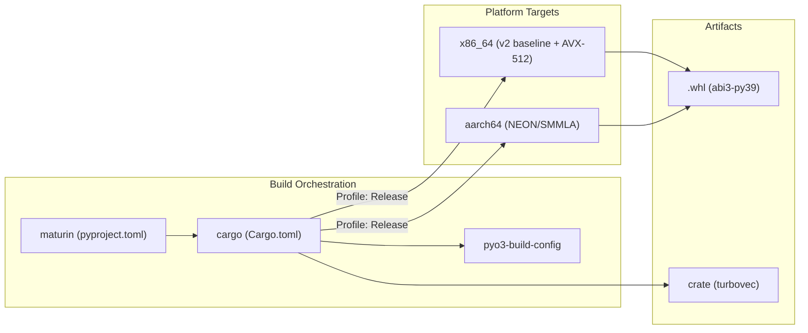
Sources: [Cargo.toml:9-12](), [turbovec-python/pyproject.toml:1-3](), [.cargo/config.toml:21-22](), [turbovec-python/Cargo.toml:31]()

## Examples and Testing
*   **`examples/downstream-smoke/`**: A standalone crate (excluded from the workspace) that mimics a real user experience. It verifies that `turbovec` links and runs without requiring manual BLAS/LAPACK configuration [examples/downstream-smoke/Cargo.toml:1-15]().
*   **`tests/encode_fingerprint.rs`**: A critical test suite that ensures cross-platform determinism of the quantization pipeline [turbovec/Cargo.toml:63-64]().

Sources: [examples/downstream-smoke/src/main.rs:1-15](), [Cargo.toml:6]()

---

# Page: Core Rust Library (turbovec)

# Core Rust Library (turbovec)

<details>
<summary>Relevant source files</summary>

The following files were used as context for generating this wiki page:

- [CHANGELOG.md](CHANGELOG.md)
- [docs/api.md](docs/api.md)
- [turbovec-python/tests/test_id_map.py](turbovec-python/tests/test_id_map.py)
- [turbovec-python/tests/test_index.py](turbovec-python/tests/test_index.py)
- [turbovec/src/error.rs](turbovec/src/error.rs)
- [turbovec/src/id_map.rs](turbovec/src/id_map.rs)
- [turbovec/src/io.rs](turbovec/src/io.rs)
- [turbovec/src/lib.rs](turbovec/src/lib.rs)
- [turbovec/tests/concurrent_search.rs](turbovec/tests/concurrent_search.rs)
- [turbovec/tests/filtering.rs](turbovec/tests/filtering.rs)
- [turbovec/tests/id_map.rs](turbovec/tests/id_map.rs)
- [turbovec/tests/lazy_init.rs](turbovec/tests/lazy_init.rs)

</details>


The `turbovec` crate is the core engine of the library, providing high-performance vector quantization and SIMD-accelerated search. It implements the **TurboQuant** algorithm, which compresses high-dimensional `f32` vectors into 2, 3, or 4 bits per coordinate while maintaining high recall. The library is designed to be "data-oblivious," meaning it does not require a training phase on the user's dataset to generate codebooks [turbovec/src/lib.rs:1-5]().

## System Architecture

The library is organized into several internal modules that handle the mathematical pipeline, data layout, and hardware-specific search kernels.

### Module Structure

| Module | Responsibility | Key Entities |
| :--- | :--- | :--- |
| `codebook` | Generates scalar quantization boundaries. | `codebook()` [turbovec/src/lib.rs:63]() |
| `encode` | Transforms and packs raw vectors into bit-codes. | `encode()` [turbovec/src/lib.rs:64]() |
| `rotation` | Generates the random orthogonal rotation matrix. | `make_rotation_matrix()` [turbovec/src/lib.rs:71]() |
| `pack` | Rearranges bit-codes into SIMD-friendly blocks. | `repack()`, `BlockedCache` [turbovec/src/lib.rs:70]() |
| `search` | Orchestrates query transformation and scoring. | `search()` [turbovec/src/lib.rs:72]() |
| `io_v7` | Handles persistence to the `v7` container format. | `write_full()`, `load()` [turbovec/src/lib.rs:69]() |
| `id_map` | Provides stable `u64` IDs over positional slots. | `IdMapIndex` [turbovec/src/lib.rs:66]() |

### Data Flow: From Vector to Search Results

The following diagram maps the natural language concepts of the quantization pipeline to the specific code entities and data structures used in the Rust implementation.

**TurboQuant Pipeline Mapping**
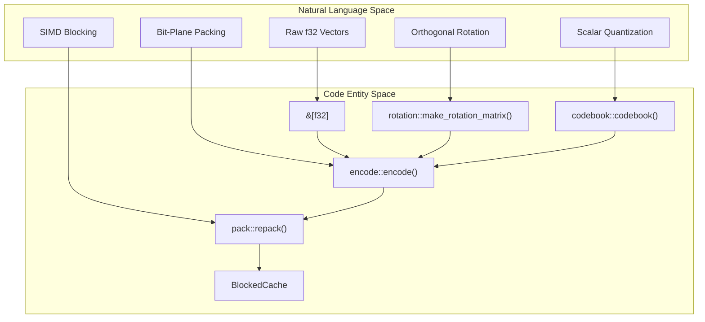
Sources: [turbovec/src/lib.rs:1-53](), [turbovec/src/pack.rs:1-50]()

---

## Core Components

### TurboQuantIndex and IdMapIndex — Public API and Lifecycle
`TurboQuantIndex` is the primary positional index. It manages the lifecycle of the vector store, including adding data, performing searches, and handling persistence. A key design feature is its **thread-safe lazy initialization**: while mutation requires `&mut self`, the `search` method takes `&self` and uses `std::sync::OnceLock` to safely initialize internal caches (rotation matrices and SIMD-blocked codes) across multiple threads [turbovec/src/lib.rs:22-36](). `IdMapIndex` wraps this to provide stable external `u64` IDs [turbovec/src/id_map.rs:1-13]().

For details on constructor constraints, thread-safety, and cache invalidation, see **[TurboQuantIndex and IdMapIndex — Public API and Lifecycle](#2.1)**.

### TurboQuant Algorithm — Rotation, Codebook, and Encoding
The quantization process involves rotating vectors into a space where their coordinates follow a known distribution, applying Lloyd-Max scalar quantization, and packing the resulting indices into bit-planes [turbovec/src/lib.rs:1-5](). This process is deterministic based on the vector dimension and a fixed seed [turbovec/src/rotation.rs:1-20]().

For a deep dive into the mathematical pipeline and bit-packing implementation, see **[TurboQuant Algorithm — Rotation, Codebook, and Encoding](#2.2)**.

### SIMD Search Engine — Repacking and Scoring Kernels
Search performance is achieved through a two-phase pipeline. First, `repack()` transforms bit-plane codes into a layout optimized for the host architecture (AVX-512, AVX2, or NEON) [turbovec/src/pack.rs:1-10](). Second, the `search()` function performs query rotation and uses high-speed kernels to compute asymmetric distances using Look-Up Tables (LUTs) [turbovec/src/search.rs:1-50]().

For details on SIMD-blocked layouts and architecture-specific scoring, see **[SIMD Search Engine — Repacking and Scoring Kernels](#2.3)**.

### Persistence — v7 File Format and Incremental Sync
The library implements the `v7` binary container format (`TV7\0` magic). It supports atomic-replace protocols and incremental `sync()`, which writes only the rows that changed since the last commit [CHANGELOG.md:31-34](), [turbovec/src/io.rs:14-27]().

For the full specification of the `v7` format and I/O operations, see **[Persistence — v7 File Format and Incremental Sync](#2.4)**.

---

## Code Entity Relationships

The following diagram illustrates how the `TurboQuantIndex` coordinates the various sub-systems during a search operation.

**Search Orchestration Diagram**
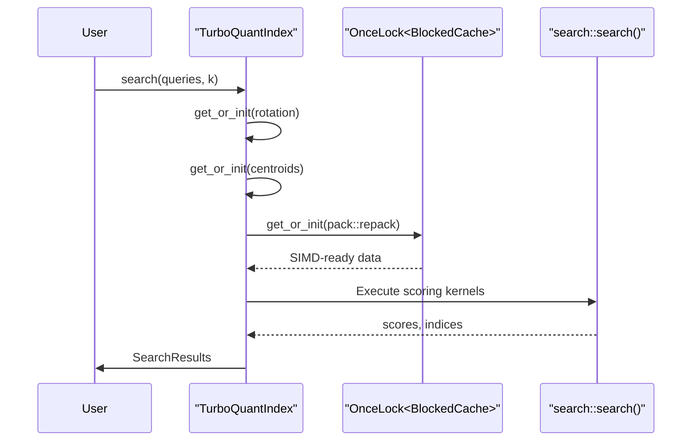
Sources: [turbovec/src/lib.rs:22-36](), [turbovec/tests/concurrent_search.rs:49-90]()

## Performance and Platform Safety
The crate is strictly 64-bit to ensure safety in SIMD and offset arithmetic [turbovec/src/lib.rs:54-61](). It enforces a `MAX_DIM` of 16,384 to prevent resource-exhaustion DoS from malformed files [turbovec/src/lib.rs:91-101]().

Sources: [turbovec/src/lib.rs:54-101](), [CHANGELOG.md:14-46]()

---

# Page: TurboQuantIndex and IdMapIndex — Public API and Lifecycle

# TurboQuantIndex and IdMapIndex — Public API and Lifecycle

<details>
<summary>Relevant source files</summary>

The following files were used as context for generating this wiki page:

- [CHANGELOG.md](CHANGELOG.md)
- [docs/api.md](docs/api.md)
- [turbovec-python/tests/test_calibration.py](turbovec-python/tests/test_calibration.py)
- [turbovec-python/tests/test_id_map.py](turbovec-python/tests/test_id_map.py)
- [turbovec-python/tests/test_index.py](turbovec-python/tests/test_index.py)
- [turbovec/src/error.rs](turbovec/src/error.rs)
- [turbovec/src/id_map.rs](turbovec/src/id_map.rs)
- [turbovec/src/io.rs](turbovec/src/io.rs)
- [turbovec/src/lib.rs](turbovec/src/lib.rs)
- [turbovec/tests/concurrent_search.rs](turbovec/tests/concurrent_search.rs)
- [turbovec/tests/filtering.rs](turbovec/tests/filtering.rs)
- [turbovec/tests/id_map.rs](turbovec/tests/id_map.rs)
- [turbovec/tests/lazy_init.rs](turbovec/tests/lazy_init.rs)
- [turbovec/tests/tqplus_calibration.rs](turbovec/tests/tqplus_calibration.rs)

</details>


This page provides a detailed technical reference for the two primary index types in `turbovec`: `TurboQuantIndex` and `IdMapIndex`. It covers their constructor constraints, internal state management, thread-safety model via `OnceLock`, and the lifecycle of data from ingestion to persistence.

---

### TurboQuantIndex — Positional SIMD Index

`TurboQuantIndex` is the core engine of the library. It manages the compression of raw `f32` vectors into bit-packed codes and orchestrates SIMD-accelerated searches. It uses positional indexing: each vector is identified by its slot (`0..n`).

#### Struct Definition and Internal State
`TurboQuantIndex` maintains the compressed vector data and several internal caches required for high-performance search. It uses `std::sync::OnceLock` to ensure thread-safe, lazy initialization of heavy compute structures.

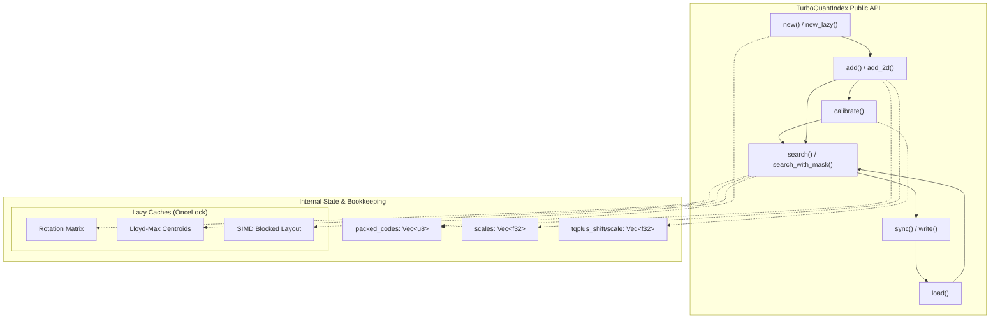
**Sources:** [turbovec/src/lib.rs:85-110](), [turbovec/src/lib.rs:22-52]()

#### Lifecycle and Constructors
The index supports both eager and lazy dimensionality commitment.

*   **`new(dim, bit_width)`**: Commits the index to a specific dimensionality immediately. `dim` must be a positive multiple of 8 and $\le$ `MAX_DIM` (16384). `bit_width` must be 2, 3, or 4 [turbovec/src/error.rs:164-175]().
*   **`new_lazy(bit_width)`**: Creates an index without a committed `dim`. The dimensionality is inferred and "locked" during the first call to `add_2d` [turbovec/src/lib.rs:104-107]().
*   **`add(vectors)`**: Appends vectors. On a lazy index, this must be `add_2d` to specify the dimension; otherwise, it panics [turbovec/tests/lazy_init.rs:105-111]().
*   **`prepare()`**: Eagerly builds the rotation matrix, centroids, and SIMD-blocked layout. This pays the one-time initialization cost up front so the first search is fast [turbovec/src/lib.rs:29-31]().

**Sources:** [turbovec/src/lib.rs:91-101](), [docs/api.md:42-54]()

#### Thread-Safety and Cache Invalidation
`TurboQuantIndex::search` takes `&self`, enabling lock-free concurrent searches.
*   **Safety Invariant**: "Whenever the index is reachable through `&self`, every populated cache describes exactly the `len()` rows the index currently holds" [turbovec/src/lib.rs:34-36]().
*   **Invalidation**: Any mutation (via `&mut self`) such as `add()` or `swap_remove()` invalidates the `blocked` layout cache by resetting the `OnceLock`. The rotation and centroids are functions of `dim` and `bit_width` only, so they never go stale [turbovec/src/lib.rs:38-45]().

**Sources:** [turbovec/src/lib.rs:22-52](), [turbovec/tests/concurrent_search.rs:142-175]()

---

### IdMapIndex — Stable External IDs

`IdMapIndex` provides a wrapper around `TurboQuantIndex` that maps stable `u64` IDs to internal positional slots. This is essential when deletions occur, as `TurboQuantIndex` uses `swap_remove` which changes slot indices.

#### ID Bookkeeping and Complexity
`IdMapIndex` maintains two primary maps: `id_to_slot` and `slot_to_id`.
*   **`add_with_ids(vectors, ids)`**: Ingests vectors and maps them to provided IDs. O(N) complexity for encoding plus hash map inserts [turbovec/src/id_map.rs:31-31]().
*   **`remove(id)`**: Performs O(1) removal. It identifies the slot of the ID, performs `swap_remove` on the inner index, and updates the maps so the ID previously at the "tail" of the index now points to the newly occupied slot [turbovec/src/id_map.rs:32-34]().
*   **Deferred ID Map**: Optimization for `load()`. To avoid O(N) hash map construction on startup, the ID table is stored sorted on disk. The index uses binary search on this sorted table until a mutation occurs, at which point the hash maps are materialized [turbovec/src/id_map.rs:133-166]().

**Sources:** [turbovec/src/id_map.rs:1-37](), [turbovec/src/id_map.rs:112-115]()

#### Search and Filtering
`IdMapIndex` supports an "allowlist" filter, which resolves external `u64` IDs to internal bitmasks for the SIMD engine.

| Feature | Description |
| :--- | :--- |
| **Search** | Returns `IdSearchResults`, translating internal `i64` slots back to external `u64` IDs [turbovec/src/id_map.rs:168-175](). |
| **Allowlist** | `search_with_allowlist` accepts a slice of `u64`. It performs binary searches against the ID maps to build a bitmask for the kernel [turbovec/src/id_map.rs:13-17](). |
| **`contains(id)`** | Checks if an ID exists in O(1) (via hash map) or O(log N) (via sorted table) [turbovec/src/id_map.rs:54-63](). |

**Sources:** [turbovec/src/id_map.rs:35-36](), [turbovec/tests/filtering.rs:10-11]()

---

### Persistence and Sync

The `turbovec` v7 format introduces incremental synchronization (`sync()`), allowing the index to persist only changed blocks rather than the entire file.

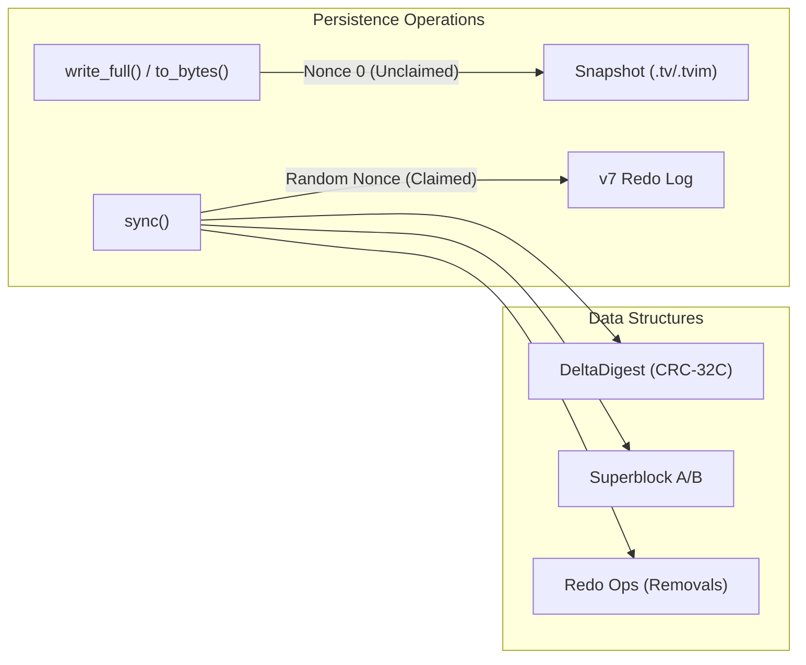

*   **Atomic Replace**: Writes go to a sibling `.tmp` file using `O_CREAT | O_EXCL` before an atomic rename to prevent corruption from concurrent writers or power loss [turbovec/src/io.rs:14-27]().
*   **Nonces**: `write()` produces a file with nonce `0` (unclaimed). `sync()` claims the file with a random nonce. A loader will refuse to `sync()` to a file replaced by another writer (nonce mismatch) [CHANGELOG.md:93-102]().
*   **Durability**: Users can choose `Durability::Durable` (fsync) or `Durability::Fast` (no fsync) [turbovec/src/io.rs:57-64]().

**Sources:** [turbovec/src/io.rs:1-46](), [CHANGELOG.md:31-34]()

---

### TQ+ Calibration Lifecycle

TQ+ provides per-coordinate shift and scale fitting. Unlike the quantization codebook, calibration is data-dependent and belongs to the index lifecycle.

*   **States**: There are only two states: `Uncalibrated` and `Calibrated` [turbovec/tests/tqplus_calibration.rs:3-4]().
*   **Transition**: Transition occurs via an explicit `calibrate(&[f32])` call. This calculates optimal shifts (means) and scales (Lloyd-Max fitting over the Beta distribution) [turbovec/tests/tqplus_calibration.rs:57-61]().
*   **Persistence**: Calibration is stored in the TQ+ trailer of the v7 file. An uncalibrated index round-trips as uncalibrated (storing empty arrays) [turbovec/tests/tqplus_calibration.rs:87-95]().

**Sources:** [turbovec/tests/tqplus_calibration.rs:1-12](), [docs/api.md:62-76]()

---

# Page: TurboQuant Algorithm — Rotation, Codebook, and Encoding

# TurboQuant Algorithm — Rotation, Codebook, and Encoding

<details>
<summary>Relevant source files</summary>

The following files were used as context for generating this wiki page:

- [Cargo.lock](Cargo.lock)
- [examples/downstream-smoke/Cargo.lock](examples/downstream-smoke/Cargo.lock)
- [turbovec-python/Cargo.toml](turbovec-python/Cargo.toml)
- [turbovec-python/pyproject.toml](turbovec-python/pyproject.toml)
- [turbovec/Cargo.toml](turbovec/Cargo.toml)
- [turbovec/examples/encode_hash.rs](turbovec/examples/encode_hash.rs)
- [turbovec/src/codebook.rs](turbovec/src/codebook.rs)
- [turbovec/src/encode.rs](turbovec/src/encode.rs)
- [turbovec/src/kernel_tests.rs](turbovec/src/kernel_tests.rs)
- [turbovec/src/rotation.rs](turbovec/src/rotation.rs)
- [turbovec/src/search.rs](turbovec/src/search.rs)
- [turbovec/tests/codebook_determinism.rs](turbovec/tests/codebook_determinism.rs)
- [turbovec/tests/common/fingerprint.rs](turbovec/tests/common/fingerprint.rs)
- [turbovec/tests/encode_fingerprint.rs](turbovec/tests/encode_fingerprint.rs)
- [turbovec/tests/query_scale_invariance.rs](turbovec/tests/query_scale_invariance.rs)

</details>


The TurboQuant algorithm is the core compression pipeline of `turbovec`. It transforms high-dimensional `float32` vectors into compact, bit-packed representations (2, 3, or 4 bits per dimension) while preserving the angular relationships necessary for high-recall similarity search. This page details the mathematical and implementation steps: block-Hadamard rotation, Lloyd-Max quantization over the Beta distribution, TQ+ calibration, and bit-plane packing.

### Algorithm Pipeline Overview

The encoding process follows a deterministic pipeline to convert raw input vectors into a format optimized for SIMD-accelerated scoring. Unlike earlier versions, the current pipeline is strictly deterministic across architectures and platforms.

1.  **Validation**: Input vectors are scanned for `NaN`, `Inf`, or extreme magnitudes `[turbovec/src/encode.rs:58-74]()`.
2.  **Normalization**: Input vectors are converted to unit vectors (on the unit hypersphere $S^{d-1}$), and their original magnitudes (norms) are stored separately `[turbovec/src/encode.rs:160-163]()`.
3.  **Deterministic Orthogonal Rotation**: A block-Hadamard transform is applied. This decorrelates coordinates so each follows a predictable statistical distribution `[turbovec/src/rotation.rs:1-39]()`.
4.  **TQ+ Calibration**: Per-coordinate `shift` and `scale` parameters are fit to map empirical quantiles onto codebook centroids, correcting for residual anisotropy `[turbovec/src/encode.rs:10-29]()`.
5.  **Lloyd-Max Quantization**: Each rotated and calibrated coordinate is mapped to a discrete code based on optimal boundaries derived from the Beta distribution `[turbovec/src/codebook.rs:1-5]()`.
6.  **Bit-Plane Packing**: Codes are packed into bit-planes to facilitate fast bitwise operations during search `[turbovec/src/encode.rs:244-278]()`.

#### Data Flow and Code Entities

The following diagram maps the mathematical stages to the specific Rust functions and modules.

**TurboQuant Encoding Pipeline**
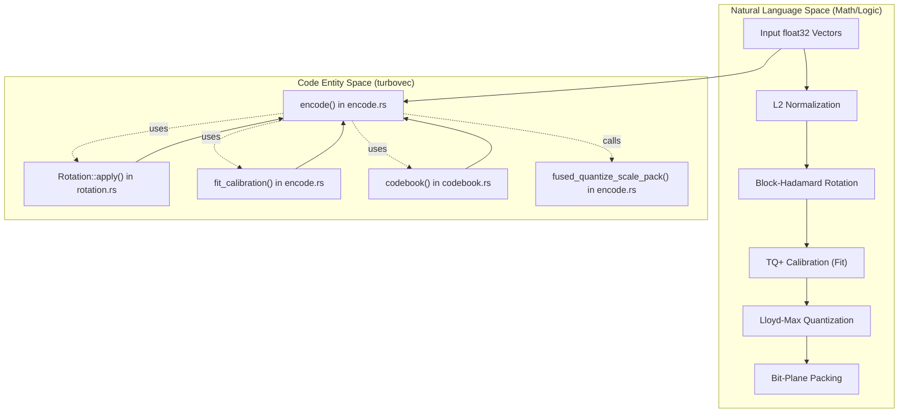
Sources: `[turbovec/src/encode.rs:1-30]()`, `[turbovec/src/rotation.rs:97-118]()`, `[turbovec/src/codebook.rs:35-50]()`

---

### Deterministic Rotation (`rotation.rs`)

`turbovec` uses a **Block-Hadamard Transform** instead of a dense Gaussian matrix to ensure bit-for-bit determinism across CPUs and operating systems `[turbovec/src/rotation.rs:6-18]()`.

#### The Transform Mechanism
The rotation is composed of `K=2` rounds `[turbovec/src/rotation.rs:69-70]()`. Each round consists of:
1.  **Global Permutation**: A Fisher-Yates shuffle across all `dim` coordinates, seeded by a fixed `ROTATION_SEED` (ChaCha8) `[turbovec/src/rotation.rs:33-34]()`.
2.  **Sign Flips**: Every coordinate is multiplied by ±1, also seeded by ChaCha8 `[turbovec/src/rotation.rs:35]()`.
3.  **Walsh-Hadamard Transform (WHT)**: Applied to contiguous blocks of size `B`, where `B` is the largest power-of-two divisor of `dim` `[turbovec/src/rotation.rs:36-37]()`.

This approach removes dependencies on BLAS or transcendental samplers that previously caused cross-platform divergence `[turbovec/src/rotation.rs:19-26]()`.

Sources: `[turbovec/src/rotation.rs:1-96]()`

---

### Lloyd-Max Scalar Quantization (`codebook.rs`)

Rotated coordinates follow a `Beta((d-1)/2, (d-1)/2)` distribution. The `codebook` module computes optimal boundaries and centroids for this distribution.

#### Lloyd-Max Implementation
The `lloyd_max` function iteratively minimizes Mean Squared Error (MSE) `[turbovec/src/codebook.rs:69-82]()`:
- **Memoization**: Results are cached in a process-global `MEMO` (a `Mutex<HashMap>`) using `try_lock` to avoid deadlocks during `fork()` `[turbovec/src/codebook.rs:11-33]()`.
- **Numerical Integration**: Conditional means are calculated using `adaptive_simpson` quadratures of the Beta PDF `[turbovec/src/codebook.rs:108-122]()`.
- **Determinism Guard**: Centroids are rounded to `f32` *before* computing midpoints (boundaries). This prevents tiny `f64` precision differences between `libm` implementations (e.g., glibc vs MSVC) from flipping the final `f32` boundary value `[turbovec/src/codebook.rs:137-160]()`.

Sources: `[turbovec/src/codebook.rs:1-165]()`

---

### TQ+ Calibration and Packing (`encode.rs`)

#### TQ+ Calibration
TQ+ introduces two free parameters per coordinate—`shift` and `scale`—to correct for anisotropic energy remaining after rotation `[turbovec/src/encode.rs:10-17]()`.
- **Fitting**: `fit_calibration` maps empirical quantiles of the data onto the codebook's outermost centroids `[turbovec/src/encode.rs:17-20]()`.
- **Anchor**: The probability level for the fit is derived from the codebook itself via `tqplus_anchor` `[turbovec/src/encode.rs:454-455]()`.

#### Fused Quantization and Packing
To maximize performance, `fused_quantize_scale_pack` performs quantization and bit-plane packing in a single pass `[turbovec/src/encode.rs:244-248]()`.

**Bit-Plane Layout**
Vectors are stored in blocks of 32. The layout is "vector-major" or "bit-plane" depending on the target SIMD architecture:
- **Sequential**: Standard layout for ARM NEON.
- **Perm0-Interleaved**: Layout for x86 AVX2/AVX-512 to match `vpshufb` requirements `[turbovec/src/search.rs:5-8]()`.

The `encode` function handles the final calculation of the RaBitQ-style scale: `||v|| / <u, x_hat>`, providing an unbiased estimator of the inner product during search `[turbovec/src/encode.rs:3-8]()`.

Sources: `[turbovec/src/encode.rs:1-30]()`, `[turbovec/src/encode.rs:244-278]()`, `[turbovec/src/search.rs:1-10]()`

---

### Determinism and Fingerprinting

`turbovec` enforces strict determinism via a "Golden Bytes" test suite.

- **Golden Bytes**: `tests/encode_fingerprint.rs` contains hardcoded FNV-1a hashes for every stage of the pipeline (boundaries, centroids, calibration, codes, scales) across various dimensions and bit widths `[turbovec/tests/encode_fingerprint.rs:1-92]()`.
- **Cross-OS Validation**: CI runs these tests on Linux, macOS, and Windows. Any change in `statrs` (Beta CDF) or reduction order that moves encoded bytes is caught as a format break `[turbovec/tests/encode_fingerprint.rs:47-58]()`.

Sources: `[turbovec/tests/encode_fingerprint.rs:1-130]()`, `[turbovec/tests/common/fingerprint.rs:1-15]()`

---

# Page: SIMD Search Engine — Repacking and Scoring Kernels

# SIMD Search Engine — Repacking and Scoring Kernels

<details>
<summary>Relevant source files</summary>

The following files were used as context for generating this wiki page:

- [benchmarks/hillclimb/LOG.md](benchmarks/hillclimb/LOG.md)
- [benchmarks/results/hillclimb_baseline.json](benchmarks/results/hillclimb_baseline.json)
- [turbovec-python/tests/test_id_map.py](turbovec-python/tests/test_id_map.py)
- [turbovec-python/tests/test_index.py](turbovec-python/tests/test_index.py)
- [turbovec/src/encode.rs](turbovec/src/encode.rs)
- [turbovec/src/error.rs](turbovec/src/error.rs)
- [turbovec/src/kernel_tests.rs](turbovec/src/kernel_tests.rs)
- [turbovec/src/pack.rs](turbovec/src/pack.rs)
- [turbovec/src/rotation.rs](turbovec/src/rotation.rs)
- [turbovec/src/search.rs](turbovec/src/search.rs)
- [turbovec/tests/concurrent_search.rs](turbovec/tests/concurrent_search.rs)
- [turbovec/tests/filtering.rs](turbovec/tests/filtering.rs)
- [turbovec/tests/id_map.rs](turbovec/tests/id_map.rs)
- [turbovec/tests/kernel_correctness.rs](turbovec/tests/kernel_correctness.rs)
- [turbovec/tests/lazy_init.rs](turbovec/tests/lazy_init.rs)
- [turbovec/tests/swap_remove.rs](turbovec/tests/swap_remove.rs)

</details>


The `turbovec` search engine implements a high-performance, two-phase pipeline designed to maximize SIMD utilization across different CPU architectures. This page details the transformation of bit-plane encoded vectors into SIMD-friendly memory layouts and the subsequent scoring kernels that leverage architecture-specific instructions (AVX2, AVX-512, NEON) for ultra-fast similarity search.

## 1. Data Flow: From Bit-Planes to SIMD Blocks

The search pipeline begins with `repack()`, which reorganizes the bit-packed codes generated during encoding into a blocked layout. This layout allows SIMD registers to load data for multiple vectors simultaneously without complex shuffling during the hot scoring loop.

### 1.1. The Repacking Phase
The `repack` function [turbovec/src/pack.rs:59-74]() performs two primary steps:
1.  **Extraction**: It calls `extract_codes_flat` to convert bit-plane packed codes into a flat vector of nibble-sized values [turbovec/src/pack.rs:68]().
2.  **Layout Transformation**: It uses the `pack_blocked_native!` macro to arrange these values into architecture-optimized structures [turbovec/src/pack.rs:71-72]().

### 1.2. Platform-Specific Layouts
`turbovec` optimizes for three primary memory layouts based on the target instruction set and bit-width:

| Layout Type | Target Architecture | Description |
| :--- | :--- | :--- |
| **perm0-Interleaved** | x86_64 (AVX2/AVX-512) | Splits bytes into hi/lo nibbles, interleaving them through the `PERM0` constant to ensure cross-lane compatibility for AVX2 `_mm256_shuffle_epi8` [turbovec/src/pack.rs:76-102](). |
| **Vector-Major** | VNNI / SDOT | A layout optimized for dot-product instructions where codes are grouped to match vector register widths (e.g., `vector_major_chunk`) [turbovec/src/pack.rs:31-35](). |
| **VM8 (ARM SMMLA)** | ARM (aarch64) | A specialized "Vector-Major 8" layout used for ARM matrix-multiply instructions [turbovec/src/pack.rs:26-30](). |
| **Sequential** | NEON / Scalar | The default layout for non-x86 targets where codes are stored contiguously [turbovec/src/pack.rs:41-44](). |

### Data Transformation Topology
The following diagram illustrates how raw bit-planes are transformed into the `blocked_codes` used by the scoring kernels.

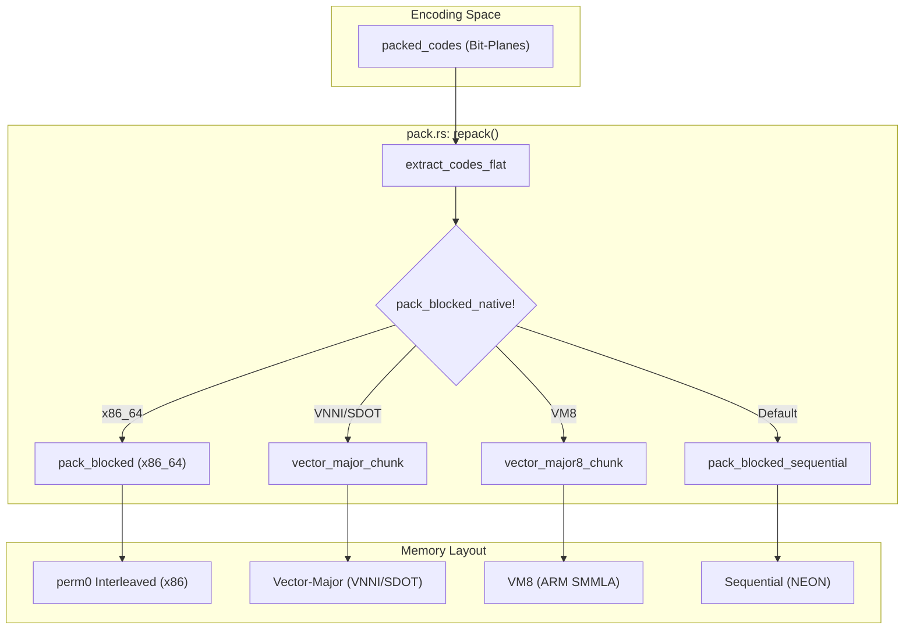
Sources: [turbovec/src/pack.rs:1-74](), [turbovec/src/pack.rs:19-47]()

---

## 2. Scoring Kernels and SIMD Implementation

The `search()` function orchestrates the construction of Look-Up Tables (LUTs) and dispatches execution to architecture-specific kernels. It supports single-query parallelization over blocks when the dataset size exceeds `SINGLE_QUERY_PARALLEL_MIN_BLOCKS` (1024 blocks) [turbovec/src/search.rs:30-86]().

### 2.1. LUT Construction and Query Rotation
Before scoring, the query is rotated using the `Rotation` object [turbovec/src/rotation.rs:97-141](). `turbovec` then constructs a LUT containing the pre-calculated contribution of every possible quantized value to the final dot product. This converts the dot product calculation into a series of SIMD table lookups.

### 2.2. Architecture-Specific Kernels
The engine selects the most efficient kernel at runtime using `is_x86_feature_detected!` or target-specific CFG flags [turbovec/src/search.rs:1-10]().

*   **AVX-512 (BW/VNNI/GFNI)**: The highest performance x86 path. Uses 512-bit ZMM registers for massive throughput.
*   **AVX2**: The standard x86 fallback. Uses a fused multi-query approach to process 4 queries against a block of vectors, maximizing cache reuse [turbovec/src/search.rs:134-149]().
*   **ARM NEON (SDOT/SMMLA)**: Leverages `sdot` for 4-way dot products or `smmla` for matrix-multiply-accumulate, significantly outperforming standard NEON lookups.
*   **Scalar Fallback**: Used for unsupported architectures. It handles `perm0` de-interleaving on x86 via `deinterleave_x86_code_byte` to ensure correctness [turbovec/src/pack.rs:125-135]().

### System Architecture: Search Pipeline
This diagram maps the logical search steps to the specific code entities in `search.rs` and `pack.rs`.

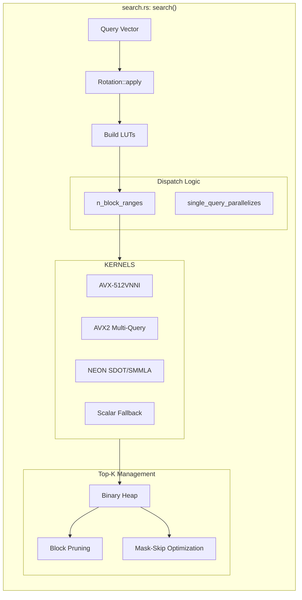
Sources: [turbovec/src/search.rs:1-144](), [turbovec/src/rotation.rs:121-141]()

---

## 3. Advanced Block Management

### 3.1. Block-Level Pruning and Masking
`turbovec` uses a block-based approach to minimize the work performed by the scoring kernels:
*   **Block Size**: Vectors are processed in fixed blocks of 32 (`BLOCK = 32`) [turbovec/src/pack.rs:7]().
*   **Mask-Skip**: If an allowlist mask is provided, the kernel uses `block_has_allowed` to skip entire blocks where no vectors are permitted [turbovec/src/search.rs:101-113]().
*   **Pruning**: For multi-query searches, if a block's maximum possible score is lower than the current heap minimum, the entire block is skipped.

### 3.2. Incremental Mutation (O(dim) Deletions)
Instead of repacking the entire index when a vector is removed, `turbovec` implements `move_lane` [turbovec/src/pack.rs:156-178]().
*   **`move_lane`**: When `swap_remove` occurs, this function copies the last vector's code bytes into the vacated lane in O(dim) time [turbovec/src/pack.rs:156]().
*   **`append_lanes`**: Efficiently adds new vectors to the blocked layout by filling the next available lanes in the final block [turbovec/src/pack.rs:205-224]().

### 3.3. Lazy Materialization
The index supports `new_lazy`, allowing it to defer dimension commitment until the first `add_2d` call [turbovec/src/error.rs:10-12](). The `blocked` layout is materialized lazily via `prepare()` or on the first `search()` call, utilizing `OnceLock` for thread-safe initialization [turbovec/tests/concurrent_search.rs:3-12]().

Sources: [turbovec/src/pack.rs:156-224](), [turbovec/src/search.rs:15-86](), [turbovec/src/error.rs:1-172](), [turbovec/tests/concurrent_search.rs:1-186]()

---

# Page: Persistence — v7 File Format and Incremental Sync

# Persistence — v7 File Format and Incremental Sync

<details>
<summary>Relevant source files</summary>

The following files were used as context for generating this wiki page:

- [CHANGELOG.md](CHANGELOG.md)
- [docs/api.md](docs/api.md)
- [turbovec-python/tests/test_pickle_copy.py](turbovec-python/tests/test_pickle_copy.py)
- [turbovec/examples/convert.rs](turbovec/examples/convert.rs)
- [turbovec/src/convert.rs](turbovec/src/convert.rs)
- [turbovec/src/id_map.rs](turbovec/src/id_map.rs)
- [turbovec/src/io.rs](turbovec/src/io.rs)
- [turbovec/src/io_v7.rs](turbovec/src/io_v7.rs)
- [turbovec/src/lib.rs](turbovec/src/lib.rs)
- [turbovec/tests/adversarial_durability.rs](turbovec/tests/adversarial_durability.rs)
- [turbovec/tests/adversarial_durability_edges.rs](turbovec/tests/adversarial_durability_edges.rs)
- [turbovec/tests/adversarial_durability_fuzz.rs](turbovec/tests/adversarial_durability_fuzz.rs)
- [turbovec/tests/adversarial_durability_round2.rs](turbovec/tests/adversarial_durability_round2.rs)
- [turbovec/tests/adversarial_gen_reuse.rs](turbovec/tests/adversarial_gen_reuse.rs)
- [turbovec/tests/adversarial_load_memory.rs](turbovec/tests/adversarial_load_memory.rs)
- [turbovec/tests/bytes_io.rs](turbovec/tests/bytes_io.rs)
- [turbovec/tests/calibration_bounds.rs](turbovec/tests/calibration_bounds.rs)
- [turbovec/tests/convert_versions.rs](turbovec/tests/convert_versions.rs)
- [turbovec/tests/sync_v7.rs](turbovec/tests/sync_v7.rs)
- [turbovec/tests/v7_only.rs](turbovec/tests/v7_only.rs)

</details>


The `turbovec` library uses the **v7 binary container format** as its primary persistence layer. Starting with version 1.0.0, v7 is the only format supported for reading and writing [CHANGELOG.md:18-20](). It introduces **incremental synchronization** via the `sync()` method, allowing the index to persist only changed blocks rather than rewriting the entire file [CHANGELOG.md:31-32]().

### v7 Binary Layout

The v7 format is a headerized slot array designed for crash-safe updates and random-access loading [io_v7.rs:1-3](). It consists of a superblock, two alternating commit headers, and a sequence of data block units.

| Section | Content | Purpose |
| :--- | :--- | :--- |
| **Superblock** | `TV7\0` magic, version, bit-width, dimension, codebook, TQ+ calibration. | Global immutable geometry; carries a trailing CRC-32C [io_v7.rs:6-7](). |
| **Header A/B** | Generation, row count `n`, tail rows, redo ops, delta digest. | Dual-slot A/B protocol for atomic commits [io_v7.rs:8-9](). |
| **Block Units** | Sequential-blocked codes, 32 scales, 32 IDs. | One unit per 32-row block; stored in search-ready layout [io_v7.rs:10-12](). |

**Sources:** [io_v7.rs:1-13](), [io_v7.rs:89-100](), [CHANGELOG.md:18-35]()

---

### A/B Dual-Slot Header Protocol

To ensure crash safety without a separate write-ahead log, v7 uses two alternating header slots. Generation `g` is written to slot `g % 2`, overwriting only the slot from generation `g-1` [io_v7.rs:21-23]().

**Commit and Recovery Flow**
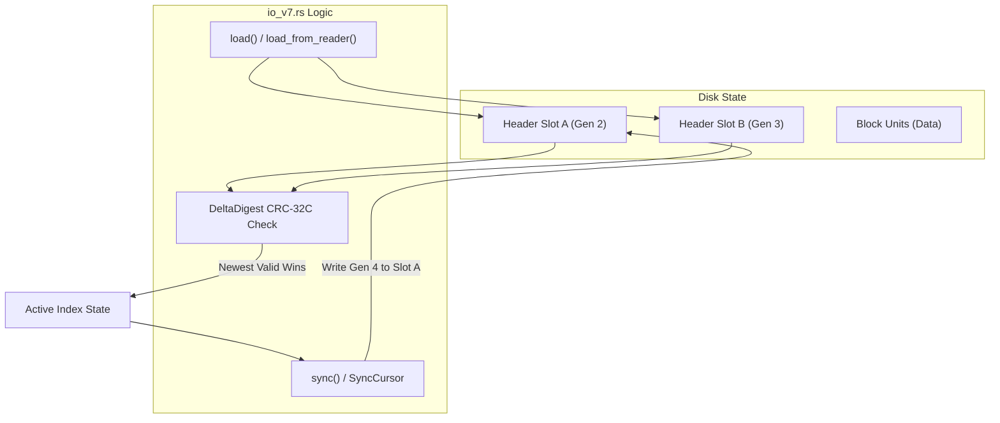
**Sources:** [io_v7.rs:21-48](), [io_v7.rs:73-83]()

---

### Incremental Sync and Redo Ops

Unlike a full `write()`, `sync()` identifies dirty blocks and appends them to the file. Removals are handled via **Redo Ops** stored in the commit header [io_v7.rs:50-51]().

1.  **Removals:** A `remove()` operation records a redo op ("slot X now holds these bytes") in the header rather than modifying the block unit immediately [io_v7.rs:52-56]().
2.  **Materialization:** Subsequent syncs materialize these ops into the data blocks on disk [io_v7.rs:56-59]().
3.  **DeltaDigest:** A CRC-32C "trick" covers all blocks written in a specific sync. During `load()`, the engine verifies the delta digest to ensure the data landed before the header commit [io_v7.rs:37-42]().

**Sources:** [io_v7.rs:50-70](), [io_v7.rs:102-114](), [adversarial_load_memory.rs:3-8]()

---

### Implementation Entities

| Component | Code Entity | Description |
| :--- | :--- | :--- |
| **Format Dispatch** | `io_v7.rs` | Core implementation of v7 serialization, CRC-32C, and header management [io_v7.rs:1-83](). |
| **File Lineage** | `nonce` | A random `u64` that binds a `SyncCursor` to a specific file. Prevents one index from syncing to a file replaced by another writer [CHANGELOG.md:93-102](). |
| **Atomic Replace** | `io.rs` | Implements the `.tmp.{pid}.{seq}.{rand}` sibling rename protocol for full `write()` calls [io.rs:14-27](). |
| **Migration** | `convert.rs` | Utility to migrate v5/v6 files to v7. It performs a re-containerization without re-quantizing [CHANGELOG.md:51-66](). |
| **In-Memory** | `to_bytes()` / `from_bytes()` | Serialization to/from `Vec<u8>`. Produces byte-identical images to the file writer but with a `0` (unclaimed) nonce [CHANGELOG.md:89-92](). |

**Sources:** [io.rs:14-45](), [io.rs:156-166](), [convert.rs:1-20](), [bytes_io.rs:7-16](), [v7_only.rs:123-132]()

---

### Data Lifecycle: Memory to Disk

This diagram maps the relationship between the high-level `TurboQuantIndex` API and the underlying persistence modules.

**Persistence Architecture Map**
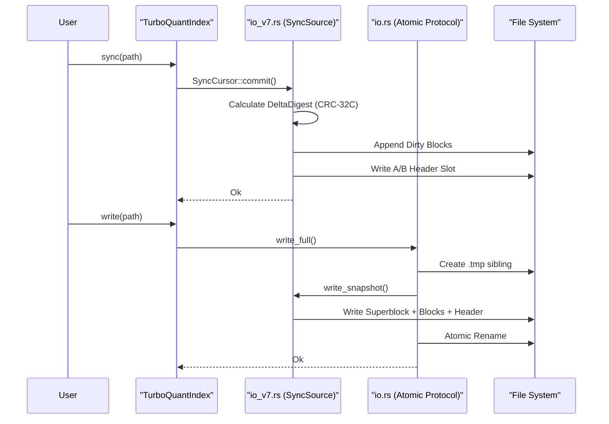
**Sources:** [lib.rs:18-19](), [io.rs:57-64](), [io_v7.rs:31-48](), [v7_only.rs:148-163]()

### Migration and Compatibility

The `turbovec::convert` module provides tools to move indexes between versions [CHANGELOG.md:45-47]().
*   **v5/v6 to v7:** Decodes the legacy flat snapshot and wraps it in the v7 container. The rotation and quantized codes remain identical [CHANGELOG.md:62-66]().
*   **v7 to Legacy:** Possible for rollbacks, but loses incremental history and redo-op state [CHANGELOG.md:68-70]().
*   **Pre-v5:** Refused entirely due to the fundamental rotation change in v5; these must be rebuilt from source vectors [io.rs:94-97]().

**Sources:** [io.rs:81-119](), [convert.rs:1-40](), [CHANGELOG.md:51-60]()

---

# Page: Python Bindings and API

# Python Bindings and API

<details>
<summary>Relevant source files</summary>

The following files were used as context for generating this wiki page:

- [.github/CODEOWNERS](.github/CODEOWNERS)
- [.github/PULL_REQUEST_TEMPLATE.md](.github/PULL_REQUEST_TEMPLATE.md)
- [CONTRIBUTING.md](CONTRIBUTING.md)
- [turbovec-python/python/turbovec/__init__.py](turbovec-python/python/turbovec/__init__.py)
- [turbovec-python/python/turbovec/_interruptible.py](turbovec-python/python/turbovec/_interruptible.py)
- [turbovec-python/src/lib.rs](turbovec-python/src/lib.rs)
- [turbovec-python/tests/test_interruptible.py](turbovec-python/tests/test_interruptible.py)

</details>


The `turbovec` Python package provides a high-performance interface to the core Rust vector search engine. It leverages **PyO3** and **maturin** to bridge the gap between Rust's SIMD-optimized kernels and the Python data science ecosystem, specifically targeting seamless integration with **NumPy**, **LangChain**, **LlamaIndex**, **Haystack**, and **Agno**.

The package is structured as a hybrid: a compiled Rust extension module (`_turbovec`) handles the heavy lifting of quantization and search, while a pure Python layer provides high-level abstractions, interruptible batching, and framework integrations.

### System Architecture: Python to Rust Bridge

The following diagram illustrates how Python calls traverse the boundary into the Rust core, utilizing PyO3 for class wrapping and the `numpy` crate for zero-copy views.

**Interface Mapping: Python Space to Rust Entities**
```mermaid
graph LR
    subgraph "Python Space (turbovec)"
        [turbovec.TurboQuantIndex] -- "calls" --> [turbovec._turbovec]
        [turbovec.IdMapIndex] -- "calls" --> [turbovec._turbovec]
        [turbovec._interruptible.py] -- "wraps" --> [turbovec._turbovec]
    end

    subgraph "Rust Space (turbovec-python/src/lib.rs)"
        [turbovec._turbovec] -- "impl #[pyclass]" --> [TurboQuantIndex_Wrapper]
        [turbovec._turbovec] -- "impl #[pyclass]" --> [IdMapIndex_Wrapper]
        [TurboQuantIndex_Wrapper] -- "delegates" --> [turbovec::TurboQuantIndex]
    end

    subgraph "Data Interop (NumPy)"
        [numpy.ndarray_f32] -- "PyReadonlyArray2" --> [extract_f32_2d]
        [numpy.ndarray_u64] -- "PyReadonlyArray1" --> [extract_u64_1d]
        [extract_f32_2d] -- "view" --> [TurboQuantIndex_Wrapper]
    end
```
**Sources:** [turbovec-python/src/lib.rs:56-62](), [turbovec-python/src/lib.rs:65-71](), [turbovec-python/python/turbovec/__init__.py:1-22]()

---

### Low-Level Extension Module (`_turbovec`)

The core of the Python package is the `_turbovec` module, a compiled extension defined in Rust. It wraps the primary `TurboQuantIndex` and `IdMapIndex` structs from the core library.

The extension provides:
*   **Direct Memory Access**: Efficiently reads NumPy arrays via `PyReadonlyArray` [turbovec-python/src/lib.rs:4-7]().
*   **GIL Management**: Releases the Global Interpreter Lock (GIL) during long-running search and add operations to allow Python multi-threading.
*   **Fork-Safety**: Implements `pthread_atfork` handlers and a `FORK_GENERATION` counter to ensure the internal Rayon thread pool is safely re-initialized after a process fork.
*   **Strict Validation**: Custom error handlers like `extract_size` [turbovec-python/src/lib.rs:153-175]() and `mask_bytes` [turbovec-python/src/lib.rs:109-130]() provide clear Python exceptions for invalid dtypes or non-contiguous memory.

For a detailed breakdown of the PyO3 implementation, GIL discipline, and thread-pool management, see [PyO3 Extension Module (_turbovec)](#3.1).

**Sources:** [turbovec-python/src/lib.rs:1-130](), [turbovec-python/src/lib.rs:153-175]()

---

### Interruptible Chunking

Python delivers signals (like `Ctrl-C`) on the main thread. If that thread is parked inside a long Rust kernel call, the signal is queued until the call returns. `turbovec` solves this via a Python-side utility layer in `_interruptible.py` [turbovec-python/python/turbovec/_interruptible.py:1-80]().

*   **BATCH_CHUNK_SIZE**: A default slice size (4096) [turbovec-python/python/turbovec/__init__.py:18]() used to split large batches.
*   **Signal Servicing**: Control returns to Python between slices, allowing `KeyboardInterrupt` to fire within milliseconds rather than seconds.
*   **Atomicity**: The `add` operation pre-validates the entire batch [turbovec-python/python/turbovec/_interruptible.py:50-61]() to ensure that mid-batch cancellations leave the index in a consistent, queryable state.

**Sources:** [turbovec-python/python/turbovec/_interruptible.py:1-80](), [turbovec-python/python/turbovec/__init__.py:18-22]()

---

### Package Structure and Distribution

The `turbovec` package follows a modern layout where the Rust logic in `src/` is paired with a Python utility layer in `python/`.

**Package Layout**
```mermaid
graph TD
    [turbovec-python/] --> [pyproject.toml]
    [turbovec-python/] --> [Cargo.toml]
    [turbovec-python/] --> [src/lib.rs]
    [turbovec-python/] --> [python/turbovec/]
    
    [python/turbovec/] --> [__init__.py]
    [python/turbovec/] --> [_interruptible.py]
    [python/turbovec/] --> [_persist.py]
    [python/turbovec/] --> [langchain/]
    [python/turbovec/] --> [llama_index/]
    [python/turbovec/] --> [haystack/]
    [python/turbovec/] --> [agno/]
```

Key aspects of the distribution include:
*   **Maturin Build System**: Used as the PEP 517 build backend.
*   **Optional Dependencies**: Managed via `pyproject.toml` extra groups (e.g., `langchain`, `haystack`) for framework integrations.
*   **Persistence Utilities**: `_persist.py` provides atomic save logic and JSON fidelity guards for metadata side-cars.

For details on the build lifecycle and utility layer, see [Python Package Structure, Utilities, and Build](#3.2).

**Sources:** [turbovec-python/python/turbovec/__init__.py:1-48](), [turbovec-python/python/turbovec/_interruptible.py:82-150]()

---

# Page: PyO3 Extension Module (_turbovec)

# PyO3 Extension Module (_turbovec)

<details>
<summary>Relevant source files</summary>

The following files were used as context for generating this wiki page:

- [turbovec-python/src/lib.rs](turbovec-python/src/lib.rs)
- [turbovec-python/tests/test_fork_safety.py](turbovec-python/tests/test_fork_safety.py)
- [turbovec-python/tests/test_gil_release.py](turbovec-python/tests/test_gil_release.py)

</details>


The `_turbovec` module is the low-level C extension that bridges the Rust core engine with the Python runtime. It handles the translation of NumPy arrays into Rust slices, manages GIL (Global Interpreter Lock) release for heavy computation, ensures fork-safety for multiprocessing, and provides the Python-facing `TurboQuantIndex` and `IdMapIndex` classes.

## Overview and Thread Management

The extension is implemented in `turbovec-python/src/lib.rs` using the [PyO3](https://pyo3.rs/) framework. A critical aspect of its design is the **fork-safe thread pool**. Because Rayon's default thread pool does not survive a `fork()` call (common in Python `multiprocessing`), the module implements a custom `PoolCell` and `pthread_atfork` handler to rebuild the pool in child processes [turbovec-python/src/lib.rs:242-286]().

### GIL Release Discipline
To prevent blocking the Python interpreter during long-running vector operations, the module releases the GIL using `py.allow_threads()` (often wrapped in `with_write_gil_aware` for indices) [turbovec-python/src/lib.rs:360-366](). Input NumPy arrays are snapshotted into owned Rust `Vec`s before the GIL is released to prevent data corruption if the Python thread mutates the array during the Rust call [turbovec-python/tests/test_gil_release.py:6-9]().

**Entity Mapping: Python to Rust Symbols**
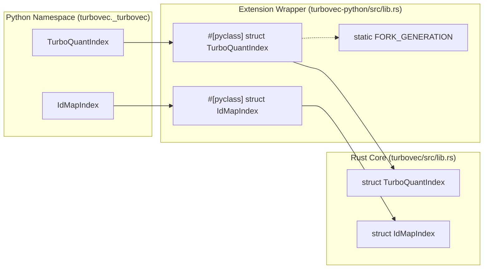
**Sources:** [turbovec-python/src/lib.rs:242-286](), [turbovec-python/src/lib.rs:315-320](), [turbovec-python/src/lib.rs:748-753]()

---

## Index Wrappers and Methods

The module exposes two primary classes: `TurboQuantIndex` (raw integer slots) and `IdMapIndex` (external `u64` ID mapping).

### Common Implementation Patterns
*   **NumPy Interop**: Uses `PyReadonlyArray2<f32>` for vectors and `PyReadonlyArray1<u64>` for IDs [turbovec-python/src/lib.rs:56-71]().
*   **Safety**: Validates C-contiguity of arrays and handles Python `bool` arrays by reading raw bytes to avoid undefined behavior with Rust `bool` [turbovec-python/src/lib.rs:87-130]().
*   **Deferred Warnings**: Uses `DeferCoreWarnings` to capture core engine warnings during computation and emit them as Python `UserWarning`s after the GIL is re-acquired [turbovec-python/src/lib.rs:290-312]().

### Method Reference

| Method | Wrapper Implementation | Core Delegation |
| :--- | :--- | :--- |
| `new` / `new_lazy` | Extracts `dim` and `bit_width` [turbovec-python/src/lib.rs:322-351]() | `TurboQuantIndex::new` |
| `add` | Snapshots NumPy to `Vec<f32>` [turbovec-python/src/lib.rs:388-406]() | `index.add()` |
| `add_with_ids` | Only in `IdMapIndex`; takes IDs array [turbovec-python/src/lib.rs:828-850]() | `index.add_with_ids()` |
| `search` | Returns `(scores, ids)` tuple [turbovec-python/src/lib.rs:434-486]() | `index.search()` |
| `calibrate` | Fits codebooks to sample data [turbovec-python/src/lib.rs:408-432]() | `index.calibrate()` |
| `sync` | Incremental persistence [turbovec-python/src/lib.rs:539-556]() | `index.sync()` |
| `remove` | Only in `IdMapIndex`; deletes by ID [turbovec-python/src/lib.rs:872-885]() | `index.remove()` |
| `snap` / `retain_snap` | Manages snapshot handles [turbovec-python/src/lib.rs:586-608]() | `index.snap()` |

**Sources:** [turbovec-python/src/lib.rs:322-608](), [turbovec-python/src/lib.rs:748-910]()

---

## Data Flow: Python to SIMD Core

The following diagram traces a search query from a Python NumPy array through the PyO3 layer into the SIMD kernels.

**Search Pipeline Data Flow**
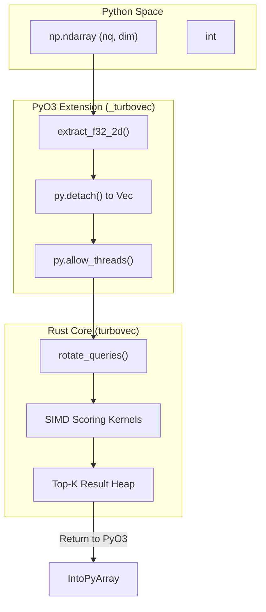
**Sources:** [turbovec-python/src/lib.rs:434-486](), [turbovec-python/tests/test_gil_release.py:83-89]()

---

## Fork-Safety and Thread Pooling

To solve the "Rayon hangs after fork" issue (#147), `_turbovec` uses a process-local `FORK_GENERATION` counter.

1.  **Registration**: At module load, `pthread_atfork` is called to increment the generation in the child process [turbovec-python/src/lib.rs:1134-1144]().
2.  **Detection**: The `with_pool` helper checks if the current process generation matches the pool's generation [turbovec-python/src/lib.rs:265-274]().
3.  **Rebuild**: If a mismatch is detected (indicating a fork occurred), the old pool is discarded and a new Rayon pool is initialized [turbovec-python/src/lib.rs:276-282]().

This ensures that `multiprocessing` workers or `gunicorn` pre-forked workers do not hang when calling `index.search()` [turbovec-python/tests/test_fork_safety.py:1-25]().

**Sources:** [turbovec-python/src/lib.rs:242-286](), [turbovec-python/src/lib.rs:1134-1144](), [turbovec-python/tests/test_fork_safety.py:10-14]()

---

## Snapshot and Persistence Lifecycle

The extension supports the v7 incremental persistence format. The `sync()` method allows for low-latency updates by only writing deltas since the last sync [turbovec-python/src/lib.rs:539-556]().

For consistent backups, the `snap()` method returns a `SnapshotHandle`. This handle pins a specific version of the index in memory, allowing a `write()` operation to proceed on a background thread while the main index continues to receive new `add()` calls [turbovec-python/src/lib.rs:586-600](). The `retain_snap()` method is used to keep these handles alive across Python calls [turbovec-python/src/lib.rs:602-608]().

**Sources:** [turbovec-python/src/lib.rs:518-537](), [turbovec-python/src/lib.rs:586-608]()

---

# Page: Python Package Structure, Utilities, and Build

# Python Package Structure, Utilities, and Build

<details>
<summary>Relevant source files</summary>

The following files were used as context for generating this wiki page:

- [.github/CODEOWNERS](.github/CODEOWNERS)
- [.github/PULL_REQUEST_TEMPLATE.md](.github/PULL_REQUEST_TEMPLATE.md)
- [CONTRIBUTING.md](CONTRIBUTING.md)
- [Cargo.lock](Cargo.lock)
- [examples/downstream-smoke/Cargo.lock](examples/downstream-smoke/Cargo.lock)
- [turbovec-python/Cargo.toml](turbovec-python/Cargo.toml)
- [turbovec-python/pyproject.toml](turbovec-python/pyproject.toml)
- [turbovec-python/python/turbovec/__init__.py](turbovec-python/python/turbovec/__init__.py)
- [turbovec-python/python/turbovec/_dedup.py](turbovec-python/python/turbovec/_dedup.py)
- [turbovec-python/python/turbovec/_interruptible.py](turbovec-python/python/turbovec/_interruptible.py)
- [turbovec-python/python/turbovec/_persist.py](turbovec-python/python/turbovec/_persist.py)
- [turbovec-python/tests/test_dedup.py](turbovec-python/tests/test_dedup.py)
- [turbovec-python/tests/test_interruptible.py](turbovec-python/tests/test_interruptible.py)
- [turbovec-python/tests/test_persist.py](turbovec-python/tests/test_persist.py)
- [turbovec/Cargo.toml](turbovec/Cargo.toml)

</details>


This page details the organization and build pipeline of the `turbovec-python` package. It covers how the Rust core is integrated into the Python ecosystem using PyO3 and Maturin, the distribution of optional framework integrations, and the Python utility layer that provides signal-safe interruption and atomic persistence.

## Directory Layout and Metadata

The `turbovec-python/` directory is structured as a standard hybrid Rust/Python project. It uses `maturin` as the build backend to manage the compilation of Rust code into a Python-compatible shared library (`.so` or `.pyd`).

### Key Files and Directories
*   **`pyproject.toml`**: The primary entry point for Python packaging. It defines build-system requirements, project metadata, and optional dependency groups (langchain, llama-index, haystack, agno) [turbovec-python/pyproject.toml:1-57]().
*   **`python/turbovec/`**: Contains the Python source code, including the main package initialization, interruptible wrappers, and framework-specific integrations [turbovec-python/pyproject.toml:62]().
*   **`Cargo.toml`**: Defines the Rust crate metadata, linking the Python extension to the `turbovec-core` library and pinning dependencies like `rayon` for fork-safety [turbovec-python/Cargo.toml:1-49]().

### Metadata and Dependencies
The package supports Python 3.9 through 3.14 [turbovec-python/pyproject.toml:10-38](). It defines four optional dependency groups:
*   `langchain`: Requires `langchain-core>=0.3` [turbovec-python/pyproject.toml:54]().
*   `llama-index`: Requires `llama-index-core>=0.12.1` [turbovec-python/pyproject.toml:55]().
*   `haystack`: Requires `haystack-ai>=2.23.0` [turbovec-python/pyproject.toml:56]().
*   `agno`: Requires `agno>=2.5.4` [turbovec-python/pyproject.toml:57]().

Sources: [turbovec-python/pyproject.toml:1-63](), [turbovec-python/Cargo.toml:1-49]()

## Build System: Maturin

The project utilizes `maturin` to bridge the Rust and Python environments. The configuration in `pyproject.toml` specifies how the extension module is named and where the Python source is located.

### Maturin Configuration
| Key | Value | Description |
| :--- | :--- | :--- |
| `build-backend` | `"maturin"` | Uses maturin to build the wheel [turbovec-python/pyproject.toml:3](). |
| `python-source` | `"python"` | Directory containing the `turbovec` Python package [turbovec-python/pyproject.toml:62](). |
| `module-name` | `"turbovec._turbovec"` | The name of the compiled binary module [turbovec-python/pyproject.toml:63](). |
| `features` | `["pyo3/extension-module"]` | Enables PyO3 extension module linking [turbovec-python/pyproject.toml:61](). |

### Build Lifecycle Diagram
The following diagram illustrates how `maturin` transforms the source into a distributable wheel.

**Maturin Build and Distribution Flow**
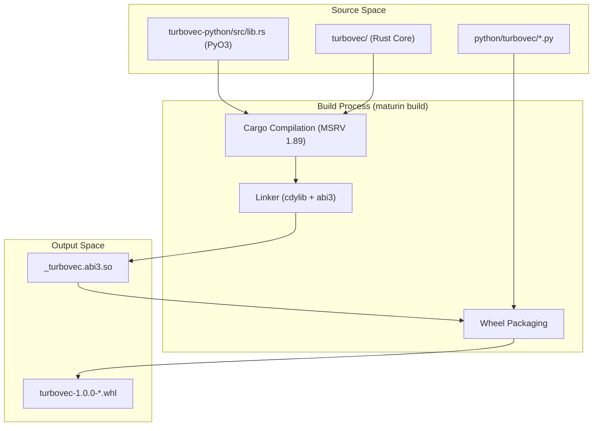
Sources: [turbovec-python/pyproject.toml:1-70](), [turbovec-python/Cargo.toml:1-15](), [turbovec/Cargo.toml:5-15]()

## Python Utility Layer

`turbovec` includes a Python-side utility layer to handle high-level concerns that are difficult to manage purely in Rust, such as signal handling and atomic file replacement across different operating systems.

### Interruptible Batch Chunking (`_interruptible.py`)
To solve the issue where long-running Rust kernels block Python signal delivery (e.g., Ctrl-C), `turbovec` wraps `search` and `add` methods in a chunking layer [turbovec-python/python/turbovec/_interruptible.py:1-16]().
*   **`BATCH_CHUNK_SIZE`**: Defaulting to 4096, this determines the slice size for batch operations [turbovec-python/python/turbovec/__init__.py:18]().
*   **Signal Safety**: By returning control to Python between slices, the interpreter can service `KeyboardInterrupt` [turbovec-python/python/turbovec/_interruptible.py:10-15]().
*   **`install()`**: This function dynamically replaces the native Rust methods with the interruptible Python wrappers at import time [turbovec-python/python/turbovec/__init__.py:22]().

### Persistence Helpers (`_persist.py`)
This module provides robust persistence logic for framework integrations that need to sync the binary index with a JSON side-car docstore [turbovec-python/python/turbovec/_persist.py:1-9]().
*   **`atomic_save`**: Performs a multi-file save using temporary siblings and atomic renames (`os.replace`) [turbovec-python/python/turbovec/_persist.py:175-190]().
*   **Windows Retry Logic**: `_with_windows_retry` handles transient `PermissionError` (winerror 5 and 32) caused by antivirus or indexers holding handles during a rename/unlink [turbovec-python/python/turbovec/_persist.py:95-118]().
*   **Consistency Checks**: `check_persisted_handles` ensures the side-car and index are in sync by verifying handle counts and the `next_u64` watermark [turbovec-python/python/turbovec/_persist.py:270-305]().

### Deduplication and Similarity
*   **`_dedup.py`**: Provides helpers for content-based deduplication, used heavily in the `Agno` integration.
*   **`_similarity.py`**: Maps internal scoring to standard similarity metrics (cosine, dot product).

Sources: [turbovec-python/python/turbovec/_interruptible.py:1-80](), [turbovec-python/python/turbovec/_persist.py:1-305](), [turbovec-python/python/turbovec/__init__.py:1-48]()

## Module Structure and Imports

The package is structured so that the high-level Python interface wraps the low-level Rust extension while maintaining a clean public API.

**Natural Language to Code Entity Mapping: Utilities and Core**
```mermaid
graph LR
    subgraph "Python API Surface"
        TQ["TurboQuantIndex"]
        IM["IdMapIndex"]
        BCS["BATCH_CHUNK_SIZE"]
    end

    subgraph "Utility Layer (turbovec/)"
        INT["_interruptible.py"]
        PER["_persist.py"]
        DED["_dedup.py"]
    end

    subgraph "Compiled Core (_turbovec)"
        RTQ["#[pyclass] TurboQuantIndex"]
        RIM["#[pyclass] IdMapIndex"]
        AF["_all_finite"]
    end

    TQ -- "wrapped by" --> INT
    IM -- "wrapped by" --> INT
    INT -- "calls" --> RTQ
    INT -- "calls" --> RIM
    PER -- "validates" --> RIM
    INT -- "uses" --> AF
```
Sources: [turbovec-python/python/turbovec/__init__.py:1-25](), [turbovec-python/python/turbovec/_interruptible.py:88-104](), [turbovec-python/python/turbovec/_persist.py:270-280]()

### Package Initialization
The `turbovec/__init__.py` file:
1.  Imports `IdMapIndex` and `TurboQuantIndex` from the compiled `_turbovec` module [turbovec-python/python/turbovec/__init__.py:1]().
2.  Defines the `BATCH_CHUNK_SIZE` global [turbovec-python/python/turbovec/__init__.py:18]().
3.  Calls `_interruptible.install()` to apply the batching wrappers [turbovec-python/python/turbovec/__init__.py:22]().
4.  Implements a lazy `__version__` resolver using `importlib.metadata` to keep import times low (~20ms saving) [turbovec-python/python/turbovec/__init__.py:27-42]().

Sources: [turbovec-python/python/turbovec/__init__.py:1-48](), [turbovec-python/python/turbovec/_interruptible.py:1-49]()

---

# Page: Framework Integrations

# Framework Integrations

<details>
<summary>Relevant source files</summary>

The following files were used as context for generating this wiki page:

- [docs/integrations/agno.md](docs/integrations/agno.md)
- [docs/integrations/haystack.md](docs/integrations/haystack.md)
- [docs/integrations/langchain.md](docs/integrations/langchain.md)
- [docs/integrations/llama_index.md](docs/integrations/llama_index.md)
- [turbovec-python/python/turbovec/haystack.py](turbovec-python/python/turbovec/haystack.py)
- [turbovec-python/python/turbovec/langchain.py](turbovec-python/python/turbovec/langchain.py)
- [turbovec-python/python/turbovec/llama_index.py](turbovec-python/python/turbovec/llama_index.py)
- [turbovec-python/tests/test_haystack.py](turbovec-python/tests/test_haystack.py)
- [turbovec-python/tests/test_langchain.py](turbovec-python/tests/test_langchain.py)
- [turbovec-python/tests/test_llama_index.py](turbovec-python/tests/test_llama_index.py)
- [turbovec-python/tests/test_similarity_modes.py](turbovec-python/tests/test_similarity_modes.py)

</details>


`turbovec` provides first-class integrations for four major RAG (Retrieval-Augmented Generation) frameworks: **LangChain**, **LlamaIndex**, **Haystack**, and **Agno**. These integrations allow developers to swap standard vector stores for `turbovec` to benefit from SIMD-accelerated search and significant memory compression (2–4 bits per dimension) while maintaining compatibility with existing document and node abstractions.

### Shared Design Pattern

All four integrations follow a consistent "side-car" architecture. Because the core `IdMapIndex` [turbovec-python/python/turbovec/_turbovec.pyi:82]() stores only quantized numerical vectors and their integer handles, the Python wrappers maintain auxiliary data structures to map these handles back to framework-specific objects (like LangChain `Document` or Haystack `Document`).

| Feature | Implementation Detail |
| :--- | :--- |
| **Vector Index** | `IdMapIndex` (Rust core) provides O(1) removals and SIMD search [turbovec-python/python/turbovec/_turbovec.pyi:82](). |
| **Side-car Store** | JSON-based store (e.g., `docstore.json` or `.nodes.json`) for framework-specific metadata [turbovec-python/python/turbovec/langchain.py:56](). |
| **Persistence** | `atomic_save` ensures all-or-nothing writes to prevent "torn" stores between the index and side-car [turbovec-python/python/turbovec/_persist.py:65](). |
| **Thread Safety** | Concurrent reads (lock-free) and serialized writes via `threading.RLock` [turbovec-python/python/turbovec/langchain.py:140](). |
| **Similarity** | Fixed `cosine` or `dot_product` modes validated at construction [turbovec-python/python/turbovec/_similarity.py:38](). |

#### Integration Architecture

The following diagram illustrates how the framework-specific Python classes bridge the gap between Natural Language objects and the optimized Rust core.

**Framework Object Mapping**
```mermaid
graph TD
    subgraph "Natural Language Space (Python)"
        A1["langchain_core.documents.Document"]
        A2["llama_index.core.schema.BaseNode"]
        A3["haystack.Document"]
        A4["agno.knowledge.document.Document"]
    end

    subgraph "Integration Layer (turbovec-python)"
        B1["langchain.TurboQuantVectorStore"]
        B2["llama_index.TurboQuantVectorStore"]
        B3["haystack.TurboQuantDocumentStore"]
        B4["agno.TurboQuantVectorDb"]
        
        B1 -->|manages| C1["_docs (JSON)"]
        B2 -->|manages| C2["_nodes (JSON)"]
        B3 -->|manages| C3["_u64_to_doc (JSON)"]
        B4 -->|manages| C4["_u64_to_doc (JSON)"]
    end

    subgraph "Code Entity Space (Rust Core)"
        E["IdMapIndex (PyO3 Wrapper)"]
        F["turbovec::index::IdMapIndex (Rust Struct)"]
    end

    B1 & B2 & B3 & B4 --> E
    E --> F
```
Sources: [turbovec-python/python/turbovec/langchain.py:66-140](), [turbovec-python/python/turbovec/llama_index.py:180-250](), [turbovec-python/python/turbovec/haystack.py:48-151](), [turbovec-python/python/turbovec/agno.py:46-130]()

---

### LangChain Integration

The `turbovec.langchain.TurboQuantVectorStore` [turbovec-python/python/turbovec/langchain.py:66]() implements the standard `VectorStore` interface. It is a drop-in replacement for `InMemoryVectorStore`.

*   **Similarity Modes**: Supports `cosine` (default) and `dot_product`. Cosine mode L2-normalizes vectors at add-time [turbovec-python/python/turbovec/langchain.py:73-82]().
*   **Search**: Implements `similarity_search_with_score` and `similarity_search_by_vector` [turbovec-python/python/turbovec/langchain.py:320-360]().
*   **Async**: All operations have `a`-prefixed async variants using `asyncio.to_thread` for non-blocking I/O [turbovec-python/python/turbovec/langchain.py:8-18]().

For details, see [LangChain Integration](#4.1).

---

### LlamaIndex Integration

The `turbovec.llama_index.TurboQuantVectorStore` [turbovec-python/python/turbovec/llama_index.py:180]() inherits from `BasePydanticVectorStore`. It supports full-node fidelity by storing the `model_dump` of LlamaIndex nodes.

*   **Node Fidelity**: `_reconstruct_node` ensures that `TextNode` objects returned from search include original relationships and metadata [turbovec-python/python/turbovec/llama_index.py:146-178]().
*   **Metadata Filtering**: Supports complex `MetadataFilters` (EQ, GT, IN, etc.) resolved via `_filters_match` [turbovec-python/python/turbovec/llama_index.py:488-580]().
*   **Persistence**: Splits data into `{base}.tvim` (index) and `{base}.nodes.json` (side-car) [turbovec-python/python/turbovec/llama_index.py:69-75]().

For details, see [LlamaIndex Integration](#4.2).

---

### Haystack Integration

The `turbovec.haystack.TurboQuantDocumentStore` [turbovec-python/python/turbovec/haystack.py:48]() implements the Haystack 2.x `DocumentStore` protocol.

*   **Duplicate Policy**: Supports `FAIL`, `SKIP`, and `OVERWRITE` during `write_documents` [turbovec-python/python/turbovec/haystack.py:236-250]().
*   **Rich Data**: Preserves Haystack `ByteStream` (blobs) and `SparseEmbedding` fields through serialization [turbovec-python/python/turbovec/haystack.py:58-61]().
*   **Scoring**: Provides `scale_score` mapping (sigmoid for dot product, linear for cosine) to normalize results to `[0, 1]` [turbovec-python/python/turbovec/haystack.py:428-445]().

For details, see [Haystack Integration](#4.3).

---

### Agno Integration

The `turbovec.agno.TurboQuantVectorDb` [turbovec-python/python/turbovec/agno.py:46]() provides a high-performance backend for Agno agents, maintaining parity with the `LanceDb` integration.

*   **Content Deduplication**: Search results are automatically deduplicated by the MD5 hash of document content [turbovec-python/python/turbovec/agno.py:330-345]().
*   **Schema Versioning**: Includes `check_schema_version` to handle migrations between side-car formats [turbovec-python/python/turbovec/agno.py:170-185]().
*   **Existence Checks**: O(1) lookups for `name_exists`, `id_exists`, and `content_hash_exists` [turbovec-python/python/turbovec/agno.py:405-420]().

For details, see [Agno Integration](#4.4).

---

### Query Execution Flow

The following diagram traces a query from a framework call down to the Rust SIMD scoring kernels.

**Query Execution Flow**
```mermaid
sequenceDiagram
    participant User as User Code
    participant Wrap as TurboQuant Integration (Py)
    participant Core as IdMapIndex (Rust)
    
    User->>Wrap: search() / query() / retrieval()
    Note over Wrap: Resolve Filters to Allowlist (bitmask)
    Wrap->>Core: search(qvec, k, allowlist=mask)
    Note over Core: Rotation -> LUT Construction -> SIMD Scoring
    Core-->>Wrap: (scores, handles)
    Note over Wrap: Map handles to framework objects via side-car
    Note over Wrap: Apply framework-level deduplication / reranking
    Wrap-->>User: List[Document] / QueryResult
```
Sources: [turbovec-python/python/turbovec/langchain.py:330-360](), [turbovec-python/python/turbovec/llama_index.py:380-420](), [turbovec-python/python/turbovec/haystack.py:380-410](), [turbovec-python/python/turbovec/agno.py:280-320]()

### Key Integration Rules
*   **Lazy Construction**: Most stores support no-arg constructors where `dim` is inferred from the first batch of vectors [turbovec-python/python/turbovec/langchain.py:126](), [turbovec-python/python/turbovec/llama_index.py:218]().
*   **Atomic Persistence**: Integrations use `atomic_save` to write a temporary file and rename it, preventing corruption if a process crashes during a save [turbovec-python/python/turbovec/_persist.py:65]().
*   **JSON Fidelity**: The `check_sidecar_keysets` utility ensures that the handles in the Rust index exactly match the keys in the JSON side-car after a reload [turbovec-python/python/turbovec/_persist.py:130]().

**Sources:**
* [turbovec-python/python/turbovec/langchain.py:1-140]()
* [turbovec-python/python/turbovec/llama_index.py:1-178]()
* [turbovec-python/python/turbovec/haystack.py:1-151]()
* [turbovec-python/python/turbovec/agno.py:1-130]()
* [turbovec-python/python/turbovec/_persist.py:65-140]()
* [turbovec-python/python/turbovec/_similarity.py:1-50]()

---

# Page: LangChain Integration

# LangChain Integration

<details>
<summary>Relevant source files</summary>

The following files were used as context for generating this wiki page:

- [docs/integrations/agno.md](docs/integrations/agno.md)
- [docs/integrations/haystack.md](docs/integrations/haystack.md)
- [docs/integrations/langchain.md](docs/integrations/langchain.md)
- [docs/integrations/llama_index.md](docs/integrations/llama_index.md)
- [turbovec-python/python/turbovec/_persist.py](turbovec-python/python/turbovec/_persist.py)
- [turbovec-python/python/turbovec/haystack.py](turbovec-python/python/turbovec/haystack.py)
- [turbovec-python/python/turbovec/langchain.py](turbovec-python/python/turbovec/langchain.py)
- [turbovec-python/python/turbovec/llama_index.py](turbovec-python/python/turbovec/llama_index.py)
- [turbovec-python/tests/test_haystack.py](turbovec-python/tests/test_haystack.py)
- [turbovec-python/tests/test_langchain.py](turbovec-python/tests/test_langchain.py)
- [turbovec-python/tests/test_llama_index.py](turbovec-python/tests/test_llama_index.py)
- [turbovec-python/tests/test_persist.py](turbovec-python/tests/test_persist.py)
- [turbovec-python/tests/test_similarity_modes.py](turbovec-python/tests/test_similarity_modes.py)

</details>


The `turbovec.langchain` module provides a high-performance vector store implementation for the LangChain framework, utilizing the `IdMapIndex` for memory-efficient similarity searches and O(1) deletions. It implements the standard `VectorStore` interface, allowing it to be used as a drop-in replacement in RAG (Retrieval-Augmented Generation) pipelines [turbovec-python/python/turbovec/langchain.py:5-18]().

## Implementation Overview

The `TurboQuantVectorStore` class acts as a wrapper that synchronizes a low-level `IdMapIndex` (which stores quantized vectors and their U64 handles) with a side-car document store for text and metadata [turbovec-python/python/turbovec/langchain.py:66-96]().

### Data Architecture

The store manages four primary components:
1.  **`_index`**: An instance of `IdMapIndex` containing the compressed vector representations. It supports lazy construction, committing to a dimension on the first add [turbovec-python/python/turbovec/langchain.py:123-126]().
2.  **`_docs`**: A dictionary mapping LangChain string IDs to a tuple of `(page_content, metadata)` [turbovec-python/python/turbovec/langchain.py:127]().
3.  **`_str_to_u64`**: A mapping from LangChain string IDs to internal `u64` handles used by the Rust index [turbovec-python/python/turbovec/langchain.py:128]().
4.  **`_u64_to_str`**: A reverse map used to translate search result handles back to LangChain IDs [turbovec-python/python/turbovec/langchain.py:131-133]().

### LangChain to Code Entity Mapping

The following diagram illustrates how standard LangChain abstractions are mapped to specific `turbovec` code entities and their internal storage mechanisms.

**Vector Store Entity Mapping**
```mermaid
graph TD
    subgraph "LangChain Abstractions"
        LC_Doc["Document (page_content, metadata, id)"]
        LC_Emb["Embeddings Interface"]
    end

    subgraph "turbovec.langchain.TurboQuantVectorStore"
        TQVS["TurboQuantVectorStore"]
        DOC_MAP["_docs: dict[str, tuple]"]
        STR_U64["_str_to_u64: dict[str, int]"]
        LOCK["_write_lock: RLock"]
    end

    subgraph "turbovec._turbovec (Rust Core)"
        IMI["IdMapIndex"]
    end

    LC_Doc -->|"id, text, metadata"| TQVS
    LC_Emb -->|"embed_documents()"| TQVS
    TQVS -->|"_index.add_with_ids(vectors, handles)"| IMI
    TQVS -->|"store ID mapping"| STR_U64
    TQVS -->|"store Content"| DOC_MAP
    TQVS -.->|"Serializes Mutations"| LOCK
```
Sources: [turbovec-python/python/turbovec/langchain.py:121-140](), [turbovec-python/python/turbovec/langchain.py:202-230]()

## Similarity and Relevance

The store supports two similarity modes, fixed at construction [turbovec-python/python/turbovec/langchain.py:118-120]():
*   **`"cosine"` (Default)**: Vectors are L2-normalized during ingestion and search. Scores are in `[-1, 1]`. The relevance score function maps this to `[0, 1]` via `(sim + 1) / 2` [turbovec-python/python/turbovec/langchain.py:157-164]().
*   **`"dot_product"`**: Raw inner products are used. Ranking is magnitude-aware. Persistence of stores created before similarity modes existed defaults to this mode [turbovec-python/python/turbovec/langchain.py:79-82]().

## Key Functions and Factory Methods

### Factory: `from_texts()` / `afrom_texts()`
These methods initialize the store and immediately ingest data. They handle embedding generation and ID assignment (generating UUIDs if none are provided) [turbovec-python/python/turbovec/langchain.py:343-380]().

### Search Operations
The store implements both synchronous and asynchronous search. Async methods use `asyncio.to_thread` to prevent blocking the event loop during heavy Rust-side computation [turbovec-python/python/turbovec/langchain.py:8-12]().
*   `similarity_search()`: Returns `list[Document]` [turbovec-python/python/turbovec/langchain.py:270-281]().
*   `similarity_search_with_score()`: Returns `list[tuple[Document, float]]` [turbovec-python/python/turbovec/langchain.py:283-300]().
*   `similarity_search_by_vector()`: Core search implementation using pre-computed embeddings [turbovec-python/python/turbovec/langchain.py:302-323]().

**Search Execution Flow**
```mermaid
sequenceDiagram
    participant App as "Application"
    participant TQVS as "TurboQuantVectorStore"
    participant IMI as "IdMapIndex (Rust)"

    App->>TQVS: similarity_search(query, k, filter)
    TQVS->>TQVS: embed_query(query)
    Note over TQVS: Resolve filter to allowlist (bitmask)
    TQVS->>IMI: search(qvec, k, allowlist)
    IMI-->>TQVS: (scores, handles)
    loop For each handle
        TQVS->>TQVS: Resolve _u64_to_str[handle]
        TQVS->>TQVS: Fetch from _docs[id]
    end
    TQVS-->>App: list[Document]
```
Sources: [turbovec-python/python/turbovec/langchain.py:302-323](), [turbovec-python/tests/test_langchain.py:93-99]()

## Persistence

Persistence uses `atomic_save` to write two files, ensuring the store is never left in a "torn" state where the index and side-car are out of sync [turbovec-python/python/turbovec/langchain.py:17-18]().
1.  **`index.tvim`**: The binary `IdMapIndex` [turbovec-python/python/turbovec/langchain.py:55]().
2.  **`docstore.json`**: A JSON side-car containing `_docs`, `_str_to_u64`, `_next_u64`, and metadata like `similarity` mode [turbovec-python/python/turbovec/langchain.py:56]().

`load()` performs consistency checks to ensure the `u64` handles in the JSON match those present in the binary index [turbovec-python/python/turbovec/_persist.py:10-14]().

## Limitations and Behaviors

*   **Deletions**: Supported via `delete(ids: List[str])`. It performs O(1) removal in the `IdMapIndex` and cleans up the side-car mappings [turbovec-python/python/turbovec/langchain.py:246-268]().
*   **Thread Safety**: A `threading.RLock` serializes all mutations (`add`, `delete`, `dump`). Readers are lock-free to allow scaling across threads [turbovec-python/python/turbovec/langchain.py:135-140]().
*   **Upsert**: Re-adding a document with an existing ID performs an upsert, replacing the previous vector and metadata [turbovec-python/tests/test_langchain.py:139-151]().

## Usage Patterns from Tests

| Scenario | Pattern |
| :--- | :--- |
| **Initialization** | `TurboQuantVectorStore.from_texts(texts, emb, bit_width=4)` [turbovec-python/tests/test_langchain.py:42-44]() |
| **Filtered Search** | `store.similarity_search(query, filter={"key": "val"})` or `filter=lambda doc: ...` [turbovec-python/tests/test_langchain.py:96-98]() |
| **Async Search** | `await store.asimilarity_search(query, k=1)` [turbovec-python/tests/test_langchain.py:131]() |
| **Persistence** | `store.dump(path)` followed by `TurboQuantVectorStore.load(path, emb)` [turbovec-python/python/turbovec/langchain.py:423-427]() |

Sources: [turbovec-python/python/turbovec/langchain.py:1-450](), [turbovec-python/tests/test_langchain.py:1-200]()

---

# Page: LlamaIndex Integration

# LlamaIndex Integration

<details>
<summary>Relevant source files</summary>

The following files were used as context for generating this wiki page:

- [docs/integrations/agno.md](docs/integrations/agno.md)
- [docs/integrations/haystack.md](docs/integrations/haystack.md)
- [docs/integrations/langchain.md](docs/integrations/langchain.md)
- [docs/integrations/llama_index.md](docs/integrations/llama_index.md)
- [turbovec-python/python/turbovec/_persist.py](turbovec-python/python/turbovec/_persist.py)
- [turbovec-python/python/turbovec/haystack.py](turbovec-python/python/turbovec/haystack.py)
- [turbovec-python/python/turbovec/langchain.py](turbovec-python/python/turbovec/langchain.py)
- [turbovec-python/python/turbovec/llama_index.py](turbovec-python/python/turbovec/llama_index.py)
- [turbovec-python/tests/test_haystack.py](turbovec-python/tests/test_haystack.py)
- [turbovec-python/tests/test_langchain.py](turbovec-python/tests/test_langchain.py)
- [turbovec-python/tests/test_llama_index.py](turbovec-python/tests/test_llama_index.py)
- [turbovec-python/tests/test_persist.py](turbovec-python/tests/test_persist.py)
- [turbovec-python/tests/test_similarity_modes.py](turbovec-python/tests/test_similarity_modes.py)

</details>


The `turbovec.llama_index` module provides a high-performance vector store implementation for the LlamaIndex RAG framework. It leverages the `IdMapIndex` for memory-efficient vector storage (quantized to 2–4 bits) and ultra-fast SIMD-accelerated similarity searches, while maintaining full node fidelity through a JSON-based side-car store.

## Overview

The integration is centered around the `TurboQuantVectorStore` class [[turbovec-python/python/turbovec/llama_index.py:202-202]](). It implements the LlamaIndex `BasePydanticVectorStore` interface, allowing it to be used as a drop-in replacement for the framework's default `SimpleVectorStore`.

The implementation follows a "side-car" pattern:
1.  **Vector Store**: An `IdMapIndex` (Rust core) manages high-dimensional embeddings and performs similarity searches [[turbovec-python/python/turbovec/llama_index.py:246-246]]().
2.  **Node Store**: A Python dictionary (`_u64_to_node`) and a mapping (`_str_to_u64`) store the full LlamaIndex `BaseNode` content, metadata, and relationships [[turbovec-python/python/turbovec/llama_index.py:250-252]]().

### Data Flow: Node Ingestion

When nodes are added via `add()`, the store extracts embeddings and updates both the Rust index and the Python side-car.

**Node Ingestion Pipeline**
```mermaid
graph TD
    subgraph "LlamaIndex Space"
        A["list[BaseNode]"] --> B["node.get_embedding()"]
        A --> C["node.node_id"]
    end

    subgraph "Code Entity Space: TurboQuantVectorStore"
        B --> D["np.asarray(dtype=np.float32)"]
        D --> E["_index.add_with_ids(vectors, handles)"]
        C --> F["_str_to_u64[nid] = handle"]
        A --> G["_u64_to_node[handle] = _payload_for(node)"]
    end

    subgraph "Rust Core"
        E --> H["IdMapIndex::add_with_ids"]
    end
```
Sources: [[turbovec-python/python/turbovec/llama_index.py:103-143]](), [[turbovec-python/python/turbovec/llama_index.py:284-332]]()

## Class Reference: TurboQuantVectorStore

### Factory Methods
*   `from_params(dim: int | None, bit_width: int = 4, similarity: str = "cosine")`: Recommended way to initialize a new store. If `dim` is `None`, the index is created lazily and commits to a dimension on the first `add()` call [[turbovec-python/python/turbovec/llama_index.py:218-242]]().
*   `from_persist_path(persist_path: str, ...)`: Reconstructs a store from a local path. It expects two files: `{base}.tvim` (binary index) and `{base}.nodes.json` (metadata) [[turbovec-python/python/turbovec/llama_index.py:537-564]]().

### Key Operations
| Method | Description | Implementation Detail |
| :--- | :--- | :--- |
| `add(nodes)` | Ingests LlamaIndex nodes. | Extracts payload via `_payload_for` to ensure JSON consistency [[turbovec-python/python/turbovec/llama_index.py:284-332]](). |
| `query(query)` | Performs top-k similarity search. | Supports `MetadataFilters` and `node_ids`/`doc_ids` intersection [[turbovec-python/python/turbovec/llama_index.py:382-446]](). |
| `delete(ref_doc_id)` | Removes all nodes for a source. | O(1) removal per node via `IdMapIndex.remove` [[turbovec-python/python/turbovec/llama_index.py:334-345]](). |
| `delete_nodes(...)` | Removes specific nodes or filters. | Evaluates `_filters_match` for metadata-based deletion [[turbovec-python/python/turbovec/llama_index.py:347-380]](). |

Sources: [[turbovec-python/python/turbovec/llama_index.py:284-446]]()

## Query Execution and Filtering

The `query()` method transforms a `VectorStoreQuery` into a `VectorStoreQueryResult`. Filters are resolved to a handle allowlist **before** scoring, ensuring the kernel only considers valid candidates.

**Query and Reconstruction Flow**
```mermaid
graph TD
    subgraph "Natural Language Space"
        Q["User Query"] --> EMB["Query Embedding"]
    end

    subgraph "Code Entity Space: TurboQuantVectorStore.query()"
        EMB --> FILT["_filters_match() evaluator"]
        FILT --> ALLOW["Allowlist (bitmask/list)"]
        ALLOW --> SEARCH["_index.search(qvec, k, allowlist)"]
        SEARCH --> RES["scores, handles"]
        
        RES --> LOOP["For each handle in handles"]
        LOOP --> FETCH["_u64_to_node[handle]"]
        FETCH --> RECON["_reconstruct_node(payload)"]
    end

    subgraph "LlamaIndex Space"
        RECON --> FINAL["VectorStoreQueryResult"]
    end
```
Sources: [[turbovec-python/python/turbovec/llama_index.py:382-446]](), [[turbovec-python/python/turbovec/llama_index.py:651-766]]()

## Persistence and Consistency

The store uses `turbovec._persist.atomic_save` to ensure that the binary index and JSON side-car are written as an all-or-nothing operation, preventing "torn" stores where the index points to missing metadata [[turbovec-python/python/turbovec/llama_index.py:503-524]]().

### Consistency Checks
On load, `TurboQuantVectorStore` performs several checks via `turbovec._persist`:
*   **Handle Check**: Verifies that every handle in the binary index has a corresponding entry in the JSON side-car [[turbovec-python/python/turbovec/llama_index.py:594-599]]().
*   **Keyset Check**: Ensures the `_str_to_u64` and `_u64_to_node` maps are in sync [[turbovec-python/python/turbovec/llama_index.py:600-606]]().
*   **Schema Version**: Validates the `nodes.json` version against `_NODES_SCHEMA_COMPAT` (currently v1, v2, v3) [[turbovec-python/python/turbovec/llama_index.py:587-593]]().

Sources: [[turbovec-python/python/turbovec/llama_index.py:573-614]](), [[turbovec-python/python/turbovec/_persist.py:1-22]]()

## Known Limitations

*   **No MMR**: Maximal Marginal Relevance (MMR) is not implemented. `VectorStoreQueryMode.MMR` will raise a `NotImplementedError` [[turbovec-python/python/turbovec/llama_index.py:402-403]]().
*   **No fsspec**: `persist` and `from_persist_path` only support local file system paths. The integration does not support LlamaIndex's `fsspec` filesystem abstraction [[turbovec-python/python/turbovec/llama_index.py:488-490]]().
*   **Embedding-Only Queries**: The store requires a pre-computed `query_embedding`. It does not perform text embedding internally [[turbovec-python/python/turbovec/llama_index.py:393-397]]().
*   **JSON Serialization**: All node metadata must be JSON-serializable. Complex Python objects in metadata may cause `persist()` to fail [[turbovec-python/python/turbovec/llama_index.py:103-143]]().

Sources: [[turbovec-python/python/turbovec/llama_index.py:382-446]](), [[turbovec-python/python/turbovec/llama_index.py:487-501]]()

---

# Page: Haystack Integration

# Haystack Integration

<details>
<summary>Relevant source files</summary>

The following files were used as context for generating this wiki page:

- [docs/integrations/agno.md](docs/integrations/agno.md)
- [docs/integrations/haystack.md](docs/integrations/haystack.md)
- [docs/integrations/langchain.md](docs/integrations/langchain.md)
- [docs/integrations/llama_index.md](docs/integrations/llama_index.md)
- [turbovec-python/python/turbovec/_persist.py](turbovec-python/python/turbovec/_persist.py)
- [turbovec-python/python/turbovec/haystack.py](turbovec-python/python/turbovec/haystack.py)
- [turbovec-python/python/turbovec/langchain.py](turbovec-python/python/turbovec/langchain.py)
- [turbovec-python/python/turbovec/llama_index.py](turbovec-python/python/turbovec/llama_index.py)
- [turbovec-python/tests/test_haystack.py](turbovec-python/tests/test_haystack.py)
- [turbovec-python/tests/test_langchain.py](turbovec-python/tests/test_langchain.py)
- [turbovec-python/tests/test_llama_index.py](turbovec-python/tests/test_llama_index.py)
- [turbovec-python/tests/test_persist.py](turbovec-python/tests/test_persist.py)
- [turbovec-python/tests/test_similarity_modes.py](turbovec-python/tests/test_similarity_modes.py)

</details>


The `turbovec.haystack.TurboQuantDocumentStore` provides a high-performance, memory-efficient implementation of the Haystack 2.x `DocumentStore` protocol. It utilizes `turbovec.IdMapIndex` for quantized vector search and a JSON-based side-car for document persistence.

This integration is designed as a drop-in replacement for Haystack's `InMemoryDocumentStore`, offering significantly lower memory usage (via 2, 3, or 4-bit quantization) and $O(1)$ deletions [turbovec-python/python/turbovec/haystack.py:1-14]().

## System Architecture and Data Flow

The integration bridges the Haystack `Document` abstraction with the underlying Rust `IdMapIndex`. Document metadata and content are managed in Python, while embeddings are compressed and searched in the Rust core.

### Natural Language to Code Entity Space

The following diagram illustrates how Haystack domain objects map to the `turbovec` implementation entities.

**Diagram: Haystack to TurboQuant Mapping**
```mermaid
graph TD
    subgraph "Haystack Space"
        H_DOC["haystack.Document"]
        H_FILTER["Filter DSL (dict)"]
        H_POLICY["DuplicatePolicy"]
    end

    subgraph "turbovec Integration (Python)"
        TQ_STORE["TurboQuantDocumentStore"]
        TQ_RECON["_reconstruct()"]
        TQ_SAVE["save_to_disk()"]
        TQ_ATOMIC["atomic_save()"]
    end

    subgraph "turbovec Core (Rust)"
        R_IDMAP["IdMapIndex"]
        R_SIMD["SIMD Search Kernels"]
    end

    H_DOC -->|"quantize embedding"| TQ_STORE
    TQ_STORE -->|"u64 handle + vector"| R_IDMAP
    H_FILTER -->|"document_matches_filter"| TQ_STORE
    TQ_STORE -->|"allowlist bitmask"| R_SIMD
    TQ_SAVE --> TQ_ATOMIC
    TQ_ATOMIC -->|"index.tvim"| R_IDMAP
    TQ_ATOMIC -->|"docstore.json"| TQ_STORE
    R_IDMAP -->|"u64 handle"| TQ_RECON
    TQ_RECON -->|"hydrate fields"| H_DOC
```
Sources: [turbovec-python/python/turbovec/haystack.py:48-97](), [turbovec-python/python/turbovec/haystack.py:30-32](), [turbovec-python/python/turbovec/haystack.py:588-615]()

## Core Implementation

### Document Ingestion and Duplicate Policy
The `write_documents()` method handles ingestion according to the Haystack `DuplicatePolicy` [turbovec-python/python/turbovec/haystack.py:228-230]().

| Policy | Behavior | Implementation |
| :--- | :--- | :--- |
| `FAIL` | Raises `DuplicateDocumentError` on first collision. | Commits documents sequentially; previous documents in batch remain persisted [docs/integrations/haystack.md:71-72](). |
| `SKIP` | Silently ignores documents with existing IDs. | Checks `_str_to_u64` before processing [turbovec-python/python/turbovec/haystack.py:276-278](). |
| `OVERWRITE` | Removes existing entry before adding new version. | Calls `delete_documents([id])` then performs a standard add [turbovec-python/python/turbovec/haystack.py:281-283](). |

### Retrieval and Filtering
`embedding_retrieval()` is the primary search interface. It supports pre-filtering using Haystack's `document_matches_filter` DSL [turbovec-python/python/turbovec/haystack.py:456-465]().

1.  **Filter Resolution**: The store evaluates the `filters` against all documents in the side-car to produce a bitmask (allowlist) [turbovec-python/python/turbovec/haystack.py:488-490]().
2.  **Quantized Search**: The allowlist is passed to `IdMapIndex.search()`, ensuring that only valid candidates are considered for the top-k heap [turbovec-python/python/turbovec/haystack.py:503-510]().
3.  **Score Scaling**: If `scale_score=True`, the raw similarity is mapped to `[0, 1]` [turbovec-python/python/turbovec/haystack.py:512-516]().
    *   **Cosine**: `(score + 1) / 2` [docs/integrations/haystack.md:53-53]().
    *   **Dot Product**: `expit(score / 100)` sigmoid mapping [docs/integrations/haystack.md:54-54]().

### Field Fidelity and Reconstruction
Turbovec discards full-precision embeddings after quantization. However, other Haystack-specific fields like `ByteStream` (blobs) and `SparseEmbedding` are preserved in the side-car and restored via the `_reconstruct()` helper [turbovec-python/python/turbovec/haystack.py:648-669]().

Sources: [turbovec-python/python/turbovec/haystack.py:48-72](), [turbovec-python/python/turbovec/haystack.py:456-530](), [turbovec-python/tests/test_haystack.py:58-86]()

## Persistence and Serialization

The store persists data into a directory containing two primary files:
*   `index.tvim`: The binary `IdMapIndex` containing quantized vectors and ID mappings [docs/integrations/haystack.md:151-151]().
*   `docstore.json`: The JSON side-car containing document text, metadata, blobs, and sparse embeddings [docs/integrations/haystack.md:152-152]().

### Atomic Save Pattern
To prevent data corruption during crashes or concurrent writes, `TurboQuantDocumentStore` uses the `atomic_save` utility [turbovec-python/python/turbovec/_persist.py:45-64]().

**Diagram: Persistence Flow**
```mermaid
sequenceDiagram
    participant App as "Application"
    participant TQ as "TurboQuantDocumentStore"
    participant PS as "_persist.atomic_save"
    participant FS as "File System"

    App->>TQ: save_to_disk(path)
    TQ->>PS: atomic_save(index, tvim_path, sidecar_data, json_path)
    PS->>FS: Write index to <name>.tmp.<pid>.<rand>
    PS->>FS: Write JSON to <name>.tmp.<pid>.<rand>
    PS->>FS: os.replace() (Atomic Rename)
    PS->>FS: _fsync_dir() (Durability Guarantee)
    FS-->>App: Save Complete
```
Sources: [turbovec-python/python/turbovec/haystack.py:588-615](), [turbovec-python/python/turbovec/_persist.py:120-160](), [turbovec-python/tests/test_persist.py:73-87]()

## Concurrency Model

`TurboQuantDocumentStore` implements a "Thread-Safe Writes, Lock-Free Reads" pattern:
*   **Write Lock**: An `RLock` (`self._write_lock`) serializes all mutations (`write_documents`, `delete_documents`, `save_to_disk`) [turbovec-python/python/turbovec/haystack.py:155-160]().
*   **Lock-Free Reads**: Retrieval and filtering methods do not acquire the lock. They rely on the thread-safety of the underlying Rust `IdMapIndex` and Python's GIL for dictionary access [turbovec-python/python/turbovec/haystack.py:73-84]().
*   **Async Execution**: The `*_async` methods delegate to a `ThreadPoolExecutor` [turbovec-python/python/turbovec/haystack.py:186-193](). This ensures the `asyncio` event loop remains responsive during heavy SIMD search operations [turbovec-python/python/turbovec/haystack.py:130-141]().

Sources: [turbovec-python/python/turbovec/haystack.py:73-84](), [turbovec-python/python/turbovec/haystack.py:155-160](), [turbovec-python/python/turbovec/haystack.py:186-218]()

---

# Page: Agno Integration

# Agno Integration

<details>
<summary>Relevant source files</summary>

The following files were used as context for generating this wiki page:

- [docs/integrations/agno.md](docs/integrations/agno.md)
- [docs/integrations/haystack.md](docs/integrations/haystack.md)
- [docs/integrations/langchain.md](docs/integrations/langchain.md)
- [docs/integrations/llama_index.md](docs/integrations/llama_index.md)
- [turbovec-python/python/turbovec/_persist.py](turbovec-python/python/turbovec/_persist.py)
- [turbovec-python/python/turbovec/agno.py](turbovec-python/python/turbovec/agno.py)
- [turbovec-python/tests/test_agno.py](turbovec-python/tests/test_agno.py)
- [turbovec-python/tests/test_persist.py](turbovec-python/tests/test_persist.py)
- [turbovec-python/tests/test_similarity_modes.py](turbovec-python/tests/test_similarity_modes.py)

</details>


`turbovec.agno.TurboQuantVectorDb` is a high-performance vector database implementation for the [Agno](https://github.com/agno-agi/agno) framework. It is backed by an `IdMapIndex` and implements the `VectorDb` interface, specifically designed as a drop-in replacement for `agno.vectordb.lancedb.LanceDb` in single-machine environments [turbovec-python/python/turbovec/agno.py:1-7]().

## Overview and Lifecycle

The integration manages a quantized vector index alongside a JSON side-car document store [turbovec-python/python/turbovec/agno.py:55-56](). It supports both synchronous and asynchronous operations, utilizing `asyncio.to_thread` for the `async_*` variants to ensure the event loop remains responsive during compute-intensive Rust kernel operations [turbovec-python/python/turbovec/agno.py:9-14]().

### Data Flow: Natural Language to Code Entities

The following diagram illustrates how Agno high-level concepts map to the `turbovec` implementation.

**Natural Language to Code Entity Space: Mapping**
```mermaid
graph TD
    subgraph "Agno Space (Natural Language / User API)"
        A["VectorDb Interface"]
        B["Knowledge Document"]
        C["Similarity Search"]
        D["Distance.cosine"]
    end

    subgraph "turbovec Code Entity Space"
        E["turbovec.agno.TurboQuantVectorDb"]
        F["agno.knowledge.document.Document"]
        G["turbovec._turbovec.IdMapIndex"]
        H["turbovec._persist.atomic_save"]
        I["turbovec._similarity.l2_normalize_rows"]
    end

    A --- E
    B --- F
    C --- G
    D --- I
    E -- "Uses" --> G
    E -- "Persistence" --> H
```
Sources: [turbovec-python/python/turbovec/agno.py:41-47](), [turbovec-python/python/turbovec/agno.py:83-84](), [turbovec-python/python/turbovec/agno.py:37-39]().

### Constructor and Configuration

The constructor requires an `Embedder` and allows configuration of quantization and similarity behaviors [turbovec-python/python/turbovec/agno.py:143-156]().

| Parameter | Type | Default | Description |
| :--- | :--- | :--- | :--- |
| `embedder` | `Embedder` | **Required** | Source of truth for index dimensions via `embedder.dimensions`. |
| `bit_width` | `int` | `4` | Quantization bits per dimension (2, 3, or 4). |
| `distance` | `Distance` | `Distance.cosine` | Similarity metric (Cosine or Max Inner Product). |
| `path` | `str` | `None` | Optional directory for persistence. |

Sources: [turbovec-python/python/turbovec/agno.py:143-160](), [docs/integrations/agno.md:46-54]().

### Similarity Modes
*   **`Distance.cosine`**: Embeddings are L2-normalized at both insert and query time [turbovec-python/python/turbovec/agno.py:90-93](). The raw kernel score is cosine similarity in `[-1, 1]`.
*   **`Distance.max_inner_product`**: Vectors are stored and queried without normalization [turbovec-python/python/turbovec/agno.py:97-98]().
*   **Note**: `Distance.l2` is not supported and will raise a `ValueError` [turbovec-python/python/turbovec/agno.py:102]().

## Data Mutation and Search

### Ingestion (Insert/Upsert)
`TurboQuantVectorDb` implement both `insert` and `upsert` patterns. The internal `doc_id` is derived as `md5(f"{base_id}_{content_hash}")` [docs/integrations/agno.md:65](). If documents are provided without embeddings, they are automatically embedded using the configured `Embedder` before quantization [turbovec-python/python/turbovec/agno.py:382-386]().

### Search Implementation
The search engine utilizes `IdMapIndex.search` and handles metadata filtering at the kernel level.
1.  **Filter Resolution**: Metadata filters (AND-of-exact-equality) are resolved to an allowlist *before* scoring [turbovec-python/python/turbovec/agno.py:109-111]().
2.  **Deduplication**: Results are deduplicated based on `md5(doc.content)` [turbovec-python/python/turbovec/agno.py:112-114]().
3.  **Reranking**: If an Agno `Reranker` is provided, it is applied to the final result set [turbovec-python/python/turbovec/agno.py:456-458]().

### Deletion Methods
The implementation provides granular deletion control:
*   `delete_by_id(id)`: Removes entries by internal MD5 ID [turbovec-python/python/turbovec/agno.py:476]().
*   `delete_by_name(name)`: Removes entries matching `Document.name` [turbovec-python/python/turbovec/agno.py:494]().
*   `delete_by_metadata(metadata)`: Removes entries matching metadata predicates [turbovec-python/python/turbovec/agno.py:512]().
*   `drop()`: Clears the entire index and docstore [turbovec-python/python/turbovec/agno.py:553]().

Sources: [turbovec-python/python/turbovec/agno.py:470-560](), [docs/integrations/agno.md:105-116]().

## Handle Mapping Sub-system

The integration maintains a bijection between the Rust `u64` handles used in `IdMapIndex` and the Python `Document` objects.

**Internal Handle Lifecycle**
```mermaid
sequenceDiagram
    participant User
    participant TQ["TurboQuantVectorDb"]
    participant Store["JSON DocStore"]
    participant Rust["IdMapIndex (Rust)"]

    User->>TQ: insert(documents)
    TQ->>TQ: _str_to_u64(doc_id)
    Note over TQ: Manages _next_u64 watermark
    TQ->>Rust: add_with_ids(embeddings, [u64_handle])
    TQ->>Store: Map handle -> Document
    TQ->>TQ: save() -> atomic_save()
    
    User->>TQ: search(query)
    TQ->>Rust: search(query_vec)
    Rust-->>TQ: list[u64_handles]
    TQ->>Store: _u64_to_doc(handle)
    Store-->>TQ: Document
    TQ-->>User: list[Document]
```
Sources: [turbovec-python/python/turbovec/agno.py:641-655](), [turbovec-python/python/turbovec/agno.py:221-224](), [turbovec-python/python/turbovec/_persist.py:3-9]().

### Key Components:
*   **`_next_u64`**: A watermark tracker that ensures monotonically increasing handles for the Rust core [turbovec-python/python/turbovec/agno.py:224]().
*   **`_id_to_u64`**: Map from the derived internal string ID to the index handle [turbovec-python/python/turbovec/agno.py:221]().
*   **`_u64_to_doc`**: Map from index handle back to the full `Document` payload [turbovec-python/python/turbovec/agno.py:222]().

## Persistence and Validation

Persistence is handled via `atomic_save`, which ensures that the binary index (`index.tvim`) and the JSON side-car (`docstore.json`) are written atomically to prevent torn states [turbovec-python/python/turbovec/agno.py:562-570]().

### Schema and Consistency
*   **Version Validation**: The docstore includes a `schema_version` (current version: 2). Loader compatibility is maintained for older versions (v1) by reconstructing missing fields like `distance` [turbovec-python/python/turbovec/agno.py:61-63]().
*   **`check_persisted_handles`**: At load time, the system verifies that the handle set in the JSON side-car exactly matches the handles present in the binary index [turbovec-python/python/turbovec/_persist.py:9-14]().
*   **Watermark Integrity**: Validates that `_next_u64` is greater than or equal to any handle present in the index to prevent handle reuse [turbovec-python/tests/test_persist.py:51-57]().

Sources: [turbovec-python/python/turbovec/agno.py:55-64](), [turbovec-python/python/turbovec/_persist.py:1-22]().

## Testing Patterns

Test coverage in `test_agno.py` focuses on parity with Agno's `LanceDb` behavior:
*   **Metadata Updates**: Verified that `update_metadata` applies to all documents sharing a `content_id` [turbovec-python/tests/test_agno.py:130-152]().
*   **Quantization Stability**: Ensuring `update_metadata` does not re-derive quantized codes [turbovec-python/tests/test_agno.py:154-169]().
*   **Empty Embeddings**: Testing that `insert` correctly triggers re-embedding if a document arrives with an empty list `[]` [turbovec-python/tests/test_agno.py:172-184]().
*   **Numpy Compatibility**: Support for `numpy.ndarray` embeddings in the `insert` path [turbovec-python/tests/test_agno.py:186-196]().

Sources: [turbovec-python/tests/test_agno.py:1-200]().

---

# Page: Benchmarks

# Benchmarks

<details>
<summary>Relevant source files</summary>

The following files were used as context for generating this wiki page:

- [benchmarks/create_diagrams.py](benchmarks/create_diagrams.py)
- [benchmarks/hillclimb/LOG.md](benchmarks/hillclimb/LOG.md)
- [benchmarks/results/hillclimb_baseline.json](benchmarks/results/hillclimb_baseline.json)
- [docs/arm_persist_mt.svg](docs/arm_persist_mt.svg)
- [docs/arm_persist_st.svg](docs/arm_persist_st.svg)
- [docs/x86_persist_mt.svg](docs/x86_persist_mt.svg)
- [docs/x86_persist_st.svg](docs/x86_persist_st.svg)
- [turbovec/src/pack.rs](turbovec/src/pack.rs)

</details>


The `benchmarks/` directory contains a comprehensive suite for evaluating the performance, accuracy, and storage efficiency of `turbovec`. The primary goal of these benchmarks is to provide a reproducible comparison against industry-standard baselines, specifically **FAISS IndexPQFastScan**, across different hardware architectures (x86_64 and ARM64).

### Overview of Benchmark Components

The benchmarking infrastructure is split into data acquisition, execution scripts, a hillclimb optimization log, and a visualization layer. It measures three key metrics:
1.  **Search Latency**: Milliseconds per query (ms/query) for single-threaded and multi-threaded execution.
2.  **Recall**: The accuracy of the quantized search compared to a ground-truth brute-force search.
3.  **Persistence Performance**: Speed of `write()`, `load()`, and `sync()` operations, including "cold" start times.

### Data Flow and Architecture

The following diagram illustrates how raw datasets and optimization iterations are transformed into the performance visualizations found in the documentation.

**Benchmark Pipeline: From Data to Diagrams**
```mermaid
graph TD
    subgraph "Data Preparation"
        A["download_data.py"] -- "Fetches" --> B["HDF5 / NPY Datasets"]
    end

    subgraph "Execution & Optimization"
        B --> C["suite/speed_*.py"]
        B --> D["suite/recall_*.py"]
        H1["hillclimb/bench_ops.py"] -- "Generates" --> H2["LOG.md"]
        
        C -- "Uses" --> F["TurboQuantIndex"]
        C -- "Baseline" --> G["faiss.IndexPQFastScan"]
    end

    subgraph "Results Layer"
        F & G --> H["results/*.json"]
        H --> I["create_diagrams.py"]
        I --> J["docs/*.svg"]
    end
```
**Sources:** [benchmarks/download_data.py:1-7](), [benchmarks/create_diagrams.py:1-8](), [benchmarks/hillclimb/LOG.md:1-10]()

---

### Benchmark Suite and Hillclimb

The suite consists of Python scripts that utilize the `turbovec` Python bindings to perform search operations on standardized datasets.

*   **Data Loading**: The `download_data.py` script fetches GloVe vectors (via `ann-benchmarks`) and OpenAI text-embedding-3-large vectors (1536 and 3072 dimensions) from HuggingFace.
*   **Execution Environment**: Benchmarks are designed to be run in both single-threaded and multi-threaded modes. Multi-threading is controlled by the `RAYON_NUM_THREADS` environment variable [benchmarks/hillclimb/LOG.md:48-50]().
*   **Hillclimb Optimization**: The `benchmarks/hillclimb/` directory tracks systematic performance improvements. It uses a **Weighted Harmonic Mean (WHM)** scoring metric to evaluate changes across search, insert, delete, save, and load operations [benchmarks/hillclimb/LOG.md:3-5]().
*   **Baselines**: All speed and recall tests compare `TurboQuantIndex` against `faiss.IndexPQFastScan`.

For technical details on the individual scripts and dataset loading logic, see [Benchmark Suite](#5.1).

**Sources:** [benchmarks/download_data.py:48-52](), [benchmarks/create_diagrams.py:154-167](), [benchmarks/hillclimb/LOG.md:1-25]()

---

### Results and Visualization

Benchmark results are persisted as JSON files in `benchmarks/results/`. These files serve as the source of truth for the project's performance claims.

*   **JSON Schema**: Results include metrics such as `tq_ms_per_query`, `faiss_ms_per_query`, and detailed persistence timings like `speed_insert_st` and `speed_remove_st` [benchmarks/results/hillclimb_baseline.json:1-26]().
*   **SVG Generation**: The `create_diagrams.py` script processes these JSON files to generate high-quality SVG charts using a custom "turboquant-wasm" aesthetic [benchmarks/create_diagrams.py:21-42]().
*   **Key Findings**:
    *   **Speed**: `turbovec` demonstrates significant speedups, particularly on ARM64 (e.g., Google Axion) where it often outperforms FAISS in search latency [docs/arm_persist_st.svg:16-17]().
    *   **Efficiency**: The O(1) removal primitive via lane operations significantly reduces the cost of mutations compared to FAISS [benchmarks/hillclimb/LOG.md:120-130]().
    *   **Persistence**: "Load $\to$ first search" metrics capture the time to open a cold `.tv` file and return results, highlighting the efficiency of the lazy materialization strategy [docs/x86_persist_mt.svg:69-80]().

For a deep dive into the JSON schemas and generated charts, see [Results and Visualization](#5.2).

**System Mapping: Results to Visualization**
```mermaid
graph LR
    subgraph "benchmarks/results/"
        R1["speed_d1536_2bit_arm_st.json"]
        R2["hillclimb_baseline.json"]
        C1["compression.json"]
    end

    subgraph "benchmarks/create_diagrams.py"
        P1["speed_panels()"]
        P2["paired_panel()"]
        P3["write_speed_panel()"]
    end

    subgraph "docs/ (Output)"
        O1["arm_speed_st.svg"]
        O2["x86_persist_mt.svg"]
        O3["compression.svg"]
    end

    R1 & R2 --> P1
    C1 --> P2
    P1 & P2 & P3 --> O1 & O2 & O3
```
**Sources:** [benchmarks/results/hillclimb_baseline.json:1-26](), [benchmarks/create_diagrams.py:107-140](), [docs/arm_persist_st.svg:31-55]()

---

# Page: Benchmark Suite

# Benchmark Suite

<details>
<summary>Relevant source files</summary>

The following files were used as context for generating this wiki page:

- [benchmarks/download_data.py](benchmarks/download_data.py)
- [benchmarks/hillclimb/LOG.md](benchmarks/hillclimb/LOG.md)
- [benchmarks/hillclimb/LOG_sync.md](benchmarks/hillclimb/LOG_sync.md)
- [benchmarks/hillclimb/bench_ops.py](benchmarks/hillclimb/bench_ops.py)
- [benchmarks/hillclimb/bench_sync.py](benchmarks/hillclimb/bench_sync.py)
- [benchmarks/hillclimb/whm_sync.py](benchmarks/hillclimb/whm_sync.py)
- [benchmarks/results/hillclimb_baseline.json](benchmarks/results/hillclimb_baseline.json)
- [benchmarks/results/sync_baseline.json](benchmarks/results/sync_baseline.json)
- [benchmarks/suite/recall_d1536_2bit.py](benchmarks/suite/recall_d1536_2bit.py)
- [benchmarks/suite/recall_d1536_4bit.py](benchmarks/suite/recall_d1536_4bit.py)
- [benchmarks/suite/recall_d3072_2bit.py](benchmarks/suite/recall_d3072_2bit.py)
- [benchmarks/suite/speed_sync_d1536_2bit_arm_mt.py](benchmarks/suite/speed_sync_d1536_2bit_arm_mt.py)
- [benchmarks/suite/speed_sync_d1536_2bit_arm_st.py](benchmarks/suite/speed_sync_d1536_2bit_arm_st.py)
- [benchmarks/suite/speed_sync_d1536_2bit_x86_mt.py](benchmarks/suite/speed_sync_d1536_2bit_x86_mt.py)
- [benchmarks/suite/speed_sync_d1536_2bit_x86_st.py](benchmarks/suite/speed_sync_d1536_2bit_x86_st.py)
- [benchmarks/whm.py](benchmarks/whm.py)
- [turbovec/src/pack.rs](turbovec/src/pack.rs)

</details>


The `turbovec` benchmark suite is designed to evaluate the performance, accuracy, and efficiency of the TurboQuant algorithm against industry-standard baselines. The suite measures four primary metrics: search latency (speed), recall accuracy, memory compression ratios, and incremental persistence performance. It provides automated scripts for data acquisition, execution of single- and multi-threaded benchmarks, and comparison against the `FAISS` `IndexPQ` implementation.

## Data Acquisition and Management

The suite relies on high-dimensional datasets to simulate real-world RAG (Retrieval-Augmented Generation) workloads. Data management is handled by `benchmarks/download_data.py`, which fetches and processes datasets into a local directory (defaulting to `~/data/py-turboquant`) [benchmarks/download_data.py:1-65]().

### Supported Datasets
- **GloVe**: The `glove-200-angular.hdf5` dataset (200 dimensions) is fetched from `ann-benchmarks.com` [benchmarks/download_data.py:16-17]().
- **OpenAI Embeddings**: Large-scale embeddings are pulled from Hugging Face (`Qdrant/dbpedia-entities-openai3-text-embedding-3-large`) in both 1536 and 3072 dimensions [benchmarks/download_data.py:30-45]().

### Data Loading Pattern
Benchmark scripts utilize standardized loading functions to ensure consistency across runs:
- **`load_openai`**: Loads `.npy` files, shuffles the vectors using a fixed seed, and extracts a database (typically 100,000 vectors) and a query set (1,000 vectors). All vectors are normalized to unit length [benchmarks/suite/recall_d3072_2bit.py:16-25](), [benchmarks/suite/speed_sync_d1536_2bit_arm_st.py:13-21]().
- **`load_glove`**: Processes HDF5 files, selecting a subset of the training data for the database and using the standard test set for queries.

Sources: [benchmarks/download_data.py:1-65](), [benchmarks/suite/recall_d3072_2bit.py:16-25](), [benchmarks/suite/speed_sync_d1536_2bit_arm_st.py:13-21]()

## Execution Environment and Configuration

The suite is designed to test performance across different hardware architectures (x86 and ARM) and threading models.

### Threading Control
Threading behavior is controlled via environment variables:
- **Single-threaded (ST)**: Scripts set `os.environ["RAYON_NUM_THREADS"] = "1"` to restrict the Rust `rayon` thread pool to a single worker [benchmarks/suite/speed_sync_d1536_2bit_arm_st.py:2](), [benchmarks/hillclimb/bench_ops.py:27-28]().
- **Multi-threaded (MT)**: Defaults to the system's available logical cores unless restricted by the environment.

### Comparison Baseline: FAISS IndexPQ
`turbovec` is benchmarked against `faiss.IndexPQ`. To ensure a fair comparison at specific bit-widths:
- **Recall Benchmarks**: FAISS is configured with `nbits=8` (256 codewords per sub-quantizer). For 2-bit TQ, FAISS uses `m = dim / 4` (4 coordinates per sub-quantizer). For 4-bit TQ, it uses `m = dim / 2` (2 coordinates per sub-quantizer) [benchmarks/suite/recall_d1536_2bit.py:3-7, 39-40](), [benchmarks/suite/recall_d1536_4bit.py:3-7, 39-40]().

Sources: [benchmarks/suite/speed_sync_d1536_2bit_arm_st.py:2](), [benchmarks/hillclimb/bench_ops.py:27-28](), [benchmarks/suite/recall_d1536_2bit.py:3-40]()

## Benchmark Scripts

### Speed and Sync Benchmarks (`speed_sync_*.py`)
These scripts measure the latency of incremental persistence operations introduced in the v7 file format. They measure:
- **`tq_sync_first_ms`**: The cost of the initial full write (v6 to v7 conversion) [benchmarks/suite/speed_sync_d1536_2bit_arm_st.py:50-63]().
- **`tq_sync_append_ms`**: The cost of syncing a small append (e.g., 32 rows) [benchmarks/suite/speed_sync_d1536_2bit_arm_st.py:67-77]().
- **`tq_sync_remove_ms`**: The cost of committing removals to the header [benchmarks/suite/speed_sync_d1536_2bit_arm_st.py:79-103]().
- **`tq_sync_settle_ms`**: The cost of materializing removals into their block units [benchmarks/suite/speed_sync_d1536_2bit_arm_st.py:104-109]().

### Recall Benchmarks (`recall_*.py`)
Recall is measured as "Recall@1@K", calculating how often the true brute-force top-1 result appears within the top K results returned by `TurboQuantIndex` or `FAISS` [benchmarks/suite/recall_d1536_2bit.py:33-34](). These scripts compare standard TQ, TQ+ (calibrated), and FAISS [benchmarks/suite/recall_d1536_2bit.py:45-70]().

### System Data Flow: Benchmark Execution
The following diagram illustrates how a benchmark script interacts with the `turbovec` Python wrapper and the underlying Rust engine.

**Benchmark Logic Flow**
```mermaid
graph TD
    subgraph "Python Space"
        A["speed_sync_*.py / recall_*.py"] -- "load_openai()" --> B["NumPy Arrays"]
        B -- "IdMapIndex.add_with_ids()" --> C["_turbovec.IdMapIndex"]
        C -- "IdMapIndex.sync(path)" --> D["Incremental Persistence"]
    end

    subgraph "Rust Code Entity Space (turbovec crate)"
        D -- "Calls" --> E["io_v7.rs (SyncSource/SyncCursor)"]
        C -- "search()" --> F["search.rs (SIMD Kernels)"]
        F -- "Uses" --> G["pack.rs (repack)"]
    end

    subgraph "Hardware Optimization"
        G -- "x86 Layout" --> H["perm0 / INV_PERM0"]
        G -- "ARM Layout" --> I["Sequential / VM8"]
    end
```
Sources: [benchmarks/suite/speed_sync_d1536_2bit_arm_st.py:40-109](), [turbovec/src/pack.rs:59-74](), [turbovec/src/pack.rs:108-109]()

## Hillclimb Optimization Suite

The `benchmarks/hillclimb/` directory contains tools for iterative performance optimization.

### Scoring Metric: WHM (Weighted Harmonic Mean)
Optimization wins are determined by the Weighted Harmonic Mean of speedups across multiple "cells" (combinations of operation and architecture).
- **Weights**: `search` (3.0), `insert` (2.0), `delete` (2.0), `save` (1.0), `load` (1.0) [benchmarks/whm.py:25-32]().
- **Sync Weights**: `sync_append` (1.0), `sync_remove` (1.0) [benchmarks/hillclimb/whm_sync.py:40-41]().
- **Noise Tolerance**: Non-target cells may regress by at most 3% [benchmarks/whm.py:34](), [benchmarks/hillclimb/whm_sync.py:43]().

### Optimization Journal (`LOG.md`)
The `LOG.md` and `LOG_sync.md` files serve as journals for every optimization hypothesis tested. Notable entries include:
- **H1 (Ops)**: Parallelizing `seq_to_packed` using `rayon`, resulting in a ~10x speedup for ARM inserts [benchmarks/hillclimb/LOG.md:25-41]().
- **H6 (Ops)**: Implementing O(dim) `swap_remove` using lane-level bit manipulation in `pack.rs`, avoiding full block repacks [benchmarks/hillclimb/LOG.md:120-135](), [turbovec/src/pack.rs:142-153]().
- **H1 (Sync)**: Eliminating redundant re-verification of the last commit in `cursor_state`, providing a ~3.2x speedup for `sync_remove` [benchmarks/hillclimb/LOG_sync.md:78-130]().

### Benchmark Harnesses
- **`bench_ops.py`**: Measures the core six operations: `search`, `save`, `load`, `insert`, `delete`, and `load_search` [benchmarks/hillclimb/bench_ops.py:4-10]().
- **`bench_sync.py`**: Specifically targets the v7 incremental sync protocol performance.

**Code Entity Mapping: Optimization**
```mermaid
graph LR
    subgraph "Hillclimb Harness"
        H1["bench_ops.py"]
        H2["whm.py"]
        H3["LOG.md"]
    end

    subgraph "Rust Optimization Targets"
        R1["pack::repack"]
        R2["pack::write_x86_code_byte"]
        R3["io_v7::SyncCursor"]
    end

    H1 -- "measures" --> R1
    H1 -- "measures" --> R3
    R2 -- "optimizes" --> H1
    H2 -- "verdicts" --> H3
```
Sources: [benchmarks/hillclimb/bench_ops.py:89-155](), [benchmarks/whm.py:51-91](), [turbovec/src/pack.rs:142-153](), [benchmarks/hillclimb/LOG.md:120-135]()

Sources: [benchmarks/whm.py:20-48](), [benchmarks/hillclimb/whm_sync.py:36-68](), [benchmarks/hillclimb/LOG.md:1-135](), [benchmarks/hillclimb/LOG_sync.md:1-130]()

---

# Page: Results and Visualization

# Results and Visualization

<details>
<summary>Relevant source files</summary>

The following files were used as context for generating this wiki page:

- [benchmarks/create_diagrams.py](benchmarks/create_diagrams.py)
- [benchmarks/results/compression.json](benchmarks/results/compression.json)
- [benchmarks/results/recall_d1536_4bit.json](benchmarks/results/recall_d1536_4bit.json)
- [benchmarks/results/recall_d3072_4bit.json](benchmarks/results/recall_d3072_4bit.json)
- [benchmarks/results/recall_glove_4bit.json](benchmarks/results/recall_glove_4bit.json)
- [docs/arm_persist_mt.svg](docs/arm_persist_mt.svg)
- [docs/arm_persist_st.svg](docs/arm_persist_st.svg)
- [docs/arm_speed_mt.svg](docs/arm_speed_mt.svg)
- [docs/arm_speed_st.svg](docs/arm_speed_st.svg)
- [docs/x86_persist_mt.svg](docs/x86_persist_mt.svg)
- [docs/x86_persist_st.svg](docs/x86_persist_st.svg)
- [docs/x86_speed_mt.svg](docs/x86_speed_mt.svg)
- [docs/x86_speed_st.svg](docs/x86_speed_st.svg)

</details>


The **turbovec** project includes a comprehensive benchmarking and visualization pipeline designed to validate performance claims across different hardware architectures (ARM and x86) and quantization levels (2-bit and 4-bit). This page details the data schema used for results, the SVG generation logic, and a summary of the key performance findings, including speedups, compression ratios, and removal efficiency.

## Benchmark Results Schema

Benchmark results are stored as JSON files within the `benchmarks/results/` directory [benchmarks/create_diagrams.py:18](). These files provide a standardized interface between the execution scripts (e.g., `speed_*.py`, `recall_*.py`) and the visualization tools.

### JSON Structure
Each result file contains hardware metadata and performance metrics for both `TurboQuant` and the `FAISS` baseline [benchmarks/results/recall_d3072_4bit.json:1-35]().

| Key | Description |
| :--- | :--- |
| `dim` | Vector dimensionality (e.g., 1536, 3072) [benchmarks/results/recall_d3072_4bit.json:3](). |
| `bit_width` | Quantization level (2 or 4) [benchmarks/results/recall_d3072_4bit.json:4](). |
| `tq_ms_per_query` | Median latency for TurboQuant in milliseconds [benchmarks/create_diagrams.py:167](). |
| `faiss_ms_per_query` | Median latency for FAISS `IndexPQFastScan` baseline [benchmarks/create_diagrams.py:168](). |
| `tq_recalls` | Dictionary of recall@1@k values for TurboQuant [benchmarks/results/recall_d3072_4bit.json:7-15](). |
| `tqplus_recalls` | Recall values for TQ+ (per-coordinate calibration) [benchmarks/results/recall_d3072_4bit.json:16-24](). |
| `faiss_recalls` | Recall values for FAISS baseline [benchmarks/results/recall_d3072_4bit.json:26-34](). |
| `speed_insert_*` | Metrics for online insertion speed. |
| `speed_remove_*` | Metrics for online removal speed. |
| `sync_*` | Metrics for incremental synchronization performance. |

**Sources:**
- `benchmarks/results/recall_d3072_4bit.json`
- `benchmarks/create_diagrams.py`

## Visualization Pipeline

The visualization system uses a custom Python script, `create_diagrams.py`, to transform JSON results into high-quality SVG charts published to the `docs/` directory [benchmarks/create_diagrams.py:1-12]().

### Diagram Generation Logic
The script implements a "turboquant-wasm" aesthetic using a specific color palette and typography [benchmarks/create_diagrams.py:21-42]().

1.  **Data Loading**: The `load_json` function reads files from the results directory [benchmarks/create_diagrams.py:153-155]().
2.  **Scaling**: A `nice_ceil` utility ensures Y-axis ticks are rounded to human-readable intervals (1.0, 1.5, 2.0, 5.0) [benchmarks/create_diagrams.py:55-70]().
3.  **Component Rendering**:
    *   `grid_lines`: Renders background ticks and axis labels [benchmarks/create_diagrams.py:90-104]().
    *   `paired_panel`: Generates side-by-side bar comparisons for latency and persistence benchmarks [benchmarks/create_diagrams.py:107-140]().
    *   `legend_tq_faiss`: Creates the color-coded key for chart interpretation [benchmarks/create_diagrams.py:143-150]().

### System Data Flow: Results to Visuals

```mermaid
graph TD
    subgraph "Execution Layer"
        A["Benchmark Scripts (speed_*.py, recall_*.py)"] -- "Writes JSON" --> B["benchmarks/results/*.json"]
    end

    subgraph "Visualization Layer"
        C["create_diagrams.py"] -- "load_json()" --> B
        C -- "paired_panel()" --> D["SVG Components"]
        C -- "write_speed_panel()" --> E["docs/*.svg"]
    end

    subgraph "Output Files"
        E1["arm_speed_st.svg"]
        E2["x86_speed_mt.svg"]
        E3["recall_d1536.svg"]
        E4["compression.svg"]
        E5["arm_persist_st.svg"]
    end

    E --> E1
    E --> E2
    E --> E3
    E --> E4
    E --> E5
```

**Sources:**
- `benchmarks/create_diagrams.py`
- `benchmarks/results/recall_d1536_4bit.json`

## Key Findings and Charts

The benchmarks compare `turbovec` against `FAISS` (using `IndexPQFastScan`) across several dimensions.

### 1. Search Latency (Speed)
TurboQuant demonstrates a significant performance advantage on ARM architectures, specifically leveraging Google Axion (ARM) and Apple Silicon.

*   **ARM Performance**: On ARM (GCP Axion), TurboQuant achieves a **12–20% speedup** over FAISS [docs/arm_speed_mt.svg:2-35](). For example, at `d=3072` and 4-bit, TurboQuant records **0.285 ms/query** compared to FAISS's **0.987 ms/query** in multi-threaded mode [docs/arm_speed_mt.svg:52-53]().
*   **x86 Performance**: On Intel Sapphire Rapids, TurboQuant remains highly competitive. At `d=3072` and 4-bit, TurboQuant records **0.346 ms/query** vs FAISS **1.177 ms/query** [docs/x86_speed_mt.svg:52-53]().

### 2. Recall Accuracy
Recall is measured as `recall@1@k`, tracking how often the true top-1 nearest neighbor appears within the top-k results [benchmarks/results/recall_glove_4bit.json:7-15]().

*   **High Fidelity**: On the `openai-3072` dataset at 4-bit, TurboQuant achieves a recall@1@1 of **0.972**, matching FAISS exactly [benchmarks/results/recall_d3072_4bit.json:8, 27]().
*   **TQ+ Advantage**: TQ+ (per-coordinate calibration) often provides a boost, reaching **0.981** recall@1@1 on the same dataset [benchmarks/results/recall_d3072_4bit.json:17]().

### 3. Compression and Persistence
TurboQuant significantly reduces memory footprint and optimizes cold-start search times.

*   **Compression**: TurboQuant achieves approximately **16× compression** at 2-bit quantization compared to standard `float32` [benchmarks/create_diagrams.py:11]().
*   **Load Performance**: TurboQuant excels in "Load → first search" latency. On ARM, for `d=3072` 2-bit, TurboQuant completes the first search in **3.0 ms** compared to FAISS **17.4 ms** [docs/arm_persist_mt.svg:83-85]().
*   **Removal Efficiency**: TurboQuant implements **O(1) removal** via `swap_remove` and lazy materialization, avoiding the **O(N) repacking** overhead typically required by FAISS [benchmarks/create_diagrams.py:7]().

### Latency Comparison Diagram (Code Entity Mapping)

This diagram maps the visual representation of a "Panel" in the SVG to the specific logic and data points in the benchmark results.

```mermaid
graph LR
    subgraph "Code Entity: create_diagrams.py"
        F1["write_speed_panel()"]
        F2["paired_panel()"]
        F3["legend_tq_faiss()"]
    end

    subgraph "Visual Entity: docs/arm_speed_mt.svg"
        V1["rect (TurboQuant Bar)"]
        V2["rect (FAISS Bar)"]
        V3["text (value-accent)"]
        V4["text (value)"]
    end

    subgraph "Data Source: results/*.json"
        D1["tq_ms_per_query"]
        D2["faiss_ms_per_query"]
    end

    F2 -- "renders" --> V1
    F2 -- "renders" --> V2
    D1 -- "populates" --> V3
    D2 -- "populates" --> V4
    F1 -- "calls" --> F2
```

**Sources:**
- `benchmarks/create_diagrams.py`
- `docs/x86_speed_mt.svg`
- `docs/arm_speed_mt.svg`
- `docs/arm_persist_mt.svg`
- `benchmarks/results/recall_d3072_4bit.json`

---

# Page: Build, CI/CD, and Release

# Build, CI/CD, and Release

<details>
<summary>Relevant source files</summary>

The following files were used as context for generating this wiki page:

- [.claude/skills/s/SKILL.md](.claude/skills/s/SKILL.md)
- [.github/workflows/ci.yml](.github/workflows/ci.yml)
- [.github/workflows/claude.yml](.github/workflows/claude.yml)
- [.github/workflows/intake.yml](.github/workflows/intake.yml)
- [.github/workflows/pr-review.yml](.github/workflows/pr-review.yml)
- [.github/workflows/release-crates.yml](.github/workflows/release-crates.yml)
- [.github/workflows/release-pypi.yml](.github/workflows/release-pypi.yml)
- [.github/workflows/review-stamp.yml](.github/workflows/review-stamp.yml)
- [.github/workflows/security-audit.yml](.github/workflows/security-audit.yml)
- [.github/workflows/summarize-command.yml](.github/workflows/summarize-command.yml)
- [.github/workflows/supply-chain.yml](.github/workflows/supply-chain.yml)

</details>


This page provides a high-level overview of the `turbovec` build system, compiler optimizations, and the automated pipelines used to distribute the project to the Rust and Python ecosystems. The project utilizes a polyglot workspace strategy to manage both the core SIMD engine and its high-level bindings, alongside an agentic automation layer for development.

## Build System Architecture

The `turbovec` repository is organized as a Cargo workspace containing two primary members: the core Rust library and the Python extension module. The build system is designed to maximize SIMD throughput by enforcing specific instruction set baselines while maintaining runtime flexibility for advanced features like AVX-512.

### Workspace Structure
The root `Cargo.toml` manages the relationship between the core engine and the Python wrapper. It defines shared release profiles that prioritize execution speed through Link Time Optimization (LTO) and reduced codegen units.

| Component | Path | Responsibility |
| :--- | :--- | :--- |
| **Workspace Root** | `Cargo.toml` | Defines members and release profiles [Cargo.toml:1-9](). |
| **Core Library** | `turbovec/` | The primary Rust crate containing SIMD kernels and quantization logic. |
| **Python Bindings** | `turbovec-python/` | PyO3-based extension module and Python package metadata. |

### Compiler Configuration
To ensure the high-performance search kernels are not bottlenecked by generic code, the project enforces an `x86-64-v3` microarchitecture baseline for all x86_64 builds. This allows the compiler to emit AVX2 and FMA instructions globally without requiring manual intrinsics for every loop. The Minimum Supported Rust Version (MSRV) is pinned to **1.89** to support stabilized AVX-512 intrinsics.

For details on microarchitecture levels, MSRV, and BLAS backend selection (Accelerate on macOS, OpenBLAS on Linux), see [Cargo Workspace and Compiler Configuration](#6.1).

**Build Configuration Flow**
```mermaid
graph TD
    subgraph "Compiler_Directives"
        A[".cargo/config.toml"] -- "target-cpu=x86-64-v3" --> B["LLVM Codegen"]
        C["Cargo.toml"] -- "lto=true" --> D["Linker"]
    end

    subgraph "Feature_Dispatch"
        B --> E{"Runtime Check"}
        E -- "is_x86_feature_detected" --> F["AVX-512BW Kernel"]
        E -- "Fallback" --> G["AVX2 Kernel"]
    end

    subgraph "External_Dependencies"
        H["blas-src"] -- "macOS" --> I["Accelerate"]
        H -- "Linux" --> J["OpenBLAS"]
    end
```
Sources: [.cargo/config.toml:1-21](), [Cargo.toml:1-9](), [turbovec/Cargo.toml:1-40]()

---

## CI/CD and Release Pipelines

Automated pipelines handle testing, security auditing, and publishing of `turbovec` to **crates.io** and **PyPI**.

### CI and Security
The `ci.yml` workflow enforces strict quality gates, including `TURBOVEC_REQUIRE_SIMD=avx2` to ensure kernels actually execute in the runner environment [.github/workflows/ci.yml:42-45](). Supply chain security is managed via `cargo-deny` and `pip-audit` [.github/workflows/supply-chain.yml:1-6](), while workflow integrity is verified by `zizmor` [.github/workflows/security-audit.yml:34-36]().

### Release Workflows
- **Rust Crate**: `release-crates.yml` publishes `turbovec` to crates.io on `v*` tags [.github/workflows/release-crates.yml:1-6](). It validates that the git tag matches the `Cargo.toml` version before proceeding [.github/workflows/release-crates.yml:32-46]().
- **Python Wheels**: `release-pypi.yml` builds `manylinux_2_28` wheels for `x86_64` and `aarch64` using `maturin-action` [.github/workflows/release-pypi.yml:58-64](). It includes a "smoke test" that installs the built wheel on Python 3.9 through 3.14 to catch linkage regressions [.github/workflows/release-pypi.yml:98-126]().

For details on CI jobs and the release matrix, see [GitHub Actions — CI and Release Pipelines](#6.2).

**Release Pipeline Mapping**
```mermaid
graph LR
    subgraph "Git_Events"
        V_TAG["Tag: v*"]
        PY_TAG["Tag: py-v*"]
    end

    subgraph "GitHub_Actions_Workflows"
        CRATES_WF["release-crates.yml"]
        PYPI_WF["release-pypi.yml"]
    end

    subgraph "Artifacts_and_Registries"
        CRATES_IO["crates.io"]
        PYPI["PyPI"]
        WHEELS["manylinux_2_28 Wheels"]
    end

    V_TAG --> CRATES_WF
    CRATES_WF -- "cargo publish -p turbovec" --> CRATES_IO

    PY_TAG --> PYPI_WF
    PYPI_WF -- "maturin build" --> WHEELS
    WHEELS -- "pypa/gh-action-pypi-publish" --> PYPI
```
Sources: [.github/workflows/release-crates.yml:1-61](), [.github/workflows/release-pypi.yml:1-132](), [.github/workflows/ci.yml:1-109]()

---

## AI-Assisted Development

`turbovec` integrates an agentic automation layer powered by Anthropic's Claude to assist with maintenance and code quality.

### @tq-bot and PR Review
The repository uses `@tq-bot` (invoked via `claude.yml`) to handle complex tasks like branch creation and testing [.github/workflows/claude.yml:1-34](). A separate `pr-review.yml` workflow acts as a blocking merge gate; it uses a multi-agent "finder+validator" pattern to post a `REVIEW_VERDICT` (GO/NO-GO) as a commit status on the PR head SHA [.github/workflows/pr-review.yml:1-12]().

### Utility Commands
- **/s or /summary**: Triggers `summarize-command.yml` to provide plain-English explanations of diffs or threads [.github/workflows/summarize-command.yml:1-15]().
- **Issue Intake**: `intake.yml` provides automated triage and classification of new issues [.github/workflows/intake.yml:1-6]().

For details on bot capabilities and review protocols, see [AI-Assisted Development — @tq-bot and PR Review](#6.3).

**Agentic Workflow Topology**
```mermaid
graph TD
    subgraph "User_Interaction"
        U1["Issue/PR Comment '@tq-bot'"]
        U2["PR Comment '/review'"]
        U3["PR Comment '/s'"]
    end

    subgraph "Agent_Workflows"
        CW["claude.yml (@tq-bot)"]
        RW["pr-review.yml (/review)"]
        SW["summarize-command.yml (/s)"]
    end

    subgraph "Code_Entities"
        SKILL["SKILL.md (Capability)"]
        STAMP["review-stamp.yml (Status)"]
    end

    U1 --> CW
    U2 --> RW
    U3 --> SW
    
    CW -.-> SKILL
    RW -- "Sets 'Agent code review'" --> STAMP
    STAMP -- "Blocks Merge" --> PR["Pull Request Head"]
```
Sources: [.github/workflows/claude.yml:1-101](), [.github/workflows/pr-review.yml:1-100](), [.github/workflows/summarize-command.yml:1-40](), [.claude/skills/s/SKILL.md:1-27]()

---

## Child Pages

*   **[Cargo Workspace and Compiler Configuration](#6.1)**: Deep dive into `lto`, `codegen-units`, the `x86-64-v3` baseline, and conditional BLAS linking (Accelerate vs OpenBLAS).
*   **[GitHub Actions — CI and Release Pipelines](#6.2)**: Technical details of the `maturin` build matrix, `manylinux` compatibility, security auditing (`zizmor`, `cargo-deny`), and the automated publishing steps.
*   **[AI-Assisted Development — @tq-bot and PR Review](#6.3)**: Documents the agentic layer, including the `REVIEW_VERDICT` protocol, the multi-agent review pattern, and the `s` skill for diff summarization.

---

# Page: Cargo Workspace and Compiler Configuration

# Cargo Workspace and Compiler Configuration

<details>
<summary>Relevant source files</summary>

The following files were used as context for generating this wiki page:

- [.cargo/config.toml](.cargo/config.toml)
- [.gitignore](.gitignore)
- [Cargo.lock](Cargo.lock)
- [Cargo.toml](Cargo.toml)
- [examples/downstream-smoke/Cargo.lock](examples/downstream-smoke/Cargo.lock)
- [examples/downstream-smoke/Cargo.toml](examples/downstream-smoke/Cargo.toml)
- [examples/downstream-smoke/src/main.rs](examples/downstream-smoke/src/main.rs)
- [turbovec-python/Cargo.toml](turbovec-python/Cargo.toml)
- [turbovec-python/build.rs](turbovec-python/build.rs)
- [turbovec-python/pyproject.toml](turbovec-python/pyproject.toml)
- [turbovec/Cargo.toml](turbovec/Cargo.toml)

</details>


This page documents the build system, compiler optimizations, and dependency management used by `turbovec`. The project is structured as a Cargo workspace to manage the core Rust engine and its Python bindings as separate but coupled entities. The configuration emphasizes aggressive Link Time Optimization (LTO) and specific instruction set baselines to achieve high-performance vector search while maintaining broad hardware compatibility.

## Workspace Structure

The `turbovec` repository is organized as a Cargo workspace containing two primary members. This structure allows the core library to remain a pure Rust crate while the Python extension manages its own PyO3-specific dependencies and build lifecycle.

| Member | Path | Role |
| :--- | :--- | :--- |
| `turbovec` | `turbovec/` | Core SIMD-accelerated quantization and search engine. |
| `turbovec-python` | `turbovec-python/` | PyO3 bindings (`_turbovec`) and high-level Python wrappers. |

The root `Cargo.toml` defines the workspace members and excludes the `downstream-smoke` example to ensure it remains a standalone test of the external user experience.

Sources: `[Cargo.toml:1-7]()`

## Release Profile and Optimization

To maximize search performance, `turbovec` utilizes a highly optimized release profile. These settings ensure that the compiler can perform cross-crate optimizations and minimize overhead in the hot search loops.

*   **LTO (Link Time Optimization)**: Set to `true` `[Cargo.toml:10-10]()`. This enables global optimizations across the entire dependency graph, which is critical for inlining functions between the core engine and its dependencies.
*   **Codegen Units**: Set to `1` `[Cargo.toml:11-11]()`. While this increases compilation time, it allows LLVM to perform better optimization by processing the entire crate as a single unit, preventing optimization barriers between modules.
*   **Optimization Level**: Set to `3` `[Cargo.toml:12-12]()` for maximum speed.

Sources: `[Cargo.toml:9-12]()`

## Minimum Supported Rust Version (MSRV)

The project enforces a Minimum Supported Rust Version of **1.89** `[turbovec/Cargo.toml:27-27]()`. This specific version is required because the AVX-512 search kernels in `search.rs` and the rotation logic in `rotation.rs` rely on `_mm512_*` intrinsics that were stabilized in Rust 1.89 `[turbovec/Cargo.toml:5-11]()`. 

Versions prior to 1.89 fail to compile on `x86_64` targets due to unstable feature requirements and signature changes in stabilized intrinsics like `_mm512_loadu_si512` `[turbovec/Cargo.toml:10-15]()`.

Sources: `[turbovec/Cargo.toml:5-27]()`, `[turbovec-python/Cargo.toml:10-10]()`

## Target Architecture and SIMD Strategy

The `.cargo/config.toml` file defines the baseline instruction set for `x86_64` builds. The project targets the **x86-64-v2** microarchitecture level `[.cargo/config.toml:22-22]()`.

### x86-64-v2 Baseline
The `x86-64-v2` level (Nehalem-era) includes SSE3, SSSE3, SSE4.1, SSE4.2, and POPCNT `[.cargo/config.toml:3-3]()`. This is the baseline for all "plain" Rust code, including the dispatch prologue and scalar fallbacks.

### Runtime Dispatch and SIGILL Prevention
Unlike earlier versions, the project deliberately does **not** set the baseline to `x86-64-v3` (AVX2) or `v4` (AVX-512) `[.cargo/config.toml:11-13]()`. 
1.  **Compatibility**: A `v3` baseline would cause standard Rust code to emit AVX2 instructions, leading to a `SIGILL` crash on older CPUs before the runtime dispatch logic in `search.rs` can even execute `[.cargo/config.toml:14-17]()`.
2.  **Runtime Selection**: High-performance kernels are marked with `#[target_feature(enable = "...")]` and selected at runtime via `is_x86_feature_detected!` `[.cargo/config.toml:13-14]()`.

Sources: `[.cargo/config.toml:1-22]()`

## Dependency Panning and Features

### Pinned Mathematical Dependencies
Certain dependencies are pinned to exact versions to ensure index consistency and deterministic encoding:
*   **`rand_chacha = "=0.3.1"`**: The ChaCha8 stream drives block-Hadamard sign flips. Any change in the stream would invalidate existing v5+ indexes `[turbovec/Cargo.toml:42-47]()`.
*   **`statrs = "=0.17.1"`**: Used for `Beta::cdf` to determine Lloyd-Max centroids and TQ+ calibration anchors. Small changes in upstream math would silently shift encoded bits `[turbovec/Cargo.toml:48-65]()`.

### Feature Flags
*   **`mask-skip-counter`**: An optional feature for telemetry that counts 32-vector blocks short-circuited by slot-masking. It is off by default to avoid atomic RMW serialization on the search hot path `[turbovec/Cargo.toml:67-71]()`.
*   **`extension-module`**: A `turbovec-python` feature that controls linking against `libpython`. It is enabled by default for `maturin` builds but disabled during CI unit tests to allow linking against the test runner `[turbovec-python/Cargo.toml:16-27]()`.

Sources: `[turbovec/Cargo.toml:36-72]()`, `[turbovec-python/Cargo.toml:16-41]()`

## Integration Testing: Downstream Smoke

The `examples/downstream-smoke` crate serves as a final integration gate. It is excluded from the workspace `[Cargo.toml:6-6]()` to mimic a real-world user adding `turbovec` via a path or registry dependency. It verifies:
1.  **Linkability**: Confirms the crate links without requiring manual BLAS ceremony (e.g., `extern crate blas_src`) `[examples/downstream-smoke/src/main.rs:5-8]()`.
2.  **Public API Integrity**: Ensures that types like `SearchResults` maintain `Debug`, `Send`, and `Sync` traits from the perspective of an external crate `[examples/downstream-smoke/src/main.rs:51-81]()`.

Sources: `[examples/downstream-smoke/Cargo.toml:1-21]()`, `[examples/downstream-smoke/src/main.rs:1-81]()`

## Build Configuration Logic

The following diagram illustrates how the compiler configuration and workspace members interact to produce optimized artifacts.

### Build Data Flow
```mermaid
graph TD
    subgraph "Workspace_Root"
        ROOT_TOML["Cargo.toml (Workspace)"]
        CARGO_CONF[".cargo/config.toml"]
    end

    subgraph "Compiler_Flags"
        LTO["LTO = true"]
        CGU["codegen-units = 1"]
        V2["target-cpu = x86-64-v2"]
    end

    subgraph "Crates"
        CORE["turbovec (lib)"]
        PY_BIND["turbovec-python (cdylib)"]
        SMOKE["downstream-smoke (bin)"]
    end

    ROOT_TOML --> LTO
    ROOT_TOML --> CGU
    CARGO_CONF --> V2

    LTO & CGU & V2 --> CORE
    LTO & CGU & V2 --> PY_BIND
    
    CORE -.-> |"Path Dependency"| SMOKE
    CORE --> |"Linked into"| PY_BIND
    PY_BIND --> |"maturin"| WHEEL["Python Wheel"]
```
Sources: `[Cargo.toml:1-12]()`, `[.cargo/config.toml:21-22]()`, `[examples/downstream-smoke/Cargo.toml:18-19]()`

## Code Entity Association

This diagram maps configuration entities to their specific impacts on the Rust implementation.

### Configuration to Implementation Mapping
```mermaid
graph LR
    subgraph "Config_Entities"
        MSRV["rust-version = 1.89"]
        PIN_CHACHA["rand_chacha = =0.3.1"]
        PIN_STATRS["statrs = =0.17.1"]
        FEAT_SKIP["mask-skip-counter"]
    end

    subgraph "Implementation_Impact"
        AVX512_KERNELS["search.rs (AVX-512 Intrinsics)"]
        ROTATION_DET["rotation.rs (ChaCha8 Permutations)"]
        CALIBRATION["codebook.rs (Beta CDF Centroids)"]
        TELEMETRY["search.rs (Skip Counters)"]
    end

    MSRV -- "Enables" --> AVX512_KERNELS
    PIN_CHACHA -- "Ensures Determinism" --> ROTATION_DET
    PIN_STATRS -- "Fixes Anchors" --> CALIBRATION
    FEAT_SKIP -- "Instruments" --> TELEMETRY
```
Sources: `[turbovec/Cargo.toml:5-71]()`, `[turbovec-python/Cargo.toml:5-10]()`

---

# Page: GitHub Actions — CI and Release Pipelines

# GitHub Actions — CI and Release Pipelines

<details>
<summary>Relevant source files</summary>

The following files were used as context for generating this wiki page:

- [.github/scripts/changelog_gate.py](.github/scripts/changelog_gate.py)
- [.github/scripts/dep_floors.py](.github/scripts/dep_floors.py)
- [.github/scripts/escape_hatch.py](.github/scripts/escape_hatch.py)
- [.github/scripts/test_changelog_gate.py](.github/scripts/test_changelog_gate.py)
- [.github/workflows/changelog.yml](.github/workflows/changelog.yml)
- [.github/workflows/ci.yml](.github/workflows/ci.yml)
- [.github/workflows/claude.yml](.github/workflows/claude.yml)
- [.github/workflows/mutants.yml](.github/workflows/mutants.yml)
- [.github/workflows/release-crates.yml](.github/workflows/release-crates.yml)
- [.github/workflows/release-pypi.yml](.github/workflows/release-pypi.yml)
- [.github/workflows/security-audit.yml](.github/workflows/security-audit.yml)
- [.github/workflows/supply-chain.yml](.github/workflows/supply-chain.yml)
- [deny.toml](deny.toml)

</details>


This page documents the automated workflows used by `turbovec` for continuous integration, security auditing, and multi-platform distribution. The repository employs a rigorous testing suite, including mutation testing and SIMD enforcement, to ensure the reliability and performance of the vector search engine.

## Continuous Integration (`ci.yml`)

The primary CI workflow validates every pull request and push to `main`. It covers Rust core logic, Python bindings, and cross-platform compatibility.

### Key Jobs and Enforcement
*   **SIMD Enforcement**: The `rust` job sets `TURBOVEC_REQUIRE_SIMD=avx2` to ensure that SIMD kernels are actually executed during testing rather than silently skipped on runners that support them [.github/workflows/ci.yml:43-45]().
*   **Debug Assertions**: The `rust-debug` job runs the test suite with the debug profile to exercise `debug_assert!` checks for block-alignment and buffer-length invariants [.github/workflows/ci.yml:86-109](). It excludes the `io_v6` suite due to the performance cost of unmemoized codebook solves in unoptimized builds [.github/workflows/ci.yml:66-81]().
*   **MSRV and Clippy**: CI enforces a Minimum Supported Rust Version (MSRV) and runs Clippy with a strict "ratchet" policy where new lint classes are denied while existing findings are temporarily allow-listed [.github/workflows/ci.yml:119-140]().
*   **Determinism Check**: The `encode-fingerprint` job verifies that the vector encoding process is deterministic across different Operating Systems by comparing generated codes against a "golden-bytes" reference [.github/workflows/ci.yml:267-280]().
*   **Python Integration**: The `python` job builds the extension module and runs the full test suite for all four framework integrations (LangChain, LlamaIndex, Haystack, Agno) [.github/workflows/ci.yml:195-217]().

### CI Data Flow and Verification
Title: CI Pipeline and Verification Gates
```mermaid
graph TD
    subgraph "Verification Jobs"
        "rust"["Job: rust (SIMD Gate)"]
        "rust-debug"["Job: rust-debug (Asserts)"]
        "python"["Job: python (Integrations)"]
        "fingerprint"["Job: encode-fingerprint"]
    end

    subgraph "Enforcement Logic"
        "rust" -- "Env: TURBOVEC_REQUIRE_SIMD=avx2" --> "SIMD_Kernels"["SIMD Kernels Executed"]
        "rust-debug" -- "Excludes io_v6" --> "Asserts"["debug_assert! Validation"]
        "fingerprint" -- "Cross-OS" --> "Determinism"["Golden-Bytes Check"]
    end

    subgraph "Downstream"
        "smoke"["Job: downstream-smoke"]
        "abi3"["Job: abi3-smoke"]
    end

    "rust" --> "smoke"
    "python" --> "abi3"
```
**Sources:** [.github/workflows/ci.yml:1-320]()

---

## Release Pipelines

Release workflows are triggered by specific tags and use OIDC-based trusted publishing to registries.

### Rust Crate Release (`release-crates.yml`)
*   **Trigger**: Tags matching `v*` (e.g., `v1.0.0`) [.github/workflows/release-crates.yml:4-6]().
*   **Validation**: The workflow verifies that the Git tag matches the `version` declared in `turbovec/Cargo.toml` before proceeding [.github/workflows/release-crates.yml:32-46]().
*   **Publication**: Publishes to [crates.io/crates/turbovec](https://crates.io/crates/turbovec) using `cargo publish` [.github/workflows/release-crates.yml:58-61]().

### Python Wheel Release (`release-pypi.yml`)
*   **Trigger**: Tags matching `py-v*` [.github/workflows/release-pypi.yml:4-6]().
*   **Targets**: Builds `manylinux_2_28` wheels for `x86_64` and `aarch64` Linux, plus `aarch64` macOS wheels [.github/workflows/release-pypi.yml:24, 134]().
*   **Smoke Testing**: Every wheel is installed and tested on the runner after building to catch linkage regressions. The `abi3` wheels are specifically tested on the floor (3.9) and ceiling (3.14) of the claimed Python range [.github/workflows/release-pypi.yml:85-126]().

Title: Python Release and Smoke Test Logic
```mermaid
graph TD
    subgraph "Build Phase"
        "maturin"["maturin-action"] -- "manylinux_2_28" --> "Wheel"["*.whl (abi3)"]
    end

    subgraph "Smoke Test Phase"
        "Wheel" --> "Install_3.11"["Install & Test (Py 3.11)"]
        "Wheel" --> "Install_3.9"["Install & Test (Py 3.9)"]
        "Wheel" --> "Install_3.14"["Install & Test (Py 3.14)"]
    end

    subgraph "Publish Phase"
        "Install_3.11" & "Install_3.9" & "Install_3.14" --> "PyPI"["pypi.org/project/turbovec"]
    end
```
**Sources:** [.github/workflows/release-crates.yml:1-61](), [.github/workflows/release-pypi.yml:1-170]()

---

## Supply Chain and Security Audits

The project uses automated scanning to protect against dependency vulnerabilities and CI/CD misconfigurations.

### Supply Chain (`supply-chain.yml`)
*   **Rust**: Uses `cargo-deny` to audit the dependency graph for RustSec advisories, yanked crates, and unauthorized sources (e.g., git dependencies) [.github/workflows/supply-chain.yml:42-61]().
*   **Python**: Uses `pip-audit` to scan the core runtime dependency (`numpy`) and informational audits for the large transitive closures of RAG framework integrations [.github/workflows/supply-chain.yml:63-101]().
*   **Configuration**: The `deny.toml` file defines the security policy, specifically denying yanked crates and unknown registries [deny.toml:17, 37-38]().

### Security Audit (`security-audit.yml`)
*   **Zizmor**: Performs static analysis of the GitHub Actions workflows themselves. It detects footguns such as unpinned actions, over-broad token permissions, and credential-persisting checkouts [.github/workflows/security-audit.yml:34-100]().
*   **Enforcement**: The workflow gates on findings with a severity of `low` or higher [.github/workflows/security-audit.yml:100]().

**Sources:** [.github/workflows/supply-chain.yml:1-101](), [.github/workflows/security-audit.yml:1-100](), [deny.toml:1-43]()

---

## Mutation Testing and PR Gates

### Mutation Testing (`mutants.yml`)
To ensure that tests are actually capable of catching regressions, the project uses `cargo-mutants`.
*   **Diff Scoping**: To keep runtimes manageable, the job is scoped to the PR diff using the `--in-diff` flag [.github/workflows/mutants.yml:67-69]().
*   **Sampling**: If a diff is large, the workflow samples up to `MUTANT_CAP` (16) mutants round-robin across the changes [.github/workflows/mutants.yml:56]().
*   **Exclusions**: Dominant suites like `io_v6` and `recall_sanity` are excluded to maintain a 45-minute job ceiling [.github/workflows/mutants.yml:149-158]().

### Changelog Gate (`changelog.yml`)
Ensures that any change to the "public surface" (Rust API, Python package, framework integrations, or `Cargo.toml` features) is recorded in `CHANGELOG.md` under the `## [Unreleased]` heading [.github/scripts/changelog_gate.py:9-28]().
*   **Implementation**: The `changelog_gate.py` script uses a brace-depth counter to ignore changes inside `#[cfg(test)]` regions while correctly handling comments and multi-line literals [.github/scripts/changelog_gate.py:113-142]().
*   **Escape Hatch**: Developers can bypass this gate by adding the `skip-changelog` label to a PR or including `[skip changelog]` in the PR body [.github/scripts/escape_hatch.py:86-96]().

**Sources:** [.github/workflows/mutants.yml:1-170](), [.github/workflows/changelog.yml:1-46](), [.github/scripts/changelog_gate.py:1-142](), [.github/scripts/escape_hatch.py:1-118]()

---

## AI-Assisted Development (`claude.yml`)

The `@tq-bot` is an agentic automation layer powered by Claude Code.
*   **Permissions**: The bot has `write` access to contents, pull requests, and issues, allowing it to push branches and open PRs [.github/workflows/claude.yml:38-41]().
*   **Security**: Access is restricted to specific numeric actor IDs (RyanCodrai and turbovec-bot) to prevent unauthorized subscription usage or command injection from third parties [.github/workflows/claude.yml:17-34]().
*   **Toolset**: The agent is provided with a full local-parity toolset, including `Bash`, `Edit`, and `Write`, enabling it to build the project, run tests, and modify the codebase [.github/workflows/claude.yml:98-101]().

**Sources:** [.github/workflows/claude.yml:1-123]()

---

# Page: AI-Assisted Development — @tq-bot and PR Review

# AI-Assisted Development — @tq-bot and PR Review

<details>
<summary>Relevant source files</summary>

The following files were used as context for generating this wiki page:

- [.claude/skills/s/SKILL.md](.claude/skills/s/SKILL.md)
- [.github/workflows/ci.yml](.github/workflows/ci.yml)
- [.github/workflows/claude.yml](.github/workflows/claude.yml)
- [.github/workflows/intake.yml](.github/workflows/intake.yml)
- [.github/workflows/pr-review.yml](.github/workflows/pr-review.yml)
- [.github/workflows/release-crates.yml](.github/workflows/release-crates.yml)
- [.github/workflows/release-pypi.yml](.github/workflows/release-pypi.yml)
- [.github/workflows/review-stamp.yml](.github/workflows/review-stamp.yml)
- [.github/workflows/security-audit.yml](.github/workflows/security-audit.yml)
- [.github/workflows/summarize-command.yml](.github/workflows/summarize-command.yml)
- [.github/workflows/supply-chain.yml](.github/workflows/supply-chain.yml)

</details>


This page documents the agentic automation layer of the `turbovec` repository. The system leverages Anthropic's Claude models to provide interactive development assistance, automated code reviews, issue triage, and plain-English summarization of technical diffs.

## Agentic Architecture Overview

The automation layer is composed of five specialized GitHub Actions workflows that interact with the codebase, issues, and pull requests. These agents use a combination of standard GitHub Actions, the `claude-code-action`, and custom scripts to execute tasks ranging from read-only triage to full-parity development with shell access.

### Component Relationship Diagram

The following diagram illustrates how natural language triggers in GitHub (Issues/PRs) map to specific workflow executions and their corresponding toolsets.

"Natural Language Space to Code Entity Space Mapping"
```mermaid
graph TD
    subgraph "Natural Language Space (GitHub UI)"
        A["@tq-bot mention"]
        B["/review command"]
        C["/s or /summary command"]
        D["New Issue Opened"]
        E["New Commit / PR Sync"]
    end

    subgraph "Agentic Automation Layer (.github/workflows/)"
        F["claude.yml (@tq-bot)"]
        G["pr-review.yml"]
        H["summarize-command.yml"]
        I["intake.yml"]
        J["review-stamp.yml"]
    end

    subgraph "Code Entity Space (Capabilities)"
        K["Bash, Edit, Write, Web"]
        L["Multi-agent Validator Pattern"]
        M[".claude/skills/s/SKILL.md"]
        N["Read-only (Grep, Glob, LS)"]
        O["GitHub Status API"]
    end

    A --> F
    B --> G
    C --> H
    D --> I
    E --> J

    F --> K
    G --> L
    H --> M
    I --> N
    J --> O
```
Sources: [.github/workflows/claude.yml:27-34](), [.github/workflows/pr-review.yml:77-86](), [.github/workflows/summarize-command.yml:38-40](), [.github/workflows/intake.yml:8-10](), [.github/workflows/review-stamp.yml:29-31]()

---

## Interactive Assistant: @tq-bot (`claude.yml`)

The `@tq-bot` is a full-capability agent that responds to mentions in issues and pull requests. It is designed to act as a remote pair programmer.

### Security and Permissions
*   **Actor Guard:** Restricted to the repository owner (`RyanCodrai`) and the `turbovec-bot` machine account to prevent unauthorized subscription spend and code execution [.github/workflows/claude.yml:27-28]().
*   **Toolset:** Enabled with `Bash`, `Edit`, `Write`, `Read`, `Grep`, `Glob`, `LS`, `WebSearch`, `WebFetch`, `Task`, and `TodoWrite` [.github/workflows/claude.yml:101]().
*   **Environment:** Installs `libopenblas-dev` and `pkg-config` so the agent can compile and test the Rust crate [.github/workflows/claude.yml:77-78]().

### Data Flow
1.  **Trigger:** A comment containing `@tq-bot` is posted.
2.  **Acknowledge:** The workflow reacts with 👀 (`eyes`) [.github/workflows/claude.yml:46-62]().
3.  **Execution:** The `claude-code-action` runs using a dedicated `CLAUDE_CODE_OAUTH_TOKEN` [.github/workflows/claude.yml:81-86]().
4.  **Outcome:** Success results in a 🚀 reaction; failure results in 😕 [.github/workflows/claude.yml:105-123]().

Sources: [.github/workflows/claude.yml:1-123]()

---

## Automated PR Review (`pr-review.yml`)

The PR review workflow implements a blocking "Agent code review" merge gate. It uses a multi-agent pattern to find and validate potential issues in code changes.

### Multi-Agent Pattern
The workflow orchestrates parallel agents:
*   **Finder Agents:** Four parallel agents (2x `CLAUDE.md` compliance, 2x bug/logic) identify candidate issues [.github/workflows/pr-review.yml:3-6]().
*   **Validator Subagents:** One validation subagent per candidate issue confirms the finding before it is posted as an inline comment [.github/workflows/pr-review.yml:5-6]().

### Blocking Protocol (`REVIEW_VERDICT`)
The workflow manages a required status check named `Agent code review`.
*   **Pending:** Upon start, the status is set to `pending` [.github/workflows/pr-review.yml:131-140]().
*   **Verdict:** The final status is a `GO/NO-GO` decision. A failure to record a verdict or an error in the run results in a `NO-GO`, keeping the merge button disabled [.github/workflows/pr-review.yml:8-17]().

### Review Stamp (`review-stamp.yml`)
To ensure every new commit is reviewed, `review-stamp.yml` immediately marks any new push (`synchronize`) or PR reopening as `failure` (Review required) [.github/workflows/review-stamp.yml:74-76](). This forces a manual re-trigger via the `/review` command [.github/workflows/review-stamp.yml:15]().

"PR Review Status Transition Logic"
```mermaid
stateDiagram-v2
    [*] --> Unreviewed: New PR / Push
    Unreviewed --> Pending: "/review" command
    Pending --> GO: All agents pass
    Pending --> NO_GO: Validated issues found
    Pending --> NO_GO: Workflow Error
    GO --> Unreviewed: New Commit (synchronize)
    NO_GO --> Pending: "/review" command (after fix)
```
Sources: [.github/workflows/pr-review.yml:1-28](), [.github/workflows/review-stamp.yml:1-76]()

---

## Plain-English Summarization (`summarize-command.yml`)

The `/s` and `/summary` commands provide instant, non-technical summaries of technical content using a specialized skill definition.

### Skill Definition (`.claude/skills/s/SKILL.md`)
The `s` skill is configured to:
*   Write in flowing prose, aimed at non-experts [.claude/skills/s/SKILL.md:21-22]().
*   Support arguments for scope (`all`) and length (`w N`, `l N`, `p N`) [.claude/skills/s/SKILL.md:13-17]().
*   Maintain technical substance while simplifying language [.claude/skills/s/SKILL.md:27]().

### Implementation Details
The workflow parses the command body using a shell script to extract arguments and range-check numeric values [.github/workflows/summarize-command.yml:73-128](). It intelligently resolves the target for summarization based on context:
*   **Issue Comment:** The newest comment or the description [.github/workflows/summarize-command.yml:133-135]().
*   **Review Comment Reply:** The root of the thread [.github/workflows/summarize-command.yml:147-156]().
*   **Fresh Review Comment:** The diff hunk associated with the comment [.github/workflows/summarize-command.yml:157-162]().

Sources: [.claude/skills/s/SKILL.md:1-27](), [.github/workflows/summarize-command.yml:1-162]()

---

## Issue Intake and Triage (`intake.yml`)

`intake.yml` is designed for automated triage of newly opened issues. Unlike the owner-restricted workflows, this is intended to fire for any contributor.

### Read-Only Constraints
To safely handle untrusted content from external users, the intake agent is strictly locked down:
*   **Permissions:** `contents: read`, `issues: write` [.github/workflows/intake.yml:26-28]().
*   **Tools:** Only `Read`, `Grep`, `Glob`, `LS`, and the `Skill` tool are allowed [.github/workflows/intake.yml:69]().
*   **Disallowed:** `Bash`, `Edit`, `Write`, `WebFetch`, and `WebSearch` are explicitly blocked [.github/workflows/intake.yml:70]().

### Triage Process
The agent is instructed to classify the issue (bug, feature, or question), identify relevant files, and then invoke the `s` skill with the `all` argument to provide a summary [.github/workflows/intake.yml:59-65]().

Sources: [.github/workflows/intake.yml:1-70]()

---

# Page: Glossary

# Glossary

<details>
<summary>Relevant source files</summary>

The following files were used as context for generating this wiki page:

- [.github/CODEOWNERS](.github/CODEOWNERS)
- [.github/PULL_REQUEST_TEMPLATE.md](.github/PULL_REQUEST_TEMPLATE.md)
- [CHANGELOG.md](CHANGELOG.md)
- [CONTRIBUTING.md](CONTRIBUTING.md)
- [README.md](README.md)
- [docs/api.md](docs/api.md)
- [docs/recall_d1536.svg](docs/recall_d1536.svg)
- [docs/recall_d3072.svg](docs/recall_d3072.svg)
- [docs/recall_glove.svg](docs/recall_glove.svg)
- [turbovec-python/python/turbovec/__init__.py](turbovec-python/python/turbovec/__init__.py)
- [turbovec-python/python/turbovec/_interruptible.py](turbovec-python/python/turbovec/_interruptible.py)
- [turbovec-python/python/turbovec/_persist.py](turbovec-python/python/turbovec/_persist.py)
- [turbovec-python/src/lib.rs](turbovec-python/src/lib.rs)
- [turbovec-python/tests/test_interruptible.py](turbovec-python/tests/test_interruptible.py)
- [turbovec-python/tests/test_persist.py](turbovec-python/tests/test_persist.py)
- [turbovec/src/encode.rs](turbovec/src/encode.rs)
- [turbovec/src/id_map.rs](turbovec/src/id_map.rs)
- [turbovec/src/io.rs](turbovec/src/io.rs)
- [turbovec/src/io_v7.rs](turbovec/src/io_v7.rs)
- [turbovec/src/kernel_tests.rs](turbovec/src/kernel_tests.rs)
- [turbovec/src/lib.rs](turbovec/src/lib.rs)
- [turbovec/src/rotation.rs](turbovec/src/rotation.rs)
- [turbovec/src/search.rs](turbovec/src/search.rs)
- [turbovec/tests/adversarial_durability.rs](turbovec/tests/adversarial_durability.rs)
- [turbovec/tests/adversarial_durability_edges.rs](turbovec/tests/adversarial_durability_edges.rs)
- [turbovec/tests/adversarial_durability_fuzz.rs](turbovec/tests/adversarial_durability_fuzz.rs)
- [turbovec/tests/adversarial_durability_round2.rs](turbovec/tests/adversarial_durability_round2.rs)
- [turbovec/tests/adversarial_gen_reuse.rs](turbovec/tests/adversarial_gen_reuse.rs)
- [turbovec/tests/adversarial_load_memory.rs](turbovec/tests/adversarial_load_memory.rs)
- [turbovec/tests/calibration_bounds.rs](turbovec/tests/calibration_bounds.rs)

</details>


This page defines the technical terms, algorithms, and architectural concepts used within the `turbovec` codebase. It serves as a reference for onboarding engineers to understand the mathematical foundations, the v7 incremental persistence format, and the specific SIMD implementations that drive performance.

## Core Concepts

### TurboQuant (TQ)
The central algorithm, based on Google Research's data-oblivious quantization. It relies on the mathematical property that high-dimensional unit vectors, when randomly rotated, have coordinates that follow a predictable distribution [turbovec/src/lib.rs:3-5]().

### TQ+
An enhanced calibration layer that corrects for anisotropic data. It fits two parameters per coordinate—`shift` and `scale`—to map empirical quantiles onto codebook centroids [turbovec/src/encode.rs:10-24]().
*   **Calibration State:** An index is either `"uncalibrated"` or `"calibrated"` [docs/api.md:54-54]().
*   **Logic:** `fit_calibration` in [turbovec/src/encode.rs:205-280]().

### IdMapIndex
A wrapper providing stable external `u64` IDs. It uses a bidirectional `id ↔ slot` mapping to ensure IDs remain valid even when `swap_remove` reorders the underlying positional index [turbovec/src/id_map.rs:1-13]().

### TurboQuantIndex
The core positional index. Vectors are identified by their insertion slot (`0..n`). It manages `packed_codes`, `scales`, and the lazy initialization of SIMD caches [turbovec/src/lib.rs:61-81]().

---

## Algorithms and Mathematics

### Block-Hadamard Rotation
Replaces the expensive QR-based rotation. It uses a Walsh-Hadamard Transform (WHT) combined with permutations seeded by **ChaCha8** to achieve near-orthogonal rotation at $O(d \log d)$ complexity [turbovec/src/rotation.rs:1-20]().
*   **ROTATION_SEED:** A fixed constant ensuring deterministic rotation [turbovec/src/rotation.rs:22-22]().

### Lloyd-Max Scalar Quantization
Used to find optimal centroids and boundaries for the **Beta distribution** ($Beta(\frac{d-1}{2}, \frac{d-1}{2})$) [turbovec/src/codebook.rs:1-5]().
*   **Beta CDF:** Used during calibration to anchor TQ+ parameters [turbovec/src/encode.rs:32-32]().

### WHM (Weighted Harmonic Mean)
A metric used in the hillclimb benchmarks to balance speed and recall improvements [benchmarks/suite/LOG.md:1-20]().

---

## Data Layouts and SIMD

### Bit-Plane Packed Layout
The "cold" storage format. Bits for each coordinate are grouped into planes (e.g., all bit-0s for a block of vectors are contiguous) [turbovec/src/encode.rs:51-71]().

### Sequential Blocked Layout
The "hot" search format. Data is organized into **BLOCK** units (32 vectors) [turbovec/src/lib.rs:89-89]().
*   **perm0:** Interleaving for x86 AVX2 to handle 128-bit lane boundaries [turbovec/src/pack.rs:63-88]().
*   **Vector-Major:** Layout for VNNI/SDOT kernels.
*   **VM8:** A specific layout for ARM SMMLA kernels [turbovec/src/pack.rs:90-114]().

### SIMD Kernels
*   **AVX-512BW/VNNI/GFNI:** High-performance x86 kernels using byte-manipulation and neural-network instructions.
*   **NEON SDOT/SMMLA:** ARM kernels for dot-product and matrix-multiply acceleration.
*   **Nibble-Split LUT:** A technique where 4-bit scores are looked up via SIMD shuffle instructions (e.g., `vpshufb`) [turbovec/src/search.rs:1-10]().

---

## Persistence (v7 Container)

The v7 format supports **Incremental Sync**, writing only changed blocks [turbovec/src/io_v7.rs:1-13]().

### A/B Header Protocol
Two commit slots (`header A` and `header B`). A sync flips between them, ensuring that a crash during a header write leaves the previous commit intact [turbovec/src/io_v7.rs:19-26]().

### Redo Ops
Absolute writes stored in the header to represent removals or updates within a block without rewriting the whole block unit [turbovec/src/io_v7.rs:50-62]().

### Sync Management
*   **SyncCursor:** Tracks the state of a file on disk to determine what needs syncing [turbovec/src/io_v7.rs:320-350]().
*   **Nonce:** A unique `u64` identifying a file's lineage. **UNCLAIMED_NONCE** (0) marks a snapshot not yet bound to a sync cursor [turbovec/src/io.rs:156-166]().
*   **DeltaDigest:** A CRC-32C checksum covering the data blocks written in a specific sync [turbovec/src/io_v7.rs:39-49]().

**Persistence Flow**
```mermaid
graph TD
    subgraph "turbovec/src/io_v7.rs"
    A["Index State"] --> B["SyncSource::diff()"]
    B --> C["Write Block Units"]
    C --> D["Flip A/B Header"]
    D --> E["Update SyncCursor"]
    end
    
    subgraph "turbovec/src/io.rs"
    F["Atomic Replace Protocol"] --> G["Temp File Sibling"]
    G --> H["fsync + Rename"]
    end
```
Sources: [turbovec/src/io_v7.rs:1-84](), [turbovec/src/io.rs:14-28]()

---

## Domain Concepts

| Term | Definition | Code Pointer |
| :--- | :--- | :--- |
| **Slot** | A positional index `0..n`. | [docs/api.md:16-16]() |
| **Handle** | A `u64` ID in `IdMapIndex`. | [turbovec/src/id_map.rs:6-13]() |
| **swap_remove** | O(1) deletion that moves the last vector into the hole. | [turbovec/src/lib.rs:142-151]() |
| **FLUSH_EVERY** | Threshold to prevent SIMD accumulator overflow. | [turbovec/src/lib.rs:102-102]() |
| **BATCH_CHUNK_SIZE** | Default size for interruptible Python operations. | [turbovec-python/python/turbovec/_interruptible.py:10-20]() |
| **JSON Fidelity** | Ensuring side-car JSONs match the `.tvim` index. | [turbovec-python/python/turbovec/_persist.py:1-22]() |
| **Torn Store** | A file corrupted by a partial write during a crash. | [turbovec/src/io.rs:140-143]() |
| **Outcome Unknown** | A state where a write was issued but its success is unconfirmed. | [turbovec/src/io_v7.rs:40-49]() |

---

## Search & Filtering

### Allowlist/Bitmask Filtering
Filters are applied inside the SIMD kernel. **block_has_allowed** short-circuits 32-vector blocks if no vectors in that block are permitted [README.md:82-88]().

### Similarity Modes
*   **Cosine:** Normalized dot product.
*   **Dot Product:** Raw inner product [docs/api.md:46-46]().

### Parallelism Gates
*   **SINGLE_QUERY_PARALLEL_MIN_BLOCKS:** Threshold (1024) where a single query starts using multiple threads [turbovec/src/search.rs:30-30]().
*   **mask-skip-counter:** Optimization to skip the filter check for dense allowlists [turbovec/src/lib.rs:44-50]().

**Natural Language to Code Mapping**
```mermaid
graph LR
    "Add Vectors" --> add["TurboQuantIndex::add()"]
    "Search" --> search["search::search()"]
    "Delete" --> remove["IdMapIndex::remove()"]
    "Persist" --> sync["TurboQuantIndex::sync()"]
    "Calibrate" --> calibrate["TurboQuantIndex::calibrate()"]

    subgraph "turbovec/src/lib.rs"
    add
    calibrate
    end
    subgraph "turbovec/src/id_map.rs"
    remove
    end
    subgraph "turbovec/src/search.rs"
    search
    end
    subgraph "turbovec/src/io_v7.rs"
    sync
    end
```
Sources: [turbovec/src/lib.rs:1-100](), [turbovec/src/id_map.rs:1-37](), [turbovec/src/search.rs:1-30](), [turbovec/src/io_v7.rs:1-100]()