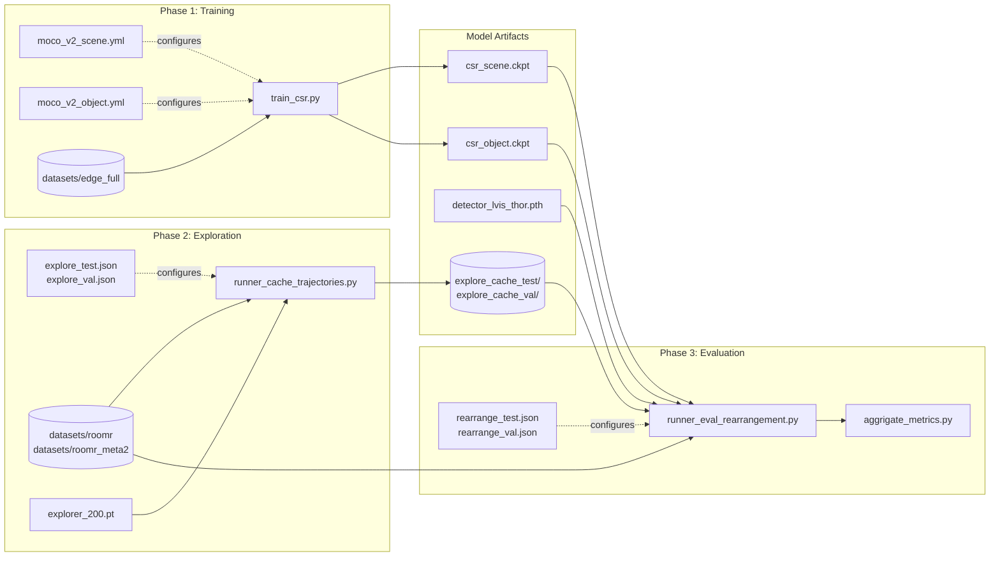
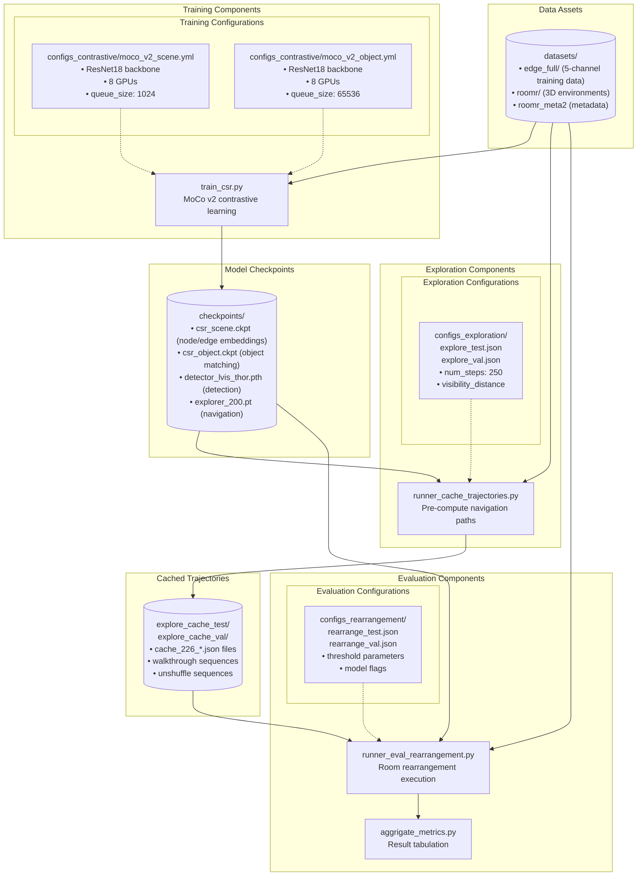
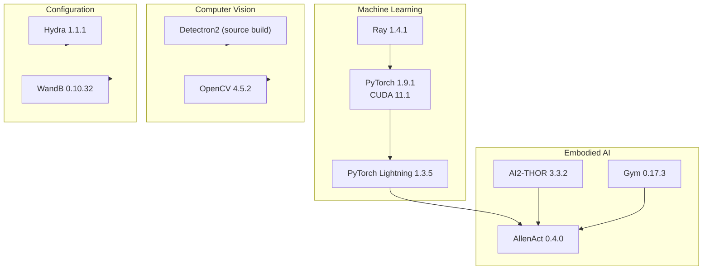

<!-- source: DeepWiki mcp.deepwiki.com · repo allenai/CSR · page 1 Overview · fetched 2026-10-26 -->

# Overview

<details>
<summary>Relevant source files</summary>

The following files were used as context for generating this wiki page:

- [README.md](README.md)
- [environment.yml](environment.yml)

</details>


## Purpose and Scope

This document provides a high-level introduction to the Continuous Scene Representations (CSR) codebase, which implements the paper "Continuous Scene Representations for Embodied AI" by Gadre et al. (2022). This page summarizes the system's purpose, architecture, main components, and workflow.

For detailed information about specific subsystems, refer to:
- Training CSR models: [Training Continuous Scene Representations](#2)
- Generating exploration trajectories: [Exploration and Trajectory Caching](#3)
- Running evaluations: [Evaluation and Visual Room Rearrangement](#4)
- Environment setup: [Environment and Dependencies](#5)

**Sources**: [README.md:1-80]()

## What CSR Does

CSR constructs scene representations for embodied agents navigating physical spaces. The system models objects and their spatial relationships using continuous-valued embeddings rather than discrete symbolic relations. The key capabilities include:

| Capability | Description |
|------------|-------------|
| **Scene Graph Construction** | Builds on-the-fly graph structures with learned edge embeddings representing spatial relationships |
| **Object Tracking** | Maintains object identities as agents move through environments |
| **Change Detection** | Detects modifications in room configurations |
| **Room Rearrangement** | Performs visual room rearrangement tasks without task-specific training |

The system is evaluated on the **Visual Room Rearrangement (RoomR)** benchmark, a challenging task where an agent must restore a room to its original configuration after objects have been moved.

**Sources**: [README.md:6-8]()

## System Architecture

### Three-Phase Pipeline

CSR operates through three distinct phases, each with dedicated entry points and configurations:



**Diagram: Three-Phase CSR Pipeline with Code Entry Points**

This diagram illustrates the complete workflow from training to evaluation, showing the actual Python scripts, configuration files, and data artifacts used at each stage.

**Sources**: [README.md:26-62]()

### Core Components and Their Roles



**Diagram: Component Architecture Mapping Code Entities**

This diagram shows the relationships between Python scripts, configuration directories, data assets, and model artifacts using their actual file paths and names as they appear in the codebase.

**Sources**: [README.md:11-62]()

## Main Execution Scripts

The codebase provides four primary entry points:

| Script | Purpose | Configuration | Output |
|--------|---------|---------------|--------|
| `train_csr.py` | Train scene/object representations using MoCo v2 | `configs_contrastive/moco_v2_scene.yml`<br/>`configs_contrastive/moco_v2_object.yml` | `checkpoints/csr_scene.ckpt`<br/>`checkpoints/csr_object.ckpt` |
| `runner_cache_trajectories.py` | Generate and cache exploration trajectories | `configs_exploration/explore_test.json`<br/>`configs_exploration/explore_val.json` | `explore_cache_test/`<br/>`explore_cache_val/` |
| `runner_eval_rearrangement.py` | Execute room rearrangement evaluation | `configs_rearrangement/rearrange_test.json`<br/>`configs_rearrangement/rearrange_val.json` | `my_results_test/`<br/>`my_results_val/` |
| `aggrigate_metrics.py` | Aggregate and report evaluation metrics | Results directories | Console output with performance metrics |

**Sources**: [README.md:26-62]()

## Data Assets

The system operates on three primary datasets:

### datasets/edge_full
Training data for contrastive learning. Contains 5-channel images used to learn continuous scene representations.

### datasets/roomr
3D environment data for the Visual Room Rearrangement benchmark. Contains room layouts and object configurations.

### datasets/roomr_meta2
Metadata and annotations for the RoomR dataset. Provides scene information for evaluation episodes.

All datasets can be downloaded from AWS S3 and must be extracted to the repository root:
- Datasets: `https://prior-datasets.s3.us-east-2.amazonaws.com/csr/datasets.tar.gz`
- Checkpoints: `https://prior-model-weights.s3.us-east-2.amazonaws.com/embodied-ai/csr/checkpoints.tar.gz`

**Sources**: [README.md:21-24]()

## Model Artifacts

The system uses four trained models:

### csr_scene.ckpt
Contains learned node and edge embeddings for scene representation. Trained with `train_object_representation=false` flag. Captures spatial relationships between objects and scene structure.

### csr_object.ckpt
Specialized for object correspondence across trajectories. Trained with `train_object_representation=true` flag. Maintains object identity as agents navigate.

### detector_lvis_thor.pth
Object detection model (Detectron2-based) for identifying and localizing objects in visual observations.

### explorer_200.pt
Pre-trained navigation policy for autonomous exploration in AI2-THOR environments.

**Sources**: [README.md:27-42]()

## Technology Stack

The codebase is built on the following core frameworks:



**Diagram: Technology Stack Dependencies**

The environment is managed through Conda ([environment.yml:1-244]()) and requires building Detectron2 from source.

**Sources**: [README.md:13-18](), [environment.yml:1-244]()

## Workflow Summary

A typical workflow for using this codebase:

1. **Setup** ([Environment and Dependencies](#5)): Install Conda environment and Detectron2, download datasets and checkpoints.

2. **Training** ([Training Continuous Scene Representations](#2)): 
   - Run `train_csr.py` with `moco_v2_scene.yml` to learn scene representations
   - Run `train_csr.py` with `moco_v2_object.yml` to learn object correspondences
   - Both require 8-GPU machines by default

3. **Exploration Caching** ([Exploration and Trajectory Caching](#3)):
   - Run `runner_cache_trajectories.py` to generate navigation trajectories
   - Creates `explore_cache_test/` and `explore_cache_val/` directories
   - Pre-computed trajectories avoid expensive re-simulation during evaluation

4. **Evaluation** ([Evaluation and Visual Room Rearrangement](#4)):
   - Run `runner_eval_rearrangement.py` to execute rearrangement tasks
   - Run `aggrigate_metrics.py` to compute performance metrics
   - Evaluates on 1000 test and 1000 validation episodes

**Sources**: [README.md:12-62]()

## Performance Baseline

Using the provided checkpoints and cached trajectories, the system achieves the following performance on the RoomR test set:

| Metric | Score |
|--------|-------|
| % Fixed Strict | 1.9 |
| % Success | 0.4 |

These low scores reflect the difficulty of the RoomR benchmark, which requires accurate object detection, tracking, spatial reasoning, and manipulation planning in realistic 3D environments.

**Sources**: [README.md:64-67]()

## Repository Structure

```
csr/
├── train_csr.py                    # Training entry point
├── runner_cache_trajectories.py    # Exploration caching
├── runner_eval_rearrangement.py    # Evaluation runner
├── aggrigate_metrics.py            # Metrics computation
├── configs_contrastive/            # Training configs
│   ├── moco_v2_scene.yml
│   └── moco_v2_object.yml
├── configs_exploration/            # Exploration configs
│   ├── explore_test.json
│   └── explore_val.json
├── configs_rearrangement/          # Evaluation configs
│   ├── rearrange_test.json
│   └── rearrange_val.json
├── datasets/                       # Data assets
│   ├── edge_full/
│   ├── roomr/
│   └── roomr_meta2/
├── checkpoints/                    # Model weights
│   ├── csr_scene.ckpt
│   ├── csr_object.ckpt
│   ├── detector_lvis_thor.pth
│   └── explorer_200.pt
├── explore_cache_test/            # Cached test trajectories
├── explore_cache_val/             # Cached val trajectories
├── my_results_test/               # Test results (generated)
├── my_results_val/                # Val results (generated)
└── environment.yml                # Conda environment spec
```

**Sources**: [README.md:1-80]()

---

