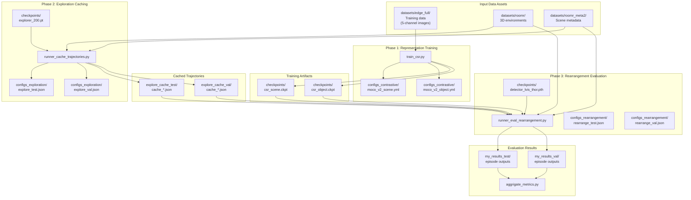
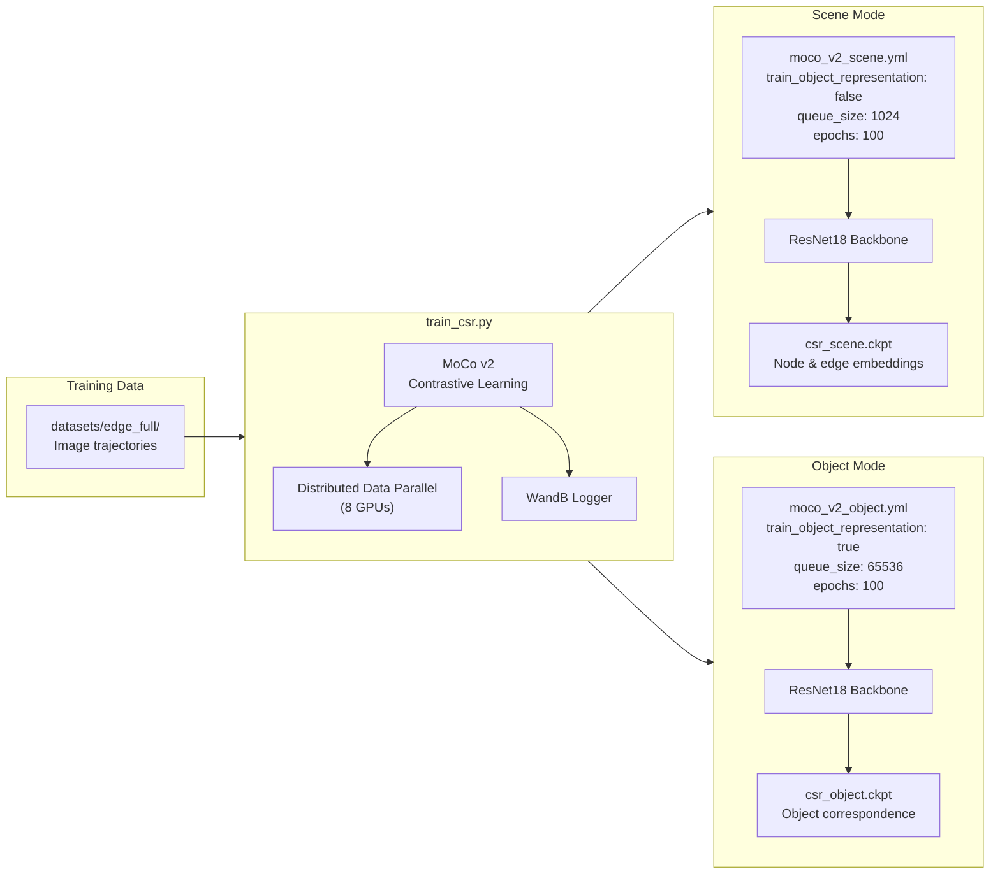
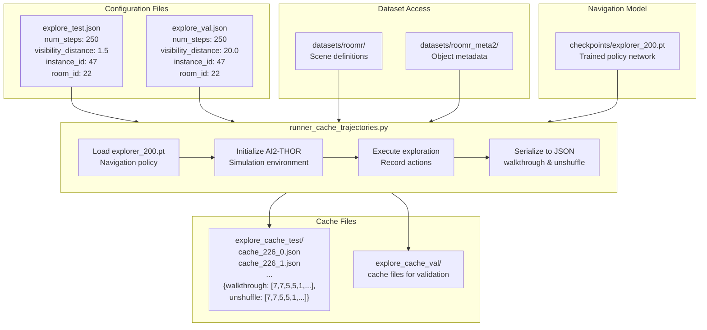
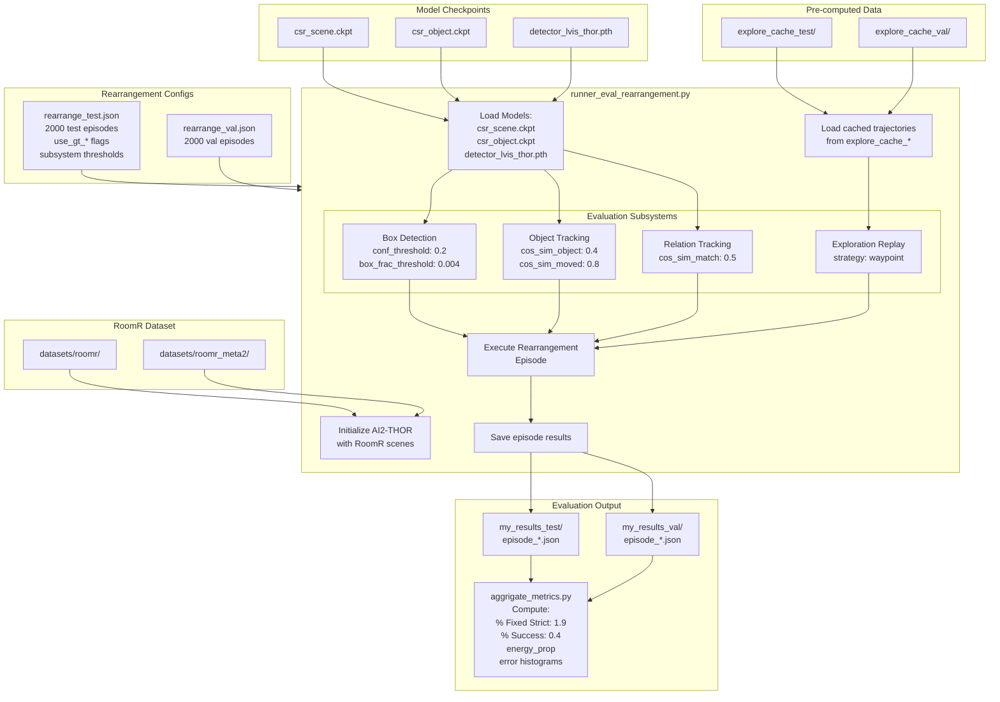

<!-- source: DeepWiki mcp.deepwiki.com · repo allenai/CSR · page 1.1 System Architecture · fetched 2026-10-26 -->

# System Architecture

Relevant source files

The following files were used as context for generating this wiki page:

- [README.md](README.md)
- [environment.yml](environment.yml)

## Purpose and Scope

This page describes the high-level architecture of the Continuous Scene Representations (CSR) system. It covers the three main operational phases (training, exploration, evaluation), the data flow between these phases, and how components depend on each other. This page provides an architectural overview; for detailed information on specific components, see:
- Training details: [Training Continuous Scene Representations](#2)
- Exploration details: [Exploration and Trajectory Caching](#3)
- Evaluation details: [Evaluation and Visual Room Rearrangement](#4)
- Environment setup: [Environment and Dependencies](#5)

## System Overview

The CSR system is organized into three sequential phases, each with its own entry point script, configuration system, and artifacts:

| Phase | Entry Point | Configuration | Input | Output |
|-------|-------------|---------------|-------|--------|
| **Training** | `train_csr.py` | `configs_contrastive/` | `datasets/edge_full/` | `checkpoints/*.ckpt` |
| **Exploration** | `runner_cache_trajectories.py` | `configs_exploration/` | `datasets/roomr/`, `checkpoints/explorer_200.pt` | `explore_cache_*/` |
| **Evaluation** | `runner_eval_rearrangement.py` | `configs_rearrangement/` | All checkpoints, cached trajectories, RoomR dataset | `my_results_*/` |

**Sources**: [README.md:10-62]()

## Three-Phase Pipeline Architecture

**Description**: This diagram shows the complete pipeline from raw data through to final metrics. Each phase is self-contained with its own entry point script and configuration system. The training phase is independent of downstream phases and produces reusable model checkpoints. The exploration phase pre-computes expensive navigation trajectories to enable faster evaluation iterations. The evaluation phase consumes all artifacts from previous phases to perform the Visual Room Rearrangement task.

**Sources**: [README.md:26-62]()

## Training Phase Architecture

The training phase implements MoCo v2 contrastive learning to train two distinct representation models. The system uses a single training script that operates in two modes controlled by configuration.

**Description**: The training script `train_csr.py` supports two operational modes distinguished by the `train_object_representation` flag in configuration files. Scene mode learns spatial relationships between nodes and edges in a scene graph representation. Object mode learns to match objects across different trajectories. Both use ResNet18 backbones and MoCo v2 methodology but differ in queue sizes (1024 vs 65536) and training objectives.

**Sources**: [README.md:26-42](), [environment.yml:123-124]()

## Exploration Phase Architecture

The exploration phase generates and caches navigation trajectories that will be replayed during evaluation. This pre-computation strategy separates expensive simulation from the evaluation logic.

**Description**: The exploration caching system uses `runner_cache_trajectories.py` to generate navigation sequences. The script loads a trained explorer model (`explorer_200.pt`), initializes AI2-THOR simulation environments from the RoomR dataset, and executes exploration following the trained policy. Each episode produces two integer sequences (`walkthrough` and `unshuffle`) representing action sequences, which are serialized to JSON files. The cached trajectories are later consumed by the evaluation phase, eliminating the need to re-run expensive simulations during evaluation.

**Sources**: [README.md:44-49]()

## Evaluation Phase Architecture

The evaluation phase orchestrates all trained models and cached data to perform the Visual Room Rearrangement task on the RoomR benchmark.

**Description**: The evaluation runner `runner_eval_rearrangement.py` integrates four subsystems: box detection (using `detector_lvis_thor.pth`), object tracking (using `csr_object.ckpt`), relation tracking (using `csr_scene.ckpt`), and exploration replay (using cached trajectories). Each subsystem operates with configurable thresholds defined in `rearrange_test.json` and `rearrange_val.json`. The system supports both "predicted mode" (using all models) and "ground truth mode" (using oracle information via `use_gt_*` flags) to enable debugging. Results are saved per-episode and aggregated using `aggrigate_metrics.py` to produce final benchmark metrics.

**Sources**: [README.md:51-67]()

## Configuration Management

The CSR system uses a hierarchical configuration system managed by Hydra, with separate configuration directories for each phase:

| Directory | Format | Purpose | Key Files |
|-----------|--------|---------|-----------|
| `configs_contrastive/` | YAML | Training configuration | `moco_v2_scene.yml`, `moco_v2_object.yml` |
| `configs_exploration/` | JSON | Exploration parameters | `explore_test.json`, `explore_val.json` |
| `configs_rearrangement/` | JSON | Evaluation configuration | `rearrange_test.json`, `rearrange_val.json` |

Configuration files control:
- Model hyperparameters (queue sizes, learning rates, batch sizes)
- System thresholds (confidence thresholds, similarity thresholds)
- Hardware settings (GPU count, distributed training)
- Dataset parameters (visibility distance, episode counts)
- Runtime modes (predicted vs ground truth)

**Sources**: [README.md:26-55](), [environment.yml:190]()

## Data Flow and Dependencies

```mermaid
graph TD
    subgraph External["External Sources"]
        S3Data["AWS S3<br/>prior-datasets.s3.us-east-2.amazonaws.com<br/>datasets.tar.gz"]
        S3Ckpt["AWS S3<br/>prior-model-weights.s3.us-east-2.amazonaws.com<br/>checkpoints.tar.gz"]
    end
    
    subgraph LocalData["Local Data Storage"]
        EdgeFullLocal["datasets/edge_full/<br/>Training images"]
        RoomRLocal["datasets/roomr/<br/>3D scenes"]
        MetaLocal["datasets/roomr_meta2/<br/>Metadata"]
        
        SceneCkptLocal["checkpoints/csr_scene.ckpt"]
        ObjectCkptLocal["checkpoints/csr_object.ckpt"]
        ExplorerLocal["checkpoints/explorer_200.pt"]
        DetectorLocal["checkpoints/detector_lvis_thor.pth"]
    end
    
    subgraph Intermediate["Intermediate Artifacts"]
        TestCache["explore_cache_test/"]
        ValCache["explore_cache_val/"]
    end
    
    subgraph Final["Final Outputs"]
        TestRes["my_results_test/"]
        ValRes["my_results_val/"]
    end
    
    S3Data --> EdgeFullLocal
    S3Data --> RoomRLocal
    S3Data --> MetaLocal
    S3Ckpt --> SceneCkptLocal
    S3Ckpt --> ObjectCkptLocal
    S3Ckpt --> ExplorerLocal
    S3Ckpt --> DetectorLocal
    
    EdgeFullLocal -->|train_csr.py| SceneCkptLocal
    EdgeFullLocal -->|train_csr.py| ObjectCkptLocal
    
    RoomRLocal -->|runner_cache_trajectories.py| TestCache
    MetaLocal -->|runner_cache_trajectories.py| TestCache
    ExplorerLocal -->|runner_cache_trajectories.py| TestCache
    
    RoomRLocal -->|runner_cache_trajectories.py| ValCache
    MetaLocal -->|runner_cache_trajectories.py| ValCache
    ExplorerLocal -->|runner_cache_trajectories.py| ValCache
    
    SceneCkptLocal -->|runner_eval_rearrangement.py| TestRes
    ObjectCkptLocal -->|runner_eval_rearrangement.py| TestRes
    DetectorLocal -->|runner_eval_rearrangement.py| TestRes
    TestCache -->|runner_eval_rearrangement.py| TestRes
    RoomRLocal -->|runner_eval_rearrangement.py| TestRes
    MetaLocal -->|runner_eval_rearrangement.py| TestRes
    
    SceneCkptLocal -->|runner_eval_rearrangement.py| ValRes
    ObjectCkptLocal -->|runner_eval_rearrangement.py| ValRes
    DetectorLocal -->|runner_eval_rearrangement.py| ValRes
    ValCache -->|runner_eval_rearrangement.py| ValRes
    RoomRLocal -->|runner_eval_rearrangement.py| ValRes
    MetaLocal -->|runner_eval_rearrangement.py| ValRes
    
    TestRes -->|aggrigate_metrics.py| Metrics["Aggregated Metrics"]
    ValRes -->|aggrigate_metrics.py| Metrics
```

**Description**: This diagram shows the complete data dependency graph. External datasets and pre-trained checkpoints are downloaded from AWS S3 and stored locally. The training script can optionally regenerate CSR checkpoints from the `edge_full` dataset, though pre-trained versions are provided. The exploration caching step requires the RoomR dataset, metadata, and the explorer model, producing cached trajectories. The evaluation step consumes all model checkpoints, cached trajectories, and the RoomR dataset to produce per-episode results, which are then aggregated into final metrics.

**Sources**: [README.md:21-62]()

## Technology Stack

The CSR system is built on a multi-layered technology stack:

### Core Framework Layer
- **PyTorch 1.9.1**: Deep learning framework for neural network training and inference
- **PyTorch Lightning 1.3.5**: High-level training orchestration and distributed training wrapper
- **CUDA 11.1**: GPU acceleration support for 8-GPU distributed training

### Embodied AI Layer
- **AllenAct 0.4.0**: Reinforcement learning framework for embodied agents
- **AI2-THOR 3.3.2**: 3D simulation environment for visual reasoning tasks
- **Gym 0.17.3**: Standard interface for RL environments

### Computer Vision Layer
- **Detectron2**: Object detection framework (built from source)
- **TorchVision**: Pre-trained computer vision models
- **OpenCV 4.5.2**: Image processing utilities

### Configuration and Logging
- **Hydra 1.1.1**: Hierarchical configuration management
- **WandB 0.10.32**: Experiment tracking and metric logging
- **TensorBoard**: Training visualization

### Distributed Computing
- **Ray 1.4.1**: Distributed execution framework for parallel evaluation

**Sources**: [environment.yml:1-244](), [README.md:13-18]()

## Execution Flow

The typical execution sequence for the complete system is:

1. **Environment Setup**: Install dependencies via `conda env create --file environment.yml` and build Detectron2 from source
2. **Data Download**: Download `datasets.tar.gz` and `checkpoints.tar.gz` from AWS S3 and extract to project root
3. **Training (Optional)**: Run `python train_csr.py --conf configs_contrastive/moco_v2_scene.yml` and with `moco_v2_object.yml` to train scene and object models
4. **Exploration Caching**: Run `python runner_cache_trajectories.py --config-dir-path configs_exploration` to generate trajectory caches
5. **Evaluation**: Run `python runner_eval_rearrangement.py` to evaluate on RoomR test and validation sets
6. **Metrics**: Run `python aggrigate_metrics.py` to compute final performance metrics

Pre-trained checkpoints and pre-cached trajectories enable skipping steps 3-4 for immediate evaluation.

**Sources**: [README.md:12-62]()

## System Characteristics

### Modularity
Each phase is independently executable with clearly defined inputs and outputs. The training phase is completely decoupled from the downstream task, producing general-purpose scene representations.

### Caching Strategy
Pre-computing exploration trajectories separates expensive simulation from evaluation logic, enabling rapid iteration during development and debugging.

### Dual-Mode Operation
Training supports two representation learning modes (scene vs object) via configuration flags rather than separate codebases, ensuring consistency in training methodology.

### Evaluation Flexibility
The evaluation system supports both "predicted mode" (fully autonomous) and "ground truth mode" (with oracle components) to facilitate component-level debugging and ablation studies.

**Sources**: [README.md:1-80]()

---

