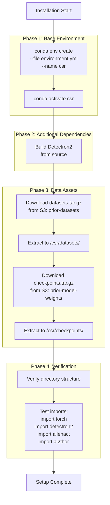
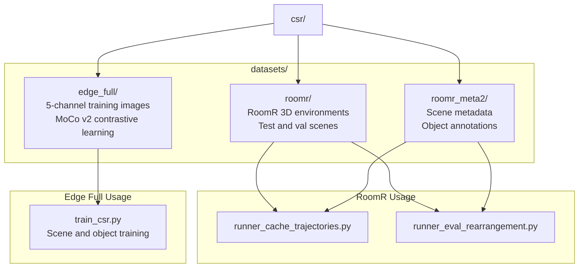
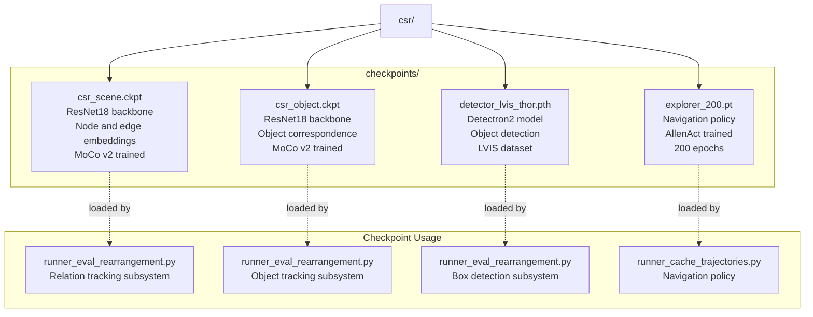
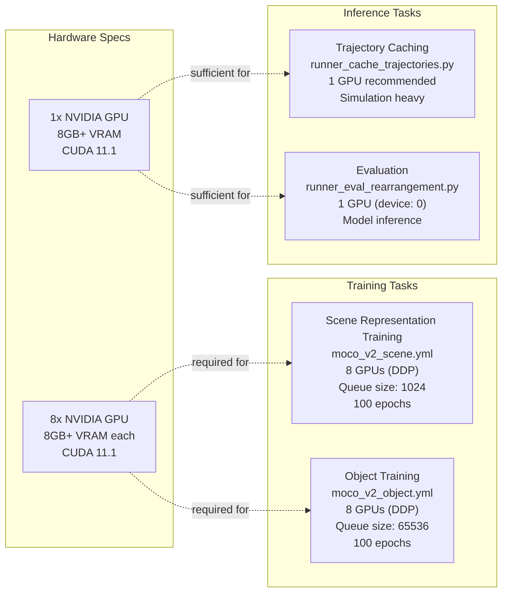

<!-- source: DeepWiki mcp.deepwiki.com · repo allenai/CSR · page 1.2 Installation and Setup · fetched 2026-10-26 -->

# Installation and Setup

<details>
<summary>Relevant source files</summary>

The following files were used as context for generating this wiki page:

- [README.md](README.md)
- [environment.yml](environment.yml)

</details>


## Purpose and Scope

This document provides step-by-step instructions for setting up the CSR development environment, including dependency installation, data preparation, and model checkpoint acquisition. After completing these steps, you will be able to train CSR models, cache exploration trajectories, and evaluate on the Visual Room Rearrangement task.

For information about the system architecture and data flow, see [System Architecture](#1.1). For details about runtime dependencies and the technology stack, see [Environment and Dependencies](#5).

---

## Prerequisites

The CSR system requires:
- **Operating System**: Linux (tested on Ubuntu)
- **GPU**: NVIDIA GPU with CUDA 11.1 support
- **GPU Memory**: Minimum 8GB per GPU (training configurations assume 8 GPUs)
- **Disk Space**: Approximately 100GB for datasets and checkpoints
- **Python**: 3.8.x (managed via conda)
- **Conda**: Anaconda or Miniconda package manager

---

## Installation Overview



**Sources**: [README.md:12-24]()

---

## Step 1: Conda Environment Creation

Create the conda environment using the provided specification file:

```bash
conda env create --file environment.yml --name csr
conda activate csr
```

The `environment.yml` file specifies the complete dependency tree including:

| Category | Key Packages | Purpose |
|----------|-------------|---------|
| **Deep Learning Core** | `pytorch=1.9.1`, `torchvision=0.10.1`, `cudatoolkit=11.1.74` | Neural network training and GPU acceleration |
| **Training Infrastructure** | `pytorch-lightning=1.3.5`, `ray=1.4.1` | Training orchestration and distributed execution |
| **Embodied AI** | `ai2thor=3.3.2`, `allenact=0.4.0`, `gym=0.17.3` | 3D simulation and RL framework |
| **Computer Vision** | `opencv-python=4.5.2.54`, `pillow=8.2.0` | Image processing and manipulation |
| **Configuration** | `hydra-core=1.1.1`, `pyyaml=5.4.1` | Configuration management |
| **Experiment Tracking** | `wandb=0.10.32`, `tensorboard=2.7.0` | Logging and visualization |

**Sources**: [README.md:12-16](), [environment.yml:1-244]()

---

## Step 2: Detectron2 Installation

Detectron2 is not available via conda and must be built from source. Follow the official Detectron2 installation guide:

```bash
# Clone the repository
git clone https://github.com/facebookresearch/detectron2.git
cd detectron2

# Build and install
python -m pip install -e .
```

**Note**: The `environment.yml` file includes a commented reference to `detectron2==0.5` at [environment.yml:180]() indicating the expected version. Ensure compatibility with CUDA 11.1 and PyTorch 1.9.1 during installation.

**Sources**: [README.md:18-18](), [environment.yml:180]()

---

## Step 3: Dataset Download and Setup

### Download Datasets

Download the complete dataset archive from AWS S3:

```bash
# Download datasets (approximately 50GB)
wget https://prior-datasets.s3.us-east-2.amazonaws.com/csr/datasets.tar.gz

# Extract to the repository root
tar -xzf datasets.tar.gz -C /path/to/csr/
```

### Dataset Directory Structure

After extraction, the following directory structure will be created:



### Dataset Descriptions

| Dataset | Path | Contents | Size | Used By |
|---------|------|----------|------|---------|
| **RoomR** | `datasets/roomr/` | 3D room environments with shuffled/unshuffled states | ~30GB | Exploration and evaluation scripts |
| **RoomR Metadata** | `datasets/roomr_meta2/` | Scene metadata, object positions, and annotations | ~5GB | Exploration and evaluation scripts |
| **Edge Full** | `datasets/edge_full/` | 5-channel images for contrastive learning (RGB + depth + edges) | ~15GB | `train_csr.py` |

**Sources**: [README.md:21-24]()

---

## Step 4: Model Checkpoint Download and Setup

### Download Checkpoints

Download pre-trained model weights from AWS S3:

```bash
# Download checkpoints (approximately 1GB)
wget https://prior-model-weights.s3.us-east-2.amazonaws.com/embodied-ai/csr/checkpoints.tar.gz

# Extract to the repository root
tar -xzf checkpoints.tar.gz -C /path/to/csr/
```

### Checkpoint Directory Structure



### Checkpoint Descriptions

| Checkpoint | Path | Model Type | Training Source | Used By |
|------------|------|------------|----------------|---------|
| **CSR Scene** | `checkpoints/csr_scene.ckpt` | ResNet18 + MoCo v2 | `configs_contrastive/moco_v2_scene.yml` | Relation tracking in evaluation |
| **CSR Object** | `checkpoints/csr_object.ckpt` | ResNet18 + MoCo v2 | `configs_contrastive/moco_v2_object.yml` | Object tracking in evaluation |
| **Detector** | `checkpoints/detector_lvis_thor.pth` | Detectron2 | External (LVIS-THOR dataset) | Object detection in evaluation |
| **Explorer** | `checkpoints/explorer_200.pt` | AllenAct policy | External (navigation training) | Trajectory caching |

**Sources**: [README.md:22-24](), [README.md:27-42]()

---

## Step 5: Complete Directory Structure

After completing all installation steps, verify the following directory structure:

```
csr/
├── datasets/
│   ├── roomr/               # RoomR environments (test/val)
│   ├── roomr_meta2/         # Scene metadata
│   └── edge_full/           # 5-channel training data
├── checkpoints/
│   ├── csr_scene.ckpt       # Scene representation model
│   ├── csr_object.ckpt      # Object correspondence model
│   ├── detector_lvis_thor.pth  # Object detector
│   └── explorer_200.pt      # Navigation policy
├── configs_contrastive/
│   ├── moco_v2_scene.yml    # Scene training config
│   └── moco_v2_object.yml   # Object training config
├── configs_exploration/
│   ├── explore_test.json    # Test exploration config
│   └── explore_val.json     # Val exploration config
├── configs_rearrangement/
│   ├── rearrange_test.json  # Test evaluation config
│   └── rearrange_val.json   # Val evaluation config
├── explore_cache_test/      # Pre-cached test trajectories
├── explore_cache_val/       # Pre-cached val trajectories
├── environment.yml          # Conda environment spec
├── train_csr.py            # Training script
├── runner_cache_trajectories.py  # Caching script
├── runner_eval_rearrangement.py  # Evaluation script
└── aggrigate_metrics.py    # Metrics aggregation
```

**Sources**: [README.md:1-81]()

---

## Step 6: Environment Verification

### Verify Python Package Imports

Test that all critical dependencies are correctly installed:

```python
# Core deep learning
import torch
print(f"PyTorch version: {torch.__version__}")
print(f"CUDA available: {torch.cuda.is_available()}")
print(f"CUDA version: {torch.version.cuda}")

# Embodied AI frameworks
import ai2thor
import allenact
import gym

# Computer vision
import detectron2
import cv2

# Configuration and training
import pytorch_lightning
import hydra
import wandb
```

Expected output:
```
PyTorch version: 1.9.1
CUDA available: True
CUDA version: 11.1
```

### Verify GPU Configuration

```python
import torch

# Check number of available GPUs
num_gpus = torch.cuda.device_count()
print(f"Number of GPUs: {num_gpus}")

# List GPU names
for i in range(num_gpus):
    print(f"GPU {i}: {torch.cuda.get_device_name(i)}")
```

**Note**: The default training configurations assume 8 GPUs. To train with fewer GPUs, modify the `gpus` field in [configs_contrastive/moco_v2_scene.yml]() and [configs_contrastive/moco_v2_object.yml]().

**Sources**: [README.md:33-42](), [environment.yml:31-31](), [environment.yml:123-124]()

---

## Step 7: Pre-cached Trajectory Setup

The repository provides pre-cached exploration trajectories to skip expensive simulation during evaluation:

| Cache Directory | Contents | Source Configuration | Episodes |
|----------------|----------|---------------------|----------|
| `explore_cache_test/` | Test set trajectories | `configs_exploration/explore_test.json` | 1000 episodes |
| `explore_cache_val/` | Validation set trajectories | `configs_exploration/explore_val.json` | 1000 episodes |

Each cache file (e.g., `cache_226_0.json`) contains:
- **walkthrough**: Integer sequence representing forward exploration
- **unshuffle**: Integer sequence for rearrangement navigation

If these directories do not exist or you need to regenerate trajectories, see [Exploration and Trajectory Caching](#3).

**Sources**: [README.md:44-49]()

---

## Hardware Requirements and Training Considerations

### GPU Requirements by Task



### Memory Requirements

| Task | GPU Memory | System Memory | Disk Space |
|------|-----------|---------------|------------|
| **Scene Training** | 8GB per GPU × 8 | 64GB RAM | 50GB (datasets) |
| **Object Training** | 8GB per GPU × 8 | 64GB RAM | 50GB (datasets) |
| **Trajectory Caching** | 8GB (single GPU) | 32GB RAM | 20GB (cache output) |
| **Evaluation** | 8GB (single GPU) | 32GB RAM | 10GB (results output) |

**Sources**: [README.md:33-42]()

---

## Configuration File Mapping

### Training Configurations

| Configuration | Path | Purpose | Key Parameters |
|--------------|------|---------|----------------|
| Scene Training | `configs_contrastive/moco_v2_scene.yml` | Node and edge embeddings | `gpus: 8`, `train_object_representation: false` |
| Object Training | `configs_contrastive/moco_v2_object.yml` | Object correspondence | `gpus: 8`, `train_object_representation: true`, `queue_size: 65536` |

### Exploration Configurations

| Configuration | Path | Purpose | Key Parameters |
|--------------|------|---------|----------------|
| Test Exploration | `configs_exploration/explore_test.json` | Cache test trajectories | `instance_id: 47`, `num_steps: 250`, `visibility_distance: 1.5` |
| Val Exploration | `configs_exploration/explore_val.json` | Cache val trajectories | `instance_id: 47`, `num_steps: 250`, `visibility_distance: 20.0` |

### Evaluation Configurations

| Configuration | Path | Purpose | Key Parameters |
|--------------|------|---------|----------------|
| Test Evaluation | `configs_rearrangement/rearrange_test.json` | Evaluate on test set | `episodes: 2000`, `conf_threshold: 0.2` |
| Val Evaluation | `configs_rearrangement/rearrange_val.json` | Evaluate on val set | `episodes: 2000`, `cos_sim_object: 0.4` |

**Sources**: [README.md:26-55]()

---

## Next Steps

After completing installation and setup:

1. **Training**: To train CSR models from scratch, see [Training Continuous Scene Representations](#2)
2. **Exploration**: To generate custom exploration trajectories, see [Exploration and Trajectory Caching](#3)
3. **Evaluation**: To run evaluation on RoomR, see [Evaluation and Visual Room Rearrangement](#4)

For quick evaluation using provided checkpoints and cached trajectories:

```bash
# Activate environment
conda activate csr

# Run evaluation
python runner_eval_rearrangement.py

# Aggregate results
python aggrigate_metrics.py
```

**Sources**: [README.md:51-61]()

---

