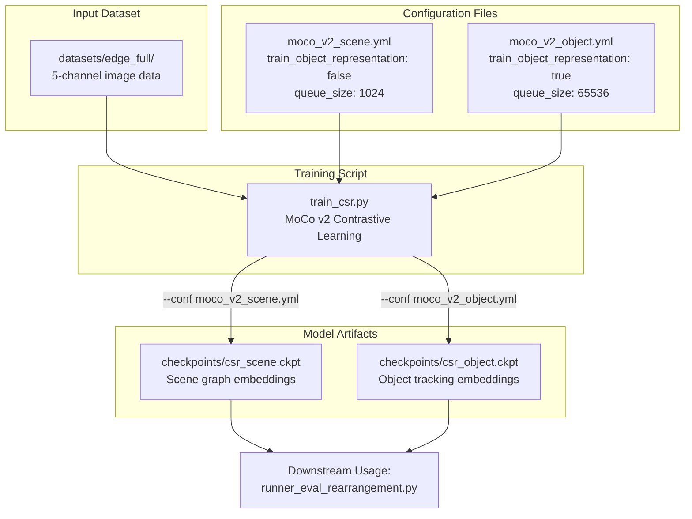
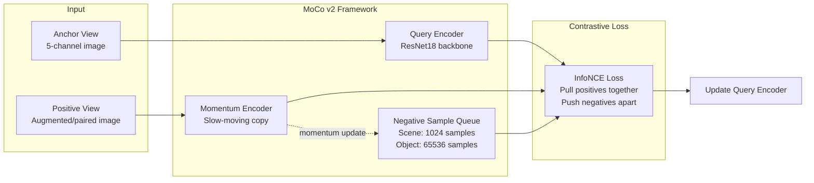
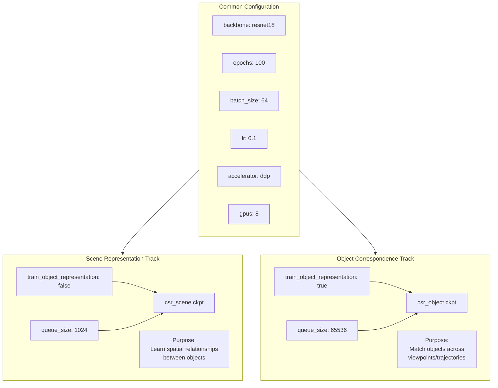
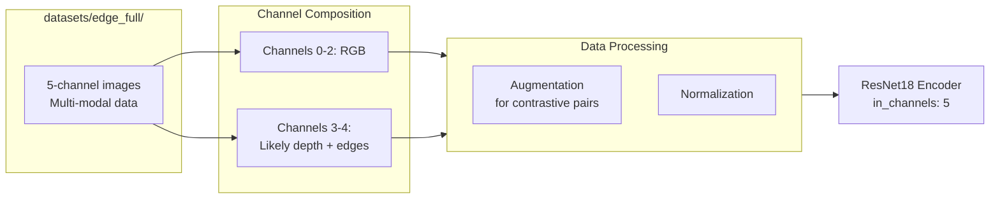
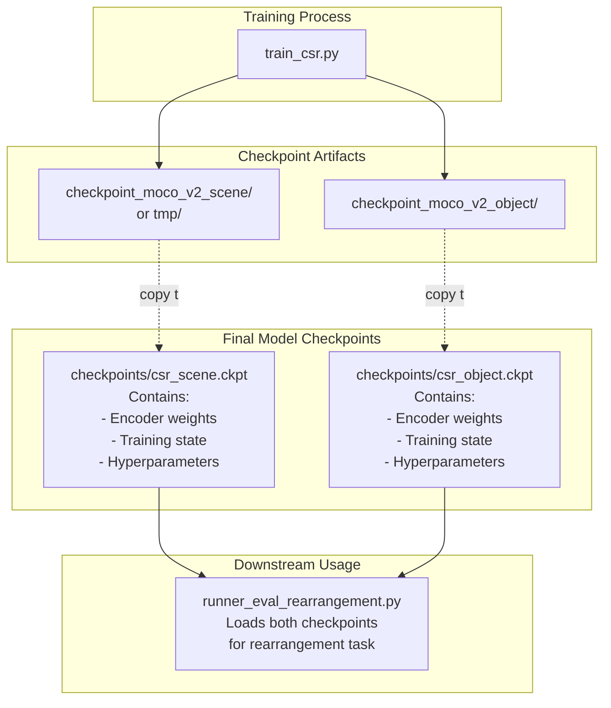

<!-- source: DeepWiki mcp.deepwiki.com · repo allenai/CSR · page 2 Training Continuous Scene Representations · fetched 2026-10-26 -->

# Training Continuous Scene Representations

<details>
<summary>Relevant source files</summary>

The following files were used as context for generating this wiki page:

- [README.md](README.md)
- [configs_contrastive/moco_v2_object.yml](configs_contrastive/moco_v2_object.yml)
- [configs_contrastive/moco_v2_scene.yml](configs_contrastive/moco_v2_scene.yml)

</details>


## Purpose and Scope

This document describes the training process for Continuous Scene Representations (CSR), which learns latent embeddings for objects and their spatial relationships using self-supervised contrastive learning. The training phase produces two complementary models: a **scene representation model** that captures spatial relationships between objects, and an **object correspondence model** that maintains object identity across trajectories.

For detailed configuration parameters, see:
- Scene representation configuration: [2.1](#2.1)
- Object correspondence configuration: [2.2](#2.2)

For exploration caching and evaluation that uses these trained models, see [3](#3) and [4](#4).

## Overview

The CSR training system implements a dual-track approach that learns two distinct but complementary representations:

1. **Scene Representation** (`csr_scene.ckpt`): Learns continuous embeddings for spatial relationships between objects (nodes) and their connections (edges) in a scene graph
2. **Object Correspondence** (`csr_object.ckpt`): Learns embeddings for matching and tracking individual objects across different viewpoints and trajectories

Both models use the same training script ([train_csr.py]()) but with different configuration files that control their learning objectives.



**Sources:** [README.md:26-42](), [configs_contrastive/moco_v2_scene.yml](), [configs_contrastive/moco_v2_object.yml]()

## Training Framework: MoCo v2

The training system uses **Momentum Contrast v2 (MoCo v2)**, a self-supervised contrastive learning framework that learns representations by maximizing agreement between differently augmented views of the same data while minimizing agreement with negative samples stored in a queue.



**Key Framework Components:**

| Component | Description | Configuration |
|-----------|-------------|---------------|
| **Backbone** | Feature extractor | ResNet18 ([moco_v2_scene.yml:9](), [moco_v2_object.yml:9]()) |
| **Input Channels** | Multi-modal input | 5 channels ([moco_v2_scene.yml:11](), [moco_v2_object.yml:11]()) |
| **Channel Width** | Network capacity | 64 ([moco_v2_scene.yml:10](), [moco_v2_object.yml:10]()) |
| **Optimizer** | Gradient descent | SGD ([moco_v2_scene.yml:14](), [moco_v2_object.yml:14]()) |
| **Learning Rate** | Initial LR | 0.1 ([moco_v2_scene.yml:7](), [moco_v2_object.yml:7]()) |
| **Scheduler** | LR annealing | CosineAnnealingLR ([moco_v2_scene.yml:15](), [moco_v2_object.yml:15]()) |
| **Weight Decay** | Regularization | 0.0001 ([moco_v2_scene.yml:8](), [moco_v2_object.yml:8]()) |

**Sources:** [configs_contrastive/moco_v2_scene.yml:7-15](), [configs_contrastive/moco_v2_object.yml:7-15]()

## Dual Training Tracks

The two training tracks share the same architecture and training procedure but differ in their learning objectives and hyperparameters:



**Key Differences:**

| Aspect | Scene Representation | Object Correspondence |
|--------|---------------------|----------------------|
| **Config File** | [moco_v2_scene.yml]() | [moco_v2_object.yml]() |
| **Flag** | `train_object_representation: false` | `train_object_representation: true` |
| **Queue Size** | 1024 | 65536 |
| **Learning Focus** | Broader spatial relationships | Fine-grained object identity |
| **Negative Samples** | Fewer, scene-level contrasts | Many, object-level contrasts |
| **Output Checkpoint** | `csr_scene.ckpt` | `csr_object.ckpt` |

The larger queue size for object correspondence (65536 vs 1024) provides a much larger bank of negative samples, enabling the model to learn more discriminative features for distinguishing individual objects.

**Sources:** [configs_contrastive/moco_v2_scene.yml:31-32](), [configs_contrastive/moco_v2_object.yml:31-32](), [README.md:26-42]()

## Training Script Usage

The [train_csr.py]() script serves as the unified entry point for training both models. Training is controlled entirely through YAML configuration files.

### Scene Representation Training

To train the scene representation model from scratch:

```bash
python train_csr.py --conf configs_contrastive/moco_v2_scene.yml
```

This command:
- Loads the 5-channel image dataset from `datasets/edge_full`
- Initializes a ResNet18 encoder with MoCo v2 training framework
- Trains for 100 epochs using distributed data parallel (DDP) across 8 GPUs
- Saves checkpoints to the path specified in [moco_v2_scene.yml:4]() (`checkpoint_path: 'tmp'`)
- Produces `csr_scene.ckpt` for downstream use

**Sources:** [README.md:26-33]()

### Object Correspondence Training

To train the object correspondence model from scratch:

```bash
python train_csr.py --conf configs_contrastive/moco_v2_object.yml
```

This command:
- Uses the same data source and architecture as scene training
- Sets `train_object_representation: true` to change the learning objective
- Uses a 64x larger queue (65536) for more negative samples
- Saves checkpoints to the path specified in [moco_v2_object.yml:4]() (`checkpoint_path: 'checkpoint_moco_v2_object'`)
- Produces `csr_object.ckpt` for downstream use

**Sources:** [README.md:35-42]()

### GPU Configuration

Both configurations assume an 8-GPU machine ([moco_v2_scene.yml:19-27](), [moco_v2_object.yml:19-27]()):

```yaml
gpus:
  - 0
  - 1
  - 2
  - 3
  - 4
  - 5
  - 6
  - 7
accelerator: 'ddp'
```

To train with fewer GPUs, modify the `gpus` field in the respective YAML file. The `ddp` (Distributed Data Parallel) accelerator automatically distributes the batch across available GPUs.

**Sources:** [README.md:33,42](), [configs_contrastive/moco_v2_scene.yml:19-29](), [configs_contrastive/moco_v2_object.yml:19-29]()

## Input Data Format

The training system reads from the `datasets/edge_full` directory ([moco_v2_scene.yml:3](), [moco_v2_object.yml:3]()), which contains **5-channel images** ([moco_v2_scene.yml:11](), [moco_v2_object.yml:11]()).



The 5-channel input likely includes:
- **RGB channels (0-2)**: Visual appearance
- **Depth channel (3)**: Geometric information
- **Edge channel (4)**: Structural boundaries

This multi-modal input provides richer scene understanding compared to RGB-only training.

**Sources:** [configs_contrastive/moco_v2_scene.yml:3,11](), [configs_contrastive/moco_v2_object.yml:3,11]()

## Output Artifacts

Training produces PyTorch Lightning checkpoint files containing the learned encoder weights and training metadata.



### Pre-trained Checkpoints

The repository provides pre-trained checkpoints ([README.md:23]()):
- **Scene model**: `checkpoints/csr_scene.ckpt` ([README.md:27]())
- **Object model**: `checkpoints/csr_object.ckpt` ([README.md:36]())

These can be downloaded from AWS S3 and used directly without training:
```
https://prior-model-weights.s3.us-east-2.amazonaws.com/embodied-ai/csr/checkpoints.tar.gz
```

### Checkpoint Contents

Each checkpoint file (`.ckpt`) contains:
- **Model Weights**: Trained ResNet18 encoder parameters
- **Optimizer State**: For resuming training
- **Training Metadata**: Epoch number, loss history, hyperparameters
- **Configuration**: Copy of the YAML config used for training

**Sources:** [README.md:23,27,36](), [configs_contrastive/moco_v2_scene.yml:4](), [configs_contrastive/moco_v2_object.yml:4]()

## Hardware and Performance Considerations

### Training Infrastructure

Both training configurations are designed for multi-GPU training:

| Resource | Requirement | Configuration |
|----------|-------------|---------------|
| **GPUs** | 8 NVIDIA GPUs | [moco_v2_scene.yml:19-27]() |
| **CUDA** | 11.1 | environment.yml |
| **PyTorch** | 1.9.1 | environment.yml |
| **PyTorch Lightning** | 1.3.5 | environment.yml |
| **Accelerator** | DDP (Distributed Data Parallel) | [moco_v2_scene.yml:29]() |

### Training Duration

With the default configuration:
- **Epochs**: 100 ([moco_v2_scene.yml:17](), [moco_v2_object.yml:17]())
- **Batch Size**: 64 per GPU ([moco_v2_scene.yml:16](), [moco_v2_object.yml:16]())
- **Effective Batch Size**: 512 (64 × 8 GPUs) with DDP

Training time depends on dataset size and GPU capabilities. The progress bar updates every 20 steps ([moco_v2_scene.yml:18](), [moco_v2_object.yml:18]()).

### Memory Considerations

The object correspondence model requires significantly more GPU memory due to its larger queue:
- **Scene model queue**: 1024 samples × embedding size
- **Object model queue**: 65536 samples × embedding size (64× larger)

The larger queue for object correspondence necessitates careful memory management but enables learning more discriminative object features.

**Sources:** [configs_contrastive/moco_v2_scene.yml:16-29](), [configs_contrastive/moco_v2_object.yml:16-29](), [README.md:33,42]()

## Training Monitoring

Both configurations include monitoring capabilities:

```yaml
project_name: 'contrastive'
experiment_name: 'moco_v2_scene'  # or 'moco_v2_object'
progress_bar_refresh_rate: 20
```

The training script integrates with experiment tracking systems (as indicated by `project_name`) to monitor:
- Training loss over epochs
- Learning rate schedule (cosine annealing)
- GPU utilization
- Training progress

**Sources:** [configs_contrastive/moco_v2_scene.yml:1-2,18](), [configs_contrastive/moco_v2_object.yml:1-2,18]()

---

For detailed configuration parameters and options, see:
- **Scene representation configuration**: [2.1](#2.1)
- **Object correspondence configuration**: [2.2](#2.2)

To use the trained models for exploration and evaluation, see:
- **Exploration and trajectory caching**: [3](#3)
- **Evaluation on RoomR**: [4](#4)

---

