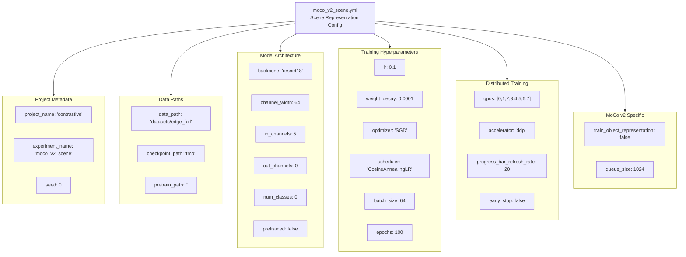
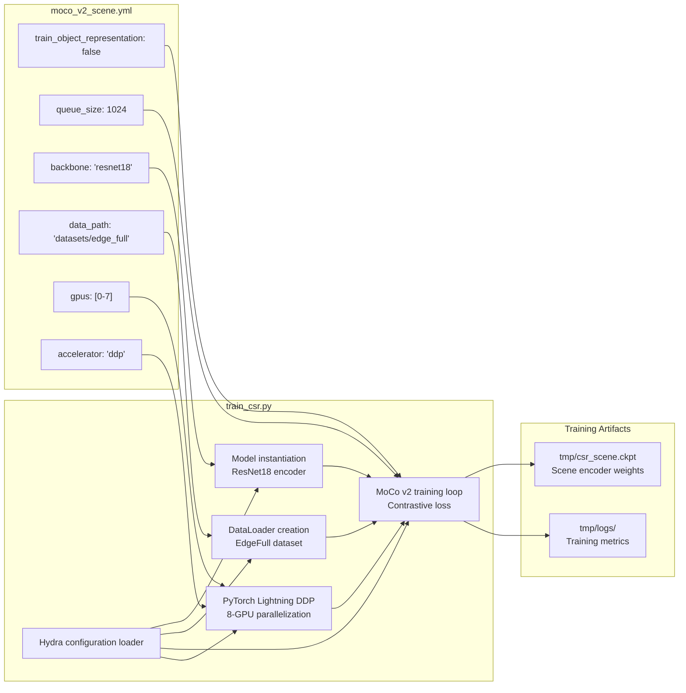
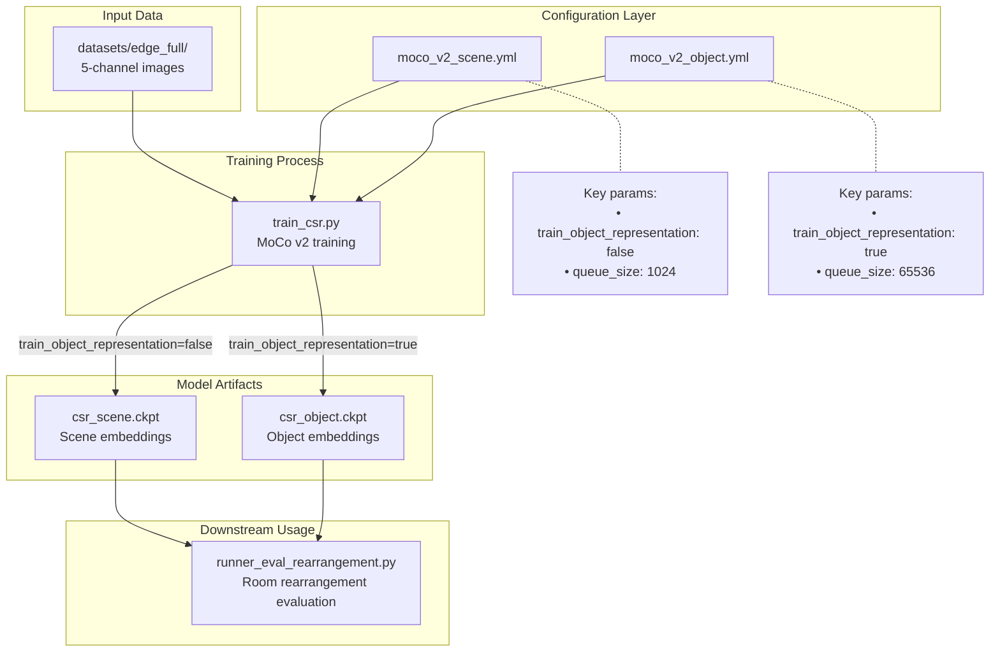

<!-- source: DeepWiki mcp.deepwiki.com · repo allenai/CSR · page 2.1 Scene Representation Training Configuration · fetched 2026-10-26 -->

# Scene Representation Training Configuration

<details>
<summary>Relevant source files</summary>

The following files were used as context for generating this wiki page:

- [configs_contrastive/moco_v2_scene.yml](configs_contrastive/moco_v2_scene.yml)

</details>


## Purpose and Scope

This page documents the configuration file `moco_v2_scene.yml` used for training scene representations in the CSR system. This configuration defines all parameters needed to train a ResNet18 encoder using MoCo v2 contrastive learning to produce embeddings that capture spatial relationships and scene structure. For object correspondence training configuration, see [Object Correspondence Training Configuration](#2.2). For general training pipeline information, see [Training Continuous Scene Representations](#2).

**Sources**: [configs_contrastive/moco_v2_scene.yml:1-32]()

---

## Configuration Overview

The `moco_v2_scene.yml` file is a YAML configuration that specifies all parameters for training scene-level continuous representations. It is consumed by the `train_csr.py` script and uses the Hydra configuration framework for management. The configuration produces a model checkpoint (`csr_scene.ckpt`) that learns to embed visual observations into a continuous space where spatially-related scenes have similar representations.

### Key Configuration Identity

| Property | Value | Purpose |
|----------|-------|---------|
| `project_name` | `contrastive` | Experiment tracking project identifier |
| `experiment_name` | `moco_v2_scene` | Specific experiment identifier for scene training |
| `train_object_representation` | `false` | **Critical flag**: Indicates scene-level (not object-level) training |
| `queue_size` | `1024` | Smaller queue optimized for scene-level contrastive learning |

**Sources**: [configs_contrastive/moco_v2_scene.yml:1-3,31-32]()

---

## Configuration Structure Diagram



**Sources**: [configs_contrastive/moco_v2_scene.yml:1-32]()

---

## Complete Parameter Reference

### Project Identification Parameters

| Parameter | Value | Description |
|-----------|-------|-------------|
| `project_name` | `'contrastive'` | Top-level project name for experiment tracking (e.g., W&B, TensorBoard) |
| `experiment_name` | `'moco_v2_scene'` | Unique identifier for this specific training run; distinguishes from `moco_v2_object` |
| `seed` | `0` | Random seed for reproducibility across training runs |

**Sources**: [configs_contrastive/moco_v2_scene.yml:1-5]()

---

### Data and Checkpoint Paths

| Parameter | Value | Description |
|-----------|-------|-------------|
| `data_path` | `'datasets/edge_full'` | Path to 5-channel image dataset containing RGB + auxiliary visual information |
| `checkpoint_path` | `'tmp'` | Directory where training checkpoints and logs are saved during training |
| `pretrain_path` | `''` | Path to load pre-trained weights from; empty string means train from scratch |

The `data_path` points to the Edge Full dataset, which contains multi-modal visual observations. The 5-channel input (see `in_channels`) typically includes RGB channels plus additional perception modalities like depth and edge maps.

**Sources**: [configs_contrastive/moco_v2_scene.yml:3-4,30]()

---

### Model Architecture Parameters

| Parameter | Value | Description |
|-----------|-------|-------------|
| `backbone` | `'resnet18'` | Encoder architecture; uses ResNet-18 as the feature extractor |
| `channel_width` | `64` | Number of channels in the first convolutional layer of the backbone |
| `in_channels` | `5` | Number of input channels (5-channel images from Edge Full dataset) |
| `out_channels` | `0` | Not used for contrastive learning; set to 0 |
| `num_classes` | `0` | Not used for contrastive learning (unsupervised); set to 0 |
| `pretrained` | `false` | Whether to initialize from ImageNet weights; false for random initialization |

The ResNet-18 backbone is modified to accept 5-channel inputs instead of standard 3-channel RGB. The `out_channels` and `num_classes` parameters are set to 0 because MoCo v2 uses contrastive learning rather than supervised classification.

**Sources**: [configs_contrastive/moco_v2_scene.yml:6,9-13]()

---

### Training Hyperparameters

| Parameter | Value | Description |
|-----------|-------|-------------|
| `lr` | `0.1` | Initial learning rate for the optimizer |
| `weight_decay` | `0.0001` | L2 regularization coefficient |
| `optimizer` | `'SGD'` | Optimization algorithm (Stochastic Gradient Descent) |
| `scheduler` | `'CosineAnnealingLR'` | Learning rate schedule; cosine annealing over epochs |
| `batch_size` | `64` | Batch size per GPU (effective batch size: 64 × 8 = 512) |
| `epochs` | `100` | Total number of training epochs |

The learning rate of 0.1 is relatively high, which is standard for large-batch contrastive learning. Combined with the cosine annealing schedule, the learning rate gradually decreases to near zero by epoch 100, following the MoCo v2 training protocol.

**Sources**: [configs_contrastive/moco_v2_scene.yml:7-8,14-17]()

---

### Distributed Training Configuration

| Parameter | Value | Description |
|-----------|-------|-------------|
| `gpus` | `[0, 1, 2, 3, 4, 5, 6, 7]` | List of GPU device IDs to use for training; 8 GPUs total |
| `accelerator` | `'ddp'` | Distributed Data Parallel strategy for multi-GPU training |
| `progress_bar_refresh_rate` | `20` | Frequency (in batches) to update the progress bar display |
| `early_stop` | `false` | Whether to enable early stopping; disabled for full 100-epoch training |

The configuration uses all 8 GPUs with PyTorch's Distributed Data Parallel (DDP) strategy. This means each GPU processes a batch of 64 samples independently, with gradients synchronized across devices, yielding an effective batch size of 512.

**Sources**: [configs_contrastive/moco_v2_scene.yml:18-29]()

---

## MoCo v2 Specific Parameters

### Scene Representation Configuration

| Parameter | Value | Critical Significance |
|-----------|-------|----------------------|
| `train_object_representation` | `false` | **Distinguishes scene vs. object training**: When false, trains scene-level spatial relationships; when true, trains object-level correspondences |
| `queue_size` | `1024` | Size of negative sample queue for contrastive learning; smaller than object model (65536) |

The `train_object_representation` flag is the primary differentiator between scene and object training configurations. When set to `false`, the training process:

- Focuses on learning spatial relationships between scene observations
- Uses samples from different viewpoints and timesteps as positives
- Optimizes for embeddings that capture scene structure and layout

The `queue_size` of 1024 maintains a bank of negative samples for contrastive loss computation. This is significantly smaller than the object model's queue (65536) because scene-level distinctions require fewer negative examples.

**Sources**: [configs_contrastive/moco_v2_scene.yml:31-32]()

---

## Configuration to Code Flow



**Sources**: [configs_contrastive/moco_v2_scene.yml:1-32]()

---

## Scene vs. Object Configuration Comparison

The following table highlights the key differences between scene and object representation training configurations:

| Parameter | Scene Configuration | Object Configuration | Rationale |
|-----------|-------------------|---------------------|-----------|
| `experiment_name` | `moco_v2_scene` | `moco_v2_object` | Distinguishes experiment tracking |
| `train_object_representation` | `false` | `true` | Scene-level vs. object-level learning |
| `queue_size` | `1024` | `65536` | Scenes need fewer negatives than fine-grained objects |
| Other parameters | Identical | Identical | Same architecture, hyperparameters, and hardware |

The primary architectural difference is the queue size: scene representations require a smaller negative sample bank (1024) because distinguishing between different scenes is easier than matching identical objects across trajectories. Object matching benefits from a much larger queue (65536) to learn fine-grained correspondences.

For detailed object configuration documentation, see [Object Correspondence Training Configuration](#2.2).

**Sources**: [configs_contrastive/moco_v2_scene.yml:2,31-32]()

---

## Usage Example

To train scene representations using this configuration:

```bash
python train_csr.py --config-name moco_v2_scene
```

The training script will:
1. Load configuration from `configs_contrastive/moco_v2_scene.yml` using Hydra
2. Initialize a ResNet-18 encoder with 5-channel inputs
3. Load the Edge Full dataset from `datasets/edge_full`
4. Train using MoCo v2 contrastive learning with scene-level objectives
5. Distribute training across 8 GPUs using DDP
6. Save checkpoints to `tmp/` directory
7. Train for 100 epochs with cosine annealing learning rate schedule

The resulting checkpoint (`csr_scene.ckpt`) will contain encoder weights optimized for producing scene embeddings used in the downstream room rearrangement task.

**Sources**: [configs_contrastive/moco_v2_scene.yml:1-32]()

---

## Configuration Validation

### Required Directory Structure

Before training, ensure the following paths exist:

| Path | Required | Purpose |
|------|----------|---------|
| `datasets/edge_full/` | Yes | Source data for training |
| `tmp/` | Auto-created | Checkpoint and log output directory |
| `configs_contrastive/moco_v2_scene.yml` | Yes | Configuration file |

### Hardware Requirements

- **Minimum**: 8 NVIDIA GPUs with CUDA 11.1 support
- **Memory**: Each GPU should have sufficient VRAM for batch_size=64 with ResNet-18
- **Storage**: Adequate space for checkpoints (~100MB per checkpoint) and logs

### Expected Outputs

After successful training, the following artifacts are created:

- `tmp/csr_scene.ckpt`: Final model checkpoint containing encoder weights
- `tmp/logs/`: Training logs and metrics (TensorBoard format)
- Intermediate checkpoints (if checkpoint callbacks are enabled)

**Sources**: [configs_contrastive/moco_v2_scene.yml:3-4]()

---

## Configuration Relationships



**Sources**: [configs_contrastive/moco_v2_scene.yml:1-32]()

---

