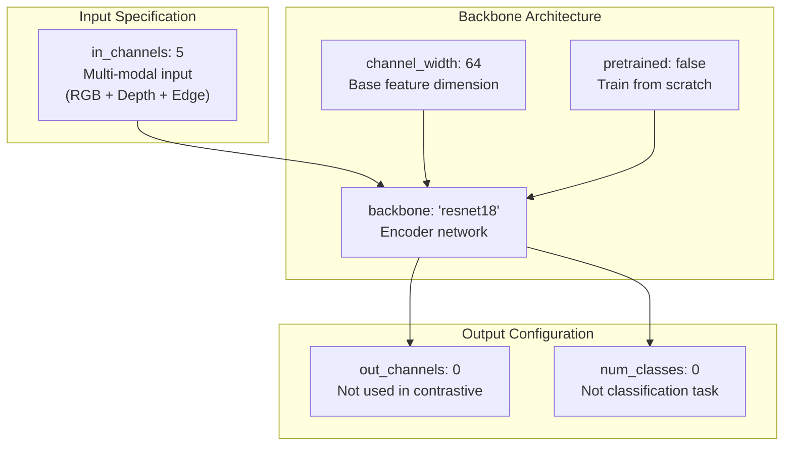
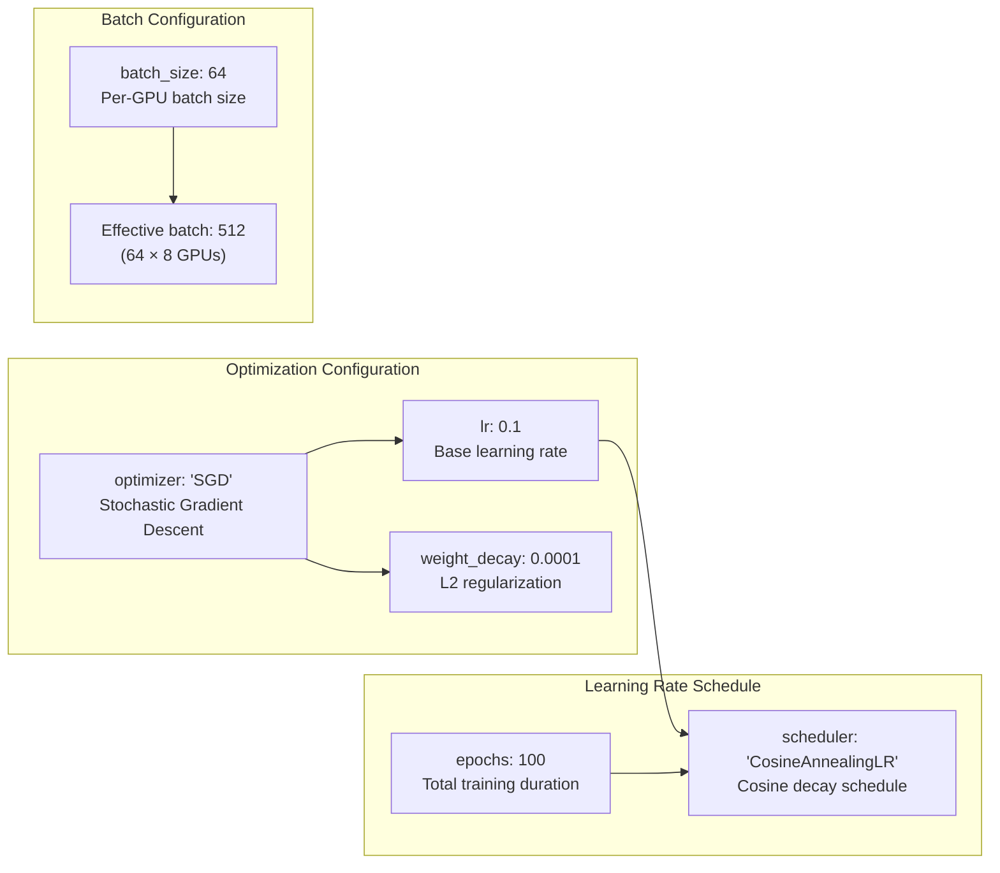
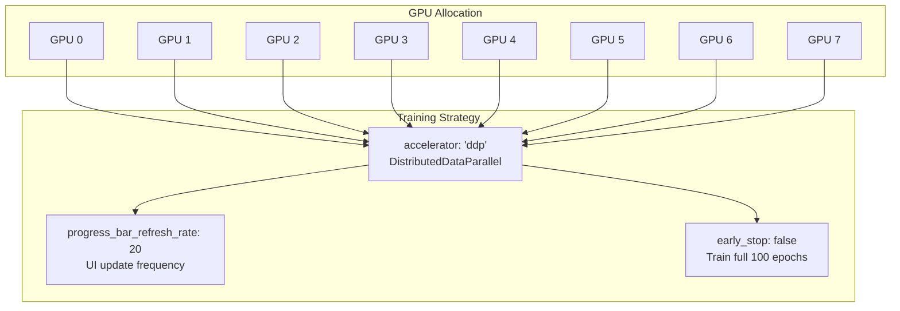
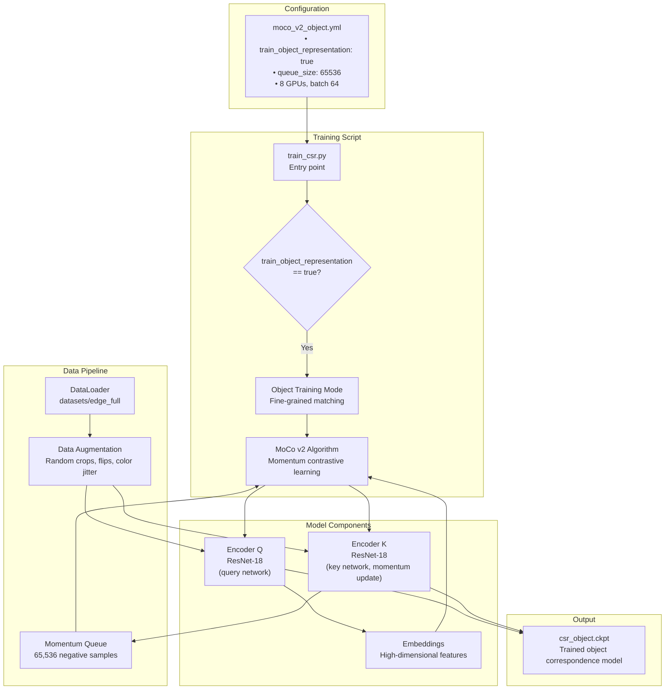
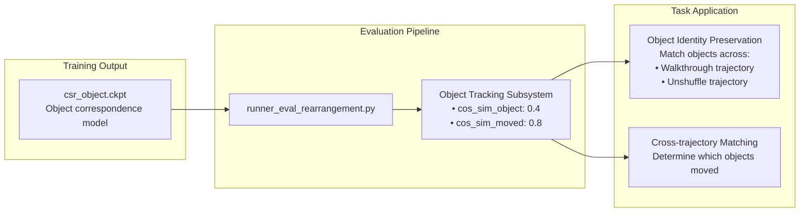

<!-- source: DeepWiki mcp.deepwiki.com · repo allenai/CSR · page 2.2 Object Correspondence Training Configuration · fetched 2026-10-26 -->

# Object Correspondence Training Configuration

<details>
<summary>Relevant source files</summary>

The following files were used as context for generating this wiki page:

- [configs_contrastive/moco_v2_object.yml](configs_contrastive/moco_v2_object.yml)

</details>


## Purpose and Scope

This document details the configuration parameters for training the **object correspondence model** using MoCo v2 contrastive learning. The object correspondence model learns embeddings that enable cross-trajectory object matching and identity preservation, which is essential for tracking objects across different observation sequences in the Visual Room Rearrangement task.

For information about the scene representation training configuration, see [2.1](#2.1). For an overview of the complete training system, see [2](#2).

**Sources**: [configs_contrastive/moco_v2_object.yml:1-32]()

---

## Configuration File Location

The object correspondence training configuration is located at `configs_contrastive/moco_v2_object.yml`. This file is consumed by `train_csr.py` when training with the `train_object_representation=true` flag, which instructs the training script to optimize for fine-grained object matching rather than scene-level spatial relationships.

**Sources**: [configs_contrastive/moco_v2_object.yml:1-4]()

---

## Project and Experiment Identification

| Parameter | Value | Description |
|-----------|-------|-------------|
| `project_name` | `'contrastive'` | Weights & Biases project name for experiment tracking |
| `experiment_name` | `'moco_v2_object'` | Specific experiment identifier for this training run |
| `checkpoint_path` | `'checkpoint_moco_v2_object'` | Directory where model checkpoints will be saved |
| `seed` | `0` | Random seed for reproducibility |

These parameters organize the training run within the MLOps infrastructure and ensure that model artifacts are saved to a distinct location from the scene representation training.

**Sources**: [configs_contrastive/moco_v2_object.yml:1-5]()

---

## Data Configuration

```yaml
data_path: 'datasets/edge_full'
```

The training data is sourced from `datasets/edge_full`, which contains 5-channel image observations from AI2-THOR environments. These channels typically include RGB, depth, and edge information, providing multi-modal visual features for learning robust object representations.

**Sources**: [configs_contrastive/moco_v2_object.yml:3]()

---

## Model Architecture Parameters



**Model Architecture Parameters**

| Parameter | Value | Purpose |
|-----------|-------|---------|
| `backbone` | `'resnet18'` | ResNet-18 CNN architecture serves as the feature encoder |
| `channel_width` | `64` | Base number of channels in the first convolution layer |
| `in_channels` | `5` | Input accepts 5-channel images (multi-modal observations) |
| `out_channels` | `0` | Not used in contrastive learning (embeddings are implicit) |
| `num_classes` | `0` | Not a classification task (unsupervised contrastive learning) |
| `pretrained` | `false` | Train from scratch rather than using ImageNet weights |

The ResNet-18 backbone is modified to accept 5-channel inputs and produces high-dimensional embeddings suitable for contrastive similarity comparisons. Setting `out_channels` and `num_classes` to 0 indicates this is not a supervised classification setup but rather an unsupervised representation learning task.

**Sources**: [configs_contrastive/moco_v2_object.yml:6-13]()

---

## Training Hyperparameters



**Hyperparameter Details**

| Parameter | Value | Description |
|-----------|-------|-------------|
| `optimizer` | `'SGD'` | Stochastic Gradient Descent optimizer |
| `lr` | `0.1` | Base learning rate (relatively high for SGD with momentum) |
| `weight_decay` | `0.0001` | L2 regularization coefficient |
| `scheduler` | `'CosineAnnealingLR'` | Cosine annealing learning rate schedule |
| `batch_size` | `64` | Batch size per GPU (effective batch: 512 across 8 GPUs) |
| `epochs` | `100` | Total number of training epochs |

The high initial learning rate (0.1) combined with cosine annealing allows rapid early learning followed by fine-tuning in later epochs. The large effective batch size (512) is critical for contrastive learning, as it provides more negative samples per training step.

**Sources**: [configs_contrastive/moco_v2_object.yml:7-17]()

---

## Distributed Training Configuration



**Distributed Training Settings**

| Parameter | Value | Description |
|-----------|-------|-------------|
| `gpus` | `[0, 1, 2, 3, 4, 5, 6, 7]` | Train across 8 GPUs in parallel |
| `accelerator` | `'ddp'` | Use PyTorch DistributedDataParallel |
| `progress_bar_refresh_rate` | `20` | Update progress bar every 20 batches |
| `early_stop` | `false` | Disable early stopping; train for full duration |

The 8-GPU distributed training setup enables processing large batch sizes and maintaining a substantial momentum queue (see next section), both of which are essential for effective contrastive learning. The DistributedDataParallel (DDP) strategy synchronizes gradients across GPUs while maintaining separate model replicas.

**Sources**: [configs_contrastive/moco_v2_object.yml:18-29]()

---

## Object Representation Specific Settings

```yaml
train_object_representation: true
queue_size: 65536
```

These two parameters are the **key differentiators** between object correspondence training and scene representation training:

### `train_object_representation: true`

This flag instructs `train_csr.py` to optimize for object-level matching rather than scene-level spatial relationships. When enabled, the training process focuses on:
- Learning embeddings that preserve object identity across different viewpoints
- Matching objects across different trajectory sequences
- Maintaining fine-grained object-level features rather than coarse scene structure

### `queue_size: 65536`

The momentum queue size is set to **65,536** negative samples, which is **64× larger** than the scene representation queue (1,024). This massive queue enables:
- **Broader negative sampling**: Each positive pair is contrasted against 65,536 negative examples
- **More discriminative embeddings**: The model must distinguish between many more similar-looking objects
- **Better generalization**: Exposure to diverse negative samples improves cross-scene object matching

The large queue is critical for object correspondence because objects can be highly similar (e.g., multiple chairs in a room), requiring the model to learn subtle distinguishing features.

**Sources**: [configs_contrastive/moco_v2_object.yml:31-32]()

---

## Configuration Comparison: Object vs Scene

The following table highlights the critical differences between object correspondence and scene representation training configurations:

| Parameter | Object Config (this page) | Scene Config ([2.1](#2.1)) | Rationale |
|-----------|---------------------------|----------------------------|-----------|
| `experiment_name` | `'moco_v2_object'` | `'moco_v2_scene'` | Distinguishes saved artifacts |
| `checkpoint_path` | `'checkpoint_moco_v2_object'` | `'checkpoint_moco_v2_scene'` | Separate checkpoint directories |
| `train_object_representation` | `true` | `false` | **Core differentiator**: object vs scene focus |
| `queue_size` | `65536` | `1024` | **64× larger** for fine-grained object matching |
| `backbone` | `'resnet18'` | `'resnet18'` | Same architecture for both tasks |
| `lr` | `0.1` | `0.1` | Identical learning rate |
| `batch_size` | `64` | `64` | Same per-GPU batch size |
| `epochs` | `100` | `100` | Same training duration |
| `gpus` | `[0-7]` | `[0-7]` | Same 8-GPU setup |

The **queue size** difference is the most significant architectural choice: object correspondence requires substantially more negative samples to learn discriminative features that distinguish between similar objects.

**Sources**: [configs_contrastive/moco_v2_object.yml:1-32]()

---

## Training Process Flow



**Process Description**

1. **Configuration Loading**: `train_csr.py` reads `moco_v2_object.yml` and detects `train_object_representation=true`
2. **Object Training Mode**: The script enters object correspondence training mode, optimizing for cross-trajectory object matching
3. **Data Pipeline**: 5-channel images from `datasets/edge_full` undergo augmentation (random crops, flips, color jittering)
4. **Dual Encoder Architecture**: 
   - Encoder Q (query): Actively trained network that processes augmented views
   - Encoder K (key): Momentum-updated network that maintains temporal consistency
5. **Momentum Queue**: Maintains 65,536 negative samples for contrastive loss computation
6. **Training Loop**: For 100 epochs across 8 GPUs, the model learns embeddings that maximize similarity between augmented views of the same object while minimizing similarity to different objects
7. **Checkpoint Output**: Final trained model saved to `checkpoint_moco_v2_object/` as `csr_object.ckpt`

**Sources**: [configs_contrastive/moco_v2_object.yml:1-32]()

---

## Output Model and Downstream Usage

The trained object correspondence model (`csr_object.ckpt`) produces embeddings that enable **cross-trajectory object matching**. This model is consumed by the evaluation system in the following way:



**Downstream Usage Details**

- **Object Tracking**: The model generates embeddings for detected objects in both walkthrough and unshuffle trajectories
- **Similarity Thresholds**: Objects are matched using cosine similarity with configurable thresholds (default: 0.4 for general matching, 0.8 for moved objects)
- **Identity Preservation**: Enables the system to track the same object across different viewpoints and time steps
- **Rearrangement Detection**: By comparing object positions between trajectories, the system identifies which objects need to be moved to restore the room to its original state

The large queue size (65,536) during training directly improves the model's ability to distinguish between similar objects in cluttered scenes, which is critical for accurate rearrangement planning.

**Sources**: [configs_contrastive/moco_v2_object.yml:31-32]()

---

## Key Insights

1. **Object vs Scene**: The `train_object_representation=true` flag and massive `queue_size=65536` are the defining characteristics that differentiate object training from scene training
2. **Negative Sampling Scale**: The 64× larger queue size reflects the increased difficulty of object-level matching compared to scene-level spatial reasoning
3. **Architecture Reuse**: Both object and scene models use identical ResNet-18 backbones, demonstrating that the training objective (not architecture) determines specialization
4. **Distributed Training Necessity**: 8-GPU training is essential not just for speed but to support the large effective batch size (512) and massive momentum queue
5. **Unsupervised Learning**: Setting `num_classes=0` and `out_channels=0` confirms this is pure contrastive learning without any supervised labels

**Sources**: [configs_contrastive/moco_v2_object.yml:1-32]()

---

