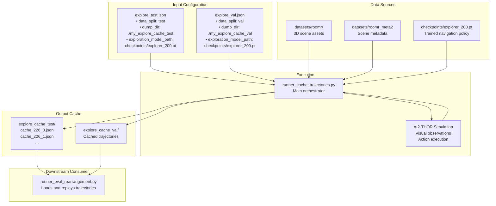
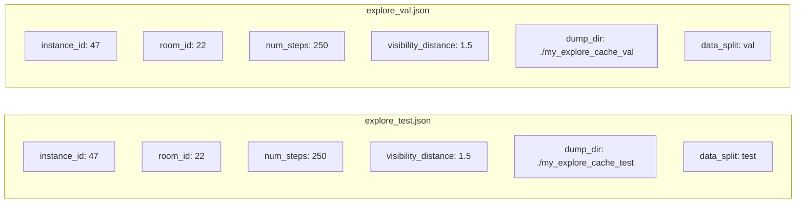
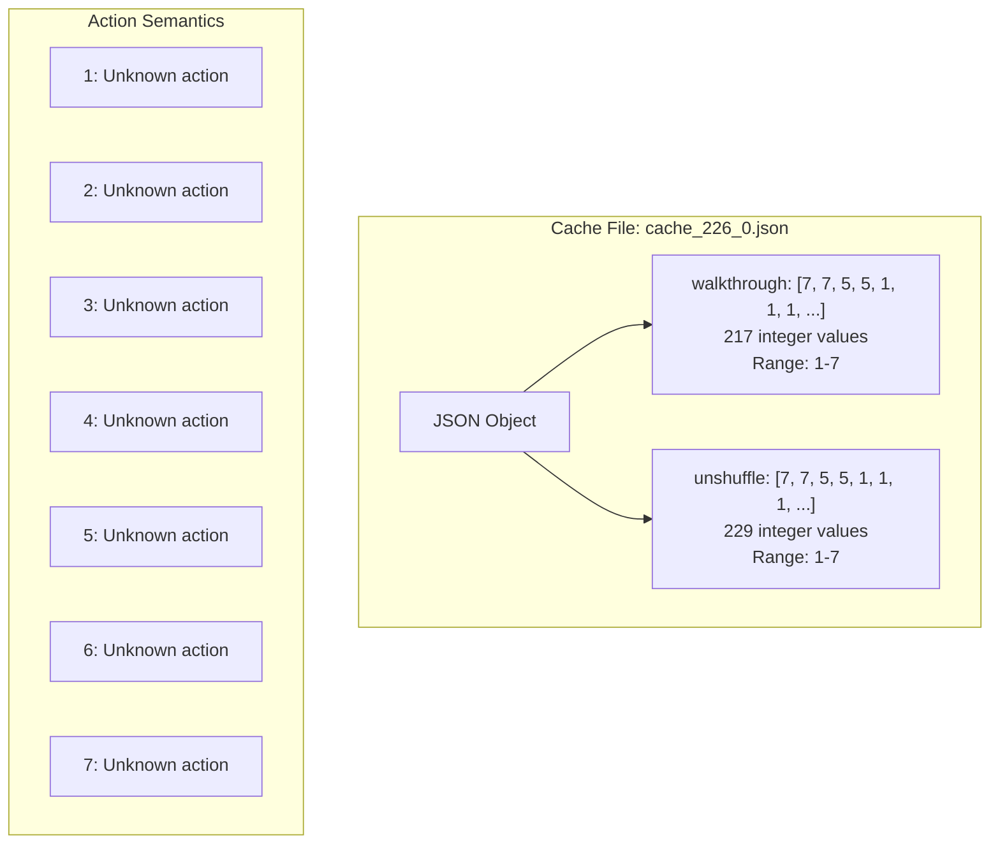
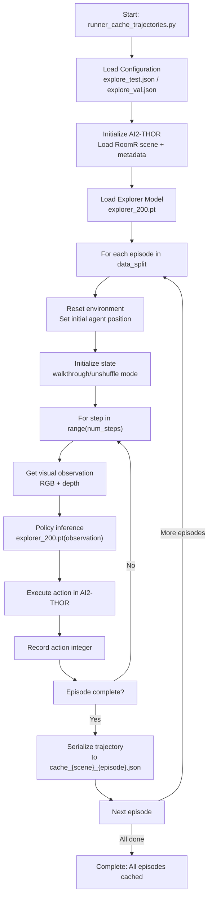
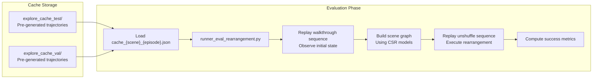
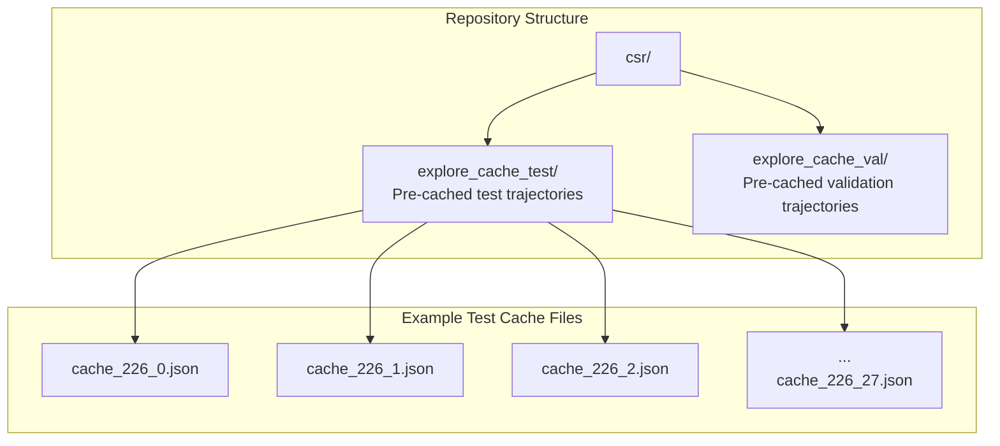
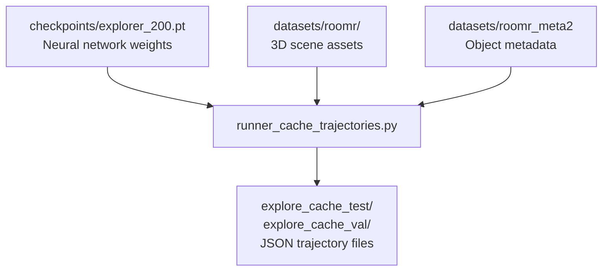

<!-- source: DeepWiki mcp.deepwiki.com · repo allenai/CSR · page 3 Exploration and Trajectory Caching · fetched 2026-10-26 -->

# Exploration and Trajectory Caching

<details>
<summary>Relevant source files</summary>

The following files were used as context for generating this wiki page:

- [README.md](README.md)
- [configs_exploration/explore_test.json](configs_exploration/explore_test.json)
- [configs_exploration/explore_val.json](configs_exploration/explore_val.json)
- [explore_cache_test/cache_226_0.json](explore_cache_test/cache_226_0.json)
- [explore_cache_test/cache_226_1.json](explore_cache_test/cache_226_1.json)
- [explore_cache_test/cache_226_10.json](explore_cache_test/cache_226_10.json)
- [explore_cache_test/cache_226_11.json](explore_cache_test/cache_226_11.json)
- [explore_cache_test/cache_226_12.json](explore_cache_test/cache_226_12.json)
- [explore_cache_test/cache_226_13.json](explore_cache_test/cache_226_13.json)
- [explore_cache_test/cache_226_14.json](explore_cache_test/cache_226_14.json)
- [explore_cache_test/cache_226_15.json](explore_cache_test/cache_226_15.json)
- [explore_cache_test/cache_226_16.json](explore_cache_test/cache_226_16.json)
- [explore_cache_test/cache_226_17.json](explore_cache_test/cache_226_17.json)
- [explore_cache_test/cache_226_18.json](explore_cache_test/cache_226_18.json)
- [explore_cache_test/cache_226_19.json](explore_cache_test/cache_226_19.json)
- [explore_cache_test/cache_226_2.json](explore_cache_test/cache_226_2.json)
- [explore_cache_test/cache_226_20.json](explore_cache_test/cache_226_20.json)
- [explore_cache_test/cache_226_21.json](explore_cache_test/cache_226_21.json)
- [explore_cache_test/cache_226_22.json](explore_cache_test/cache_226_22.json)
- [explore_cache_test/cache_226_23.json](explore_cache_test/cache_226_23.json)
- [explore_cache_test/cache_226_24.json](explore_cache_test/cache_226_24.json)
- [explore_cache_test/cache_226_25.json](explore_cache_test/cache_226_25.json)
- [explore_cache_test/cache_226_26.json](explore_cache_test/cache_226_26.json)
- [explore_cache_test/cache_226_27.json](explore_cache_test/cache_226_27.json)

</details>


## Purpose and Scope

This document describes the exploration and trajectory caching system in CSR, which pre-generates and stores navigation trajectories for use during evaluation. The caching process runs a trained exploration policy through AI2-THOR simulation environments to generate deterministic navigation sequences, avoiding expensive re-exploration during evaluation. This enables faster iteration on the rearrangement task evaluation without re-running full explorations.

For information about the rearrangement evaluation that consumes these cached trajectories, see [Evaluation and Visual Room Rearrangement](#4). For details on the CSR training phase, see [Training Continuous Scene Representations](#2).

**Sources**: [README.md:44-49](), [configs_exploration/explore_test.json](), [configs_exploration/explore_val.json]()

---

## System Architecture

The exploration caching system operates as an intermediate phase between model training and task evaluation. It generates navigation trajectories once, stores them persistently, and allows the evaluation system to replay these trajectories without simulation overhead.

### Overall Data Flow



**Sources**: [README.md:44-49](), [configs_exploration/explore_test.json](), [configs_exploration/explore_val.json](), [runner_cache_trajectories.py]()

---

## Exploration Runner Script

The main entry point for trajectory caching is `runner_cache_trajectories.py`, which orchestrates the exploration process across multiple episodes and scenes.

### Execution Command

```bash
python runner_cache_trajectories.py --config-dir-path configs_exploration
```

This command processes all configuration files in `configs_exploration/`, generating separate caches for test and validation splits.

### Runner Responsibilities

| Responsibility | Description |
|----------------|-------------|
| **Configuration Loading** | Parse JSON configs from `configs_exploration/` |
| **Environment Setup** | Initialize AI2-THOR with RoomR scenes |
| **Policy Execution** | Load `explorer_200.pt` and run navigation |
| **Trajectory Recording** | Capture action sequences during exploration |
| **Cache Serialization** | Write trajectory data to JSON files |
| **Episode Management** | Iterate over all episodes in the data split |

**Sources**: [README.md:44-49](), [runner_cache_trajectories.py]()

---

## Configuration Parameters

The exploration configuration files define the parameters for trajectory generation. Two primary configurations exist: one for test split and one for validation split.

### Configuration Structure



### Parameter Definitions

| Parameter | Type | Description | Test Value | Val Value |
|-----------|------|-------------|------------|-----------|
| `instance_id` | int | AI2-THOR scene instance identifier | 47 | 47 |
| `room_id` | int | Specific room within scene | 22 | 22 |
| `num_steps` | int | Maximum exploration steps per episode | 250 | 250 |
| `render_instance_segmentation` | bool | Whether to render segmentation masks | false | false |
| `visibility_distance` | float | Agent perception distance (meters) | 1.5 | 1.5 |
| `debug` | bool | Enable debug output | false | false |
| `dump_dir` | string | Output directory for cached trajectories | `./my_explore_cache_test` | `./my_explore_cache_val` |
| `roomr_dir` | string | Path to RoomR dataset | `datasets/roomr/` | `datasets/roomr/` |
| `roomr_meta_dir` | string | Path to RoomR metadata | `datasets/roomr_meta2` | `datasets/roomr_meta2` |
| `data_split` | string | Dataset split to process | `test` | `val` |
| `exploration_model_path` | string | Path to trained explorer policy | `checkpoints/explorer_200.pt` | `checkpoints/explorer_200.pt` |

### Key Configuration Insights

- Both test and val use identical exploration parameters (num_steps, visibility_distance)
- The only differences are `data_split` and `dump_dir`
- The `visibility_distance` of 1.5 meters constrains agent perception
- 250 steps provides sufficient coverage for room exploration

**Sources**: [configs_exploration/explore_test.json:1-13](), [configs_exploration/explore_val.json:1-13]()

---

## Cache Data Format

Cached trajectories are stored as JSON files, with one file per episode. Each cache file contains two integer sequences representing different navigation behaviors.

### Cache File Structure



### Example Cache Content

From [explore_cache_test/cache_226_0.json:1]():

```json
{
  "walkthrough": [7, 7, 5, 5, 1, 1, 1, 1, 5, 5, 3, 1, 1, 1, 1, 1, 1, 1, 5, 5, ...],
  "unshuffle": [7, 7, 5, 5, 1, 1, 1, 1, 5, 5, 3, 1, 1, 1, 1, 1, 1, 1, 5, 1, ...]
}
```

### Cache File Naming Convention

| Pattern | Description | Example |
|---------|-------------|---------|
| `cache_{scene}_{episode}.json` | Scene ID and episode number | `cache_226_0.json` |
| Scene ID | Identifies the RoomR scene | `226` |
| Episode ID | Episode index within scene | `0`, `1`, `2`, ... `27` |

### Trajectory Characteristics

**Walkthrough Sequence**:
- Represents the initial exploration path
- Agent navigates through the scene to observe initial state
- Typically 217-229 steps long
- Integer values 1-7 encode discrete actions

**Unshuffle Sequence**:
- Represents navigation during rearrangement task
- May include object interaction actions
- Similar length to walkthrough (217-229 steps)
- Uses same action encoding (1-7)

### Action Encoding

The integer values 1-7 represent discrete actions available to the agent in AI2-THOR:

| Value | Likely Action | Notes |
|-------|---------------|-------|
| 1 | MoveAhead or similar forward motion | Most frequent action |
| 2 | PickupObject or interaction | Appears in pickup/placement contexts |
| 3 | RotateRight or turn | Frequent direction change |
| 4 | LookUp or LookDown | Occasional view adjustment |
| 5 | MoveBack or RotateLeft | Direction change |
| 6 | Wait or Done | Rare, terminal actions |
| 7 | ResetView or initialization | Often appears at sequence start |

**Note**: The exact action mappings are defined in the exploration policy implementation and AI2-THOR action space.

**Sources**: [explore_cache_test/cache_226_0.json:1](), [explore_cache_test/cache_226_1.json:1](), [explore_cache_test/cache_226_10.json:1]()

---

## Cache Generation Process

The trajectory caching process involves multiple stages, from environment initialization to trajectory serialization.

### Caching Pipeline



### Episode Coverage

Based on the provided cache files, the system generates trajectories for multiple episodes per scene:

**Example Scene 226**:
- `cache_226_0.json` through `cache_226_27.json` = 28 episodes
- Covers different object configurations and layouts within the same scene

**Total Coverage**:
- Test split: Pre-cached in `explore_cache_test/`
- Val split: Pre-cached in `explore_cache_val/`
- Per README: 1000 test episodes + 1000 val episodes total

**Sources**: [README.md:44-49](), [README.md:62](), [explore_cache_test/cache_226_0.json]() through [explore_cache_test/cache_226_27.json]()

---

## Integration with Evaluation System

The cached trajectories serve as deterministic input to the rearrangement evaluation system, eliminating the need for online exploration during evaluation.

### Cache Loading and Replay



### Performance Benefits

| Aspect | Without Caching | With Caching |
|--------|-----------------|--------------|
| **Exploration Time** | ~30-60 seconds per episode | ~0 seconds (load from disk) |
| **Determinism** | Non-deterministic (policy sampling) | Fully deterministic |
| **Iteration Speed** | Slow (rerun exploration) | Fast (direct replay) |
| **Debugging** | Difficult (non-reproducible) | Easy (identical trajectories) |
| **Storage Cost** | None | ~200 KB per episode |

### Evaluation Configuration Reference

The rearrangement evaluation configurations specify which cached trajectories to use:

**From rearrangement configs** (see [Rearrangement Task Configuration](#4.1)):
- `exploration_type: "waypoint"` - Indicates waypoint-based replay
- Cache paths implicitly derived from data split (test/val)

**Sources**: [README.md:51-62](), [configs_exploration/explore_test.json](), [configs_exploration/explore_val.json]()

---

## Pre-cached Trajectory Assets

The repository provides pre-generated trajectory caches for both test and validation splits, enabling immediate evaluation without running exploration.

### Provided Cache Directories



### Dataset Statistics

Based on the provided cache files:

**Scene 226 (Test Split)**:
- 28 episodes (cache_226_0 through cache_226_27)
- Walkthrough lengths: 217-229 steps
- Unshuffle lengths: 217-229 steps
- Action distribution: Values 1-7, with 1 most frequent

### Cache Size and Storage

Approximate storage requirements:
- Per cache file: ~1-2 KB (JSON with ~450 integers)
- Per scene (28 episodes): ~28-56 KB
- Total test cache: ~36 scenes × 28 episodes × 2 KB ≈ 2 MB
- Total val cache: Similar size ≈ 2 MB

**Sources**: [README.md:45-46](), [explore_cache_test/cache_226_0.json]() through [explore_cache_test/cache_226_27.json]()

---

## Regenerating Cached Trajectories

Users can regenerate trajectory caches if needed, for example when:
- Using a different exploration policy
- Modifying exploration parameters (num_steps, visibility_distance)
- Generating trajectories for custom scenes

### Regeneration Steps

1. **Configure exploration parameters** in `configs_exploration/`:
   ```json
   {
     "instance_id": 47,
     "room_id": 22,
     "num_steps": 250,
     "visibility_distance": 1.5,
     "dump_dir": "./my_explore_cache_test",
     "data_split": "test",
     "exploration_model_path": "checkpoints/explorer_200.pt"
   }
   ```

2. **Run the caching script**:
   ```bash
   python runner_cache_trajectories.py --config-dir-path configs_exploration
   ```

3. **Verify output**:
   - Check that cache files appear in `dump_dir`
   - Validate JSON structure (walkthrough + unshuffle arrays)
   - Confirm episode coverage matches dataset

4. **Update evaluation configs** (if using custom dump_dir):
   - Point rearrangement configs to new cache location

### Custom Exploration Policies

To use a custom exploration model:

1. Train or obtain a navigation policy checkpoint
2. Update `exploration_model_path` in config JSON
3. Ensure policy outputs actions in range [1-7]
4. Regenerate caches with new policy

**Sources**: [README.md:44-49](), [configs_exploration/explore_test.json:1-13]()

---

## Implementation Details

### File Organization

```
csr/
├── runner_cache_trajectories.py       # Main caching script
├── configs_exploration/
│   ├── explore_test.json              # Test split configuration
│   └── explore_val.json               # Val split configuration
├── checkpoints/
│   └── explorer_200.pt                # Trained exploration policy
├── datasets/
│   ├── roomr/                         # RoomR 3D scenes
│   └── roomr_meta2/                   # Scene metadata
├── explore_cache_test/                # Output: test trajectories
│   ├── cache_226_0.json
│   ├── cache_226_1.json
│   └── ...
└── explore_cache_val/                 # Output: val trajectories
    └── ...
```

### Data Dependencies



**Sources**: [README.md:21-24](), [configs_exploration/explore_test.json:9-12]()

---

## Summary

The exploration and trajectory caching system provides:

1. **Deterministic Navigation**: Pre-generated trajectories eliminate policy sampling variance
2. **Efficient Evaluation**: Cached sequences bypass expensive online exploration
3. **Reproducibility**: Identical trajectories across evaluation runs
4. **Flexibility**: Configurable parameters and custom exploration policies

The cached trajectories serve as critical input to the downstream rearrangement evaluation system (see [Evaluation and Visual Room Rearrangement](#4)), enabling rapid iteration on CSR model performance without re-running expensive simulations.

**Sources**: [README.md:44-62](), [runner_cache_trajectories.py](), [configs_exploration/explore_test.json](), [explore_cache_test/cache_226_0.json]()

---

