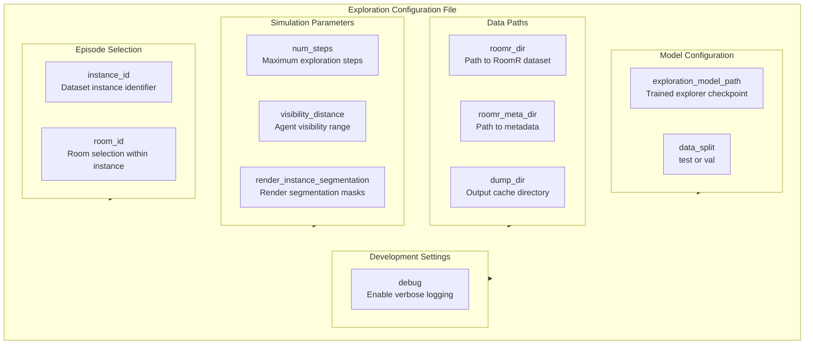
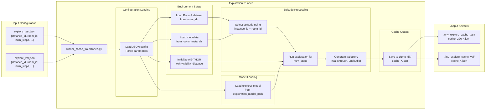
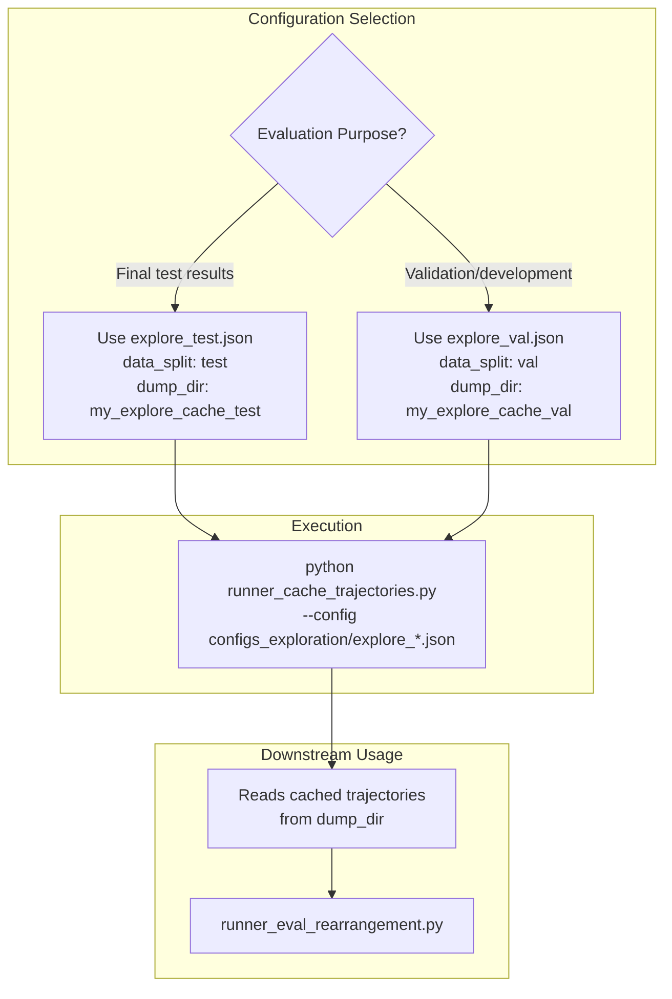

<!-- source: DeepWiki mcp.deepwiki.com · repo allenai/CSR · page 3.1 Exploration Configuration · fetched 2026-10-26 -->

# Exploration Configuration

<details>
<summary>Relevant source files</summary>

The following files were used as context for generating this wiki page:

- [configs_exploration/explore_test.json](configs_exploration/explore_test.json)
- [configs_exploration/explore_val.json](configs_exploration/explore_val.json)

</details>


## Purpose and Scope

This document describes the exploration configuration files that control the trajectory caching process in the CSR system. These JSON configuration files (`explore_test.json` and `explore_val.json`) specify parameters for generating and caching navigation trajectories using a trained explorer model within AI2-THOR simulation environments.

The exploration configuration is consumed by `runner_cache_trajectories.py` to generate pre-computed trajectories that are later used during rearrangement evaluation. For information about the generated cache files and their format, see [Exploration Cache Data Format](#3.2). For the overall exploration and caching process, see [Exploration and Trajectory Caching](#3).

**Sources:** [configs_exploration/explore_test.json](), [configs_exploration/explore_val.json]()

## Configuration Files Overview

The CSR system provides two exploration configuration files, one for each evaluation split:

| Configuration File | Data Split | Primary Use Case | Output Directory |
|-------------------|------------|------------------|------------------|
| `explore_test.json` | test | Final evaluation on test set | `./my_explore_cache_test` |
| `explore_val.json` | val | Development and validation | `./my_explore_cache_val` |

Both files share an identical structure but may differ in specific parameter values depending on the evaluation requirements. The configuration files are located in `configs_exploration/` and follow standard JSON format for easy modification and version control.

**Sources:** [configs_exploration/explore_test.json:1-13](), [configs_exploration/explore_val.json:1-13]()

## Configuration File Structure



**Diagram: Exploration Configuration Parameter Categories**

**Sources:** [configs_exploration/explore_test.json:1-13](), [configs_exploration/explore_val.json:1-13]()

## Configuration Parameters

### Episode Selection Parameters

| Parameter | Type | Description | Example Values |
|-----------|------|-------------|----------------|
| `instance_id` | integer | Identifies which dataset instance to process. This corresponds to a specific environment configuration in the RoomR dataset. | `47` |
| `room_id` | integer | Specifies which room within the instance to use for exploration. Each instance may contain multiple rooms. | `22` |

These parameters together uniquely identify a specific room environment within the RoomR dataset for trajectory generation. The exploration runner uses these identifiers to load the appropriate 3D environment and metadata.

**Sources:** [configs_exploration/explore_test.json:2-3](), [configs_exploration/explore_val.json:2-3]()

### Simulation Parameters

| Parameter | Type | Description | Example Values |
|-----------|------|-------------|----------------|
| `num_steps` | integer | Maximum number of steps the agent can take during exploration. This limits the trajectory length and prevents infinite exploration. | `250` |
| `render_instance_segmentation` | boolean | Controls whether to render instance segmentation masks during simulation. Set to `false` for faster execution when segmentation is not needed. | `false` |
| `visibility_distance` | float | Defines the maximum distance (in meters) at which the agent can perceive objects in the environment. This parameter affects what the agent "sees" and can interact with. | `1.5` |

The `num_steps` parameter is crucial for controlling computational cost, as each step involves AI2-THOR simulation and model inference. The `visibility_distance` directly impacts the agent's perception capabilities and should be set according to the task requirements.

**Sources:** [configs_exploration/explore_test.json:4-6](), [configs_exploration/explore_val.json:4-6]()

### Data Path Parameters

| Parameter | Type | Description | Example Values |
|-----------|------|-------------|----------------|
| `roomr_dir` | string | Path to the RoomR dataset directory containing the 3D environment assets and scene configurations. | `"datasets/roomr/"` |
| `roomr_meta_dir` | string | Path to the RoomR metadata directory containing episode metadata, object configurations, and scene annotations. | `"datasets/roomr_meta2"` |
| `dump_dir` | string | Output directory where the generated trajectory cache files will be saved. Each cached trajectory is stored as a separate JSON file. | `"./my_explore_cache_test"` |

These paths must be correctly configured to point to the downloaded RoomR dataset and desired output location. The `dump_dir` is created automatically if it doesn't exist. For dataset setup instructions, see [Installation and Setup](#1.2).

**Sources:** [configs_exploration/explore_test.json:8-10](), [configs_exploration/explore_val.json:8-10]()

### Model and Split Configuration

| Parameter | Type | Description | Example Values |
|-----------|------|-------------|----------------|
| `data_split` | string | Specifies which data split to use. Must be either `"test"` or `"val"`. This determines which episodes from the RoomR dataset are processed. | `"test"`, `"val"` |
| `exploration_model_path` | string | Path to the trained exploration policy checkpoint. This model determines the agent's navigation behavior during trajectory generation. | `"checkpoints/explorer_200.pt"` |

The `data_split` parameter must match the intended evaluation split and should align with the configuration filename (e.g., `explore_test.json` should have `data_split: "test"`). The exploration model checkpoint must be downloaded or trained before running trajectory caching.

**Sources:** [configs_exploration/explore_test.json:11-12](), [configs_exploration/explore_val.json:11-12]()

### Development Parameters

| Parameter | Type | Description | Example Values |
|-----------|------|-------------|----------------|
| `debug` | boolean | Enables verbose debugging output and additional logging during exploration. Useful for development and troubleshooting but should be disabled for production runs. | `false` |

When `debug` is set to `true`, the exploration runner outputs detailed information about each step, agent observations, and internal state transitions.

**Sources:** [configs_exploration/explore_test.json:7](), [configs_exploration/explore_val.json:7]()

## Configuration Flow in the Exploration System



**Diagram: Configuration Data Flow Through Exploration System**

This diagram illustrates how the exploration configuration files drive the trajectory caching process. The runner loads configuration parameters and uses them to:
1. Set up the AI2-THOR simulation environment with appropriate visibility constraints
2. Load the trained exploration policy from the specified checkpoint
3. Select specific episodes using `instance_id` and `room_id`
4. Execute exploration for the configured number of steps
5. Save generated trajectories to the output directory

**Sources:** [configs_exploration/explore_test.json](), [configs_exploration/explore_val.json]()

## Configuration Usage Pattern



**Diagram: Configuration Usage in CSR Workflow**

The exploration configuration is typically used as follows:
1. Select the appropriate configuration file based on the evaluation split
2. Modify parameters if needed (e.g., change output directory or visibility distance)
3. Run `runner_cache_trajectories.py` with the configuration
4. Use the generated cache files in downstream rearrangement evaluation

**Sources:** [configs_exploration/explore_test.json](), [configs_exploration/explore_val.json]()

## Configuration Differences Between Test and Val

While both configuration files share the same structure, they differ in their `data_split` and `dump_dir` parameters:

| Parameter | explore_test.json | explore_val.json |
|-----------|-------------------|------------------|
| `data_split` | `"test"` | `"val"` |
| `dump_dir` | `"./my_explore_cache_test"` | `"./my_explore_cache_val"` |

All other parameters (instance_id, room_id, num_steps, visibility_distance, etc.) are identical in the provided configurations. This ensures consistent exploration behavior across both splits, with only the data source and output location differing.

**Note:** Users may need to adjust `instance_id` and `room_id` when processing different episodes from the dataset. The provided values (`instance_id: 47`, `room_id: 22`) serve as examples and should be modified to match the desired evaluation episodes.

**Sources:** [configs_exploration/explore_test.json:8-11](), [configs_exploration/explore_val.json:8-11]()

## Common Configuration Modifications

### Adjusting Visibility Distance

The `visibility_distance` parameter can be modified to test different perception capabilities:

```json
"visibility_distance": 1.5   // Limited perception (realistic)
"visibility_distance": 20.0  // Near-omniscient perception (debugging)
```

Higher values allow the agent to perceive objects from greater distances, which can be useful for debugging but may not reflect realistic agent capabilities.

### Enabling Debug Mode

For troubleshooting exploration issues:

```json
"debug": true
```

This produces verbose logging that shows step-by-step agent actions, observations, and internal state.

### Changing Output Location

To organize multiple experiment runs:

```json
"dump_dir": "./experiments/exp_001/cache_test"
```

The directory structure is created automatically if it doesn't exist.

**Sources:** [configs_exploration/explore_test.json](), [configs_exploration/explore_val.json]()

## Configuration Validation

The exploration runner validates the following aspects of the configuration:

1. **Path Existence**: Verifies that `roomr_dir`, `roomr_meta_dir`, and `exploration_model_path` point to existing locations
2. **Data Split Validity**: Ensures `data_split` is either `"test"` or `"val"`
3. **Parameter Ranges**: Validates that numeric parameters like `num_steps` and `visibility_distance` are positive
4. **Episode Availability**: Confirms that the specified `instance_id` and `room_id` exist in the dataset

If validation fails, the runner will raise an error with a descriptive message indicating which parameter is misconfigured.

**Sources:** [configs_exploration/explore_test.json](), [configs_exploration/explore_val.json]()

---

