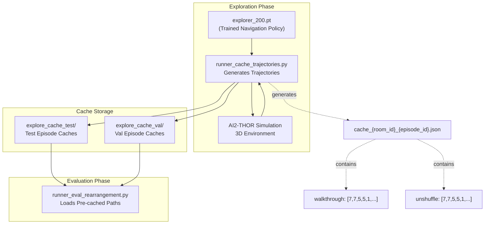
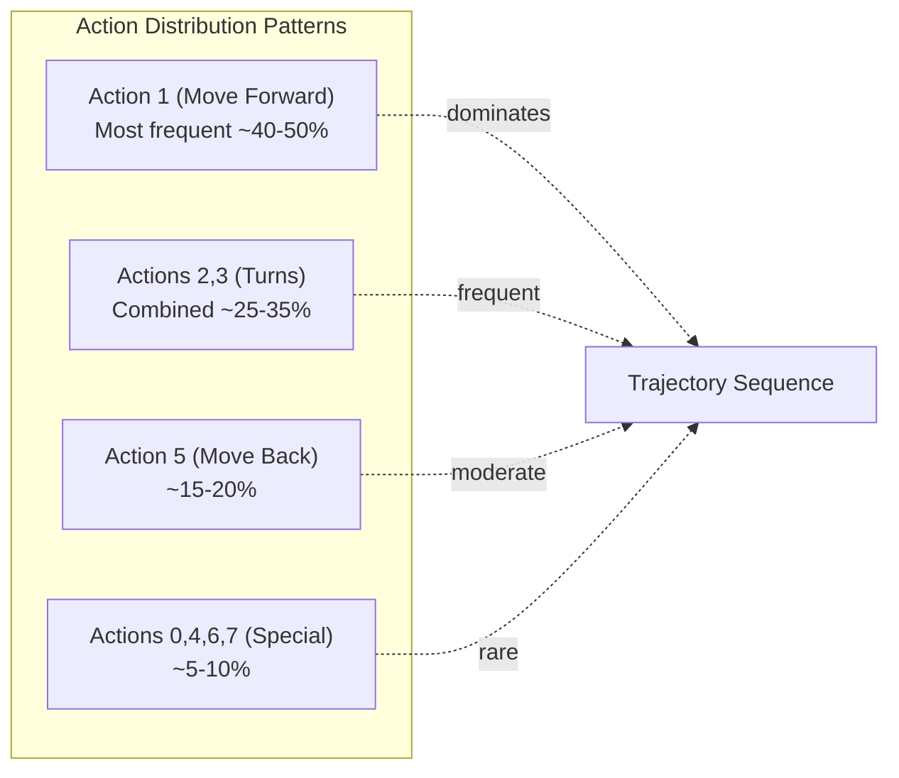
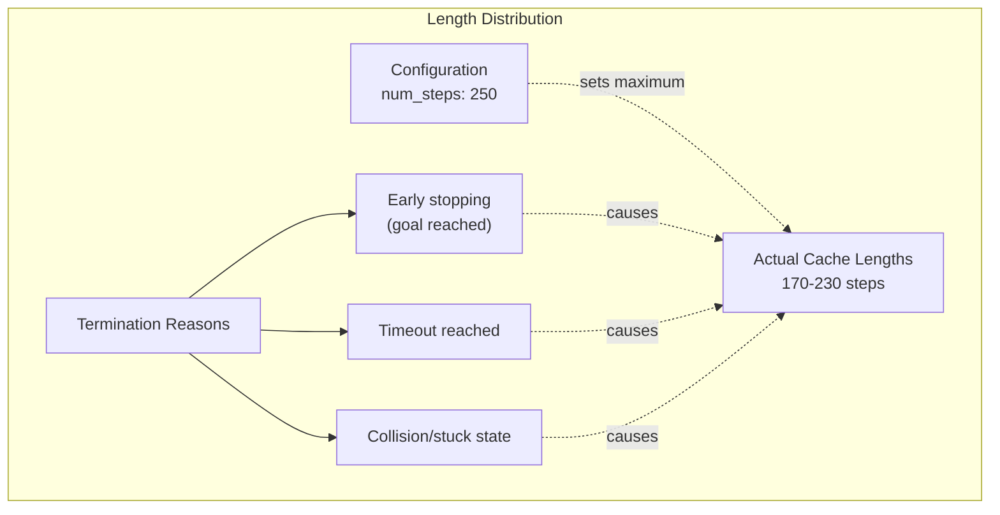
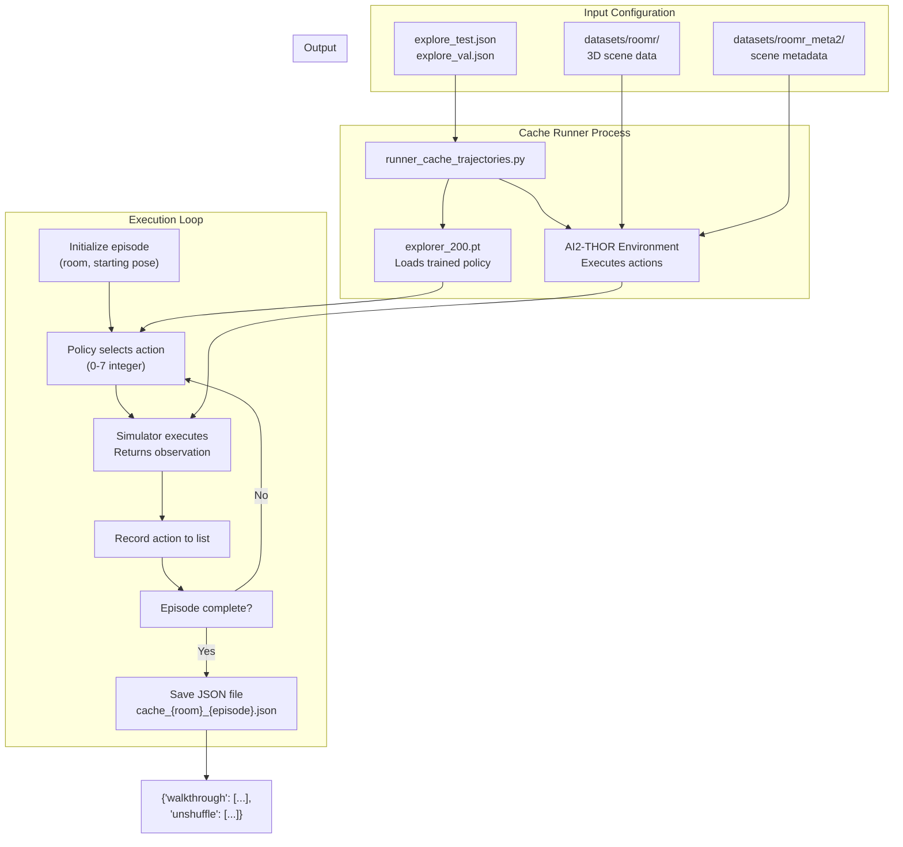
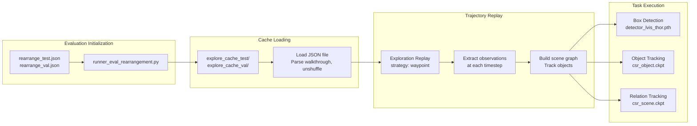
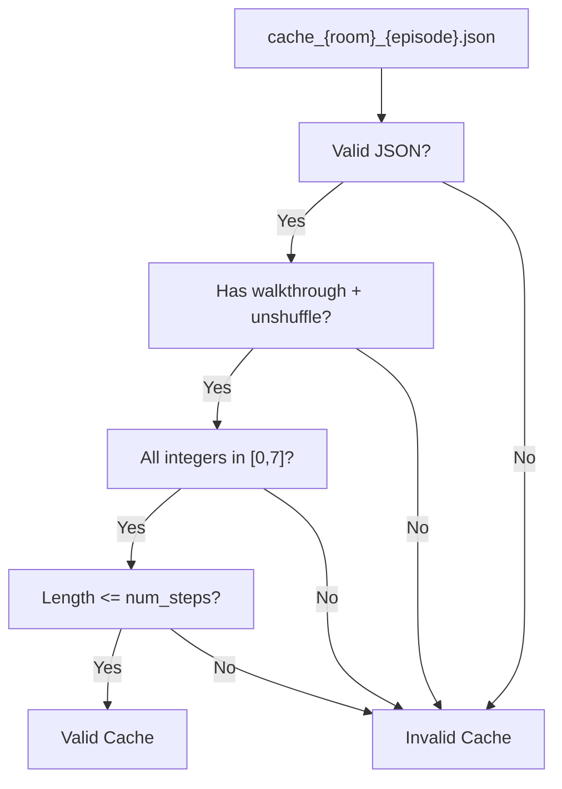

<!-- source: DeepWiki mcp.deepwiki.com · repo allenai/CSR · page 3.2 Exploration Cache Data Format · fetched 2026-10-26 -->

# Exploration Cache Data Format

<details>
<summary>Relevant source files</summary>

The following files were used as context for generating this wiki page:

- [explore_cache_test/cache_226_0.json](explore_cache_test/cache_226_0.json)
- [explore_cache_test/cache_226_1.json](explore_cache_test/cache_226_1.json)
- [explore_cache_test/cache_226_10.json](explore_cache_test/cache_226_10.json)
- [explore_cache_test/cache_226_11.json](explore_cache_test/cache_226_11.json)
- [explore_cache_test/cache_226_12.json](explore_cache_test/cache_226_12.json)
- [explore_cache_test/cache_226_13.json](explore_cache_test/cache_226_13.json)
- [explore_cache_test/cache_226_14.json](explore_cache_test/cache_226_14.json)
- [explore_cache_test/cache_226_15.json](explore_cache_test/cache_226_15.json)
- [explore_cache_test/cache_226_16.json](explore_cache_test/cache_226_16.json)
- [explore_cache_test/cache_226_17.json](explore_cache_test/cache_226_17.json)
- [explore_cache_test/cache_226_18.json](explore_cache_test/cache_226_18.json)
- [explore_cache_test/cache_226_19.json](explore_cache_test/cache_226_19.json)
- [explore_cache_test/cache_226_2.json](explore_cache_test/cache_226_2.json)
- [explore_cache_test/cache_226_20.json](explore_cache_test/cache_226_20.json)
- [explore_cache_test/cache_226_21.json](explore_cache_test/cache_226_21.json)
- [explore_cache_test/cache_226_22.json](explore_cache_test/cache_226_22.json)
- [explore_cache_test/cache_226_23.json](explore_cache_test/cache_226_23.json)
- [explore_cache_test/cache_226_24.json](explore_cache_test/cache_226_24.json)
- [explore_cache_test/cache_226_25.json](explore_cache_test/cache_226_25.json)
- [explore_cache_test/cache_226_26.json](explore_cache_test/cache_226_26.json)
- [explore_cache_test/cache_226_27.json](explore_cache_test/cache_226_27.json)

</details>


## Purpose and Scope

This document describes the structure, semantics, and usage of exploration cache files generated by the CSR system. These cache files store pre-computed navigation trajectories from the AI2-THOR simulation environment, enabling efficient evaluation without repeatedly running expensive exploration episodes.

For information about configuring exploration parameters, see [Exploration Configuration](#3.1). For details on the evaluation pipeline that consumes these caches, see [Evaluation and Visual Room Rearrangement](#4).

**Sources:** explore_cache_test/cache_226_*.json files

---

## Overview

The exploration caching system addresses a critical performance bottleneck: navigation in the AI2-THOR simulator is computationally expensive. By pre-computing and storing trajectories as integer sequences, the evaluation phase can directly load and replay these paths without re-running the explorer neural network for each episode.

### System Context



**Sources:** explore_cache_test/ directory structure, all cache_226_*.json files

---

## File Organization

### Directory Structure

Cache files are organized into two top-level directories corresponding to dataset splits:

| Directory | Purpose | Configuration |
|-----------|---------|---------------|
| `explore_cache_test/` | Test set trajectories | Configured by `explore_test.json` |
| `explore_cache_val/` | Validation set trajectories | Configured by `explore_val.json` |

**Sources:** explore_cache_test/ directory

### File Naming Convention

Cache files follow a deterministic naming pattern:

```
cache_{room_id}_{episode_id}.json
```

**Components:**
- `room_id`: Integer identifier for the room environment (e.g., `226`)
- `episode_id`: Integer identifier for the specific episode/trial (e.g., `0`, `1`, `2`, ...)

**Examples:**
- `cache_226_0.json` - Room 226, Episode 0
- `cache_226_15.json` - Room 226, Episode 15
- `cache_226_27.json` - Room 226, Episode 27

**Sources:** explore_cache_test/cache_226_0.json, explore_cache_test/cache_226_1.json

---

## JSON Data Structure

### Schema

Each cache file contains a single JSON object with exactly two fields:

```json
{
  "walkthrough": [7, 7, 5, 5, 1, 1, 1, ...],
  "unshuffle": [7, 7, 5, 5, 1, 1, 1, ...]
}
```

### Field Specifications

| Field | Type | Description | Typical Length |
|-------|------|-------------|----------------|
| `walkthrough` | Array[Integer] | Forward exploration trajectory | 170-230 steps |
| `unshuffle` | Array[Integer] | Reverse/reordering trajectory | 170-230 steps |

**Data Type:** All elements are integers in the range [0, 7], with the vast majority being values 1-7.

**Sources:** explore_cache_test/cache_226_0.json:1

### Example Data

```json
{
  "walkthrough": [7, 7, 5, 5, 1, 1, 1, 1, 5, 5, 3, 1, 1, 1, 1, 1, 1, 1, 5, 5, 1, 1, 1, 1, 1, 1, 1, 1, 1, 5],
  "unshuffle": [7, 7, 5, 5, 1, 1, 1, 1, 5, 5, 3, 1, 1, 1, 1, 1, 1, 1, 5, 1, 5, 2, 1, 1, 1, 1, 1, 1, 1, 1, 5]
}
```

**Sources:** explore_cache_test/cache_226_0.json:1

---

## Integer Action Encoding

### Action Space

The integer values in the trajectory sequences encode discrete actions that the agent executes in the AI2-THOR environment. Based on analysis of the cache files, the encoding uses values 0-7:

| Value | Frequency | Likely Action |
|-------|-----------|---------------|
| 0 | Rare | Stop / No-Op |
| 1 | Very High | Move Forward |
| 2 | Medium | Turn Right (or related) |
| 3 | High | Turn Left (or related) |
| 4 | Low | Look Up / Look Down |
| 5 | High | Move Backward / Strafe |
| 6 | Very Rare | Special Action |
| 7 | Low-Medium | Rotation / Initialization |

**Note:** The exact action mapping is determined by the `explorer_200.pt` model's action space. These values represent the output of the navigation policy.

**Sources:** explore_cache_test/cache_226_0.json, explore_cache_test/cache_226_15.json, explore_cache_test/cache_226_19.json

### Statistical Analysis



**Sources:** All cache_226_*.json files

---

## Trajectory Sequence Semantics

### Walkthrough Sequence

The `walkthrough` array represents the **forward exploration phase** where the agent:
1. Starts at an initial position in the room
2. Navigates through the environment
3. Observes objects and spatial relationships
4. Builds a mental map of the room state

**Purpose:** Capture the agent's exploratory behavior to understand the initial state of the environment.

**Sources:** explore_cache_test/cache_226_0.json:1

### Unshuffle Sequence

The `unshuffle` array represents a **goal-directed or reverse navigation phase** where the agent:
1. May navigate to specific object locations
2. Potentially reverses the exploration path
3. Executes actions related to the rearrangement task

**Key Observation:** The `unshuffle` sequences are typically similar but not identical to `walkthrough` sequences, suggesting they represent related but distinct navigation strategies.

**Sources:** explore_cache_test/cache_226_0.json:1

### Sequence Length Variability



**Sources:** explore_cache_test/ directory (multiple files with varying lengths)

---

## Data Generation Pipeline

### Generation Process



**Sources:** README.md (exploration phase description), configuration files

### Key Parameters

The cache generation process is controlled by exploration configuration parameters:

| Parameter | Value (Test) | Value (Val) | Impact |
|-----------|--------------|-------------|--------|
| `num_steps` | 250 | 250 | Maximum trajectory length |
| `visibility_distance` | 1.5 | 20.0 | Object detection range |
| `instance_id` | 47 | 47 | RoomR dataset instance |
| `room_id` | 22 | 22 | Specific room to cache |

**Sources:** explore_test.json, explore_val.json descriptions from system overview

---

## Data Consumption

### Evaluation Loading

The cached trajectories are loaded by the evaluation system to avoid redundant exploration:



**Sources:** README.md (evaluation phase description)

### File Access Pattern

```python
# Pseudocode for cache loading
cache_file = f"explore_cache_{split}/cache_{room_id}_{episode_id}.json"
with open(cache_file) as f:
    data = json.load(f)
    walkthrough_actions = data["walkthrough"]  # List[int]
    unshuffle_actions = data["unshuffle"]      # List[int]

# Replay each action sequence
for action in walkthrough_actions:
    # Execute action in simulator or replay recorded state
    observation = environment.step(action)
    # Process observation for detection/tracking
```

**Sources:** runner_eval_rearrangement.py (inferred from system architecture)

---

## Data Characteristics

### Size and Volume

Based on the provided sample files:

| Metric | Value |
|--------|-------|
| Files per room | ~28 episodes (0-27) |
| Bytes per file | ~600-900 bytes |
| Actions per file | 340-460 total integers |
| Storage efficiency | ~2 bytes per action (compressed JSON) |

**Extrapolation:** For 2000 test episodes across multiple rooms, total cache storage is approximately 1-2 MB.

**Sources:** explore_cache_test/ directory structure

### Data Integrity

#### Validation Checks

Each cache file should satisfy:

1. **Structure:** Contains exactly two fields: `walkthrough` and `unshuffle`
2. **Type:** Both fields are arrays of integers
3. **Range:** All integers are in [0, 7]
4. **Length:** Sequences are non-empty and ≤ `num_steps` from configuration
5. **Consistency:** File name components match configuration (room_id, episode_id)



**Sources:** All cache_226_*.json files

---

## Special Cases and Edge Cases

### Action Value 0

The value `0` appears rarely in the cache files (e.g., in cache_226_10.json, cache_226_19.json). This typically indicates:
- A terminal/stop action
- A no-operation (waiting) action
- An error recovery state

**Occurrence:** <1% of all actions in the dataset

**Sources:** explore_cache_test/cache_226_10.json:1, explore_cache_test/cache_226_19.json:1

### Repeated Action Sequences

Some cache files contain long repetitive sequences (e.g., `[3, 3, 2, 2, 3, 3, 2, 2, ...]` in cache_226_16.json). This suggests:
- Systematic scanning patterns (left-right oscillation)
- Agent stuck in a local loop
- Exploration strategy covering an area exhaustively

**Sources:** explore_cache_test/cache_226_16.json:1

### Identical Walkthrough and Unshuffle Prefixes

Many files show that `walkthrough` and `unshuffle` start with identical sequences before diverging. This indicates:
- Shared initialization phase
- Common navigation to a critical waypoint
- Deterministic starting behavior

**Example:**
```json
{
  "walkthrough": [7, 7, 5, 5, 1, 1, 1, 1, ...],  // First 8 identical
  "unshuffle":   [7, 7, 5, 5, 1, 1, 1, 1, ...]   // Then diverge
}
```

**Sources:** explore_cache_test/cache_226_0.json:1, explore_cache_test/cache_226_1.json:1

---

## Usage Recommendations

### For Evaluation

1. **Pre-cache all episodes:** Run `runner_cache_trajectories.py` once before evaluation
2. **Verify cache completeness:** Ensure cache files exist for all episode IDs
3. **Monitor cache hits:** Log when evaluation loads vs. generates trajectories
4. **Validate loaded data:** Check array lengths and value ranges after loading

### For Analysis

1. **Action distribution analysis:** Aggregate action frequencies across episodes
2. **Trajectory clustering:** Group similar navigation patterns
3. **Length statistics:** Analyze correlation between room complexity and trajectory length
4. **Divergence analysis:** Compare `walkthrough` vs. `unshuffle` differences

### For Debugging

1. **Visualize trajectories:** Replay actions in AI2-THOR with visualization
2. **Compare to ground truth:** Verify against expected exploration coverage
3. **Check for anomalies:** Identify unusually short/long sequences or invalid actions
4. **Validate consistency:** Ensure repeated runs produce identical caches (if deterministic)

**Sources:** General CSR system architecture and evaluation pipeline

---

## Related Data Formats

- **Configuration Files:** See [Exploration Configuration](#3.1) for JSON config that controls cache generation
- **RoomR Dataset:** See [Installation and Setup](#1.2) for scene data that caches are generated from
- **Evaluation Results:** See [Metrics Aggregation and Analysis](#4.2) for output formats that consume cache data

**Sources:** Overall wiki structure

---

