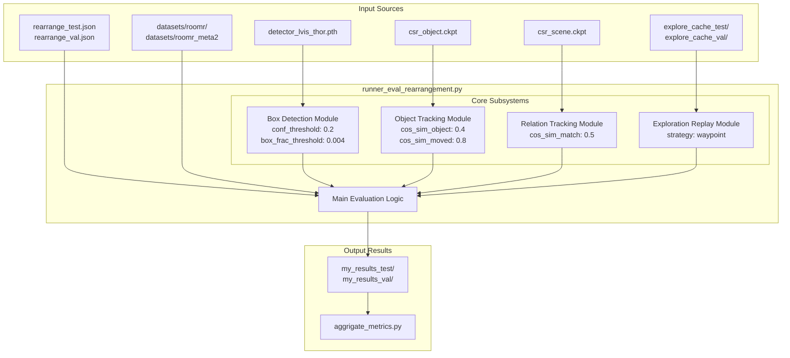
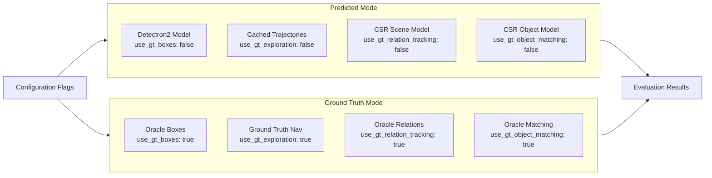
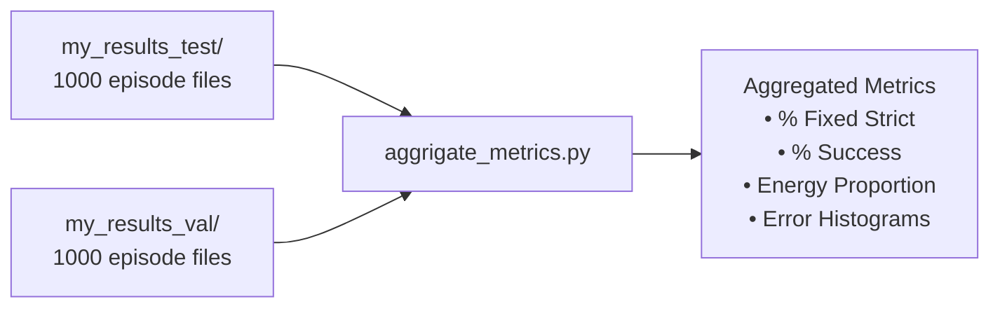

<!-- source: DeepWiki mcp.deepwiki.com · repo allenai/CSR · page 4 Evaluation and Visual Room Rearrangement · fetched 2026-10-26 -->

# Evaluation and Visual Room Rearrangement

<details>
<summary>Relevant source files</summary>

The following files were used as context for generating this wiki page:

- [README.md](README.md)
- [configs_rearrangement/rearrange_test.json](configs_rearrangement/rearrange_test.json)
- [configs_rearrangement/rearrange_val.json](configs_rearrangement/rearrange_val.json)

</details>


## Purpose and Scope

This page documents the evaluation pipeline for the Visual Room Rearrangement (RoomR) task. It covers the high-level architecture of the evaluation system, the core subsystems involved in rearrangement reasoning, execution modes, input requirements, and output structure. For detailed configuration parameters, see [Rearrangement Task Configuration](#4.1). For metrics computation and interpretation, see [Metrics Aggregation and Analysis](#4.2).

**Sources:** README.md, Diagram 4 from high-level architecture

---

## The Visual Room Rearrangement Task

The Visual Room Rearrangement task tests an embodied agent's ability to detect changes in a room configuration and restore objects to their original positions. The agent is given:

1. **Walkthrough phase**: A trajectory through a room in its initial configuration
2. **Unshuffle phase**: A trajectory through the same room after objects have been rearranged

The agent must identify which objects have moved and determine their correct original positions to restore the room to its initial state. This task evaluates spatial reasoning, object tracking, and scene understanding capabilities.

The RoomR dataset provides 1000 test episodes and 1000 validation episodes, each representing a unique room rearrangement scenario.

**Sources:** README.md:6-8, README.md:51-67

---

## Evaluation Pipeline Architecture

The evaluation pipeline orchestrates multiple subsystems to solve the rearrangement task. The diagram below shows the complete data flow:



**Sources:** README.md:51-62, configs_rearrangement/rearrange_test.json, configs_rearrangement/rearrange_val.json, Diagram 4

---

## The Evaluation Runner

The main evaluation script is `runner_eval_rearrangement.py`, which coordinates the entire rearrangement pipeline. It loads configurations, initializes all subsystems, processes episodes from the RoomR dataset, and writes results to disk.

### Key Responsibilities

| Responsibility | Description |
|---------------|-------------|
| Configuration Loading | Reads parameters from `rearrange_test.json` or `rearrange_val.json` |
| Environment Management | Initializes AI2-THOR simulation environments |
| Subsystem Coordination | Orchestrates box detection, object tracking, relation tracking, and exploration |
| Episode Processing | Iterates through 1000 test or validation episodes |
| Result Persistence | Writes per-episode results to `my_results_test/` or `my_results_val/` |

The runner supports both **predicted mode** (using trained models) and **ground truth mode** (using oracle information for debugging).

**Sources:** README.md:52-55, configs_rearrangement/rearrange_test.json:1-32

---

## Core Subsystems

The evaluation pipeline consists of four major subsystems, each responsible for a distinct aspect of the rearrangement task:

### Box Detection Module

Detects object bounding boxes in visual observations using a trained Detectron2 model.

**Configuration Parameters:**
- `boxes_model_path`: Path to detection model checkpoint (`checkpoints/detector_lvis_thor.pth`)
- `boxes_model_type`: Model architecture type (`"ithor"`)
- `box_conf_threshold`: Minimum confidence score (0.2)
- `box_frac_threshold`: Minimum box area fraction (0.004)

The detector filters out low-confidence and small bounding boxes to reduce false positives.

### Object Tracking Module

Maintains object identity across frames using the trained object correspondence model.

**Configuration Parameters:**
- `object_tracking_model_path`: Path to object model checkpoint (`checkpoints/csr_object.ckpt`)
- `cos_sim_object_threshold`: Cosine similarity threshold for object matching (0.4)
- `cos_sim_moved_threshold`: Threshold for detecting object movement (0.8)

This module uses continuous embeddings to match objects between the walkthrough and unshuffle phases, determining which objects have been displaced.

### Relation Tracking Module

Tracks spatial relationships between objects using the scene representation model.

**Configuration Parameters:**
- `relation_tracking_model_path`: Path to scene model checkpoint (`checkpoints/csr_scene.ckpt`)
- `cos_sim_match_threshold`: Threshold for matching spatial relationships (0.5)
- `device_relation_tracking`: GPU device ID (0)
- `averaging_strategy`: Strategy for combining embeddings (`"unweighted"`)

The module constructs a graph representation where nodes are objects and edges encode spatial relationships using continuous embeddings.

### Exploration Replay Module

Replays pre-cached exploration trajectories to navigate through the environment.

**Configuration Parameters:**
- `exploration_cache_dir`: Directory containing cached trajectories (`explore_cache_test/` or `explore_cache_val/`)
- `gt_exploration_strategy`: Navigation strategy for ground truth mode (`"waypoint"`)
- `num_steps`: Maximum steps per phase (250)
- `rotation_degrees`: Agent rotation granularity (30°)

For details on trajectory cache structure, see [Exploration Cache Data Format](#3.2).

**Sources:** configs_rearrangement/rearrange_test.json:8-22, Diagram 4

---

## Execution Modes

The evaluation system supports two execution modes for flexibility in debugging and analysis:



### Predicted Mode (Default)

All `use_gt_*` flags set to `false`. The system uses trained neural networks for all components:
- Box detection via Detectron2
- Object matching via `csr_object.ckpt`
- Relation tracking via `csr_scene.ckpt`
- Exploration via cached trajectories from `explorer_200.pt`

This mode provides realistic end-to-end performance metrics.

### Ground Truth Mode (Debugging)

Individual `use_gt_*` flags can be set to `true` to substitute oracle information for specific subsystems. This enables:
- **Component ablation**: Measure impact of individual subsystem errors
- **Upper bound analysis**: Determine theoretical performance with perfect perception
- **Error attribution**: Identify which subsystem contributes most to failures

**Sources:** configs_rearrangement/rearrange_test.json:23-26, Diagram 4

---

## Input Requirements

The evaluation pipeline requires the following inputs:

### Datasets

| Dataset | Path | Purpose |
|---------|------|---------|
| RoomR Episodes | `datasets/roomr/` | 3D environment definitions |
| RoomR Metadata | `datasets/roomr_meta2/` | Episode metadata and ground truth |

### Model Checkpoints

| Model | Path | Description |
|-------|------|-------------|
| Scene Representation | `checkpoints/csr_scene.ckpt` | Relation tracking embeddings |
| Object Correspondence | `checkpoints/csr_object.ckpt` | Object matching embeddings |
| Object Detector | `checkpoints/detector_lvis_thor.pth` | Detectron2 bounding box detector |

### Cached Trajectories

| Split | Path | Episodes |
|-------|------|----------|
| Test | `explore_cache_test/` | 1000 cached trajectories |
| Validation | `explore_cache_val/` | 1000 cached trajectories |

For dataset and checkpoint download instructions, see [Installation and Setup](#1.2). For trajectory caching details, see [Exploration and Trajectory Caching](#3).

**Sources:** README.md:21-24, configs_rearrangement/rearrange_test.json:14-31

---

## Output Structure

### Per-Episode Results

The evaluation runner writes detailed results for each episode to the dump directory:

```
my_results_test/          # Test split results
my_results_val/           # Validation split results
```

Each result file contains:
- Episode metadata (room ID, instance ID, data split)
- Detected object bounding boxes per frame
- Object tracking correspondences
- Predicted object rearrangements
- Ground truth information for comparison

### Aggregated Metrics

After evaluation completes, results are aggregated using `aggrigate_metrics.py` to compute dataset-level metrics:



For detailed metric definitions and interpretation, see [Metrics Aggregation and Analysis](#4.2).

**Sources:** README.md:58-67, configs_rearrangement/rearrange_test.json:28

---

## Running Evaluation

### Basic Execution

To evaluate on both test and validation splits with default configuration:

```bash
python runner_eval_rearrangement.py
```

This command:
1. Reads configurations from `configs_rearrangement/rearrange_test.json` and `configs_rearrangement/rearrange_val.json`
2. Loads all required models and cached trajectories
3. Processes 1000 test episodes and 1000 validation episodes
4. Writes results to `my_results_test/` and `my_results_val/`

### Computing Metrics During Evaluation

To monitor progress and see current metrics while evaluation is running:

```bash
python aggrigate_metrics.py
```

This can be executed in a separate terminal to compute metrics on partial results without interrupting the evaluation process.

### Expected Performance

Using the provided checkpoints and cached trajectories, expected test set performance is:

| Metric | Value |
|--------|-------|
| % Fixed Strict | 1.9 |
| % Success | 0.4 |

The low success rates reflect the challenging nature of the RoomR benchmark, which requires sophisticated spatial reasoning and object understanding.

**Sources:** README.md:52-67

---

## Configuration Overview

The table below summarizes key configuration parameters. For comprehensive parameter documentation, see [Rearrangement Task Configuration](#4.1).

| Parameter Category | Key Parameters | Purpose |
|-------------------|----------------|---------|
| **Environment** | `num_steps`, `visibility_distance`, `rotation_degrees` | Control agent capabilities and constraints |
| **Detection** | `box_conf_threshold`, `box_frac_threshold` | Filter object detections |
| **Matching** | `cos_sim_object_threshold`, `cos_sim_moved_threshold` | Control object identity tracking |
| **Relations** | `cos_sim_match_threshold`, `averaging_strategy` | Configure spatial relationship matching |
| **Data** | `roomr_dir`, `roomr_meta_dir`, `data_split` | Specify dataset locations and split |
| **Models** | `*_model_path` parameters | Point to trained model checkpoints |
| **Debugging** | `use_gt_*` flags, `debug` | Enable ground truth modes and debug output |
| **Output** | `dump_dir` | Specify results directory |

**Sources:** configs_rearrangement/rearrange_test.json:1-32, configs_rearrangement/rearrange_val.json:1-32

---

