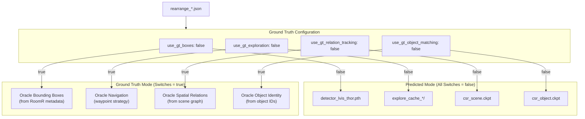
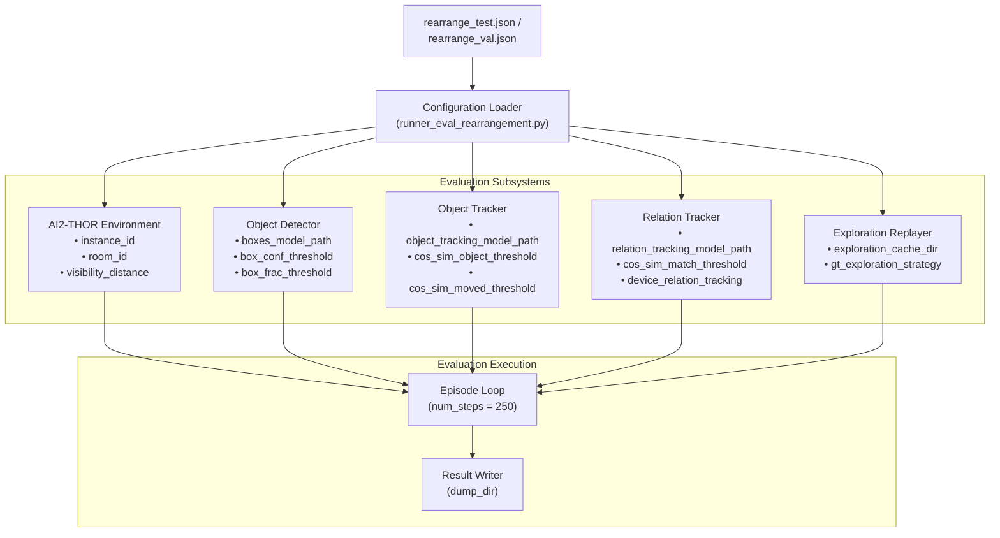

<!-- source: DeepWiki mcp.deepwiki.com · repo allenai/CSR · page 4.1 Rearrangement Task Configuration · fetched 2026-10-26 -->

# Rearrangement Task Configuration

Relevant source files

The following files were used as context for generating this wiki page:

- [configs_rearrangement/rearrange_test.json](configs_rearrangement/rearrange_test.json)
- [configs_rearrangement/rearrange_val.json](configs_rearrangement/rearrange_val.json)

## Purpose and Scope

This document describes the configuration parameters used for evaluating the Visual Room Rearrangement (RoomR) task. These configurations control all aspects of the evaluation pipeline, including environment settings, model selection, threshold tuning, and execution modes.

The configuration files are consumed by `runner_eval_rearrangement.py` during the evaluation phase. For information about the overall evaluation pipeline architecture, see [Evaluation and Visual Room Rearrangement](#4). For details on how metrics are computed from evaluation results, see [Metrics Aggregation and Analysis](#4.2).

**Sources**: [configs_rearrangement/rearrange_test.json:1-32](), [configs_rearrangement/rearrange_val.json:1-32]()

---

## Configuration Files Overview

The CSR system provides two rearrangement configuration files:

| File | Purpose | Output Directory | Exploration Cache |
|------|---------|------------------|-------------------|
| `configs_rearrangement/rearrange_test.json` | Test set evaluation | `my_results_test/` | `explore_cache_test/` |
| `configs_rearrangement/rearrange_val.json` | Validation set evaluation | `my_results_val/` | `explore_cache_val/` |

Both configurations share identical parameter values except for three fields:
- `exploration_cache_dir`: Points to the appropriate cached trajectory directory
- `dump_dir`: Specifies where evaluation results are written
- `data_split`: Identifies the data split (`"test"` or `"val"`)

**Sources**: [configs_rearrangement/rearrange_test.json:1-32](), [configs_rearrangement/rearrange_val.json:1-32]()

---

## Configuration Architecture

The following diagram illustrates how configuration parameters map to different subsystems in the evaluation pipeline:

```mermaid
graph TB
    subgraph ConfigFile["rearrange_test.json / rearrange_val.json"]
        EnvParams["Environment Parameters<br/>instance_id, room_id, num_steps<br/>visibility_distance, rotation_degrees<br/>render_instance_segmentation"]
        DetectionParams["Detection Parameters<br/>boxes_model_path, boxes_model_type<br/>box_conf_threshold, box_frac_threshold"]
        ObjectParams["Object Tracking Parameters<br/>object_tracking_model_path<br/>cos_sim_object_threshold<br/>cos_sim_moved_threshold"]
        RelationParams["Relation Tracking Parameters<br/>relation_tracking_model_path<br/>cos_sim_match_threshold<br/>device_relation_tracking"]
        ExploreParams["Exploration Parameters<br/>exploration_model_path<br/>exploration_cache_dir<br/>gt_exploration_strategy"]
        GTSwitches["Ground Truth Switches<br/>use_gt_boxes, use_gt_exploration<br/>use_gt_relation_tracking<br/>use_gt_object_matching"]
        DataPaths["Data & Output Paths<br/>roomr_dir, roomr_meta_dir<br/>dump_dir, data_split"]
        OtherParams["Other Parameters<br/>averaging_strategy<br/>are_close_model_path<br/>debug"]
    end
    
    subgraph EvalRunner["runner_eval_rearrangement.py"]
        EnvSetup["AI2-THOR Environment Setup"]
        BoxDetection["Box Detection Subsystem"]
        ObjTracking["Object Tracking Subsystem"]
        RelTracking["Relation Tracking Subsystem"]
        ExploreReplay["Exploration Replay Subsystem"]
        ResultWriter["Result Writer"]
    end
    
    EnvParams --> EnvSetup
    DetectionParams --> BoxDetection
    ObjectParams --> ObjTracking
    RelationParams --> RelTracking
    ExploreParams --> ExploreReplay
    GTSwitches --> BoxDetection
    GTSwitches --> ObjTracking
    GTSwitches --> RelTracking
    GTSwitches --> ExploreReplay
    DataPaths --> EnvSetup
    DataPaths --> ExploreReplay
    DataPaths --> ResultWriter
    OtherParams --> ObjTracking
    OtherParams --> RelTracking
```

**Sources**: [configs_rearrangement/rearrange_test.json:1-32](), [configs_rearrangement/rearrange_val.json:1-32]()

---

## Environment and Simulation Parameters

These parameters control the AI2-THOR simulation environment and agent behavior:

| Parameter | Value | Description |
|-----------|-------|-------------|
| `instance_id` | `47` | Specific room instance to evaluate |
| `room_id` | `22` | Room type identifier in RoomR dataset |
| `num_steps` | `250` | Maximum simulation steps per episode |
| `visibility_distance` | `20.0` | Maximum distance (meters) for object visibility |
| `rotation_degrees` | `30` | Agent rotation increment in degrees (12 discrete orientations) |
| `render_instance_segmentation` | `true` | Whether to render instance segmentation masks |

The `visibility_distance` of 20.0 provides a generous perception range, effectively allowing the agent to see most objects in typical room layouts. This contrasts with the exploration configurations, which use more restrictive visibility for navigation learning.

**Sources**: [configs_rearrangement/rearrange_test.json:2-7](), [configs_rearrangement/rearrange_val.json:2-7]()

---

## Object Detection Parameters

These parameters configure the object detector used to identify and localize objects in scenes:

| Parameter | Value | Description |
|-----------|-------|-------------|
| `boxes_model_path` | `"checkpoints/detector_lvis_thor.pth"` | Path to trained Detectron2 detector weights |
| `boxes_model_type` | `"ithor"` | Detector model variant for iTHOR/AI2-THOR environments |
| `box_conf_threshold` | `0.2` | Minimum confidence score for accepting detections |
| `box_frac_threshold` | `0.004` | Minimum bounding box area fraction (relative to image size) |

The low `box_conf_threshold` of 0.2 prioritizes high recall over precision, ensuring small or partially occluded objects are detected. The `box_frac_threshold` of 0.004 filters out extremely small detections that likely represent noise or distant objects.

**Sources**: [configs_rearrangement/rearrange_test.json:14-16](), [configs_rearrangement/rearrange_val.json:14-16]()

---

## Object Tracking Parameters

These parameters control the object tracking subsystem, which maintains object identity across frames:

| Parameter | Value | Description |
|-----------|-------|-------------|
| `object_tracking_model_path` | `"checkpoints/csr_object.ckpt"` | Path to trained object correspondence model |
| `cos_sim_object_threshold` | `0.4` | Minimum cosine similarity for object matching |
| `cos_sim_moved_threshold` | `0.8` | Threshold for detecting if an object has moved |
| `averaging_strategy` | `"unweighted"` | How to average embeddings (unweighted vs weighted) |

The object tracking model uses cosine similarity in embedding space to determine if two detected objects across different frames represent the same physical object. The `cos_sim_object_threshold` of 0.4 is relatively permissive, allowing matches even when object appearance changes due to viewpoint or lighting variations.

The `cos_sim_moved_threshold` of 0.8 is more conservative, requiring high similarity for the system to conclude an object has *not* moved. If similarity falls below this threshold, the object is flagged as displaced.

**Sources**: [configs_rearrangement/rearrange_test.json:10-12,21](), [configs_rearrangement/rearrange_val.json:10-12,21]()

---

## Relation Tracking Parameters

These parameters configure the relation tracking subsystem, which models spatial relationships between objects:

| Parameter | Value | Description |
|-----------|-------|-------------|
| `relation_tracking_model_path` | `"checkpoints/csr_scene.ckpt"` | Path to trained scene representation model |
| `cos_sim_match_threshold` | `0.5` | Minimum cosine similarity for matching spatial relations |
| `device_relation_tracking` | `0` | GPU device ID for relation tracking inference |

The relation tracking model learns continuous representations of scene structure, including node embeddings (objects) and edge embeddings (spatial relationships). The `cos_sim_match_threshold` determines when two spatial configurations are considered equivalent.

**Sources**: [configs_rearrangement/rearrange_test.json:9,20,22](), [configs_rearrangement/rearrange_val.json:9,20,22]()

---

## Exploration Parameters

These parameters control how the agent explores environments and whether to use cached trajectories:

| Parameter | Value (Test) | Value (Val) | Description |
|-----------|--------------|-------------|-------------|
| `exploration_model_path` | `""` | `""` | Path to exploration policy (empty = use cache) |
| `exploration_cache_dir` | `"explore_cache_test"` | `"explore_cache_val"` | Directory containing pre-computed trajectories |
| `gt_exploration_strategy` | `"waypoint"` | `"waypoint"` | Fallback strategy when using ground truth exploration |

When `exploration_model_path` is empty, the system reads pre-cached exploration trajectories from `exploration_cache_dir`. This design significantly accelerates evaluation by avoiding expensive re-computation of navigation paths. For details on exploration cache structure, see [Exploration Cache Data Format](#3.2).

**Sources**: [configs_rearrangement/rearrange_test.json:13,17-18](), [configs_rearrangement/rearrange_val.json:13,17-18]()

---

## Ground Truth Modes

The configuration includes four binary switches that enable ground truth (oracle) modes for different subsystems. These switches are critical for debugging and ablation studies:

| Parameter | Default | Purpose |
|-----------|---------|---------|
| `use_gt_boxes` | `false` | Use oracle object detection instead of model predictions |
| `use_gt_exploration` | `false` | Use oracle navigation instead of cached/learned exploration |
| `use_gt_relation_tracking` | `false` | Use oracle spatial relationships instead of CSR scene model |
| `use_gt_object_matching` | `false` | Use oracle object identity instead of CSR object model |

The following diagram shows how these switches affect the evaluation pipeline:

Setting all switches to `true` provides an upper bound on system performance by replacing all learned components with oracle information. This helps isolate which subsystems contribute most to errors.

**Sources**: [configs_rearrangement/rearrange_test.json:23-26](), [configs_rearrangement/rearrange_val.json:23-26]()

---

## Data Paths and Output Configuration

These parameters specify input data locations and where to write evaluation results:

| Parameter | Value (Test) | Value (Val) | Description |
|-----------|--------------|-------------|-------------|
| `roomr_dir` | `"datasets/roomr/"` | `"datasets/roomr/"` | Root directory of RoomR dataset |
| `roomr_meta_dir` | `"datasets/roomr_meta2"` | `"datasets/roomr_meta2"` | RoomR metadata directory |
| `dump_dir` | `"./my_results_test"` | `"./my_results_val"` | Output directory for evaluation results |
| `data_split` | `"test"` | `"val"` | Dataset split to evaluate |

The `dump_dir` receives per-episode result files that are later aggregated by `aggrigate_metrics.py`. Each episode generates a JSON file containing predictions, ground truth, and intermediate debugging information.

**Sources**: [configs_rearrangement/rearrange_test.json:28-31](), [configs_rearrangement/rearrange_val.json:28-31]()

---

## Additional Parameters

| Parameter | Value | Description |
|-----------|-------|-------------|
| `are_close_model_path` | `""` | Optional model for determining object proximity (unused when empty) |
| `debug` | `false` | Enable verbose debug logging and visualizations |

The `are_close_model_path` is reserved for future extensions and currently remains unused in the evaluation pipeline.

**Sources**: [configs_rearrangement/rearrange_test.json:19,27](), [configs_rearrangement/rearrange_val.json:19,27]()

---

## Parameter Data Flow

The following diagram illustrates how configuration parameters flow through the evaluation pipeline from file loading to subsystem instantiation:

**Sources**: [configs_rearrangement/rearrange_test.json:1-32](), [configs_rearrangement/rearrange_val.json:1-32]()

---

## Configuration Validation

The evaluation runner expects all configuration parameters to be present. Missing or invalid parameters will cause runtime errors. Key validation rules:

1. **Model paths** must point to existing checkpoint files or be empty strings (for cached exploration)
2. **Threshold values** must be floats in the range [0.0, 1.0]
3. **Directory paths** must exist or be writable (for output directories)
4. **Device IDs** must be valid GPU indices available on the system
5. **Data split** must be either `"test"` or `"val"`

The `debug` flag does not affect correctness but enables additional logging and visualization output, which can be useful for troubleshooting configuration issues.

**Sources**: [configs_rearrangement/rearrange_test.json:1-32](), [configs_rearrangement/rearrange_val.json:1-32]()

---

