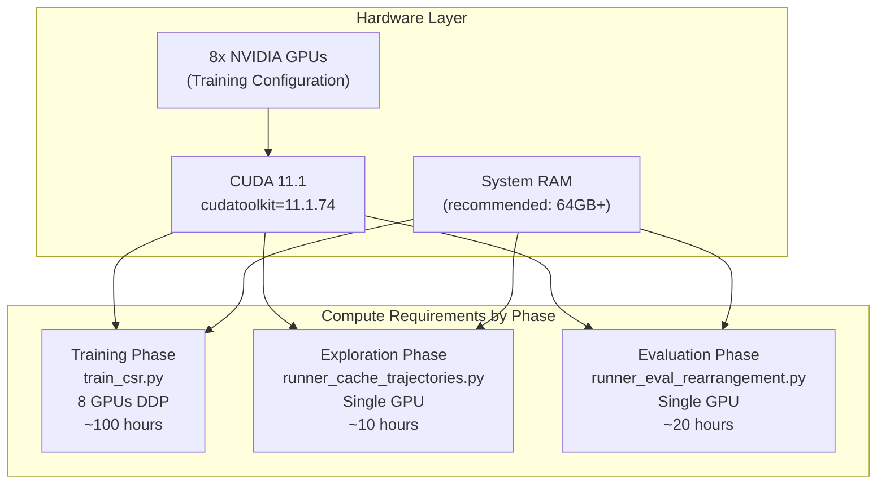
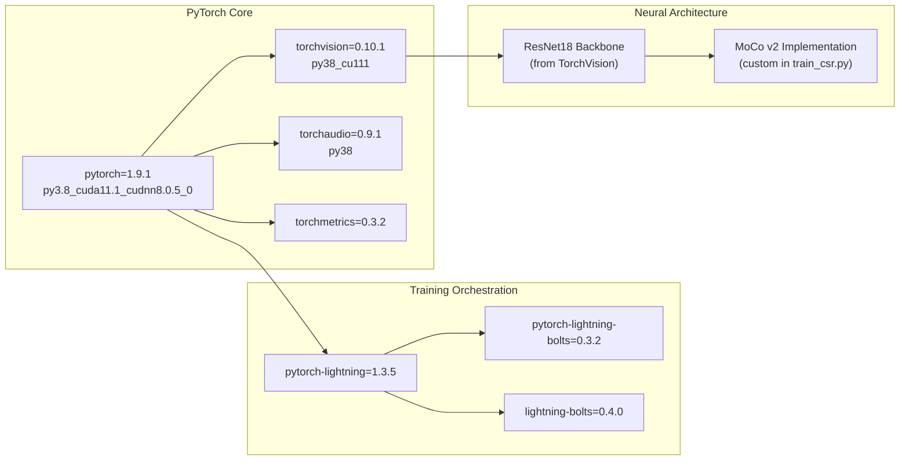
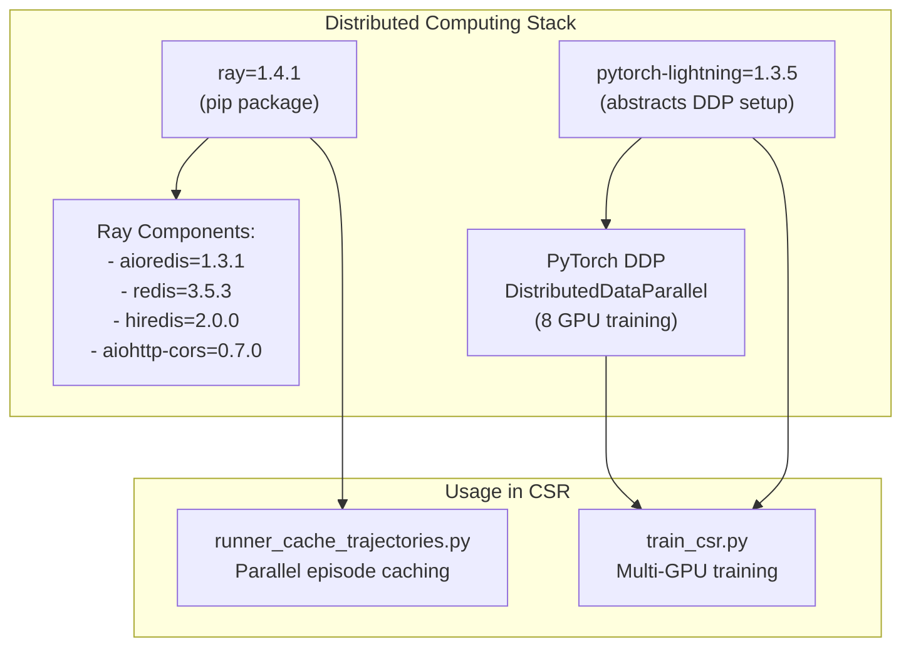
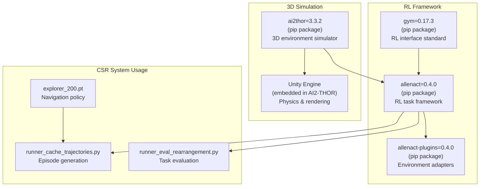
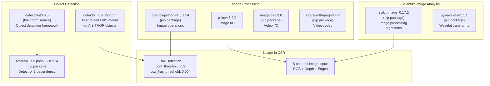
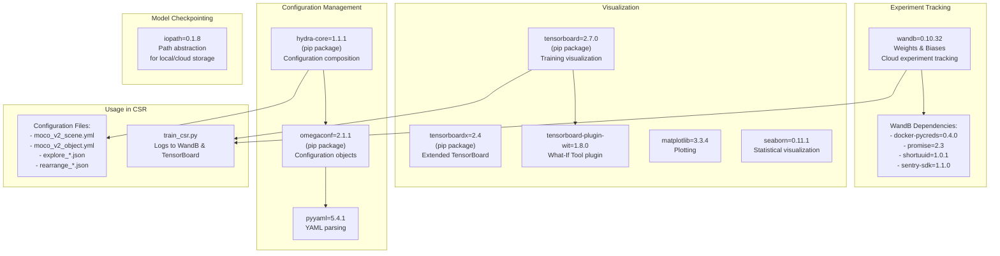
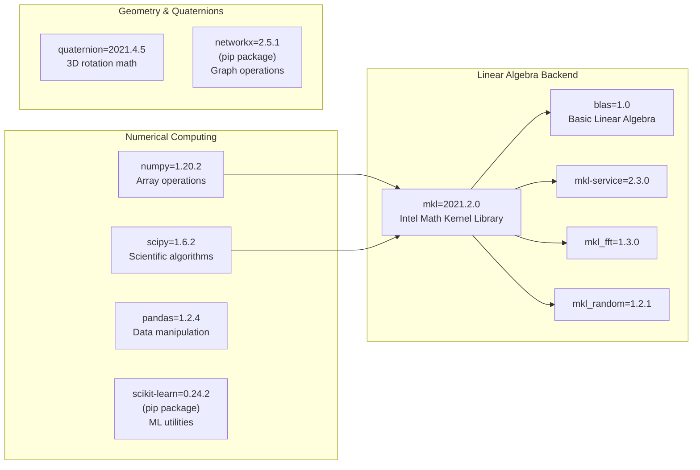
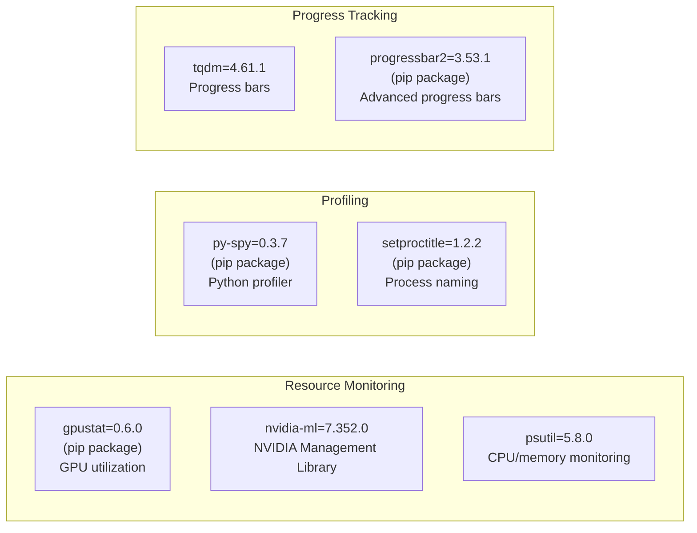
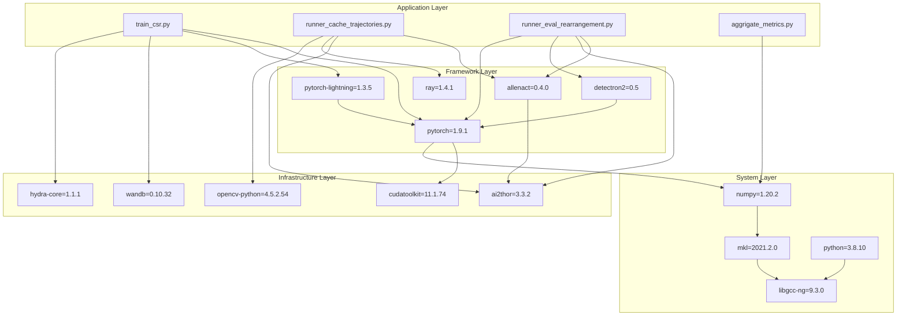

<!-- source: DeepWiki mcp.deepwiki.com · repo allenai/CSR · page 5 Environment and Dependencies · fetched 2026-10-26 -->

# Environment and Dependencies

<details>
<summary>Relevant source files</summary>

The following files were used as context for generating this wiki page:

- [environment.yml](environment.yml)

</details>


## Purpose and Scope

This page documents the software dependencies, runtime environment, and hardware requirements for the CSR (Continuous Scene Representations) system. It covers the conda environment specification, package versions, installation procedures, and dependency relationships. For information about initial setup and data preparation, see [Installation and Setup](#1.2). For details about specific configurations used in training, exploration, or evaluation, see pages [2](#2), [3](#3), and [4](#4) respectively.

---

## Environment Overview

The CSR system uses a conda environment named `emb` defined in [environment.yml:1](), which specifies all required dependencies across multiple technology layers. The environment supports distributed GPU training, 3D embodied AI simulation, computer vision tasks, and experiment tracking.

**Key Environment Characteristics:**
- **Environment Name**: `emb`
- **Python Version**: 3.8.10
- **Primary Deep Learning Framework**: PyTorch 1.9.1
- **CUDA Version**: 11.1
- **Package Manager**: Conda with pip supplements
- **Total Dependencies**: 163 conda packages + 76 pip packages

**Sources**: [environment.yml:1-9]()

---

## Conda Channels

The environment pulls packages from multiple conda channels in priority order:

| Channel | Purpose |
|---------|---------|
| `pytorch` | PyTorch, TorchVision, TorchAudio with CUDA support |
| `nvidia` | CUDA toolkit and GPU acceleration libraries |
| `conda-forge` | Community-maintained packages including Ray, WandB |
| `anaconda` | Standard scientific Python packages |
| `defaults` | Fallback channel for base dependencies |

**Sources**: [environment.yml:2-7]()

---

## Hardware Requirements



**GPU Requirements:**
- **Training**: 8 GPUs for distributed data parallel training (DDP)
- **Exploration/Evaluation**: Single GPU sufficient
- **CUDA Version**: 11.1 (specified in [environment.yml:31]())
- **Compatible Architectures**: Volta, Turing, Ampere (compute capability 7.0+)

**Sources**: [environment.yml:31](), [moco_v2_scene.yml](), [moco_v2_object.yml]()

---

## Core Framework Layer

### PyTorch Ecosystem

The CSR system is built on PyTorch 1.9.1 with CUDA 11.1 support:



**Key Versions:**

| Package | Version | Purpose |
|---------|---------|---------|
| `pytorch` | 1.9.1 | Deep learning framework, GPU computation |
| `torchvision` | 0.10.1 | Pre-trained models (ResNet18), image transforms |
| `torchaudio` | 0.9.1 | Audio processing utilities (indirect dependency) |
| `pytorch-lightning` | 1.3.5 | Training loop abstraction, distributed training |
| `torchmetrics` | 0.3.2 | Metrics computation during training |
| `lightning-bolts` | 0.4.0 | Pre-built models and callbacks |

**Sources**: [environment.yml:123-124](), [environment.yml:147-149]()

### Distributed Execution



**Distributed Components:**

| Component | Version | Role |
|-----------|---------|------|
| `ray` | 1.4.1 | Distributed task execution, parallel exploration |
| `aioredis` | 1.3.1 | Async Redis client for Ray |
| `redis` | 3.5.3 | In-memory data structure store for Ray backend |
| `hiredis` | 2.0.0 | High-performance Redis protocol parser |

Ray is used in [runner_cache_trajectories.py]() for parallel trajectory generation across multiple environments.

**Sources**: [environment.yml:228](), [environment.yml:167](), [environment.yml:189](), [environment.yml:229]()

---

## Embodied AI Layer

### Simulation and RL Framework



**Embodied AI Stack:**

| Package | Version | Purpose |
|---------|---------|---------|
| `ai2thor` | 3.3.2 | 3D simulation environment for RoomR dataset |
| `allenact` | 0.4.0 | RL framework for embodied agents |
| `allenact-plugins` | 0.4.0 | Environment adapters and utilities |
| `gym` | 0.17.3 | Standard RL environment interface |

**AI2-THOR Features Used:**
- Photorealistic 3D scenes from RoomR dataset
- Physics simulation for object manipulation
- Agent navigation with collision detection
- Visual observations (RGB, depth, segmentation)
- Action execution (move, rotate, pick, place)

**AllenAct Features Used:**
- Task abstraction for room rearrangement
- Episode management and caching
- Sensor interface for observations
- Distributed episode sampling

**Sources**: [environment.yml:165](), [environment.yml:168-169](), [environment.yml:188]()

---

## Computer Vision Layer

### Object Detection and Image Processing



**Computer Vision Dependencies:**

| Package | Version | Installation Method | Purpose |
|---------|---------|---------------------|---------|
| `detectron2` | 0.5 | Built from source (commented in yml) | Object detection for RoomR |
| `opencv-python` | 4.5.2.54 | pip | Image processing, transformations |
| `pillow` | 8.2.0 | conda | Image I/O operations |
| `scikit-image` | 0.17.2 | pip | Advanced image processing |
| `pycocotools` | 2.0.2 | pip | COCO dataset format utilities |
| `fvcore` | 0.1.5 | pip | Core utilities for Detectron2 |

**Note on Detectron2**: Line 180 in [environment.yml:180]() shows `# - detectron2==0.5` is commented out. Detectron2 must be built from source after environment creation:

```bash
# After activating conda environment
python -m pip install 'git+https://github.com/facebookresearch/detectron2.git@v0.5'
```

**Sources**: [environment.yml:104](), [environment.yml:180](), [environment.yml:184](), [environment.yml:211](), [environment.yml:219](), [environment.yml:231]()

---

## MLOps and Experiment Tracking



**MLOps Stack:**

| Package | Version | Purpose |
|---------|---------|---------|
| `wandb` | 0.10.32 | Cloud-based experiment tracking, hyperparameter logging |
| `tensorboard` | 2.7.0 | Local training visualization, loss curves |
| `tensorboardx` | 2.4 | Extended TensorBoard functionality |
| `hydra-core` | 1.1.1 | Hierarchical configuration management |
| `omegaconf` | 2.1.1 | Configuration object system (used by Hydra) |
| `iopath` | 0.1.8 | Unified I/O for local and cloud storage |

**Configuration System**: Hydra is used to manage YAML configuration files in [configs_contrastive/](), JSON configuration files in [configs_exploration/]() and [configs_rearrangement/](). It provides:
- Configuration composition and inheritance
- Command-line overrides
- Structured configuration validation
- Multi-run sweeps

**Sources**: [environment.yml:155](), [environment.yml:237-238](), [environment.yml:144](), [environment.yml:190](), [environment.yml:208](), [environment.yml:126](), [environment.yml:57]()

---

## Scientific Computing Stack



**Scientific Stack:**

| Package | Version | Purpose |
|---------|---------|---------|
| `numpy` | 1.20.2 | Multi-dimensional arrays, linear algebra |
| `scipy` | 1.6.2 | Scientific computing (optimization, signal processing) |
| `pandas` | 1.2.4 | Data frames for results aggregation |
| `scikit-learn` | 0.24.2 | Machine learning utilities, metrics |
| `quaternion` | 2021.4.5 | 3D rotation operations for agent navigation |
| `networkx` | 2.5.1 | Graph algorithms for scene graphs |

**Performance**: Intel MKL provides optimized implementations of BLAS and LAPACK operations, significantly accelerating NumPy/SciPy computations on CPU.

**Sources**: [environment.yml:93-94](), [environment.yml:133](), [environment.yml:101](), [environment.yml:232](), [environment.yml:128](), [environment.yml:207](), [environment.yml:85-88]()

---

## System Libraries and Utilities

### Multimedia and Graphics

| Package | Version | Purpose |
|---------|---------|---------|
| `ffmpeg` | 4.3 | Video encoding/decoding for trajectory visualization |
| `opencv-python` | 4.5.2.54 | Image/video processing |
| `moviepy` | 1.0.3 | Video editing and composition |
| `imageio` | 2.9.0 | Image/video I/O |
| `imageio-ffmpeg` | 0.4.4 | FFmpeg backend for imageio |

**Sources**: [environment.yml:37](), [environment.yml:211](), [environment.yml:204](), [environment.yml:191-192]()

### System Monitoring



| Package | Version | Purpose |
|---------|---------|---------|
| `gpustat` | 0.6.0 | Monitor GPU utilization during training |
| `nvidia-ml` | 7.352.0 | NVIDIA Management Library bindings |
| `psutil` | 5.8.0 | System resource monitoring |
| `py-spy` | 0.3.7 | Low-overhead Python profiler |
| `tqdm` | 4.61.1 | Progress bars for loops and iterations |

**Sources**: [environment.yml:187](), [environment.yml:95](), [environment.yml:109](), [environment.yml:218](), [environment.yml:151](), [environment.yml:216]()

---

## Dependency Installation Process

### Step 1: Create Conda Environment

```bash
# Create environment from YAML file
conda env create -f environment.yml

# Activate environment
conda activate emb
```

The environment creation resolves 163 conda packages from multiple channels and installs them with consistent versions.

**Sources**: [environment.yml:1]()

### Step 2: Install Detectron2 from Source

Since Detectron2 is commented out in [environment.yml:180](), it must be installed separately:

```bash
# Ensure environment is activated
conda activate emb

# Install Detectron2 from source (requires CUDA)
python -m pip install 'git+https://github.com/facebookresearch/detectron2.git@v0.5'
```

**Detectron2 Requirements:**
- CUDA 11.1 (already installed via conda)
- GCC >= 5
- PyTorch 1.9+ (already installed)

**Sources**: [environment.yml:180]()

### Step 3: Verify Installation

```bash
# Verify PyTorch CUDA availability
python -c "import torch; print(f'CUDA available: {torch.cuda.is_available()}')"
python -c "import torch; print(f'CUDA version: {torch.version.cuda}')"
python -c "import torch; print(f'GPU count: {torch.cuda.device_count()}')"

# Verify AI2-THOR
python -c "import ai2thor; print(f'AI2-THOR version: {ai2thor.__version__}')"

# Verify AllenAct
python -c "import allenact; print(f'AllenAct version: {allenact.__version__}')"

# Verify Detectron2
python -c "import detectron2; print(f'Detectron2 version: {detectron2.__version__}')"
```

**Sources**: [environment.yml:123](), [environment.yml:165](), [environment.yml:168]()

---

## Platform Requirements

### Operating System

The CSR system is designed for **Linux x86_64**. Package specifications include:

- `ld_impl_linux-64=2.35.1` - GNU linker
- `libgcc-ng=9.3.0` - GNU C library
- `libstdcxx-ng=9.3.0` - GNU C++ library

**Supported Distributions:**
- Ubuntu 18.04 LTS or later
- CentOS 7 or later
- Other distributions with kernel 4.4+

**Sources**: [environment.yml:62](), [environment.yml:64](), [environment.yml:72]()

### Python Version

The environment uses **Python 3.8.10**:

```
python=3.8.10=h12debd9_8
python_abi=3.8=1_cp38
```

This specific version ensures compatibility with:
- PyTorch 1.9.1 compiled binaries
- AI2-THOR 3.3.2 Unity bindings
- Type hints and dataclass features

**Sources**: [environment.yml:120](), [environment.yml:122]()

### Storage Requirements

| Component | Size | Location |
|-----------|------|----------|
| Conda environment | ~10 GB | `~/.conda/envs/emb/` |
| PyTorch cache | ~2 GB | `~/.cache/torch/` |
| Detectron2 models | ~1 GB | `~/.torch/` |
| AI2-THOR builds | ~5 GB | `~/.ai2thor/` |
| **Total** | **~18 GB** | Various |

---

## Dependency Graph Summary



This diagram illustrates how the four main CSR scripts depend on different layers of the technology stack, with clear separation between application code, frameworks, infrastructure, and system libraries.

**Sources**: [environment.yml:1-244]()

---

## Common Installation Issues

### Issue 1: CUDA Version Mismatch

**Symptom**: `RuntimeError: CUDA error: no kernel image is available for execution on the device`

**Solution**: Verify GPU compute capability matches CUDA 11.1 requirements:
```bash
nvidia-smi --query-gpu=compute_cap --format=csv
```
CUDA 11.1 requires compute capability >= 3.5 (recommended >= 7.0).

### Issue 2: Detectron2 Build Failure

**Symptom**: `error: command 'gcc' failed with exit status 1`

**Solution**: Install build tools before Detectron2:
```bash
sudo apt-get install build-essential
conda install -c conda-forge gcc_linux-64 gxx_linux-64
```

### Issue 3: AI2-THOR Display Issues

**Symptom**: `Failed to initialize Unity display`

**Solution**: AI2-THOR requires X11 or xvfb for headless rendering:
```bash
# For headless servers
sudo apt-get install xvfb
xvfb-run --auto-servernum --server-num=1 python runner_cache_trajectories.py
```

### Issue 4: Out of Memory During Training

**Symptom**: `CUDA out of memory` during training

**Solution**: Reduce batch size in configuration:
- Scene training: [moco_v2_scene.yml]() line with `batch_size`
- Object training: [moco_v2_object.yml]() line with `batch_size`

Or reduce number of GPUs and adjust learning rate accordingly.

**Sources**: [environment.yml:31](), [environment.yml:165]()

---

## Version Compatibility Matrix

| Component | Version | Compatible PyTorch | Compatible CUDA |
|-----------|---------|-------------------|-----------------|
| PyTorch | 1.9.1 | N/A | 11.1, 11.3 |
| TorchVision | 0.10.1 | 1.9.x | 11.1 |
| PyTorch Lightning | 1.3.5 | 1.8+, 1.9+ | Any |
| AI2-THOR | 3.3.2 | 1.7+ | N/A |
| AllenAct | 0.4.0 | 1.7+ | N/A |
| Detectron2 | 0.5 | 1.9+ | 11.1+ |
| Ray | 1.4.1 | Any | N/A |

**Upgrade Considerations**: Upgrading PyTorch requires careful coordination with TorchVision, Detectron2, and CUDA versions. The system has been tested and validated with the exact versions specified in [environment.yml:1-244]().

**Sources**: [environment.yml:123](), [environment.yml:149](), [environment.yml:124](), [environment.yml:165](), [environment.yml:168](), [environment.yml:228]()

---

## Environment Variables

Certain environment variables may need to be set for optimal performance:

```bash
# CUDA device visibility (for multi-GPU training)
export CUDA_VISIBLE_DEVICES=0,1,2,3,4,5,6,7

# PyTorch distributed backend
export MASTER_ADDR=localhost
export MASTER_PORT=12355

# AI2-THOR settings
export AI2THOR_VISIBILITY_DISTANCE=1.5

# Detectron2 model cache
export TORCH_HOME=~/.torch

# WandB API key (for experiment tracking)
export WANDB_API_KEY=your_api_key_here

# Disable WandB (for offline runs)
export WANDB_MODE=offline
```

These variables are referenced by the training and evaluation scripts to control hardware utilization and external service integration.

**Sources**: Configuration files in [configs_contrastive/](), [configs_exploration/](), [configs_rearrangement/]()