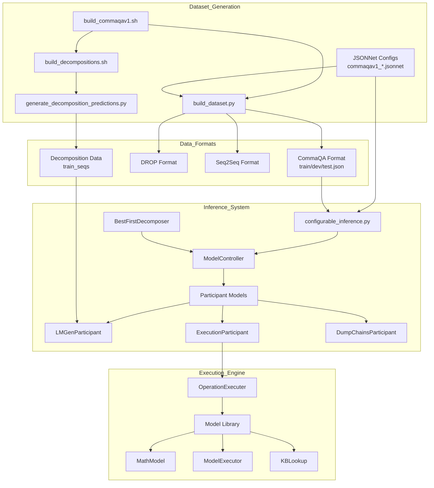
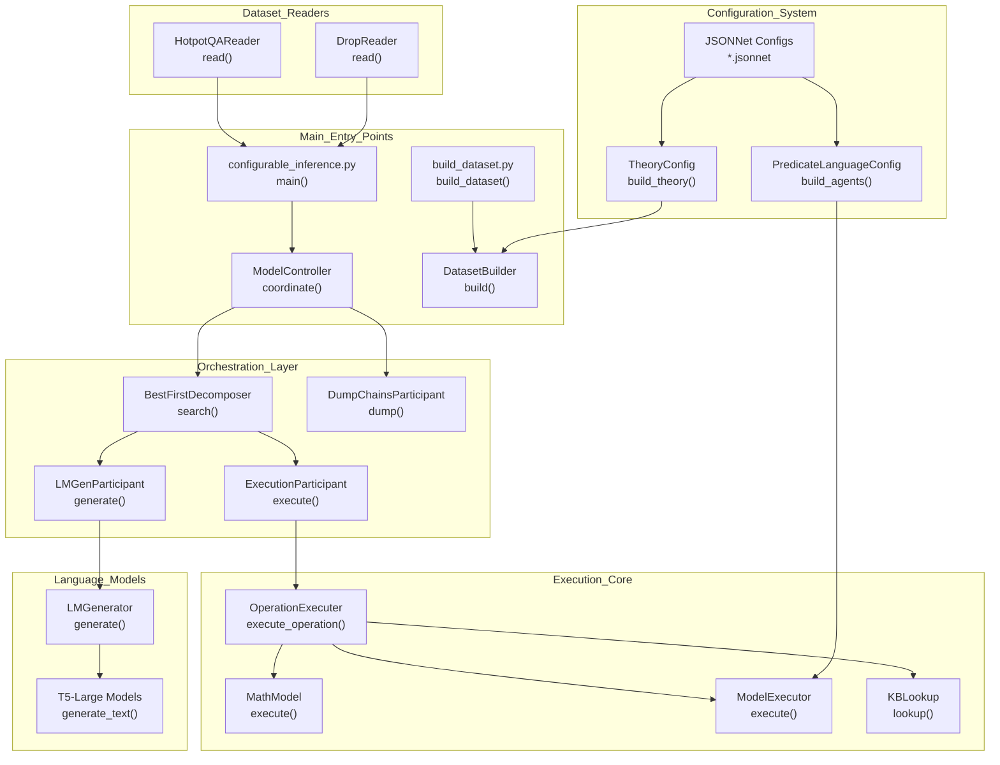

<!-- source: DeepWiki mcp.deepwiki.com · repo allenai/CommaQA · page 1 Overview · fetched 2026-10-26 -->

# Overview

Relevant source files

The following files were used as context for generating this wiki page:

- [README.md](README.md)
- [commaqa/dataset/README.md](commaqa/dataset/README.md)
- [commaqa/execution/README.md](commaqa/execution/README.md)
- [commaqa/inference/README.md](commaqa/inference/README.md)

## Purpose and Scope

CommaQA is a question-answering benchmark designed for training models to communicate with specialized agents to solve complex multi-hop reasoning tasks. This repository provides a complete system for generating synthetic QA datasets, training decomposition models, and performing inference through agent communication.

The system enables models to break down complex questions into simpler sub-questions that can be answered by different specialized agents (table lookup, text QA, mathematical operations), then combine the results to produce final answers. For detailed information about specific components, see [Dataset Generation System](#3) for building datasets, [Inference System](#4) for running question-answering, and [Execution Engine](#5) for operation execution.

## System Architecture Overview

**CommaQA System Architecture**: Shows the three main pipelines and their key code components, from dataset generation through inference execution.

Sources: [README.md:1-113](), [commaqa/inference/README.md:1-59](), [commaqa/dataset/README.md:1-47](), [commaqa/execution/README.md:1-20]()

## Core Components

CommaQA consists of three primary systems that work together to enable agent-based question answering:

### Dataset Generation Pipeline
The dataset generation system creates synthetic QA datasets through configurable JSONNet specifications. The main entry point `build_commaqav1.sh` orchestrates the creation of three dataset variants:

- **CommaQA-E (Explicit)**: Questions requiring explicit multi-hop reasoning
- **CommaQA-I (Implicit)**: Questions requiring implicit reasoning connections  
- **CommaQA-N (Numeric)**: Questions requiring numerical computation and aggregation

The `build_dataset.py` module generates the core QA pairs, while `generate_decomposition_predictions.py` creates training sequences for decomposition models.

### Inference Engine
The inference system processes questions by decomposing them into sub-questions that specialized agents can answer. The `configurable_inference.py` entry point coordinates this process using:

- `ModelController`: Orchestrates participant models in a state machine
- `BestFirstDecomposer`: Implements search strategies (greedy, beam search)
- Participant models: `LMGenParticipant`, `ExecutionParticipant`, `DumpChainsParticipant`

### Execution Engine  
The execution system performs structured operations against knowledge bases through the `OperationExecuter` class. It supports operations like `select`, `project`, `filter`, and mathematical aggregations, coordinating with specialized models including `MathModel`, `ModelExecutor`, and `KBLookup`.

Sources: [README.md:31-76](), [commaqa/inference/README.md:2-8](), [commaqa/dataset/README.md:3-20](), [commaqa/execution/README.md:1-8]()

## Code Entity Architecture

**Code Entity Architecture**: Maps system components to their implementing classes and key methods, showing the concrete code structure.

Sources: [commaqa/inference/README.md:10-19](), [commaqa/dataset/README.md:11-18](), [commaqa/execution/README.md:17-19]()

## Dataset Types and Formats

CommaQA provides three reasoning variants, each available in multiple formats:

| Dataset Type | Description | Key Characteristics |
|-------------|-------------|-------------------|
| **CommaQA-E** | Explicit reasoning | Clear decomposition steps, direct agent communication |
| **CommaQA-I** | Implicit reasoning | Requires inferring hidden connections between facts |
| **CommaQA-N** | Numeric reasoning | Mathematical operations, aggregations, comparisons |

Each dataset type supports three output formats:

### CommaQA Format
The native format containing structured knowledge bases, agent specifications, and decomposition traces:
- `kb`: Predicate-fact mappings
- `context`: Verbalized natural language context  
- `pred_lang_config`: Agent language specifications
- `qa_pairs`: Questions with decompositions and theory configurations

### DROP Format
Compatible with the DROP dataset format for existing QA models, containing `context` and `qa_pairs` fields suitable for end-to-end training.

### Seq2Seq Format  
Simple text format with `<context> Q: <question> A: <answer>` structure for sequence-to-sequence model training.

Sources: [README.md:42-72](), [commaqa/dataset/README.md:32-46]()

## Key Workflows

### Inference Workflow
The main inference process follows this execution path:

1. **Input Processing**: `configurable_inference.py` loads questions via dataset readers (`DropReader`, `HotpotQAReader`)
2. **Orchestration**: `ModelController` coordinates participant models using search strategies
3. **Decomposition**: `BestFirstDecomposer` explores question decomposition space  
4. **Execution**: `ExecutionParticipant` processes sub-questions through `OperationExecuter`
5. **Generation**: `LMGenParticipant` uses `LMGenerator` with T5-Large models for next question prediction

### Dataset Building Workflow  
Dataset generation proceeds through these stages:

1. **Configuration**: JSONNet configs define entities, predicates, and question theories
2. **Building**: `build_dataset.py` samples entities and generates QA pairs
3. **Decomposition**: `generate_decomposition_predictions.py` creates training sequences
4. **Output**: Multiple format exports (CommaQA, DROP, Seq2Seq)

Sources: [commaqa/inference/README.md:2-38](), [commaqa/dataset/README.md:3-29]()

---

