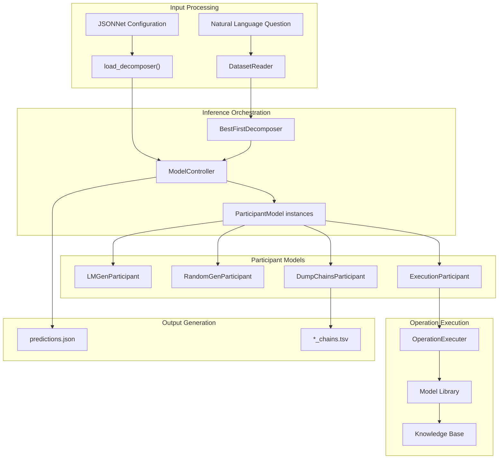
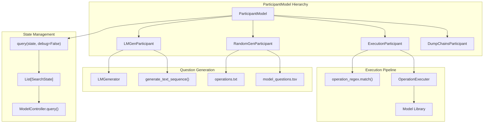
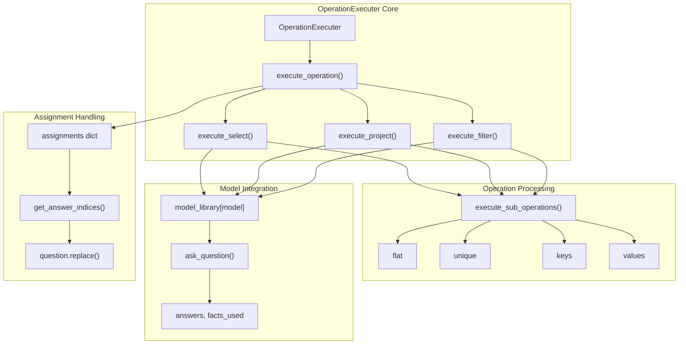
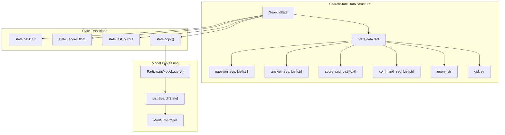
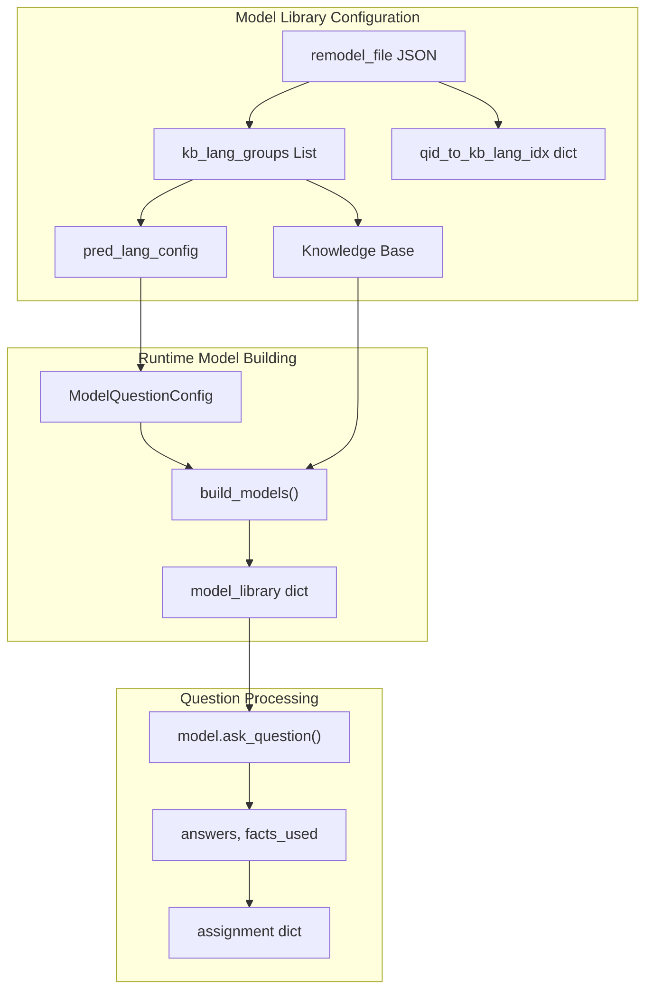

<!-- source: DeepWiki mcp.deepwiki.com · repo allenai/CommaQA · page 2 Core Architecture · fetched 2026-10-26 -->

# Core Architecture

Relevant source files

The following files were used as context for generating this wiki page:

- [commaqa/execution/operation_executer.py](commaqa/execution/operation_executer.py)
- [commaqa/inference/configurable_inference.py](commaqa/inference/configurable_inference.py)
- [commaqa/inference/participant_execution.py](commaqa/inference/participant_execution.py)
- [commaqa/inference/participant_qgen.py](commaqa/inference/participant_qgen.py)
- [configs/inference/commaqav1_brute_force.jsonnet](configs/inference/commaqav1_brute_force.jsonnet)

This document explains the overall system architecture of CommaQA, showing how the dataset generation pipeline, inference engine, and execution engine work together to perform multi-step question answering through model orchestration. For details on dataset building, see [Dataset Generation System](#3). For specific inference strategies and configuration options, see [Inference System](#4).

## System Overview

CommaQA operates as a configurable multi-model system that decomposes complex questions into simpler sub-questions, executes operations against knowledge bases, and chains the results together. The system consists of three main subsystems that work together:

Sources: [commaqa/inference/configurable_inference.py:34-51](), [commaqa/inference/participant_qgen.py:15-26](), [commaqa/inference/participant_execution.py:14-33](), [commaqa/execution/operation_executer.py:10-16]()

## Core Components

### Inference Engine Entry Point

The system starts with `configurable_inference.py`, which serves as the main orchestrator. The `load_decomposer()` function instantiates participant models based on JSONNet configuration and creates the core inference components:

| Component | Class | Purpose |
|-----------|-------|---------|
| Model Controller | `ModelController` | State machine that coordinates participant models |
| Search Strategy | `BestFirstDecomposer` | Implements search over question decomposition space |
| Data Structure | `QuestionGeneratorData` | Holds question sequences, answers, and metadata |

The entry point processes command-line arguments and loads configuration through JSONNet with environment variable support.

Sources: [commaqa/inference/configurable_inference.py:54-130](), [commaqa/inference/configurable_inference.py:34-51]()

### Participant Model Architecture

The system uses a participant-based architecture where different specialized models handle specific aspects of the inference process. All participants inherit from `ParticipantModel` and implement the `query()` method:

Sources: [commaqa/inference/participant_qgen.py:15-89](), [commaqa/inference/participant_qgen.py:91-262](), [commaqa/inference/participant_execution.py:14-103]()

### Operation Execution Engine

The `OperationExecuter` provides the core execution logic for structured operations against knowledge bases. It supports three main operation types through specialized execution methods:

Sources: [commaqa/execution/operation_executer.py:10-219](), [commaqa/execution/operation_executer.py:43-55](), [commaqa/execution/operation_executer.py:57-112](), [commaqa/execution/operation_executer.py:114-188]()

## Configuration and Model Loading

### JSONNet Configuration System

The system uses JSONNet configurations to define participant models and their parameters. Configuration files specify the state machine structure and model instantiation parameters:

```mermaid
graph LR
    subgraph "Configuration Loading"  
        JSONNET["*.jsonnet files"] --> EXTLVARS["get_environment_variables()"]
        EXTLVARS --> EVALUATE["_jsonnet.evaluate_file()"]
        EVALUATE --> CONFIGMAP["config_map dict"]
    end
    
    subgraph "Model Instantiation"
        CONFIGMAP --> MODELS["config_map['models']"]
        MODELS --> CLASSNAME["value.pop('name')"]
        CLASSNAME --> LOOKUP["MODEL_NAME_CLASS[class_name]"]
        LOOKUP --> INSTANTIATE["class(**value)"]
        INSTANTIATE --> MODELMAP["model_map dict"]
    end
    
    subgraph "State Machine Setup"
        CONFIGMAP --> CONTROLLER["ModelController(config_map)"]
        CONTROLLER --> DECOMPOSER["BestFirstDecomposer(controller)"]
        MODELMAP --> CONTROLLER
    end
```

Example configuration structure from `commaqav1_brute_force.jsonnet`:

| Field | Purpose | Example Values |
|-------|---------|----------------|
| `start_state` | Initial participant model | `"gen"` |
| `end_state` | Terminal state marker | `"[EOQ]"` |
| `models.gen.name` | Participant class name | `"randgen"` |
| `models.execute.name` | Execution participant | `"operation_executer"` |
| `models.chains.name` | Utility participant | `"dump_chains"` |

Sources: [commaqa/inference/configurable_inference.py:61-67](), [configs/inference/commaqav1_brute_force.jsonnet:1-28](), [commaqa/inference/configurable_inference.py:34-51]()

## Data Flow and State Management

### Search State Structure

The system maintains state through `SearchState` objects that track question sequences, answers, and metadata as they flow through participant models:

Each participant model receives a state, processes it according to its logic, and returns a list of new states representing possible next steps in the decomposition.

Sources: [commaqa/inference/participant_qgen.py:30-88](), [commaqa/inference/participant_execution.py:37-103](), [commaqa/inference/configurable_inference.py:84-100]()

## Integration Points

### Model Library Interface

The execution participant integrates with domain-specific models through a standardized interface defined in the `remodel_file` configuration. This JSON file maps question IDs to knowledge bases and predicate language configurations:

Sources: [commaqa/inference/participant_execution.py:19-32](), [commaqa/inference/participant_execution.py:55-79]()

This architecture enables CommaQA to handle complex multi-step reasoning by decomposing questions into executable operations, maintaining state across steps, and coordinating multiple specialized models through a unified participant interface.

---

