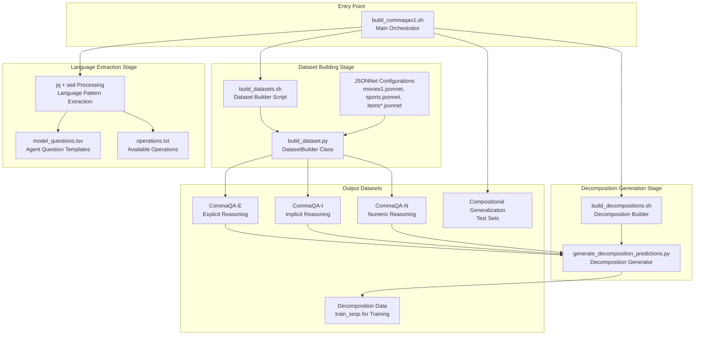
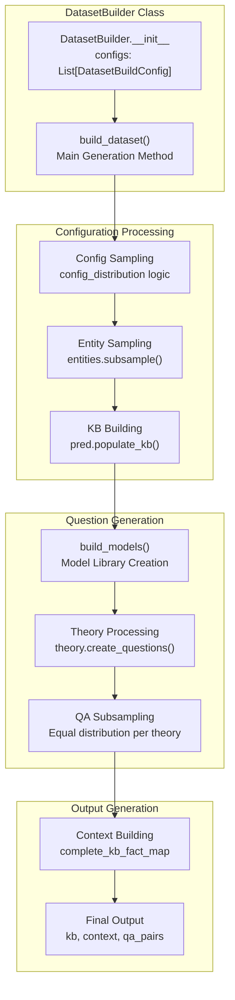
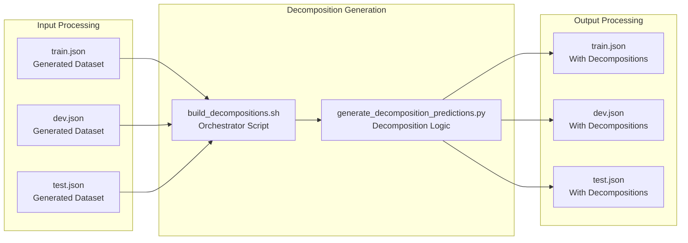
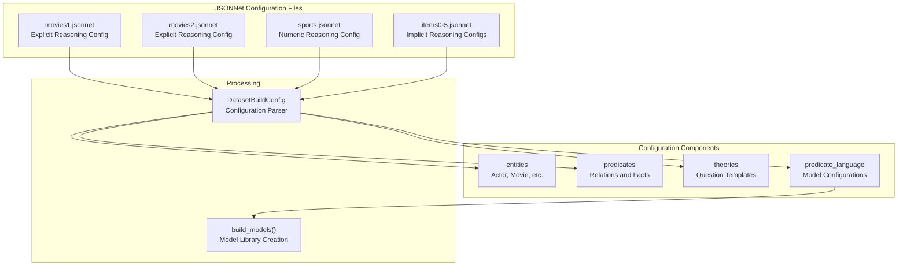
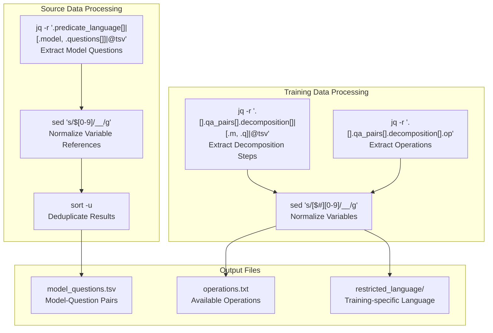
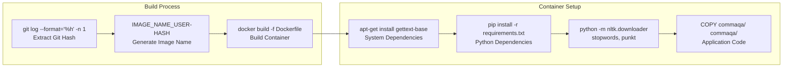
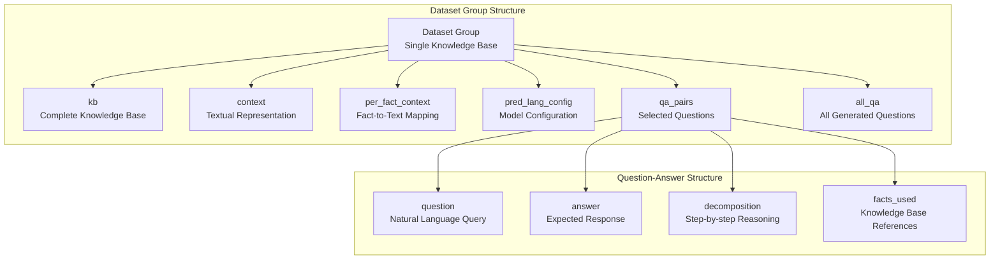

<!-- source: DeepWiki mcp.deepwiki.com · repo allenai/CommaQA · page 3 Dataset Generation System · fetched 2026-10-26 -->

# Dataset Generation System

Relevant source files

The following files were used as context for generating this wiki page:

- [.dockerignore](.dockerignore)
- [Dockerfile](Dockerfile)
- [commaqa/dataset/build_dataset.py](commaqa/dataset/build_dataset.py)
- [commaqa/dataset/build_submodel_datasets.py](commaqa/dataset/build_submodel_datasets.py)
- [scripts/build_commaqav1.sh](scripts/build_commaqav1.sh)
- [scripts/build_datasets.sh](scripts/build_datasets.sh)
- [scripts/build_decompositions.sh](scripts/build_decompositions.sh)
- [scripts/build_docker_image.sh](scripts/build_docker_image.sh)

## Purpose and Scope

The Dataset Generation System is responsible for creating the CommaQA datasets from configuration files, generating question-answer pairs, building decompositions for training data, and extracting language models. This system produces three main dataset variants: CommaQA-E (explicit reasoning), CommaQA-I (implicit reasoning), and CommaQA-N (numeric reasoning). 

For information about how these datasets are used during inference, see [Inference Engine](#4.1). For details on the execution of operations within generated datasets, see [Operation Executer](#5.1).

## System Architecture

The dataset generation system follows a multi-stage pipeline that transforms JSONNet configuration files into structured datasets with accompanying decompositions and language models.

### Dataset Generation Pipeline Overview

Sources: [scripts/build_commaqav1.sh:1-67](), [scripts/build_datasets.sh:1-21](), [scripts/build_decompositions.sh:1-21]()

## Main Components

### Dataset Builder Core Logic

The `DatasetBuilder` class in `build_dataset.py` implements the core dataset generation logic. It processes multiple `DatasetBuildConfig` objects to create structured question-answer datasets.

Sources: [commaqa/dataset/build_dataset.py:37-129]()

### Dataset Generation Workflow

The system generates datasets through a structured process that ensures balanced representation across different reasoning types:

| Stage | Process | Key Components |
|-------|---------|---------------|
| **Configuration** | Load JSONNet configs | `DatasetBuildConfig`, `_jsonnet.evaluate_file()` |
| **Entity Sampling** | Sample entities per group | `entities.subsample()`, `entity_percent` parameter |
| **KB Population** | Build knowledge base | `pred.populate_kb()`, `complete_kb` |
| **Model Library** | Initialize execution models | `build_models()` from `execution.utils` |
| **Question Generation** | Create QA pairs | `theory.create_questions()` |
| **Balancing** | Equalize across theories | `random.sample()`, `min_size` calculation |
| **Output** | Generate train/dev/test | 80%/10%/10% split |

Sources: [commaqa/dataset/build_dataset.py:41-129]()

### Decomposition Generation System

Sources: [scripts/build_decompositions.sh:1-21](), [scripts/build_commaqav1.sh:20-32]()

## Configuration System

The dataset generation system is driven by JSONNet configuration files that define entities, predicates, theories, and predicate language configurations. These configurations are processed by the `DatasetBuildConfig` class.

### Configuration File Structure

Sources: [scripts/build_commaqav1.sh:4-17](), [commaqa/dataset/build_dataset.py:149-162]()

## Language Extraction Process

The system extracts language patterns and operation templates from generated datasets using `jq` and `sed` processing to create reusable components for model training.

### Language Processing Pipeline

Sources: [scripts/build_commaqav1.sh:34-56]()

## Docker Environment

The dataset generation system includes Docker support for consistent, reproducible builds across different environments.

### Docker Configuration

| Component | Configuration | Purpose |
|-----------|---------------|---------|
| **Base Image** | `python:3.8` | Python runtime environment |
| **Environment** | `LC_ALL=C.UTF-8`, `LANG=C.UTF-8` | Unicode support |
| **NVIDIA Support** | `NVIDIA_VISIBLE_DEVICES all` | GPU access for model execution |
| **Dependencies** | `requirements.txt` | Python package installation |
| **NLTK Data** | `stopwords`, `punkt` | Natural language processing |
| **Working Directory** | `/stage/` | Container workspace |

Sources: [Dockerfile:1-28](), [scripts/build_docker_image.sh:1-16]()

### Container Build Process

Sources: [scripts/build_docker_image.sh:1-16](), [Dockerfile:1-28]()

## Output Dataset Structure

The dataset generation system produces structured JSON files with specific schemas for different reasoning types.

### Dataset Output Schema

Each generated dataset follows a consistent structure:

Sources: [commaqa/dataset/build_dataset.py:75-120]()

### Dataset Variants

| Dataset Type | Configuration | Purpose | Output Location |
|--------------|---------------|---------|-----------------|
| **CommaQA-E** | `explicit/movies1.jsonnet`, `movies2.jsonnet` | Explicit reasoning over movie entities | `output/commaqav1/explicit/commaqa/` |
| **CommaQA-I** | `implicit/items0-5.jsonnet` | Implicit reasoning over item entities | `output/commaqav1/implicit/commaqa/` |
| **CommaQA-N** | `numeric/sports.jsonnet` | Numeric reasoning over sports entities | `output/commaqav1/numeric/commaqa/` |
| **Compositional** | `*_compgen.jsonnet` | Generalization testing | `output/commaqav1/compgen/` |

Sources: [scripts/build_commaqav1.sh:4-67]()

---

