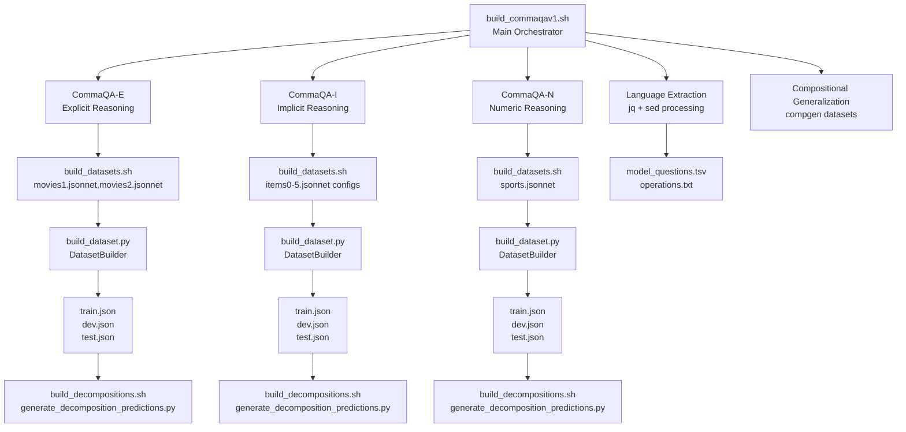
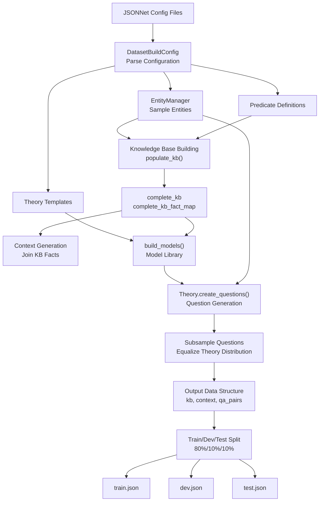

<!-- source: DeepWiki mcp.deepwiki.com · repo allenai/CommaQA · page 3.1 Dataset Building Pipeline · fetched 2026-10-26 -->

# Dataset Building Pipeline

<details>
<summary>Relevant source files</summary>

The following files were used as context for generating this wiki page:

- [commaqa/dataset/build_dataset.py](commaqa/dataset/build_dataset.py)
- [scripts/build_commaqav1.sh](scripts/build_commaqav1.sh)
- [scripts/build_datasets.sh](scripts/build_datasets.sh)
- [scripts/build_decompositions.sh](scripts/build_decompositions.sh)

</details>


This document covers the dataset building pipeline system that generates CommaQA datasets from configuration files. The pipeline transforms JSONNet configuration files containing entities, predicates, and theories into structured question-answering datasets with multiple splits and formats.

For information about the configuration format itself, see [Configuration Format](#3.2). For details about decomposition generation specifically, see [Decomposition Generation](#3.3).

## Pipeline Overview

The dataset building pipeline is orchestrated through a series of shell scripts that coordinate the generation of three main dataset variants: CommaQA-E (explicit), CommaQA-I (implicit), and CommaQA-N (numeric). The pipeline also generates decomposition data and language extraction files.



**Sources:** [scripts/build_commaqav1.sh:1-67](), [scripts/build_datasets.sh:1-21](), [scripts/build_decompositions.sh:1-21]()

## Main Pipeline Scripts

### build_commaqav1.sh

The primary orchestration script that coordinates the entire dataset building process. It sequentially builds three dataset variants:

| Dataset Variant | Configuration Files | Output Directory |
|-----------------|-------------------|------------------|
| CommaQA-E | `movies1.jsonnet`, `movies2.jsonnet` | `output/commaqav1/explicit/` |
| CommaQA-I | `items0.jsonnet` through `items5.jsonnet` | `output/commaqav1/implicit/` |
| CommaQA-N | `sports.jsonnet` | `output/commaqav1/numeric/` |

The script performs four main phases:

1. **Dataset Generation**: Calls `build_datasets.sh` for each variant [scripts/build_commaqav1.sh:4-17]()
2. **Decomposition Building**: Calls `build_decompositions.sh` for each variant [scripts/build_commaqav1.sh:20-31]()
3. **Language Extraction**: Processes JSONNet configs to extract model questions and operations [scripts/build_commaqav1.sh:34-56]()
4. **Compositional Generalization**: Builds additional test datasets with reduced entity coverage [scripts/build_commaqav1.sh:58-67]()

### build_datasets.sh

A wrapper script that standardizes dataset building parameters and calls `build_dataset.py`. It uses environment variables with defaults:

- `ent_per`: Entity percentage (default: 0.2)
- `groups`: Number of groups (default: 2000) 
- `egs`: Examples per group (default: 5)

### build_decompositions.sh

Processes existing dataset files to generate decomposition data by calling `generate_decomposition_predictions.py` for each data split (train, dev, test).

**Sources:** [scripts/build_commaqav1.sh:1-67](), [scripts/build_datasets.sh:1-21](), [scripts/build_decompositions.sh:1-21]()

## Dataset Building Process

The core dataset building logic is implemented in the `DatasetBuilder` class, which transforms configuration files into structured question-answering datasets.



**Sources:** [commaqa/dataset/build_dataset.py:37-130]()

### DatasetBuilder Class

The `DatasetBuilder` class orchestrates the dataset generation process through its `build_dataset` method:

1. **Configuration Sampling**: Uses weighted sampling across input configs to ensure balanced representation [commaqa/dataset/build_dataset.py:53-58]()

2. **Entity Sampling**: For each selected config, samples entities using `entities.subsample()` [commaqa/dataset/build_dataset.py:61]()

3. **Knowledge Base Construction**: Builds complete KB by calling `pred.populate_kb()` for each predicate [commaqa/dataset/build_dataset.py:64-70]()

4. **Context Generation**: Creates both complete context and per-fact context mappings [commaqa/dataset/build_dataset.py:73-80]()

5. **Question Generation**: Uses theories to generate questions via `theory.create_questions()` [commaqa/dataset/build_dataset.py:84-92]()

6. **Quality Control**: Ensures minimum question thresholds and balanced theory representation [commaqa/dataset/build_dataset.py:95-116]()

7. **Output Formatting**: Structures data with KB, context, and QA pairs [commaqa/dataset/build_dataset.py:75-120]()

**Sources:** [commaqa/dataset/build_dataset.py:37-130]()

## Output Structure

The dataset building pipeline generates several types of output files:

### Primary Dataset Files

| File | Content | Format |
|------|---------|--------|
| `train.json` | Training examples (80%) | JSON array of dataset groups |
| `dev.json` | Development examples (10%) | JSON array of dataset groups |
| `test.json` | Test examples (10%) | JSON array of dataset groups |
| `source*.json` | Original JSONNet configs | Compiled JSON configurations |

### Language Extraction Files

The pipeline extracts language patterns using `jq` and `sed` processing:

- **Full Language**: Extracted from `predicate_language` configs [scripts/build_commaqav1.sh:39-42]()
- **Restricted Language**: Extracted from training decompositions [scripts/build_commaqav1.sh:48-56]()

| File | Content | Purpose |
|------|---------|---------|
| `model_questions.tsv` | Model-question pairs | Agent question templates |
| `operations.txt` | Available operations | Operation vocabulary |

### Compositional Generalization Datasets

Special test datasets with reduced entity coverage (20%) for evaluating compositional generalization:

- `output/commaqav1/compgen/numeric_test.json`
- `output/commaqav1/compgen/explicit_test.json`

**Sources:** [scripts/build_commaqav1.sh:34-67](), [commaqa/dataset/build_dataset.py:170-185]()

## Data Group Structure

Each dataset group in the output JSON files contains:

```json
{
  "kb": "Complete knowledge base with all predicates",
  "context": "Space-separated context from all KB facts", 
  "per_fact_context": "Mapping from facts to natural language",
  "pred_lang_config": "Predicate language configuration",
  "all_qa": "All generated questions before subsampling",
  "qa_pairs": "Final subsampled question-answer pairs"
}
```

The `qa_pairs` field contains the actual training examples, while `all_qa` provides the complete generated set for analysis.

**Sources:** [commaqa/dataset/build_dataset.py:75-120]()

---

