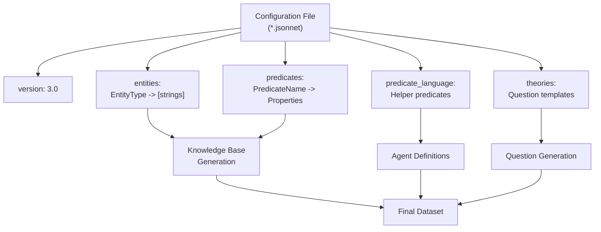
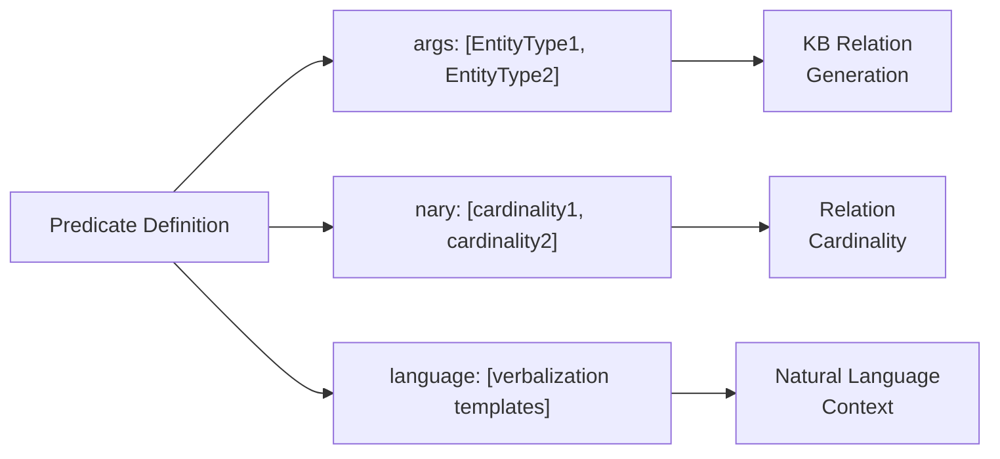
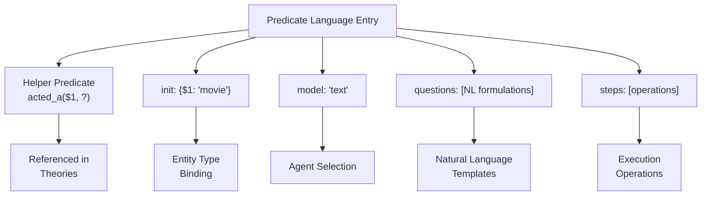
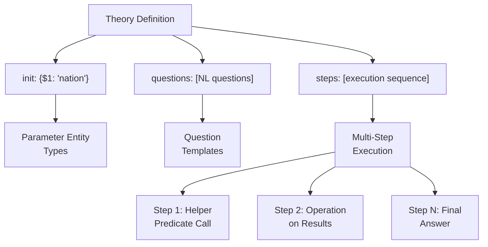
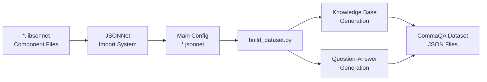

<!-- source: DeepWiki mcp.deepwiki.com · repo allenai/CommaQA · page 3.2 Configuration Format · fetched 2026-10-26 -->

# Configuration Format

<details>
<summary>Relevant source files</summary>

The following files were used as context for generating this wiki page:

- [commaqa/configs/README.md](commaqa/configs/README.md)
- [configs/commaqav1/implicit/theories.libsonnet](configs/commaqav1/implicit/theories.libsonnet)
- [configs/commaqav1/numeric/sports_compgen.jsonnet](configs/commaqav1/numeric/sports_compgen.jsonnet)
- [configs/commaqav1/numeric/theories.libsonnet](configs/commaqav1/numeric/theories.libsonnet)
- [configs/commaqav1/numeric/theories_compgen.libsonnet](configs/commaqav1/numeric/theories_compgen.libsonnet)

</details>


This document describes the JSONNet configuration format used to define CommaQA datasets. The configuration system allows users to specify entities, predicates, predicate languages, and theories that control how datasets are generated and structured. For information about the dataset building pipeline that processes these configurations, see [Dataset Building Pipeline](#3.1).

## Overview

The CommaQA configuration format uses JSONNet files to declaratively define all aspects of a dataset, including the knowledge base structure, agent capabilities, and question generation templates. Each configuration produces a complete dataset with structured question-answer pairs and their corresponding execution traces.

## Configuration Structure

Every CommaQA configuration file follows a standardized top-level structure defined in [commaqa/configs/README.md:10-17]():

```jsonnet
{
  version: 3.0,
  entities: Entities,
  predicates: Predicates,
  predicate_language: Predicate_Language,
  theories: Theories,
}
```

### Configuration Components Diagram



Sources: [commaqa/configs/README.md:8-18](), [configs/commaqav1/numeric/sports_compgen.jsonnet:10-16]()

## Entities

The `entities` section defines the types and instances of entities available in the knowledge base. Each entity type maps to a list of concrete entities that will be used during dataset generation.

Example from [commaqa/configs/README.md:27-44]():

```jsonnet
entities: {
    movie: [
        "Godfather",
        "Kill Bill",
    ],
    actor: [
        "Marlon Brando", 
        "Uma Thurman",
    ],
    year: [
        "1990",
        "1995", 
    ]
}
```

Entity types serve as argument types for predicates and are referenced throughout the configuration using symbolic names like `"person"`, `"nation"`, or `"movie"`.

Sources: [commaqa/configs/README.md:24-44]()

## Predicates

Predicates define relations between entity types and specify how these relations are structured and verbalized. Each predicate contains several key properties:

### Predicate Structure



Example predicate definition from [commaqa/configs/README.md:52-58]():

```jsonnet
acted_in: {
    args: ["movie", "actor"],
    nary: ["n", "1"], 
    language: ["movie: $1 ; actor: $2", "$2 acted in $1."],
}
```

### Cardinality Specifications

The `nary` field controls relationship cardinality:
- `["n", "1"]`: Many-to-one (each movie can have multiple actors, each actor appears once)
- `["n", "n"]`: Many-to-many (flexible relationships)
- `["1", "n"]`: One-to-many

Alternative structures like `type: "tree"` or `type: "chain"` can be specified instead of `nary` for hierarchical or sequential relationships.

Sources: [commaqa/configs/README.md:47-87]()

## Predicate Language

The `predicate_language` section defines the interface between natural language questions and the underlying knowledge base operations. Each entry specifies how agents answer specific types of questions.

### Predicate Language Structure



Example from [commaqa/configs/README.md:96-113]():

```jsonnet
"acted_a($1, ?)": {
  "init": {
    "$1": "movie"
  },
  "model": "text",
  "questions": [
    "Who all acted in the movie $1?",
    "Who are the actors in the movie $1?"
  ],
  "steps": [
    {
      "answer": "#1",
      "operation": "select", 
      "question": "text_actor($1, ?)"
    }
  ]
}
```

### Step Operations

The `steps` array defines the execution sequence:
- `operation`: Type of operation (`select`, `project`, `filter`, etc.)
- `question`: KB query or predicate call
- `answer`: Variable name for storing results (e.g., `#1`, `#2`)

Sources: [commaqa/configs/README.md:89-131]()

## Theories

Theories define complex multi-step question templates that combine multiple predicate language entries. They specify the high-level questions and their decomposition into executable steps.

### Theory Structure



Example from [configs/commaqav1/numeric/theories.libsonnet:2-36]():

```jsonnet
{
  init: {
    "$1": "nation",
  },
  questions: [
    "What was the gap between the longest and shortest javelin throws by athletes from $1?",
  ],
  steps: [
    {
      operation: "select",
      question: "nationj_p($1, ?)",
      answer: "#1",
    },
    {
      operation: "project_values_flat", 
      question: "jthrow_l(#1, ?)",
      answer: "#2",
    },
    {
      operation: "select",
      question: "max(#2)",
      answer: "#3", 
    },
    {
      operation: "select",
      question: "min(#2)",
      answer: "#4",
    },
    {
      operation: "select", 
      question: "diff(#3 | #4)",
      answer: "#5",
    },
  ],
}
```

### Variable Chaining

Theories enable complex reasoning through variable chaining:
- Initial variables (`$1`, `$2`): Input parameters from entity sampling
- Intermediate variables (`#1`, `#2`, etc.): Results from previous steps
- Final answer: Last step's result becomes the question answer

Sources: [configs/commaqav1/numeric/theories.libsonnet:1-36](), [commaqa/configs/README.md:133-163]()

## Configuration Assembly

The complete configuration file imports and combines multiple components using JSONNet's import system, as shown in [configs/commaqav1/numeric/sports_compgen.jsonnet:1-16]():

```jsonnet
local entities = import "entities.libsonnet";
local table_predicate = import "table_predicates.libsonnet"; 
local text_predicate = import "text_predicates.libsonnet";
local combined_predicates = table_predicate + text_predicate;
local predicate_languages = import "predicate_language.libsonnet";
local theories = import "theories_compgen.libsonnet";
```

### Configuration Flow Diagram



This modular approach allows for:
- Component reuse across different dataset variants
- Selective predicate filtering for specialized datasets
- Flexible predicate language composition

Sources: [configs/commaqav1/numeric/sports_compgen.jsonnet:1-16]()

---

