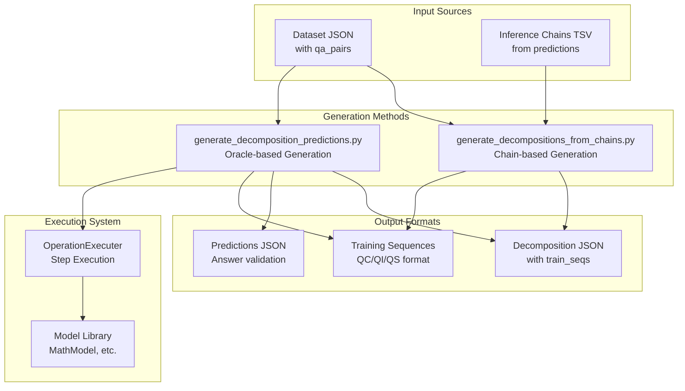
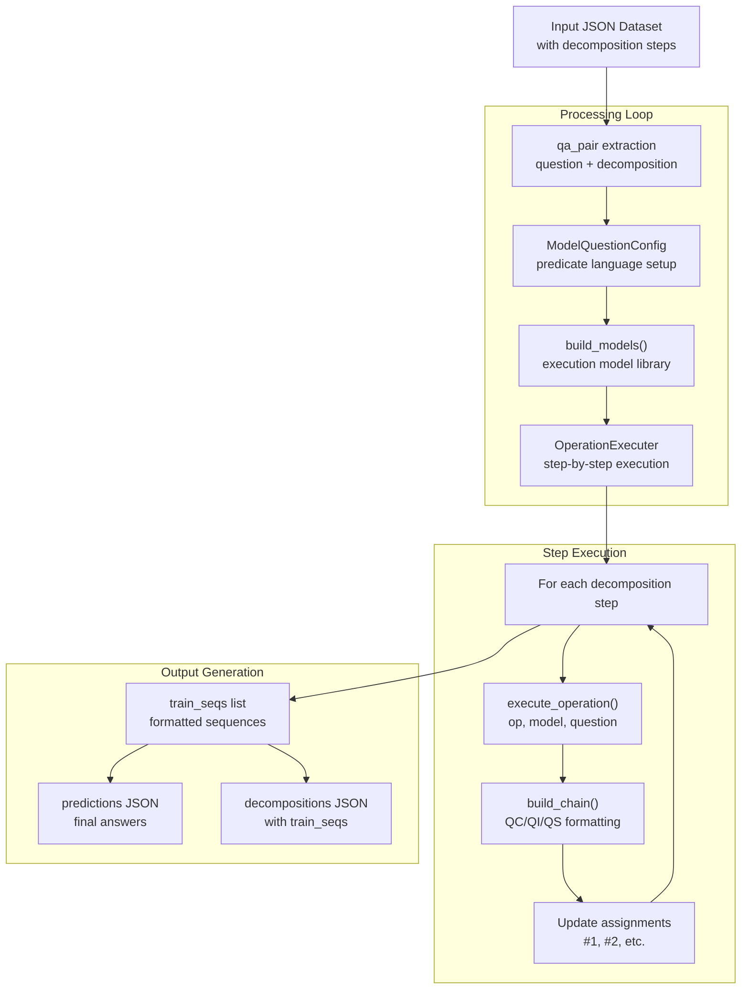
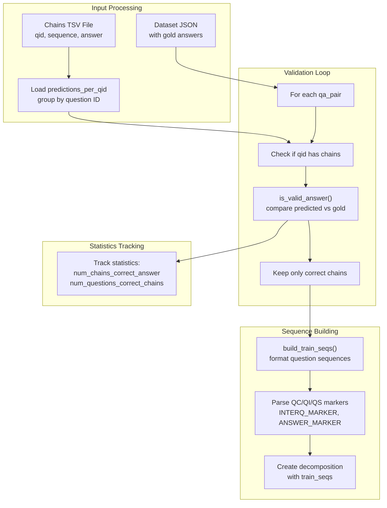
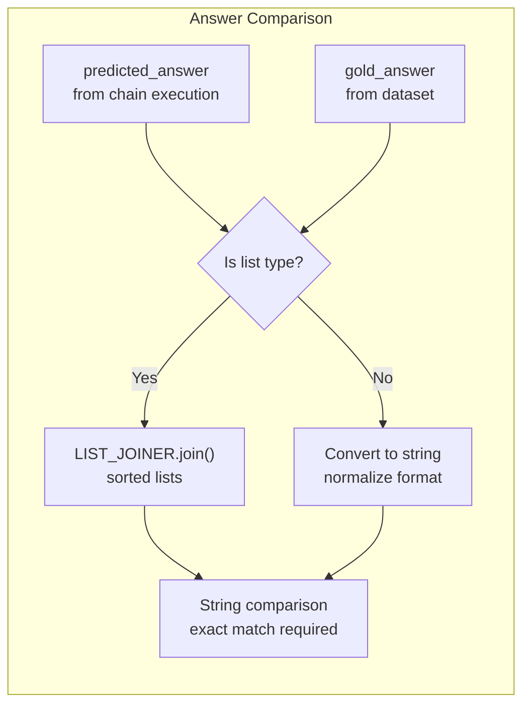
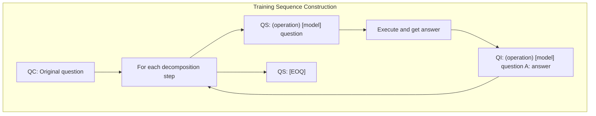
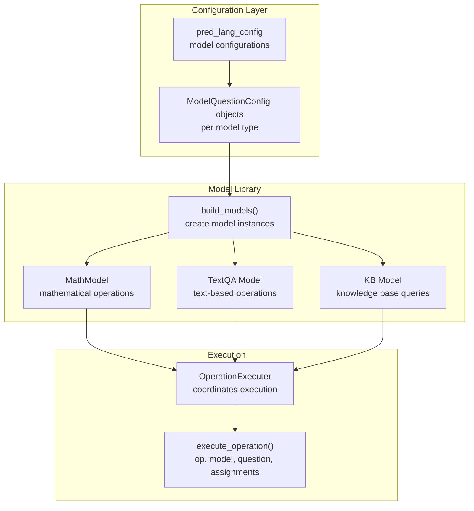

<!-- source: DeepWiki mcp.deepwiki.com · repo allenai/CommaQA · page 3.3 Decomposition Generation · fetched 2026-10-26 -->

# Decomposition Generation

<details>
<summary>Relevant source files</summary>

The following files were used as context for generating this wiki page:

- [commaqa/dataset/generate_decomposition_predictions.py](commaqa/dataset/generate_decomposition_predictions.py)
- [commaqa/dataset/generate_decompositions_from_chains.py](commaqa/dataset/generate_decompositions_from_chains.py)
- [commaqa/execution/math_model.py](commaqa/execution/math_model.py)

</details>


## Purpose and Scope

Decomposition Generation is the process of converting complex multi-step questions into structured training sequences that teach models how to break down reasoning tasks into executable operations. This system generates training data by taking question-answer pairs and creating step-by-step decomposition chains that can be learned by sequence-to-sequence models.

For information about the overall dataset building pipeline, see [Dataset Building Pipeline](#3.1). For details about the execution system that processes these decompositions, see [Execution Engine](#5).

## Overview

The CommaQA system supports two primary methods for generating decompositions:

1. **Oracle-based Generation**: Using ground-truth decompositions provided in the dataset to create training sequences
2. **Chain-based Generation**: Extracting decompositions from inference chains that produced correct answers

Both methods produce training sequences in a standardized format that can be used to train models for multi-step question answering.



Sources: [commaqa/dataset/generate_decomposition_predictions.py:1-92](), [commaqa/dataset/generate_decompositions_from_chains.py:1-120]()

## Oracle-based Decomposition Generation

The `generate_decomposition_predictions.py` script processes datasets with ground-truth decompositions to create training sequences. This method uses the provided step-by-step breakdowns to generate executable training data.

### Process Flow



Sources: [commaqa/dataset/generate_decomposition_predictions.py:29-92]()

### Key Components

The oracle-based generation relies on several key functions and data structures:

| Component | Purpose | Location |
|-----------|---------|----------|
| `build_chain()` | Formats decomposition steps into training sequences | [commaqa/dataset/generate_decomposition_predictions.py:25-26]() |
| `OperationExecuter` | Executes individual decomposition steps | [commaqa/dataset/generate_decomposition_predictions.py:43]() |
| `ModelQuestionConfig` | Configures predicate language models | [commaqa/dataset/generate_decomposition_predictions.py:40]() |
| `curr_assignment` | Tracks intermediate results across steps | [commaqa/dataset/generate_decomposition_predictions.py:47]() |

The process iterates through each decomposition step, executing operations and building formatted training sequences that capture the question-decomposition-answer flow.

Sources: [commaqa/dataset/generate_decomposition_predictions.py:25-68]()

## Chain-based Decomposition Generation

The `generate_decompositions_from_chains.py` script extracts valid decompositions from inference chains that produced correct answers. This method filters chains based on answer correctness and converts them into training sequences.

### Validation and Filtering Process



Sources: [commaqa/dataset/generate_decompositions_from_chains.py:51-107]()

### Answer Validation

The system uses a sophisticated answer validation mechanism to ensure only correct chains are used for training:



Sources: [commaqa/dataset/generate_decompositions_from_chains.py:24-36]()

## Training Sequence Format

Both generation methods produce training sequences in a standardized format that uses specific markers to denote different types of content:

### Sequence Markers

| Marker | Purpose | Usage |
|--------|---------|-------|
| `QC:` | Question Context | Initial question statement |
| `QI:` | Question Intermediate | Intermediate steps with answers |
| `QS:` | Question Step | Operation to be performed |
| `A:` | Answer | Result of operation execution |
| `[EOQ]` | End of Question | Terminal marker |

### Format Structure



Sources: [commaqa/dataset/generate_decomposition_predictions.py:50-68](), [commaqa/inference/utils.py:7-8]()

### Example Sequence Building

The `build_chain()` function creates formatted sequences by combining previous context with new operations:

```python
# From generate_decomposition_predictions.py:25-26
def build_chain(prev_chain, operation, model, question):
    return prev_chain + " QS: ({}) [{}] {}".format(operation, model, question)
```

This produces sequences like:
- `QC: What is the maximum age? QS: (select) [MathModel] What are all ages?`
- `QI: (select) [MathModel] What are all ages? A: [25, 30, 35] QS: (max) [MathModel] max([25, 30, 35])`

Sources: [commaqa/dataset/generate_decomposition_predictions.py:25-26](), [commaqa/dataset/generate_decomposition_predictions.py:50-68]()

## Integration with Execution System

The decomposition generation process relies heavily on the execution system to validate and process operations. The integration points include:

### Model Library Integration



Sources: [commaqa/dataset/generate_decomposition_predictions.py:38-43](), [commaqa/execution/utils.py:build_models]()

### Operation Types and Models

The system supports various operation types that are executed by different models:

| Operation | Model Type | Example Function | Purpose |
|-----------|------------|------------------|---------|
| `select` | Various | Data retrieval | Extract entities or values |
| `project` | Text/KB | Value extraction | Get specific attributes |
| `filter` | Various | Data filtering | Apply conditions |
| `max` | MathModel | `max()` | Find maximum value |
| `min` | MathModel | `min()` | Find minimum value |
| `count` | MathModel | `count()` | Count elements |
| `diff` | MathModel | `diff()` | Calculate difference |

Sources: [commaqa/execution/math_model.py:14-23](), [commaqa/dataset/generate_decomposition_predictions.py:57-60]()

The decomposition generation system ensures that all generated training sequences can be properly executed by the underlying execution engine, maintaining consistency between training data and inference capabilities.

Sources: [commaqa/execution/math_model.py:1-210](), [commaqa/dataset/generate_decomposition_predictions.py:1-92](), [commaqa/dataset/generate_decompositions_from_chains.py:1-120]()

---

