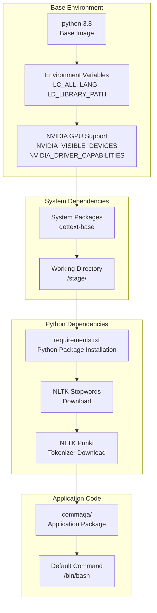
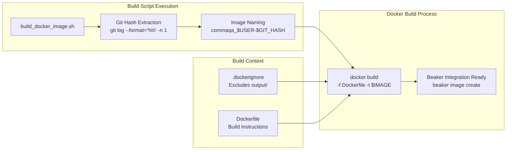
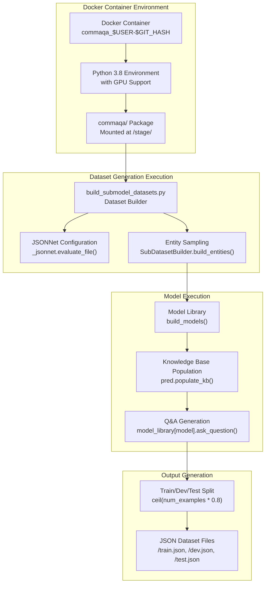

<!-- source: DeepWiki mcp.deepwiki.com · repo allenai/CommaQA · page 3.4 Docker Environment · fetched 2026-10-26 -->

# Docker Environment

<details>
<summary>Relevant source files</summary>

The following files were used as context for generating this wiki page:

- [.dockerignore](.dockerignore)
- [Dockerfile](Dockerfile)
- [commaqa/dataset/build_submodel_datasets.py](commaqa/dataset/build_submodel_datasets.py)
- [scripts/build_docker_image.sh](scripts/build_docker_image.sh)

</details>


## Purpose and Scope

This document covers the Docker containerization setup for the CommaQA dataset generation system. The Docker environment provides a standardized, reproducible execution context for running dataset building scripts and operations. For information about the dataset building pipeline that runs within this environment, see [Dataset Building Pipeline](#3.1). For details about configuration formats used in dataset generation, see [Configuration Format](#3.2).

## Docker Image Architecture

The CommaQA Docker environment is built on Python 3.8 with NVIDIA GPU support and includes all necessary dependencies for dataset generation and model execution.

### Container Structure



Sources: [Dockerfile:1-28]()

### Image Build Process

The Docker image construction follows a standardized build workflow with versioning based on Git commits.



Sources: [scripts/build_docker_image.sh:1-16](), [.dockerignore:1]()

## Environment Configuration

### NVIDIA GPU Support

The Docker environment includes comprehensive NVIDIA GPU support for machine learning workloads:

| Environment Variable | Value | Purpose |
|---------------------|-------|---------|
| `NVIDIA_VISIBLE_DEVICES` | `all` | Makes all GPUs available to container |
| `NVIDIA_DRIVER_CAPABILITIES` | `compute,utility` | Enables compute and utility functions |
| `LD_LIBRARY_PATH` | `/usr/local/nvidia/lib:/usr/local/nvidia/lib64` | NVIDIA library path configuration |

Sources: [Dockerfile:6-14]()

### Language and Locale Settings

The container uses UTF-8 encoding for consistent text processing:

```bash
LC_ALL=C.UTF-8
LANG=C.UTF-8
```

Sources: [Dockerfile:3-4]()

### Python Dependencies and NLTK Setup

The environment includes automatic setup of NLTK components required for text processing:

```bash
python -m nltk.downloader stopwords
python -m nltk.downloader punkt
```

Sources: [Dockerfile:24-25]()

## Integration with Dataset Generation

### Usage in Dataset Building Pipeline

The Docker environment serves as the execution context for dataset generation scripts, particularly `build_submodel_datasets.py` and related components.



Sources: [commaqa/dataset/build_submodel_datasets.py:1-184]()

### Build Context Management

The `.dockerignore` file ensures that output directories are excluded from the Docker build context, preventing large generated datasets from being copied into the image during builds.

```
output/
```

Sources: [.dockerignore:1]()

## Build and Deployment Workflow

### Local Development Usage

1. **Build the Image**: Execute the build script to create a versioned Docker image
   ```bash
   ./scripts/build_docker_image.sh
   ```

2. **Image Naming Convention**: Images are tagged with format `commaqa_$USER-$GIT_HASH` for reproducibility

3. **Beaker Integration**: The build script provides commands for integrating with Beaker for distributed execution

Sources: [scripts/build_docker_image.sh:9-15]()

### Container Execution Context

The Docker environment provides a complete execution context for:

- **JSONNet Configuration Processing**: Via `_jsonnet.evaluate_file()` calls in dataset builders
- **Entity and Predicate Management**: Through `DatasetBuildConfig` initialization
- **Model Library Execution**: Including `MathModel`, `TextQA`, and knowledge base operations
- **Multi-format Output Generation**: JSON datasets with train/dev/test splits

Sources: [commaqa/dataset/build_submodel_datasets.py:153-183]()

The containerized environment ensures consistent execution across different development and deployment environments while providing the necessary GPU acceleration and text processing capabilities required for the CommaQA dataset generation pipeline.

---

