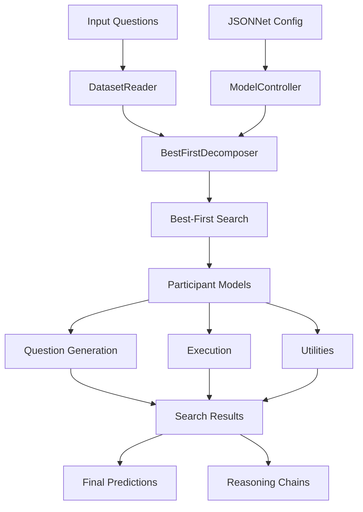
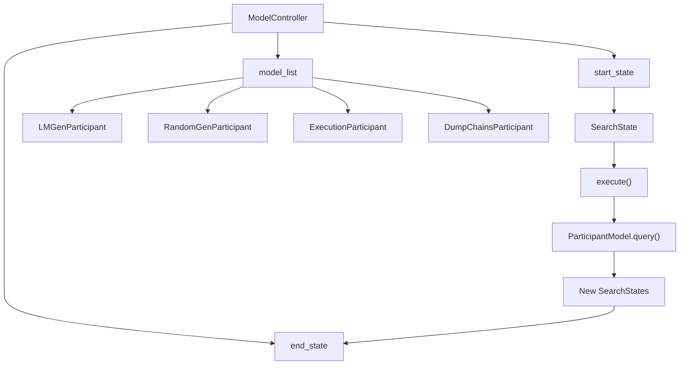
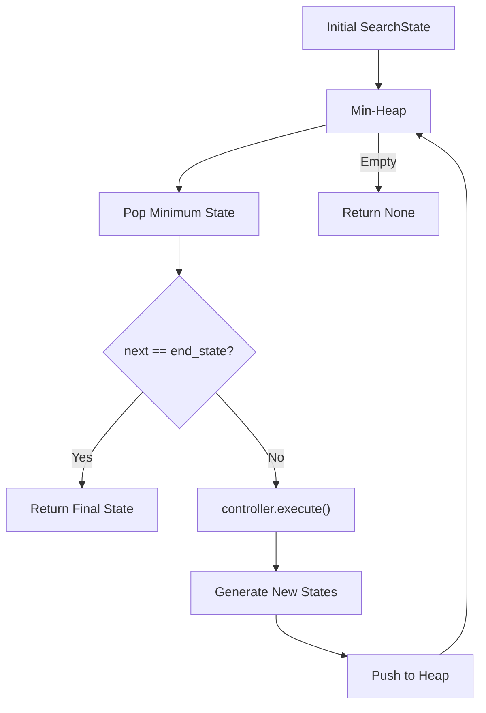
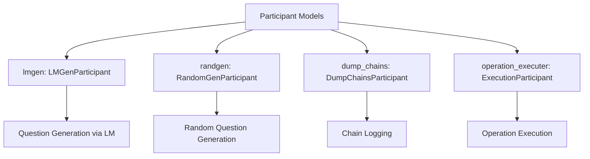
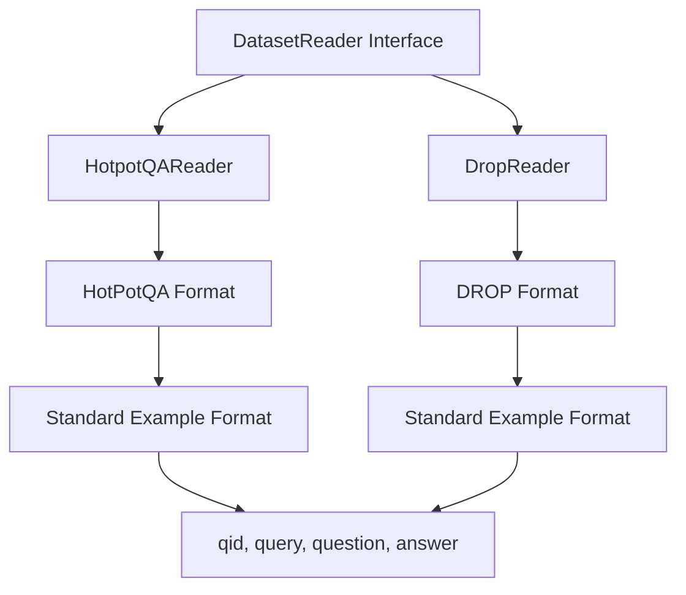
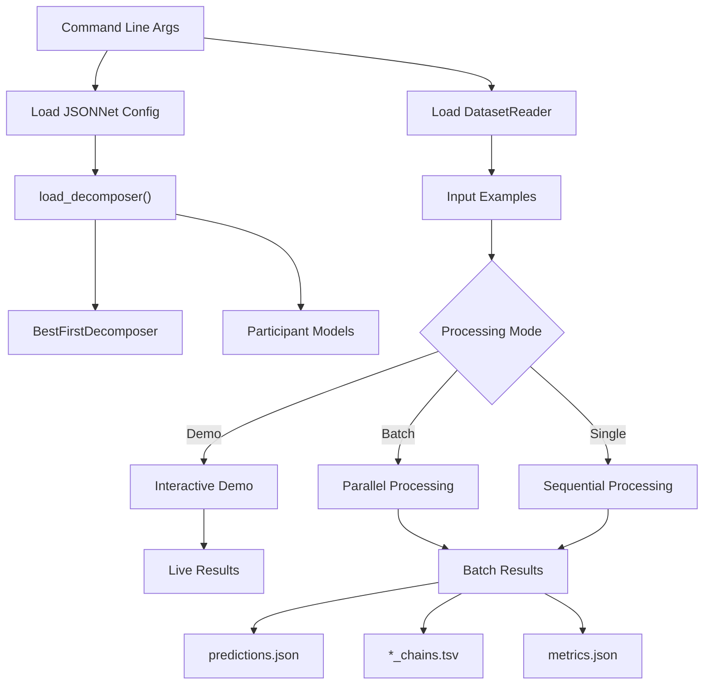

<!-- source: DeepWiki mcp.deepwiki.com · repo allenai/CommaQA · page 4 Inference System · fetched 2026-10-26 -->

# Inference System

<details>
<summary>Relevant source files</summary>

The following files were used as context for generating this wiki page:

- [commaqa/inference/configurable_inference.py](commaqa/inference/configurable_inference.py)
- [commaqa/inference/constants.py](commaqa/inference/constants.py)
- [commaqa/inference/dataset_readers.py](commaqa/inference/dataset_readers.py)
- [commaqa/inference/model_search.py](commaqa/inference/model_search.py)

</details>


## Purpose and Scope

The Inference System is the core question-answering engine that processes natural language questions and generates answers through coordinated model orchestration. This system handles question decomposition, model coordination, and search-based reasoning to produce structured answer chains. 

For information about the underlying execution operations, see [Execution Engine](#5). For details about dataset generation and configuration, see [Dataset Generation System](#3).

## System Architecture

The inference system operates as a configurable orchestration framework that coordinates multiple specialized participant models through a search-based approach. The system takes natural language questions as input and produces both final answers and detailed reasoning chains showing the decomposition process.

### High-Level Inference Flow



Sources: [commaqa/inference/configurable_inference.py:1-137](), [commaqa/inference/model_search.py:266-320]()

## Core Components

### ModelController

The `ModelController` serves as the central coordinator for all participant models, implementing a state machine that manages the flow between different processing stages.



The controller manages state transitions through the `execute()` method, which calls the appropriate participant model based on the current state's `next` attribute.

Sources: [commaqa/inference/model_search.py:55-130]()

### BestFirstDecomposer

The `BestFirstDecomposer` implements the core search strategy using a best-first search algorithm with a min-heap to explore question decompositions.

| Component | Purpose | Implementation |
|-----------|---------|----------------|
| `find_answer_decomp()` | Main search loop | Uses `heapq` for priority queue |
| `SearchState` | Tracks search progress | Contains data, score, next command |
| Heap Management | Prioritizes promising paths | Min-heap based on state scores |

The search process continues until reaching the `end_state` or exhausting all possibilities:



Sources: [commaqa/inference/model_search.py:266-320]()

### SearchState

The `SearchState` class tracks the progression of question decomposition, maintaining data, scoring, and control flow information.

```python
# Key attributes managed by SearchState
{
    "_data": "JSON data with question/answer sequences",
    "_score": "Numerical score for search prioritization", 
    "_next": "Next command/participant to execute",
    "_last_output": "Output from previous step"
}
```

The state implements comparison operators for heap operations and provides deep copying functionality for search branching.

Sources: [commaqa/inference/model_search.py:134-213]()

## Participant Model Framework

### ParticipantModel Base Class

All participant models inherit from `ParticipantModel` and implement two key methods:

| Method | Purpose | Return Type |
|--------|---------|-------------|
| `query(state, debug)` | Main processing logic | `list` of new states |
| `return_model_calls()` | Usage metrics | `dict` of model call counts |

Sources: [commaqa/inference/model_search.py:31-53]()

### Participant Types

The system supports multiple participant types through the `MODEL_NAME_CLASS` mapping:



For detailed information about specific participant implementations, see [Participant Models](#4.2).

Sources: [commaqa/inference/constants.py:8-13]()

## Dataset Readers and Input Processing

### Reader Architecture

The system supports multiple input formats through the `DatasetReader` hierarchy:



### Input Format Standardization

Both readers convert their respective formats into a standardized example structure:

| Field | Purpose | Source |
|-------|---------|--------|
| `qid` | Question identifier | Dataset-specific ID |
| `query` | Question text | Main question content |
| `question` | Question text (duplicate) | Compatibility field |
| `answer` | Ground truth answer | Dataset answer format |

Sources: [commaqa/inference/dataset_readers.py:1-60]()

### Answer Format Handling

The `DropReader` includes specialized answer format processing for the DROP dataset's complex answer structure:

```python
# DROP answer format handling
{
    "number": "Numerical answers",
    "spans": "Text span answers", 
    "date": "Date-based answers with day/month/year"
}
```

Sources: [commaqa/inference/dataset_readers.py:28-39]()

## Configuration and Execution Flow

### Main Execution Pipeline

The `configurable_inference.py` script orchestrates the entire inference process:



### Configuration Loading

The system supports both JSON and JSONNet configuration formats with environment variable injection:

```python
# Configuration loading logic
if args.config.endswith(".jsonnet"):
    ext_vars = get_environment_variables()
    config_map = json.loads(_jsonnet.evaluate_file(args.config, ext_vars=ext_vars))
else:
    config_map = json.load(open(args.config))
```

Sources: [commaqa/inference/configurable_inference.py:61-67]()

### Output Generation

The inference system generates three types of output:

| Output File | Format | Content |
|-------------|--------|---------|
| `predictions.json` | JSON | `{qid: final_answer}` mappings |
| `*_chains.tsv` | TSV | Detailed reasoning chains with Q/A sequences |
| `metrics.json` | JSON | Model usage statistics and call counts |

The chain format includes the full decomposition trace:
```
qid \t original_question \t Q: (model) subquestion A: answer \t S: final_score
```

Sources: [commaqa/inference/configurable_inference.py:114-136](), [commaqa/inference/model_search.py:241-263]()

### Parallel Processing Support

The system supports multiprocessing for batch inference through the `multiprocessing` module with spawn method initialization for cross-platform compatibility.

Sources: [commaqa/inference/configurable_inference.py:102-112]()

---

