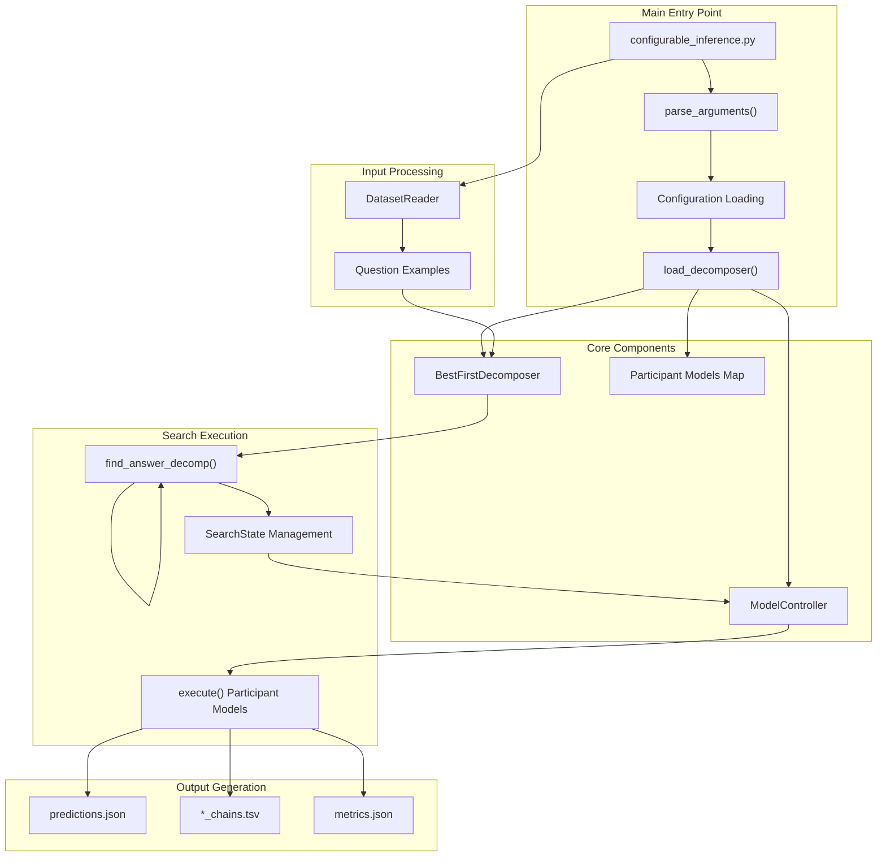
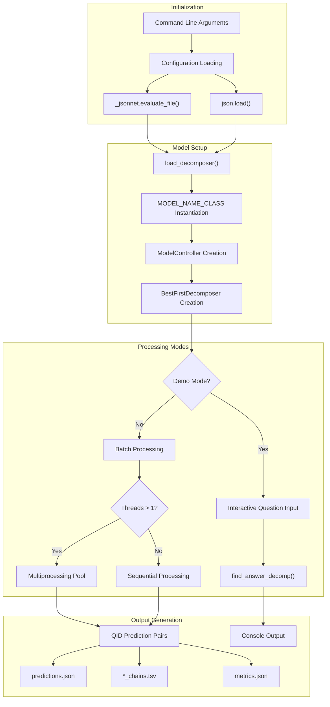
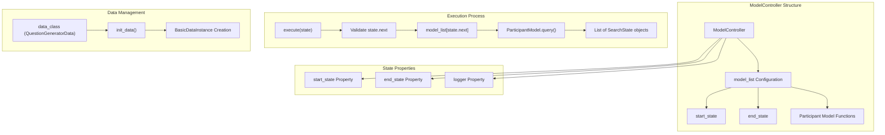
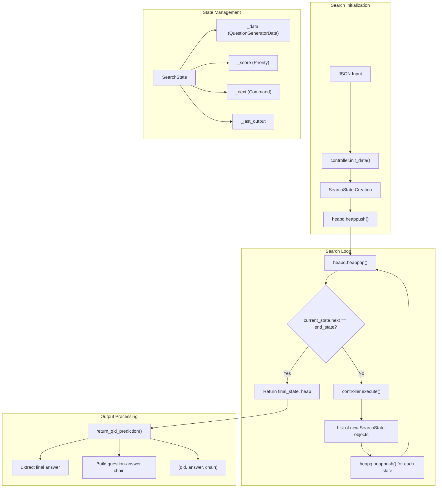
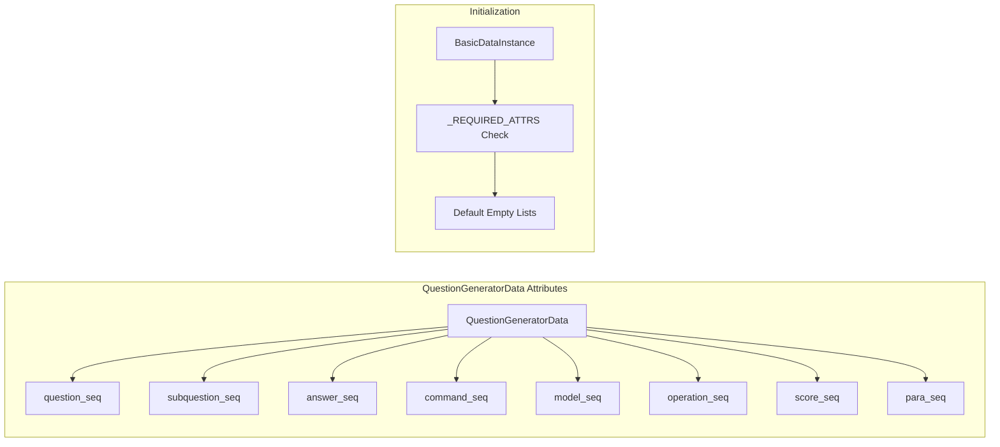

<!-- source: DeepWiki mcp.deepwiki.com · repo allenai/CommaQA · page 4.1 Inference Engine · fetched 2026-10-26 -->

# Inference Engine

Relevant source files

The following files were used as context for generating this wiki page:

- [commaqa/inference/configurable_inference.py](commaqa/inference/configurable_inference.py)
- [commaqa/inference/model_search.py](commaqa/inference/model_search.py)

The Inference Engine is the core orchestration system that processes natural language questions and generates answers through coordinated model execution. It serves as the main entry point for question-answering inference, managing the interaction between multiple participant models through a search-based decomposition strategy.

This page covers the primary inference orchestration components. For information about specific participant model implementations, see [Participant Models](#4.2). For details about search strategies and model coordination, see [Search Strategies and Model Orchestration](#4.3).

## System Overview

The Inference Engine consists of three main components: the main orchestrator in `configurable_inference.py`, the model controller system in `ModelController`, and the search strategy implementation in `BestFirstDecomposer`. These components work together to process questions through a sequence of model interactions.

### Inference Engine Architecture

Sources: [commaqa/inference/configurable_inference.py:1-137](), [commaqa/inference/model_search.py:1-320]()

## Main Orchestrator

The primary entry point is `configurable_inference.py`, which handles argument parsing, configuration loading, and execution coordination. It supports both batch processing and interactive demo modes.

### Key Functions

| Function | Purpose | Location |
|----------|---------|----------|
| `parse_arguments()` | Command-line argument parsing | [commaqa/inference/configurable_inference.py:18-31]() |
| `load_decomposer()` | Model instantiation and decomposer creation | [commaqa/inference/configurable_inference.py:34-51]() |
| Main execution loop | Processes examples and generates outputs | [commaqa/inference/configurable_inference.py:101-136]() |

The orchestrator supports multiprocessing for batch inference and provides a demo mode for interactive question answering. Configuration can be provided in either JSON or JSONNet format with environment variable support.

### Execution Flow

Sources: [commaqa/inference/configurable_inference.py:54-136]()

## Model Controller

The `ModelController` class coordinates multiple participant models through a state-based execution system. It manages model instantiation, state transitions, and execution flow according to configuration specifications.

### Controller Architecture 

Sources: [commaqa/inference/model_search.py:55-130]()

The `ModelController` requires `start_state` and `end_state` to be defined in the configuration and uses the `data_class` parameter to initialize data structures for state management.

## Search Strategy

The `BestFirstDecomposer` implements a best-first search strategy using a min-heap to explore question decompositions. It coordinates with the `ModelController` to execute participant models and track search states.

### Search Process

The decomposer maintains a priority queue of `SearchState` objects, prioritizing states with lower scores. The search continues until reaching the end state or exhausting all possibilities.

Sources: [commaqa/inference/model_search.py:266-320](), [commaqa/inference/model_search.py:241-263]()

## State Management

The `SearchState` class tracks the progression of question decomposition, maintaining data, score, next command, and output information. It implements comparison operators for heap operations.

### SearchState Structure

| Property | Purpose | Type |
|----------|---------|------|
| `_data` | Question and answer sequences | `QuestionGeneratorData` |
| `_score` | Search priority score | `float` |
| `_next` | Next command/participant | `string` |
| `_last_output` | Previous model output | `string` |

The `SearchState` class supports deep copying for branching search paths and implements `__lt__` and `__eq__` methods for heap-based priority queue operations.

### Data Structure Requirements

The `QuestionGeneratorData` class extends `BasicDataInstance` with required attributes for tracking question decomposition sequences:

Sources: [commaqa/inference/model_search.py:18-28](), [commaqa/inference/model_search.py:134-213]()

## Configuration and Model Loading

The system loads models dynamically based on configuration specifications, mapping model names to implementation classes through the `MODEL_NAME_CLASS` registry. Each model is instantiated with its configuration parameters and registered with the controller.

The `load_decomposer()` function performs model instantiation, controller creation, and decomposer initialization, returning both the decomposer instance and a model map for metrics tracking.

Sources: [commaqa/inference/configurable_inference.py:34-51](), [commaqa/inference/model_search.py:55-76]()

---

