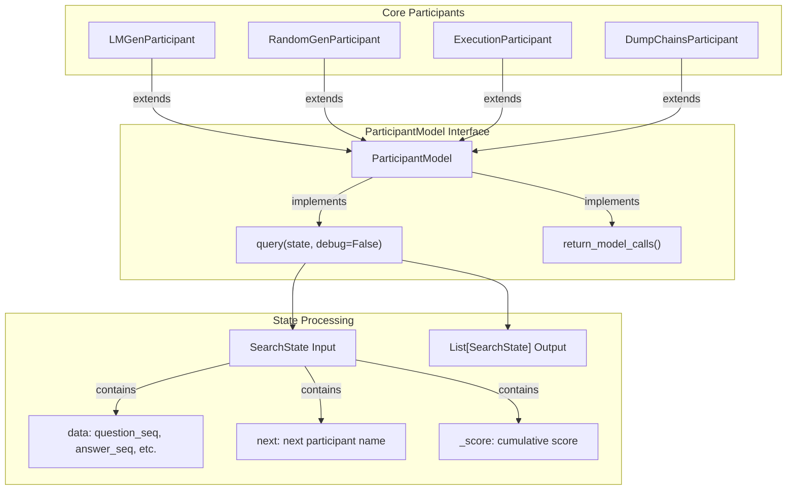
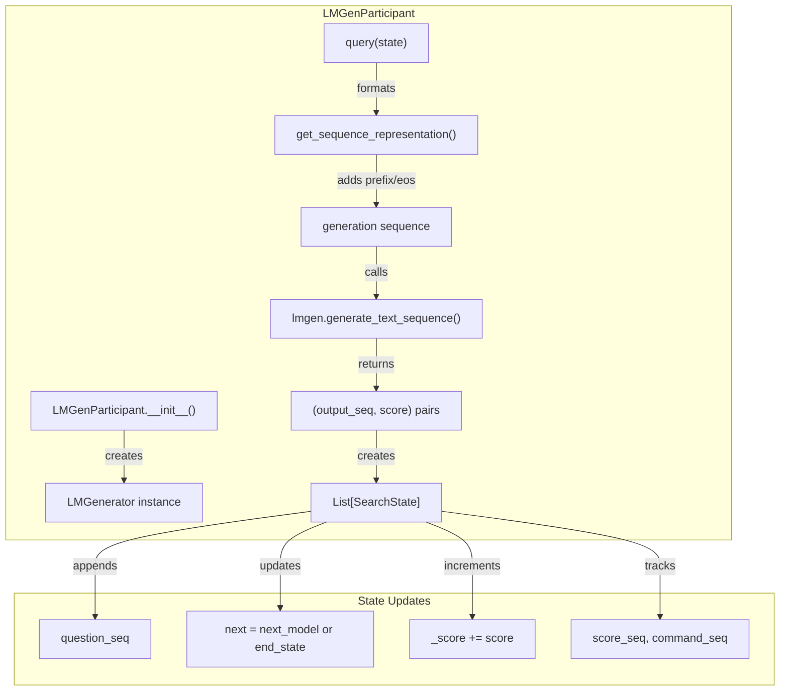
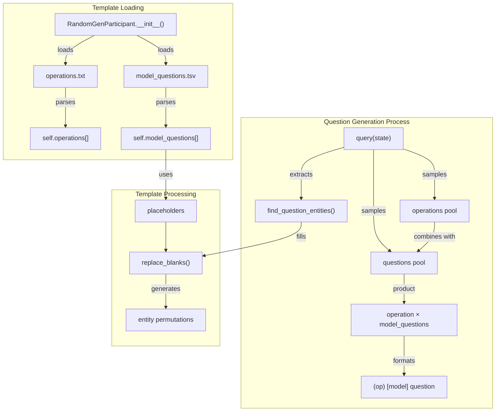
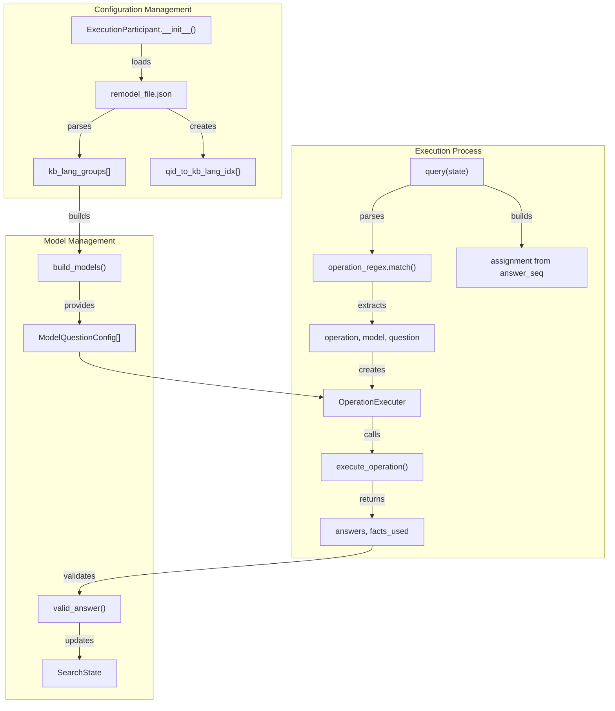
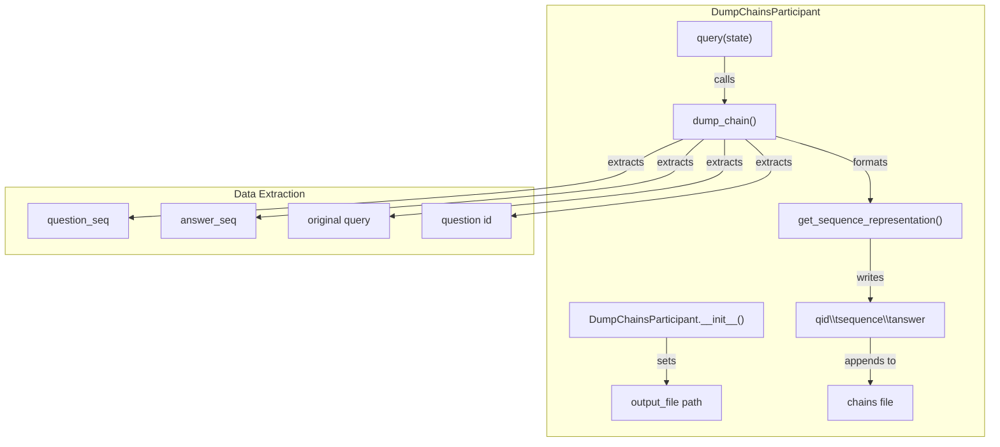
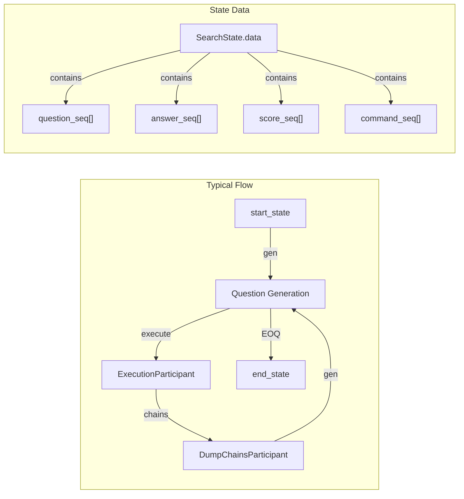

<!-- source: DeepWiki mcp.deepwiki.com · repo allenai/CommaQA · page 4.2 Participant Models · fetched 2026-10-26 -->

# Participant Models

Relevant source files

The following files were used as context for generating this wiki page:

- [commaqa/inference/participant_execution.py](commaqa/inference/participant_execution.py)
- [commaqa/inference/participant_qgen.py](commaqa/inference/participant_qgen.py)
- [commaqa/inference/participant_util.py](commaqa/inference/participant_util.py)
- [configs/inference/commaqav1_brute_force.jsonnet](configs/inference/commaqav1_brute_force.jsonnet)

This document covers the participant model system used in the CommaQA inference engine. Participant models are specialized components that handle different aspects of the question-answering process, including question generation, operation execution, and utility functions. Each participant operates on search states and coordinates through the model controller to decompose complex questions into executable operations.

For information about the overall inference orchestration and search strategies, see [Search Strategies and Model Orchestration](#4.3). For details about the core execution logic, see [Operation Executer](#5.1).

## Participant Model Architecture

All participant models inherit from the `ParticipantModel` base class and implement a common interface for state processing. The system uses a state machine approach where each participant receives a `SearchState` object, processes it, and returns a list of new states representing possible next steps in the reasoning chain.

**Participant Model Interface**

Sources: [commaqa/inference/model_search.py](), [commaqa/inference/participant_qgen.py:15-88](), [commaqa/inference/participant_execution.py:14-103](), [commaqa/inference/participant_util.py:5-31]()

## Question Generation Participants

Question generation participants are responsible for generating sub-questions that decompose the original complex question into simpler, executable operations.

### LMGenParticipant

The `LMGenParticipant` uses language models to generate question sequences. It leverages the `LMGenerator` class to produce contextually appropriate sub-questions based on the current question and answer sequence.

**LMGenParticipant Process Flow**

**Key Configuration Parameters:**
- `scale_by_step`: Score scaling factor
- `add_eos`: Whether to add end-of-sequence tokens
- `add_prefix`: Prefix to add to generation sequences
- `next_model`: Next participant in the chain (typically "execute")
- `end_state`: Terminal state marker ("[EOQ]")

Sources: [commaqa/inference/participant_qgen.py:15-88]()

### RandomGenParticipant

The `RandomGenParticipant` implements template-based question generation using predefined operations and model question templates. It samples from available operations and question templates to create structured sub-questions.

**RandomGenParticipant Architecture**

**Template System:**
- Operations are loaded from `operations.txt` and can contain `<BLANK>` placeholders
- Model questions are loaded from `model_questions.tsv` with format: `model_name\tquestion1\tquestion2...`
- Entity extraction uses regex patterns to find capitalized words and numbers
- Question scoring uses token overlap with the original complex question

Sources: [commaqa/inference/participant_qgen.py:91-262]()

## Execution Participants

### ExecutionParticipant

The `ExecutionParticipant` handles the execution of generated sub-questions by parsing operation strings and delegating to the `OperationExecuter`. It maintains knowledge base and predicate language configurations for each question ID.

**ExecutionParticipant Operation Flow**

**Operation String Format:**
The execution participant expects questions formatted as: `(operation) [model] question_text`

For example: `(select) [math_model] What is the age of the actor?`

**State Management:**
- Maintains assignments from previous answers using `#1`, `#2`, etc. notation
- Tracks model calls per step and per model type
- Validates answers and skips empty results based on configuration

Sources: [commaqa/inference/participant_execution.py:14-103]()

## Utility Participants

### DumpChainsParticipant

The `DumpChainsParticipant` provides logging and debugging capabilities by dumping question-answer chains to TSV files. This is useful for analyzing the reasoning paths taken during inference.

**Chain Dumping Process**

**Output Format:**
The participant writes tab-separated values containing:
- Question ID
- Sequence representation (formatted question-answer chain)
- Final answer

Sources: [commaqa/inference/participant_util.py:5-31]()

## Configuration and Integration

Participants are configured through JSONNet configuration files that specify their parameters and interconnections in the inference pipeline.

**Example Configuration Structure**

| Participant Type | Configuration Key | Purpose |
|------------------|------------------|---------|
| `LMGenParticipant` | `"name": "lmgen"` | Language model-based question generation |
| `RandomGenParticipant` | `"name": "randgen"` | Template-based question generation |
| `ExecutionParticipant` | `"name": "operation_executer"` | Operation execution against knowledge bases |
| `DumpChainsParticipant` | `"name": "dump_chains"` | Chain logging and debugging |

**State Transition Flow**

Each participant processes the current state and can:
- Generate multiple next states (branching search)
- Modify state data (questions, answers, scores)
- Set the next participant in the chain
- Track model usage statistics

Sources: [configs/inference/commaqav1_brute_force.jsonnet:1-28](), [commaqa/inference/participant_qgen.py:15-88](), [commaqa/inference/participant_execution.py:14-103](), [commaqa/inference/participant_util.py:5-31]()

---

