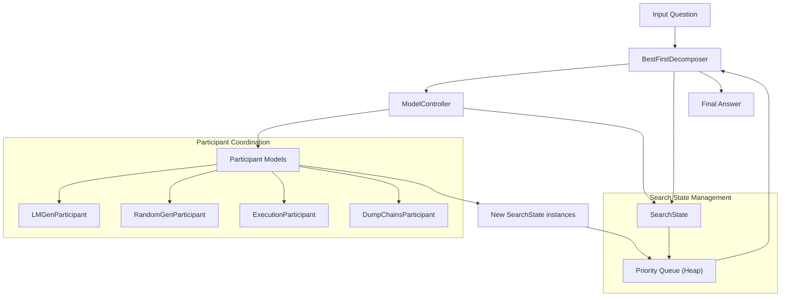
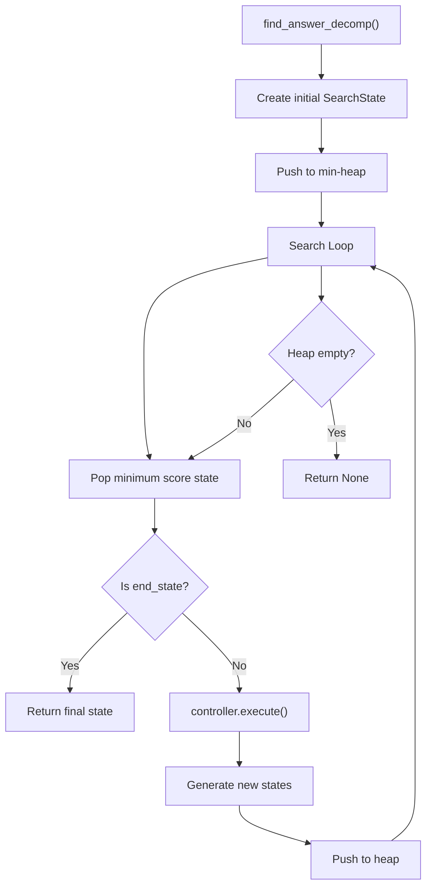
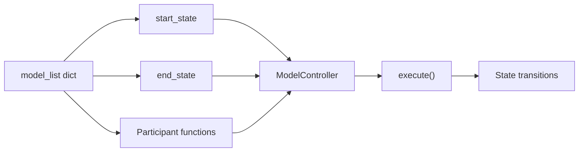
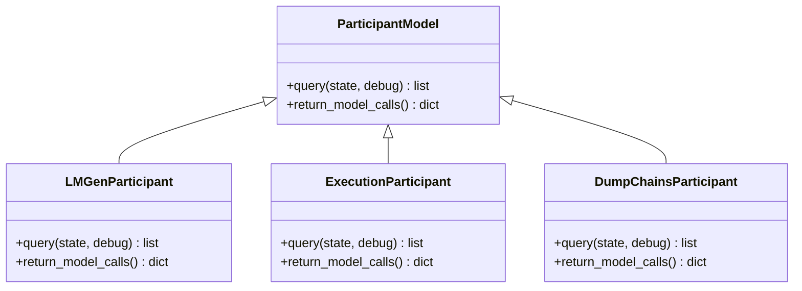
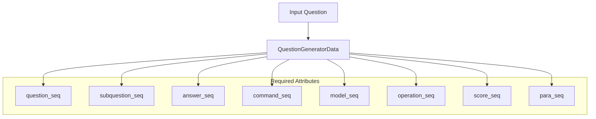
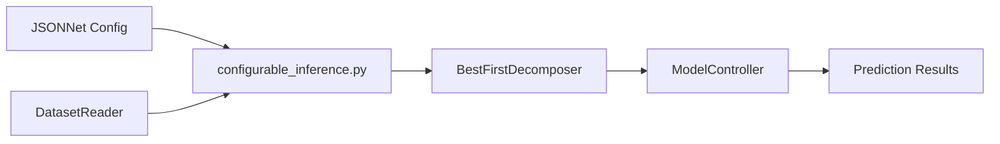

<!-- source: DeepWiki mcp.deepwiki.com · repo allenai/CommaQA · page 4.3 Search Strategies and Model Orchestration · fetched 2026-10-26 -->

# Search Strategies and Model Orchestration

Relevant source files

The following files were used as context for generating this wiki page:

- [commaqa/inference/constants.py](commaqa/inference/constants.py)
- [commaqa/inference/dataset_readers.py](commaqa/inference/dataset_readers.py)
- [commaqa/inference/model_search.py](commaqa/inference/model_search.py)

This document covers the search strategies and model orchestration components that coordinate multiple participant models during inference. The system uses a search-based approach where a `ModelController` orchestrates different participant models (question generation, execution, utilities) while a search strategy like `BestFirstDecomposer` explores the solution space to find optimal question decompositions.

For information about individual participant model implementations, see [Participant Models](#4.2). For details about inference configuration and entry points, see [Inference Engine](#4.1).

## Architecture Overview

The search and orchestration system consists of three main components that work together to process questions through multiple reasoning steps:

### Model Orchestration Flow

Sources: [commaqa/inference/model_search.py:1-320]()

## Search Strategies

### BestFirstDecomposer

The `BestFirstDecomposer` implements a best-first search algorithm to explore question decomposition possibilities using a min-heap priority queue:

The search process works as follows:

1. **Initialization**: Creates initial `SearchState` with starting command from `ModelController`
2. **Heap Management**: Uses `heapq` to maintain priority queue ordered by state scores
3. **State Exploration**: Repeatedly pops minimum-score states and generates successors
4. **Termination**: Stops when reaching `end_state` or when heap is empty (failure)

Sources: [commaqa/inference/model_search.py:266-320]()

### Search State Tracking

The `SearchState` class maintains the state of the search process:

| Property | Type | Purpose |
|----------|------|---------|
| `data` | `BasicDataInstance` | Question data and accumulated results |
| `score` | `float` | Priority score for heap ordering |
| `next` | `str` | Next command/participant to execute |
| `last_output` | `str` | Output from previous step |

The class implements comparison operators (`__lt__`, `__eq__`) to work with Python's `heapq` module for priority queue functionality.

Sources: [commaqa/inference/model_search.py:134-213]()

## Model Controller

The `ModelController` coordinates multiple participant models using a state machine approach:

### Controller Configuration

The controller requires:
- `start_state`: Initial participant to invoke
- `end_state`: Terminal condition identifier  
- Participant model functions mapped by state names

### Execution Flow

The `execute()` method handles state transitions:

1. **State Validation**: Checks if `state.next` exists in `model_list`
2. **Model Invocation**: Calls appropriate participant function with current state
3. **Output Processing**: Ensures return values are lists of new states
4. **Error Handling**: Catches exceptions and provides debugging information

Sources: [commaqa/inference/model_search.py:55-130]()

## Participant Model Interface

All participant models inherit from `ParticipantModel` base class and implement:

### Required Methods

### Participant Registration

The mapping between participant names and classes is defined in constants:

| Participant Name | Class | Purpose |
|------------------|-------|---------|
| `lmgen` | `LMGenParticipant` | Language model question generation |
| `randgen` | `RandomGenParticipant` | Random question generation |
| `operation_executer` | `ExecutionParticipant` | Execute operations on knowledge base |
| `dump_chains` | `DumpChainsParticipant` | Log decomposition chains |

Sources: [commaqa/inference/model_search.py:31-53](), [commaqa/inference/constants.py:8-13]()

## Data Flow and State Management

### Data Instance Structure

The `QuestionGeneratorData` class extends `BasicDataInstance` with required attributes for tracking question decomposition:

These sequences track the progression of questions, answers, and metadata through the decomposition process.

### State Copying and Branching

The search explores multiple paths by creating deep copies of states:

- `SearchState.copy()` creates independent state branches
- Each participant can generate multiple successor states
- Heap maintains all active search branches ordered by score

Sources: [commaqa/inference/model_search.py:7-29](), [commaqa/inference/model_search.py:153-167]()

## Integration with Inference Pipeline

The search and orchestration components integrate with the broader inference system through standardized interfaces:

### Entry Point Integration

The main inference script instantiates search strategies and model controllers based on configuration, then processes datasets through the orchestrated participant models.

Sources: [commaqa/inference/model_search.py:241-263]()

---

