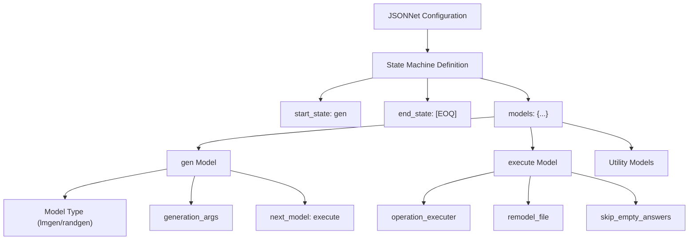
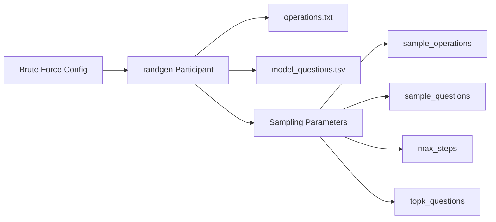
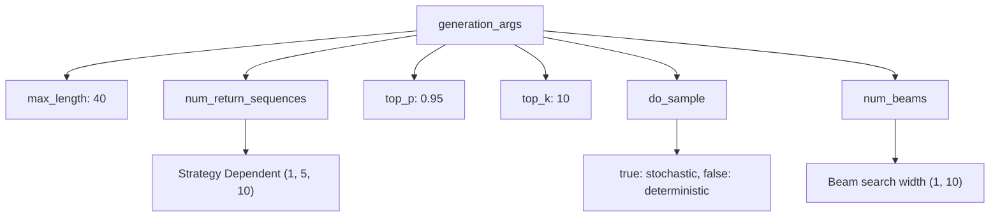
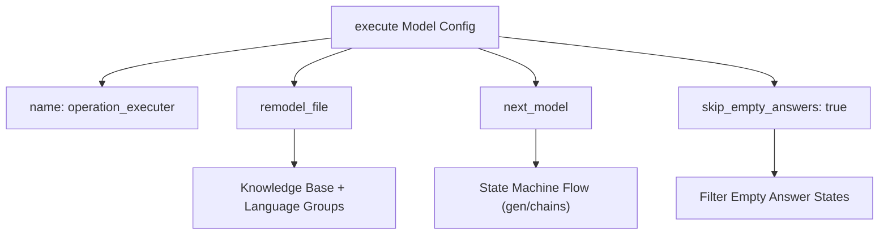
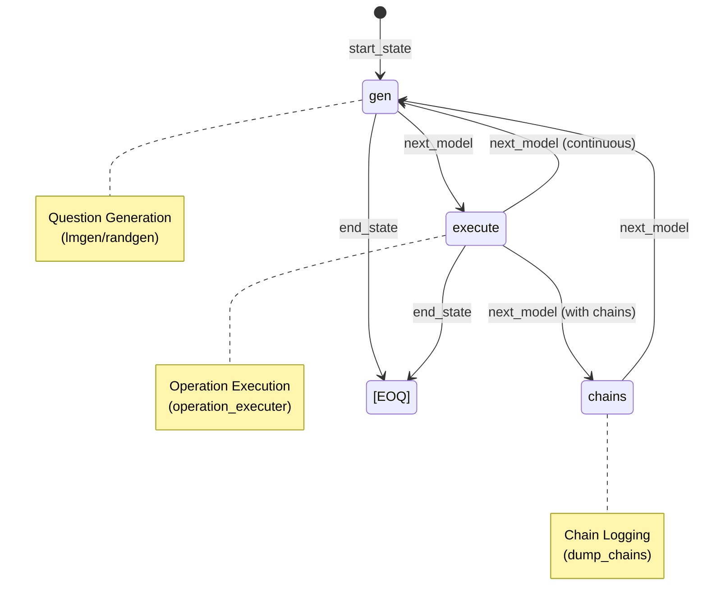

<!-- source: DeepWiki mcp.deepwiki.com · repo allenai/CommaQA · page 4.4 Inference Configuration · fetched 2026-10-26 -->

# Inference Configuration

Relevant source files

The following files were used as context for generating this wiki page:

- [commaqa/inference/participant_execution.py](commaqa/inference/participant_execution.py)
- [configs/inference/commaqav1_beam_search.jsonnet](configs/inference/commaqav1_beam_search.jsonnet)
- [configs/inference/commaqav1_brute_force.jsonnet](configs/inference/commaqav1_brute_force.jsonnet)
- [configs/inference/commaqav1_greedy_search.jsonnet](configs/inference/commaqav1_greedy_search.jsonnet)
- [configs/inference/commaqav1_sample_search.jsonnet](configs/inference/commaqav1_sample_search.jsonnet)

This document covers the configuration system for different inference strategies in the CommaQA system. These configurations define how questions are decomposed through language model generation and execution participants, supporting various search strategies including greedy search, beam search, sampling, and brute force approaches.

For information about the core inference engine that processes these configurations, see [Inference Engine](#4.1). For details about the individual participant models referenced in these configurations, see [Participant Models](#4.2).

## Configuration Structure

Inference configurations are defined using JSONNet files that specify a state machine flow with different participant models. The configuration defines the orchestration between question generation and operation execution participants.

### Core Components

Sources: [configs/inference/commaqav1_greedy_search.jsonnet:1-34](), [configs/inference/commaqav1_beam_search.jsonnet:1-34](), [configs/inference/commaqav1_sample_search.jsonnet:1-34](), [configs/inference/commaqav1_brute_force.jsonnet:1-28]()

## Search Strategies

The system supports four primary inference strategies, each with distinct configuration patterns and generation parameters.

### Greedy Search Configuration

Greedy search uses deterministic generation with a single return sequence:

| Parameter | Value | Purpose |
|-----------|-------|---------|
| `num_return_sequences` | 1 | Single best sequence |
| `do_sample` | false | Deterministic generation |
| `num_beams` | 10 | Beam search with pruning |

### Beam Search Configuration  

Beam search explores multiple promising paths simultaneously:

| Parameter | Value | Purpose |
|-----------|-------|---------|
| `num_return_sequences` | 5 | Multiple candidate sequences |
| `do_sample` | false | Deterministic beam exploration |
| `num_beams` | 10 | Parallel beam maintenance |

### Sample Search Configuration

Sample search uses stochastic generation for exploration:

| Parameter | Value | Purpose |
|-----------|-------|---------|
| `num_return_sequences` | 10 | Multiple sampled sequences |
| `do_sample` | true | Stochastic sampling |
| `num_beams` | 1 | Single beam with sampling |
| `top_p` | 0.95 | Nucleus sampling threshold |
| `top_k` | 10 | Top-k token limitation |

### Brute Force Configuration

Brute force uses rule-based random generation instead of language models:

Sources: [configs/inference/commaqav1_greedy_search.jsonnet:8-15](), [configs/inference/commaqav1_beam_search.jsonnet:8-15](), [configs/inference/commaqav1_sample_search.jsonnet:8-15](), [configs/inference/commaqav1_brute_force.jsonnet:5-14]()

## Language Model Configuration

For `lmgen` participants, the configuration includes three argument categories that control different aspects of text generation:

### Generation Arguments

### Encoder and Decoder Arguments

The `encoder_args` and `decoder_args` sections control tokenization and output formatting:

| Configuration | Parameters | Purpose |
|---------------|------------|---------|
| `encoder_args` | `add_special_tokens: false`, `return_tensors: "pt"` | Input tokenization control |
| `decoder_args` | `clean_up_tokenization_spaces: true`, `skip_special_tokens: true` | Output formatting control |

Sources: [configs/inference/commaqav1_sample_search.jsonnet:7-23](), [configs/inference/commaqav1_beam_search.jsonnet:7-23](), [configs/inference/commaqav1_greedy_search.jsonnet:7-23]()

## Execution Participant Configuration

All inference strategies include an `operation_executer` participant that processes generated questions through the execution engine:

The `ExecutionParticipant` class processes these configurations by:

1. Loading knowledge base and predicate language configurations from `remodel_file`
2. Building model libraries for operation execution
3. Parsing operation syntax using regex patterns
4. Managing variable assignments across decomposition steps
5. Filtering invalid or empty answers based on `skip_empty_answers`

Sources: [configs/inference/commaqav1_greedy_search.jsonnet:27-32](), [commaqa/inference/participant_execution.py:14-103]()

## State Machine Flow Control

The configuration defines a state machine that orchestrates participant interaction:

### Flow Patterns

| Pattern | Description | Use Case |
|---------|-------------|----------|
| `gen → execute → gen` | Continuous generation-execution loop | Standard decomposition |
| `gen → execute → chains → gen` | Include chain logging | Debugging and analysis |
| `gen → [EOQ]` | Direct termination | Question generation failure |
| `execute → [EOQ]` | Execution termination | Operation completion |

Sources: [configs/inference/commaqav1_brute_force.jsonnet:2-3, 19, 25](), [configs/inference/commaqav1_sample_search.jsonnet:2-3, 24, 30]()

## Environment Variable Integration

Configurations use JSONNet's `std.extVar()` function to integrate with runtime environment variables:

| Variable | Purpose | Example Usage |
|----------|---------|---------------|
| `model_path` | Language model location | T5-Large model directory |
| `remodel_path` | Knowledge base configurations | Dataset-specific KB files |
| `filename` | Specific remodel file | `train.json`, `dev.json` |
| `lang_path` | Language resource directory | Operations and questions files |
| `output_dir` | Output file location | Chain dump destination |

This design allows the same configuration template to work across different datasets and model variants without code changes.

Sources: [configs/inference/commaqav1_sample_search.jsonnet:7, 29](), [configs/inference/commaqav1_brute_force.jsonnet:9-11, 18, 24]()

---

