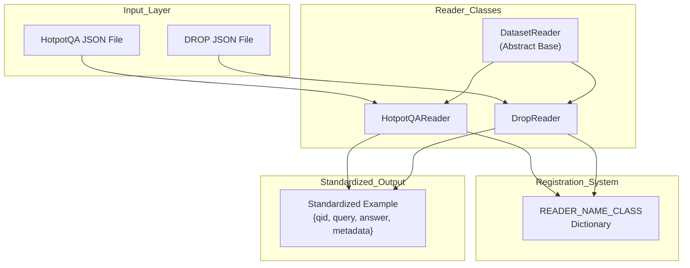
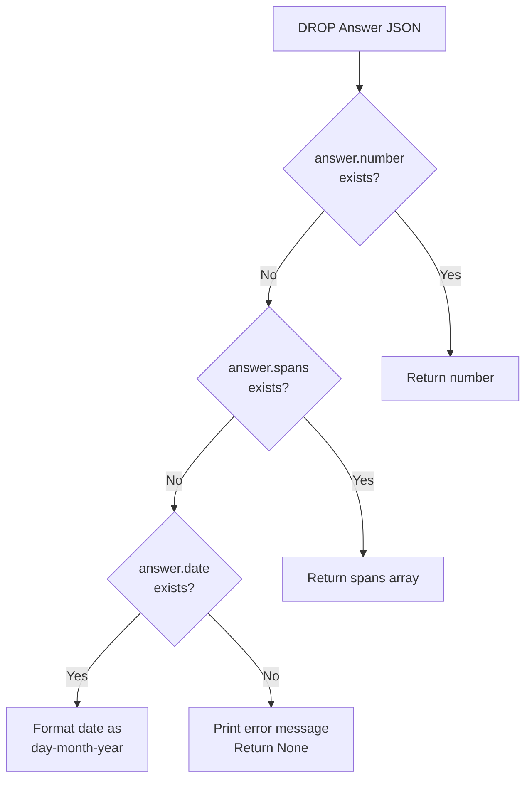
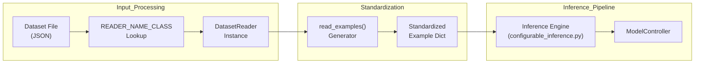

<!-- source: DeepWiki mcp.deepwiki.com · repo allenai/CommaQA · page 4.5 Dataset Readers and Input Processing · fetched 2026-10-26 -->

# Dataset Readers and Input Processing

<details>
<summary>Relevant source files</summary>

The following files were used as context for generating this wiki page:

- [commaqa/inference/constants.py](commaqa/inference/constants.py)
- [commaqa/inference/dataset_readers.py](commaqa/inference/dataset_readers.py)

</details>


This document covers the dataset reader system that handles input processing for the CommaQA inference engine. The dataset readers are responsible for converting various question-answering dataset formats into a standardized internal representation that can be processed by the inference system.

For information about the core inference orchestration that uses these readers, see [Inference Engine](#4.1). For details about how the inference system is configured, see [Inference Configuration](#4.4).

## Purpose and Architecture

The dataset reader system provides a pluggable architecture for processing different question-answering dataset formats. The system consists of a base `DatasetReader` class and format-specific implementations that convert input data into a standardized format expected by the inference engine.

### Dataset Reader Architecture



*Sources: [commaqa/inference/dataset_readers.py:1-60](), [commaqa/inference/constants.py:15-18]()*

## Supported Dataset Formats

The system currently supports two question-answering dataset formats, each with its own specialized reader implementation.

### HotpotQA Format

The `HotpotQAReader` processes HotpotQA-formatted JSON files, which contain multi-hop reasoning questions with supporting facts.

**Input Structure Expected:**
- `_id`: Unique question identifier
- `question`: The natural language question
- `answer`: The expected answer
- `type`: Question type (optional)
- `level`: Difficulty level (optional)

**Output Standardization:**
```
{
    "qid": entry["_id"],
    "query": entry["question"], 
    "answer": entry["answer"],
    "question": entry["question"],
    "type": entry.get("type", ""),
    "level": entry.get("level", "")
}
```

*Sources: [commaqa/inference/dataset_readers.py:10-25]()*

### DROP Format

The `DropReader` handles DROP (Discrete Reasoning Over Paragraphs) dataset format, which focuses on discrete reasoning over numerical and textual content.

**Input Structure Expected:**
- Nested JSON with paragraph IDs as keys
- Each paragraph contains `passage` text and `qa_pairs` array
- Each QA pair has `question`, `query_id`, and complex `answer` structure

**Answer Processing:**
The DROP format uses a complex answer structure that can contain numbers, text spans, or dates. The `format_drop_answer` function handles this conversion:



*Sources: [commaqa/inference/dataset_readers.py:28-38](), [commaqa/inference/dataset_readers.py:41-59]()*

## Reader Registration and Lookup

The system uses a centralized registration mechanism to map reader names to their corresponding classes. This allows for dynamic reader selection based on configuration.

| Reader Name | Class | Purpose |
|-------------|--------|---------|
| `"hotpot"` | `HotpotQAReader` | Process HotpotQA format files |
| `"drop"` | `DropReader` | Process DROP format files |

*Sources: [commaqa/inference/constants.py:15-18]()*

## Integration with Inference System

### Data Flow Architecture



*Sources: [commaqa/inference/constants.py:1-18](), [commaqa/inference/dataset_readers.py:4-7]()*

## Implementation Details

### Base DatasetReader Class

The abstract base class defines the interface that all readers must implement:

```python
class DatasetReader:
    def read_examples(self, file):
        return NotImplementedError("read_examples not implemented by " + self.__class__.__name__)
```

The `read_examples` method is designed as a generator that yields standardized example dictionaries, allowing for memory-efficient processing of large datasets.

*Sources: [commaqa/inference/dataset_readers.py:4-7]()*

### Standardized Output Format

All readers convert their input format to a common structure containing:

- `qid`: Unique question identifier
- `query`: The question text used for processing
- `answer`: The expected answer for evaluation
- Additional metadata fields specific to each format

This standardization ensures that downstream components in the inference pipeline can work with any supported dataset format without modification.

*Sources: [commaqa/inference/dataset_readers.py:17-25](), [commaqa/inference/dataset_readers.py:53-59]()*

---

