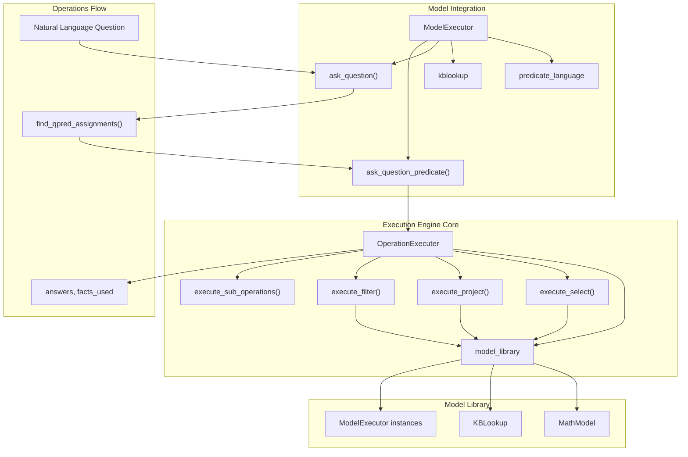
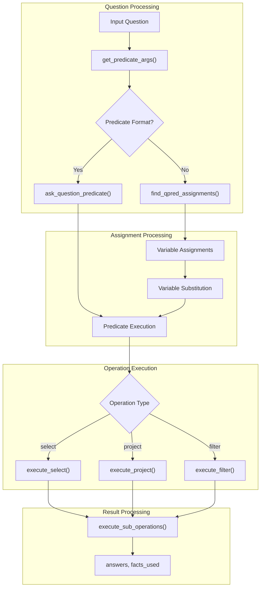
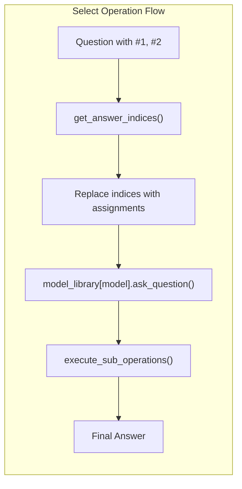
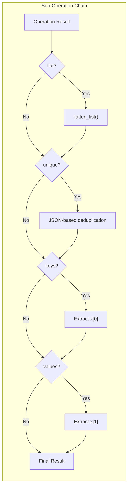
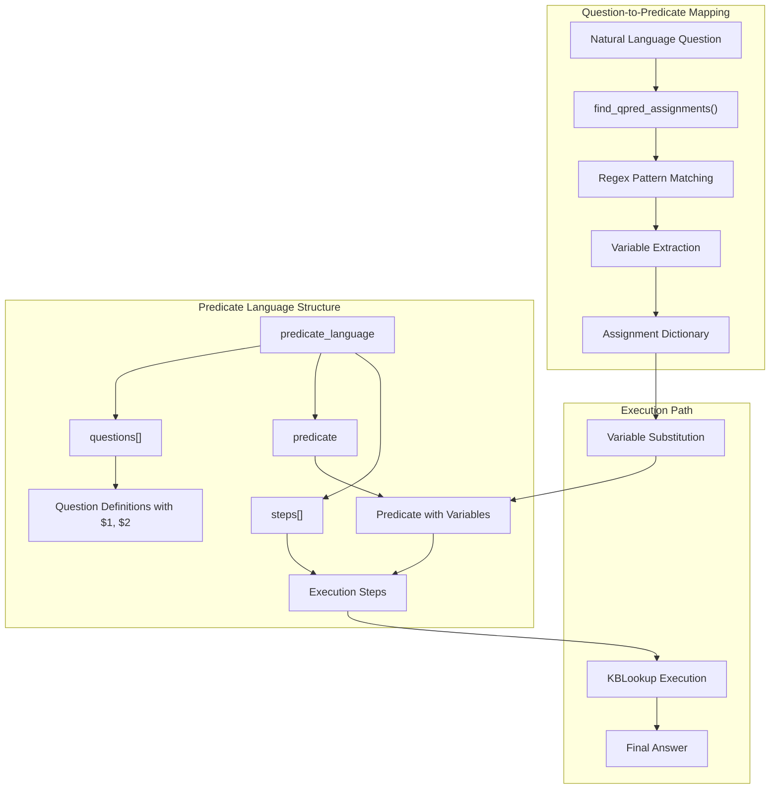
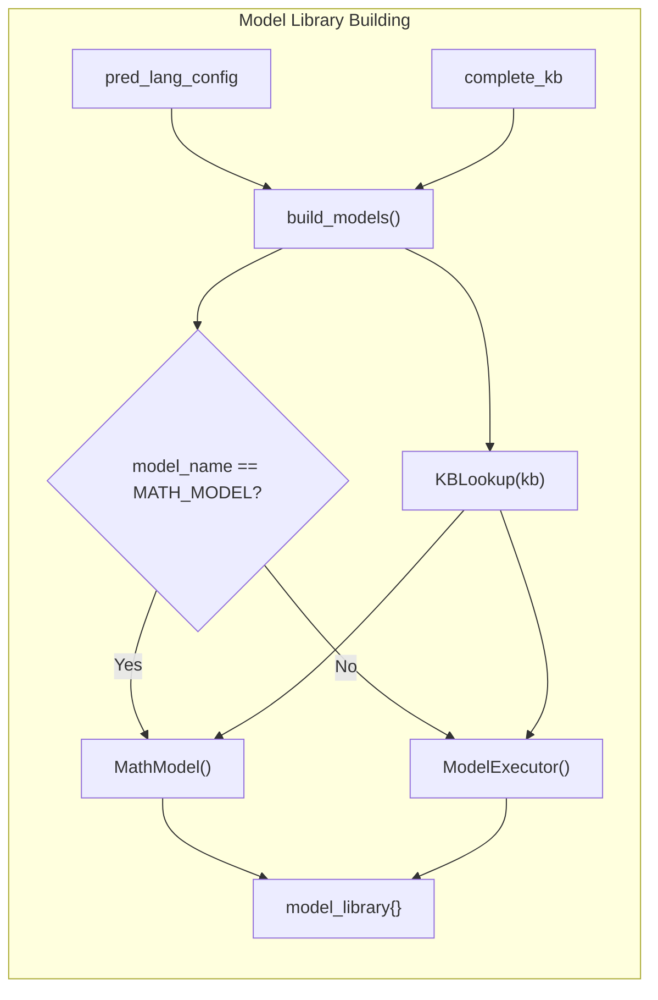

<!-- source: DeepWiki mcp.deepwiki.com · repo allenai/CommaQA · page 5 Execution Engine · fetched 2026-10-26 -->

# Execution Engine

Relevant source files

The following files were used as context for generating this wiki page:

- [commaqa/execution/model_executer.py](commaqa/execution/model_executer.py)
- [commaqa/execution/operation_executer.py](commaqa/execution/operation_executer.py)
- [commaqa/execution/utils.py](commaqa/execution/utils.py)

The Execution Engine is the core operational component that executes structured operations against knowledge bases and model libraries. It processes questions through a series of operations (`select`, `project`, `filter`) and manages variable assignments throughout the execution process. This system bridges natural language questions to structured knowledge base queries through predicate matching and operation chaining.

For information about higher-level inference orchestration, see [Inference System](#4). For details about specific models used in execution, see [Model Library](#5.2).

## Core Architecture

The execution engine is built around two primary classes: `OperationExecuter` which handles the core operation logic, and `ModelExecutor` which manages predicate-to-question mapping and model selection.

### Execution Engine Components

Sources: [commaqa/execution/operation_executer.py:10-16](), [commaqa/execution/model_executer.py:13-20](), [commaqa/execution/utils.py:11-26]()

### Operation Execution Flow

The execution process follows a systematic pattern where questions are parsed, matched to predicates, and executed through the appropriate operation type:

Sources: [commaqa/execution/model_executer.py:38-69](), [commaqa/execution/operation_executer.py:190-218]()

## Operation Types

The execution engine supports three primary operation types, each designed for specific query patterns:

### Select Operations

Select operations retrieve data directly from the knowledge base using the model library. They replace answer indices with assigned values and query the specified model.

**Key Implementation Details:**
- Processes answer indices (`#1`, `#2`, etc.) from questions
- Substitutes indices with values from `assignments` dictionary
- Calls `model_library[model].ask_question()` for execution
- Applies sub-operations to results

Sources: [commaqa/execution/operation_executer.py:43-55]()

### Project Operations

Project operations iterate over list assignments and apply questions to each item, creating new associations between keys and values.

**Supported Project Types:**
- `project`: Creates `(item, answer)` tuples
- `projectValues`: Creates `(key, answer)` tuples from `(key, value)` inputs  
- `projectKeys`: Creates `(answer, value)` tuples from `(key, value)` inputs

| Operation Type | Input Format | Output Format |
|---------------|--------------|---------------|
| `project` | `[item1, item2, ...]` | `[(item1, answer1), (item2, answer2), ...]` |
| `projectValues` | `[(key1, val1), (key2, val2), ...]` | `[(key1, answer1), (key2, answer2), ...]` |
| `projectKeys` | `[(key1, val1), (key2, val2), ...]` | `[(answer1, val1), (answer2, val2), ...]` |

Sources: [commaqa/execution/operation_executer.py:57-112]()

### Filter Operations

Filter operations evaluate boolean conditions on list items and return only those items that satisfy the condition.

**Filter Types:**
- `filter`: Evaluates condition on string items
- `filterValues`: Evaluates condition on tuple values
- `filterKeys`: Evaluates condition on tuple keys

The filter expects boolean responses (`"yes"`, `"1"`, `"true"`) to determine item inclusion.

Sources: [commaqa/execution/operation_executer.py:114-188]()

## Sub-Operations

Sub-operations are chained modifiers applied after the primary operation execution. They are specified using underscore notation (e.g., `select_flat_unique`).

### Available Sub-Operations

| Sub-Operation | Purpose | Input Type | Behavior |
|--------------|---------|------------|----------|
| `flat` | Flatten nested lists | `list` | Calls `flatten_list()` |
| `unique` | Remove duplicates | `list` | JSON-based deduplication |
| `keys` | Extract keys from tuples | `list of tuples` | Returns `[x[0] for x in list]` |
| `values` | Extract values from tuples | `list of tuples` | Returns `[x[1] for x in list]` |

Sources: [commaqa/execution/operation_executer.py:17-42]()

## Model Integration and Predicate Matching

The `ModelExecutor` class handles the translation from natural language questions to structured predicates through pattern matching and variable assignment.

### Predicate Language Processing

The system uses regular expressions to match question patterns, extracting variables through named capture groups. For example, a question pattern `"What is the age of $1?"` becomes the regex `"What is the age of (?P<G1>.+)?"`.

Sources: [commaqa/execution/model_executer.py:21-36](), [commaqa/execution/model_executer.py:70-108]()

## Error Handling and Robustness

The execution engine includes comprehensive error handling with configurable behavior through the `ignore_input_mismatch` parameter.

### Error Handling Strategy

| Error Condition | `ignore_input_mismatch=False` | `ignore_input_mismatch=True` |
|----------------|-------------------------------|------------------------------|
| Model not found | Raises `ValueError` | Returns `NOANSWER`, logs debug |
| No matching predicate | Raises `ValueError` | Returns `NOANSWER`, logs debug |
| Invalid assignments | Raises `ValueError` | Returns `NOANSWER`, logs debug |
| Operation execution failure | Raises `ValueError` | Returns `NOANSWER`, logs debug |

The system tracks execution statistics through `num_calls` counters in both `OperationExecuter` and `ModelExecutor` classes.

Sources: [commaqa/execution/operation_executer.py:190-218](), [commaqa/execution/model_executer.py:62-68](), [commaqa/execution/model_executer.py:103-108]()

## Model Library Construction

The execution engine is initialized with a model library built through the `build_models()` function, which creates specialized model instances based on configuration.

Each model in the library is instantiated with the same `KBLookup` instance, ensuring consistent knowledge base access across all execution paths.

Sources: [commaqa/execution/utils.py:11-26]()

---

