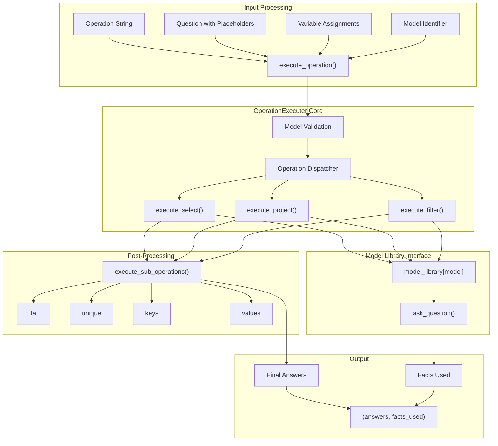
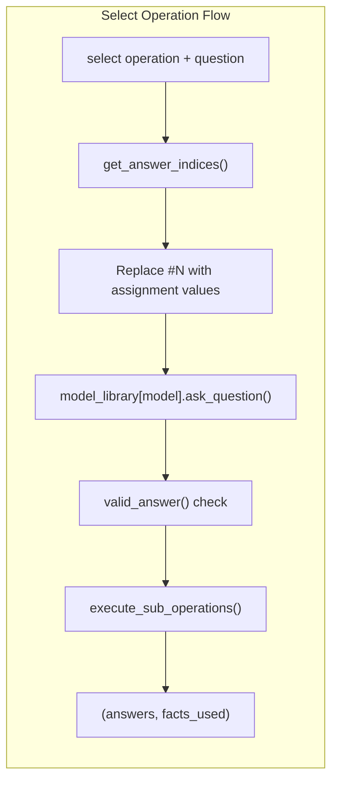
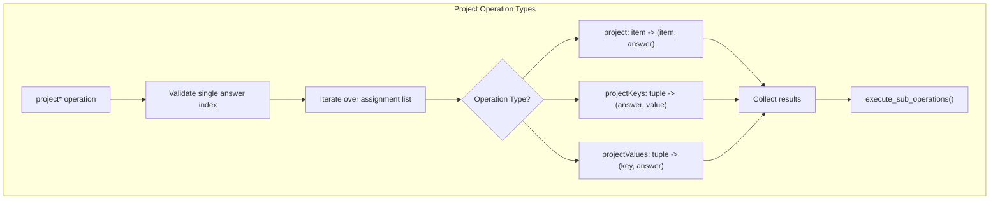
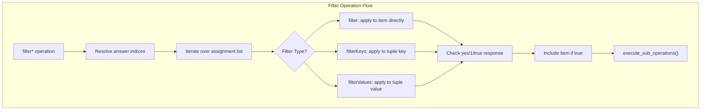
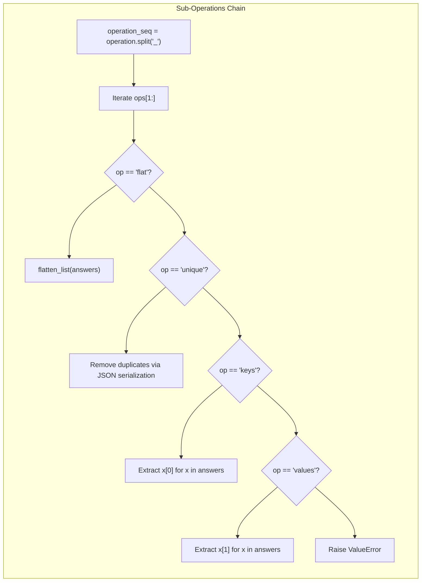
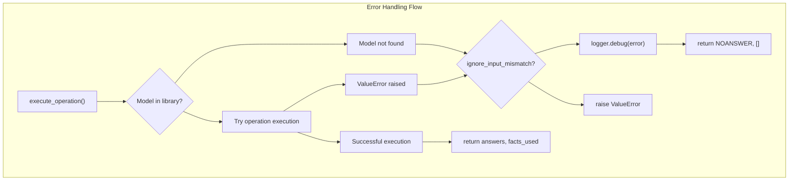

<!-- source: DeepWiki mcp.deepwiki.com · repo allenai/CommaQA · page 5.1 Operation Executer · fetched 2026-10-26 -->

# Operation Executer

<details>
<summary>Relevant source files</summary>

The following files were used as context for generating this wiki page:

- [commaqa/execution/operation_executer.py](commaqa/execution/operation_executer.py)

</details>


## Purpose and Scope

The Operation Executer is the core execution engine of CommaQA that performs structured operations against knowledge bases and models. It serves as the bridge between high-level operation specifications and actual model queries, handling three primary operation types: `select`, `project`, and `filter`. The Operation Executer manages variable assignments, processes sub-operations, and coordinates with the model library to execute complex multi-step reasoning tasks.

For information about the broader execution engine architecture, see [Execution Engine](#5). For details about the specific models used within the execution system, see [Model Library](#5.2).

## Core Architecture

The `OperationExecuter` class in [commaqa/execution/operation_executer.py:10-16]() serves as the central orchestrator for all operation execution. It maintains a reference to a model library and provides configurable error handling through the `ignore_input_mismatch` parameter.



**Sources:** [commaqa/execution/operation_executer.py:10-219]()

## Operation Types and Execution Flow

The Operation Executer handles three distinct operation categories, each with specific execution patterns and data transformation requirements.

### Select Operations

Select operations retrieve data from the knowledge base using direct model queries. The `execute_select` method [commaqa/execution/operation_executer.py:43-55]() processes questions by replacing placeholder indices with actual values from assignments and querying the specified model.



### Project Operations

Project operations iterate over collections and apply questions to each item. The system supports three projection variants: `project`, `projectKeys`, and `projectValues` [commaqa/execution/operation_executer.py:57-112]().



### Filter Operations

Filter operations apply boolean conditions to collections, retaining only items that satisfy the criteria. The system supports `filter`, `filterKeys`, and `filterValues` operations [commaqa/execution/operation_executer.py:114-188]().



**Sources:** [commaqa/execution/operation_executer.py:43-188]()

## Sub-Operations Processing

Sub-operations provide additional data transformation capabilities that can be chained after primary operations. The `execute_sub_operations` method [commaqa/execution/operation_executer.py:17-41]() processes operation strings with underscore-separated sub-operation sequences.

| Sub-Operation | Input Type | Transformation | Example |
|---------------|------------|----------------|---------|
| `flat` | Nested lists | Flattens nested structure | `[[1,2],[3,4]]` → `[1,2,3,4]` |
| `unique` | List | Removes duplicates | `[1,2,2,3]` → `[1,2,3]` |
| `keys` | List of tuples | Extracts first elements | `[(a,1),(b,2)]` → `[a,b]` |
| `values` | List of tuples | Extracts second elements | `[(a,1),(b,2)]` → `[1,2]` |



**Sources:** [commaqa/execution/operation_executer.py:17-41]()

## Assignment and Variable Handling

The Operation Executer uses a placeholder system where questions contain indexed references (e.g., `#1`, `#2`) that are resolved using the assignments dictionary. The `get_answer_indices` function extracts these placeholders, and the executer replaces them with actual values before model queries.

```mermaid
graph TD
    subgraph "Variable Assignment System"
        QUESTION_INPUT["Question: 'What is the age of #1?'"] --> EXTRACT["get_answer_indices(question)"]
        EXTRACT --> INDICES["indices = [1]"]
        ASSIGNMENTS_INPUT["assignments = {'#1': 'John Smith'}"] --> LOOKUP["assignments['#1']"]
        LOOKUP --> VALUE["'John Smith'"]
        
        INDICES --> REPLACE["question.replace('#1', json.dumps('John Smith'))"]
        VALUE --> REPLACE
        REPLACE --> FINAL_Q["'What is the age of \"John Smith\"?'"]
        FINAL_Q --> MODEL_CALL["model_library[model].ask_question()"]
    end
```

**Sources:** [commaqa/execution/operation_executer.py:44-50, 58-67, 115-145]()

## Error Handling and Configuration

The Operation Executer provides configurable error handling through the `ignore_input_mismatch` parameter [commaqa/execution/operation_executer.py:12-14](). When enabled, execution errors are logged but do not halt processing, returning `NOANSWER` instead.



The executer also maintains execution statistics through the `num_calls` counter [commaqa/execution/operation_executer.py:15, 191](), enabling performance monitoring and debugging.

**Sources:** [commaqa/execution/operation_executer.py:12-16, 190-218]()

---

