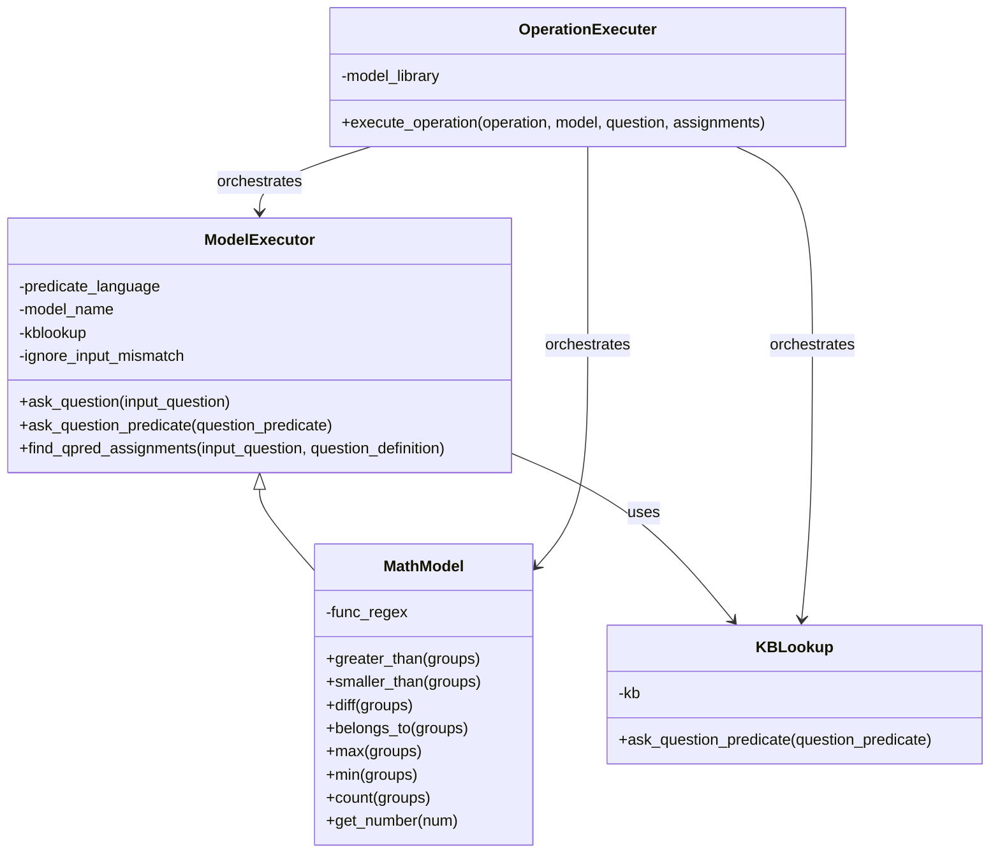
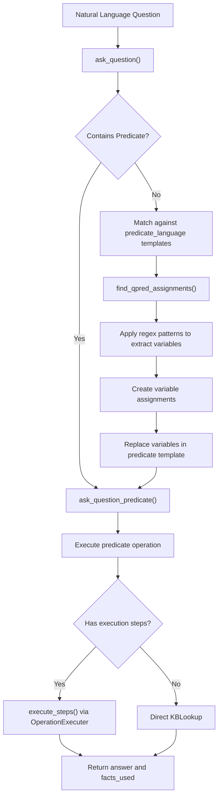
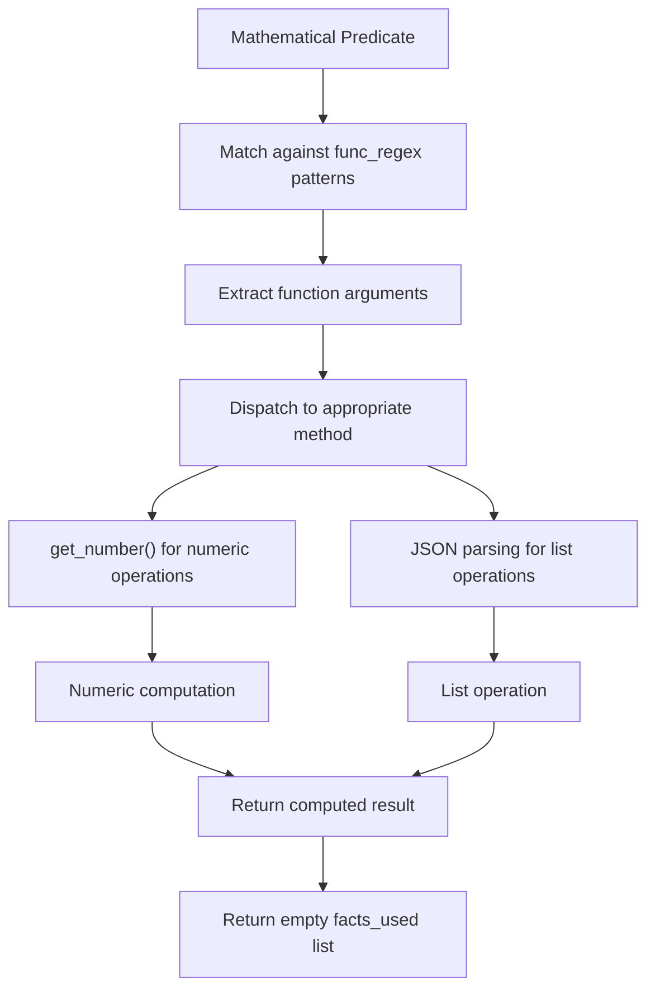
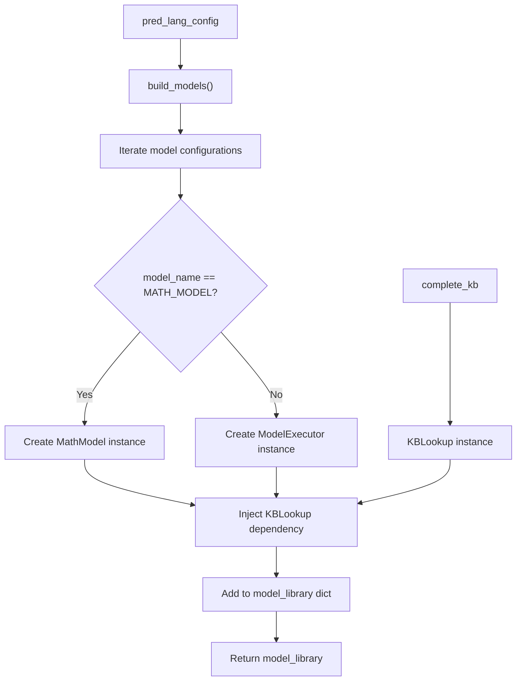
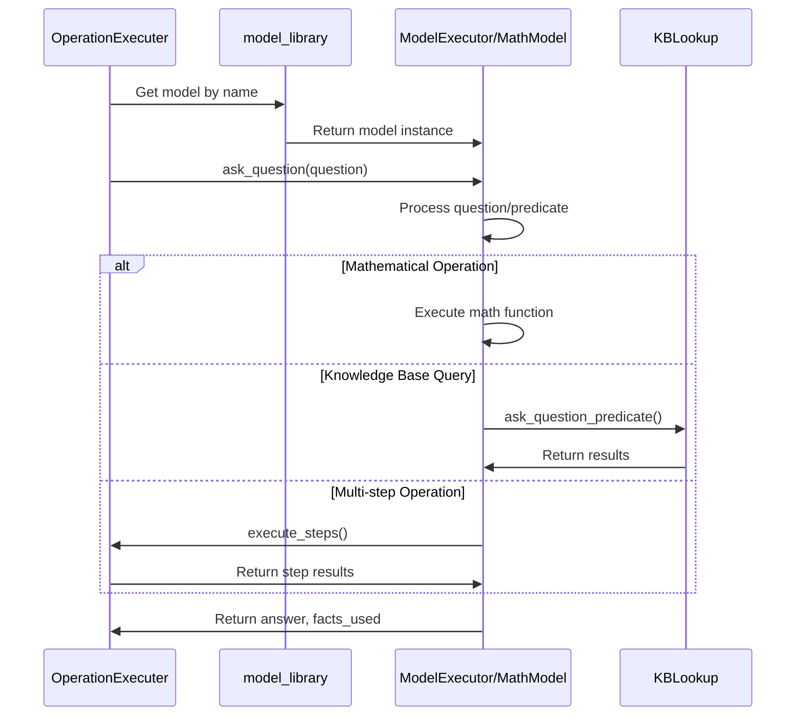

<!-- source: DeepWiki mcp.deepwiki.com · repo allenai/CommaQA · page 5.2 Model Library · fetched 2026-10-26 -->

# Model Library

Relevant source files

The following files were used as context for generating this wiki page:

- [commaqa/dataset/generate_decomposition_predictions.py](commaqa/dataset/generate_decomposition_predictions.py)
- [commaqa/execution/math_model.py](commaqa/execution/math_model.py)
- [commaqa/execution/model_executer.py](commaqa/execution/model_executer.py)
- [commaqa/execution/utils.py](commaqa/execution/utils.py)

## Purpose and Scope

The Model Library provides the core computational models used by the execution engine to process different types of operations against knowledge bases. This library implements specialized models for mathematical computations, text processing, and knowledge base lookups that are orchestrated by the Operation Executer to answer complex questions through structured decomposition. 

For information about how these models are orchestrated during operation execution, see [Operation Executer](#5.1). For details about the inference system that coordinates multiple models, see [Inference System](#4).

## Architecture Overview

The Model Library follows a hierarchical design with `ModelExecutor` as the base class and specialized implementations for different operation types. Models are instantiated through a factory pattern and integrated into the execution pipeline through the `OperationExecuter`.

### Model Library Class Hierarchy

Sources: [commaqa/execution/model_executer.py:13-109](), [commaqa/execution/math_model.py:11-210](), [commaqa/execution/utils.py:11-26]()

## Base ModelExecutor Class

The `ModelExecutor` class serves as the foundation for all models in the execution system. It handles the translation between natural language questions and predicate-based operations through pattern matching and variable assignment.

### Core Functionality

| Method | Purpose | Input | Output |
|--------|---------|-------|--------|
| `ask_question` | Main entry point for question processing | Natural language question | Answer and supporting facts |
| `ask_question_predicate` | Process predicate-formatted questions | Predicate string | Answer and supporting facts |
| `find_qpred_assignments` | Map question variables to values | Question template and input | Variable assignments |

### Question Processing Flow

Sources: [commaqa/execution/model_executer.py:38-68](), [commaqa/execution/model_executer.py:70-108](), [commaqa/execution/model_executer.py:21-36]()

## MathModel Specialization

The `MathModel` extends `ModelExecutor` to handle mathematical and logical operations through regex-based function dispatch. It processes operations like comparisons, aggregations, and set membership tests.

### Supported Mathematical Operations

| Operation | Function | Input Format | Output |
|-----------|----------|--------------|--------|
| Greater Than | `is_greater(a \| b)` | Two numeric values | "yes" or "no" |
| Smaller Than | `is_smaller(a \| b)` | Two numeric values | "yes" or "no" |
| Difference | `diff(a \| b)` | Two numeric values | Absolute difference |
| Maximum | `max(list)` | JSON list of numbers | Maximum value |
| Minimum | `min(list)` | JSON list of numbers | Minimum value |
| Count | `count(list)` | JSON list | List length |
| Membership | `belongs_to(item \| list)` | Item and JSON list | "yes" or "no" |

### Mathematical Operation Processing

The `get_number` method handles robust numeric extraction from various input formats including JSON strings, lists, and direct numeric values:

Sources: [commaqa/execution/math_model.py:14-23](), [commaqa/execution/math_model.py:26-50](), [commaqa/execution/math_model.py:204-209]()

## Model Factory and Instantiation

The `build_models` function serves as a factory for creating model instances based on configuration specifications. It integrates all models with a shared `KBLookup` instance for knowledge base access.

### Model Building Process

### Model Configuration Structure

Each model in the library requires the following configuration parameters:

- `predicate_language`: List of predicate language configurations defining supported operations
- `model_name`: Unique identifier for the model type (e.g., `MATH_MODEL`)
- `kblookup`: Shared knowledge base lookup instance
- `ignore_input_mismatch`: Boolean flag for error handling behavior

Sources: [commaqa/execution/utils.py:11-26](), [commaqa/execution/constants.py]()

## Integration with Execution System

The Model Library integrates with the broader execution system through the `OperationExecuter`, which maintains the `model_library` dictionary and routes operations to appropriate models based on the specified model name in decomposition steps.

### Execution Integration Flow

The models are instantiated during system initialization and reused throughout the execution pipeline, with each model maintaining call counts and state for debugging and performance monitoring.

Sources: [commaqa/execution/operation_executer.py](), [commaqa/dataset/generate_decomposition_predictions.py:38-43](), [commaqa/execution/model_executer.py:14-19]()

---

