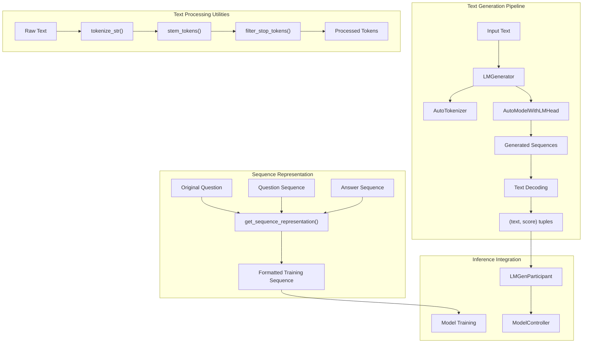
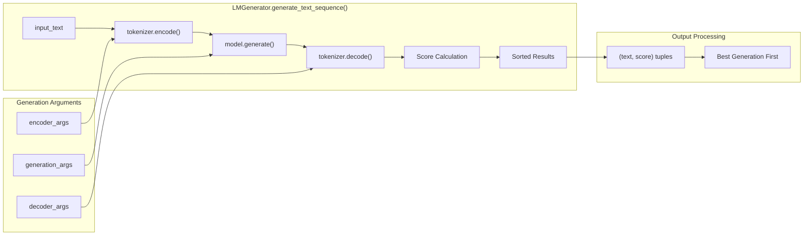
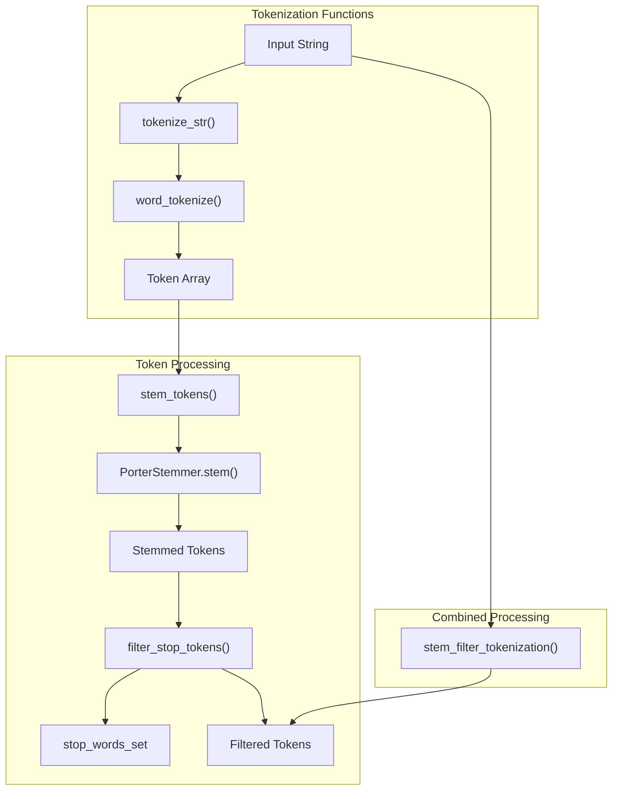
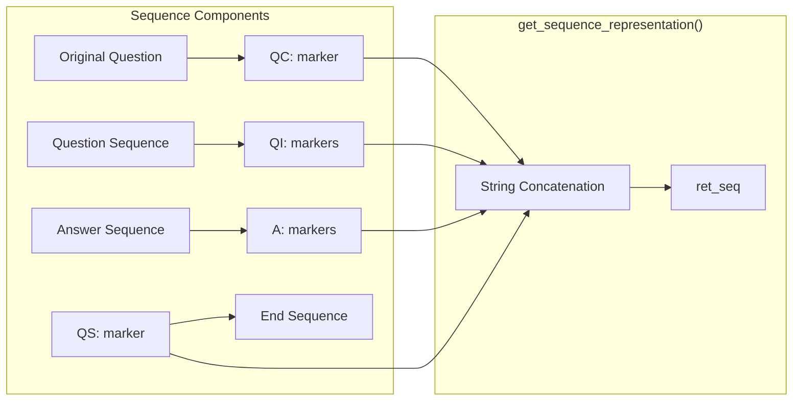
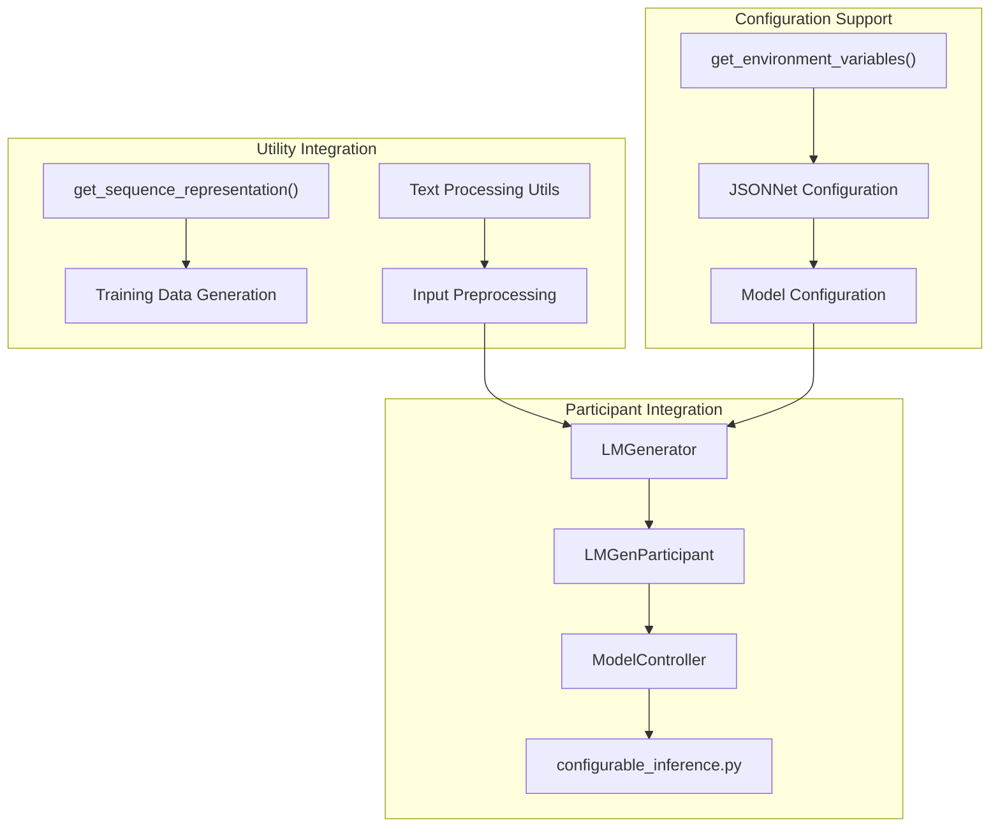

<!-- source: DeepWiki mcp.deepwiki.com · repo allenai/CommaQA · page 6 Language Models and Text Generation · fetched 2026-10-26 -->

# Language Models and Text Generation

<details>
<summary>Relevant source files</summary>

The following files were used as context for generating this wiki page:

- [commaqa/inference/__init__.py](commaqa/inference/__init__.py)
- [commaqa/inference/utils.py](commaqa/inference/utils.py)
- [commaqa/models/generator.py](commaqa/models/generator.py)

</details>


This document covers the language model integration and text generation capabilities within the CommaQA system. This includes the T5-Large model wrapper, text processing utilities, and sequence representation formats used for question decomposition generation.

For detailed information about specific text generation workflows, see [Text Generation](#6.1). For NLP preprocessing utilities, see [NLP Utilities](#6.2).

## System Overview

The CommaQA system integrates language models primarily through the `LMGenerator` class, which provides a wrapper around Hugging Face transformers models. This integration enables automatic question generation and sequence-to-sequence text processing within the inference pipeline.

### Language Model Integration Architecture



Sources: [commaqa/models/generator.py:1-58](), [commaqa/inference/utils.py:1-70]()

## LMGenerator Class

The `LMGenerator` class serves as the primary interface for language model operations within CommaQA. It wraps Hugging Face transformers models and provides text generation capabilities with scoring.

### Core Components

| Component | Class/Function | Purpose |
|-----------|----------------|---------|
| Model Wrapper | `LMGenerator` | Main interface for text generation |
| Configuration | `AutoConfig` | Model configuration management |
| Tokenization | `AutoTokenizer` | Text tokenization and encoding |
| Generation | `AutoModelWithLMHead` | Sequence-to-sequence text generation |

### Text Generation Process



The generation process produces scored text sequences where lower scores indicate better generations. The method `generate_text_sequence()` at [commaqa/models/generator.py:29-57]() handles the complete pipeline from input encoding to scored output generation.

Sources: [commaqa/models/generator.py:9-58]()

## Text Processing Utilities

The system provides comprehensive text processing capabilities through utility functions that handle tokenization, stemming, and filtering operations.

### Processing Pipeline



### Key Processing Functions

| Function | Location | Purpose |
|----------|----------|---------|
| `tokenize_str()` | [commaqa/inference/utils.py:37-38]() | Basic word tokenization using NLTK |
| `stem_tokens()` | [commaqa/inference/utils.py:41-42]() | Apply Porter stemming to token arrays |
| `filter_stop_tokens()` | [commaqa/inference/utils.py:45-46]() | Remove English stop words |
| `stem_filter_tokenization()` | [commaqa/inference/utils.py:49-50]() | Combined stemming and filtering pipeline |

Sources: [commaqa/inference/utils.py:1-51]()

## Sequence Representation Format

CommaQA uses a structured sequence representation format for training and inference, with specific markers to delineate different types of questions and answers.

### Sequence Markers

| Marker | Constant | Purpose |
|--------|----------|---------|
| `" QC: "` | `COMPQ_MARKER` | Complex question marker |
| `" QI: "` | `INTERQ_MARKER` | Intermediate question marker |
| `" QS: "` | `SIMPQ_MARKER` | Simple question marker |
| `" A: "` | `ANSWER_MARKER` | Answer marker |
| `"[EOQ]"` | `EOQ_MARKER` | End of question marker |

### Sequence Construction

The `get_sequence_representation()` function at [commaqa/inference/utils.py:23-34]() constructs training sequences in the format:

```
QC: [original_question] QI: [intermediate_question_1] A: [answer_1] QI: [intermediate_question_2] A: [answer_2] QS:
```



This format enables the language model to learn the structure of question decomposition by providing explicit markers between different components of the reasoning chain.

Sources: [commaqa/inference/utils.py:12-34]()

## Integration with Inference System

The language model components integrate with the broader inference system through participant models and orchestration mechanisms.

### Model Integration Points



The system supports environment variable parsing for JSONNet configurations through `get_environment_variables()` and `_is_encodable()` functions at [commaqa/inference/utils.py:54-69](), enabling flexible model configuration management.

Sources: [commaqa/inference/utils.py:54-70](), [commaqa/models/generator.py:1-58]()

---

