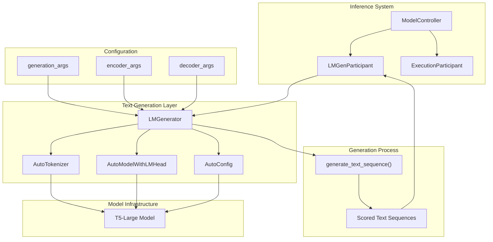
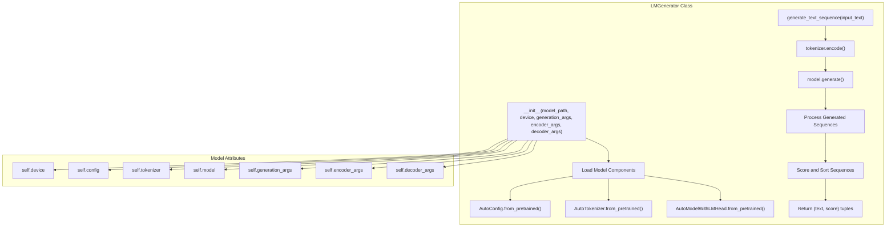
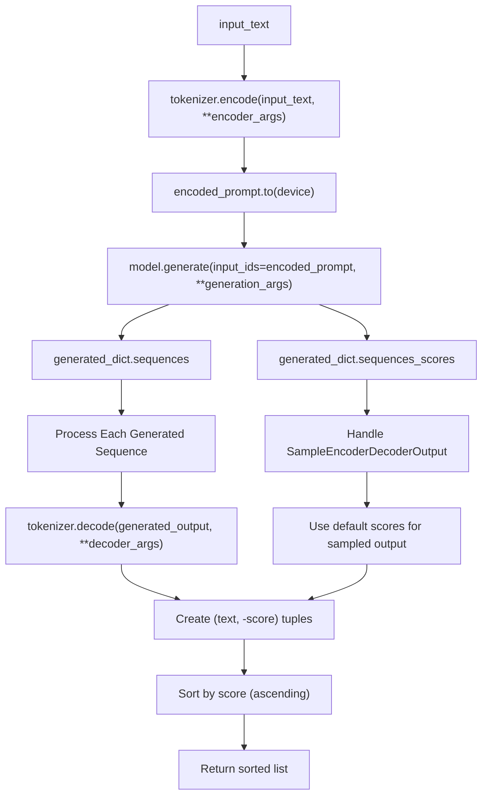

<!-- source: DeepWiki mcp.deepwiki.com · repo allenai/CommaQA · page 6.1 Text Generation · fetched 2026-10-26 -->

# Text Generation

<details>
<summary>Relevant source files</summary>

The following files were used as context for generating this wiki page:

- [commaqa/inference/__init__.py](commaqa/inference/__init__.py)
- [commaqa/models/generator.py](commaqa/models/generator.py)

</details>


This document covers the text generation capabilities within the CommaQA system, specifically the language model integration for generating question sequences during inference. The text generation system provides a unified interface for transformer-based language models, primarily T5-Large, to generate natural language questions as part of the question decomposition process.

For information about NLP utilities like tokenization and text processing, see [NLP Utilities](#6.2). For details about how generated text is used in the inference pipeline, see [Participant Models](#4.2).

## Overview

The text generation system in CommaQA centers around the `LMGenerator` class, which provides a wrapper interface for transformer-based language models. This system is primarily used by question generation participants in the inference pipeline to produce natural language questions that guide the decomposition process.

## System Architecture

The text generation system integrates with the broader CommaQA inference pipeline through the following architecture:



Sources: [commaqa/models/generator.py:1-58]()

## LMGenerator Class

The `LMGenerator` class serves as the core component for text generation, providing a standardized interface for transformer models within the CommaQA system.

### Class Structure



Sources: [commaqa/models/generator.py:9-27]()

### Initialization Parameters

The `LMGenerator` constructor accepts several configuration parameters:

| Parameter | Type | Description |
|-----------|------|-------------|
| `model_path` | str | Path to the pretrained model |
| `device` | torch.device | Target device (GPU/CPU), auto-detected if None |
| `generation_args` | dict | Arguments passed to model.generate() |
| `encoder_args` | dict | Arguments for tokenizer encoding |
| `decoder_args` | dict | Arguments for tokenizer decoding |

The constructor automatically configures output scoring and return dictionary format by setting `output_scores=True` and `return_dict_in_generate=True` in the generation arguments.

Sources: [commaqa/models/generator.py:11-27]()

### Text Generation Process

The `generate_text_sequence` method implements the core text generation functionality:



Sources: [commaqa/models/generator.py:29-57]()

### Scoring System

The scoring system implements a specific convention for sequence ranking:

- **Score Inversion**: Generated scores are negated (`-generated_scores[generated_sequence_idx]`) so that lower scores indicate better sequences
- **Sampling Handling**: When using sampling-based generation (resulting in `SampleEncoderDecoderOutput`), default scores of 0 are assigned with a warning
- **Sorted Output**: Results are always returned sorted by score in ascending order (best sequences first)

Sources: [commaqa/models/generator.py:40-57]()

## Integration Points

The text generation system integrates with other CommaQA components through the following interfaces:

### Model Loading

The system uses the Hugging Face Transformers library for model management:

- `AutoConfig.from_pretrained()` loads model configuration
- `AutoTokenizer.from_pretrained()` loads the tokenizer
- `AutoModelWithLMHead.from_pretrained()` loads the language model

### Device Management

Automatic device detection prioritizes CUDA when available:
```python
self.device = torch.device("cuda" if torch.cuda.is_available() else "cpu")
```

### Configuration Management

Three separate argument dictionaries control different aspects of generation:
- `generation_args`: Parameters for `model.generate()`
- `encoder_args`: Parameters for input tokenization
- `decoder_args`: Parameters for output decoding

Sources: [commaqa/models/generator.py:14-27]()

## Usage Patterns

The `LMGenerator` is typically instantiated once per model and reused across multiple generation calls. The class design supports:

- **Batch Processing**: Can handle multiple sequences through the generation framework
- **Flexible Configuration**: Supports various generation strategies through parameter configuration
- **Score-based Selection**: Provides ranked outputs for downstream selection logic
- **Device Abstraction**: Handles GPU/CPU allocation transparently

The generated sequences are consumed by participants in the inference system, particularly the `LMGenParticipant`, which uses the scored sequences to guide question decomposition processes.

Sources: [commaqa/models/generator.py:1-58]()

---

