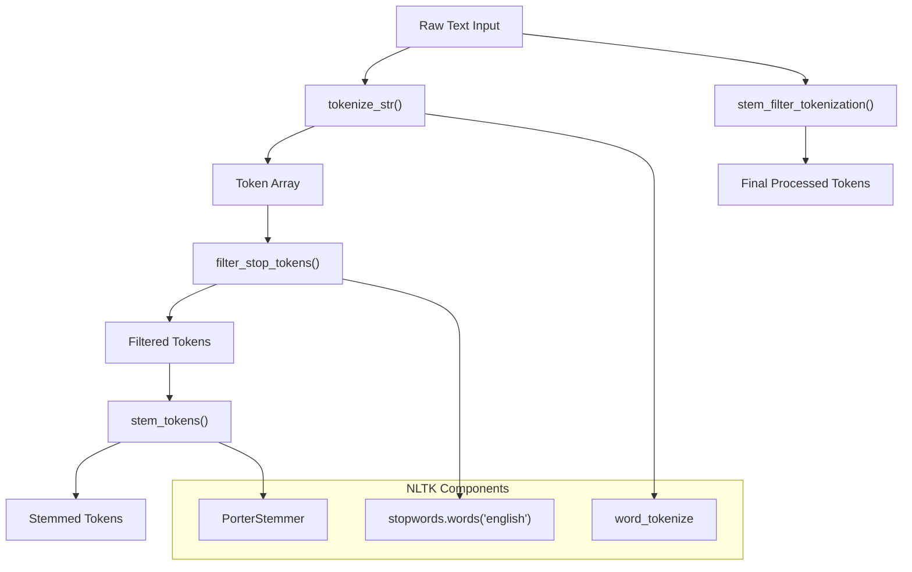
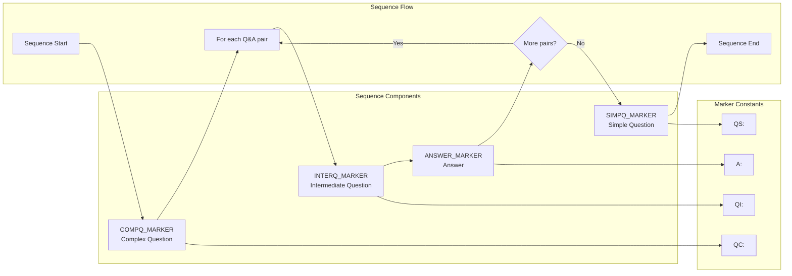
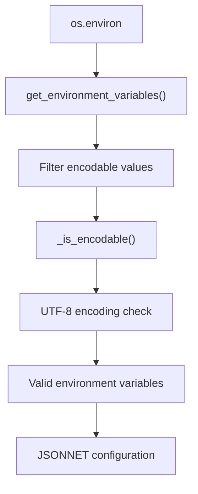

<!-- source: DeepWiki mcp.deepwiki.com · repo allenai/CommaQA · page 6.2 NLP Utilities · fetched 2026-10-26 -->

# NLP Utilities

Relevant source files

The following files were used as context for generating this wiki page:

- [commaqa/inference/utils.py](commaqa/inference/utils.py)

## Purpose and Scope

This document covers the natural language processing utilities provided by the CommaQA system. These utilities support text processing, sequence representation, and configuration parsing throughout the inference pipeline. The utilities primarily focus on tokenization, stemming, stop word filtering, and specialized sequence formatting for question-answer pairs.

For information about text generation capabilities, see [Text Generation](#6.1). For broader language model integration, refer to the parent section on [Language Models and Text Generation](#6).

## Text Processing Pipeline

The CommaQA system provides a complete text processing pipeline built on NLTK components. The pipeline supports tokenization, stemming, and stop word filtering for natural language questions and answers.

### Text Processing Flow

**Sources:** [commaqa/inference/utils.py:37-51]()

### Core Processing Functions

The text processing system provides four main functions:

| Function | Purpose | Input | Output |
|----------|---------|--------|--------|
| `tokenize_str` | Basic tokenization | Raw text string | List of tokens |
| `stem_tokens` | Apply stemming | Token array | Stemmed token array |
| `filter_stop_tokens` | Remove stop words | Token array | Filtered token array |
| `stem_filter_tokenization` | Complete pipeline | Raw text string | Processed token array |

The `stem_filter_tokenization` function [commaqa/inference/utils.py:49-50]() combines all processing steps into a single operation, applying lowercasing, tokenization, stop word removal, and stemming in sequence.

**Sources:** [commaqa/inference/utils.py:37-51]()

## Sequence Representation System

The CommaQA system uses a specialized sequence representation format to encode complex question-answer pairs with multiple intermediate steps. This format supports the decomposition-based reasoning approach used throughout the system.

### Sequence Markers and Structure

**Sources:** [commaqa/inference/utils.py:12-17]()

### Sequence Generation Process

The `get_sequence_representation` function [commaqa/inference/utils.py:23-34]() creates formatted sequences from question-answer pairs:

1. **Validation**: Ensures question and answer sequences have matching lengths
2. **Complex Question**: Prefixes the original question with `COMPQ_MARKER`
3. **Intermediate Steps**: Alternates between `INTERQ_MARKER` for questions and `ANSWER_MARKER` for answers
4. **Simple Question**: Concludes with `SIMPQ_MARKER`

**Sources:** [commaqa/inference/utils.py:23-34]()

## Environment Variable Handling

The system includes utilities for parsing JSONNET configurations with environment variable support, borrowed from AllenNLP patterns.

### Environment Variable Processing

The `get_environment_variables` function [commaqa/inference/utils.py:54-58]() filters out environment variables that cannot be unicode-encoded to prevent "surrogates not allowed" errors in JSONNET processing.

**Sources:** [commaqa/inference/utils.py:54-69]()

## Constants and Markers Reference

The utilities module defines several important constants used throughout the CommaQA system:

### Question and Answer Markers

| Constant | Value | Purpose |
|----------|--------|---------|
| `QUESTION_MARKER` | `" Q: "` | General question prefix |
| `COMPQ_MARKER` | `" QC: "` | Complex question prefix |
| `SIMPQ_MARKER` | `" QS: "` | Simple question prefix |
| `INTERQ_MARKER` | `" QI: "` | Intermediate question prefix |
| `ANSWER_MARKER` | `" A: "` | Answer prefix |

### Utility Constants

| Constant | Value | Purpose |
|----------|--------|---------|
| `EOQ_MARKER` | `"[EOQ]"` | End of question marker |
| `LIST_JOINER` | `" + "` | List element separator |
| `BLANK` | `"__"` | Placeholder for missing values |
| `WH_WORDS` | `set(["who", "what", ...])` | Question word recognition |

**Sources:** [commaqa/inference/utils.py:12-20]()

## Integration with NLP Components

The utilities integrate with standard NLP libraries:

- **NLTK**: Provides tokenization through `word_tokenize` and stemming through `PorterStemmer`
- **Stop Words**: Uses NLTK's English stop word corpus for filtering
- **Stemming**: Applies Porter stemming algorithm for word normalization

The module initializes these components at import time [commaqa/inference/utils.py:8-10](), making them available for efficient reuse throughout the system.

**Sources:** [commaqa/inference/utils.py:1-10]()

---

