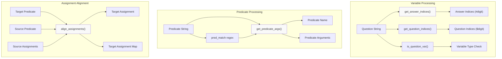
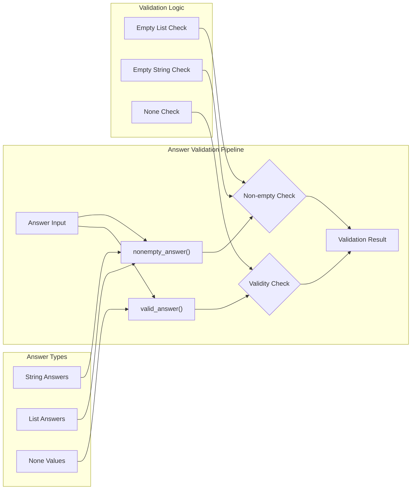
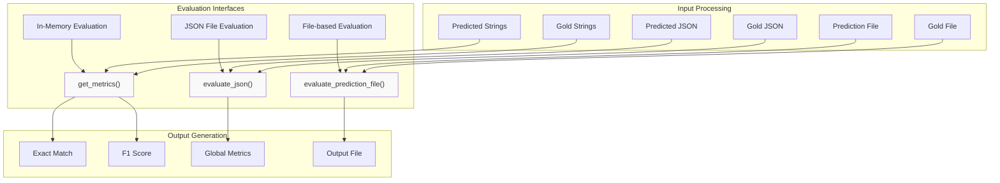

<!-- source: DeepWiki mcp.deepwiki.com · repo allenai/CommaQA · page 7 Utilities and Tools · fetched 2026-10-26 -->

# Utilities and Tools

Relevant source files

The following files were used as context for generating this wiki page:

- [commaqa/dataset/utils.py](commaqa/dataset/utils.py)
- [requirements.txt](requirements.txt)
- [scripts/drop_eval.py](scripts/drop_eval.py)

This document covers the supporting utilities and evaluation tools that facilitate dataset processing, development, and model evaluation in the CommaQA system. These utilities provide essential functionality for predicate parsing, argument handling, text normalization, and performance measurement.

For information about dataset generation processes, see [Dataset Generation System](#3). For inference-related utilities, see [Inference System](#4).

## Dataset Processing Utilities

The CommaQA system includes a comprehensive set of utilities for processing dataset elements, parsing predicates, and handling variable assignments. These utilities are primarily located in the `commaqa/dataset/utils.py` module and provide core functionality used throughout the dataset generation pipeline.

### Predicate and Variable Processing

The system provides specialized functions for parsing and processing predicates and variables within question-answer pairs:

The `get_predicate_args` function [commaqa/dataset/utils.py:19-25]() uses regex pattern matching to parse predicate strings in the format `predicate_name(arg1, arg2, ...)` and supports both comma-separated and pipe-separated argument lists.

### List and Data Structure Utilities

Several utility functions handle common data structure operations:

| Function | Purpose | Input | Output |
|----------|---------|-------|--------|
| `flatten_list` | Recursively flattens nested lists | `List[Any]` | `List[Any]` |
| `dict_product` | Cartesian product of dictionary values | `Dict[str, List]` | `Generator[Dict]` |
| `nonempty_answer` | Checks for non-empty answers | `Union[str, List]` | `bool` |
| `valid_answer` | Validates answer existence | `Any` | `bool` |

The `flatten_list` function [commaqa/dataset/utils.py:28-35]() provides recursive flattening capabilities essential for processing hierarchical data structures in the dataset generation pipeline.

Sources: [commaqa/dataset/utils.py:1-87]()

## Answer Validation and Processing

The system includes robust answer validation mechanisms to ensure data quality:

The `NOANSWER` constant [commaqa/dataset/utils.py:82]() provides a standardized representation for missing answers throughout the system.

Sources: [commaqa/dataset/utils.py:74-87]()

## DROP Dataset Evaluation

The system includes the official DROP evaluation script that provides comprehensive performance measurement capabilities for question-answering models.

### Text Normalization Pipeline

The evaluation system implements a sophisticated text normalization pipeline to ensure fair comparison between predicted and gold answers:

```mermaid
graph TD
    subgraph "Text Normalization Pipeline"
        INPUT["Raw Text"] --> TOK["_tokenize()"]
        TOK --> LOW["_lower()"]
        LOW --> RMP["_remove_punc()"]
        RMP --> NOR["_normalize_number()"]
        NOR --> RMA["_remove_articles()"]
        RMA --> WSF["_white_space_fix()"]
        WSF --> NORM["Normalized Text"]
    end
    
    subgraph "Number Processing"
        NUM["Number Detection"] --> ISN["_is_number()"]
        ISN --> NNU["_normalize_number()"]
        NNU --> NVAL["Normalized Value"]
    end
    
    subgraph "Answer Processing"
        PRED["Predicted Answer"] --> ATB["_answer_to_bags()"]
        GOLD["Gold Answer"] --> ATB
        ATB --> SPANS["Normalized Spans"]
        ATB --> BAGS["Token Bags"]
    end
    
    style TOK fill:#f9f9f9
    style ATB fill:#f9f9f9
    style ISN fill:#f9f9f9
```

The normalization process [scripts/drop_eval.py:47-56]() handles articles, punctuation, whitespace, and number standardization to create consistent representations for evaluation.

### Metric Computation

The evaluation system computes both exact match and F1 scores using optimal alignment between predicted and gold answers:

| Metric | Description | Computation Method |
|--------|-------------|-------------------|
| Exact Match | Binary match between normalized answers | Set equality check |
| F1 Score | Token-level precision and recall | Optimal bipartite matching |
| Alignment | Answer set correspondence | Hungarian algorithm via `linear_sum_assignment` |

The `_align_bags` function [scripts/drop_eval.py:90-105]() uses the Hungarian algorithm to find optimal 1-1 correspondence between predicted and gold answer sets, maximizing F1 scores across all possible alignments.

Sources: [scripts/drop_eval.py:1-309]()

## Evaluation Interface Functions

The evaluation system provides multiple interface levels for different use cases:

The `get_metrics` function [scripts/drop_eval.py:140-161]() serves as the core evaluation interface for in-memory processing, while `evaluate_prediction_file` [scripts/drop_eval.py:258-281]() provides file-based evaluation with optional output writing.

Sources: [scripts/drop_eval.py:140-309]()

## Development Dependencies

The system maintains specific dependency requirements to ensure consistent behavior across different environments:

| Category | Package | Version | Purpose |
|----------|---------|---------|---------|
| Configuration | `jsonnet` | Latest | JSONNet configuration processing |
| ML Framework | `transformers` | 4.11.3 | Hugging Face model integration |
| ML Framework | `torch` | 1.10.0 | PyTorch tensor operations |
| Tokenization | `sentencepiece` | Latest | T5 model tokenization |
| Serialization | `protobuf` | 3.19.0 | Protocol buffer support |
| NLP | `nltk` | Latest | Natural language processing |
| Evaluation | `scipy` | Latest | DROP evaluation metrics |

The dependency specifications [requirements.txt:1-10]() maintain compatibility with the T5-Large models used throughout the system while supporting the mathematical operations required for evaluation metrics.

Sources: [requirements.txt:1-10]()

---

