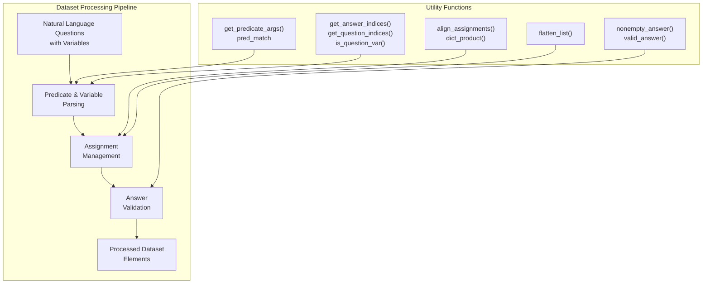
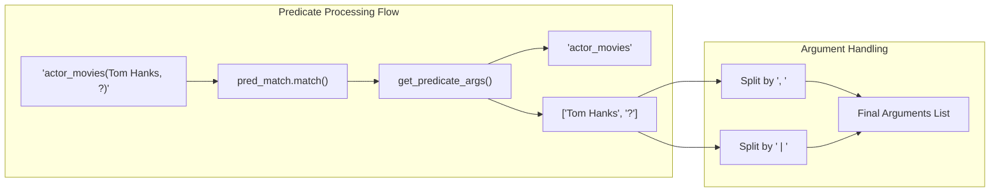
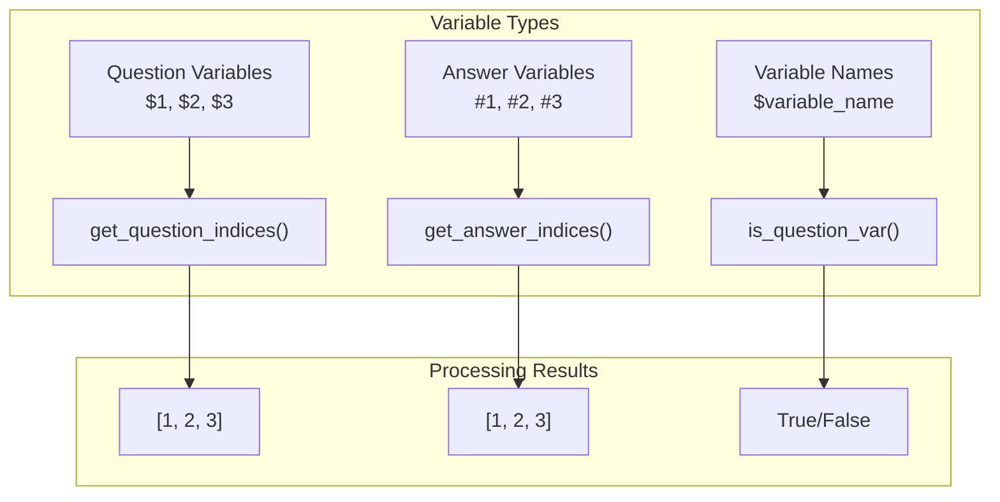
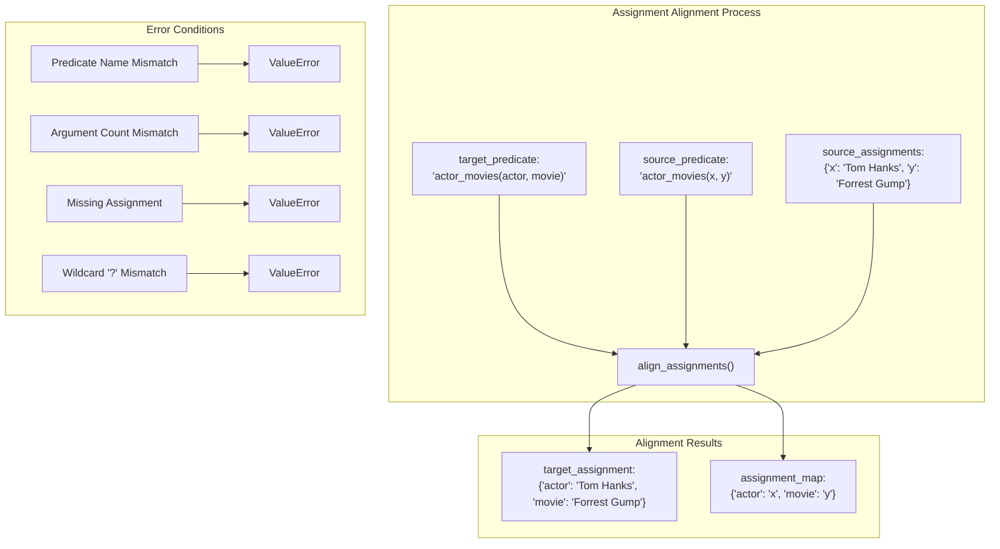
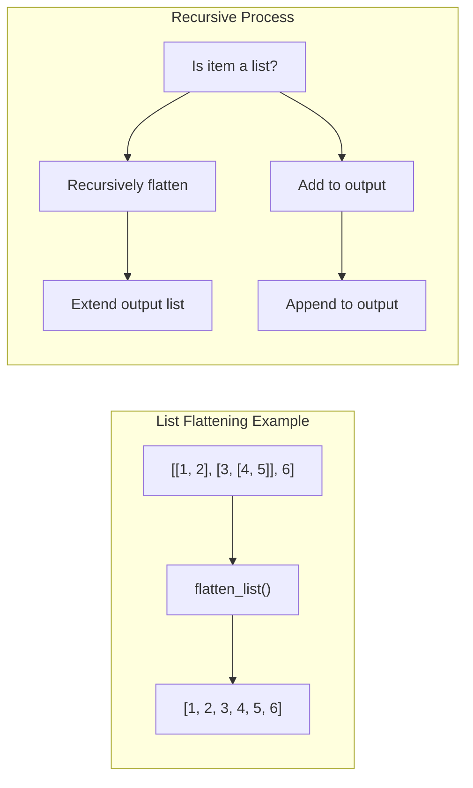
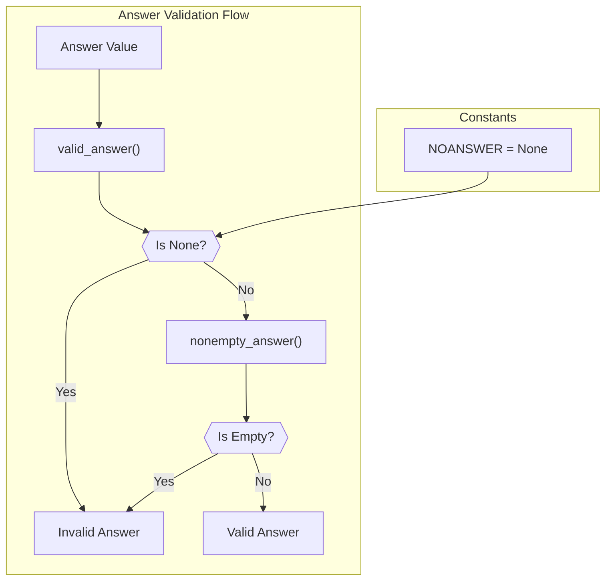
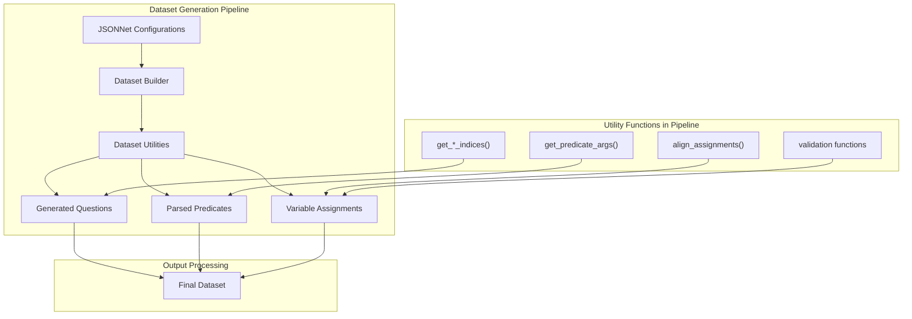

<!-- source: DeepWiki mcp.deepwiki.com · repo allenai/CommaQA · page 7.1 Dataset Utilities · fetched 2026-10-26 -->

# Dataset Utilities

<details>
<summary>Relevant source files</summary>

The following files were used as context for generating this wiki page:

- [commaqa/dataset/utils.py](commaqa/dataset/utils.py)

</details>


## Purpose and Scope

The Dataset Utilities module provides core utility functions for processing and manipulating dataset elements in the CommaQA system. This module handles predicate parsing, variable extraction, assignment management, and data validation tasks that are essential for dataset generation and processing workflows.

For information about the broader dataset generation pipeline, see [Dataset Generation System](#3). For execution-specific utilities, see [Execution Engine](#5).

## Overview

The dataset utilities are organized into several functional categories that support different aspects of dataset processing:



Sources: [commaqa/dataset/utils.py:1-87]()

## Predicate Parsing Utilities

The system uses structured predicates in the format `predicate_name(arg1, arg2, ...)` throughout the dataset processing pipeline. The predicate parsing utilities extract and manipulate these structured representations.

### Core Predicate Functions

| Function | Purpose | Input Format | Output |
|----------|---------|--------------|--------|
| `get_predicate_args()` | Parse predicate strings | `"predicate(arg1, arg2)"` | `("predicate", ["arg1", "arg2"])` |
| `pred_match` | Regex pattern | Compiled regex | Matches predicate format |



The `get_predicate_args()` function handles two argument separation formats: comma-separated (`arg1, arg2`) and pipe-separated (`arg1 | arg2`), allowing flexibility in predicate definitions.

Sources: [commaqa/dataset/utils.py:4-25]()

## Question and Answer Variable Handling

The system uses special variable syntax to mark placeholders in questions and reference answers from previous steps in decomposition chains.

### Variable Extraction Functions



| Function | Pattern | Example Input | Example Output |
|----------|---------|---------------|----------------|
| `get_question_indices()` | `\$(\d)` | `"What is $1 + $2?"` | `[1, 2]` |
| `get_answer_indices()` | `#(\d)` | `"Sum #1 and #2"` | `[1, 2]` |
| `is_question_var()` | Starts with `$` | `"$variable"` | `True` |

Sources: [commaqa/dataset/utils.py:7-16]()

## Assignment Management

The assignment system manages variable bindings and ensures compatibility between different predicate instances with the same structure but different variable names.

### Assignment Alignment

The `align_assignments()` function provides critical functionality for mapping assignments between predicates with different variable names but identical structure:



The function performs validation to ensure:
- Predicate names match between source and target
- Argument counts are identical
- All required assignments are present
- Wildcard arguments (`?`) are handled consistently

Sources: [commaqa/dataset/utils.py:38-67]()

## Data Structure Utilities

### List Processing

The `flatten_list()` function recursively flattens nested list structures, which is essential for processing hierarchical data structures in the dataset pipeline:



### Dictionary Cartesian Product

The `dict_product()` function generates all possible combinations from a dictionary of lists, useful for exploring different assignment combinations:

```python
# Example usage:
input_dicts = {'a': [1, 2], 'b': [3, 4]}
# Generates: [{'a': 1, 'b': 3}, {'a': 1, 'b': 4}, {'a': 2, 'b': 3}, {'a': 2, 'b': 4}]
```

Sources: [commaqa/dataset/utils.py:28-71]()

## Answer Validation

The system provides utilities to validate and filter answers throughout the processing pipeline:

### Validation Functions

| Function | Purpose | Valid Examples | Invalid Examples |
|----------|---------|----------------|------------------|
| `nonempty_answer()` | Check for non-empty answers | `"result"`, `[1, 2, 3]`, `42` | `""`, `[]` |
| `valid_answer()` | Check for non-None answers | Any non-None value | `None`, `NOANSWER` |



The `NOANSWER` constant provides a standardized way to represent missing or unavailable answers throughout the system.

Sources: [commaqa/dataset/utils.py:74-87]()

## Integration with Dataset Processing

These utilities form the foundation for dataset processing operations across the CommaQA system:



Sources: [commaqa/dataset/utils.py:1-87]()

---

