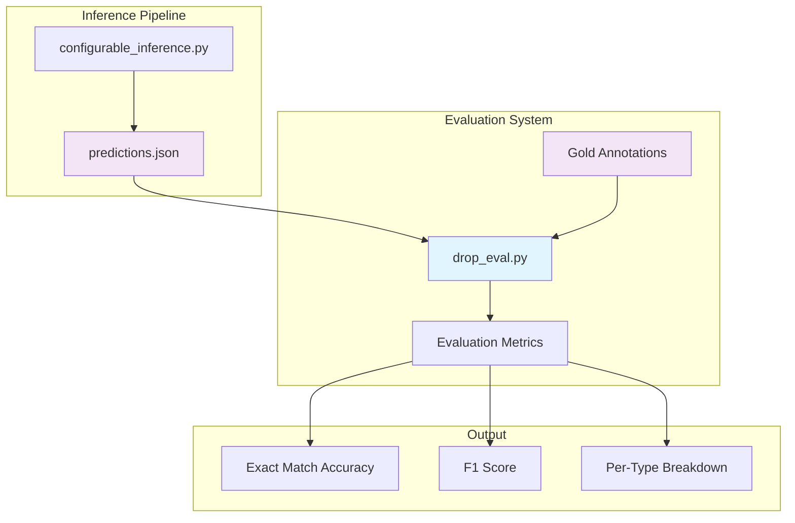
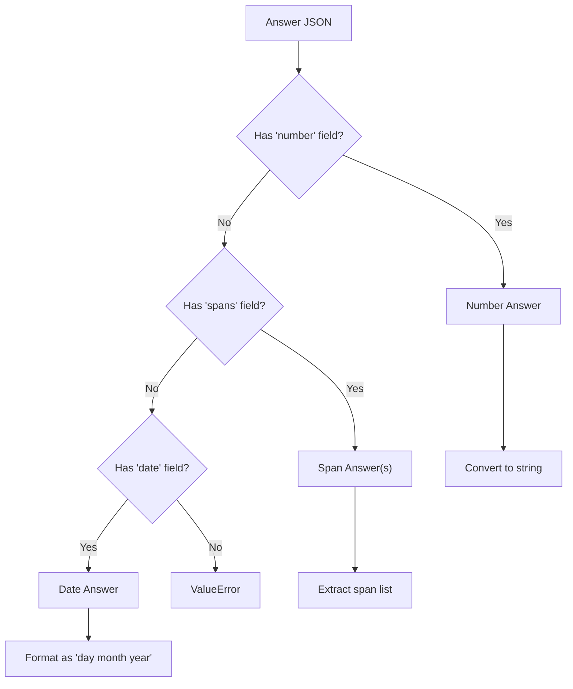

<!-- source: DeepWiki mcp.deepwiki.com · repo allenai/CommaQA · page 7.2 Evaluation Tools · fetched 2026-10-26 -->

# Evaluation Tools

<details>
<summary>Relevant source files</summary>

The following files were used as context for generating this wiki page:

- [requirements.txt](requirements.txt)
- [scripts/drop_eval.py](scripts/drop_eval.py)

</details>


This section covers the evaluation infrastructure provided by CommaQA for assessing model performance on question-answering tasks. The primary evaluation tool implements the official DROP dataset evaluation metrics, enabling standardized performance measurement for models trained and evaluated on DROP-format datasets.

For information about inference system outputs that feed into these evaluation tools, see [Inference System](#4). For dataset utilities used in data processing, see [Dataset Utilities](#7.1).

## Overview

The evaluation tools in CommaQA center around the DROP evaluation script, which provides standardized metrics for measuring question-answering performance. The evaluation system handles multiple answer types (numbers, text spans, dates) and implements sophisticated matching algorithms to compute exact match accuracy and F1 scores.

### System Integration



**DROP Evaluation Integration**
Sources: [scripts/drop_eval.py:1-309]()

## DROP Evaluation Script

The core evaluation tool is the DROP evaluation script located at `scripts/drop_eval.py`, which implements the official evaluation methodology from the AllenNLP reading comprehension repository.

### Core Functionality

The evaluation script provides several key functions:

| Function | Purpose | Input/Output |
|----------|---------|--------------|
| `get_metrics()` | Compute EM and F1 for single prediction | Takes predicted/gold answers → Returns (exact_match, f1) |
| `evaluate_json()` | Evaluate full dataset in memory | Takes annotations/predictions dicts → Returns global metrics |
| `evaluate_prediction_file()` | Evaluate prediction file against gold file | Takes file paths → Returns metrics and saves to output |
| `answer_json_to_strings()` | Convert DROP answer format to strings | Takes answer JSON → Returns normalized strings |

### Text Normalization Pipeline

```mermaid
graph LR
    INPUT["Raw Answer Text"] --> TOKENIZE["_tokenize()"]
    TOKENIZE --> LOWER["_lower()"]
    LOWER --> REMOVE_PUNC["_remove_punc()"]
    REMOVE_PUNC --> NORMALIZE_NUM["_normalize_number()"]
    NORMALIZE_NUM --> REMOVE_ARTICLES["_remove_articles()"]
    REMOVE_ARTICLES --> WHITESPACE_FIX["_white_space_fix()"]
    WHITESPACE_FIX --> NORMALIZED["Normalized Answer"]
    
    style INPUT fill:#e1f5fe
    style NORMALIZED fill:#f3e5f5
```



**Text Normalization Process**
Sources: [scripts/drop_eval.py:20-56]()

The normalization process handles:
- **Tokenization**: Splits on spaces and hyphens via `_tokenize()` [scripts/drop_eval.py:43-44]()
- **Case normalization**: Converts to lowercase via `_lower()` [scripts/drop_eval.py:39-40]()
- **Punctuation removal**: Removes punctuation except for numbers via `_remove_punc()` [scripts/drop_eval.py:32-36]()
- **Number normalization**: Converts numbers to float representation via `_normalize_number()` [scripts/drop_eval.py:67-71]()
- **Article removal**: Removes articles (a, an, the) via `_remove_articles()` [scripts/drop_eval.py:20-22]()
- **Whitespace cleanup**: Normalizes whitespace via `_white_space_fix()` [scripts/drop_eval.py:25-26]()

## Evaluation Metrics and Scoring

### Answer Type Support

The evaluation script handles three types of answers from the DROP dataset format:



**Answer Type Processing**
Sources: [scripts/drop_eval.py:164-187]()

### Scoring Algorithm

The evaluation uses a sophisticated alignment-based scoring system:

1. **Answer to Bags Conversion**: Each answer is converted to normalized spans and token bags via `_answer_to_bags()` [scripts/drop_eval.py:74-87]()

2. **Optimal Alignment**: Uses linear sum assignment to find optimal 1-1 alignment between predicted and gold answers via `_align_bags()` [scripts/drop_eval.py:90-105]()

3. **Number Matching**: Special handling ensures numeric answers match correctly via `_match_numbers_if_present()` [scripts/drop_eval.py:126-137]()

4. **F1 Computation**: Computes precision, recall, and F1 for aligned answer pairs via `_compute_f1()` [scripts/drop_eval.py:108-123]()

### Metrics Output

The evaluation produces several metrics:

| Metric | Description |
|--------|-------------|
| **Global Exact Match** | Percentage of questions with perfect match |
| **Global F1** | Average F1 score across all questions |
| **Type-specific Metrics** | Breakdown by answer type (number, span, date) |
| **Coverage Statistics** | Distribution of answer types in evaluation set |

## Usage and Command Line Interface

### Script Execution

The evaluation script can be run from the command line with the following interface:

```bash
python scripts/drop_eval.py \
    --gold_path drop_dataset_test.gold.json \
    --prediction_path sample_predictions.json \
    --output_path metrics.json
```

### Parameters

| Parameter | Default | Description |
|-----------|---------|-------------|
| `--gold_path` | `drop_dataset_test.gold.json` | Path to gold annotations file |
| `--prediction_path` | `sample_predictions.json` | Path to predictions file |
| `--output_path` | `None` | Optional path to save metrics JSON |

Sources: [scripts/drop_eval.py:284-309]()

### Input Format Requirements

**Prediction File Format**: JSON dictionary keyed by query_id with string or list of strings as values
**Gold File Format**: DROP dataset format with nested qa_pairs containing query_id and answer fields

### Dependencies

The evaluation script requires scipy for the linear sum assignment optimization:

```
scipy  # For linear_sum_assignment in optimal alignment
```

Sources: [requirements.txt:8-9]()

### Integration with Inference System

The evaluation tools integrate with the CommaQA inference pipeline by consuming the `predictions.json` output file generated by `configurable_inference.py`. The predictions are then evaluated against gold standard annotations using the DROP evaluation metrics, providing standardized performance assessment for the question-answering system.

---

