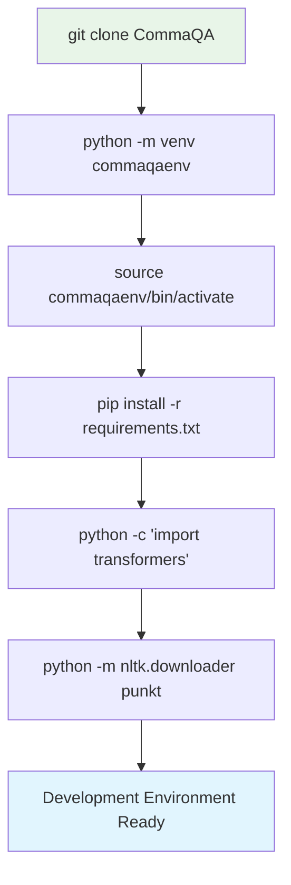
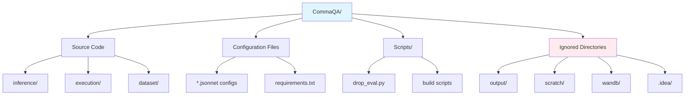

<!-- source: DeepWiki mcp.deepwiki.com · repo allenai/CommaQA · page 8 Development Setup · fetched 2026-10-26 -->

# Development Setup

<details>
<summary>Relevant source files</summary>

The following files were used as context for generating this wiki page:

- [.gitignore](.gitignore)
- [LICENSE](LICENSE)
- [requirements.txt](requirements.txt)
- [scripts/drop_eval.py](scripts/drop_eval.py)

</details>


This document covers the essential steps for setting up a local development environment for the CommaQA repository. It includes dependency installation, environment configuration, and verification steps needed to run the dataset generation pipeline and inference system.

For information about running the dataset generation pipeline, see [Dataset Generation System](#3). For details about inference configuration, see [Inference Configuration](#4.4).

## Prerequisites and System Requirements

CommaQA requires Python 3.7+ and has specific version requirements for key dependencies to ensure compatibility with the T5-Large language models and PyTorch-based execution engine.

### Core Dependencies

The system relies on several critical packages with pinned versions for stability:

| Package | Version | Purpose |
|---------|---------|---------|
| `torch` | 1.10.0 | Deep learning framework for language models |
| `transformers` | 4.11.3 | Hugging Face library for T5 models |
| `jsonnet` | Latest | Configuration language for dataset definitions |
| `sentencepiece` | Latest | Tokenization for T5 models |
| `protobuf` | 3.19.0 | Protocol buffers for model serialization |
| `nltk` | Latest | Natural language processing utilities |
| `scipy` | Latest | Scientific computing for DROP evaluation |

Sources: [requirements.txt:1-10]()

## Installation Process

### Environment Setup



Development Environment Setup Flow

The recommended setup process follows these steps:

1. **Clone Repository**: Download the CommaQA codebase
2. **Virtual Environment**: Create isolated Python environment
3. **Dependency Installation**: Install pinned package versions
4. **Verification**: Test critical imports
5. **NLTK Data**: Download required language processing data

Sources: [requirements.txt:1-10]()

### Dependency Installation

Install all required packages using the pinned versions:

```bash
pip install -r requirements.txt
```

The `requirements.txt` file specifies exact versions for critical packages like `transformers==4.11.3` and `torch==1.10.0` to maintain compatibility with the T5-Large models used in the `LMGenerator` class.

For development work on the DROP evaluation functionality, ensure `scipy` is installed as it's required by the `linear_sum_assignment` function in the evaluation script.

Sources: [requirements.txt:1-10](), [scripts/drop_eval.py:14]()

## Development Environment Structure

### Project Organization



Project Directory Structure

The development environment maintains several key directories:

- **Source directories**: Core system code for inference, execution, and dataset generation
- **Configuration files**: JSONNet definitions and dependency specifications  
- **Scripts directory**: Evaluation tools and build automation
- **Ignored directories**: Output, scratch space, IDE files, and experiment tracking

Sources: [.gitignore:1-16]()

### Ignored Files and Directories

The `.gitignore` configuration excludes several types of files from version control:

- **IDE files**: IntelliJ IDEA files (`.iml`, `.idea/`)
- **Python artifacts**: Compiled bytecode files (`.pyc`)
- **Output data**: Generated datasets and results (`output/`)
- **Development workspace**: Temporary files (`scratch/`)
- **Experiment tracking**: Weights & Biases logs (`wandb/`)

This structure allows developers to work with generated datasets and experiment outputs without cluttering the repository.

Sources: [.gitignore:1-16]()

## Verification and Testing

### Basic System Verification

Test the installation by verifying critical imports:

```python
# Verify core dependencies
import torch
import transformers
import jsonnet
import nltk

# Verify evaluation dependencies  
import scipy
import numpy as np
from scipy.optimize import linear_sum_assignment
```

### DROP Evaluation Setup

The `drop_eval.py` script provides the official DROP dataset evaluation functionality. Verify it can be imported and run:

```python
from scripts.drop_eval import evaluate_json, get_metrics
```

This script implements the standard DROP evaluation metrics including exact match and F1 scoring using the `_align_bags` function with `linear_sum_assignment` for optimal alignment.

Sources: [scripts/drop_eval.py:1-15](), [scripts/drop_eval.py:90-105]()

## Development Workflow Integration

### Language Model Setup

The system uses T5-Large models through the Hugging Face `transformers` library. The pinned version `4.11.3` ensures compatibility with the `LMGenerator` class in the inference system.

For local development, the models will be automatically downloaded on first use. Consider pre-downloading models for offline development:

```python
from transformers import T5Tokenizer, T5ForConditionalGeneration

tokenizer = T5Tokenizer.from_pretrained("t5-large")
model = T5ForConditionalGeneration.from_pretrained("t5-large")
```

### Configuration Management

The system uses JSONNet for configuration management. Ensure JSONNet is properly installed and can process the configuration files:

```bash
jsonnet --version
```

This is essential for the dataset generation pipeline which relies heavily on JSONNet configurations for defining entities, predicates, and theories.

Sources: [requirements.txt:1]()

### NLTK Data Requirements

Download required NLTK data for text processing:

```python
import nltk
nltk.download('punkt')
nltk.download('stopwords')
```

This supports the text normalization functions used in evaluation and natural language processing throughout the system.

Sources: [requirements.txt:7](), [scripts/drop_eval.py:43-44]()