# Page: Overview

# Overview

<details>
<summary>Relevant source files</summary>

The following files were used as context for generating this wiki page:

- [README.md](README.md)
- [commaqa/dataset/README.md](commaqa/dataset/README.md)
- [commaqa/execution/README.md](commaqa/execution/README.md)
- [commaqa/inference/README.md](commaqa/inference/README.md)

</details>


## Purpose and Scope

CommaQA is a question-answering benchmark designed for training models to communicate with specialized agents to solve complex multi-hop reasoning tasks. This repository provides a complete system for generating synthetic QA datasets, training decomposition models, and performing inference through agent communication.

The system enables models to break down complex questions into simpler sub-questions that can be answered by different specialized agents (table lookup, text QA, mathematical operations), then combine the results to produce final answers. For detailed information about specific components, see [Dataset Generation System](#3) for building datasets, [Inference System](#4) for running question-answering, and [Execution Engine](#5) for operation execution.

## System Architecture Overview

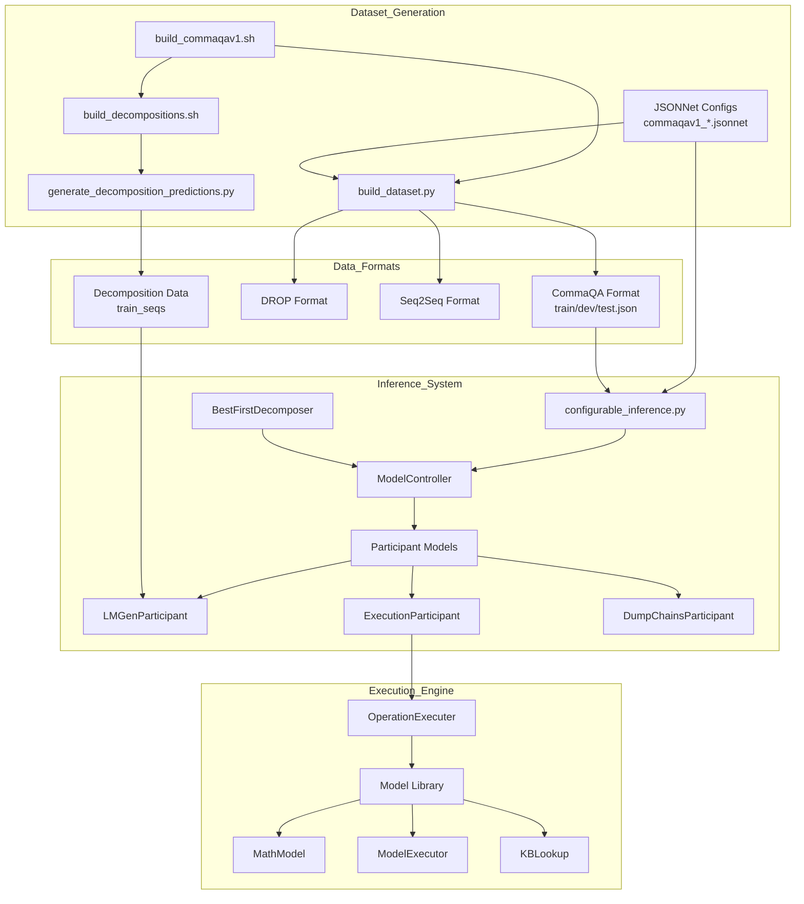

**CommaQA System Architecture**: Shows the three main pipelines and their key code components, from dataset generation through inference execution.

Sources: [README.md:1-113](), [commaqa/inference/README.md:1-59](), [commaqa/dataset/README.md:1-47](), [commaqa/execution/README.md:1-20]()

## Core Components

CommaQA consists of three primary systems that work together to enable agent-based question answering:

### Dataset Generation Pipeline
The dataset generation system creates synthetic QA datasets through configurable JSONNet specifications. The main entry point `build_commaqav1.sh` orchestrates the creation of three dataset variants:

- **CommaQA-E (Explicit)**: Questions requiring explicit multi-hop reasoning
- **CommaQA-I (Implicit)**: Questions requiring implicit reasoning connections  
- **CommaQA-N (Numeric)**: Questions requiring numerical computation and aggregation

The `build_dataset.py` module generates the core QA pairs, while `generate_decomposition_predictions.py` creates training sequences for decomposition models.

### Inference Engine
The inference system processes questions by decomposing them into sub-questions that specialized agents can answer. The `configurable_inference.py` entry point coordinates this process using:

- `ModelController`: Orchestrates participant models in a state machine
- `BestFirstDecomposer`: Implements search strategies (greedy, beam search)
- Participant models: `LMGenParticipant`, `ExecutionParticipant`, `DumpChainsParticipant`

### Execution Engine  
The execution system performs structured operations against knowledge bases through the `OperationExecuter` class. It supports operations like `select`, `project`, `filter`, and mathematical aggregations, coordinating with specialized models including `MathModel`, `ModelExecutor`, and `KBLookup`.

Sources: [README.md:31-76](), [commaqa/inference/README.md:2-8](), [commaqa/dataset/README.md:3-20](), [commaqa/execution/README.md:1-8]()

## Code Entity Architecture

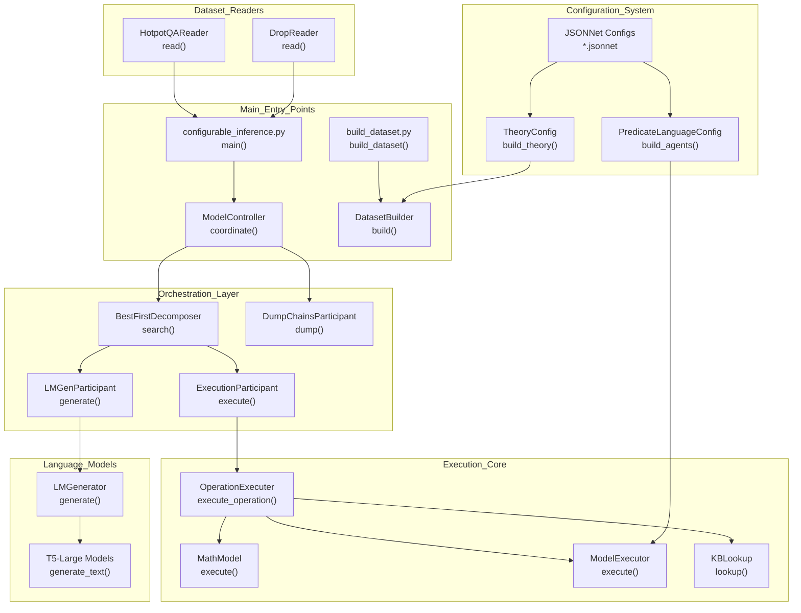

**Code Entity Architecture**: Maps system components to their implementing classes and key methods, showing the concrete code structure.

Sources: [commaqa/inference/README.md:10-19](), [commaqa/dataset/README.md:11-18](), [commaqa/execution/README.md:17-19]()

## Dataset Types and Formats

CommaQA provides three reasoning variants, each available in multiple formats:

| Dataset Type | Description | Key Characteristics |
|-------------|-------------|-------------------|
| **CommaQA-E** | Explicit reasoning | Clear decomposition steps, direct agent communication |
| **CommaQA-I** | Implicit reasoning | Requires inferring hidden connections between facts |
| **CommaQA-N** | Numeric reasoning | Mathematical operations, aggregations, comparisons |

Each dataset type supports three output formats:

### CommaQA Format
The native format containing structured knowledge bases, agent specifications, and decomposition traces:
- `kb`: Predicate-fact mappings
- `context`: Verbalized natural language context  
- `pred_lang_config`: Agent language specifications
- `qa_pairs`: Questions with decompositions and theory configurations

### DROP Format
Compatible with the DROP dataset format for existing QA models, containing `context` and `qa_pairs` fields suitable for end-to-end training.

### Seq2Seq Format  
Simple text format with `<context> Q: <question> A: <answer>` structure for sequence-to-sequence model training.

Sources: [README.md:42-72](), [commaqa/dataset/README.md:32-46]()

## Key Workflows

### Inference Workflow
The main inference process follows this execution path:

1. **Input Processing**: `configurable_inference.py` loads questions via dataset readers (`DropReader`, `HotpotQAReader`)
2. **Orchestration**: `ModelController` coordinates participant models using search strategies
3. **Decomposition**: `BestFirstDecomposer` explores question decomposition space  
4. **Execution**: `ExecutionParticipant` processes sub-questions through `OperationExecuter`
5. **Generation**: `LMGenParticipant` uses `LMGenerator` with T5-Large models for next question prediction

### Dataset Building Workflow  
Dataset generation proceeds through these stages:

1. **Configuration**: JSONNet configs define entities, predicates, and question theories
2. **Building**: `build_dataset.py` samples entities and generates QA pairs
3. **Decomposition**: `generate_decomposition_predictions.py` creates training sequences
4. **Output**: Multiple format exports (CommaQA, DROP, Seq2Seq)

Sources: [commaqa/inference/README.md:2-38](), [commaqa/dataset/README.md:3-29]()

---

# Page: Core Architecture

# Core Architecture

<details>
<summary>Relevant source files</summary>

The following files were used as context for generating this wiki page:

- [commaqa/execution/operation_executer.py](commaqa/execution/operation_executer.py)
- [commaqa/inference/configurable_inference.py](commaqa/inference/configurable_inference.py)
- [commaqa/inference/participant_execution.py](commaqa/inference/participant_execution.py)
- [commaqa/inference/participant_qgen.py](commaqa/inference/participant_qgen.py)
- [configs/inference/commaqav1_brute_force.jsonnet](configs/inference/commaqav1_brute_force.jsonnet)

</details>


This document explains the overall system architecture of CommaQA, showing how the dataset generation pipeline, inference engine, and execution engine work together to perform multi-step question answering through model orchestration. For details on dataset building, see [Dataset Generation System](#3). For specific inference strategies and configuration options, see [Inference System](#4).

## System Overview

CommaQA operates as a configurable multi-model system that decomposes complex questions into simpler sub-questions, executes operations against knowledge bases, and chains the results together. The system consists of three main subsystems that work together:

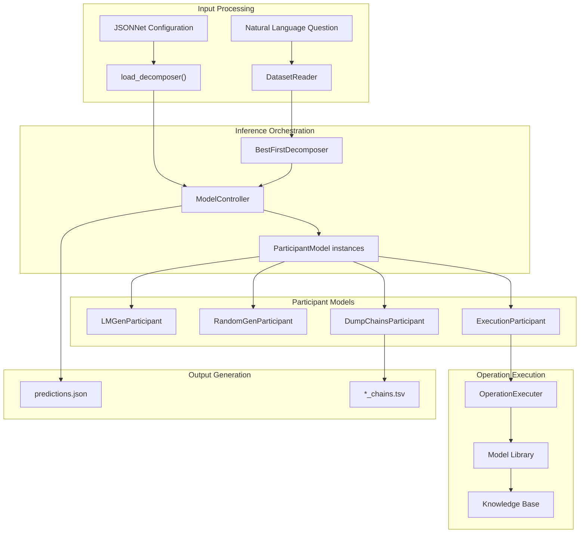

Sources: [commaqa/inference/configurable_inference.py:34-51](), [commaqa/inference/participant_qgen.py:15-26](), [commaqa/inference/participant_execution.py:14-33](), [commaqa/execution/operation_executer.py:10-16]()

## Core Components

### Inference Engine Entry Point

The system starts with `configurable_inference.py`, which serves as the main orchestrator. The `load_decomposer()` function instantiates participant models based on JSONNet configuration and creates the core inference components:

| Component | Class | Purpose |
|-----------|-------|---------|
| Model Controller | `ModelController` | State machine that coordinates participant models |
| Search Strategy | `BestFirstDecomposer` | Implements search over question decomposition space |
| Data Structure | `QuestionGeneratorData` | Holds question sequences, answers, and metadata |

The entry point processes command-line arguments and loads configuration through JSONNet with environment variable support.

Sources: [commaqa/inference/configurable_inference.py:54-130](), [commaqa/inference/configurable_inference.py:34-51]()

### Participant Model Architecture

The system uses a participant-based architecture where different specialized models handle specific aspects of the inference process. All participants inherit from `ParticipantModel` and implement the `query()` method:

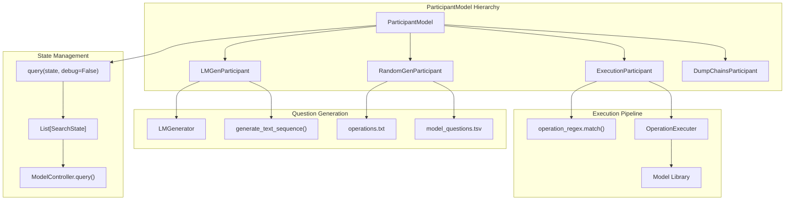

Sources: [commaqa/inference/participant_qgen.py:15-89](), [commaqa/inference/participant_qgen.py:91-262](), [commaqa/inference/participant_execution.py:14-103]()

### Operation Execution Engine

The `OperationExecuter` provides the core execution logic for structured operations against knowledge bases. It supports three main operation types through specialized execution methods:

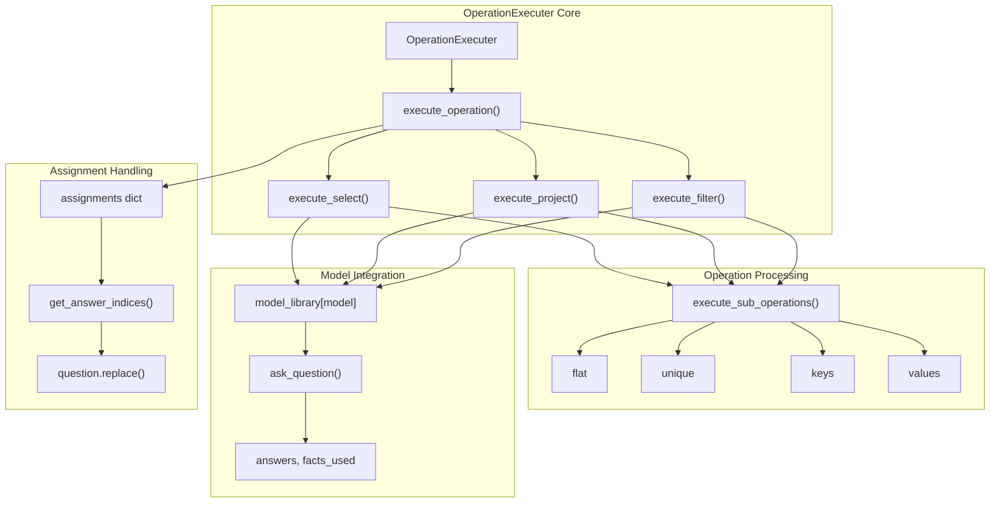

Sources: [commaqa/execution/operation_executer.py:10-219](), [commaqa/execution/operation_executer.py:43-55](), [commaqa/execution/operation_executer.py:57-112](), [commaqa/execution/operation_executer.py:114-188]()

## Configuration and Model Loading

### JSONNet Configuration System

The system uses JSONNet configurations to define participant models and their parameters. Configuration files specify the state machine structure and model instantiation parameters:

```mermaid
graph LR
    subgraph "Configuration Loading"  
        JSONNET["*.jsonnet files"] --> EXTLVARS["get_environment_variables()"]
        EXTLVARS --> EVALUATE["_jsonnet.evaluate_file()"]
        EVALUATE --> CONFIGMAP["config_map dict"]
    end
    
    subgraph "Model Instantiation"
        CONFIGMAP --> MODELS["config_map['models']"]
        MODELS --> CLASSNAME["value.pop('name')"]
        CLASSNAME --> LOOKUP["MODEL_NAME_CLASS[class_name]"]
        LOOKUP --> INSTANTIATE["class(**value)"]
        INSTANTIATE --> MODELMAP["model_map dict"]
    end
    
    subgraph "State Machine Setup"
        CONFIGMAP --> CONTROLLER["ModelController(config_map)"]
        CONTROLLER --> DECOMPOSER["BestFirstDecomposer(controller)"]
        MODELMAP --> CONTROLLER
    end
```

Example configuration structure from `commaqav1_brute_force.jsonnet`:

| Field | Purpose | Example Values |
|-------|---------|----------------|
| `start_state` | Initial participant model | `"gen"` |
| `end_state` | Terminal state marker | `"[EOQ]"` |
| `models.gen.name` | Participant class name | `"randgen"` |
| `models.execute.name` | Execution participant | `"operation_executer"` |
| `models.chains.name` | Utility participant | `"dump_chains"` |

Sources: [commaqa/inference/configurable_inference.py:61-67](), [configs/inference/commaqav1_brute_force.jsonnet:1-28](), [commaqa/inference/configurable_inference.py:34-51]()

## Data Flow and State Management

### Search State Structure

The system maintains state through `SearchState` objects that track question sequences, answers, and metadata as they flow through participant models:

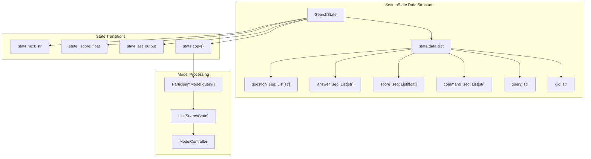

Each participant model receives a state, processes it according to its logic, and returns a list of new states representing possible next steps in the decomposition.

Sources: [commaqa/inference/participant_qgen.py:30-88](), [commaqa/inference/participant_execution.py:37-103](), [commaqa/inference/configurable_inference.py:84-100]()

## Integration Points

### Model Library Interface

The execution participant integrates with domain-specific models through a standardized interface defined in the `remodel_file` configuration. This JSON file maps question IDs to knowledge bases and predicate language configurations:

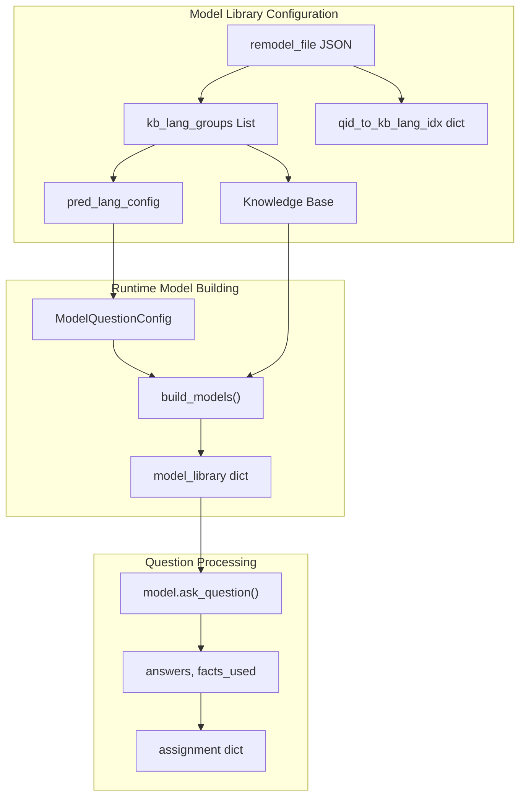

Sources: [commaqa/inference/participant_execution.py:19-32](), [commaqa/inference/participant_execution.py:55-79]()

This architecture enables CommaQA to handle complex multi-step reasoning by decomposing questions into executable operations, maintaining state across steps, and coordinating multiple specialized models through a unified participant interface.

---

# Page: Dataset Generation System

# Dataset Generation System

<details>
<summary>Relevant source files</summary>

The following files were used as context for generating this wiki page:

- [.dockerignore](.dockerignore)
- [Dockerfile](Dockerfile)
- [commaqa/dataset/build_dataset.py](commaqa/dataset/build_dataset.py)
- [commaqa/dataset/build_submodel_datasets.py](commaqa/dataset/build_submodel_datasets.py)
- [scripts/build_commaqav1.sh](scripts/build_commaqav1.sh)
- [scripts/build_datasets.sh](scripts/build_datasets.sh)
- [scripts/build_decompositions.sh](scripts/build_decompositions.sh)
- [scripts/build_docker_image.sh](scripts/build_docker_image.sh)

</details>


## Purpose and Scope

The Dataset Generation System is responsible for creating the CommaQA datasets from configuration files, generating question-answer pairs, building decompositions for training data, and extracting language models. This system produces three main dataset variants: CommaQA-E (explicit reasoning), CommaQA-I (implicit reasoning), and CommaQA-N (numeric reasoning). 

For information about how these datasets are used during inference, see [Inference Engine](#4.1). For details on the execution of operations within generated datasets, see [Operation Executer](#5.1).

## System Architecture

The dataset generation system follows a multi-stage pipeline that transforms JSONNet configuration files into structured datasets with accompanying decompositions and language models.

### Dataset Generation Pipeline Overview

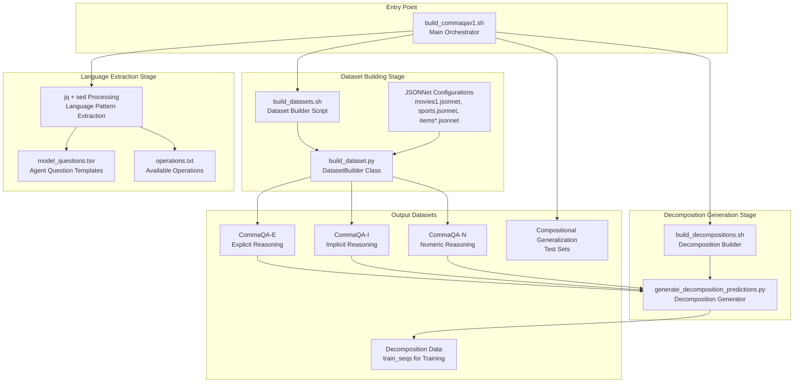

Sources: [scripts/build_commaqav1.sh:1-67](), [scripts/build_datasets.sh:1-21](), [scripts/build_decompositions.sh:1-21]()

## Main Components

### Dataset Builder Core Logic

The `DatasetBuilder` class in `build_dataset.py` implements the core dataset generation logic. It processes multiple `DatasetBuildConfig` objects to create structured question-answer datasets.

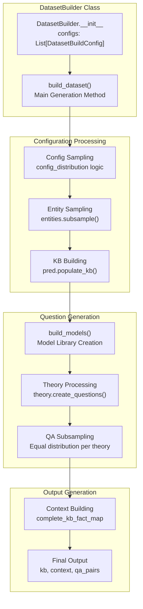

Sources: [commaqa/dataset/build_dataset.py:37-129]()

### Dataset Generation Workflow

The system generates datasets through a structured process that ensures balanced representation across different reasoning types:

| Stage | Process | Key Components |
|-------|---------|---------------|
| **Configuration** | Load JSONNet configs | `DatasetBuildConfig`, `_jsonnet.evaluate_file()` |
| **Entity Sampling** | Sample entities per group | `entities.subsample()`, `entity_percent` parameter |
| **KB Population** | Build knowledge base | `pred.populate_kb()`, `complete_kb` |
| **Model Library** | Initialize execution models | `build_models()` from `execution.utils` |
| **Question Generation** | Create QA pairs | `theory.create_questions()` |
| **Balancing** | Equalize across theories | `random.sample()`, `min_size` calculation |
| **Output** | Generate train/dev/test | 80%/10%/10% split |

Sources: [commaqa/dataset/build_dataset.py:41-129]()

### Decomposition Generation System

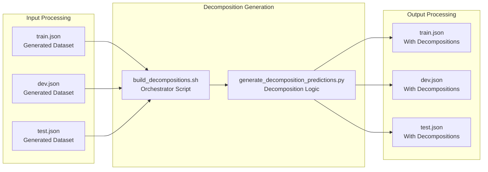

Sources: [scripts/build_decompositions.sh:1-21](), [scripts/build_commaqav1.sh:20-32]()

## Configuration System

The dataset generation system is driven by JSONNet configuration files that define entities, predicates, theories, and predicate language configurations. These configurations are processed by the `DatasetBuildConfig` class.

### Configuration File Structure

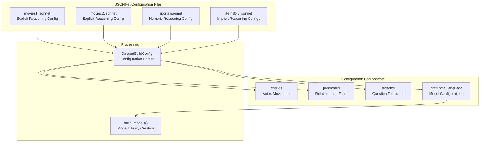

Sources: [scripts/build_commaqav1.sh:4-17](), [commaqa/dataset/build_dataset.py:149-162]()

## Language Extraction Process

The system extracts language patterns and operation templates from generated datasets using `jq` and `sed` processing to create reusable components for model training.

### Language Processing Pipeline

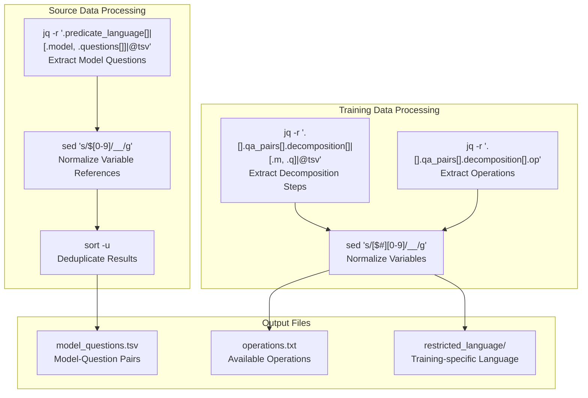

Sources: [scripts/build_commaqav1.sh:34-56]()

## Docker Environment

The dataset generation system includes Docker support for consistent, reproducible builds across different environments.

### Docker Configuration

| Component | Configuration | Purpose |
|-----------|---------------|---------|
| **Base Image** | `python:3.8` | Python runtime environment |
| **Environment** | `LC_ALL=C.UTF-8`, `LANG=C.UTF-8` | Unicode support |
| **NVIDIA Support** | `NVIDIA_VISIBLE_DEVICES all` | GPU access for model execution |
| **Dependencies** | `requirements.txt` | Python package installation |
| **NLTK Data** | `stopwords`, `punkt` | Natural language processing |
| **Working Directory** | `/stage/` | Container workspace |

Sources: [Dockerfile:1-28](), [scripts/build_docker_image.sh:1-16]()

### Container Build Process

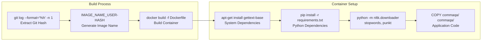

Sources: [scripts/build_docker_image.sh:1-16](), [Dockerfile:1-28]()

## Output Dataset Structure

The dataset generation system produces structured JSON files with specific schemas for different reasoning types.

### Dataset Output Schema

Each generated dataset follows a consistent structure:

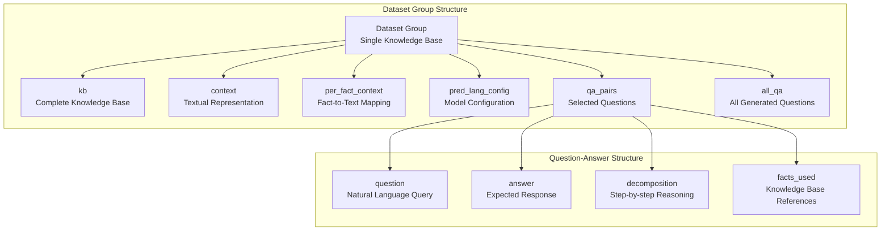

Sources: [commaqa/dataset/build_dataset.py:75-120]()

### Dataset Variants

| Dataset Type | Configuration | Purpose | Output Location |
|--------------|---------------|---------|-----------------|
| **CommaQA-E** | `explicit/movies1.jsonnet`, `movies2.jsonnet` | Explicit reasoning over movie entities | `output/commaqav1/explicit/commaqa/` |
| **CommaQA-I** | `implicit/items0-5.jsonnet` | Implicit reasoning over item entities | `output/commaqav1/implicit/commaqa/` |
| **CommaQA-N** | `numeric/sports.jsonnet` | Numeric reasoning over sports entities | `output/commaqav1/numeric/commaqa/` |
| **Compositional** | `*_compgen.jsonnet` | Generalization testing | `output/commaqav1/compgen/` |

Sources: [scripts/build_commaqav1.sh:4-67]()

---

# Page: Dataset Building Pipeline

# Dataset Building Pipeline

<details>
<summary>Relevant source files</summary>

The following files were used as context for generating this wiki page:

- [commaqa/dataset/build_dataset.py](commaqa/dataset/build_dataset.py)
- [scripts/build_commaqav1.sh](scripts/build_commaqav1.sh)
- [scripts/build_datasets.sh](scripts/build_datasets.sh)
- [scripts/build_decompositions.sh](scripts/build_decompositions.sh)

</details>


This document covers the dataset building pipeline system that generates CommaQA datasets from configuration files. The pipeline transforms JSONNet configuration files containing entities, predicates, and theories into structured question-answering datasets with multiple splits and formats.

For information about the configuration format itself, see [Configuration Format](#3.2). For details about decomposition generation specifically, see [Decomposition Generation](#3.3).

## Pipeline Overview

The dataset building pipeline is orchestrated through a series of shell scripts that coordinate the generation of three main dataset variants: CommaQA-E (explicit), CommaQA-I (implicit), and CommaQA-N (numeric). The pipeline also generates decomposition data and language extraction files.

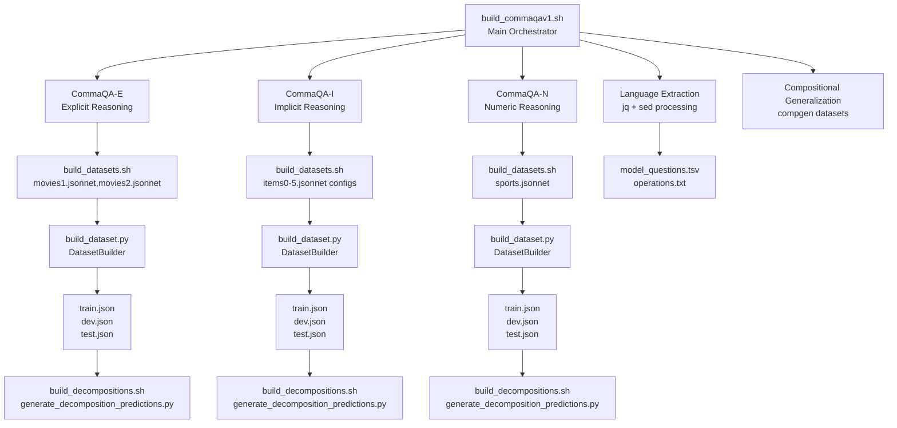

**Sources:** [scripts/build_commaqav1.sh:1-67](), [scripts/build_datasets.sh:1-21](), [scripts/build_decompositions.sh:1-21]()

## Main Pipeline Scripts

### build_commaqav1.sh

The primary orchestration script that coordinates the entire dataset building process. It sequentially builds three dataset variants:

| Dataset Variant | Configuration Files | Output Directory |
|-----------------|-------------------|------------------|
| CommaQA-E | `movies1.jsonnet`, `movies2.jsonnet` | `output/commaqav1/explicit/` |
| CommaQA-I | `items0.jsonnet` through `items5.jsonnet` | `output/commaqav1/implicit/` |
| CommaQA-N | `sports.jsonnet` | `output/commaqav1/numeric/` |

The script performs four main phases:

1. **Dataset Generation**: Calls `build_datasets.sh` for each variant [scripts/build_commaqav1.sh:4-17]()
2. **Decomposition Building**: Calls `build_decompositions.sh` for each variant [scripts/build_commaqav1.sh:20-31]()
3. **Language Extraction**: Processes JSONNet configs to extract model questions and operations [scripts/build_commaqav1.sh:34-56]()
4. **Compositional Generalization**: Builds additional test datasets with reduced entity coverage [scripts/build_commaqav1.sh:58-67]()

### build_datasets.sh

A wrapper script that standardizes dataset building parameters and calls `build_dataset.py`. It uses environment variables with defaults:

- `ent_per`: Entity percentage (default: 0.2)
- `groups`: Number of groups (default: 2000) 
- `egs`: Examples per group (default: 5)

### build_decompositions.sh

Processes existing dataset files to generate decomposition data by calling `generate_decomposition_predictions.py` for each data split (train, dev, test).

**Sources:** [scripts/build_commaqav1.sh:1-67](), [scripts/build_datasets.sh:1-21](), [scripts/build_decompositions.sh:1-21]()

## Dataset Building Process

The core dataset building logic is implemented in the `DatasetBuilder` class, which transforms configuration files into structured question-answering datasets.

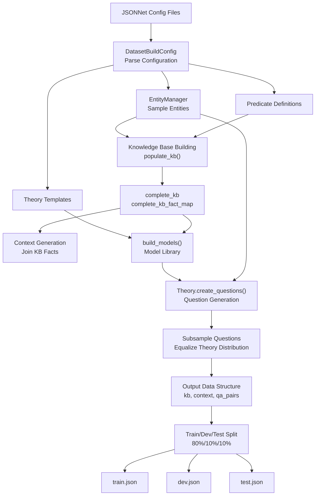

**Sources:** [commaqa/dataset/build_dataset.py:37-130]()

### DatasetBuilder Class

The `DatasetBuilder` class orchestrates the dataset generation process through its `build_dataset` method:

1. **Configuration Sampling**: Uses weighted sampling across input configs to ensure balanced representation [commaqa/dataset/build_dataset.py:53-58]()

2. **Entity Sampling**: For each selected config, samples entities using `entities.subsample()` [commaqa/dataset/build_dataset.py:61]()

3. **Knowledge Base Construction**: Builds complete KB by calling `pred.populate_kb()` for each predicate [commaqa/dataset/build_dataset.py:64-70]()

4. **Context Generation**: Creates both complete context and per-fact context mappings [commaqa/dataset/build_dataset.py:73-80]()

5. **Question Generation**: Uses theories to generate questions via `theory.create_questions()` [commaqa/dataset/build_dataset.py:84-92]()

6. **Quality Control**: Ensures minimum question thresholds and balanced theory representation [commaqa/dataset/build_dataset.py:95-116]()

7. **Output Formatting**: Structures data with KB, context, and QA pairs [commaqa/dataset/build_dataset.py:75-120]()

**Sources:** [commaqa/dataset/build_dataset.py:37-130]()

## Output Structure

The dataset building pipeline generates several types of output files:

### Primary Dataset Files

| File | Content | Format |
|------|---------|--------|
| `train.json` | Training examples (80%) | JSON array of dataset groups |
| `dev.json` | Development examples (10%) | JSON array of dataset groups |
| `test.json` | Test examples (10%) | JSON array of dataset groups |
| `source*.json` | Original JSONNet configs | Compiled JSON configurations |

### Language Extraction Files

The pipeline extracts language patterns using `jq` and `sed` processing:

- **Full Language**: Extracted from `predicate_language` configs [scripts/build_commaqav1.sh:39-42]()
- **Restricted Language**: Extracted from training decompositions [scripts/build_commaqav1.sh:48-56]()

| File | Content | Purpose |
|------|---------|---------|
| `model_questions.tsv` | Model-question pairs | Agent question templates |
| `operations.txt` | Available operations | Operation vocabulary |

### Compositional Generalization Datasets

Special test datasets with reduced entity coverage (20%) for evaluating compositional generalization:

- `output/commaqav1/compgen/numeric_test.json`
- `output/commaqav1/compgen/explicit_test.json`

**Sources:** [scripts/build_commaqav1.sh:34-67](), [commaqa/dataset/build_dataset.py:170-185]()

## Data Group Structure

Each dataset group in the output JSON files contains:

```json
{
  "kb": "Complete knowledge base with all predicates",
  "context": "Space-separated context from all KB facts", 
  "per_fact_context": "Mapping from facts to natural language",
  "pred_lang_config": "Predicate language configuration",
  "all_qa": "All generated questions before subsampling",
  "qa_pairs": "Final subsampled question-answer pairs"
}
```

The `qa_pairs` field contains the actual training examples, while `all_qa` provides the complete generated set for analysis.

**Sources:** [commaqa/dataset/build_dataset.py:75-120]()

---

# Page: Configuration Format

# Configuration Format

<details>
<summary>Relevant source files</summary>

The following files were used as context for generating this wiki page:

- [commaqa/configs/README.md](commaqa/configs/README.md)
- [configs/commaqav1/implicit/theories.libsonnet](configs/commaqav1/implicit/theories.libsonnet)
- [configs/commaqav1/numeric/sports_compgen.jsonnet](configs/commaqav1/numeric/sports_compgen.jsonnet)
- [configs/commaqav1/numeric/theories.libsonnet](configs/commaqav1/numeric/theories.libsonnet)
- [configs/commaqav1/numeric/theories_compgen.libsonnet](configs/commaqav1/numeric/theories_compgen.libsonnet)

</details>


This document describes the JSONNet configuration format used to define CommaQA datasets. The configuration system allows users to specify entities, predicates, predicate languages, and theories that control how datasets are generated and structured. For information about the dataset building pipeline that processes these configurations, see [Dataset Building Pipeline](#3.1).

## Overview

The CommaQA configuration format uses JSONNet files to declaratively define all aspects of a dataset, including the knowledge base structure, agent capabilities, and question generation templates. Each configuration produces a complete dataset with structured question-answer pairs and their corresponding execution traces.

## Configuration Structure

Every CommaQA configuration file follows a standardized top-level structure defined in [commaqa/configs/README.md:10-17]():

```jsonnet
{
  version: 3.0,
  entities: Entities,
  predicates: Predicates,
  predicate_language: Predicate_Language,
  theories: Theories,
}
```

### Configuration Components Diagram

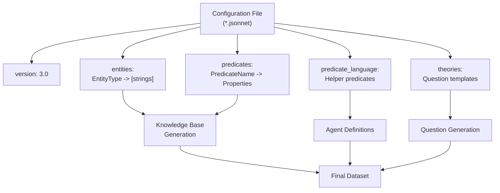

Sources: [commaqa/configs/README.md:8-18](), [configs/commaqav1/numeric/sports_compgen.jsonnet:10-16]()

## Entities

The `entities` section defines the types and instances of entities available in the knowledge base. Each entity type maps to a list of concrete entities that will be used during dataset generation.

Example from [commaqa/configs/README.md:27-44]():

```jsonnet
entities: {
    movie: [
        "Godfather",
        "Kill Bill",
    ],
    actor: [
        "Marlon Brando", 
        "Uma Thurman",
    ],
    year: [
        "1990",
        "1995", 
    ]
}
```

Entity types serve as argument types for predicates and are referenced throughout the configuration using symbolic names like `"person"`, `"nation"`, or `"movie"`.

Sources: [commaqa/configs/README.md:24-44]()

## Predicates

Predicates define relations between entity types and specify how these relations are structured and verbalized. Each predicate contains several key properties:

### Predicate Structure

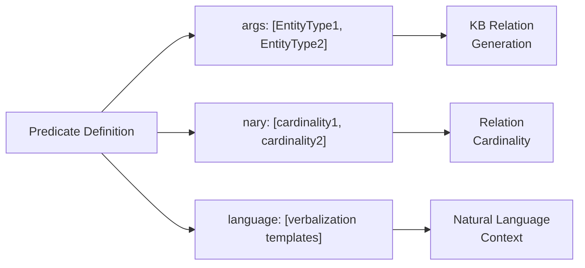

Example predicate definition from [commaqa/configs/README.md:52-58]():

```jsonnet
acted_in: {
    args: ["movie", "actor"],
    nary: ["n", "1"], 
    language: ["movie: $1 ; actor: $2", "$2 acted in $1."],
}
```

### Cardinality Specifications

The `nary` field controls relationship cardinality:
- `["n", "1"]`: Many-to-one (each movie can have multiple actors, each actor appears once)
- `["n", "n"]`: Many-to-many (flexible relationships)
- `["1", "n"]`: One-to-many

Alternative structures like `type: "tree"` or `type: "chain"` can be specified instead of `nary` for hierarchical or sequential relationships.

Sources: [commaqa/configs/README.md:47-87]()

## Predicate Language

The `predicate_language` section defines the interface between natural language questions and the underlying knowledge base operations. Each entry specifies how agents answer specific types of questions.

### Predicate Language Structure

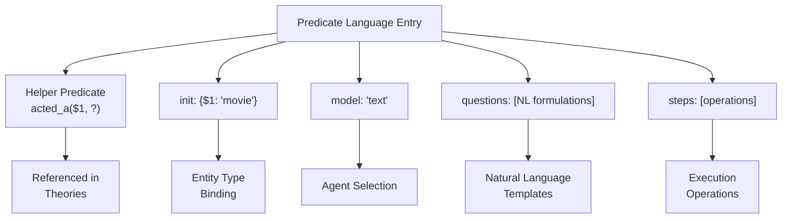

Example from [commaqa/configs/README.md:96-113]():

```jsonnet
"acted_a($1, ?)": {
  "init": {
    "$1": "movie"
  },
  "model": "text",
  "questions": [
    "Who all acted in the movie $1?",
    "Who are the actors in the movie $1?"
  ],
  "steps": [
    {
      "answer": "#1",
      "operation": "select", 
      "question": "text_actor($1, ?)"
    }
  ]
}
```

### Step Operations

The `steps` array defines the execution sequence:
- `operation`: Type of operation (`select`, `project`, `filter`, etc.)
- `question`: KB query or predicate call
- `answer`: Variable name for storing results (e.g., `#1`, `#2`)

Sources: [commaqa/configs/README.md:89-131]()

## Theories

Theories define complex multi-step question templates that combine multiple predicate language entries. They specify the high-level questions and their decomposition into executable steps.

### Theory Structure

```mermaid
graph TD
    THEORY["Theory Definition"] --> INIT_T["init: {$1: 'nation'}"]
    THEORY --> QUESTIONS_T["questions: [NL questions]"]  
    THEORY --> STEPS_T["steps: [execution sequence]"]
    
    INIT_T --> PARAM_TYPES["Parameter Entity<br/>Types"]
    QUESTIONS_T --> QUESTION_TEMPLATES["Question<br/>Templates"]
    STEPS_T --> MULTI_STEP["Multi-Step<br/>Execution"]
    
    MULTI_STEP --> STEP1["Step 1: Helper<br/>Predicate Call"]
    MULTI_STEP --> STEP2["Step 2: Operation<br/>on Results"]
    MULTI_STEP --> STEPN["Step N: Final<br/>Answer"]
```

Example from [configs/commaqav1/numeric/theories.libsonnet:2-36]():

```jsonnet
{
  init: {
    "$1": "nation",
  },
  questions: [
    "What was the gap between the longest and shortest javelin throws by athletes from $1?",
  ],
  steps: [
    {
      operation: "select",
      question: "nationj_p($1, ?)",
      answer: "#1",
    },
    {
      operation: "project_values_flat", 
      question: "jthrow_l(#1, ?)",
      answer: "#2",
    },
    {
      operation: "select",
      question: "max(#2)",
      answer: "#3", 
    },
    {
      operation: "select",
      question: "min(#2)",
      answer: "#4",
    },
    {
      operation: "select", 
      question: "diff(#3 | #4)",
      answer: "#5",
    },
  ],
}
```

### Variable Chaining

Theories enable complex reasoning through variable chaining:
- Initial variables (`$1`, `$2`): Input parameters from entity sampling
- Intermediate variables (`#1`, `#2`, etc.): Results from previous steps
- Final answer: Last step's result becomes the question answer

Sources: [configs/commaqav1/numeric/theories.libsonnet:1-36](), [commaqa/configs/README.md:133-163]()

## Configuration Assembly

The complete configuration file imports and combines multiple components using JSONNet's import system, as shown in [configs/commaqav1/numeric/sports_compgen.jsonnet:1-16]():

```jsonnet
local entities = import "entities.libsonnet";
local table_predicate = import "table_predicates.libsonnet"; 
local text_predicate = import "text_predicates.libsonnet";
local combined_predicates = table_predicate + text_predicate;
local predicate_languages = import "predicate_language.libsonnet";
local theories = import "theories_compgen.libsonnet";
```

### Configuration Flow Diagram

```mermaid
graph LR
    LIBSONNET["*.libsonnet<br/>Component Files"] --> IMPORT["JSONNet<br/>Import System"]
    IMPORT --> MAIN_CONFIG["Main Config<br/>*.jsonnet"]
    MAIN_CONFIG --> DATASET_BUILDER["build_dataset.py"]
    DATASET_BUILDER --> KB_GENERATION["Knowledge Base<br/>Generation"] 
    DATASET_BUILDER --> QA_GENERATION["Question-Answer<br/>Generation"]
    KB_GENERATION --> FINAL_DATASET["CommaQA Dataset<br/>JSON Files"]
    QA_GENERATION --> FINAL_DATASET
```

This modular approach allows for:
- Component reuse across different dataset variants
- Selective predicate filtering for specialized datasets
- Flexible predicate language composition

Sources: [configs/commaqav1/numeric/sports_compgen.jsonnet:1-16]()

---

# Page: Decomposition Generation

# Decomposition Generation

<details>
<summary>Relevant source files</summary>

The following files were used as context for generating this wiki page:

- [commaqa/dataset/generate_decomposition_predictions.py](commaqa/dataset/generate_decomposition_predictions.py)
- [commaqa/dataset/generate_decompositions_from_chains.py](commaqa/dataset/generate_decompositions_from_chains.py)
- [commaqa/execution/math_model.py](commaqa/execution/math_model.py)

</details>


## Purpose and Scope

Decomposition Generation is the process of converting complex multi-step questions into structured training sequences that teach models how to break down reasoning tasks into executable operations. This system generates training data by taking question-answer pairs and creating step-by-step decomposition chains that can be learned by sequence-to-sequence models.

For information about the overall dataset building pipeline, see [Dataset Building Pipeline](#3.1). For details about the execution system that processes these decompositions, see [Execution Engine](#5).

## Overview

The CommaQA system supports two primary methods for generating decompositions:

1. **Oracle-based Generation**: Using ground-truth decompositions provided in the dataset to create training sequences
2. **Chain-based Generation**: Extracting decompositions from inference chains that produced correct answers

Both methods produce training sequences in a standardized format that can be used to train models for multi-step question answering.

```mermaid
graph TD
    subgraph "Input Sources"
        DATASET["Dataset JSON<br/>with qa_pairs"] 
        CHAINS["Inference Chains TSV<br/>from predictions"]
    end
    
    subgraph "Generation Methods"
        ORACLE["generate_decomposition_predictions.py<br/>Oracle-based Generation"]
        CHAIN_GEN["generate_decompositions_from_chains.py<br/>Chain-based Generation"]
    end
    
    subgraph "Execution System"
        EXECUTOR["OperationExecuter<br/>Step Execution"]
        MODELS["Model Library<br/>MathModel, etc."]
    end
    
    subgraph "Output Formats"
        TRAIN_SEQS["Training Sequences<br/>QC/QI/QS format"]
        PRED_JSON["Predictions JSON<br/>Answer validation"]
        DECOMP_JSON["Decomposition JSON<br/>with train_seqs"]
    end
    
    DATASET --> ORACLE
    CHAINS --> CHAIN_GEN
    DATASET --> CHAIN_GEN
    
    ORACLE --> EXECUTOR
    EXECUTOR --> MODELS
    
    ORACLE --> TRAIN_SEQS
    ORACLE --> PRED_JSON
    ORACLE --> DECOMP_JSON
    
    CHAIN_GEN --> TRAIN_SEQS
    CHAIN_GEN --> DECOMP_JSON
```

Sources: [commaqa/dataset/generate_decomposition_predictions.py:1-92](), [commaqa/dataset/generate_decompositions_from_chains.py:1-120]()

## Oracle-based Decomposition Generation

The `generate_decomposition_predictions.py` script processes datasets with ground-truth decompositions to create training sequences. This method uses the provided step-by-step breakdowns to generate executable training data.

### Process Flow

```mermaid
graph TD
    INPUT_JSON["Input JSON Dataset<br/>with decomposition steps"]
    
    subgraph "Processing Loop"
        QB_PAIR["qa_pair extraction<br/>question + decomposition"]
        MODEL_CONFIG["ModelQuestionConfig<br/>predicate language setup"]
        MODEL_LIB["build_models()<br/>execution model library"]
        EXECUTOR["OperationExecuter<br/>step-by-step execution"]
    end
    
    subgraph "Step Execution"
        STEP_LOOP["For each decomposition step"]
        EXECUTE["execute_operation()<br/>op, model, question"]
        BUILD_CHAIN["build_chain()<br/>QC/QI/QS formatting"]
        UPDATE_ASSIGN["Update assignments<br/>#1, #2, etc."]
    end
    
    subgraph "Output Generation"
        TRAIN_SEQ["train_seqs list<br/>formatted sequences"]
        PRED_OUTPUT["predictions JSON<br/>final answers"]
        DECOMP_OUTPUT["decompositions JSON<br/>with train_seqs"]
    end
    
    INPUT_JSON --> QB_PAIR
    QB_PAIR --> MODEL_CONFIG
    MODEL_CONFIG --> MODEL_LIB
    MODEL_LIB --> EXECUTOR
    
    EXECUTOR --> STEP_LOOP
    STEP_LOOP --> EXECUTE
    EXECUTE --> BUILD_CHAIN
    BUILD_CHAIN --> UPDATE_ASSIGN
    UPDATE_ASSIGN --> STEP_LOOP
    
    STEP_LOOP --> TRAIN_SEQ
    TRAIN_SEQ --> PRED_OUTPUT
    TRAIN_SEQ --> DECOMP_OUTPUT
```

Sources: [commaqa/dataset/generate_decomposition_predictions.py:29-92]()

### Key Components

The oracle-based generation relies on several key functions and data structures:

| Component | Purpose | Location |
|-----------|---------|----------|
| `build_chain()` | Formats decomposition steps into training sequences | [commaqa/dataset/generate_decomposition_predictions.py:25-26]() |
| `OperationExecuter` | Executes individual decomposition steps | [commaqa/dataset/generate_decomposition_predictions.py:43]() |
| `ModelQuestionConfig` | Configures predicate language models | [commaqa/dataset/generate_decomposition_predictions.py:40]() |
| `curr_assignment` | Tracks intermediate results across steps | [commaqa/dataset/generate_decomposition_predictions.py:47]() |

The process iterates through each decomposition step, executing operations and building formatted training sequences that capture the question-decomposition-answer flow.

Sources: [commaqa/dataset/generate_decomposition_predictions.py:25-68]()

## Chain-based Decomposition Generation

The `generate_decompositions_from_chains.py` script extracts valid decompositions from inference chains that produced correct answers. This method filters chains based on answer correctness and converts them into training sequences.

### Validation and Filtering Process

```mermaid
graph TD
    subgraph "Input Processing"
        CHAINS_TSV["Chains TSV File<br/>qid, sequence, answer"]
        INPUT_JSON["Dataset JSON<br/>with gold answers"]
        LOAD_CHAINS["Load predictions_per_qid<br/>group by question ID"]
    end
    
    subgraph "Validation Loop"
        QA_PAIR["For each qa_pair"]
        CHECK_CHAINS["Check if qid has chains"]
        VALIDATE["is_valid_answer()<br/>compare predicted vs gold"]
        FILTER_CORRECT["Keep only correct chains"]
    end
    
    subgraph "Sequence Building"
        BUILD_SEQS["build_train_seqs()<br/>format question sequences"]
        PARSE_MARKERS["Parse QC/QI/QS markers<br/>INTERQ_MARKER, ANSWER_MARKER"]
        CREATE_DECOMP["Create decomposition<br/>with train_seqs"]
    end
    
    subgraph "Statistics Tracking"
        STATS["Track statistics:<br/>num_chains_correct_answer<br/>num_questions_correct_chains"]
    end
    
    CHAINS_TSV --> LOAD_CHAINS
    INPUT_JSON --> QA_PAIR
    LOAD_CHAINS --> CHECK_CHAINS
    
    QA_PAIR --> CHECK_CHAINS
    CHECK_CHAINS --> VALIDATE
    VALIDATE --> FILTER_CORRECT
    
    FILTER_CORRECT --> BUILD_SEQS
    BUILD_SEQS --> PARSE_MARKERS
    PARSE_MARKERS --> CREATE_DECOMP
    
    VALIDATE --> STATS
```

Sources: [commaqa/dataset/generate_decompositions_from_chains.py:51-107]()

### Answer Validation

The system uses a sophisticated answer validation mechanism to ensure only correct chains are used for training:

```mermaid
graph LR
    subgraph "Answer Comparison"
        PRED_ANS["predicted_answer<br/>from chain execution"]
        GOLD_ANS["gold_answer<br/>from dataset"]
        
        LIST_CHECK{"Is list type?"}
        LIST_JOIN["LIST_JOINER.join()<br/>sorted lists"]
        STR_CONVERT["Convert to string<br/>normalize format"]
        
        COMPARE["String comparison<br/>exact match required"]
    end
    
    PRED_ANS --> LIST_CHECK
    GOLD_ANS --> LIST_CHECK
    
    LIST_CHECK -->|Yes| LIST_JOIN
    LIST_CHECK -->|No| STR_CONVERT
    
    LIST_JOIN --> COMPARE
    STR_CONVERT --> COMPARE
```

Sources: [commaqa/dataset/generate_decompositions_from_chains.py:24-36]()

## Training Sequence Format

Both generation methods produce training sequences in a standardized format that uses specific markers to denote different types of content:

### Sequence Markers

| Marker | Purpose | Usage |
|--------|---------|-------|
| `QC:` | Question Context | Initial question statement |
| `QI:` | Question Intermediate | Intermediate steps with answers |
| `QS:` | Question Step | Operation to be performed |
| `A:` | Answer | Result of operation execution |
| `[EOQ]` | End of Question | Terminal marker |

### Format Structure

```mermaid
graph TD
    subgraph "Training Sequence Construction"
        QC_START["QC: Original question"]
        
        STEP_LOOP["For each decomposition step"]
        QS_FORMAT["QS: (operation) [model] question"]
        EXECUTE["Execute and get answer"]
        QI_FORMAT["QI: (operation) [model] question A: answer"]
        
        EOQ_END["QS: [EOQ]"]
    end
    
    QC_START --> STEP_LOOP
    STEP_LOOP --> QS_FORMAT
    QS_FORMAT --> EXECUTE
    EXECUTE --> QI_FORMAT
    QI_FORMAT --> STEP_LOOP
    STEP_LOOP --> EOQ_END
```

Sources: [commaqa/dataset/generate_decomposition_predictions.py:50-68](), [commaqa/inference/utils.py:7-8]()

### Example Sequence Building

The `build_chain()` function creates formatted sequences by combining previous context with new operations:

```python
# From generate_decomposition_predictions.py:25-26
def build_chain(prev_chain, operation, model, question):
    return prev_chain + " QS: ({}) [{}] {}".format(operation, model, question)
```

This produces sequences like:
- `QC: What is the maximum age? QS: (select) [MathModel] What are all ages?`
- `QI: (select) [MathModel] What are all ages? A: [25, 30, 35] QS: (max) [MathModel] max([25, 30, 35])`

Sources: [commaqa/dataset/generate_decomposition_predictions.py:25-26](), [commaqa/dataset/generate_decomposition_predictions.py:50-68]()

## Integration with Execution System

The decomposition generation process relies heavily on the execution system to validate and process operations. The integration points include:

### Model Library Integration

```mermaid
graph TD
    subgraph "Configuration Layer"
        PRED_LANG["pred_lang_config<br/>model configurations"]
        MODEL_CONFIGS["ModelQuestionConfig objects<br/>per model type"]
    end
    
    subgraph "Model Library"
        BUILD_MODELS["build_models()<br/>create model instances"]
        MATH_MODEL["MathModel<br/>mathematical operations"]
        TEXT_MODEL["TextQA Model<br/>text-based operations"]
        KB_MODEL["KB Model<br/>knowledge base queries"]
    end
    
    subgraph "Execution"
        OP_EXECUTER["OperationExecuter<br/>coordinates execution"]
        EXECUTE_OP["execute_operation()<br/>op, model, question, assignments"]
    end
    
    PRED_LANG --> MODEL_CONFIGS
    MODEL_CONFIGS --> BUILD_MODELS
    
    BUILD_MODELS --> MATH_MODEL
    BUILD_MODELS --> TEXT_MODEL
    BUILD_MODELS --> KB_MODEL
    
    MATH_MODEL --> OP_EXECUTER
    TEXT_MODEL --> OP_EXECUTER
    KB_MODEL --> OP_EXECUTER
    
    OP_EXECUTER --> EXECUTE_OP
```

Sources: [commaqa/dataset/generate_decomposition_predictions.py:38-43](), [commaqa/execution/utils.py:build_models]()

### Operation Types and Models

The system supports various operation types that are executed by different models:

| Operation | Model Type | Example Function | Purpose |
|-----------|------------|------------------|---------|
| `select` | Various | Data retrieval | Extract entities or values |
| `project` | Text/KB | Value extraction | Get specific attributes |
| `filter` | Various | Data filtering | Apply conditions |
| `max` | MathModel | `max()` | Find maximum value |
| `min` | MathModel | `min()` | Find minimum value |
| `count` | MathModel | `count()` | Count elements |
| `diff` | MathModel | `diff()` | Calculate difference |

Sources: [commaqa/execution/math_model.py:14-23](), [commaqa/dataset/generate_decomposition_predictions.py:57-60]()

The decomposition generation system ensures that all generated training sequences can be properly executed by the underlying execution engine, maintaining consistency between training data and inference capabilities.

Sources: [commaqa/execution/math_model.py:1-210](), [commaqa/dataset/generate_decomposition_predictions.py:1-92](), [commaqa/dataset/generate_decompositions_from_chains.py:1-120]()

---

# Page: Docker Environment

# Docker Environment

<details>
<summary>Relevant source files</summary>

The following files were used as context for generating this wiki page:

- [.dockerignore](.dockerignore)
- [Dockerfile](Dockerfile)
- [commaqa/dataset/build_submodel_datasets.py](commaqa/dataset/build_submodel_datasets.py)
- [scripts/build_docker_image.sh](scripts/build_docker_image.sh)

</details>


## Purpose and Scope

This document covers the Docker containerization setup for the CommaQA dataset generation system. The Docker environment provides a standardized, reproducible execution context for running dataset building scripts and operations. For information about the dataset building pipeline that runs within this environment, see [Dataset Building Pipeline](#3.1). For details about configuration formats used in dataset generation, see [Configuration Format](#3.2).

## Docker Image Architecture

The CommaQA Docker environment is built on Python 3.8 with NVIDIA GPU support and includes all necessary dependencies for dataset generation and model execution.

### Container Structure

```mermaid
graph TD
    subgraph "Base Environment"
        PYTHON["python:3.8<br/>Base Image"] --> ENV_VARS["Environment Variables<br/>LC_ALL, LANG, LD_LIBRARY_PATH"]
        ENV_VARS --> NVIDIA["NVIDIA GPU Support<br/>NVIDIA_VISIBLE_DEVICES<br/>NVIDIA_DRIVER_CAPABILITIES"]
    end
    
    subgraph "System Dependencies"
        NVIDIA --> APT["System Packages<br/>gettext-base"]
        APT --> WORKDIR["Working Directory<br/>/stage/"]
    end
    
    subgraph "Python Dependencies"
        WORKDIR --> REQ["requirements.txt<br/>Python Package Installation"]
        REQ --> NLTK_STOP["NLTK Stopwords<br/>Download"]
        NLTK_STOP --> NLTK_PUNKT["NLTK Punkt<br/>Tokenizer Download"]
    end
    
    subgraph "Application Code"
        NLTK_PUNKT --> COMMAQA_CODE["commaqa/<br/>Application Package"]
        COMMAQA_CODE --> BASH_CMD["Default Command<br/>/bin/bash"]
    end
```

Sources: [Dockerfile:1-28]()

### Image Build Process

The Docker image construction follows a standardized build workflow with versioning based on Git commits.

```mermaid
graph LR
    subgraph "Build Script Execution"
        BUILD_SCRIPT["build_docker_image.sh"] --> GIT_HASH["Git Hash Extraction<br/>git log --format='%h' -n 1"]
        GIT_HASH --> IMAGE_NAME["Image Naming<br/>commaqa_$USER-$GIT_HASH"]
    end
    
    subgraph "Docker Build Process"
        IMAGE_NAME --> DOCKER_BUILD["docker build<br/>-f Dockerfile -t $IMAGE"]
        DOCKER_BUILD --> BEAKER_READY["Beaker Integration Ready<br/>beaker image create"]
    end
    
    subgraph "Build Context"
        DOCKERIGNORE[".dockerignore<br/>Excludes output/"] --> DOCKER_BUILD
        DOCKERFILE["Dockerfile<br/>Build Instructions"] --> DOCKER_BUILD
    end
```

Sources: [scripts/build_docker_image.sh:1-16](), [.dockerignore:1]()

## Environment Configuration

### NVIDIA GPU Support

The Docker environment includes comprehensive NVIDIA GPU support for machine learning workloads:

| Environment Variable | Value | Purpose |
|---------------------|-------|---------|
| `NVIDIA_VISIBLE_DEVICES` | `all` | Makes all GPUs available to container |
| `NVIDIA_DRIVER_CAPABILITIES` | `compute,utility` | Enables compute and utility functions |
| `LD_LIBRARY_PATH` | `/usr/local/nvidia/lib:/usr/local/nvidia/lib64` | NVIDIA library path configuration |

Sources: [Dockerfile:6-14]()

### Language and Locale Settings

The container uses UTF-8 encoding for consistent text processing:

```bash
LC_ALL=C.UTF-8
LANG=C.UTF-8
```

Sources: [Dockerfile:3-4]()

### Python Dependencies and NLTK Setup

The environment includes automatic setup of NLTK components required for text processing:

```bash
python -m nltk.downloader stopwords
python -m nltk.downloader punkt
```

Sources: [Dockerfile:24-25]()

## Integration with Dataset Generation

### Usage in Dataset Building Pipeline

The Docker environment serves as the execution context for dataset generation scripts, particularly `build_submodel_datasets.py` and related components.

```mermaid
graph TD
    subgraph "Docker Container Environment"
        CONTAINER["Docker Container<br/>commaqa_$USER-$GIT_HASH"] --> PYTHON_ENV["Python 3.8 Environment<br/>with GPU Support"]
        PYTHON_ENV --> COMMAQA_PKG["commaqa/ Package<br/>Mounted at /stage/"]
    end
    
    subgraph "Dataset Generation Execution"
        COMMAQA_PKG --> BUILD_SCRIPT["build_submodel_datasets.py<br/>Dataset Builder"]
        BUILD_SCRIPT --> JSONNET_EVAL["JSONNet Configuration<br/>_jsonnet.evaluate_file()"]
        BUILD_SCRIPT --> ENTITY_SAMPLING["Entity Sampling<br/>SubDatasetBuilder.build_entities()"]
    end
    
    subgraph "Model Execution"
        ENTITY_SAMPLING --> MODEL_LIB["Model Library<br/>build_models()"]
        MODEL_LIB --> KB_POPULATION["Knowledge Base Population<br/>pred.populate_kb()"]
        KB_POPULATION --> QA_GENERATION["Q&A Generation<br/>model_library[model].ask_question()"]
    end
    
    subgraph "Output Generation"
        QA_GENERATION --> TRAIN_SPLIT["Train/Dev/Test Split<br/>ceil(num_examples * 0.8)"]
        TRAIN_SPLIT --> JSON_OUTPUT["JSON Dataset Files<br/>/train.json, /dev.json, /test.json"]
    end
```

Sources: [commaqa/dataset/build_submodel_datasets.py:1-184]()

### Build Context Management

The `.dockerignore` file ensures that output directories are excluded from the Docker build context, preventing large generated datasets from being copied into the image during builds.

```
output/
```

Sources: [.dockerignore:1]()

## Build and Deployment Workflow

### Local Development Usage

1. **Build the Image**: Execute the build script to create a versioned Docker image
   ```bash
   ./scripts/build_docker_image.sh
   ```

2. **Image Naming Convention**: Images are tagged with format `commaqa_$USER-$GIT_HASH` for reproducibility

3. **Beaker Integration**: The build script provides commands for integrating with Beaker for distributed execution

Sources: [scripts/build_docker_image.sh:9-15]()

### Container Execution Context

The Docker environment provides a complete execution context for:

- **JSONNet Configuration Processing**: Via `_jsonnet.evaluate_file()` calls in dataset builders
- **Entity and Predicate Management**: Through `DatasetBuildConfig` initialization
- **Model Library Execution**: Including `MathModel`, `TextQA`, and knowledge base operations
- **Multi-format Output Generation**: JSON datasets with train/dev/test splits

Sources: [commaqa/dataset/build_submodel_datasets.py:153-183]()

The containerized environment ensures consistent execution across different development and deployment environments while providing the necessary GPU acceleration and text processing capabilities required for the CommaQA dataset generation pipeline.

---

# Page: Inference System

# Inference System

<details>
<summary>Relevant source files</summary>

The following files were used as context for generating this wiki page:

- [commaqa/inference/configurable_inference.py](commaqa/inference/configurable_inference.py)
- [commaqa/inference/constants.py](commaqa/inference/constants.py)
- [commaqa/inference/dataset_readers.py](commaqa/inference/dataset_readers.py)
- [commaqa/inference/model_search.py](commaqa/inference/model_search.py)

</details>


## Purpose and Scope

The Inference System is the core question-answering engine that processes natural language questions and generates answers through coordinated model orchestration. This system handles question decomposition, model coordination, and search-based reasoning to produce structured answer chains. 

For information about the underlying execution operations, see [Execution Engine](#5). For details about dataset generation and configuration, see [Dataset Generation System](#3).

## System Architecture

The inference system operates as a configurable orchestration framework that coordinates multiple specialized participant models through a search-based approach. The system takes natural language questions as input and produces both final answers and detailed reasoning chains showing the decomposition process.

### High-Level Inference Flow

```mermaid
graph TD
    INPUT["Input Questions"] --> READER["DatasetReader"]
    READER --> DECOMPOSER["BestFirstDecomposer"]
    
    CONFIG["JSONNet Config"] --> CONTROLLER["ModelController"]
    CONTROLLER --> DECOMPOSER
    
    DECOMPOSER --> SEARCH["Best-First Search"]
    SEARCH --> PARTICIPANTS["Participant Models"]
    
    PARTICIPANTS --> QGEN["Question Generation"]
    PARTICIPANTS --> EXEC["Execution"]
    PARTICIPANTS --> UTIL["Utilities"]
    
    QGEN --> RESULTS["Search Results"]
    EXEC --> RESULTS
    UTIL --> RESULTS
    
    RESULTS --> OUTPUT["Final Predictions"]
    RESULTS --> CHAINS["Reasoning Chains"]
```

Sources: [commaqa/inference/configurable_inference.py:1-137](), [commaqa/inference/model_search.py:266-320]()

## Core Components

### ModelController

The `ModelController` serves as the central coordinator for all participant models, implementing a state machine that manages the flow between different processing stages.

```mermaid
graph TD
    CONTROLLER["ModelController"] --> START["start_state"]
    CONTROLLER --> END["end_state"]
    CONTROLLER --> MODELS["model_list"]
    
    START --> STATE1["SearchState"]
    STATE1 --> EXECUTE["execute()"]
    EXECUTE --> PARTICIPANT["ParticipantModel.query()"]
    PARTICIPANT --> NEWSTATES["New SearchStates"]
    NEWSTATES --> END
    
    MODELS --> LMGEN["LMGenParticipant"]
    MODELS --> RANDGEN["RandomGenParticipant"] 
    MODELS --> EXECPART["ExecutionParticipant"]
    MODELS --> DUMPCHAIN["DumpChainsParticipant"]
```

The controller manages state transitions through the `execute()` method, which calls the appropriate participant model based on the current state's `next` attribute.

Sources: [commaqa/inference/model_search.py:55-130]()

### BestFirstDecomposer

The `BestFirstDecomposer` implements the core search strategy using a best-first search algorithm with a min-heap to explore question decompositions.

| Component | Purpose | Implementation |
|-----------|---------|----------------|
| `find_answer_decomp()` | Main search loop | Uses `heapq` for priority queue |
| `SearchState` | Tracks search progress | Contains data, score, next command |
| Heap Management | Prioritizes promising paths | Min-heap based on state scores |

The search process continues until reaching the `end_state` or exhausting all possibilities:

```mermaid
graph TD
    START["Initial SearchState"] --> HEAP["Min-Heap"]
    HEAP --> POP["Pop Minimum State"]
    POP --> CHECK{"next == end_state?"}
    CHECK -->|Yes| RETURN["Return Final State"]
    CHECK -->|No| EXECUTE["controller.execute()"]
    EXECUTE --> NEWSTATES["Generate New States"]
    NEWSTATES --> PUSH["Push to Heap"]
    PUSH --> HEAP
    HEAP -->|Empty| FAIL["Return None"]
```

Sources: [commaqa/inference/model_search.py:266-320]()

### SearchState

The `SearchState` class tracks the progression of question decomposition, maintaining data, scoring, and control flow information.

```python
# Key attributes managed by SearchState
{
    "_data": "JSON data with question/answer sequences",
    "_score": "Numerical score for search prioritization", 
    "_next": "Next command/participant to execute",
    "_last_output": "Output from previous step"
}
```

The state implements comparison operators for heap operations and provides deep copying functionality for search branching.

Sources: [commaqa/inference/model_search.py:134-213]()

## Participant Model Framework

### ParticipantModel Base Class

All participant models inherit from `ParticipantModel` and implement two key methods:

| Method | Purpose | Return Type |
|--------|---------|-------------|
| `query(state, debug)` | Main processing logic | `list` of new states |
| `return_model_calls()` | Usage metrics | `dict` of model call counts |

Sources: [commaqa/inference/model_search.py:31-53]()

### Participant Types

The system supports multiple participant types through the `MODEL_NAME_CLASS` mapping:

```mermaid
graph TD
    PARTICIPANTS["Participant Models"] --> LMGEN["lmgen: LMGenParticipant"]
    PARTICIPANTS --> RANDGEN["randgen: RandomGenParticipant"]
    PARTICIPANTS --> DUMP["dump_chains: DumpChainsParticipant"]
    PARTICIPANTS --> EXEC["operation_executer: ExecutionParticipant"]
    
    LMGEN --> QGEN1["Question Generation via LM"]
    RANDGEN --> QGEN2["Random Question Generation"]
    DUMP --> UTIL1["Chain Logging"]
    EXEC --> EXEC1["Operation Execution"]
```

For detailed information about specific participant implementations, see [Participant Models](#4.2).

Sources: [commaqa/inference/constants.py:8-13]()

## Dataset Readers and Input Processing

### Reader Architecture

The system supports multiple input formats through the `DatasetReader` hierarchy:

```mermaid
graph TD
    READERS["DatasetReader Interface"] --> HOTPOT["HotpotQAReader"]
    READERS --> DROP["DropReader"]
    
    HOTPOT --> HOTPOT_FORMAT["HotPotQA Format"]
    DROP --> DROP_FORMAT["DROP Format"]
    
    HOTPOT_FORMAT --> EXAMPLE1["Standard Example Format"]
    DROP_FORMAT --> EXAMPLE2["Standard Example Format"]
    
    EXAMPLE1 --> FIELDS["qid, query, question, answer"]
    EXAMPLE2 --> FIELDS
```

### Input Format Standardization

Both readers convert their respective formats into a standardized example structure:

| Field | Purpose | Source |
|-------|---------|--------|
| `qid` | Question identifier | Dataset-specific ID |
| `query` | Question text | Main question content |
| `question` | Question text (duplicate) | Compatibility field |
| `answer` | Ground truth answer | Dataset answer format |

Sources: [commaqa/inference/dataset_readers.py:1-60]()

### Answer Format Handling

The `DropReader` includes specialized answer format processing for the DROP dataset's complex answer structure:

```python
# DROP answer format handling
{
    "number": "Numerical answers",
    "spans": "Text span answers", 
    "date": "Date-based answers with day/month/year"
}
```

Sources: [commaqa/inference/dataset_readers.py:28-39]()

## Configuration and Execution Flow

### Main Execution Pipeline

The `configurable_inference.py` script orchestrates the entire inference process:

```mermaid
graph TD
    ARGS["Command Line Args"] --> CONFIG_LOAD["Load JSONNet Config"]
    CONFIG_LOAD --> MODEL_LOAD["load_decomposer()"]
    MODEL_LOAD --> DECOMPOSER["BestFirstDecomposer"]
    MODEL_LOAD --> MODELS["Participant Models"]
    
    ARGS --> READER_LOAD["Load DatasetReader"]
    READER_LOAD --> EXAMPLES["Input Examples"]
    
    EXAMPLES --> PROCESS{"Processing Mode"}
    PROCESS -->|Demo| INTERACTIVE["Interactive Demo"]
    PROCESS -->|Batch| PARALLEL["Parallel Processing"]
    PROCESS -->|Single| SEQUENTIAL["Sequential Processing"]
    
    INTERACTIVE --> RESULTS["Live Results"]
    PARALLEL --> BATCH_RESULTS["Batch Results"]
    SEQUENTIAL --> BATCH_RESULTS
    
    BATCH_RESULTS --> PREDICTIONS["predictions.json"]
    BATCH_RESULTS --> CHAINS["*_chains.tsv"]
    BATCH_RESULTS --> METRICS["metrics.json"]
```

### Configuration Loading

The system supports both JSON and JSONNet configuration formats with environment variable injection:

```python
# Configuration loading logic
if args.config.endswith(".jsonnet"):
    ext_vars = get_environment_variables()
    config_map = json.loads(_jsonnet.evaluate_file(args.config, ext_vars=ext_vars))
else:
    config_map = json.load(open(args.config))
```

Sources: [commaqa/inference/configurable_inference.py:61-67]()

### Output Generation

The inference system generates three types of output:

| Output File | Format | Content |
|-------------|--------|---------|
| `predictions.json` | JSON | `{qid: final_answer}` mappings |
| `*_chains.tsv` | TSV | Detailed reasoning chains with Q/A sequences |
| `metrics.json` | JSON | Model usage statistics and call counts |

The chain format includes the full decomposition trace:
```
qid \t original_question \t Q: (model) subquestion A: answer \t S: final_score
```

Sources: [commaqa/inference/configurable_inference.py:114-136](), [commaqa/inference/model_search.py:241-263]()

### Parallel Processing Support

The system supports multiprocessing for batch inference through the `multiprocessing` module with spawn method initialization for cross-platform compatibility.

Sources: [commaqa/inference/configurable_inference.py:102-112]()

---

# Page: Inference Engine

# Inference Engine

<details>
<summary>Relevant source files</summary>

The following files were used as context for generating this wiki page:

- [commaqa/inference/configurable_inference.py](commaqa/inference/configurable_inference.py)
- [commaqa/inference/model_search.py](commaqa/inference/model_search.py)

</details>


The Inference Engine is the core orchestration system that processes natural language questions and generates answers through coordinated model execution. It serves as the main entry point for question-answering inference, managing the interaction between multiple participant models through a search-based decomposition strategy.

This page covers the primary inference orchestration components. For information about specific participant model implementations, see [Participant Models](#4.2). For details about search strategies and model coordination, see [Search Strategies and Model Orchestration](#4.3).

## System Overview

The Inference Engine consists of three main components: the main orchestrator in `configurable_inference.py`, the model controller system in `ModelController`, and the search strategy implementation in `BestFirstDecomposer`. These components work together to process questions through a sequence of model interactions.

### Inference Engine Architecture

```mermaid
graph TB
    subgraph "Main Entry Point"
        CLI["configurable_inference.py"] --> PARSE["parse_arguments()"]
        PARSE --> CONFIG["Configuration Loading"]
        CONFIG --> LOAD["load_decomposer()"]
    end
    
    subgraph "Core Components"
        LOAD --> DECOMPOSER["BestFirstDecomposer"]
        LOAD --> CONTROLLER["ModelController"]
        LOAD --> MODELS["Participant Models Map"]
    end
    
    subgraph "Input Processing"
        READER["DatasetReader"] --> EXAMPLES["Question Examples"]
        EXAMPLES --> DECOMPOSER
    end
    
    subgraph "Search Execution"
        DECOMPOSER --> SEARCH["find_answer_decomp()"]
        SEARCH --> STATE["SearchState Management"]
        STATE --> CONTROLLER
        CONTROLLER --> PARTICIPANTS["execute() Participant Models"]
    end
    
    subgraph "Output Generation"
        PARTICIPANTS --> PREDICTIONS["predictions.json"]
        PARTICIPANTS --> CHAINS["*_chains.tsv"]
        PARTICIPANTS --> METRICS["metrics.json"]
    end
    
    CLI --> READER
    SEARCH --> SEARCH
```

Sources: [commaqa/inference/configurable_inference.py:1-137](), [commaqa/inference/model_search.py:1-320]()

## Main Orchestrator

The primary entry point is `configurable_inference.py`, which handles argument parsing, configuration loading, and execution coordination. It supports both batch processing and interactive demo modes.

### Key Functions

| Function | Purpose | Location |
|----------|---------|----------|
| `parse_arguments()` | Command-line argument parsing | [commaqa/inference/configurable_inference.py:18-31]() |
| `load_decomposer()` | Model instantiation and decomposer creation | [commaqa/inference/configurable_inference.py:34-51]() |
| Main execution loop | Processes examples and generates outputs | [commaqa/inference/configurable_inference.py:101-136]() |

The orchestrator supports multiprocessing for batch inference and provides a demo mode for interactive question answering. Configuration can be provided in either JSON or JSONNet format with environment variable support.

### Execution Flow

```mermaid
graph TD
    subgraph "Initialization"
        ARGS["Command Line Arguments"] --> CONFIG_LOAD["Configuration Loading"]
        CONFIG_LOAD --> JSON_EVAL["_jsonnet.evaluate_file()"]
        CONFIG_LOAD --> JSON_LOAD["json.load()"]
    end
    
    subgraph "Model Setup"
        JSON_EVAL --> LOAD_DECOMP["load_decomposer()"]
        JSON_LOAD --> LOAD_DECOMP
        LOAD_DECOMP --> MODEL_INSTANTIATION["MODEL_NAME_CLASS Instantiation"]
        MODEL_INSTANTIATION --> CONTROLLER["ModelController Creation"]
        CONTROLLER --> DECOMPOSER["BestFirstDecomposer Creation"]
    end
    
    subgraph "Processing Modes"
        DECOMPOSER --> DEMO_CHECK{"Demo Mode?"}
        DEMO_CHECK -->|Yes| INTERACTIVE["Interactive Question Input"]
        DEMO_CHECK -->|No| BATCH["Batch Processing"]
        
        INTERACTIVE --> FIND_ANSWER["find_answer_decomp()"]
        BATCH --> MULTIPROCESSING{"Threads > 1?"}
        MULTIPROCESSING -->|Yes| MP_POOL["Multiprocessing Pool"]
        MULTIPROCESSING -->|No| SEQUENTIAL["Sequential Processing"]
    end
    
    subgraph "Output Generation"
        MP_POOL --> QID_PREDICTIONS["QID Prediction Pairs"]
        SEQUENTIAL --> QID_PREDICTIONS
        FIND_ANSWER --> DEMO_OUTPUT["Console Output"]
        QID_PREDICTIONS --> PRED_FILE["predictions.json"]
        QID_PREDICTIONS --> CHAIN_FILE["*_chains.tsv"]
        QID_PREDICTIONS --> METRICS_FILE["metrics.json"]
    end
```

Sources: [commaqa/inference/configurable_inference.py:54-136]()

## Model Controller

The `ModelController` class coordinates multiple participant models through a state-based execution system. It manages model instantiation, state transitions, and execution flow according to configuration specifications.

### Controller Architecture 

```mermaid
graph TB
    subgraph "ModelController Structure"
        CONTROLLER["ModelController"] --> MODEL_LIST["model_list Configuration"]
        MODEL_LIST --> START_STATE["start_state"]
        MODEL_LIST --> END_STATE["end_state"] 
        MODEL_LIST --> MODELS["Participant Model Functions"]
    end
    
    subgraph "Execution Process"
        EXECUTE["execute(state)"] --> STATE_CHECK["Validate state.next"]
        STATE_CHECK --> MODEL_FUNC["model_list[state.next]"]
        MODEL_FUNC --> PARTICIPANT["ParticipantModel.query()"]
        PARTICIPANT --> OUTPUT_LIST["List of SearchState objects"]
    end
    
    subgraph "Data Management"
        DATA_CLASS["data_class (QuestionGeneratorData)"] --> INIT_DATA["init_data()"]
        INIT_DATA --> BASIC_INSTANCE["BasicDataInstance Creation"]
    end
    
    subgraph "State Properties"
        CONTROLLER --> START_PROP["start_state Property"]
        CONTROLLER --> END_PROP["end_state Property"] 
        CONTROLLER --> LOGGER_PROP["logger Property"]
    end
```

Sources: [commaqa/inference/model_search.py:55-130]()

The `ModelController` requires `start_state` and `end_state` to be defined in the configuration and uses the `data_class` parameter to initialize data structures for state management.

## Search Strategy

The `BestFirstDecomposer` implements a best-first search strategy using a min-heap to explore question decompositions. It coordinates with the `ModelController` to execute participant models and track search states.

### Search Process

The decomposer maintains a priority queue of `SearchState` objects, prioritizing states with lower scores. The search continues until reaching the end state or exhausting all possibilities.

```mermaid
graph TD
    subgraph "Search Initialization"
        JSON_INPUT["JSON Input"] --> START_DATA["controller.init_data()"]
        START_DATA --> INIT_STATE["SearchState Creation"]
        INIT_STATE --> HEAP["heapq.heappush()"]
    end
    
    subgraph "Search Loop"
        HEAP --> POP["heapq.heappop()"]
        POP --> END_CHECK{"current_state.next == end_state?"}
        END_CHECK -->|Yes| RETURN["Return final_state, heap"]
        END_CHECK -->|No| EXECUTE_CONTROLLER["controller.execute()"]
        
        EXECUTE_CONTROLLER --> NEW_STATES["List of new SearchState objects"]
        NEW_STATES --> PUSH_HEAP["heapq.heappush() for each state"]
        PUSH_HEAP --> POP
    end
    
    subgraph "State Management"
        SEARCH_STATE["SearchState"] --> DATA["_data (QuestionGeneratorData)"]
        SEARCH_STATE --> SCORE["_score (Priority)"]
        SEARCH_STATE --> NEXT["_next (Command)"]
        SEARCH_STATE --> OUTPUT["_last_output"]
    end
    
    subgraph "Output Processing"
        RETURN --> QID_PRED["return_qid_prediction()"]
        QID_PRED --> FINAL_ANSWER["Extract final answer"]
        QID_PRED --> CHAIN_BUILD["Build question-answer chain"]
        QID_PRED --> TUPLE_RETURN["(qid, answer, chain)"]
    end
```

Sources: [commaqa/inference/model_search.py:266-320](), [commaqa/inference/model_search.py:241-263]()

## State Management

The `SearchState` class tracks the progression of question decomposition, maintaining data, score, next command, and output information. It implements comparison operators for heap operations.

### SearchState Structure

| Property | Purpose | Type |
|----------|---------|------|
| `_data` | Question and answer sequences | `QuestionGeneratorData` |
| `_score` | Search priority score | `float` |
| `_next` | Next command/participant | `string` |
| `_last_output` | Previous model output | `string` |

The `SearchState` class supports deep copying for branching search paths and implements `__lt__` and `__eq__` methods for heap-based priority queue operations.

### Data Structure Requirements

The `QuestionGeneratorData` class extends `BasicDataInstance` with required attributes for tracking question decomposition sequences:

```mermaid
graph LR
    subgraph "QuestionGeneratorData Attributes"
        QGD["QuestionGeneratorData"] --> QUESTION_SEQ["question_seq"]
        QGD --> SUBQUESTION_SEQ["subquestion_seq"] 
        QGD --> ANSWER_SEQ["answer_seq"]
        QGD --> COMMAND_SEQ["command_seq"]
        QGD --> MODEL_SEQ["model_seq"]
        QGD --> OPERATION_SEQ["operation_seq"]
        QGD --> SCORE_SEQ["score_seq"]
        QGD --> PARA_SEQ["para_seq"]
    end
    
    subgraph "Initialization"
        BASIC["BasicDataInstance"] --> REQUIRED["_REQUIRED_ATTRS Check"]
        REQUIRED --> DEFAULT["Default Empty Lists"]
    end
```

Sources: [commaqa/inference/model_search.py:18-28](), [commaqa/inference/model_search.py:134-213]()

## Configuration and Model Loading

The system loads models dynamically based on configuration specifications, mapping model names to implementation classes through the `MODEL_NAME_CLASS` registry. Each model is instantiated with its configuration parameters and registered with the controller.

The `load_decomposer()` function performs model instantiation, controller creation, and decomposer initialization, returning both the decomposer instance and a model map for metrics tracking.

Sources: [commaqa/inference/configurable_inference.py:34-51](), [commaqa/inference/model_search.py:55-76]()

---

# Page: Participant Models

# Participant Models

<details>
<summary>Relevant source files</summary>

The following files were used as context for generating this wiki page:

- [commaqa/inference/participant_execution.py](commaqa/inference/participant_execution.py)
- [commaqa/inference/participant_qgen.py](commaqa/inference/participant_qgen.py)
- [commaqa/inference/participant_util.py](commaqa/inference/participant_util.py)
- [configs/inference/commaqav1_brute_force.jsonnet](configs/inference/commaqav1_brute_force.jsonnet)

</details>


This document covers the participant model system used in the CommaQA inference engine. Participant models are specialized components that handle different aspects of the question-answering process, including question generation, operation execution, and utility functions. Each participant operates on search states and coordinates through the model controller to decompose complex questions into executable operations.

For information about the overall inference orchestration and search strategies, see [Search Strategies and Model Orchestration](#4.3). For details about the core execution logic, see [Operation Executer](#5.1).

## Participant Model Architecture

All participant models inherit from the `ParticipantModel` base class and implement a common interface for state processing. The system uses a state machine approach where each participant receives a `SearchState` object, processes it, and returns a list of new states representing possible next steps in the reasoning chain.

**Participant Model Interface**

```mermaid
graph TD
    subgraph "ParticipantModel Interface"
        PM[ParticipantModel] --> |implements| QUERY["query(state, debug=False)"]
        PM --> |implements| CALLS["return_model_calls()"]
    end
    
    subgraph "Core Participants" 
        LMGEN[LMGenParticipant] --> |extends| PM
        RANDGEN[RandomGenParticipant] --> |extends| PM
        EXEC[ExecutionParticipant] --> |extends| PM
        DUMP[DumpChainsParticipant] --> |extends| PM
    end
    
    subgraph "State Processing"
        QUERY --> INSTATE["SearchState Input"]
        QUERY --> OUTSTATE["List[SearchState] Output"]
        INSTATE --> |contains| DATA["data: question_seq, answer_seq, etc."]
        INSTATE --> |contains| NEXT["next: next participant name"]
        INSTATE --> |contains| SCORE["_score: cumulative score"]
    end
```

Sources: [commaqa/inference/model_search.py](), [commaqa/inference/participant_qgen.py:15-88](), [commaqa/inference/participant_execution.py:14-103](), [commaqa/inference/participant_util.py:5-31]()

## Question Generation Participants

Question generation participants are responsible for generating sub-questions that decompose the original complex question into simpler, executable operations.

### LMGenParticipant

The `LMGenParticipant` uses language models to generate question sequences. It leverages the `LMGenerator` class to produce contextually appropriate sub-questions based on the current question and answer sequence.

**LMGenParticipant Process Flow**

```mermaid
graph TD
    subgraph "LMGenParticipant"
        LMGEN_INIT["LMGenParticipant.__init__()"] --> |creates| LMGEN_OBJ["LMGenerator instance"]
        LMGEN_QUERY["query(state)"] --> |formats| SEQ_REP["get_sequence_representation()"]
        SEQ_REP --> |adds prefix/eos| GEN_SEQ["generation sequence"]
        GEN_SEQ --> |calls| LM_GENERATE["lmgen.generate_text_sequence()"]
        LM_GENERATE --> |returns| SCORED_OUTPUTS["(output_seq, score) pairs"]
        SCORED_OUTPUTS --> |creates| NEW_STATES["List[SearchState]"]
    end
    
    subgraph "State Updates"
        NEW_STATES --> |appends| QUESTION_SEQ["question_seq"]
        NEW_STATES --> |updates| NEXT_MODEL["next = next_model or end_state"]
        NEW_STATES --> |increments| SCORE_UPDATE["_score += score"]
        NEW_STATES --> |tracks| SCORE_SEQ["score_seq, command_seq"]
    end
```

**Key Configuration Parameters:**
- `scale_by_step`: Score scaling factor
- `add_eos`: Whether to add end-of-sequence tokens
- `add_prefix`: Prefix to add to generation sequences
- `next_model`: Next participant in the chain (typically "execute")
- `end_state`: Terminal state marker ("[EOQ]")

Sources: [commaqa/inference/participant_qgen.py:15-88]()

### RandomGenParticipant

The `RandomGenParticipant` implements template-based question generation using predefined operations and model question templates. It samples from available operations and question templates to create structured sub-questions.

**RandomGenParticipant Architecture**

```mermaid
graph TD
    subgraph "Template Loading"
        RAND_INIT["RandomGenParticipant.__init__()"] --> |loads| OPS_FILE["operations.txt"]
        RAND_INIT --> |loads| MODEL_Q_FILE["model_questions.tsv"]
        OPS_FILE --> |parses| OPERATIONS["self.operations[]"]
        MODEL_Q_FILE --> |parses| MODEL_QUESTIONS["self.model_questions[]"]
    end
    
    subgraph "Question Generation Process"
        RAND_QUERY["query(state)"] --> |extracts| ENTITIES["find_question_entities()"]
        RAND_QUERY --> |samples| OPS_POOL["operations pool"]
        RAND_QUERY --> |samples| Q_POOL["questions pool"]
        OPS_POOL --> |combines with| Q_POOL
        Q_POOL --> |product| OP_MODEL_QS["operation × model_questions"]
        OP_MODEL_QS --> |formats| OUTPUT_FORMAT["(op) [model] question"]
    end
    
    subgraph "Template Processing"
        ENTITIES --> |fills| REPLACE_BLANKS["replace_blanks()"]
        REPLACE_BLANKS --> |generates| PERMUTATIONS["entity permutations"]
        MODEL_QUESTIONS --> |uses| BLANK_PLACEHOLDER["<BLANK> placeholders"]
        BLANK_PLACEHOLDER --> REPLACE_BLANKS
    end
```

**Template System:**
- Operations are loaded from `operations.txt` and can contain `<BLANK>` placeholders
- Model questions are loaded from `model_questions.tsv` with format: `model_name\tquestion1\tquestion2...`
- Entity extraction uses regex patterns to find capitalized words and numbers
- Question scoring uses token overlap with the original complex question

Sources: [commaqa/inference/participant_qgen.py:91-262]()

## Execution Participants

### ExecutionParticipant

The `ExecutionParticipant` handles the execution of generated sub-questions by parsing operation strings and delegating to the `OperationExecuter`. It maintains knowledge base and predicate language configurations for each question ID.

**ExecutionParticipant Operation Flow**

```mermaid
graph TD
    subgraph "Configuration Management"
        EXEC_INIT["ExecutionParticipant.__init__()"] --> |loads| REMODEL_FILE["remodel_file.json"]
        REMODEL_FILE --> |parses| KB_LANG_GROUPS["kb_lang_groups[]"]
        REMODEL_FILE --> |creates| QID_MAPPING["qid_to_kb_lang_idx{}"]
    end
    
    subgraph "Execution Process"
        EXEC_QUERY["query(state)"] --> |parses| OPERATION_REGEX["operation_regex.match()"]
        OPERATION_REGEX --> |extracts| OP_PARTS["operation, model, question"]
        EXEC_QUERY --> |builds| ASSIGNMENT["assignment from answer_seq"]
        OP_PARTS --> |creates| OP_EXECUTER["OperationExecuter"]
        OP_EXECUTER --> |calls| EXECUTE_OP["execute_operation()"]
        EXECUTE_OP --> |returns| ANSWERS_FACTS["answers, facts_used"]
    end
    
    subgraph "Model Management"
        KB_LANG_GROUPS --> |builds| MODEL_LIB["build_models()"]
        MODEL_LIB --> |provides| MODEL_CONFIGS["ModelQuestionConfig[]"]
        MODEL_CONFIGS --> OP_EXECUTER
        ANSWERS_FACTS --> |validates| VALID_ANSWER["valid_answer()"]
        VALID_ANSWER --> |updates| NEW_STATE["SearchState"]
    end
```

**Operation String Format:**
The execution participant expects questions formatted as: `(operation) [model] question_text`

For example: `(select) [math_model] What is the age of the actor?`

**State Management:**
- Maintains assignments from previous answers using `#1`, `#2`, etc. notation
- Tracks model calls per step and per model type
- Validates answers and skips empty results based on configuration

Sources: [commaqa/inference/participant_execution.py:14-103]()

## Utility Participants

### DumpChainsParticipant

The `DumpChainsParticipant` provides logging and debugging capabilities by dumping question-answer chains to TSV files. This is useful for analyzing the reasoning paths taken during inference.

**Chain Dumping Process**

```mermaid
graph TD
    subgraph "DumpChainsParticipant"
        DUMP_INIT["DumpChainsParticipant.__init__()"] --> |sets| OUTPUT_FILE["output_file path"]
        DUMP_QUERY["query(state)"] --> |calls| DUMP_CHAIN["dump_chain()"]
        DUMP_CHAIN --> |formats| SEQUENCE_REP["get_sequence_representation()"]
        SEQUENCE_REP --> |writes| TSV_OUTPUT["qid\\tsequence\\tanswer"]
        TSV_OUTPUT --> |appends to| CHAINS_FILE["chains file"]
    end
    
    subgraph "Data Extraction"
        DUMP_CHAIN --> |extracts| QCHAIN["question_seq"]
        DUMP_CHAIN --> |extracts| ACHAIN["answer_seq"]  
        DUMP_CHAIN --> |extracts| ORIGQ["original query"]
        DUMP_CHAIN --> |extracts| QID["question id"]
    end
```

**Output Format:**
The participant writes tab-separated values containing:
- Question ID
- Sequence representation (formatted question-answer chain)
- Final answer

Sources: [commaqa/inference/participant_util.py:5-31]()

## Configuration and Integration

Participants are configured through JSONNet configuration files that specify their parameters and interconnections in the inference pipeline.

**Example Configuration Structure**

| Participant Type | Configuration Key | Purpose |
|------------------|------------------|---------|
| `LMGenParticipant` | `"name": "lmgen"` | Language model-based question generation |
| `RandomGenParticipant` | `"name": "randgen"` | Template-based question generation |
| `ExecutionParticipant` | `"name": "operation_executer"` | Operation execution against knowledge bases |
| `DumpChainsParticipant` | `"name": "dump_chains"` | Chain logging and debugging |

**State Transition Flow**

```mermaid
graph LR
    subgraph "Typical Flow"
        START["start_state"] --> |gen| QGEN["Question Generation"]
        QGEN --> |execute| EXEC["ExecutionParticipant"]
        EXEC --> |chains| DUMP["DumpChainsParticipant"] 
        DUMP --> |gen| QGEN
        QGEN --> |EOQ| END["end_state"]
    end
    
    subgraph "State Data"
        STATE_DATA["SearchState.data"] --> |contains| QUESTION_SEQ["question_seq[]"]
        STATE_DATA --> |contains| ANSWER_SEQ["answer_seq[]"]
        STATE_DATA --> |contains| SCORE_SEQ["score_seq[]"]
        STATE_DATA --> |contains| COMMAND_SEQ["command_seq[]"]
    end
```

Each participant processes the current state and can:
- Generate multiple next states (branching search)
- Modify state data (questions, answers, scores)
- Set the next participant in the chain
- Track model usage statistics

Sources: [configs/inference/commaqav1_brute_force.jsonnet:1-28](), [commaqa/inference/participant_qgen.py:15-88](), [commaqa/inference/participant_execution.py:14-103](), [commaqa/inference/participant_util.py:5-31]()

---

# Page: Search Strategies and Model Orchestration

# Search Strategies and Model Orchestration

<details>
<summary>Relevant source files</summary>

The following files were used as context for generating this wiki page:

- [commaqa/inference/constants.py](commaqa/inference/constants.py)
- [commaqa/inference/dataset_readers.py](commaqa/inference/dataset_readers.py)
- [commaqa/inference/model_search.py](commaqa/inference/model_search.py)

</details>


This document covers the search strategies and model orchestration components that coordinate multiple participant models during inference. The system uses a search-based approach where a `ModelController` orchestrates different participant models (question generation, execution, utilities) while a search strategy like `BestFirstDecomposer` explores the solution space to find optimal question decompositions.

For information about individual participant model implementations, see [Participant Models](#4.2). For details about inference configuration and entry points, see [Inference Engine](#4.1).

## Architecture Overview

The search and orchestration system consists of three main components that work together to process questions through multiple reasoning steps:

### Model Orchestration Flow

```mermaid
graph TD
    Input["Input Question"] --> SearchStrategy["BestFirstDecomposer"]
    SearchStrategy --> ModelController["ModelController"]
    ModelController --> ParticipantModels["Participant Models"]
    
    subgraph "Search State Management"
        SearchState["SearchState"]
        Heap["Priority Queue (Heap)"]
        SearchState --> Heap
    end
    
    subgraph "Participant Coordination"
        LMGen["LMGenParticipant"]
        RandGen["RandomGenParticipant"] 
        Execution["ExecutionParticipant"]
        Utility["DumpChainsParticipant"]
        
        ParticipantModels --> LMGen
        ParticipantModels --> RandGen
        ParticipantModels --> Execution
        ParticipantModels --> Utility
    end
    
    SearchStrategy --> SearchState
    ModelController --> SearchState
    ParticipantModels --> NewStates["New SearchState instances"]
    NewStates --> Heap
    
    Heap --> SearchStrategy
    SearchStrategy --> FinalAnswer["Final Answer"]
```

Sources: [commaqa/inference/model_search.py:1-320]()

## Search Strategies

### BestFirstDecomposer

The `BestFirstDecomposer` implements a best-first search algorithm to explore question decomposition possibilities using a min-heap priority queue:

```mermaid
graph TD
    Start["find_answer_decomp()"] --> InitState["Create initial SearchState"]
    InitState --> Heap["Push to min-heap"]
    
    Heap --> Loop["Search Loop"]
    Loop --> PopState["Pop minimum score state"]
    PopState --> CheckEnd{"Is end_state?"}
    
    CheckEnd -->|Yes| Return["Return final state"]
    CheckEnd -->|No| Execute["controller.execute()"]
    
    Execute --> NewStates["Generate new states"]
    NewStates --> PushStates["Push to heap"]
    PushStates --> Loop
    
    Loop --> EmptyCheck{"Heap empty?"}
    EmptyCheck -->|Yes| Failed["Return None"]
    EmptyCheck -->|No| PopState
```

The search process works as follows:

1. **Initialization**: Creates initial `SearchState` with starting command from `ModelController`
2. **Heap Management**: Uses `heapq` to maintain priority queue ordered by state scores
3. **State Exploration**: Repeatedly pops minimum-score states and generates successors
4. **Termination**: Stops when reaching `end_state` or when heap is empty (failure)

Sources: [commaqa/inference/model_search.py:266-320]()

### Search State Tracking

The `SearchState` class maintains the state of the search process:

| Property | Type | Purpose |
|----------|------|---------|
| `data` | `BasicDataInstance` | Question data and accumulated results |
| `score` | `float` | Priority score for heap ordering |
| `next` | `str` | Next command/participant to execute |
| `last_output` | `str` | Output from previous step |

The class implements comparison operators (`__lt__`, `__eq__`) to work with Python's `heapq` module for priority queue functionality.

Sources: [commaqa/inference/model_search.py:134-213]()

## Model Controller

The `ModelController` coordinates multiple participant models using a state machine approach:

### Controller Configuration

```mermaid
graph LR
    Config["model_list dict"] --> StartState["start_state"]
    Config --> EndState["end_state"] 
    Config --> Models["Participant functions"]
    
    StartState --> Controller["ModelController"]
    EndState --> Controller
    Models --> Controller
    
    Controller --> Execute["execute()"]
    Execute --> StateTransition["State transitions"]
```

The controller requires:
- `start_state`: Initial participant to invoke
- `end_state`: Terminal condition identifier  
- Participant model functions mapped by state names

### Execution Flow

The `execute()` method handles state transitions:

1. **State Validation**: Checks if `state.next` exists in `model_list`
2. **Model Invocation**: Calls appropriate participant function with current state
3. **Output Processing**: Ensures return values are lists of new states
4. **Error Handling**: Catches exceptions and provides debugging information

Sources: [commaqa/inference/model_search.py:55-130]()

## Participant Model Interface

All participant models inherit from `ParticipantModel` base class and implement:

### Required Methods

```mermaid
classDiagram
    class ParticipantModel {
        +query(state, debug) list
        +return_model_calls() dict
    }
    
    class LMGenParticipant {
        +query(state, debug) list
        +return_model_calls() dict
    }
    
    class ExecutionParticipant {
        +query(state, debug) list  
        +return_model_calls() dict
    }
    
    class DumpChainsParticipant {
        +query(state, debug) list
        +return_model_calls() dict
    }
    
    ParticipantModel <|-- LMGenParticipant
    ParticipantModel <|-- ExecutionParticipant
    ParticipantModel <|-- DumpChainsParticipant
```

### Participant Registration

The mapping between participant names and classes is defined in constants:

| Participant Name | Class | Purpose |
|------------------|-------|---------|
| `lmgen` | `LMGenParticipant` | Language model question generation |
| `randgen` | `RandomGenParticipant` | Random question generation |
| `operation_executer` | `ExecutionParticipant` | Execute operations on knowledge base |
| `dump_chains` | `DumpChainsParticipant` | Log decomposition chains |

Sources: [commaqa/inference/model_search.py:31-53](), [commaqa/inference/constants.py:8-13]()

## Data Flow and State Management

### Data Instance Structure

The `QuestionGeneratorData` class extends `BasicDataInstance` with required attributes for tracking question decomposition:

```mermaid
graph TD
    Input["Input Question"] --> DataInstance["QuestionGeneratorData"]
    
    subgraph "Required Attributes"
        QuestionSeq["question_seq"]
        SubquestionSeq["subquestion_seq"] 
        AnswerSeq["answer_seq"]
        CommandSeq["command_seq"]
        ModelSeq["model_seq"]
        OperationSeq["operation_seq"]
        ScoreSeq["score_seq"]
        ParaSeq["para_seq"]
    end
    
    DataInstance --> QuestionSeq
    DataInstance --> SubquestionSeq
    DataInstance --> AnswerSeq
    DataInstance --> CommandSeq
    DataInstance --> ModelSeq
    DataInstance --> OperationSeq
    DataInstance --> ScoreSeq
    DataInstance --> ParaSeq
```

These sequences track the progression of questions, answers, and metadata through the decomposition process.

### State Copying and Branching

The search explores multiple paths by creating deep copies of states:

- `SearchState.copy()` creates independent state branches
- Each participant can generate multiple successor states
- Heap maintains all active search branches ordered by score

Sources: [commaqa/inference/model_search.py:7-29](), [commaqa/inference/model_search.py:153-167]()

## Integration with Inference Pipeline

The search and orchestration components integrate with the broader inference system through standardized interfaces:

### Entry Point Integration

```mermaid
graph LR
    ConfigurableInference["configurable_inference.py"] --> SearchStrategy["BestFirstDecomposer"]
    SearchStrategy --> ModelController["ModelController"]
    ModelController --> Results["Prediction Results"]
    
    Config["JSONNet Config"] --> ConfigurableInference
    DatasetReader["DatasetReader"] --> ConfigurableInference
```

The main inference script instantiates search strategies and model controllers based on configuration, then processes datasets through the orchestrated participant models.

Sources: [commaqa/inference/model_search.py:241-263]()

---

# Page: Inference Configuration

# Inference Configuration

<details>
<summary>Relevant source files</summary>

The following files were used as context for generating this wiki page:

- [commaqa/inference/participant_execution.py](commaqa/inference/participant_execution.py)
- [configs/inference/commaqav1_beam_search.jsonnet](configs/inference/commaqav1_beam_search.jsonnet)
- [configs/inference/commaqav1_brute_force.jsonnet](configs/inference/commaqav1_brute_force.jsonnet)
- [configs/inference/commaqav1_greedy_search.jsonnet](configs/inference/commaqav1_greedy_search.jsonnet)
- [configs/inference/commaqav1_sample_search.jsonnet](configs/inference/commaqav1_sample_search.jsonnet)

</details>


This document covers the configuration system for different inference strategies in the CommaQA system. These configurations define how questions are decomposed through language model generation and execution participants, supporting various search strategies including greedy search, beam search, sampling, and brute force approaches.

For information about the core inference engine that processes these configurations, see [Inference Engine](#4.1). For details about the individual participant models referenced in these configurations, see [Participant Models](#4.2).

## Configuration Structure

Inference configurations are defined using JSONNet files that specify a state machine flow with different participant models. The configuration defines the orchestration between question generation and operation execution participants.

### Core Components

```mermaid
graph TD
    CONFIG["JSONNet Configuration"] --> STATE_MACHINE["State Machine Definition"]
    STATE_MACHINE --> START_STATE["start_state: gen"]
    STATE_MACHINE --> END_STATE["end_state: [EOQ]"]
    STATE_MACHINE --> MODELS["models: {...}"]
    
    MODELS --> GEN_MODEL["gen Model"]
    MODELS --> EXEC_MODEL["execute Model"] 
    MODELS --> UTIL_MODELS["Utility Models"]
    
    GEN_MODEL --> MODEL_TYPE["Model Type (lmgen/randgen)"]
    GEN_MODEL --> GEN_ARGS["generation_args"]
    GEN_MODEL --> NEXT_MODEL["next_model: execute"]
    
    EXEC_MODEL --> EXECUTER["operation_executer"]
    EXEC_MODEL --> REMODEL_FILE["remodel_file"]
    EXEC_MODEL --> SKIP_EMPTY["skip_empty_answers"]
```

Sources: [configs/inference/commaqav1_greedy_search.jsonnet:1-34](), [configs/inference/commaqav1_beam_search.jsonnet:1-34](), [configs/inference/commaqav1_sample_search.jsonnet:1-34](), [configs/inference/commaqav1_brute_force.jsonnet:1-28]()

## Search Strategies

The system supports four primary inference strategies, each with distinct configuration patterns and generation parameters.

### Greedy Search Configuration

Greedy search uses deterministic generation with a single return sequence:

| Parameter | Value | Purpose |
|-----------|-------|---------|
| `num_return_sequences` | 1 | Single best sequence |
| `do_sample` | false | Deterministic generation |
| `num_beams` | 10 | Beam search with pruning |

### Beam Search Configuration  

Beam search explores multiple promising paths simultaneously:

| Parameter | Value | Purpose |
|-----------|-------|---------|
| `num_return_sequences` | 5 | Multiple candidate sequences |
| `do_sample` | false | Deterministic beam exploration |
| `num_beams` | 10 | Parallel beam maintenance |

### Sample Search Configuration

Sample search uses stochastic generation for exploration:

| Parameter | Value | Purpose |
|-----------|-------|---------|
| `num_return_sequences` | 10 | Multiple sampled sequences |
| `do_sample` | true | Stochastic sampling |
| `num_beams` | 1 | Single beam with sampling |
| `top_p` | 0.95 | Nucleus sampling threshold |
| `top_k` | 10 | Top-k token limitation |

### Brute Force Configuration

Brute force uses rule-based random generation instead of language models:

```mermaid
graph LR
    BRUTE_FORCE["Brute Force Config"] --> RANDGEN["randgen Participant"]
    RANDGEN --> OPERATIONS_FILE["operations.txt"]
    RANDGEN --> MODEL_QUESTIONS["model_questions.tsv"]
    RANDGEN --> SAMPLE_PARAMS["Sampling Parameters"]
    
    SAMPLE_PARAMS --> SAMPLE_OPS["sample_operations"]
    SAMPLE_PARAMS --> SAMPLE_QUESTIONS["sample_questions"]  
    SAMPLE_PARAMS --> MAX_STEPS["max_steps"]
    SAMPLE_PARAMS --> TOPK_QUESTIONS["topk_questions"]
```

Sources: [configs/inference/commaqav1_greedy_search.jsonnet:8-15](), [configs/inference/commaqav1_beam_search.jsonnet:8-15](), [configs/inference/commaqav1_sample_search.jsonnet:8-15](), [configs/inference/commaqav1_brute_force.jsonnet:5-14]()

## Language Model Configuration

For `lmgen` participants, the configuration includes three argument categories that control different aspects of text generation:

### Generation Arguments

```mermaid
graph TD
    GEN_ARGS["generation_args"] --> MAX_LENGTH["max_length: 40"]
    GEN_ARGS --> NUM_SEQUENCES["num_return_sequences"]
    GEN_ARGS --> TOP_P["top_p: 0.95"]
    GEN_ARGS --> TOP_K["top_k: 10"] 
    GEN_ARGS --> DO_SAMPLE["do_sample"]
    GEN_ARGS --> NUM_BEAMS["num_beams"]
    
    NUM_SEQUENCES --> STRATEGY_DEPENDENT["Strategy Dependent (1, 5, 10)"]
    DO_SAMPLE --> SAMPLING_MODE["true: stochastic, false: deterministic"]
    NUM_BEAMS --> BEAM_WIDTH["Beam search width (1, 10)"]
```

### Encoder and Decoder Arguments

The `encoder_args` and `decoder_args` sections control tokenization and output formatting:

| Configuration | Parameters | Purpose |
|---------------|------------|---------|
| `encoder_args` | `add_special_tokens: false`, `return_tensors: "pt"` | Input tokenization control |
| `decoder_args` | `clean_up_tokenization_spaces: true`, `skip_special_tokens: true` | Output formatting control |

Sources: [configs/inference/commaqav1_sample_search.jsonnet:7-23](), [configs/inference/commaqav1_beam_search.jsonnet:7-23](), [configs/inference/commaqav1_greedy_search.jsonnet:7-23]()

## Execution Participant Configuration

All inference strategies include an `operation_executer` participant that processes generated questions through the execution engine:

```mermaid
graph TD
    EXECUTE_CONFIG["execute Model Config"] --> EXECUTER_NAME["name: operation_executer"]
    EXECUTE_CONFIG --> REMODEL_FILE["remodel_file"]
    EXECUTE_CONFIG --> NEXT_MODEL["next_model"]
    EXECUTE_CONFIG --> SKIP_EMPTY["skip_empty_answers: true"]
    
    REMODEL_FILE --> KB_LANG_GROUPS["Knowledge Base + Language Groups"]
    SKIP_EMPTY --> ANSWER_FILTERING["Filter Empty Answer States"]
    NEXT_MODEL --> FLOW_CONTROL["State Machine Flow (gen/chains)"]
```

The `ExecutionParticipant` class processes these configurations by:

1. Loading knowledge base and predicate language configurations from `remodel_file`
2. Building model libraries for operation execution
3. Parsing operation syntax using regex patterns
4. Managing variable assignments across decomposition steps
5. Filtering invalid or empty answers based on `skip_empty_answers`

Sources: [configs/inference/commaqav1_greedy_search.jsonnet:27-32](), [commaqa/inference/participant_execution.py:14-103]()

## State Machine Flow Control

The configuration defines a state machine that orchestrates participant interaction:

```mermaid
stateDiagram-v2
    [*] --> gen : start_state
    gen --> execute : next_model
    execute --> gen : next_model (continuous)
    execute --> chains : next_model (with chains)
    chains --> gen : next_model
    gen --> [EOQ] : end_state
    execute --> [EOQ] : end_state
    
    note right of gen : Question Generation<br/>(lmgen/randgen)
    note right of execute : Operation Execution<br/>(operation_executer)
    note right of chains : Chain Logging<br/>(dump_chains)
```

### Flow Patterns

| Pattern | Description | Use Case |
|---------|-------------|----------|
| `gen → execute → gen` | Continuous generation-execution loop | Standard decomposition |
| `gen → execute → chains → gen` | Include chain logging | Debugging and analysis |
| `gen → [EOQ]` | Direct termination | Question generation failure |
| `execute → [EOQ]` | Execution termination | Operation completion |

Sources: [configs/inference/commaqav1_brute_force.jsonnet:2-3, 19, 25](), [configs/inference/commaqav1_sample_search.jsonnet:2-3, 24, 30]()

## Environment Variable Integration

Configurations use JSONNet's `std.extVar()` function to integrate with runtime environment variables:

| Variable | Purpose | Example Usage |
|----------|---------|---------------|
| `model_path` | Language model location | T5-Large model directory |
| `remodel_path` | Knowledge base configurations | Dataset-specific KB files |
| `filename` | Specific remodel file | `train.json`, `dev.json` |
| `lang_path` | Language resource directory | Operations and questions files |
| `output_dir` | Output file location | Chain dump destination |

This design allows the same configuration template to work across different datasets and model variants without code changes.

Sources: [configs/inference/commaqav1_sample_search.jsonnet:7, 29](), [configs/inference/commaqav1_brute_force.jsonnet:9-11, 18, 24]()

---

# Page: Dataset Readers and Input Processing

# Dataset Readers and Input Processing

<details>
<summary>Relevant source files</summary>

The following files were used as context for generating this wiki page:

- [commaqa/inference/constants.py](commaqa/inference/constants.py)
- [commaqa/inference/dataset_readers.py](commaqa/inference/dataset_readers.py)

</details>


This document covers the dataset reader system that handles input processing for the CommaQA inference engine. The dataset readers are responsible for converting various question-answering dataset formats into a standardized internal representation that can be processed by the inference system.

For information about the core inference orchestration that uses these readers, see [Inference Engine](#4.1). For details about how the inference system is configured, see [Inference Configuration](#4.4).

## Purpose and Architecture

The dataset reader system provides a pluggable architecture for processing different question-answering dataset formats. The system consists of a base `DatasetReader` class and format-specific implementations that convert input data into a standardized format expected by the inference engine.

### Dataset Reader Architecture

```mermaid
graph TD
    subgraph "Input_Layer"
        HotpotFile["HotpotQA JSON File"] 
        DropFile["DROP JSON File"]
    end
    
    subgraph "Reader_Classes"
        BaseReader["DatasetReader<br/>(Abstract Base)"]
        HotpotReader["HotpotQAReader"]
        DropReader["DropReader"]
    end
    
    subgraph "Registration_System"
        ReaderRegistry["READER_NAME_CLASS<br/>Dictionary"]
    end
    
    subgraph "Standardized_Output"
        OutputFormat["Standardized Example<br/>{qid, query, answer, metadata}"]
    end
    
    HotpotFile --> HotpotReader
    DropFile --> DropReader
    BaseReader --> HotpotReader
    BaseReader --> DropReader
    HotpotReader --> ReaderRegistry
    DropReader --> ReaderRegistry
    HotpotReader --> OutputFormat
    DropReader --> OutputFormat
```

*Sources: [commaqa/inference/dataset_readers.py:1-60](), [commaqa/inference/constants.py:15-18]()*

## Supported Dataset Formats

The system currently supports two question-answering dataset formats, each with its own specialized reader implementation.

### HotpotQA Format

The `HotpotQAReader` processes HotpotQA-formatted JSON files, which contain multi-hop reasoning questions with supporting facts.

**Input Structure Expected:**
- `_id`: Unique question identifier
- `question`: The natural language question
- `answer`: The expected answer
- `type`: Question type (optional)
- `level`: Difficulty level (optional)

**Output Standardization:**
```
{
    "qid": entry["_id"],
    "query": entry["question"], 
    "answer": entry["answer"],
    "question": entry["question"],
    "type": entry.get("type", ""),
    "level": entry.get("level", "")
}
```

*Sources: [commaqa/inference/dataset_readers.py:10-25]()*

### DROP Format

The `DropReader` handles DROP (Discrete Reasoning Over Paragraphs) dataset format, which focuses on discrete reasoning over numerical and textual content.

**Input Structure Expected:**
- Nested JSON with paragraph IDs as keys
- Each paragraph contains `passage` text and `qa_pairs` array
- Each QA pair has `question`, `query_id`, and complex `answer` structure

**Answer Processing:**
The DROP format uses a complex answer structure that can contain numbers, text spans, or dates. The `format_drop_answer` function handles this conversion:

```mermaid
graph TD
    DropAnswer["DROP Answer JSON"]
    CheckNumber{"answer.number<br/>exists?"}
    CheckSpans{"answer.spans<br/>exists?"}
    CheckDate{"answer.date<br/>exists?"}
    ReturnNumber["Return number"]
    ReturnSpans["Return spans array"]
    FormatDate["Format date as<br/>day-month-year"]
    ErrorCase["Print error message<br/>Return None"]
    
    DropAnswer --> CheckNumber
    CheckNumber -->|Yes| ReturnNumber
    CheckNumber -->|No| CheckSpans
    CheckSpans -->|Yes| ReturnSpans
    CheckSpans -->|No| CheckDate
    CheckDate -->|Yes| FormatDate
    CheckDate -->|No| ErrorCase
```

*Sources: [commaqa/inference/dataset_readers.py:28-38](), [commaqa/inference/dataset_readers.py:41-59]()*

## Reader Registration and Lookup

The system uses a centralized registration mechanism to map reader names to their corresponding classes. This allows for dynamic reader selection based on configuration.

| Reader Name | Class | Purpose |
|-------------|--------|---------|
| `"hotpot"` | `HotpotQAReader` | Process HotpotQA format files |
| `"drop"` | `DropReader` | Process DROP format files |

*Sources: [commaqa/inference/constants.py:15-18]()*

## Integration with Inference System

### Data Flow Architecture

```mermaid
graph LR
    subgraph "Input_Processing"
        InputFile["Dataset File<br/>(JSON)"]
        ReaderLookup["READER_NAME_CLASS<br/>Lookup"]
        ReaderInstance["DatasetReader<br/>Instance"]
    end
    
    subgraph "Standardization"
        ReadExamples["read_examples()<br/>Generator"]
        StandardFormat["Standardized<br/>Example Dict"]
    end
    
    subgraph "Inference_Pipeline"
        InferenceEngine["Inference Engine<br/>(configurable_inference.py)"]
        ModelController["ModelController"]
    end
    
    InputFile --> ReaderLookup
    ReaderLookup --> ReaderInstance
    ReaderInstance --> ReadExamples
    ReadExamples --> StandardFormat
    StandardFormat --> InferenceEngine
    InferenceEngine --> ModelController
```

*Sources: [commaqa/inference/constants.py:1-18](), [commaqa/inference/dataset_readers.py:4-7]()*

## Implementation Details

### Base DatasetReader Class

The abstract base class defines the interface that all readers must implement:

```python
class DatasetReader:
    def read_examples(self, file):
        return NotImplementedError("read_examples not implemented by " + self.__class__.__name__)
```

The `read_examples` method is designed as a generator that yields standardized example dictionaries, allowing for memory-efficient processing of large datasets.

*Sources: [commaqa/inference/dataset_readers.py:4-7]()*

### Standardized Output Format

All readers convert their input format to a common structure containing:

- `qid`: Unique question identifier
- `query`: The question text used for processing
- `answer`: The expected answer for evaluation
- Additional metadata fields specific to each format

This standardization ensures that downstream components in the inference pipeline can work with any supported dataset format without modification.

*Sources: [commaqa/inference/dataset_readers.py:17-25](), [commaqa/inference/dataset_readers.py:53-59]()*

---

# Page: Execution Engine

# Execution Engine

<details>
<summary>Relevant source files</summary>

The following files were used as context for generating this wiki page:

- [commaqa/execution/model_executer.py](commaqa/execution/model_executer.py)
- [commaqa/execution/operation_executer.py](commaqa/execution/operation_executer.py)
- [commaqa/execution/utils.py](commaqa/execution/utils.py)

</details>


The Execution Engine is the core operational component that executes structured operations against knowledge bases and model libraries. It processes questions through a series of operations (`select`, `project`, `filter`) and manages variable assignments throughout the execution process. This system bridges natural language questions to structured knowledge base queries through predicate matching and operation chaining.

For information about higher-level inference orchestration, see [Inference System](#4). For details about specific models used in execution, see [Model Library](#5.2).

## Core Architecture

The execution engine is built around two primary classes: `OperationExecuter` which handles the core operation logic, and `ModelExecutor` which manages predicate-to-question mapping and model selection.

### Execution Engine Components

```mermaid
graph TD
    subgraph "Execution Engine Core"
        OE["OperationExecuter"] --> ML["model_library"]
        OE --> EXEC_SEL["execute_select()"]
        OE --> EXEC_PROJ["execute_project()"]
        OE --> EXEC_FILT["execute_filter()"]
        OE --> EXEC_SUB["execute_sub_operations()"]
    end
    
    subgraph "Model Integration"
        ME["ModelExecutor"] --> PL["predicate_language"]
        ME --> KB["kblookup"]
        ME --> ASK_Q["ask_question()"]
        ME --> ASK_PRED["ask_question_predicate()"]
    end
    
    subgraph "Model Library"
        ML --> MATH["MathModel"]
        ML --> KBLOOKUP["KBLookup"]
        ML --> TEXT["ModelExecutor instances"]
    end
    
    subgraph "Operations Flow"
        QUESTION["Natural Language Question"] --> ASK_Q
        ASK_Q --> PRED_MATCH["find_qpred_assignments()"]
        PRED_MATCH --> ASK_PRED
        ASK_PRED --> OE
        OE --> ANSWERS["answers, facts_used"]
    end
    
    EXEC_SEL --> ML
    EXEC_PROJ --> ML
    EXEC_FILT --> ML
```

Sources: [commaqa/execution/operation_executer.py:10-16](), [commaqa/execution/model_executer.py:13-20](), [commaqa/execution/utils.py:11-26]()

### Operation Execution Flow

The execution process follows a systematic pattern where questions are parsed, matched to predicates, and executed through the appropriate operation type:

```mermaid
graph TD
    subgraph "Question Processing"
        INPUT["Input Question"] --> PARSE["get_predicate_args()"]
        PARSE --> CHECK{"Predicate Format?"}
        CHECK -->|Yes| DIRECT["ask_question_predicate()"]
        CHECK -->|No| MATCH["find_qpred_assignments()"]
    end
    
    subgraph "Assignment Processing"
        MATCH --> ASSIGN["Variable Assignments"]
        ASSIGN --> SUBST["Variable Substitution"]
        DIRECT --> PRED_EXEC["Predicate Execution"]
        SUBST --> PRED_EXEC
    end
    
    subgraph "Operation Execution"
        PRED_EXEC --> OP_TYPE{"Operation Type"}
        OP_TYPE -->|select| SELECT["execute_select()"]
        OP_TYPE -->|project| PROJECT["execute_project()"]
        OP_TYPE -->|filter| FILTER["execute_filter()"]
    end
    
    subgraph "Result Processing"
        SELECT --> SUB_OPS["execute_sub_operations()"]
        PROJECT --> SUB_OPS
        FILTER --> SUB_OPS
        SUB_OPS --> RESULT["answers, facts_used"]
    end
```

Sources: [commaqa/execution/model_executer.py:38-69](), [commaqa/execution/operation_executer.py:190-218]()

## Operation Types

The execution engine supports three primary operation types, each designed for specific query patterns:

### Select Operations

Select operations retrieve data directly from the knowledge base using the model library. They replace answer indices with assigned values and query the specified model.

**Key Implementation Details:**
- Processes answer indices (`#1`, `#2`, etc.) from questions
- Substitutes indices with values from `assignments` dictionary
- Calls `model_library[model].ask_question()` for execution
- Applies sub-operations to results

```mermaid
graph LR
    subgraph "Select Operation Flow"
        Q["Question with #1, #2"] --> IDX["get_answer_indices()"]
        IDX --> REPLACE["Replace indices with assignments"]
        REPLACE --> MODEL["model_library[model].ask_question()"]
        MODEL --> SUBOP["execute_sub_operations()"]
        SUBOP --> RESULT["Final Answer"]
    end
```

Sources: [commaqa/execution/operation_executer.py:43-55]()

### Project Operations

Project operations iterate over list assignments and apply questions to each item, creating new associations between keys and values.

**Supported Project Types:**
- `project`: Creates `(item, answer)` tuples
- `projectValues`: Creates `(key, answer)` tuples from `(key, value)` inputs  
- `projectKeys`: Creates `(answer, value)` tuples from `(key, value)` inputs

| Operation Type | Input Format | Output Format |
|---------------|--------------|---------------|
| `project` | `[item1, item2, ...]` | `[(item1, answer1), (item2, answer2), ...]` |
| `projectValues` | `[(key1, val1), (key2, val2), ...]` | `[(key1, answer1), (key2, answer2), ...]` |
| `projectKeys` | `[(key1, val1), (key2, val2), ...]` | `[(answer1, val1), (answer2, val2), ...]` |

Sources: [commaqa/execution/operation_executer.py:57-112]()

### Filter Operations

Filter operations evaluate boolean conditions on list items and return only those items that satisfy the condition.

**Filter Types:**
- `filter`: Evaluates condition on string items
- `filterValues`: Evaluates condition on tuple values
- `filterKeys`: Evaluates condition on tuple keys

The filter expects boolean responses (`"yes"`, `"1"`, `"true"`) to determine item inclusion.

Sources: [commaqa/execution/operation_executer.py:114-188]()

## Sub-Operations

Sub-operations are chained modifiers applied after the primary operation execution. They are specified using underscore notation (e.g., `select_flat_unique`).

### Available Sub-Operations

| Sub-Operation | Purpose | Input Type | Behavior |
|--------------|---------|------------|----------|
| `flat` | Flatten nested lists | `list` | Calls `flatten_list()` |
| `unique` | Remove duplicates | `list` | JSON-based deduplication |
| `keys` | Extract keys from tuples | `list of tuples` | Returns `[x[0] for x in list]` |
| `values` | Extract values from tuples | `list of tuples` | Returns `[x[1] for x in list]` |

```mermaid
graph LR
    subgraph "Sub-Operation Chain"
        INPUT["Operation Result"] --> CHECK1{"flat?"}
        CHECK1 -->|Yes| FLAT["flatten_list()"]
        CHECK1 -->|No| CHECK2{"unique?"}
        FLAT --> CHECK2
        CHECK2 -->|Yes| UNIQUE["JSON-based deduplication"]
        CHECK2 -->|No| CHECK3{"keys?"}
        UNIQUE --> CHECK3
        CHECK3 -->|Yes| KEYS["Extract x[0]"]
        CHECK3 -->|No| CHECK4{"values?"}
        KEYS --> CHECK4
        CHECK4 -->|Yes| VALUES["Extract x[1]"]
        CHECK4 -->|No| OUTPUT["Final Result"]
        VALUES --> OUTPUT
    end
```

Sources: [commaqa/execution/operation_executer.py:17-42]()

## Model Integration and Predicate Matching

The `ModelExecutor` class handles the translation from natural language questions to structured predicates through pattern matching and variable assignment.

### Predicate Language Processing

```mermaid
graph TD
    subgraph "Question-to-Predicate Mapping"
        NL_Q["Natural Language Question"] --> REGEX["find_qpred_assignments()"]
        REGEX --> PATTERN["Regex Pattern Matching"]
        PATTERN --> VARS["Variable Extraction"]
        VARS --> ASSIGN["Assignment Dictionary"]
    end
    
    subgraph "Predicate Language Structure"
        PL["predicate_language"] --> QUESTIONS["questions[]"]
        PL --> PREDICATE["predicate"]
        PL --> STEPS["steps[]"]
        QUESTIONS --> Q_DEF["Question Definitions with $1, $2"]
        PREDICATE --> P_DEF["Predicate with Variables"]
        STEPS --> EXEC_STEPS["Execution Steps"]
    end
    
    subgraph "Execution Path"
        ASSIGN --> SUBST["Variable Substitution"]
        SUBST --> P_DEF
        P_DEF --> EXEC_STEPS
        EXEC_STEPS --> KB_EXEC["KBLookup Execution"]
        KB_EXEC --> FINAL["Final Answer"]
    end
```

The system uses regular expressions to match question patterns, extracting variables through named capture groups. For example, a question pattern `"What is the age of $1?"` becomes the regex `"What is the age of (?P<G1>.+)?"`.

Sources: [commaqa/execution/model_executer.py:21-36](), [commaqa/execution/model_executer.py:70-108]()

## Error Handling and Robustness

The execution engine includes comprehensive error handling with configurable behavior through the `ignore_input_mismatch` parameter.

### Error Handling Strategy

| Error Condition | `ignore_input_mismatch=False` | `ignore_input_mismatch=True` |
|----------------|-------------------------------|------------------------------|
| Model not found | Raises `ValueError` | Returns `NOANSWER`, logs debug |
| No matching predicate | Raises `ValueError` | Returns `NOANSWER`, logs debug |
| Invalid assignments | Raises `ValueError` | Returns `NOANSWER`, logs debug |
| Operation execution failure | Raises `ValueError` | Returns `NOANSWER`, logs debug |

The system tracks execution statistics through `num_calls` counters in both `OperationExecuter` and `ModelExecutor` classes.

Sources: [commaqa/execution/operation_executer.py:190-218](), [commaqa/execution/model_executer.py:62-68](), [commaqa/execution/model_executer.py:103-108]()

## Model Library Construction

The execution engine is initialized with a model library built through the `build_models()` function, which creates specialized model instances based on configuration.

```mermaid
graph LR
    subgraph "Model Library Building"
        CONFIG["pred_lang_config"] --> BUILD["build_models()"]
        KB["complete_kb"] --> BUILD
        BUILD --> KBLOOKUP["KBLookup(kb)"]
        BUILD --> CHECK{"model_name == MATH_MODEL?"}
        CHECK -->|Yes| MATH_MODEL["MathModel()"]
        CHECK -->|No| MODEL_EXEC["ModelExecutor()"]
        MATH_MODEL --> LIB["model_library{}"]
        MODEL_EXEC --> LIB
        KBLOOKUP --> MATH_MODEL
        KBLOOKUP --> MODEL_EXEC
    end
```

Each model in the library is instantiated with the same `KBLookup` instance, ensuring consistent knowledge base access across all execution paths.

Sources: [commaqa/execution/utils.py:11-26]()

---

# Page: Operation Executer

# Operation Executer

<details>
<summary>Relevant source files</summary>

The following files were used as context for generating this wiki page:

- [commaqa/execution/operation_executer.py](commaqa/execution/operation_executer.py)

</details>


## Purpose and Scope

The Operation Executer is the core execution engine of CommaQA that performs structured operations against knowledge bases and models. It serves as the bridge between high-level operation specifications and actual model queries, handling three primary operation types: `select`, `project`, and `filter`. The Operation Executer manages variable assignments, processes sub-operations, and coordinates with the model library to execute complex multi-step reasoning tasks.

For information about the broader execution engine architecture, see [Execution Engine](#5). For details about the specific models used within the execution system, see [Model Library](#5.2).

## Core Architecture

The `OperationExecuter` class in [commaqa/execution/operation_executer.py:10-16]() serves as the central orchestrator for all operation execution. It maintains a reference to a model library and provides configurable error handling through the `ignore_input_mismatch` parameter.

```mermaid
graph TD
    subgraph "Input Processing"
        OP[Operation String] --> PARSER["execute_operation()"]
        QUESTION[Question with Placeholders] --> PARSER
        ASSIGNMENTS[Variable Assignments] --> PARSER
        MODEL[Model Identifier] --> PARSER
    end
    
    subgraph "OperationExecuter Core"
        PARSER --> VALIDATOR["Model Validation"]
        VALIDATOR --> DISPATCHER["Operation Dispatcher"]
        DISPATCHER --> SELECT["execute_select()"]
        DISPATCHER --> PROJECT["execute_project()"]
        DISPATCHER --> FILTER["execute_filter()"]
    end
    
    subgraph "Model Library Interface"
        SELECT --> MODEL_LIB["model_library[model]"]
        PROJECT --> MODEL_LIB
        FILTER --> MODEL_LIB
        MODEL_LIB --> ASK_QUESTION["ask_question()"]
    end
    
    subgraph "Post-Processing"
        SELECT --> SUB_OPS["execute_sub_operations()"]
        PROJECT --> SUB_OPS
        FILTER --> SUB_OPS
        SUB_OPS --> FLAT["flat"]
        SUB_OPS --> UNIQUE["unique"]
        SUB_OPS --> KEYS["keys"]
        SUB_OPS --> VALUES["values"]
    end
    
    subgraph "Output"
        SUB_OPS --> ANSWERS["Final Answers"]
        ASK_QUESTION --> FACTS["Facts Used"]
        ANSWERS --> RESULT["(answers, facts_used)"]
        FACTS --> RESULT
    end
```

**Sources:** [commaqa/execution/operation_executer.py:10-219]()

## Operation Types and Execution Flow

The Operation Executer handles three distinct operation categories, each with specific execution patterns and data transformation requirements.

### Select Operations

Select operations retrieve data from the knowledge base using direct model queries. The `execute_select` method [commaqa/execution/operation_executer.py:43-55]() processes questions by replacing placeholder indices with actual values from assignments and querying the specified model.

```mermaid
graph LR
    subgraph "Select Operation Flow"
        SELECT_INPUT["select operation + question"] --> GET_INDICES["get_answer_indices()"]
        GET_INDICES --> REPLACE_PLACEHOLDERS["Replace #N with assignment values"]
        REPLACE_PLACEHOLDERS --> MODEL_QUERY["model_library[model].ask_question()"]
        MODEL_QUERY --> VALIDATE_ANSWER["valid_answer() check"]
        VALIDATE_ANSWER --> SUB_OPS_SELECT["execute_sub_operations()"]
        SUB_OPS_SELECT --> SELECT_OUTPUT["(answers, facts_used)"]
    end
```

### Project Operations

Project operations iterate over collections and apply questions to each item. The system supports three projection variants: `project`, `projectKeys`, and `projectValues` [commaqa/execution/operation_executer.py:57-112]().

```mermaid
graph TD
    subgraph "Project Operation Types"
        PROJECT_INPUT["project* operation"] --> CHECK_INDICES["Validate single answer index"]
        CHECK_INDICES --> ITERATE["Iterate over assignment list"]
        
        ITERATE --> PROJECT_TYPE{"Operation Type?"}
        PROJECT_TYPE --> PROJECT_STANDARD["project: item -> (item, answer)"]
        PROJECT_TYPE --> PROJECT_KEYS["projectKeys: tuple -> (answer, value)"]
        PROJECT_TYPE --> PROJECT_VALUES["projectValues: tuple -> (key, answer)"]
        
        PROJECT_STANDARD --> COLLECT["Collect results"]
        PROJECT_KEYS --> COLLECT
        PROJECT_VALUES --> COLLECT
        COLLECT --> PROJECT_SUB_OPS["execute_sub_operations()"]
    end
```

### Filter Operations

Filter operations apply boolean conditions to collections, retaining only items that satisfy the criteria. The system supports `filter`, `filterKeys`, and `filterValues` operations [commaqa/execution/operation_executer.py:114-188]().

```mermaid
graph TD
    subgraph "Filter Operation Flow"
        FILTER_INPUT["filter* operation"] --> RESOLVE_INDICES["Resolve answer indices"]
        RESOLVE_INDICES --> FILTER_ITERATE["Iterate over assignment list"]
        
        FILTER_ITERATE --> FILTER_TYPE{"Filter Type?"}
        FILTER_TYPE --> FILTER_STANDARD["filter: apply to item directly"]
        FILTER_TYPE --> FILTER_KEYS["filterKeys: apply to tuple key"]
        FILTER_TYPE --> FILTER_VALUES["filterValues: apply to tuple value"]
        
        FILTER_STANDARD --> BOOLEAN_CHECK["Check yes/1/true response"]
        FILTER_KEYS --> BOOLEAN_CHECK
        FILTER_VALUES --> BOOLEAN_CHECK
        
        BOOLEAN_CHECK --> INCLUDE_ITEM["Include item if true"]
        INCLUDE_ITEM --> FILTER_SUB_OPS["execute_sub_operations()"]
    end
```

**Sources:** [commaqa/execution/operation_executer.py:43-188]()

## Sub-Operations Processing

Sub-operations provide additional data transformation capabilities that can be chained after primary operations. The `execute_sub_operations` method [commaqa/execution/operation_executer.py:17-41]() processes operation strings with underscore-separated sub-operation sequences.

| Sub-Operation | Input Type | Transformation | Example |
|---------------|------------|----------------|---------|
| `flat` | Nested lists | Flattens nested structure | `[[1,2],[3,4]]` → `[1,2,3,4]` |
| `unique` | List | Removes duplicates | `[1,2,2,3]` → `[1,2,3]` |
| `keys` | List of tuples | Extracts first elements | `[(a,1),(b,2)]` → `[a,b]` |
| `values` | List of tuples | Extracts second elements | `[(a,1),(b,2)]` → `[1,2]` |

```mermaid
graph LR
    subgraph "Sub-Operations Chain"
        SUB_INPUT["operation_seq = operation.split('_')"] --> SUB_ITERATE["Iterate ops[1:]"]
        SUB_ITERATE --> FLAT_CHECK{"op == 'flat'?"}
        FLAT_CHECK --> FLAT_EXEC["flatten_list(answers)"]
        FLAT_CHECK --> UNIQUE_CHECK{"op == 'unique'?"}
        UNIQUE_CHECK --> UNIQUE_EXEC["Remove duplicates via JSON serialization"]
        UNIQUE_CHECK --> KEYS_CHECK{"op == 'keys'?"}
        KEYS_CHECK --> KEYS_EXEC["Extract x[0] for x in answers"]
        KEYS_CHECK --> VALUES_CHECK{"op == 'values'?"}
        VALUES_CHECK --> VALUES_EXEC["Extract x[1] for x in answers"]
        VALUES_CHECK --> ERROR["Raise ValueError"]
    end
```

**Sources:** [commaqa/execution/operation_executer.py:17-41]()

## Assignment and Variable Handling

The Operation Executer uses a placeholder system where questions contain indexed references (e.g., `#1`, `#2`) that are resolved using the assignments dictionary. The `get_answer_indices` function extracts these placeholders, and the executer replaces them with actual values before model queries.

```mermaid
graph TD
    subgraph "Variable Assignment System"
        QUESTION_INPUT["Question: 'What is the age of #1?'"] --> EXTRACT["get_answer_indices(question)"]
        EXTRACT --> INDICES["indices = [1]"]
        ASSIGNMENTS_INPUT["assignments = {'#1': 'John Smith'}"] --> LOOKUP["assignments['#1']"]
        LOOKUP --> VALUE["'John Smith'"]
        
        INDICES --> REPLACE["question.replace('#1', json.dumps('John Smith'))"]
        VALUE --> REPLACE
        REPLACE --> FINAL_Q["'What is the age of \"John Smith\"?'"]
        FINAL_Q --> MODEL_CALL["model_library[model].ask_question()"]
    end
```

**Sources:** [commaqa/execution/operation_executer.py:44-50, 58-67, 115-145]()

## Error Handling and Configuration

The Operation Executer provides configurable error handling through the `ignore_input_mismatch` parameter [commaqa/execution/operation_executer.py:12-14](). When enabled, execution errors are logged but do not halt processing, returning `NOANSWER` instead.

```mermaid
graph TD
    subgraph "Error Handling Flow"
        EXECUTE["execute_operation()"] --> MODEL_CHECK{"Model in library?"}
        MODEL_CHECK --> MODEL_ERROR["Model not found"]
        MODEL_CHECK --> TRY_EXEC["Try operation execution"]
        
        TRY_EXEC --> VALUE_ERROR["ValueError raised"]
        TRY_EXEC --> SUCCESS["Successful execution"]
        
        MODEL_ERROR --> IGNORE_CHECK{"ignore_input_mismatch?"}
        VALUE_ERROR --> IGNORE_CHECK
        
        IGNORE_CHECK --> LOG_ERROR["logger.debug(error)"]
        IGNORE_CHECK --> RAISE_ERROR["raise ValueError"]
        
        LOG_ERROR --> RETURN_NOANSWER["return NOANSWER, []"]
        SUCCESS --> RETURN_RESULT["return answers, facts_used"]
    end
```

The executer also maintains execution statistics through the `num_calls` counter [commaqa/execution/operation_executer.py:15, 191](), enabling performance monitoring and debugging.

**Sources:** [commaqa/execution/operation_executer.py:12-16, 190-218]()

---

# Page: Model Library

# Model Library

<details>
<summary>Relevant source files</summary>

The following files were used as context for generating this wiki page:

- [commaqa/dataset/generate_decomposition_predictions.py](commaqa/dataset/generate_decomposition_predictions.py)
- [commaqa/execution/math_model.py](commaqa/execution/math_model.py)
- [commaqa/execution/model_executer.py](commaqa/execution/model_executer.py)
- [commaqa/execution/utils.py](commaqa/execution/utils.py)

</details>


## Purpose and Scope

The Model Library provides the core computational models used by the execution engine to process different types of operations against knowledge bases. This library implements specialized models for mathematical computations, text processing, and knowledge base lookups that are orchestrated by the Operation Executer to answer complex questions through structured decomposition. 

For information about how these models are orchestrated during operation execution, see [Operation Executer](#5.1). For details about the inference system that coordinates multiple models, see [Inference System](#4).

## Architecture Overview

The Model Library follows a hierarchical design with `ModelExecutor` as the base class and specialized implementations for different operation types. Models are instantiated through a factory pattern and integrated into the execution pipeline through the `OperationExecuter`.

### Model Library Class Hierarchy

```mermaid
classDiagram
    class ModelExecutor {
        -predicate_language
        -model_name
        -kblookup
        -ignore_input_mismatch
        +ask_question(input_question)
        +ask_question_predicate(question_predicate)
        +find_qpred_assignments(input_question, question_definition)
    }
    
    class MathModel {
        -func_regex
        +greater_than(groups)
        +smaller_than(groups)
        +diff(groups)
        +belongs_to(groups)
        +max(groups)
        +min(groups)
        +count(groups)
        +get_number(num)
    }
    
    class KBLookup {
        -kb
        +ask_question_predicate(question_predicate)
    }
    
    class OperationExecuter {
        -model_library
        +execute_operation(operation, model, question, assignments)
    }
    
    ModelExecutor <|-- MathModel
    ModelExecutor --> KBLookup : uses
    OperationExecuter --> ModelExecutor : orchestrates
    OperationExecuter --> MathModel : orchestrates
    OperationExecuter --> KBLookup : orchestrates
```

Sources: [commaqa/execution/model_executer.py:13-109](), [commaqa/execution/math_model.py:11-210](), [commaqa/execution/utils.py:11-26]()

## Base ModelExecutor Class

The `ModelExecutor` class serves as the foundation for all models in the execution system. It handles the translation between natural language questions and predicate-based operations through pattern matching and variable assignment.

### Core Functionality

| Method | Purpose | Input | Output |
|--------|---------|-------|--------|
| `ask_question` | Main entry point for question processing | Natural language question | Answer and supporting facts |
| `ask_question_predicate` | Process predicate-formatted questions | Predicate string | Answer and supporting facts |
| `find_qpred_assignments` | Map question variables to values | Question template and input | Variable assignments |

### Question Processing Flow

```mermaid
flowchart TD
    NLQ["Natural Language Question"] --> AQ["ask_question()"]
    AQ --> QP{"Contains Predicate?"}
    QP -->|Yes| AQP["ask_question_predicate()"]
    QP -->|No| MATCH["Match against predicate_language templates"]
    
    MATCH --> FQA["find_qpred_assignments()"]
    FQA --> REGEX["Apply regex patterns to extract variables"]
    REGEX --> ASSIGN["Create variable assignments"]
    ASSIGN --> REPLACE["Replace variables in predicate template"]
    REPLACE --> AQP
    
    AQP --> EXEC["Execute predicate operation"]
    EXEC --> STEPS{"Has execution steps?"}
    STEPS -->|Yes| OPSTEPS["execute_steps() via OperationExecuter"]
    STEPS -->|No| KBLOOKUP["Direct KBLookup"]
    
    OPSTEPS --> ANSWER["Return answer and facts_used"]
    KBLOOKUP --> ANSWER
```

Sources: [commaqa/execution/model_executer.py:38-68](), [commaqa/execution/model_executer.py:70-108](), [commaqa/execution/model_executer.py:21-36]()

## MathModel Specialization

The `MathModel` extends `ModelExecutor` to handle mathematical and logical operations through regex-based function dispatch. It processes operations like comparisons, aggregations, and set membership tests.

### Supported Mathematical Operations

| Operation | Function | Input Format | Output |
|-----------|----------|--------------|--------|
| Greater Than | `is_greater(a \| b)` | Two numeric values | "yes" or "no" |
| Smaller Than | `is_smaller(a \| b)` | Two numeric values | "yes" or "no" |
| Difference | `diff(a \| b)` | Two numeric values | Absolute difference |
| Maximum | `max(list)` | JSON list of numbers | Maximum value |
| Minimum | `min(list)` | JSON list of numbers | Minimum value |
| Count | `count(list)` | JSON list | List length |
| Membership | `belongs_to(item \| list)` | Item and JSON list | "yes" or "no" |

### Mathematical Operation Processing

```mermaid
flowchart TD
    PRED["Mathematical Predicate"] --> REGEX["Match against func_regex patterns"]
    REGEX --> EXTRACT["Extract function arguments"]
    EXTRACT --> DISPATCH["Dispatch to appropriate method"]
    
    DISPATCH --> GETNUM["get_number() for numeric operations"]
    DISPATCH --> PARSE["JSON parsing for list operations"]
    
    GETNUM --> NUMERIC["Numeric computation"]
    PARSE --> LISTOP["List operation"]
    
    NUMERIC --> RESULT["Return computed result"]
    LISTOP --> RESULT
    
    RESULT --> FACTS["Return empty facts_used list"]
```

The `get_number` method handles robust numeric extraction from various input formats including JSON strings, lists, and direct numeric values:

Sources: [commaqa/execution/math_model.py:14-23](), [commaqa/execution/math_model.py:26-50](), [commaqa/execution/math_model.py:204-209]()

## Model Factory and Instantiation

The `build_models` function serves as a factory for creating model instances based on configuration specifications. It integrates all models with a shared `KBLookup` instance for knowledge base access.

### Model Building Process

```mermaid
flowchart TD
    CONFIG["pred_lang_config"] --> FACTORY["build_models()"]
    KB["complete_kb"] --> KBLOOKUP["KBLookup instance"]
    
    FACTORY --> ITERATE["Iterate model configurations"]
    ITERATE --> MATHCHECK{"model_name == MATH_MODEL?"}
    
    MATHCHECK -->|Yes| MATHMODEL["Create MathModel instance"]
    MATHCHECK -->|No| BASEMODEL["Create ModelExecutor instance"]
    
    MATHMODEL --> INJECT["Inject KBLookup dependency"]
    BASEMODEL --> INJECT
    
    INJECT --> LIBRARY["Add to model_library dict"]
    LIBRARY --> RETURN["Return model_library"]
    
    KBLOOKUP --> INJECT
```

### Model Configuration Structure

Each model in the library requires the following configuration parameters:

- `predicate_language`: List of predicate language configurations defining supported operations
- `model_name`: Unique identifier for the model type (e.g., `MATH_MODEL`)
- `kblookup`: Shared knowledge base lookup instance
- `ignore_input_mismatch`: Boolean flag for error handling behavior

Sources: [commaqa/execution/utils.py:11-26](), [commaqa/execution/constants.py]()

## Integration with Execution System

The Model Library integrates with the broader execution system through the `OperationExecuter`, which maintains the `model_library` dictionary and routes operations to appropriate models based on the specified model name in decomposition steps.

### Execution Integration Flow

```mermaid
sequenceDiagram
    participant OE as OperationExecuter
    participant ML as model_library
    participant ME as ModelExecutor/MathModel
    participant KB as KBLookup
    
    OE->>ML: Get model by name
    ML->>ME: Return model instance
    OE->>ME: ask_question(question)
    ME->>ME: Process question/predicate
    alt Mathematical Operation
        ME->>ME: Execute math function
    else Knowledge Base Query
        ME->>KB: ask_question_predicate()
        KB->>ME: Return results
    else Multi-step Operation
        ME->>OE: execute_steps()
        OE->>ME: Return step results
    end
    ME->>OE: Return answer, facts_used
```

The models are instantiated during system initialization and reused throughout the execution pipeline, with each model maintaining call counts and state for debugging and performance monitoring.

Sources: [commaqa/execution/operation_executer.py](), [commaqa/dataset/generate_decomposition_predictions.py:38-43](), [commaqa/execution/model_executer.py:14-19]()

---

# Page: Language Models and Text Generation

# Language Models and Text Generation

<details>
<summary>Relevant source files</summary>

The following files were used as context for generating this wiki page:

- [commaqa/inference/__init__.py](commaqa/inference/__init__.py)
- [commaqa/inference/utils.py](commaqa/inference/utils.py)
- [commaqa/models/generator.py](commaqa/models/generator.py)

</details>


This document covers the language model integration and text generation capabilities within the CommaQA system. This includes the T5-Large model wrapper, text processing utilities, and sequence representation formats used for question decomposition generation.

For detailed information about specific text generation workflows, see [Text Generation](#6.1). For NLP preprocessing utilities, see [NLP Utilities](#6.2).

## System Overview

The CommaQA system integrates language models primarily through the `LMGenerator` class, which provides a wrapper around Hugging Face transformers models. This integration enables automatic question generation and sequence-to-sequence text processing within the inference pipeline.

### Language Model Integration Architecture

```mermaid
graph TD
    subgraph "Text Generation Pipeline"
        INPUT["Input Text"] --> LMGEN["LMGenerator"]
        LMGEN --> TOKENIZER["AutoTokenizer"]
        LMGEN --> MODEL["AutoModelWithLMHead"]
        MODEL --> SEQS["Generated Sequences"]
        SEQS --> DECODE["Text Decoding"]
        DECODE --> OUTPUT["(text, score) tuples"]
    end
    
    subgraph "Text Processing Utilities"
        RAWTEXT["Raw Text"] --> TOKENIZE["tokenize_str()"]
        TOKENIZE --> STEM["stem_tokens()"]
        STEM --> FILTER["filter_stop_tokens()"]
        FILTER --> PROCESSED["Processed Tokens"]
    end
    
    subgraph "Sequence Representation"
        ORIGQ["Original Question"] --> SEQREP["get_sequence_representation()"]
        QSEQ["Question Sequence"] --> SEQREP
        ASEQ["Answer Sequence"] --> SEQREP
        SEQREP --> FORMATTED["Formatted Training Sequence"]
    end
    
    subgraph "Inference Integration"
        OUTPUT --> LMGENPART["LMGenParticipant"]
        FORMATTED --> TRAINING["Model Training"]
        LMGENPART --> CONTROLLER["ModelController"]
    end
```

Sources: [commaqa/models/generator.py:1-58](), [commaqa/inference/utils.py:1-70]()

## LMGenerator Class

The `LMGenerator` class serves as the primary interface for language model operations within CommaQA. It wraps Hugging Face transformers models and provides text generation capabilities with scoring.

### Core Components

| Component | Class/Function | Purpose |
|-----------|----------------|---------|
| Model Wrapper | `LMGenerator` | Main interface for text generation |
| Configuration | `AutoConfig` | Model configuration management |
| Tokenization | `AutoTokenizer` | Text tokenization and encoding |
| Generation | `AutoModelWithLMHead` | Sequence-to-sequence text generation |

### Text Generation Process

```mermaid
graph LR
    subgraph "LMGenerator.generate_text_sequence()"
        INPUTTEXT["input_text"] --> ENCODE["tokenizer.encode()"]
        ENCODE --> GENERATE["model.generate()"]
        GENERATE --> DECODE["tokenizer.decode()"]
        DECODE --> SCORE["Score Calculation"]
        SCORE --> SORT["Sorted Results"]
    end
    
    subgraph "Generation Arguments"
        GENARGS["generation_args"] --> GENERATE
        ENCARGS["encoder_args"] --> ENCODE
        DECARGS["decoder_args"] --> DECODE
    end
    
    subgraph "Output Processing"
        SORT --> TUPLES["(text, score) tuples"]
        TUPLES --> BEST["Best Generation First"]
    end
```

The generation process produces scored text sequences where lower scores indicate better generations. The method `generate_text_sequence()` at [commaqa/models/generator.py:29-57]() handles the complete pipeline from input encoding to scored output generation.

Sources: [commaqa/models/generator.py:9-58]()

## Text Processing Utilities

The system provides comprehensive text processing capabilities through utility functions that handle tokenization, stemming, and filtering operations.

### Processing Pipeline

```mermaid
graph TD
    subgraph "Tokenization Functions"
        INPUTSTR["Input String"] --> TOKENIZESTR["tokenize_str()"]
        TOKENIZESTR --> WORDTOKENIZE["word_tokenize()"]
        WORDTOKENIZE --> TOKENS["Token Array"]
    end
    
    subgraph "Token Processing"
        TOKENS --> STEMTOKENS["stem_tokens()"]
        STEMTOKENS --> PORTERSTEMMER["PorterStemmer.stem()"]
        PORTERSTEMMER --> STEMMED["Stemmed Tokens"]
        
        STEMMED --> FILTERSTOP["filter_stop_tokens()"]
        FILTERSTOP --> STOPWORDSSET["stop_words_set"]
        FILTERSTOP --> FILTERED["Filtered Tokens"]
    end
    
    subgraph "Combined Processing"
        INPUTSTR --> STEMFILTER["stem_filter_tokenization()"]
        STEMFILTER --> FILTERED
    end
```

### Key Processing Functions

| Function | Location | Purpose |
|----------|----------|---------|
| `tokenize_str()` | [commaqa/inference/utils.py:37-38]() | Basic word tokenization using NLTK |
| `stem_tokens()` | [commaqa/inference/utils.py:41-42]() | Apply Porter stemming to token arrays |
| `filter_stop_tokens()` | [commaqa/inference/utils.py:45-46]() | Remove English stop words |
| `stem_filter_tokenization()` | [commaqa/inference/utils.py:49-50]() | Combined stemming and filtering pipeline |

Sources: [commaqa/inference/utils.py:1-51]()

## Sequence Representation Format

CommaQA uses a structured sequence representation format for training and inference, with specific markers to delineate different types of questions and answers.

### Sequence Markers

| Marker | Constant | Purpose |
|--------|----------|---------|
| `" QC: "` | `COMPQ_MARKER` | Complex question marker |
| `" QI: "` | `INTERQ_MARKER` | Intermediate question marker |
| `" QS: "` | `SIMPQ_MARKER` | Simple question marker |
| `" A: "` | `ANSWER_MARKER` | Answer marker |
| `"[EOQ]"` | `EOQ_MARKER` | End of question marker |

### Sequence Construction

The `get_sequence_representation()` function at [commaqa/inference/utils.py:23-34]() constructs training sequences in the format:

```
QC: [original_question] QI: [intermediate_question_1] A: [answer_1] QI: [intermediate_question_2] A: [answer_2] QS:
```

```mermaid
graph LR
    subgraph "Sequence Components"
        ORIGQ["Original Question"] --> COMPQMARKER["QC: marker"]
        QSEQ["Question Sequence"] --> INTERQMARKER["QI: markers"]
        ASEQ["Answer Sequence"] --> ANSMARKER["A: markers"]
        SIMPQMARKER["QS: marker"] --> ENDSEQ["End Sequence"]
    end
    
    subgraph "get_sequence_representation()"
        COMPQMARKER --> CONCAT["String Concatenation"]
        INTERQMARKER --> CONCAT
        ANSMARKER --> CONCAT
        SIMPQMARKER --> CONCAT
        CONCAT --> RETSEQ["ret_seq"]
    end
```

This format enables the language model to learn the structure of question decomposition by providing explicit markers between different components of the reasoning chain.

Sources: [commaqa/inference/utils.py:12-34]()

## Integration with Inference System

The language model components integrate with the broader inference system through participant models and orchestration mechanisms.

### Model Integration Points

```mermaid
graph TD
    subgraph "Participant Integration"
        LMGEN["LMGenerator"] --> LMGENPART["LMGenParticipant"]
        LMGENPART --> CONTROLLER["ModelController"]
        CONTROLLER --> ORCHESTRATOR["configurable_inference.py"]
    end
    
    subgraph "Utility Integration"
        SEQREP["get_sequence_representation()"] --> TRAININGDATA["Training Data Generation"]
        TEXTPROC["Text Processing Utils"] --> PREPROCESSING["Input Preprocessing"]
        PREPROCESSING --> LMGEN
    end
    
    subgraph "Configuration Support"
        ENVVARS["get_environment_variables()"] --> JSONNET["JSONNet Configuration"]
        JSONNET --> MODELCONFIG["Model Configuration"]
        MODELCONFIG --> LMGEN
    end
```

The system supports environment variable parsing for JSONNet configurations through `get_environment_variables()` and `_is_encodable()` functions at [commaqa/inference/utils.py:54-69](), enabling flexible model configuration management.

Sources: [commaqa/inference/utils.py:54-70](), [commaqa/models/generator.py:1-58]()

---

# Page: Text Generation

# Text Generation

<details>
<summary>Relevant source files</summary>

The following files were used as context for generating this wiki page:

- [commaqa/inference/__init__.py](commaqa/inference/__init__.py)
- [commaqa/models/generator.py](commaqa/models/generator.py)

</details>


This document covers the text generation capabilities within the CommaQA system, specifically the language model integration for generating question sequences during inference. The text generation system provides a unified interface for transformer-based language models, primarily T5-Large, to generate natural language questions as part of the question decomposition process.

For information about NLP utilities like tokenization and text processing, see [NLP Utilities](#6.2). For details about how generated text is used in the inference pipeline, see [Participant Models](#4.2).

## Overview

The text generation system in CommaQA centers around the `LMGenerator` class, which provides a wrapper interface for transformer-based language models. This system is primarily used by question generation participants in the inference pipeline to produce natural language questions that guide the decomposition process.

## System Architecture

The text generation system integrates with the broader CommaQA inference pipeline through the following architecture:

```mermaid
graph TD
    subgraph "Inference System"
        ModelController["ModelController"] --> LMGenParticipant["LMGenParticipant"]
        ModelController --> ExecutionParticipant["ExecutionParticipant"]
    end
    
    subgraph "Text Generation Layer"
        LMGenParticipant --> LMGenerator["LMGenerator"]
        LMGenerator --> AutoTokenizer["AutoTokenizer"]
        LMGenerator --> AutoModelWithLMHead["AutoModelWithLMHead"]
        LMGenerator --> AutoConfig["AutoConfig"]
    end
    
    subgraph "Model Infrastructure"
        AutoTokenizer --> TransformerModel["T5-Large Model"]
        AutoModelWithLMHead --> TransformerModel
        AutoConfig --> TransformerModel
    end
    
    subgraph "Generation Process"
        LMGenerator --> generate_text_sequence["generate_text_sequence()"]
        generate_text_sequence --> ScoredSequences["Scored Text Sequences"]
        ScoredSequences --> LMGenParticipant
    end
    
    subgraph "Configuration"
        GenerationArgs["generation_args"] --> LMGenerator
        EncoderArgs["encoder_args"] --> LMGenerator
        DecoderArgs["decoder_args"] --> LMGenerator
    end
```

Sources: [commaqa/models/generator.py:1-58]()

## LMGenerator Class

The `LMGenerator` class serves as the core component for text generation, providing a standardized interface for transformer models within the CommaQA system.

### Class Structure

```mermaid
graph TD
    subgraph "LMGenerator Class"
        Init["__init__(model_path, device, generation_args, encoder_args, decoder_args)"] --> LoadModel["Load Model Components"]
        LoadModel --> AutoConfig_Load["AutoConfig.from_pretrained()"]
        LoadModel --> AutoTokenizer_Load["AutoTokenizer.from_pretrained()"]
        LoadModel --> AutoModelWithLMHead_Load["AutoModelWithLMHead.from_pretrained()"]
        
        GenerateMethod["generate_text_sequence(input_text)"] --> Encode["tokenizer.encode()"]
        Encode --> Generate["model.generate()"]
        Generate --> ProcessOutput["Process Generated Sequences"]
        ProcessOutput --> ScoreSequences["Score and Sort Sequences"]
        ScoreSequences --> ReturnResults["Return (text, score) tuples"]
    end
    
    subgraph "Model Attributes"
        Device["self.device"]
        Config["self.config"]
        Tokenizer["self.tokenizer"]
        Model["self.model"]
        GenArgs["self.generation_args"]
        EncArgs["self.encoder_args"]
        DecArgs["self.decoder_args"]
    end
    
    Init --> Device
    Init --> Config
    Init --> Tokenizer
    Init --> Model
    Init --> GenArgs
    Init --> EncArgs
    Init --> DecArgs
```

Sources: [commaqa/models/generator.py:9-27]()

### Initialization Parameters

The `LMGenerator` constructor accepts several configuration parameters:

| Parameter | Type | Description |
|-----------|------|-------------|
| `model_path` | str | Path to the pretrained model |
| `device` | torch.device | Target device (GPU/CPU), auto-detected if None |
| `generation_args` | dict | Arguments passed to model.generate() |
| `encoder_args` | dict | Arguments for tokenizer encoding |
| `decoder_args` | dict | Arguments for tokenizer decoding |

The constructor automatically configures output scoring and return dictionary format by setting `output_scores=True` and `return_dict_in_generate=True` in the generation arguments.

Sources: [commaqa/models/generator.py:11-27]()

### Text Generation Process

The `generate_text_sequence` method implements the core text generation functionality:

```mermaid
graph TD
    InputText["input_text"] --> TokenizeInput["tokenizer.encode(input_text, **encoder_args)"]
    TokenizeInput --> MoveToDevice["encoded_prompt.to(device)"]
    MoveToDevice --> ModelGenerate["model.generate(input_ids=encoded_prompt, **generation_args)"]
    
    ModelGenerate --> ExtractSequences["generated_dict.sequences"]
    ModelGenerate --> ExtractScores["generated_dict.sequences_scores"]
    
    ExtractSequences --> ProcessSequences["Process Each Generated Sequence"]
    ExtractScores --> HandleSampleOutput["Handle SampleEncoderDecoderOutput"]
    
    ProcessSequences --> DecodeText["tokenizer.decode(generated_output, **decoder_args)"]
    HandleSampleOutput --> DefaultScores["Use default scores for sampled output"]
    
    DecodeText --> CreateTuples["Create (text, -score) tuples"]
    DefaultScores --> CreateTuples
    CreateTuples --> SortByScore["Sort by score (ascending)"]
    SortByScore --> ReturnResults["Return sorted list"]
```

Sources: [commaqa/models/generator.py:29-57]()

### Scoring System

The scoring system implements a specific convention for sequence ranking:

- **Score Inversion**: Generated scores are negated (`-generated_scores[generated_sequence_idx]`) so that lower scores indicate better sequences
- **Sampling Handling**: When using sampling-based generation (resulting in `SampleEncoderDecoderOutput`), default scores of 0 are assigned with a warning
- **Sorted Output**: Results are always returned sorted by score in ascending order (best sequences first)

Sources: [commaqa/models/generator.py:40-57]()

## Integration Points

The text generation system integrates with other CommaQA components through the following interfaces:

### Model Loading

The system uses the Hugging Face Transformers library for model management:

- `AutoConfig.from_pretrained()` loads model configuration
- `AutoTokenizer.from_pretrained()` loads the tokenizer
- `AutoModelWithLMHead.from_pretrained()` loads the language model

### Device Management

Automatic device detection prioritizes CUDA when available:
```python
self.device = torch.device("cuda" if torch.cuda.is_available() else "cpu")
```

### Configuration Management

Three separate argument dictionaries control different aspects of generation:
- `generation_args`: Parameters for `model.generate()`
- `encoder_args`: Parameters for input tokenization
- `decoder_args`: Parameters for output decoding

Sources: [commaqa/models/generator.py:14-27]()

## Usage Patterns

The `LMGenerator` is typically instantiated once per model and reused across multiple generation calls. The class design supports:

- **Batch Processing**: Can handle multiple sequences through the generation framework
- **Flexible Configuration**: Supports various generation strategies through parameter configuration
- **Score-based Selection**: Provides ranked outputs for downstream selection logic
- **Device Abstraction**: Handles GPU/CPU allocation transparently

The generated sequences are consumed by participants in the inference system, particularly the `LMGenParticipant`, which uses the scored sequences to guide question decomposition processes.

Sources: [commaqa/models/generator.py:1-58]()

---

# Page: NLP Utilities

# NLP Utilities

<details>
<summary>Relevant source files</summary>

The following files were used as context for generating this wiki page:

- [commaqa/inference/utils.py](commaqa/inference/utils.py)

</details>


## Purpose and Scope

This document covers the natural language processing utilities provided by the CommaQA system. These utilities support text processing, sequence representation, and configuration parsing throughout the inference pipeline. The utilities primarily focus on tokenization, stemming, stop word filtering, and specialized sequence formatting for question-answer pairs.

For information about text generation capabilities, see [Text Generation](#6.1). For broader language model integration, refer to the parent section on [Language Models and Text Generation](#6).

## Text Processing Pipeline

The CommaQA system provides a complete text processing pipeline built on NLTK components. The pipeline supports tokenization, stemming, and stop word filtering for natural language questions and answers.

### Text Processing Flow

```mermaid
graph TD
    RawText["Raw Text Input"] --> tokenize_str["tokenize_str()"]
    tokenize_str --> TokenArray["Token Array"]
    TokenArray --> filter_stop_tokens["filter_stop_tokens()"]
    filter_stop_tokens --> FilteredTokens["Filtered Tokens"]
    FilteredTokens --> stem_tokens["stem_tokens()"]
    stem_tokens --> StemmedTokens["Stemmed Tokens"]
    
    RawText --> stem_filter_tokenization["stem_filter_tokenization()"]
    stem_filter_tokenization --> ProcessedOutput["Final Processed Tokens"]
    
    subgraph "NLTK Components"
        word_tokenize["word_tokenize"]
        PorterStemmer["PorterStemmer"]
        stopwords["stopwords.words('english')"]
    end
    
    tokenize_str --> word_tokenize
    stem_tokens --> PorterStemmer
    filter_stop_tokens --> stopwords
```

**Sources:** [commaqa/inference/utils.py:37-51]()

### Core Processing Functions

The text processing system provides four main functions:

| Function | Purpose | Input | Output |
|----------|---------|--------|--------|
| `tokenize_str` | Basic tokenization | Raw text string | List of tokens |
| `stem_tokens` | Apply stemming | Token array | Stemmed token array |
| `filter_stop_tokens` | Remove stop words | Token array | Filtered token array |
| `stem_filter_tokenization` | Complete pipeline | Raw text string | Processed token array |

The `stem_filter_tokenization` function [commaqa/inference/utils.py:49-50]() combines all processing steps into a single operation, applying lowercasing, tokenization, stop word removal, and stemming in sequence.

**Sources:** [commaqa/inference/utils.py:37-51]()

## Sequence Representation System

The CommaQA system uses a specialized sequence representation format to encode complex question-answer pairs with multiple intermediate steps. This format supports the decomposition-based reasoning approach used throughout the system.

### Sequence Markers and Structure

```mermaid
graph LR
    subgraph "Sequence Components"
        COMPQ["COMPQ_MARKER<br/>Complex Question"]
        INTERQ["INTERQ_MARKER<br/>Intermediate Question"]
        ANSWER["ANSWER_MARKER<br/>Answer"]
        SIMPQ["SIMPQ_MARKER<br/>Simple Question"]
    end
    
    subgraph "Sequence Flow"
        Start["Sequence Start"] --> COMPQ
        COMPQ --> Loop["For each Q&A pair"]
        Loop --> INTERQ
        INTERQ --> ANSWER
        ANSWER --> CheckMore{"More pairs?"}
        CheckMore -->|Yes| Loop
        CheckMore -->|No| SIMPQ
        SIMPQ --> End["Sequence End"]
    end
    
    subgraph "Marker Constants"
        QC[" QC: "]
        QI[" QI: "]
        A[" A: "]
        QS[" QS: "]
    end
    
    COMPQ --> QC
    INTERQ --> QI
    ANSWER --> A
    SIMPQ --> QS
```

**Sources:** [commaqa/inference/utils.py:12-17]()

### Sequence Generation Process

The `get_sequence_representation` function [commaqa/inference/utils.py:23-34]() creates formatted sequences from question-answer pairs:

1. **Validation**: Ensures question and answer sequences have matching lengths
2. **Complex Question**: Prefixes the original question with `COMPQ_MARKER`
3. **Intermediate Steps**: Alternates between `INTERQ_MARKER` for questions and `ANSWER_MARKER` for answers
4. **Simple Question**: Concludes with `SIMPQ_MARKER`

**Sources:** [commaqa/inference/utils.py:23-34]()

## Environment Variable Handling

The system includes utilities for parsing JSONNET configurations with environment variable support, borrowed from AllenNLP patterns.

### Environment Variable Processing

```mermaid
graph TD
    OSEnviron["os.environ"] --> get_environment_variables["get_environment_variables()"]
    get_environment_variables --> FilterLoop["Filter encodable values"]
    FilterLoop --> _is_encodable["_is_encodable()"]
    _is_encodable --> UTF8Check["UTF-8 encoding check"]
    UTF8Check --> ValidVars["Valid environment variables"]
    ValidVars --> JSONNETConfig["JSONNET configuration"]
```

The `get_environment_variables` function [commaqa/inference/utils.py:54-58]() filters out environment variables that cannot be unicode-encoded to prevent "surrogates not allowed" errors in JSONNET processing.

**Sources:** [commaqa/inference/utils.py:54-69]()

## Constants and Markers Reference

The utilities module defines several important constants used throughout the CommaQA system:

### Question and Answer Markers

| Constant | Value | Purpose |
|----------|--------|---------|
| `QUESTION_MARKER` | `" Q: "` | General question prefix |
| `COMPQ_MARKER` | `" QC: "` | Complex question prefix |
| `SIMPQ_MARKER` | `" QS: "` | Simple question prefix |
| `INTERQ_MARKER` | `" QI: "` | Intermediate question prefix |
| `ANSWER_MARKER` | `" A: "` | Answer prefix |

### Utility Constants

| Constant | Value | Purpose |
|----------|--------|---------|
| `EOQ_MARKER` | `"[EOQ]"` | End of question marker |
| `LIST_JOINER` | `" + "` | List element separator |
| `BLANK` | `"__"` | Placeholder for missing values |
| `WH_WORDS` | `set(["who", "what", ...])` | Question word recognition |

**Sources:** [commaqa/inference/utils.py:12-20]()

## Integration with NLP Components

The utilities integrate with standard NLP libraries:

- **NLTK**: Provides tokenization through `word_tokenize` and stemming through `PorterStemmer`
- **Stop Words**: Uses NLTK's English stop word corpus for filtering
- **Stemming**: Applies Porter stemming algorithm for word normalization

The module initializes these components at import time [commaqa/inference/utils.py:8-10](), making them available for efficient reuse throughout the system.

**Sources:** [commaqa/inference/utils.py:1-10]()

---

# Page: Utilities and Tools

# Utilities and Tools

<details>
<summary>Relevant source files</summary>

The following files were used as context for generating this wiki page:

- [commaqa/dataset/utils.py](commaqa/dataset/utils.py)
- [requirements.txt](requirements.txt)
- [scripts/drop_eval.py](scripts/drop_eval.py)

</details>


This document covers the supporting utilities and evaluation tools that facilitate dataset processing, development, and model evaluation in the CommaQA system. These utilities provide essential functionality for predicate parsing, argument handling, text normalization, and performance measurement.

For information about dataset generation processes, see [Dataset Generation System](#3). For inference-related utilities, see [Inference System](#4).

## Dataset Processing Utilities

The CommaQA system includes a comprehensive set of utilities for processing dataset elements, parsing predicates, and handling variable assignments. These utilities are primarily located in the `commaqa/dataset/utils.py` module and provide core functionality used throughout the dataset generation pipeline.

### Predicate and Variable Processing

The system provides specialized functions for parsing and processing predicates and variables within question-answer pairs:

```mermaid
graph TD
    subgraph "Variable Processing"
        QS["Question String"] --> GAI["get_answer_indices()"]
        QS --> GQI["get_question_indices()"]
        QS --> IQV["is_question_var()"]
        GAI --> AI["Answer Indices (#digit)"]
        GQI --> QI["Question Indices ($digit)"]
        IQV --> VT["Variable Type Check"]
    end
    
    subgraph "Predicate Processing"
        PS["Predicate String"] --> GPA["get_predicate_args()"]
        GPA --> PN["Predicate Name"]
        GPA --> PA["Predicate Arguments"]
        PS --> PM["pred_match regex"]
        PM --> GPA
    end
    
    subgraph "Assignment Alignment"
        TP["Target Predicate"] --> AA["align_assignments()"]
        SP["Source Predicate"] --> AA
        SA["Source Assignments"] --> AA
        AA --> TA["Target Assignment"]
        AA --> TAM["Target Assignment Map"]
    end
    
    style GAI fill:#f9f9f9
    style GPA fill:#f9f9f9
    style AA fill:#f9f9f9
```

The `get_predicate_args` function [commaqa/dataset/utils.py:19-25]() uses regex pattern matching to parse predicate strings in the format `predicate_name(arg1, arg2, ...)` and supports both comma-separated and pipe-separated argument lists.

### List and Data Structure Utilities

Several utility functions handle common data structure operations:

| Function | Purpose | Input | Output |
|----------|---------|-------|--------|
| `flatten_list` | Recursively flattens nested lists | `List[Any]` | `List[Any]` |
| `dict_product` | Cartesian product of dictionary values | `Dict[str, List]` | `Generator[Dict]` |
| `nonempty_answer` | Checks for non-empty answers | `Union[str, List]` | `bool` |
| `valid_answer` | Validates answer existence | `Any` | `bool` |

The `flatten_list` function [commaqa/dataset/utils.py:28-35]() provides recursive flattening capabilities essential for processing hierarchical data structures in the dataset generation pipeline.

Sources: [commaqa/dataset/utils.py:1-87]()

## Answer Validation and Processing

The system includes robust answer validation mechanisms to ensure data quality:

```mermaid
graph LR
    subgraph "Answer Validation Pipeline"
        ANS["Answer Input"] --> NEA["nonempty_answer()"]
        ANS --> VA["valid_answer()"]
        NEA --> NEC{"Non-empty Check"}
        VA --> VAC{"Validity Check"}
        NEC --> VR["Validation Result"]
        VAC --> VR
    end
    
    subgraph "Answer Types"
        STR["String Answers"] --> NEA
        LST["List Answers"] --> NEA
        NONE["None Values"] --> VA
    end
    
    subgraph "Validation Logic"
        EL["Empty List Check"] --> NEC
        ES["Empty String Check"] --> NEC
        NC["None Check"] --> VAC
    end
```

The `NOANSWER` constant [commaqa/dataset/utils.py:82]() provides a standardized representation for missing answers throughout the system.

Sources: [commaqa/dataset/utils.py:74-87]()

## DROP Dataset Evaluation

The system includes the official DROP evaluation script that provides comprehensive performance measurement capabilities for question-answering models.

### Text Normalization Pipeline

The evaluation system implements a sophisticated text normalization pipeline to ensure fair comparison between predicted and gold answers:

```mermaid
graph TD
    subgraph "Text Normalization Pipeline"
        INPUT["Raw Text"] --> TOK["_tokenize()"]
        TOK --> LOW["_lower()"]
        LOW --> RMP["_remove_punc()"]
        RMP --> NOR["_normalize_number()"]
        NOR --> RMA["_remove_articles()"]
        RMA --> WSF["_white_space_fix()"]
        WSF --> NORM["Normalized Text"]
    end
    
    subgraph "Number Processing"
        NUM["Number Detection"] --> ISN["_is_number()"]
        ISN --> NNU["_normalize_number()"]
        NNU --> NVAL["Normalized Value"]
    end
    
    subgraph "Answer Processing"
        PRED["Predicted Answer"] --> ATB["_answer_to_bags()"]
        GOLD["Gold Answer"] --> ATB
        ATB --> SPANS["Normalized Spans"]
        ATB --> BAGS["Token Bags"]
    end
    
    style TOK fill:#f9f9f9
    style ATB fill:#f9f9f9
    style ISN fill:#f9f9f9
```

The normalization process [scripts/drop_eval.py:47-56]() handles articles, punctuation, whitespace, and number standardization to create consistent representations for evaluation.

### Metric Computation

The evaluation system computes both exact match and F1 scores using optimal alignment between predicted and gold answers:

| Metric | Description | Computation Method |
|--------|-------------|-------------------|
| Exact Match | Binary match between normalized answers | Set equality check |
| F1 Score | Token-level precision and recall | Optimal bipartite matching |
| Alignment | Answer set correspondence | Hungarian algorithm via `linear_sum_assignment` |

The `_align_bags` function [scripts/drop_eval.py:90-105]() uses the Hungarian algorithm to find optimal 1-1 correspondence between predicted and gold answer sets, maximizing F1 scores across all possible alignments.

Sources: [scripts/drop_eval.py:1-309]()

## Evaluation Interface Functions

The evaluation system provides multiple interface levels for different use cases:

```mermaid
graph TB
    subgraph "Evaluation Interfaces"
        MEM["In-Memory Evaluation"] --> GM["get_metrics()"]
        JSON["JSON File Evaluation"] --> EJ["evaluate_json()"]
        FILE["File-based Evaluation"] --> EPF["evaluate_prediction_file()"]
    end
    
    subgraph "Input Processing"
        PRED_STR["Predicted Strings"] --> GM
        GOLD_STR["Gold Strings"] --> GM
        PRED_JSON["Predicted JSON"] --> EJ
        GOLD_JSON["Gold JSON"] --> EJ
        PRED_FILE["Prediction File"] --> EPF
        GOLD_FILE["Gold File"] --> EPF
    end
    
    subgraph "Output Generation"
        GM --> EM["Exact Match"]
        GM --> F1["F1 Score"]
        EJ --> GLOBAL["Global Metrics"]
        EPF --> OUTPUT["Output File"]
    end
    
    style GM fill:#f9f9f9
    style EJ fill:#f9f9f9
    style EPF fill:#f9f9f9
```

The `get_metrics` function [scripts/drop_eval.py:140-161]() serves as the core evaluation interface for in-memory processing, while `evaluate_prediction_file` [scripts/drop_eval.py:258-281]() provides file-based evaluation with optional output writing.

Sources: [scripts/drop_eval.py:140-309]()

## Development Dependencies

The system maintains specific dependency requirements to ensure consistent behavior across different environments:

| Category | Package | Version | Purpose |
|----------|---------|---------|---------|
| Configuration | `jsonnet` | Latest | JSONNet configuration processing |
| ML Framework | `transformers` | 4.11.3 | Hugging Face model integration |
| ML Framework | `torch` | 1.10.0 | PyTorch tensor operations |
| Tokenization | `sentencepiece` | Latest | T5 model tokenization |
| Serialization | `protobuf` | 3.19.0 | Protocol buffer support |
| NLP | `nltk` | Latest | Natural language processing |
| Evaluation | `scipy` | Latest | DROP evaluation metrics |

The dependency specifications [requirements.txt:1-10]() maintain compatibility with the T5-Large models used throughout the system while supporting the mathematical operations required for evaluation metrics.

Sources: [requirements.txt:1-10]()

---

# Page: Dataset Utilities

# Dataset Utilities

<details>
<summary>Relevant source files</summary>

The following files were used as context for generating this wiki page:

- [commaqa/dataset/utils.py](commaqa/dataset/utils.py)

</details>


## Purpose and Scope

The Dataset Utilities module provides core utility functions for processing and manipulating dataset elements in the CommaQA system. This module handles predicate parsing, variable extraction, assignment management, and data validation tasks that are essential for dataset generation and processing workflows.

For information about the broader dataset generation pipeline, see [Dataset Generation System](#3). For execution-specific utilities, see [Execution Engine](#5).

## Overview

The dataset utilities are organized into several functional categories that support different aspects of dataset processing:

```mermaid
graph TD
    subgraph "Dataset Processing Pipeline"
        INPUT["Natural Language Questions<br/>with Variables"] --> PARSE["Predicate & Variable<br/>Parsing"]
        PARSE --> ASSIGN["Assignment<br/>Management"]
        ASSIGN --> VALIDATE["Answer<br/>Validation"]
        VALIDATE --> OUTPUT["Processed Dataset<br/>Elements"]
    end
    
    subgraph "Utility Functions"
        PRED_UTILS["get_predicate_args()<br/>pred_match"] --> PARSE
        VAR_UTILS["get_answer_indices()<br/>get_question_indices()<br/>is_question_var()"] --> PARSE
        ASSIGN_UTILS["align_assignments()<br/>dict_product()"] --> ASSIGN
        DATA_UTILS["flatten_list()"] --> ASSIGN
        VALID_UTILS["nonempty_answer()<br/>valid_answer()"] --> VALIDATE
    end
```

Sources: [commaqa/dataset/utils.py:1-87]()

## Predicate Parsing Utilities

The system uses structured predicates in the format `predicate_name(arg1, arg2, ...)` throughout the dataset processing pipeline. The predicate parsing utilities extract and manipulate these structured representations.

### Core Predicate Functions

| Function | Purpose | Input Format | Output |
|----------|---------|--------------|--------|
| `get_predicate_args()` | Parse predicate strings | `"predicate(arg1, arg2)"` | `("predicate", ["arg1", "arg2"])` |
| `pred_match` | Regex pattern | Compiled regex | Matches predicate format |

```mermaid
graph LR
    subgraph "Predicate Processing Flow"
        PRED_STR["'actor_movies(Tom Hanks, ?)'"] --> REGEX["pred_match.match()"]
        REGEX --> EXTRACT["get_predicate_args()"]
        EXTRACT --> PRED_NAME["'actor_movies'"]
        EXTRACT --> ARGS["['Tom Hanks', '?']"]
    end
    
    subgraph "Argument Handling"
        ARGS --> SPLIT_COMMA["Split by ', '"]
        ARGS --> SPLIT_PIPE["Split by ' | '"]
        SPLIT_COMMA --> FINAL_ARGS["Final Arguments List"]
        SPLIT_PIPE --> FINAL_ARGS
    end
```

The `get_predicate_args()` function handles two argument separation formats: comma-separated (`arg1, arg2`) and pipe-separated (`arg1 | arg2`), allowing flexibility in predicate definitions.

Sources: [commaqa/dataset/utils.py:4-25]()

## Question and Answer Variable Handling

The system uses special variable syntax to mark placeholders in questions and reference answers from previous steps in decomposition chains.

### Variable Extraction Functions

```mermaid
graph TD
    subgraph "Variable Types"
        QUESTION_VAR["Question Variables<br/>$1, $2, $3"] --> Q_EXTRACT["get_question_indices()"]
        ANSWER_VAR["Answer Variables<br/>#1, #2, #3"] --> A_EXTRACT["get_answer_indices()"]
        VAR_CHECK["Variable Names<br/>$variable_name"] --> IS_Q["is_question_var()"]
    end
    
    subgraph "Processing Results"
        Q_EXTRACT --> Q_INDICES["[1, 2, 3]"]
        A_EXTRACT --> A_INDICES["[1, 2, 3]"]
        IS_Q --> BOOL_RESULT["True/False"]
    end
```

| Function | Pattern | Example Input | Example Output |
|----------|---------|---------------|----------------|
| `get_question_indices()` | `\$(\d)` | `"What is $1 + $2?"` | `[1, 2]` |
| `get_answer_indices()` | `#(\d)` | `"Sum #1 and #2"` | `[1, 2]` |
| `is_question_var()` | Starts with `$` | `"$variable"` | `True` |

Sources: [commaqa/dataset/utils.py:7-16]()

## Assignment Management

The assignment system manages variable bindings and ensures compatibility between different predicate instances with the same structure but different variable names.

### Assignment Alignment

The `align_assignments()` function provides critical functionality for mapping assignments between predicates with different variable names but identical structure:

```mermaid
graph TD
    subgraph "Assignment Alignment Process"
        TARGET["target_predicate:<br/>'actor_movies(actor, movie)'"] --> ALIGN["align_assignments()"]
        SOURCE["source_predicate:<br/>'actor_movies(x, y)'"] --> ALIGN
        SOURCE_ASSIGN["source_assignments:<br/>{'x': 'Tom Hanks', 'y': 'Forrest Gump'}"] --> ALIGN
    end
    
    subgraph "Alignment Results"
        ALIGN --> TARGET_ASSIGN["target_assignment:<br/>{'actor': 'Tom Hanks', 'movie': 'Forrest Gump'}"]
        ALIGN --> MAPPING["assignment_map:<br/>{'actor': 'x', 'movie': 'y'}"]
    end
    
    subgraph "Error Conditions"
        PRED_MISMATCH["Predicate Name Mismatch"] --> ERROR1["ValueError"]
        ARG_COUNT["Argument Count Mismatch"] --> ERROR2["ValueError"]
        MISSING_ASSIGN["Missing Assignment"] --> ERROR3["ValueError"]
        WILDCARD_MISMATCH["Wildcard '?' Mismatch"] --> ERROR4["ValueError"]
    end
```

The function performs validation to ensure:
- Predicate names match between source and target
- Argument counts are identical
- All required assignments are present
- Wildcard arguments (`?`) are handled consistently

Sources: [commaqa/dataset/utils.py:38-67]()

## Data Structure Utilities

### List Processing

The `flatten_list()` function recursively flattens nested list structures, which is essential for processing hierarchical data structures in the dataset pipeline:

```mermaid
graph LR
    subgraph "List Flattening Example"
        NESTED["[[1, 2], [3, [4, 5]], 6]"] --> FLATTEN["flatten_list()"]
        FLATTEN --> FLAT["[1, 2, 3, 4, 5, 6]"]
    end
    
    subgraph "Recursive Process"
        CHECK["Is item a list?"] --> YES["Recursively flatten"]
        CHECK --> NO["Add to output"]
        YES --> EXTEND["Extend output list"]
        NO --> APPEND["Append to output"]
    end
```

### Dictionary Cartesian Product

The `dict_product()` function generates all possible combinations from a dictionary of lists, useful for exploring different assignment combinations:

```python
# Example usage:
input_dicts = {'a': [1, 2], 'b': [3, 4]}
# Generates: [{'a': 1, 'b': 3}, {'a': 1, 'b': 4}, {'a': 2, 'b': 3}, {'a': 2, 'b': 4}]
```

Sources: [commaqa/dataset/utils.py:28-71]()

## Answer Validation

The system provides utilities to validate and filter answers throughout the processing pipeline:

### Validation Functions

| Function | Purpose | Valid Examples | Invalid Examples |
|----------|---------|----------------|------------------|
| `nonempty_answer()` | Check for non-empty answers | `"result"`, `[1, 2, 3]`, `42` | `""`, `[]` |
| `valid_answer()` | Check for non-None answers | Any non-None value | `None`, `NOANSWER` |

```mermaid
graph TD
    subgraph "Answer Validation Flow"
        ANSWER["Answer Value"] --> VALID_CHECK["valid_answer()"]
        VALID_CHECK --> NONE_CHECK{{"Is None?"}}
        NONE_CHECK -->|Yes| INVALID["Invalid Answer"]
        NONE_CHECK -->|No| NONEMPTY_CHECK["nonempty_answer()"]
        
        NONEMPTY_CHECK --> EMPTY_CHECK{{"Is Empty?"}}
        EMPTY_CHECK -->|Yes| INVALID
        EMPTY_CHECK -->|No| VALID["Valid Answer"]
    end
    
    subgraph "Constants"
        NOANSWER_CONST["NOANSWER = None"] --> NONE_CHECK
    end
```

The `NOANSWER` constant provides a standardized way to represent missing or unavailable answers throughout the system.

Sources: [commaqa/dataset/utils.py:74-87]()

## Integration with Dataset Processing

These utilities form the foundation for dataset processing operations across the CommaQA system:

```mermaid
graph TB
    subgraph "Dataset Generation Pipeline"
        CONFIG["JSONNet Configurations"] --> BUILDER["Dataset Builder"]
        BUILDER --> UTILS["Dataset Utilities"]
        UTILS --> QUESTIONS["Generated Questions"]
        UTILS --> PREDICATES["Parsed Predicates"]
        UTILS --> ASSIGNMENTS["Variable Assignments"]
    end
    
    subgraph "Utility Functions in Pipeline"
        PARSE_PRED["get_predicate_args()"] --> PREDICATES
        EXTRACT_VARS["get_*_indices()"] --> QUESTIONS
        ALIGN_ASSIGN["align_assignments()"] --> ASSIGNMENTS
        VALIDATE["validation functions"] --> ASSIGNMENTS
    end
    
    subgraph "Output Processing"
        QUESTIONS --> DATASET["Final Dataset"]
        PREDICATES --> DATASET
        ASSIGNMENTS --> DATASET
    end
```

Sources: [commaqa/dataset/utils.py:1-87]()

---

# Page: Evaluation Tools

# Evaluation Tools

<details>
<summary>Relevant source files</summary>

The following files were used as context for generating this wiki page:

- [requirements.txt](requirements.txt)
- [scripts/drop_eval.py](scripts/drop_eval.py)

</details>


This section covers the evaluation infrastructure provided by CommaQA for assessing model performance on question-answering tasks. The primary evaluation tool implements the official DROP dataset evaluation metrics, enabling standardized performance measurement for models trained and evaluated on DROP-format datasets.

For information about inference system outputs that feed into these evaluation tools, see [Inference System](#4). For dataset utilities used in data processing, see [Dataset Utilities](#7.1).

## Overview

The evaluation tools in CommaQA center around the DROP evaluation script, which provides standardized metrics for measuring question-answering performance. The evaluation system handles multiple answer types (numbers, text spans, dates) and implements sophisticated matching algorithms to compute exact match accuracy and F1 scores.

### System Integration

```mermaid
graph TD
    subgraph "Inference Pipeline"
        INFERENCE[configurable_inference.py] --> PREDICTIONS[predictions.json]
    end
    
    subgraph "Evaluation System"
        PREDICTIONS --> DROP_EVAL[drop_eval.py]
        GOLD_DATA[Gold Annotations] --> DROP_EVAL
        DROP_EVAL --> METRICS[Evaluation Metrics]
    end
    
    subgraph "Output"
        METRICS --> EM_SCORE["Exact Match Accuracy"]
        METRICS --> F1_SCORE["F1 Score"]
        METRICS --> TYPE_BREAKDOWN["Per-Type Breakdown"]
    end
    
    style DROP_EVAL fill:#e1f5fe
    style PREDICTIONS fill:#f3e5f5
    style GOLD_DATA fill:#f3e5f5
```

**DROP Evaluation Integration**
Sources: [scripts/drop_eval.py:1-309]()

## DROP Evaluation Script

The core evaluation tool is the DROP evaluation script located at `scripts/drop_eval.py`, which implements the official evaluation methodology from the AllenNLP reading comprehension repository.

### Core Functionality

The evaluation script provides several key functions:

| Function | Purpose | Input/Output |
|----------|---------|--------------|
| `get_metrics()` | Compute EM and F1 for single prediction | Takes predicted/gold answers → Returns (exact_match, f1) |
| `evaluate_json()` | Evaluate full dataset in memory | Takes annotations/predictions dicts → Returns global metrics |
| `evaluate_prediction_file()` | Evaluate prediction file against gold file | Takes file paths → Returns metrics and saves to output |
| `answer_json_to_strings()` | Convert DROP answer format to strings | Takes answer JSON → Returns normalized strings |

### Text Normalization Pipeline

```mermaid
graph LR
    INPUT["Raw Answer Text"] --> TOKENIZE["_tokenize()"]
    TOKENIZE --> LOWER["_lower()"]
    LOWER --> REMOVE_PUNC["_remove_punc()"]
    REMOVE_PUNC --> NORMALIZE_NUM["_normalize_number()"]
    NORMALIZE_NUM --> REMOVE_ARTICLES["_remove_articles()"]
    REMOVE_ARTICLES --> WHITESPACE_FIX["_white_space_fix()"]
    WHITESPACE_FIX --> NORMALIZED["Normalized Answer"]
    
    style INPUT fill:#e1f5fe
    style NORMALIZED fill:#f3e5f5
```

**Text Normalization Process**
Sources: [scripts/drop_eval.py:20-56]()

The normalization process handles:
- **Tokenization**: Splits on spaces and hyphens via `_tokenize()` [scripts/drop_eval.py:43-44]()
- **Case normalization**: Converts to lowercase via `_lower()` [scripts/drop_eval.py:39-40]()
- **Punctuation removal**: Removes punctuation except for numbers via `_remove_punc()` [scripts/drop_eval.py:32-36]()
- **Number normalization**: Converts numbers to float representation via `_normalize_number()` [scripts/drop_eval.py:67-71]()
- **Article removal**: Removes articles (a, an, the) via `_remove_articles()` [scripts/drop_eval.py:20-22]()
- **Whitespace cleanup**: Normalizes whitespace via `_white_space_fix()` [scripts/drop_eval.py:25-26]()

## Evaluation Metrics and Scoring

### Answer Type Support

The evaluation script handles three types of answers from the DROP dataset format:

```mermaid
graph TD
    ANSWER_JSON["Answer JSON"] --> CHECK_NUMBER{"Has 'number' field?"}
    CHECK_NUMBER -->|Yes| NUMBER_TYPE["Number Answer"]
    CHECK_NUMBER -->|No| CHECK_SPANS{"Has 'spans' field?"}
    CHECK_SPANS -->|Yes| SPAN_TYPE["Span Answer(s)"]
    CHECK_SPANS -->|No| CHECK_DATE{"Has 'date' field?"}
    CHECK_DATE -->|Yes| DATE_TYPE["Date Answer"]
    CHECK_DATE -->|No| ERROR["ValueError"]
    
    NUMBER_TYPE --> CONVERT_NUM["Convert to string"]
    SPAN_TYPE --> CONVERT_SPANS["Extract span list"]
    DATE_TYPE --> CONVERT_DATE["Format as 'day month year'"]
```

**Answer Type Processing**
Sources: [scripts/drop_eval.py:164-187]()

### Scoring Algorithm

The evaluation uses a sophisticated alignment-based scoring system:

1. **Answer to Bags Conversion**: Each answer is converted to normalized spans and token bags via `_answer_to_bags()` [scripts/drop_eval.py:74-87]()

2. **Optimal Alignment**: Uses linear sum assignment to find optimal 1-1 alignment between predicted and gold answers via `_align_bags()` [scripts/drop_eval.py:90-105]()

3. **Number Matching**: Special handling ensures numeric answers match correctly via `_match_numbers_if_present()` [scripts/drop_eval.py:126-137]()

4. **F1 Computation**: Computes precision, recall, and F1 for aligned answer pairs via `_compute_f1()` [scripts/drop_eval.py:108-123]()

### Metrics Output

The evaluation produces several metrics:

| Metric | Description |
|--------|-------------|
| **Global Exact Match** | Percentage of questions with perfect match |
| **Global F1** | Average F1 score across all questions |
| **Type-specific Metrics** | Breakdown by answer type (number, span, date) |
| **Coverage Statistics** | Distribution of answer types in evaluation set |

## Usage and Command Line Interface

### Script Execution

The evaluation script can be run from the command line with the following interface:

```bash
python scripts/drop_eval.py \
    --gold_path drop_dataset_test.gold.json \
    --prediction_path sample_predictions.json \
    --output_path metrics.json
```

### Parameters

| Parameter | Default | Description |
|-----------|---------|-------------|
| `--gold_path` | `drop_dataset_test.gold.json` | Path to gold annotations file |
| `--prediction_path` | `sample_predictions.json` | Path to predictions file |
| `--output_path` | `None` | Optional path to save metrics JSON |

Sources: [scripts/drop_eval.py:284-309]()

### Input Format Requirements

**Prediction File Format**: JSON dictionary keyed by query_id with string or list of strings as values
**Gold File Format**: DROP dataset format with nested qa_pairs containing query_id and answer fields

### Dependencies

The evaluation script requires scipy for the linear sum assignment optimization:

```
scipy  # For linear_sum_assignment in optimal alignment
```

Sources: [requirements.txt:8-9]()

### Integration with Inference System

The evaluation tools integrate with the CommaQA inference pipeline by consuming the `predictions.json` output file generated by `configurable_inference.py`. The predictions are then evaluated against gold standard annotations using the DROP evaluation metrics, providing standardized performance assessment for the question-answering system.

---

# Page: Development Setup

# Development Setup

<details>
<summary>Relevant source files</summary>

The following files were used as context for generating this wiki page:

- [.gitignore](.gitignore)
- [LICENSE](LICENSE)
- [requirements.txt](requirements.txt)
- [scripts/drop_eval.py](scripts/drop_eval.py)

</details>


This document covers the essential steps for setting up a local development environment for the CommaQA repository. It includes dependency installation, environment configuration, and verification steps needed to run the dataset generation pipeline and inference system.

For information about running the dataset generation pipeline, see [Dataset Generation System](#3). For details about inference configuration, see [Inference Configuration](#4.4).

## Prerequisites and System Requirements

CommaQA requires Python 3.7+ and has specific version requirements for key dependencies to ensure compatibility with the T5-Large language models and PyTorch-based execution engine.

### Core Dependencies

The system relies on several critical packages with pinned versions for stability:

| Package | Version | Purpose |
|---------|---------|---------|
| `torch` | 1.10.0 | Deep learning framework for language models |
| `transformers` | 4.11.3 | Hugging Face library for T5 models |
| `jsonnet` | Latest | Configuration language for dataset definitions |
| `sentencepiece` | Latest | Tokenization for T5 models |
| `protobuf` | 3.19.0 | Protocol buffers for model serialization |
| `nltk` | Latest | Natural language processing utilities |
| `scipy` | Latest | Scientific computing for DROP evaluation |

Sources: [requirements.txt:1-10]()

## Installation Process

### Environment Setup

```mermaid
graph TD
    CLONE["git clone CommaQA"] --> VENV["python -m venv commaqaenv"]
    VENV --> ACTIVATE["source commaqaenv/bin/activate"]
    ACTIVATE --> INSTALL["pip install -r requirements.txt"]
    INSTALL --> VERIFY["python -c 'import transformers'"]
    VERIFY --> NLTK["python -m nltk.downloader punkt"]
    NLTK --> READY["Development Environment Ready"]
    
    style CLONE fill:#e8f5e8
    style READY fill:#e1f5fe
```

Development Environment Setup Flow

The recommended setup process follows these steps:

1. **Clone Repository**: Download the CommaQA codebase
2. **Virtual Environment**: Create isolated Python environment
3. **Dependency Installation**: Install pinned package versions
4. **Verification**: Test critical imports
5. **NLTK Data**: Download required language processing data

Sources: [requirements.txt:1-10]()

### Dependency Installation

Install all required packages using the pinned versions:

```bash
pip install -r requirements.txt
```

The `requirements.txt` file specifies exact versions for critical packages like `transformers==4.11.3` and `torch==1.10.0` to maintain compatibility with the T5-Large models used in the `LMGenerator` class.

For development work on the DROP evaluation functionality, ensure `scipy` is installed as it's required by the `linear_sum_assignment` function in the evaluation script.

Sources: [requirements.txt:1-10](), [scripts/drop_eval.py:14]()

## Development Environment Structure

### Project Organization

```mermaid
graph TB
    ROOT["CommaQA/"] --> SRC["Source Code"]
    ROOT --> CONFIG["Configuration Files"]
    ROOT --> SCRIPTS["Scripts/"]
    ROOT --> IGNORED["Ignored Directories"]
    
    SRC --> INFERENCE["inference/"]
    SRC --> EXECUTION["execution/"]
    SRC --> DATASET["dataset/"]
    
    CONFIG --> JSONNET["*.jsonnet configs"]
    CONFIG --> REQUIREMENTS["requirements.txt"]
    
    SCRIPTS --> DROP_EVAL["drop_eval.py"]
    SCRIPTS --> BUILD["build scripts"]
    
    IGNORED --> OUTPUT["output/"]
    IGNORED --> SCRATCH["scratch/"]
    IGNORED --> WANDB["wandb/"]
    IGNORED --> IDEA[".idea/"]
    
    style ROOT fill:#e1f5fe
    style IGNORED fill:#ffebee
```

Project Directory Structure

The development environment maintains several key directories:

- **Source directories**: Core system code for inference, execution, and dataset generation
- **Configuration files**: JSONNet definitions and dependency specifications  
- **Scripts directory**: Evaluation tools and build automation
- **Ignored directories**: Output, scratch space, IDE files, and experiment tracking

Sources: [.gitignore:1-16]()

### Ignored Files and Directories

The `.gitignore` configuration excludes several types of files from version control:

- **IDE files**: IntelliJ IDEA files (`.iml`, `.idea/`)
- **Python artifacts**: Compiled bytecode files (`.pyc`)
- **Output data**: Generated datasets and results (`output/`)
- **Development workspace**: Temporary files (`scratch/`)
- **Experiment tracking**: Weights & Biases logs (`wandb/`)

This structure allows developers to work with generated datasets and experiment outputs without cluttering the repository.

Sources: [.gitignore:1-16]()

## Verification and Testing

### Basic System Verification

Test the installation by verifying critical imports:

```python
# Verify core dependencies
import torch
import transformers
import jsonnet
import nltk

# Verify evaluation dependencies  
import scipy
import numpy as np
from scipy.optimize import linear_sum_assignment
```

### DROP Evaluation Setup

The `drop_eval.py` script provides the official DROP dataset evaluation functionality. Verify it can be imported and run:

```python
from scripts.drop_eval import evaluate_json, get_metrics
```

This script implements the standard DROP evaluation metrics including exact match and F1 scoring using the `_align_bags` function with `linear_sum_assignment` for optimal alignment.

Sources: [scripts/drop_eval.py:1-15](), [scripts/drop_eval.py:90-105]()

## Development Workflow Integration

### Language Model Setup

The system uses T5-Large models through the Hugging Face `transformers` library. The pinned version `4.11.3` ensures compatibility with the `LMGenerator` class in the inference system.

For local development, the models will be automatically downloaded on first use. Consider pre-downloading models for offline development:

```python
from transformers import T5Tokenizer, T5ForConditionalGeneration

tokenizer = T5Tokenizer.from_pretrained("t5-large")
model = T5ForConditionalGeneration.from_pretrained("t5-large")
```

### Configuration Management

The system uses JSONNet for configuration management. Ensure JSONNet is properly installed and can process the configuration files:

```bash
jsonnet --version
```

This is essential for the dataset generation pipeline which relies heavily on JSONNet configurations for defining entities, predicates, and theories.

Sources: [requirements.txt:1]()

### NLTK Data Requirements

Download required NLTK data for text processing:

```python
import nltk
nltk.download('punkt')
nltk.download('stopwords')
```

This supports the text normalization functions used in evaluation and natural language processing throughout the system.

Sources: [requirements.txt:7](), [scripts/drop_eval.py:43-44]()