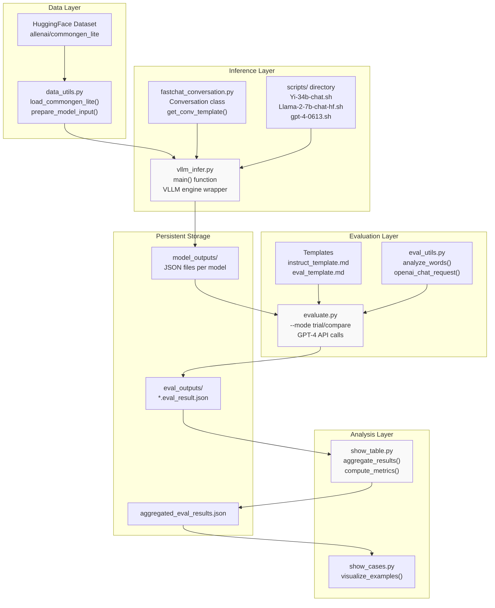

<!-- source: DeepWiki mcp.deepwiki.com · repo allenai/CommonGen-Eval · page 1 Overview · fetched 2026-10-26 -->

# Overview

<details>
<summary>Relevant source files</summary>

The following files were used as context for generating this wiki page:

- [README.md](README.md)
- [requirements.txt](requirements.txt)

</details>


## Purpose and Scope

This document provides a high-level introduction to the CommonGen-Eval system, a framework for evaluating Large Language Models (LLMs) on constrained text generation tasks using GPT-4 as an automated judge. This page explains what the system does, why it exists, and how its major components fit together.

For detailed instructions on running the system, see [Getting Started](#2). For in-depth architectural details, see [System Architecture](#3). For metric definitions and interpretation, see [Understanding Metrics](#6.3).

**Sources:** [README.md:1-18]()

## What is CommonGen-Eval?

CommonGen-Eval is an evaluation framework that tests how well LLMs can generate natural sentences from given concept sets. The system evaluates models on the **concept-to-sentence generation task**: given several concepts (nouns and verbs), the model must produce a coherent sentence that uses all concepts in a natural way.

The evaluation uses:
- **CommonGen-lite dataset**: 400 test examples with 900 human-written reference sentences
- **GPT-4 as judge**: Automated pairwise comparison between model outputs and human references
- **Multi-dimensional metrics**: Coverage, part-of-speech accuracy, and win rate

The framework produces a public leaderboard comparing 10+ state-of-the-art LLMs, with scores ranging from 10% (Yi-6b-chat) to 45% (gpt-4-0613), against human upper bounds of 97%.

**Sources:** [README.md:16-18](), [README.md:21-44]()

## The CommonGen Task

The core task involves generating sentences that describe common daily scenes using provided concepts with specific part-of-speech tags. 

| Component | Description | Example |
|-----------|-------------|---------|
| **Input Concepts** | Nouns and verbs with POS tags | `['dog_N', 'frisbee_N', 'catch_V', 'throw_V']` |
| **Expected Output** | Natural, simple sentence using all concepts | "The dog catches the frisbee when the boy throws it into the air." |
| **Constraints** | All concepts must appear; POS tags must be correct; scene must be common | |

The system uses 2-shot prompting with examples like dog/frisbee/catch/throw and apple/tree/place/pick to guide model behavior.

**Sources:** [README.md:74-94]()

## System Workflow

```mermaid
graph LR
    subgraph "1. Data Preparation"
        DS["CommonGen-lite<br/>HuggingFace Dataset<br/>400 examples"]
        Concepts["Concept Sets<br/>e.g., demonstrate_V,<br/>machine_N, sew_V, use_V"]
        Refs["Human References<br/>900 gold sentences"]
    end
    
    subgraph "2. Model Inference"
        Scripts["scripts/*.sh<br/>Model-specific configs"]
        VLLM["vllm_infer.py<br/>Batch inference engine"]
        Templates["fastchat_conversation.py<br/>50+ model templates"]
        Output["model_outputs/<br/>{model_name}.json"]
    end
    
    subgraph "3. GPT-4 Evaluation"
        EvalScript["evaluate.py<br/>--mode compare"]
        Judge["GPT-4-1106-preview<br/>Pairwise comparison"]
        EvalOut["eval_outputs/<br/>{model}.eval_result.json"]
    end
    
    subgraph "4. Results Analysis"
        Agg["show_table.py<br/>Aggregate metrics"]
        Cases["show_cases.py<br/>Example visualization"]
        LB["Leaderboard<br/>aggregated_eval_results.json"]
    end
    
    DS --> Concepts
    DS --> Refs
    Concepts --> Scripts
    Scripts --> VLLM
    Templates --> VLLM
    VLLM --> Output
    
    Output --> EvalScript
    Refs --> EvalScript
    EvalScript --> Judge
    Judge --> EvalOut
    
    EvalOut --> Agg
    Agg --> LB
    LB --> Cases
    
    style VLLM fill:#f9f9f9
    style Judge fill:#f9f9f9
    style Agg fill:#f9f9f9
```



**Diagram 1: End-to-End System Workflow**

The system operates in four sequential stages:

1. **Data Preparation**: Load the CommonGen-lite dataset from HuggingFace (`allenai/commongen_lite_eval`)
2. **Model Inference**: Run models via `vllm_infer.py` with conversation templates from `fastchat_conversation.py`
3. **GPT-4 Evaluation**: Compare model outputs to human references using `evaluate.py` with GPT-4 as judge
4. **Results Analysis**: Aggregate metrics with `show_table.py` and visualize cases with `show_cases.py`

**Sources:** [README.md:55-69](), [README.md:99-115]()

## Core Components and Code Entities



**Diagram 2: Component Architecture with Code Entities**

This diagram maps system functionality to specific code files and functions:

| Component | Key Files | Primary Functions/Classes | Purpose |
|-----------|-----------|---------------------------|---------|
| **Data Loading** | `data_utils.py` | `load_commongen_lite()`, `prepare_model_input()` | Load dataset, format prompts |
| **Model Inference** | `vllm_infer.py` | `main()`, VLLM engine wrapper | Generate sentences from concepts |
| **Conversation Templates** | `fastchat_conversation.py` | `Conversation` class, `get_conv_template()` | Format prompts for 50+ models |
| **Shell Scripts** | `scripts/*.sh` | Individual model launchers | Configure and run specific models |
| **Evaluation** | `evaluate.py` | `--mode trial/compare` | Orchestrate GPT-4 evaluation |
| **Eval Utilities** | `eval_utils.py` | `analyze_words()`, `openai_chat_request()` | NLP analysis, API interaction |
| **Results Aggregation** | `show_table.py` | `aggregate_results()`, `compute_metrics()` | Generate leaderboard |
| **Case Studies** | `show_cases.py` | `visualize_examples()` | Display example outputs |

**Sources:** [README.md:55-69](), [README.md:99-115]()

## Evaluation Metrics

The system computes five key metrics for each model:

| Metric | Symbol | Definition | Range | Human Baseline |
|--------|--------|------------|-------|----------------|
| **Length** | `len` | Average word count per sentence | ~13-20 | 12.84 |
| **Coverage** | `cover` | % of examples with all concepts present | 71-99% | 99.00% |
| **Part-of-Speech** | `pos` | % of examples with correct POS for all concepts | 63-98% | 98.11% |
| **Win/Tie Rate** | `win_tie` | % where GPT-4 prefers model over human (or tie) | 15-50% | 50-100% |
| **Overall Score** | `overall` | `cover × pos × win_tie` | 10-45% | 48.57-97.13% |

The multiplicative `overall` score ensures models must perform well across all dimensions. Models failing on coverage or POS accuracy receive low scores even if GPT-4 rates their outputs highly.

**Sources:** [README.md:39-44]()

## Repository Structure

```
CommonGen-Eval/
├── vllm_infer.py              # Main inference engine
├── evaluate.py                # GPT-4 evaluation script
├── data_utils.py              # Dataset loading utilities
├── eval_utils.py              # Evaluation helper functions
├── fastchat_conversation.py   # 50+ model conversation templates
├── show_table.py              # Leaderboard generation
├── show_cases.py              # Case study visualization
├── instruct_template.md       # Instruction prompt template
├── eval_template.md           # Evaluation prompt template
├── requirements.txt           # Python dependencies
├── scripts/                   # Model-specific shell scripts
│   ├── Yi-34b-chat.sh
│   ├── Llama-2-7b-chat-hf.sh
│   ├── gpt-4-0613.sh
│   └── ...
├── model_outputs/             # Generated sentences (JSON)
├── eval_outputs/              # Evaluation results (JSON)
└── aggregated_eval_results.json  # Final leaderboard data
```

**Sources:** [README.md:1-298]()

## Key Dependencies

The system relies on several external libraries specified in `requirements.txt`:

| Dependency | Version | Purpose |
|------------|---------|---------|
| `vllm` | 0.2.6 | High-performance model inference engine |
| `openai` | 0.28.0 | GPT-4 API client (pre-v1.0 API) |
| `transformers` | 4.36.2 | HuggingFace model loading |
| `spacy` | 3.7.2 | NLP analysis (POS tagging, lemmatization) |
| `tabulate` | 0.9.0 | ASCII table formatting |
| `tqdm` | 4.66.1 | Progress bars |

Note: The system uses `openai==0.28.0`, the legacy API version before OpenAI's v1.0.0 breaking changes.

**Sources:** [requirements.txt:1-6]()

## Supported Models

The system provides pre-configured templates for 50+ models via `fastchat_conversation.py`, including:

**Open-Source Models:**
- Yi family: Yi-34b-chat, Yi-6b-chat
- Llama family: Llama-2-7b-chat-hf, Llama-2-70b-chat-hf
- Mistral/Mixtral: Mixtral-8x7B-Instruct-v0.1, zephyr-7b-beta
- Vicuna: vicuna-13b-v1.5, vicuna-33b-v1.3
- Tulu: tulu-2-dpo-70b
- Pallas: Pallas-0.5

**Commercial Models:**
- OpenAI: gpt-4-0613, gpt-4-1106-preview, gpt-3.5-turbo

Each model requires specific conversation formatting handled by templates in `fastchat_conversation.py`. For the complete list of supported models, see [Supported Models](#9.3).

**Sources:** [README.md:23-37]()

## Leaderboard Results

The current leaderboard shows GPT-4 models leading with ~45% overall score, followed by open-source models:

**Top Performers:**
1. gpt-4-0613: 45.11% (cover=97.44%, pos=91.78%, win_tie=50.44%)
2. gpt-4-1106-preview: 44.08% (cover=96.33%, pos=90.11%, win_tie=50.78%)
3. gpt-3.5-turbo: 38.06% (cover=92.11%, pos=83.00%, win_tie=49.78%)

**Best Open-Source:**
- Yi-34b-chat: 23.73% (cover=80.11%, pos=75.11%, win_tie=39.44%)
- Pallas-0.5: 22.22% (cover=86.67%, pos=79.56%, win_tie=32.22%)

The human upper bound (assuming 100% win rate) is 97.13%, while the lower bound (50% win rate against self) is 48.57%. This indicates substantial room for improvement in LLM constrained generation capabilities.

**Sources:** [README.md:21-44]()

## Next Steps

To start using CommonGen-Eval:
- **Installation**: See [Getting Started](#2) for setup instructions
- **Run Inference**: See [Running Model Inference](#4) to generate outputs for a new model
- **Run Evaluation**: See [Running Evaluation](#5) to evaluate model outputs with GPT-4
- **Analyze Results**: See [Analyzing Results](#6) to generate leaderboards and visualize cases
- **Add New Models**: See [Conversation Templates](#4.2) to add support for new models

**Sources:** [README.md:48-115]()

---

