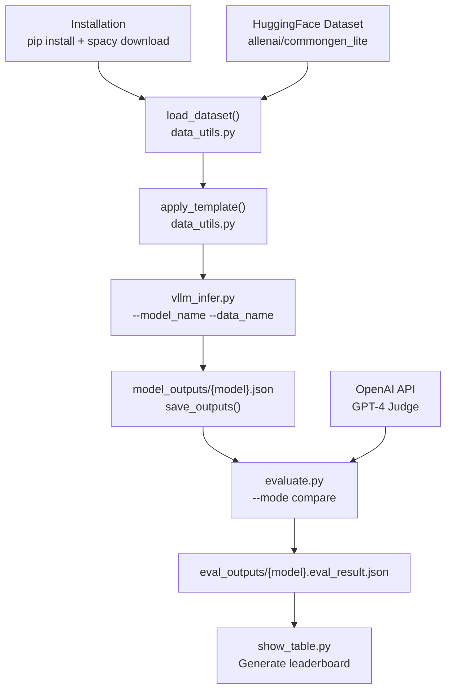
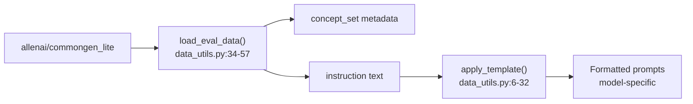
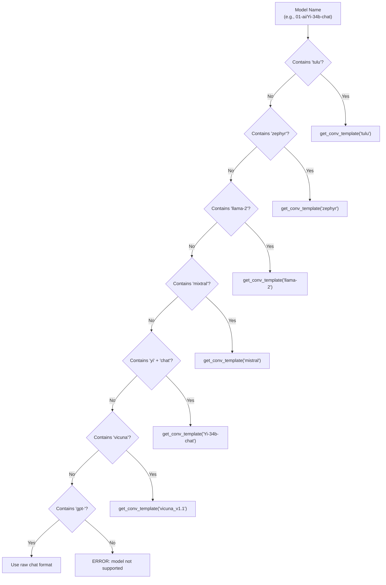
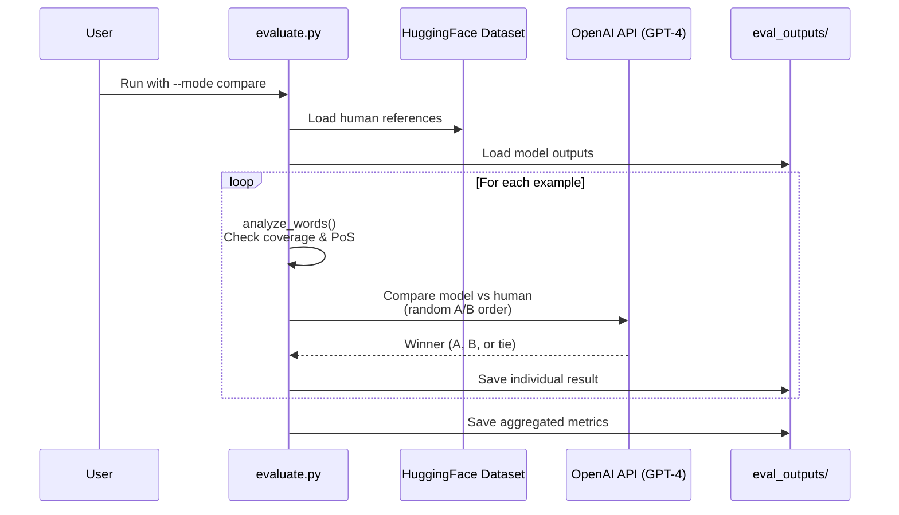

<!-- source: DeepWiki mcp.deepwiki.com · repo allenai/CommonGen-Eval · page 2 Getting Started · fetched 2026-10-26 -->

# Getting Started

<details>
<summary>Relevant source files</summary>

The following files were used as context for generating this wiki page:

- [README.md](README.md)
- [data_utils.py](data_utils.py)
- [requirements.txt](requirements.txt)
- [scripts/Pallas-0.5.sh](scripts/Pallas-0.5.sh)

</details>


This page guides you through installing the CommonGen-Eval system and running your first model inference. By the end, you will have generated model outputs for the CommonGen-lite dataset and understand how they are evaluated.

For detailed information about the system architecture, see [System Architecture](#3). For in-depth guidance on inference configuration and adding new models, see [Running Model Inference](#4). For evaluation details, see [Running Evaluation](#5).

## Purpose and Scope

This page covers:
- Installing dependencies and downloading required resources
- Running inference on a model to generate CommonGen outputs
- Understanding the output format
- Overview of the evaluation workflow (note: evaluation requires special dataset access)

## Prerequisites

Before starting, ensure you have:
- Python 3.8 or later
- CUDA-capable GPU(s) for model inference
- Sufficient disk space for model weights (varies by model, typically 10-50GB)
- Internet connection for downloading models and datasets

**Sources**: [README.md:48-53]()

## Installation

### Step 1: Install Python Dependencies

The system requires specific versions of key packages for compatibility:

```bash
pip install -r requirements.txt
```

This installs the following core dependencies:

| Package | Version | Purpose |
|---------|---------|---------|
| `vllm` | 0.2.6 | Efficient model serving and inference |
| `transformers` | 4.36.2 | Model loading and tokenization |
| `openai` | 0.28.0 | GPT-4 evaluation API access |
| `spacy` | 3.7.2 | Part-of-speech tagging and NLP analysis |
| `tabulate` | 0.9.0 | Table formatting for results |
| `tqdm` | 4.66.1 | Progress bars |

**Sources**: [requirements.txt:1-6]()

### Step 2: Download Spacy Language Model

The evaluation system uses spaCy for linguistic analysis (part-of-speech tagging):

```bash
python -m spacy download en_core_web_lg
```

This downloads the large English language model required by `eval_utils.py` for analyzing word types in generated sentences.

**Sources**: [README.md:52]()

## System Workflow Overview

The following diagram shows how the components interact during a typical usage flow:



**Sources**: [README.md:55-115](), [data_utils.py:1-94]()

## Running Your First Inference

### Understanding the Data

The system uses the CommonGen-lite dataset, which contains 400 test examples. Each example consists of:
- A set of concepts (nouns and verbs with part-of-speech tags)
- An instruction prompt asking the model to generate a sentence using all concepts

The `load_eval_data()` function in `data_utils.py` loads this dataset from HuggingFace:



**Sources**: [data_utils.py:34-57](), [README.md:57]()

### Basic Inference Command

Here is a minimal example for running inference with the Yi-34b-chat model:

```bash
CUDA_VISIBLE_DEVICES=0,1,2,3 \
python vllm_infer.py \
    --data_name "commongen" \
    --model_name 01-ai/Yi-34b-chat \
    --tensor_parallel_size 4 \
    --dtype bfloat16 \
    --output_folder "model_outputs/" \
    --top_p 1 \
    --temperature 0 \
    --batch_size 8 \
    --max_tokens 128
```

**Key Parameters**:
- `--data_name "commongen"`: Specifies the CommonGen-lite dataset
- `--model_name`: HuggingFace model identifier or local path
- `--tensor_parallel_size`: Number of GPUs for parallelization
- `--temperature 0`: Deterministic generation (no randomness)
- `--max_tokens 128`: Maximum length of generated sentences

**Sources**: [README.md:62-69](), [scripts/Pallas-0.5.sh:1-7]()

### Template Application Process

The system automatically selects the appropriate conversation template based on the model name:



This logic is implemented in `apply_template()` at [data_utils.py:6-32]().

**Sources**: [data_utils.py:6-32]()

## Verifying Your Outputs

### Output File Structure

After inference completes, outputs are saved to `model_outputs/{model_name}.json`. The `save_outputs()` function creates this file with the following structure:

```json
[
  {
    "instruction": "Given several concepts...",
    "output": "The generated sentence.",
    "generator": "01-ai/Yi-34b-chat",
    "id": "example_id",
    "concept_set": ["dog_N", "frisbee_N", "catch_V", "throw_V"]
  }
]
```

Each entry contains:
- `instruction`: The prompt given to the model
- `output`: The model's generated sentence
- `generator`: The model name that produced this output
- `id`: Unique identifier for the example
- `concept_set`: The concepts that should appear in the output

**Sources**: [data_utils.py:72-87]()

### Quick Validation

Verify your output file was created successfully:

```bash
# Check file exists and count examples
ls -lh model_outputs/
jq length model_outputs/Yi-34b-chat.json  # Should output: 400
```

Inspect a single example:

```bash
jq '.[0]' model_outputs/Yi-34b-chat.json
```

## Understanding Evaluation (Overview)

The evaluation process uses GPT-4 as a judge to compare model outputs against human references. **Note**: Running evaluation requires special access to the private HuggingFace dataset containing human references and is typically performed by the repository maintainers.

### Evaluation Workflow



**Sources**: [README.md:99-115]()

### Evaluation Metrics

The system computes multiple metrics for each model:

| Metric | Description | Implementation |
|--------|-------------|----------------|
| **length** | Average word count | Computed from output tokens |
| **cover** | % with all concepts present | Checked via string matching |
| **pos** | % with correct part-of-speech | Analyzed using spaCy `analyze_words()` |
| **win_tie** | % preferred/tied by GPT-4 | Pairwise comparison results |
| **overall** | `cover × pos × win_tie` | Final combined score |

**Sources**: [README.md:39-44]()

## Next Steps

Now that you have completed your first inference run:

1. **Explore different models**: See [Supported Models](#9.3) for the full list of 50+ supported model templates
2. **Understand the architecture**: Read [System Architecture](#3) to learn how components interact
3. **Customize inference**: See [Running Model Inference](#4) for advanced configuration options
4. **Add a new model**: Follow the guide in [Conversation Templates](#4.2) to add support for additional models
5. **Analyze results**: Learn about metrics and leaderboard generation in [Analyzing Results](#6)

**Sources**: [README.md:1-298]()

---

