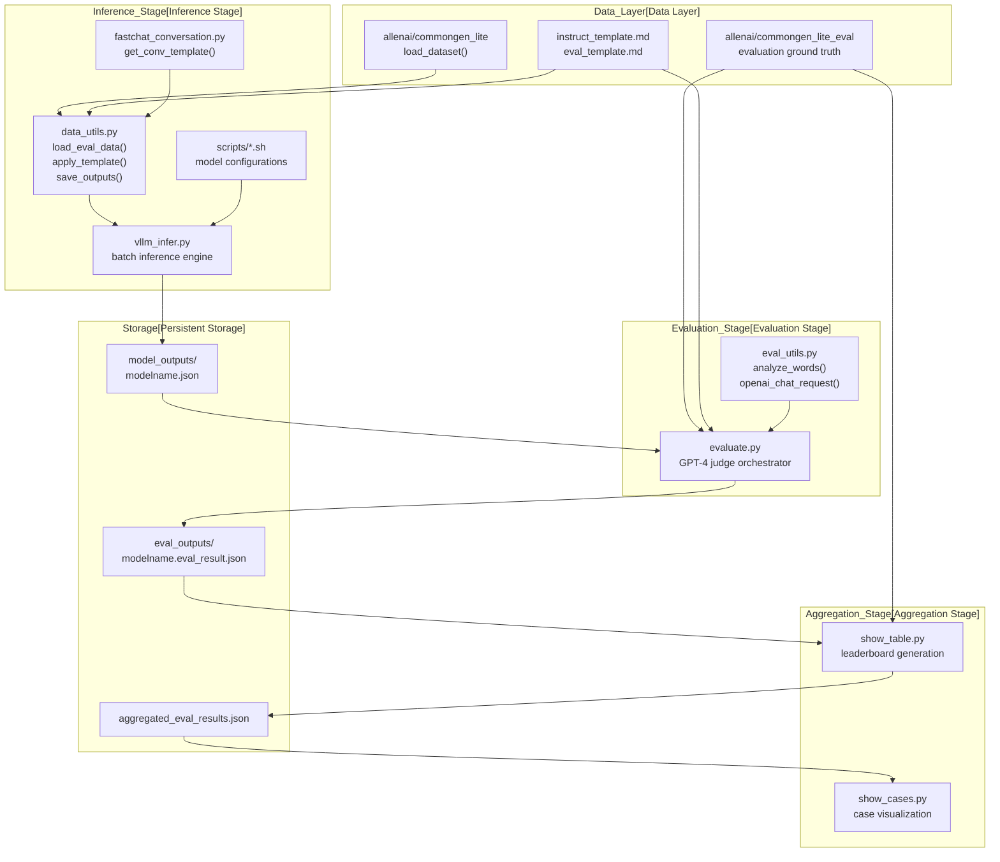
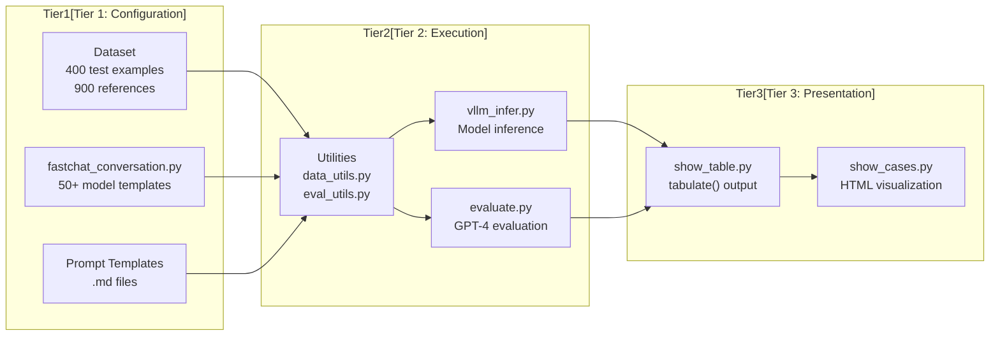
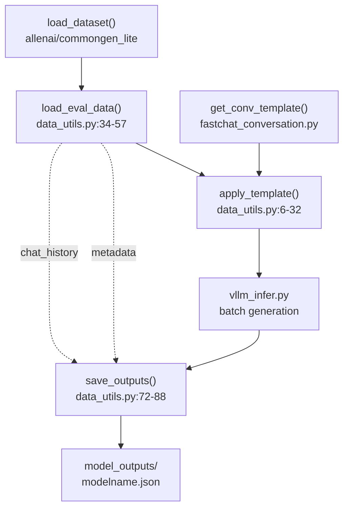
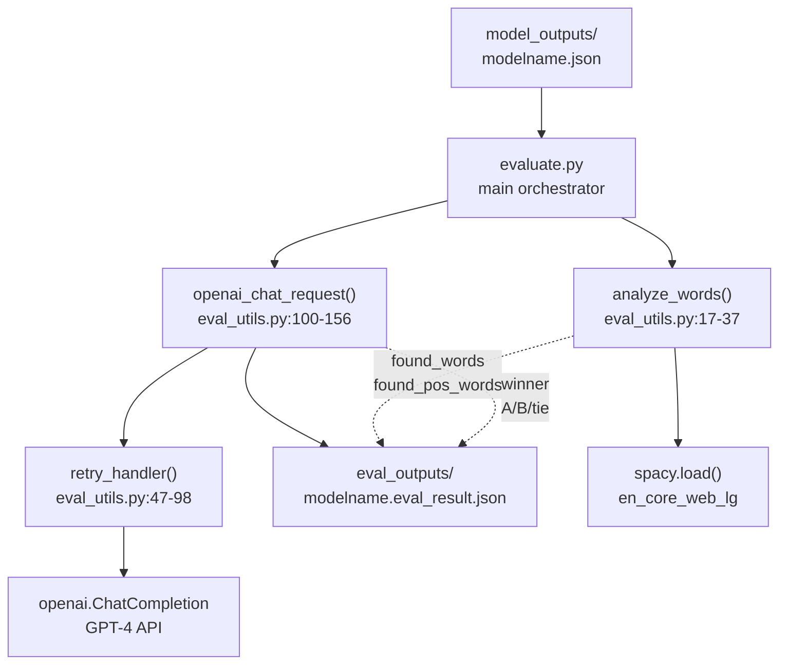
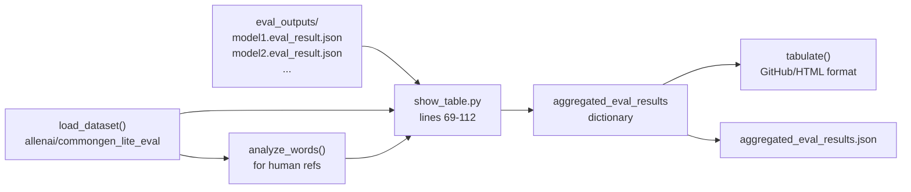
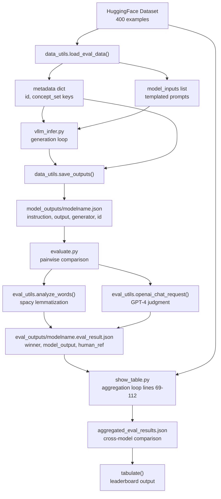
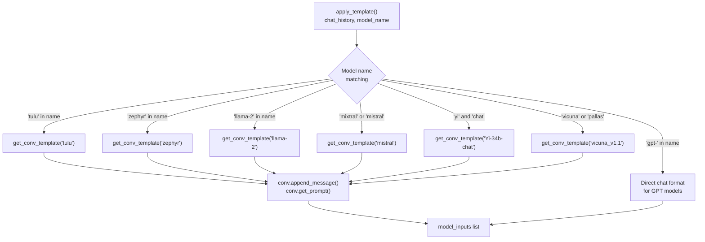
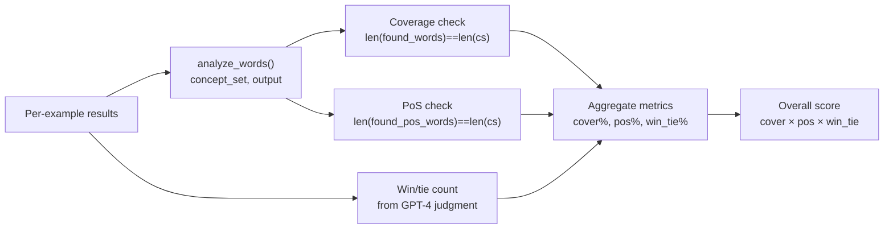
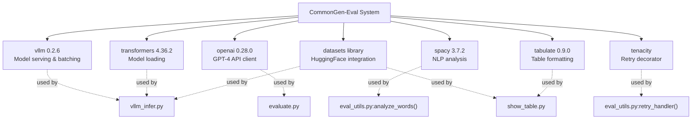

<!-- source: DeepWiki mcp.deepwiki.com · repo allenai/CommonGen-Eval · page 3 System Architecture · fetched 2026-10-26 -->

# System Architecture

<details>
<summary>Relevant source files</summary>

The following files were used as context for generating this wiki page:

- [README.md](README.md)
- [data_utils.py](data_utils.py)
- [eval_utils.py](eval_utils.py)
- [scripts/Pallas-0.5.sh](scripts/Pallas-0.5.sh)
- [show_table.py](show_table.py)

</details>


## Purpose and Scope

This document describes the overall architecture of the CommonGen-Eval system, explaining how the major components interact to evaluate language models on concept-to-sentence generation tasks. It covers the three-tier architecture (data, execution, presentation), component interactions, data flow patterns, and storage organization.

For detailed information on specific subsystems:
- Data flow mechanics: see [Data Pipeline](#3.1)
- Model inference details: see [Inference System](#3.2)
- GPT-4 evaluation mechanics: see [Evaluation System](#3.3)
- Results processing: see [Results Aggregation](#6.1)

---

## Architectural Overview

The CommonGen-Eval system follows a **pipeline architecture** with three distinct stages: inference, evaluation, and aggregation. Each stage reads from and writes to specific directories, creating a clear separation of concerns.

### System Components Diagram



**Sources**: [README.md:16-98](), [data_utils.py:1-94](), [show_table.py:1-122](), [eval_utils.py:1-158]()

---

## Three-Tier Logical Architecture

The system is organized into three logical tiers that separate configuration, execution, and presentation concerns.



**Sources**: [README.md:48-97](), [data_utils.py:6-57](), [show_table.py:22-122]()

---

## Component Interaction Details

### Inference Pipeline Components

The inference pipeline transforms concept sets into model-generated sentences through several stages of processing.



| Component | Function | Key Outputs |
|-----------|----------|-------------|
| `load_eval_data()` | Loads dataset and formats as chat history | `id_strs`, `chat_history`, `model_inputs`, `metadata` |
| `apply_template()` | Applies model-specific conversation format | List of formatted prompt strings |
| `get_conv_template()` | Retrieves template for specific model | Conversation object with `get_prompt()` method |
| `save_outputs()` | Serializes results to JSON | `formatted_outputs` with instruction, output, metadata |

**Sources**: [data_utils.py:34-88](), [scripts/Pallas-0.5.sh:1-7]()

---

### Evaluation Pipeline Components

The evaluation pipeline compares model outputs against human references using both automated metrics and GPT-4 judgment.



| Function | Purpose | Returns |
|----------|---------|---------|
| `analyze_words()` | Lemmatizes and checks POS tags using spacy | `found_words`, `found_pos_words` (sets) |
| `openai_chat_request()` | Makes API call to GPT-4 with temperature=0 | List of response strings |
| `retry_handler()` | Decorator with exponential backoff for rate limits | Wrapped function with retry logic |

**Sources**: [eval_utils.py:17-156](), [README.md:99-147]()

---

### Aggregation Pipeline Components

The aggregation pipeline collects evaluation results from all models and generates comparative metrics.



**Key Data Structures in show_table.py:**

```
aggregated_eval_results = {
  "ref_id": {
    "concept_set": [...],
    "human_ref": "...",
    "found_words": [...],
    "found_pos_words": [...],
    "len": int,
    "model_outputs": {
      "model_name": {
        "output": "...",
        "result": "win|lose|tie",
        "found_pos_words": [...],
        "found_words": [...],
        "len": int
      }
    }
  }
}
```

**Sources**: [show_table.py:24-122]()

---

## Data Flow Architecture

### End-to-End Data Flow with Code References



**Sources**: [data_utils.py:34-88](), [show_table.py:69-122](), [eval_utils.py:17-156]()

---

## Storage Organization

### File System Structure

```
CommonGen-Eval/
├── model_outputs/
│   ├── Yi-34b-chat.json              # Generated by vllm_infer.py
│   ├── Llama-2-7b-chat-hf.json
│   ├── gpt-4-0613.json
│   └── ...
│
├── eval_outputs/
│   ├── Yi-34b-chat.eval_result.gpt-4-1106-preview.json
│   ├── Llama-2-7b-chat-hf.eval_result.gpt-4-1106-preview.json
│   └── aggregated_eval_results.json  # Generated by show_table.py
│
├── scripts/
│   ├── Pallas-0.5.sh
│   ├── Yi-34b-chat.sh
│   └── all_gpt_eval.sh
│
└── templates/
    ├── instruct_template.md
    └── eval_template.md
```

**JSON Schema Reference:**

**model_outputs/*.json** (generated by [data_utils.py:72-88]()):
```json
[
  {
    "instruction": "Given concepts, write sentence...",
    "output": ["Generated sentence"],
    "generator": "model_name",
    "id": "example_id",
    "concept_set": ["word_POS", ...]
  }
]
```

**eval_outputs/*.eval_result.json** (generated by `evaluate.py`):
```json
[
  {
    "concept_set": ["word_POS", ...],
    "human_ref": {"id": "ref_id", "ref": "Human sentence"},
    "model_output": ["Model sentence"],
    "winner": "model|human|tie"
  }
]
```

**Sources**: [data_utils.py:72-88](), [show_table.py:7-20, 69-99]()

---

## Execution Orchestration

### Shell Script Configuration Pattern

The system uses shell scripts to configure and launch model inference with specific parameters:

**Example: scripts/Pallas-0.5.sh**
```bash
CUDA_VISIBLE_DEVICES=0,1,2,3 \
python vllm_infer.py \
    --data_name "commongen" \
    --model_name Mihaiii/Pallas-0.5 
    --tensor_parallel_size 4 
    --dtype bfloat16 \
    --output_folder "model_outputs/" \
    --top_p 1 
    --temperature 0 
    --batch_size 8 
    --max_tokens 128
```

**Common Parameters:**
| Parameter | Purpose | Typical Value |
|-----------|---------|---------------|
| `--data_name` | Dataset identifier | `"commongen"` |
| `--model_name` | HuggingFace model path | Model-specific |
| `--tensor_parallel_size` | GPU parallelization | 1, 2, 4, or 8 |
| `--temperature` | Sampling temperature | 0 (deterministic) |
| `--batch_size` | Inference batch size | 8 |
| `--max_tokens` | Max generation length | 128 |

**Sources**: [scripts/Pallas-0.5.sh:1-7](), [README.md:55-69]()

---

## Template Application System

### Model-Specific Template Selection

The `apply_template()` function in [data_utils.py:6-32]() uses conditional logic to select appropriate conversation templates:



**Sources**: [data_utils.py:6-32]()

---

## Metrics Calculation

The system computes multiple metrics for each model, calculated in [show_table.py:74-112]():

### Metric Computation Flow



**Metric Formulas** (from [show_table.py:101-111]()):

| Metric | Calculation | Line Reference |
|--------|-------------|----------------|
| `cover%` | `sum(cover_ratios)/len * 100` | [show_table.py:108]() |
| `pos%` | `sum(pos_ratios)/len * 100` | [show_table.py:107]() |
| `win_tie%` | `(win_count+tie_count)/len * 100` | [show_table.py:105]() |
| `overall` | `(cover × pos × win_tie) / 10000` | [show_table.py:110]() |
| `len` | `sum(lens)/len` | [show_table.py:109]() |

**Sources**: [show_table.py:74-112](), [README.md:39-44]()

---

## Dependency Architecture

### Core Dependencies and Their Roles



**Sources**: [README.md:48-53](), [eval_utils.py:1-14](), [show_table.py:1-4]()

---

## Extension Points

The architecture provides several extension points for adding new models or evaluation methods:

| Extension Point | Location | Mechanism |
|----------------|----------|-----------|
| **New Model Support** | [data_utils.py:9-27]() | Add conditional branch in `apply_template()` |
| **New Conversation Template** | `fastchat_conversation.py` | Add template via `get_conv_template()` |
| **New Evaluation Metrics** | [eval_utils.py:17-37]() | Extend `analyze_words()` or add new functions |
| **Custom Evaluation Judges** | [eval_utils.py:100-156]() | Modify `openai_chat_request()` model parameter |
| **Output Format Changes** | [data_utils.py:72-88]() | Modify `save_outputs()` formatting logic |
| **New Aggregation Methods** | [show_table.py:69-112]() | Add calculation loops for new metrics |

**Sources**: [data_utils.py:6-88](), [eval_utils.py:17-156](), [show_table.py:69-122]()

---

