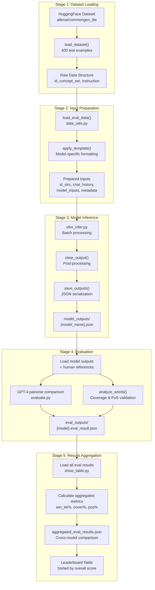
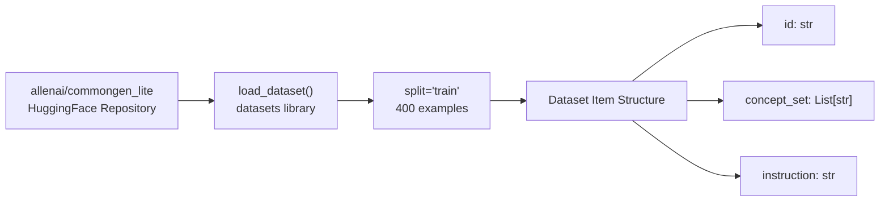
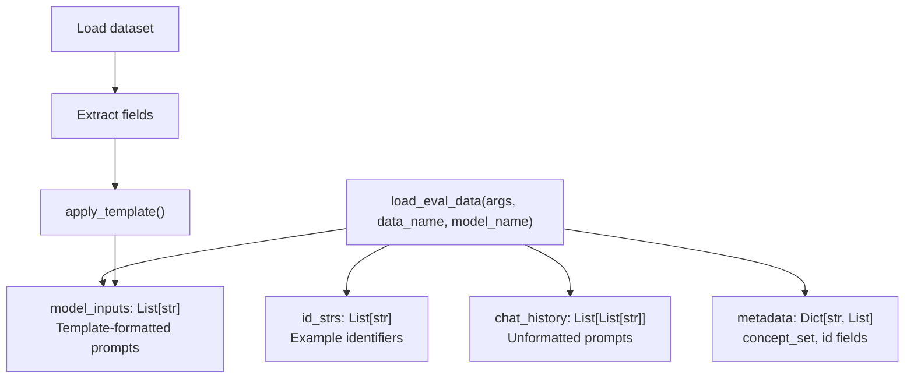
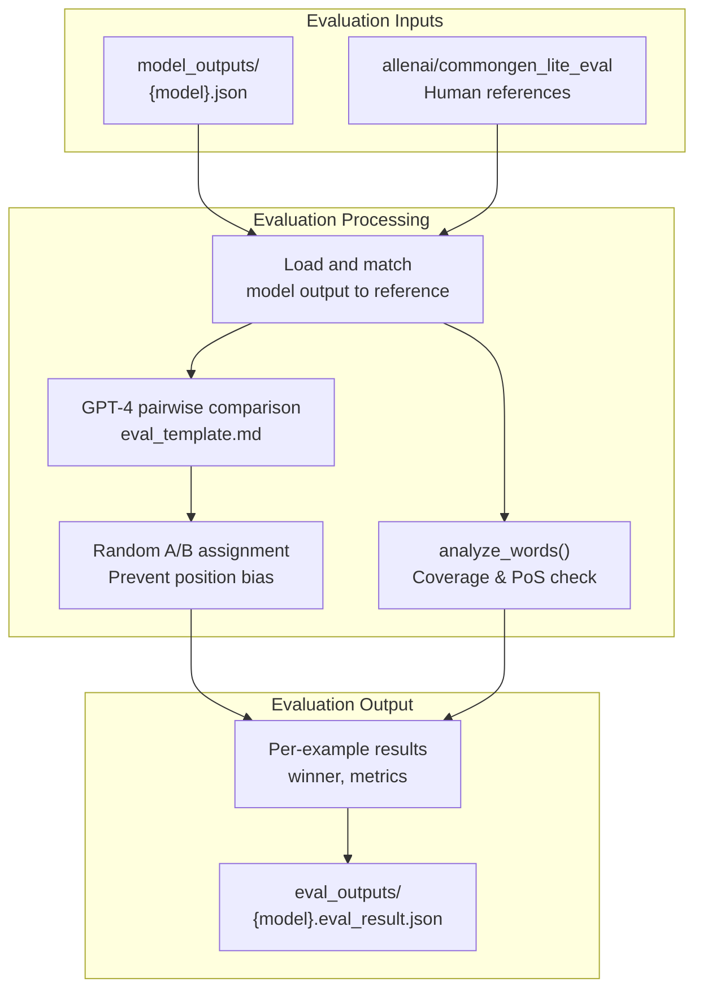
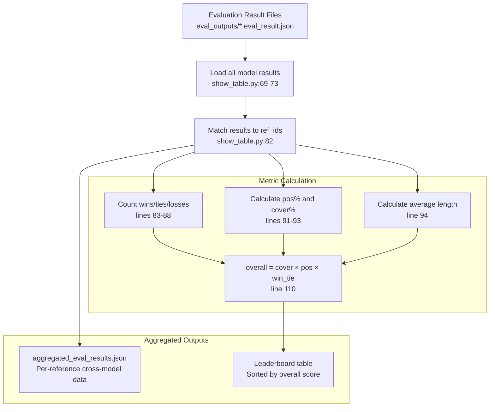

<!-- source: DeepWiki mcp.deepwiki.com · repo allenai/CommonGen-Eval · page 3.1 Data Pipeline · fetched 2026-10-26 -->

# Data Pipeline

<details>
<summary>Relevant source files</summary>

The following files were used as context for generating this wiki page:

- [README.md](README.md)
- [data_utils.py](data_utils.py)
- [scripts/Pallas-0.5.sh](scripts/Pallas-0.5.sh)
- [show_table.py](show_table.py)

</details>


## Purpose and Scope

This document details the complete data flow through the CommonGen-Eval system, from loading the CommonGen-lite dataset through model inference, GPT-4 evaluation, and final results aggregation. It covers the five main pipeline stages, data transformations at each stage, and the storage locations for intermediate and final outputs.

For details about the inference execution and model-specific configurations, see [Inference System](#3.2). For evaluation mechanics and GPT-4 judging, see [Evaluation System](#3.3). For working with results and metrics, see [Analyzing Results](#6).

**Sources:** README.md, show_table.py, data_utils.py

---

## Complete Pipeline Overview

The data pipeline transforms 400 concept sets from the CommonGen-lite dataset into evaluated model outputs with calculated metrics. The pipeline consists of five sequential stages, each with distinct inputs, processing, and outputs.



**Sources:** README.md:17-18, README.md:57-96, data_utils.py:34-57, show_table.py:1-122

---

## Stage 1: Dataset Loading

### Source Dataset

The pipeline begins by loading the CommonGen-lite dataset from HuggingFace. This dataset contains 400 test examples with 900 human-written reference sentences (some examples have multiple references).



The dataset is loaded using the `datasets` library at [data_utils.py:43]():

```python
dataset = load_dataset("allenai/commongen_lite", split="train")
```

**Sources:** data_utils.py:1, data_utils.py:43, README.md:17, README.md:57

### Data Structure

Each dataset item contains:

| Field | Type | Description | Example |
|-------|------|-------------|---------|
| `id` | `str` | Unique identifier | `"0"` |
| `concept_set` | `List[str]` | Tagged concepts (noun/verb) | `["dog_N", "frisbee_N", "catch_V", "throw_V"]` |
| `instruction` | `str` | Formatted task prompt | Full instruction with examples |

The instruction field contains a pre-formatted 2-shot prompt with the task description and the specific concepts to use. This template is shown in [README.md:74-94]().

**Sources:** data_utils.py:42-54, README.md:74-94

### Human Reference Data

For evaluation purposes, human references are loaded separately from the `allenai/commongen_lite_eval` dataset at [show_table.py:29]():

```python
truth_data = load_dataset("allenai/commongen_lite_eval", split="train")
```

Each item in the truth dataset includes `human_annotations`, where each annotation has:
- `id`: Reference identifier  
- `ref`: Human-written sentence

The system iterates through 900 total references across 400 examples at [show_table.py:30-38]().

**Sources:** show_table.py:29-38, README.md:17

---

## Stage 2: Input Preparation

### Data Loading Function

The `load_eval_data()` function at [data_utils.py:34-57]() orchestrates the preparation of inputs for model inference. It returns four key data structures:



**Sources:** data_utils.py:34-57

### Template Application

The `apply_template()` function at [data_utils.py:6-32]() transforms raw chat history into model-specific formatted prompts. It handles 50+ model conversation formats via the `fastchat_conversation` module.

The function performs model detection and template selection:

| Model Pattern | Template | Lines |
|--------------|----------|-------|
| `"tulu"` | `"tulu"` | [data_utils.py:9-10]() |
| `"zephyr"` | `"zephyr"` | [data_utils.py:11-12]() |
| `"llama-2"` | `"llama-2"` | [data_utils.py:13-14]() |
| `"mixtral"` or `"mistral"` | `"mistral"` | [data_utils.py:15-16]() |
| `"yi"` and `"chat"` | `"Yi-34b-chat"` | [data_utils.py:17-18]() |
| `"vicuna"` | `"vicuna_v1.1"` | [data_utils.py:19-20]() |
| `"pallas"` | `"vicuna_v1.1"` | [data_utils.py:21-22]() |
| `"gpt-"` | No template (direct) | [data_utils.py:23-25]() |

For most models, the conversation template is retrieved via `get_conv_template()` and messages are appended according to the template's role structure at [data_utils.py:28-31]().

**Sources:** data_utils.py:6-32

### Metadata Extraction

The metadata dictionary is populated during dataset iteration at [data_utils.py:48-54](). For the CommonGen task, it includes:

```python
metadata = {"id": [], "concept_set": []}
```

This metadata is preserved through the pipeline and included in the final output files at [data_utils.py:83-84]().

**Sources:** data_utils.py:42-54, data_utils.py:83-84

---

## Stage 3: Model Inference

### Inference Execution

Model inference is executed via shell scripts that call `vllm_infer.py`. Example from [scripts/Pallas-0.5.sh:1-7]():

```bash
CUDA_VISIBLE_DEVICES=0,1,2,3 \
python vllm_infer.py \
    --data_name "commongen" \
    --model_name Mihaiii/Pallas-0.5 --tensor_parallel_size 4 --dtype bfloat16 \
    --output_folder "model_outputs/" \
    --top_p 1 --temperature 0 --batch_size 8 --max_tokens 128
```

The inference parameters are standardized across models:
- `temperature=0`: Deterministic generation
- `top_p=1`: No nucleus sampling
- `max_tokens=128`: Maximum output length
- `batch_size=8`: Batch processing for efficiency

**Sources:** scripts/Pallas-0.5.sh:1-7, README.md:63-69

### Output Post-Processing

The `clear_output()` function at [data_utils.py:62-69]() performs model-specific cleanup. For example, Llama-2-7b outputs may contain extra newlines that need trimming:

```python
if "llama-2-7b" in model_name.lower():
    if "\n\n" in output:
        output = output[output.index("\n\n"):].strip()
```

**Sources:** data_utils.py:62-69

### Output Serialization

The `save_outputs()` function at [data_utils.py:72-87]() formats and saves the generated outputs. For the CommonGen task, each output item contains:

```python
{
    "instruction": str,      # Original prompt
    "output": List[str],     # Generated sentences (may be single or multiple)
    "generator": str,        # Model name
    "id": str,              # Example identifier
    "concept_set": List[str] # Original concepts
}
```

These are saved to `model_outputs/{model_name}.json` at [data_utils.py:86-87]().

**Sources:** data_utils.py:72-87

---

## Stage 4: Evaluation

### Evaluation Input Loading

The evaluation stage loads both model outputs and human references. The `evaluate.py` script processes each model output file and compares it against human-written references.



**Sources:** show_table.py:69-99, README.md:99-147

### Automated Metrics Calculation

The `analyze_words()` function from `eval_utils.py` performs linguistic analysis on both model outputs and human references. It is called at [show_table.py:34]() for human references and [show_table.py:91]() for model outputs.

For each generated sentence, the function returns:
- `found_words`: Set of concepts found in the output
- `found_pos_words`: Set of concepts with correct part-of-speech tags

These are used to calculate:
- **Coverage ratio**: `len(found_words) == len(concept_set)` at [show_table.py:93]()
- **PoS ratio**: `len(found_pos_words) == len(concept_set)` at [show_table.py:92]()

**Sources:** show_table.py:34, show_table.py:91-93

### Evaluation Result Structure

Each evaluation result contains:

```python
{
    "concept_set": List[str],
    "human_ref": {"id": str, "ref": str},
    "model_output": List[str],
    "winner": str,  # "model_name", "human", or "tie"
    # ... additional metrics
}
```

Results are saved to `eval_outputs/{model}.eval_result.{judge_model}.json`.

**Sources:** show_table.py:69-99

---

## Stage 5: Results Aggregation

### Aggregation Process

The `show_table.py` script at [show_table.py:1-122]() performs cross-model aggregation. It processes all evaluation result files and computes comparative metrics.



**Sources:** show_table.py:1-122

### File Registry

The aggregation script maintains a dictionary of model evaluation files at [show_table.py:7-20]():

```python
files = {
    "TurnOpt": "eval_outputs/TurnOpt.eval_result.gpt-4-1106-preview.json",
    "Pallas-0.5": "eval_outputs/Pallas-0.5.eval_result.gpt-4-1106-preview.json",
    # ... additional models
}
```

Each file is loaded and processed in the loop at [show_table.py:69-112]().

**Sources:** show_table.py:7-20, show_table.py:69-112

### Human Baseline Calculation

Human performance is calculated from the truth dataset at [show_table.py:25-38](). The system computes:

- **Human coverage**: 99.00% (proportion of references using all concepts)
- **Human PoS accuracy**: 98.11% (proportion with correct PoS tags)
- **Upper bound**: Assumes `win_tie=100%` at [show_table.py:48-56]()
- **Lower bound**: Assumes `win_tie=50%` at [show_table.py:57-61]()

**Sources:** show_table.py:25-61, README.md:25-26, README.md:44

### Aggregated Results File

The script generates `aggregated_eval_results.json` at [show_table.py:121-122](), structured as:

```python
{
    "ref_id": {
        "concept_set": List[str],
        "human_ref": str,
        "found_words": List[str],
        "found_pos_words": List[str],
        "len": int,
        "model_outputs": {
            "model_name": {
                "output": str,
                "result": "win" | "lose" | "tie",
                "found_pos_words": List[str],
                "found_words": List[str],
                "len": int
            }
        }
    }
}
```

This file enables cross-model comparison for individual examples at [show_table.py:38, 99]().

**Sources:** show_table.py:38, show_table.py:99, show_table.py:121-122

### Leaderboard Generation

The final leaderboard table is generated at [show_table.py:115-118]() with columns:

| Column | Calculation | Description |
|--------|-------------|-------------|
| `model` | Model name | Identifier |
| `len` | Average word count | Sentence length |
| `cover` | % with all concepts | Concept coverage |
| `pos` | % with correct PoS | Part-of-speech accuracy |
| `win_tie` | % wins + ties | GPT-4 preference |
| `overall` | `cover × pos × win_tie / 10000` | Combined score |

The table is sorted by overall score in descending order at [show_table.py:116]() and output in both GitHub markdown and HTML formats at [show_table.py:117-118]().

**Sources:** show_table.py:102-118, README.md:23-43

---

## Data Transformation Summary

The following table summarizes the transformations at each pipeline stage:

| Stage | Input Format | Processing | Output Format | Location |
|-------|-------------|------------|---------------|----------|
| 1. Dataset Loading | HuggingFace dataset | `load_dataset()` | Python dict with `id`, `concept_set`, `instruction` | Memory |
| 2. Input Preparation | Raw dataset items | `load_eval_data()`, `apply_template()` | Model-formatted prompts + metadata | Memory |
| 3. Model Inference | Formatted prompts | `vllm_infer.py`, `save_outputs()` | JSON with `instruction`, `output`, `generator`, metadata | `model_outputs/*.json` |
| 4. Evaluation | Model outputs + human refs | `evaluate.py`, `analyze_words()` | JSON with per-example comparison results | `eval_outputs/*.eval_result.json` |
| 5. Aggregation | All evaluation results | `show_table.py` metric calculation | Cross-model JSON + leaderboard table | `aggregated_eval_results.json` |

**Sources:** data_utils.py, show_table.py, README.md

---

