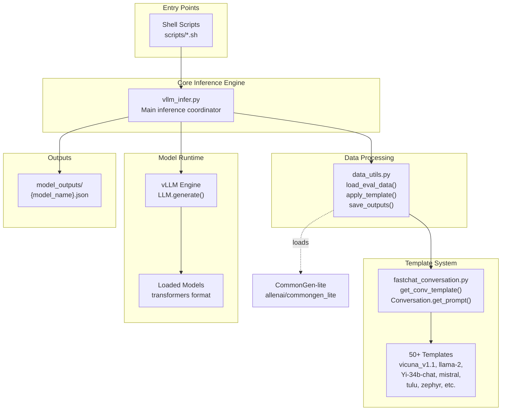
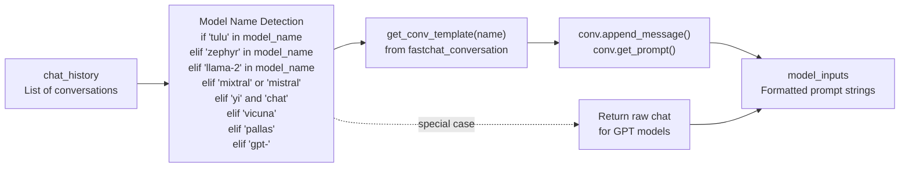
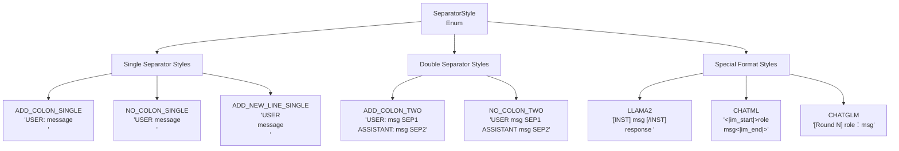
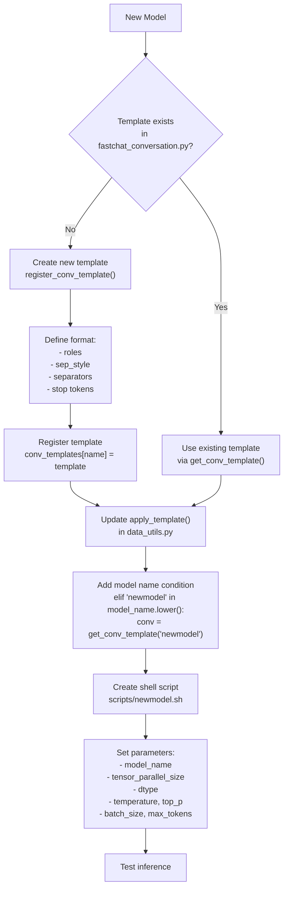

<!-- source: DeepWiki mcp.deepwiki.com · repo allenai/CommonGen-Eval · page 3.2 Inference System · fetched 2026-10-26 -->

# Inference System

<details>
<summary>Relevant source files</summary>

The following files were used as context for generating this wiki page:

- [README.md](README.md)
- [data_utils.py](data_utils.py)
- [fastchat_conversation.py](fastchat_conversation.py)
- [scripts/Pallas-0.5.sh](scripts/Pallas-0.5.sh)

</details>


## Purpose and Scope

This document describes the model inference architecture of the CommonGen-Eval system, including how the `vllm_infer.py` engine processes concept sets, how conversation templates are applied via `fastchat_conversation.py`, and how model-specific shell scripts orchestrate inference. For information about how data flows into this system, see [Data Pipeline](#3.1). For information about how inference outputs are evaluated, see [Evaluation System](#3.3).

The inference system is responsible for:
- Loading the CommonGen-lite dataset and formatting prompts
- Applying model-specific conversation templates to prompts
- Running batch inference using vLLM
- Saving structured JSON outputs for downstream evaluation

## System Overview

The inference system transforms concept sets into model-generated sentences through a multi-stage pipeline. The system supports 50+ different language models through a template-based approach that handles each model's unique prompt format.



**Sources:** [README.md:55-96](), [scripts/Pallas-0.5.sh:1-7](), [data_utils.py:1-94](), [fastchat_conversation.py:326-328]()

## Core Components

### vllm_infer.py - Main Inference Engine

The `vllm_infer.py` script is the central coordinator for model inference. While the file itself is not provided in the sources, its usage is documented extensively in the README and shell scripts.

**Key responsibilities:**
- Parsing command-line arguments for model configuration
- Initializing vLLM engine with specified parameters
- Orchestrating the inference pipeline
- Writing outputs to JSON files

**Command-line interface:**

| Argument | Purpose | Example Value |
|----------|---------|---------------|
| `--data_name` | Dataset identifier | `"commongen"` |
| `--model_name` | HuggingFace model path | `"01-ai/Yi-34b-chat"` |
| `--tensor_parallel_size` | GPU parallelism | `4` |
| `--dtype` | Model precision | `"bfloat16"` |
| `--output_folder` | Output directory | `"model_outputs/"` |
| `--top_p` | Nucleus sampling | `1` |
| `--temperature` | Sampling temperature | `0` (greedy) |
| `--batch_size` | Inference batch size | `8` |
| `--max_tokens` | Max generation length | `128` |

**Sources:** [README.md:62-69](), [scripts/Pallas-0.5.sh:1-7]()

### data_utils.py - Data Loading and Formatting

The `data_utils.py` module handles all data loading, template application, and output formatting operations.

#### Key Functions

**`load_eval_data(args, data_name, model_name)`** - [data_utils.py:34-57]()

Loads the CommonGen-lite dataset and prepares it for inference:

1. Loads dataset from HuggingFace: `allenai/commongen_lite`
2. Extracts instruction text from each item
3. Stores metadata (concept_set, id)
4. Applies conversation template via `apply_template()`
5. Returns: `id_strs`, `chat_history`, `model_inputs`, `metadata`

**`apply_template(chat_history, model_name)`** - [data_utils.py:6-32]()

Maps model names to conversation templates and formats prompts:



**Model name to template mapping:**

| Model Pattern | Template Name | Line Reference |
|---------------|---------------|----------------|
| `"tulu"` | `"tulu"` | [data_utils.py:10]() |
| `"zephyr"` | `"zephyr"` | [data_utils.py:12]() |
| `"llama-2"` | `"llama-2"` | [data_utils.py:14]() |
| `"mixtral"` or `"mistral"` | `"mistral"` | [data_utils.py:16]() |
| `"yi"` + `"chat"` | `"Yi-34b-chat"` | [data_utils.py:18]() |
| `"vicuna"` | `"vicuna_v1.1"` | [data_utils.py:20]() |
| `"pallas"` | `"vicuna_v1.1"` | [data_utils.py:22]() |
| `"gpt-"` | Raw chat (no template) | [data_utils.py:24-25]() |

**`save_outputs(args, id_strs, outputs, chat_history, metadata, model_inputs, filepath)`** - [data_utils.py:72-88]()

Formats and saves inference outputs to JSON:

```json
{
  "instruction": "...",
  "output": "generated sentence",
  "generator": "model_name",
  "id": "example_id",
  "concept_set": ["concept1_N", "concept2_V", ...]
}
```

**`clear_output(output, model_name)`** - [data_utils.py:62-69]()

Post-processes model outputs with model-specific cleaning (e.g., removing extra newlines from Llama-2-7b outputs).

**`concept_list_str(concept_set)`** - [data_utils.py:90-94]()

Converts concept tags to human-readable format:
- `"dog_N"` → `"dog(noun)"`
- `"catch_V"` → `"catch(verb)"`

**Sources:** [data_utils.py:1-94]()

### fastchat_conversation.py - Conversation Template System

The `fastchat_conversation.py` module (adapted from FastChat) provides a comprehensive template system supporting 50+ different conversational model formats.

#### Conversation Class

The `Conversation` dataclass [fastchat_conversation.py:34-310]() manages prompt templates and conversation history:

**Key attributes:**

| Attribute | Type | Purpose |
|-----------|------|---------|
| `name` | `str` | Template identifier |
| `system_template` | `str` | Format for system message |
| `system_message` | `str` | Default system prompt |
| `roles` | `Tuple[str]` | Role names (e.g., "USER", "ASSISTANT") |
| `messages` | `List[List[str]]` | Conversation history |
| `sep_style` | `SeparatorStyle` | Message separator style enum |
| `sep` | `str` | Primary separator |
| `sep2` | `str` | Secondary separator (optional) |
| `stop_str` | `str \| List[str]` | Stop sequences |
| `stop_token_ids` | `List[int]` | Stop token IDs |

#### Separator Styles

The `SeparatorStyle` enum [fastchat_conversation.py:11-31]() defines formatting strategies:



**Sources:** [fastchat_conversation.py:11-31]()

#### Key Methods

**`get_prompt()`** - [fastchat_conversation.py:59-247]()

Generates the final prompt string by applying the separator style to the conversation history. This method contains extensive logic for handling each separator style variant.

**`get_conv_template(name)`** - [fastchat_conversation.py:326-328]()

Retrieves a registered template by name and returns a copy:

```python
return conv_templates[name].copy()
```

#### Template Registry

The module registers 50+ templates using `register_conv_template()` [fastchat_conversation.py:316-323](). Key examples:

**Vicuna v1.1** - [fastchat_conversation.py:389-399]()
```python
Conversation(
    name="vicuna_v1.1",
    system_message="A chat between a curious user and an artificial intelligence assistant...",
    roles=("USER", "ASSISTANT"),
    sep_style=SeparatorStyle.ADD_COLON_TWO,
    sep=" ",
    sep2="</s>",
)
```

**Llama-2** - [fastchat_conversation.py:981-989]()
```python
Conversation(
    name="llama-2",
    system_template="[INST] <<SYS>>\n{system_message}\n<</SYS>>\n\n",
    roles=("[INST]", "[/INST]"),
    sep_style=SeparatorStyle.LLAMA2,
    sep=" ",
    sep2=" </s><s>",
)
```

**Yi-34b-chat** - [fastchat_conversation.py:1103-1116]()
```python
Conversation(
    name="Yi-34b-chat",
    roles=("<|im_start|>user", "<|im_start|>assistant"),
    sep_style=SeparatorStyle.CHATML,
    sep="<|im_end|>",
    stop_token_ids=[2, 6, 7, 8],
    stop_str="<|endoftext|>",
)
```

**Zephyr** - [fastchat_conversation.py:1315-1324]()
```python
Conversation(
    name="zephyr",
    system_template="<|system|>\n{system_message}",
    roles=("<|user|>", "<|assistant|>"),
    sep_style=SeparatorStyle.CHATML,
    sep="</s>",
    stop_token_ids=[2],
    stop_str="</s>",
)
```

**Mistral** - [fastchat_conversation.py:967-975]()
```python
Conversation(
    name="mistral",
    system_template="[INST]{system_message}\n",
    roles=("[INST]", "[/INST]"),
    sep_style=SeparatorStyle.LLAMA2,
    sep=" ",
    sep2="</s>",
)
```

**Sources:** [fastchat_conversation.py:34-1380]()

### Shell Scripts - Model-Specific Orchestration

Each model has a dedicated shell script in `scripts/` that invokes `vllm_infer.py` with model-specific parameters.

**Example: Pallas-0.5** - [scripts/Pallas-0.5.sh:1-7]()

```bash
CUDA_VISIBLE_DEVICES=0,1,2,3 \
python vllm_infer.py \
    --download_dir /net/nfs/s2-research/llama2/ \
    --data_name "commongen" \
    --model_name Mihaiii/Pallas-0.5 --tensor_parallel_size 4  --dtype bfloat16 \
    --output_folder "model_outputs/" \
    --top_p 1 --temperature 0 --batch_size 8 --max_tokens 128
```

**Common patterns:**
- `CUDA_VISIBLE_DEVICES` controls GPU allocation
- `--tensor_parallel_size` matches number of GPUs
- `--temperature 0` for deterministic generation (greedy decoding)
- `--top_p 1` for full vocabulary consideration
- `--max_tokens 128` limits output length to keep sentences concise

**Sources:** [scripts/Pallas-0.5.sh:1-7](), [README.md:62-69]()

## Inference Pipeline Flow

The complete inference pipeline follows this sequence:

```mermaid
flowchart TD
    Start["Shell Script Execution<br/>scripts/{model}.sh"]
    
    LoadData["load_eval_data()<br/>data_utils.py:34-57"]
    
    LoadDataset["Load HuggingFace Dataset<br/>allenai/commongen_lite"]
    
    ExtractInstr["Extract instruction field<br/>Contains 2-shot prompt"]
    
    StoreMetadata["Store metadata<br/>id, concept_set"]
    
    ApplyTemplate["apply_template()<br/>data_utils.py:6-32"]
    
    DetectModel["Detect model type<br/>from model_name string"]
    
    GetTemplate["get_conv_template(name)<br/>fastchat_conversation.py:326"]
    
    AppendMessages["Append messages to conversation<br/>conv.append_message()"]
    
    GetPrompt["Generate formatted prompt<br/>conv.get_prompt()"]
    
    VLLMInit["Initialize vLLM Engine<br/>LLM(model, tensor_parallel_size, dtype)"]
    
    BatchInfer["Batch Inference<br/>LLM.generate(prompts, params)"]
    
    ClearOutput["clear_output()<br/>Post-process outputs"]
    
    SaveOutput["save_outputs()<br/>data_utils.py:72-88"]
    
    FormatJSON["Format as JSON<br/>instruction, output, generator, metadata"]
    
    WriteFile["Write to file<br/>model_outputs/{model}.json"]
    
    End["Complete"]
    
    Start --> LoadData
    LoadData --> LoadDataset
    LoadDataset --> ExtractInstr
    ExtractInstr --> StoreMetadata
    StoreMetadata --> ApplyTemplate
    
    ApplyTemplate --> DetectModel
    DetectModel --> GetTemplate
    GetTemplate --> AppendMessages
    AppendMessages --> GetPrompt
    
    GetPrompt --> VLLMInit
    VLLMInit --> BatchInfer
    BatchInfer --> ClearOutput
    ClearOutput --> SaveOutput
    
    SaveOutput --> FormatJSON
    FormatJSON --> WriteFile
    WriteFile --> End
```



**Sources:** [data_utils.py:6-88](), [fastchat_conversation.py:253-328](), [README.md:55-96]()

## Prompt Structure

The inference system uses a 2-shot prompting approach defined in the instruction template:

**Instruction Template** - [README.md:74-94]()

```markdown
# Instruction

Given several concepts (i.e., nouns or verbs), write a short and simple sentence that contains *all* the required words.
The sentence should describe a common scene in daily life, and the concepts should be used in a natural way.

# Examples

## Example 1
- Concepts: "dog(noun), frisbee(noun), catch(verb), throw(verb)"
- Sentence: The dog catches the frisbee when the boy throws it into the air.

## Example 2
- Concepts: "apple(noun), place(verb), tree(noun), pick(verb)"
- Sentence: A girl picks some apples from a tree and places them into her basket.

# Your Task 

- Concepts: "{$concept_list}"
- Sentence: 
```

This template is stored as a field in the dataset and loaded by `load_eval_data()`. The `{$concept_list}` placeholder is populated with formatted concepts via `concept_list_str()` [data_utils.py:90-94]().

**Example formatted concepts:**
- Input: `["dog_N", "frisbee_N", "catch_V", "throw_V"]`
- Output: `"dog(noun), frisbee(noun), catch(verb), throw(verb)"`

**Sources:** [README.md:74-94](), [data_utils.py:90-94]()

## Output Format

All model outputs are saved as JSON arrays in `model_outputs/{model_name}.json`.

**Schema per output item:**

| Field | Type | Description | Example |
|-------|------|-------------|---------|
| `instruction` | `string` | Full 2-shot prompt | "# Instruction\nGiven several concepts..." |
| `output` | `string` | Generated sentence | "The dog catches the frisbee..." |
| `generator` | `string` | Model identifier | "01-ai/Yi-34b-chat" |
| `id` | `string` | Example ID from dataset | "example_42" |
| `concept_set` | `array` | Concept tags with POS | `["dog_N", "catch_V"]` |

**Example output structure:**

```json
[
  {
    "instruction": "# Instruction\n\nGiven several concepts...",
    "output": "The dog catches the frisbee when thrown.",
    "generator": "01-ai/Yi-34b-chat",
    "id": "example_1",
    "concept_set": ["dog_N", "frisbee_N", "catch_V", "throw_V"]
  },
  ...
]
```

**Sources:** [data_utils.py:72-88]()

## Adding New Models

To add support for a new model, follow this process:

### 1. Identify or Create Conversation Template

Check if a template exists in `fastchat_conversation.py` for your model family:



### 2. Update data_utils.py

Add a condition in `apply_template()` [data_utils.py:6-32]() to map your model name to the template:

```python
elif "your_model" in model_name.lower():
    conv = get_conv_template("your_template_name")
```

### 3. Create Shell Script

Create `scripts/your_model.sh` with appropriate parameters:

```bash
CUDA_VISIBLE_DEVICES=0,1,2,3 \
python vllm_infer.py \
    --data_name "commongen" \
    --model_name your-org/your-model-name \
    --tensor_parallel_size 4 \
    --dtype bfloat16 \
    --output_folder "model_outputs/" \
    --top_p 1 --temperature 0 --batch_size 8 --max_tokens 128
```

### 4. Run Inference

```bash
bash scripts/your_model.sh
```

The output will be saved to `model_outputs/your-model-name.json`.

**Sources:** [data_utils.py:6-32](), [fastchat_conversation.py:316-328](), [scripts/Pallas-0.5.sh:1-7](), [README.md:55-69]()

## Configuration Parameters

### Model Loading Parameters

| Parameter | Purpose | Recommended Values |
|-----------|---------|-------------------|
| `--model_name` | HuggingFace model path | Full path (e.g., "01-ai/Yi-34b-chat") |
| `--download_dir` | Optional cache directory | Path to model cache (optional) |
| `--tensor_parallel_size` | Number of GPUs for model parallelism | 1, 2, 4, or 8 based on model size |
| `--dtype` | Model precision | `"bfloat16"` or `"float16"` for memory efficiency |

### Generation Parameters

| Parameter | Purpose | CommonGen Setting | Rationale |
|-----------|---------|------------------|-----------|
| `--temperature` | Sampling temperature | `0` | Deterministic/greedy decoding |
| `--top_p` | Nucleus sampling threshold | `1` | Consider full vocabulary |
| `--max_tokens` | Maximum output tokens | `128` | Limit to concise sentences |
| `--batch_size` | Inference batch size | `8` | Balance throughput and memory |

### Output Parameters

| Parameter | Purpose | Value |
|-----------|---------|-------|
| `--data_name` | Dataset identifier | `"commongen"` |
| `--output_folder` | Output directory | `"model_outputs/"` |

**Temperature = 0** is used for CommonGen evaluation to ensure reproducibility and consistency across runs. This produces deterministic outputs via greedy decoding.

**Sources:** [README.md:62-69](), [scripts/Pallas-0.5.sh:1-7]()

---

