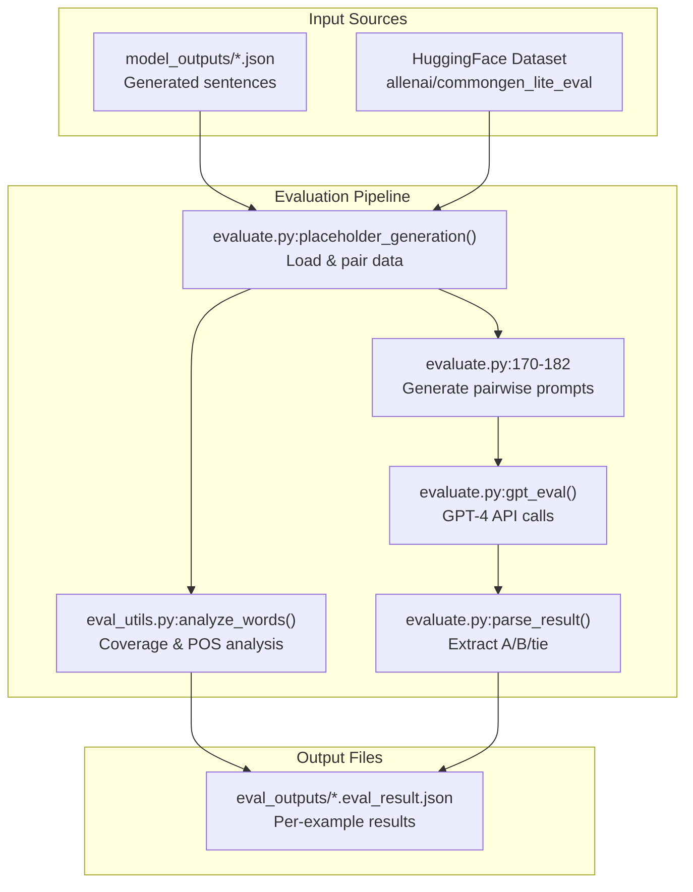
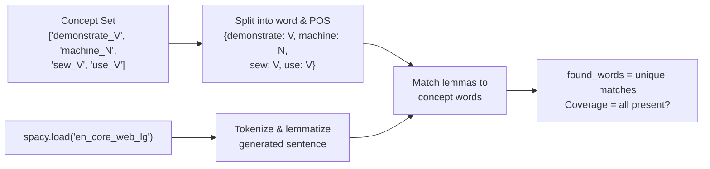
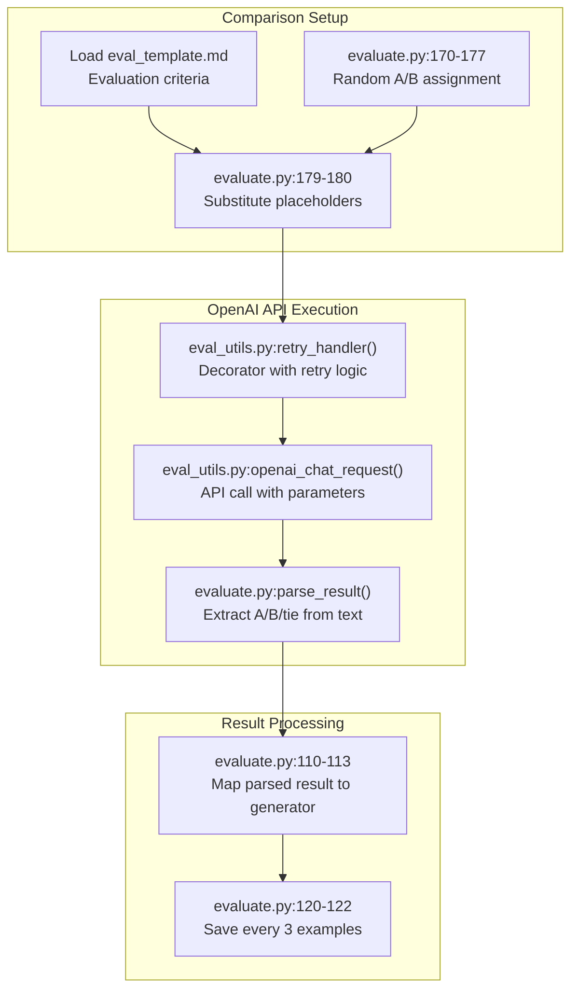
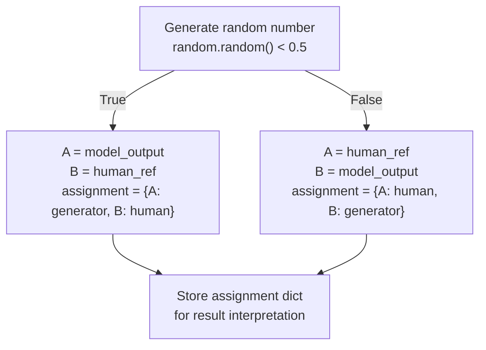
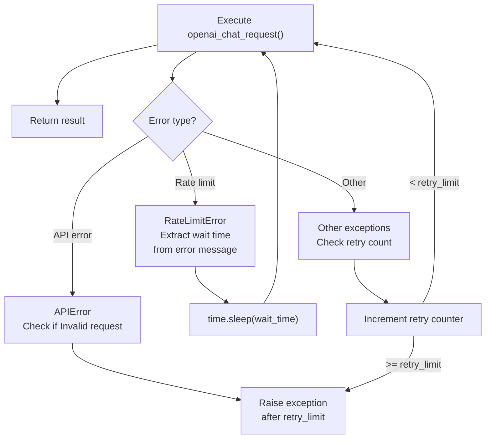
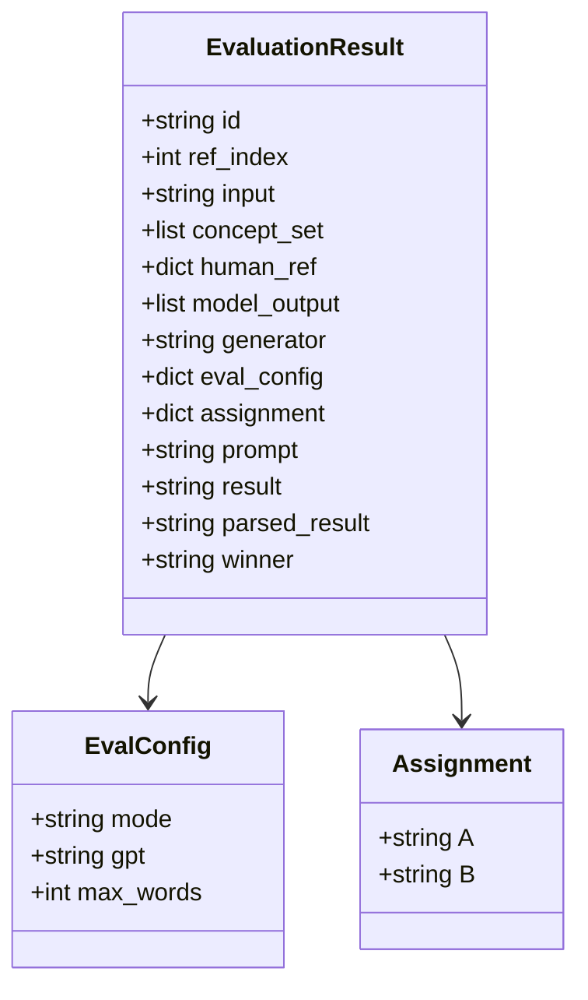
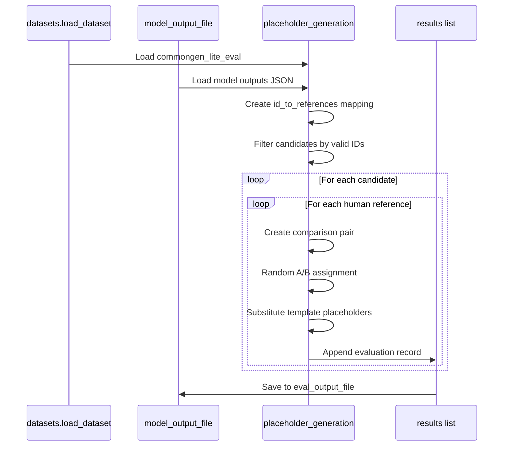

<!-- source: DeepWiki mcp.deepwiki.com · repo allenai/CommonGen-Eval · page 3.3 Evaluation System · fetched 2026-10-26 -->

# Evaluation System

<details>
<summary>Relevant source files</summary>

The following files were used as context for generating this wiki page:

- [README.md](README.md)
- [eval_template.md](eval_template.md)
- [eval_utils.py](eval_utils.py)
- [evaluate.py](evaluate.py)

</details>


The Evaluation System is responsible for assessing the quality of model-generated sentences by comparing them against human references. It combines automated linguistic metrics with GPT-4-based judgment to produce a comprehensive quality score. The system performs pairwise comparisons between model outputs and human references, calculating coverage, part-of-speech accuracy, and win/tie rates.

For information about how evaluation results are aggregated and displayed, see [Results Aggregation](#6.1). For details about the metrics themselves, see [Understanding Metrics](#6.3).

**Sources:** [README.md:99-148](), [evaluate.py:1-203]()

## System Overview

The evaluation system operates in two modes: `trial` mode for generating evaluation prompts without executing them, and `compare` mode for full GPT-4-based evaluation. The core workflow loads model outputs, pairs them with human references from the CommonGen-lite dataset, and conducts automated analysis alongside GPT-4 judgment.



**Sources:** [evaluate.py:186-202](), [README.md:99-116]()

## Automated Linguistic Metrics

The system performs automated analysis using the spaCy NLP library to compute coverage and part-of-speech accuracy before invoking GPT-4. These metrics are deterministic and provide objective measures of concept usage.

### Coverage Analysis

Coverage measures whether all required concepts appear in the generated sentence. The `analyze_words()` function uses lemmatization to match concept words in the output text:



The implementation at [eval_utils.py:17-37]() processes the sentence through spaCy's `en_core_web_lg` model and extracts lemmatized tokens that match the required concepts.

**Sources:** [eval_utils.py:17-37](), [README.md:40]()

### Part-of-Speech Validation

POS validation ensures that concepts are used with their correct grammatical roles. A concept marked as `word_V` (verb) must appear as a verb in the generated sentence:

| Concept Format | Expected POS Tag | spaCy Check |
|---------------|------------------|-------------|
| `word_N` | Noun | `tok.pos_ == 'NOUN'` |
| `word_V` | Verb | `tok.pos_ == 'VERB'` |
| `word_ADJ` | Adjective | `tok.pos_ == 'ADJ'` |

The matching logic at [eval_utils.py:29]() verifies that `input_dict[tok.lemma_].lower() in tok.pos_.lower()`, allowing partial matches like "V" matching "VERB".

**Sources:** [eval_utils.py:17-37](), [README.md:41]()

### Length Calculation

Sentence length is computed as the number of whitespace-separated tokens. This metric appears in the leaderboard to show verbosity tendencies across models (e.g., Mixtral-8x7B averages 20.15 words while Yi-6b-chat averages 13.32 words).

**Sources:** [README.md:23-38](), [README.md:39]()

## GPT-4 Judge System

The GPT-4 judge performs pairwise comparisons between model outputs and human references. Each comparison is treated as an independent evaluation task with randomized position assignment to prevent bias.

### Pairwise Comparison Architecture



**Sources:** [evaluate.py:59-125](), [eval_utils.py:100-156]()

### Evaluation Prompt Template

The evaluation prompt at [eval_template.md:1-24]() structures the comparison task:

| Template Section | Purpose | Key Elements |
|-----------------|---------|--------------|
| Data | Present the task context | Concepts, Model A output, Model B output |
| Your Task | Define the comparison goal | Choose better sentence based on naturalness |
| Rules | Specify judgment criteria | (1) Natural concept usage, (2) Correct POS, (3) Prefer simpler/shorter, (4) Allow ties |

The template uses placeholder syntax `{$concept_list}`, `{$candidate_A}`, and `{$candidate_B}` which are replaced at [evaluate.py:179-180]() using string substitution.

**Example prompt structure:**
```
Concepts: "demonstrate_V, machine_N, sew_V, use_V"
Model A: "The instructor demonstrates how to use the sewing machine."
Model B: "She used the sewing machine to demonstrate how well she could sew."

Your task is to choose a better sentence...
Your choice:
```

**Sources:** [eval_template.md:1-24](), [evaluate.py:136-183]()

### Random Position Assignment

To prevent position bias, the system randomly assigns model outputs and human references to positions A and B at [evaluate.py:170-177]():



After GPT-4 responds with "A", "B", or "tie", the `assignment` dictionary maps the choice back to the actual generator at [evaluate.py:110-113]().

**Sources:** [evaluate.py:170-177](), [evaluate.py:110-113]()

### Response Parsing

The `parse_result()` function at [evaluate.py:47-57]() extracts the judgment from GPT-4's response text:

| Response Pattern | Parsed Result | Meaning |
|-----------------|---------------|---------|
| Contains "A" | `"A"` | Prefers candidate A |
| Contains "B" | `"B"` | Prefers candidate B |
| Contains "tie" | `"tie"` | Equally good/bad |
| Contains "neither" | `"neither"` | Special case |
| No match | `"Not Matched"` | Parsing failed |

The function performs simple substring matching, checking for these keywords in the response string.

**Sources:** [evaluate.py:47-57]()

## API Interaction and Retry Logic

The system includes robust error handling for OpenAI API calls with exponential backoff and rate limit management.

### Retry Handler Decorator

The `retry_handler()` decorator at [eval_utils.py:47-98]() wraps API calls with automatic retry logic:



**Key features:**
- Rate limit errors trigger automatic waiting based on the error message's suggested wait time
- Other errors retry up to `retry_limit` times (default 10)
- Invalid API errors are immediately raised without retry

**Sources:** [eval_utils.py:47-98](), [evaluate.py:90-94]()

### OpenAI Chat Request Function

The `openai_chat_request()` function at [eval_utils.py:100-156]() provides a standardized interface for GPT-4 API calls:

| Parameter | Default | Purpose |
|-----------|---------|---------|
| `model` | None | Model identifier (e.g., "gpt-4-1106-preview") |
| `temperature` | 0.0 | Sampling temperature for deterministic output |
| `max_tokens` | 512 | Maximum response length |
| `top_p` | 1.0 | Nucleus sampling parameter |
| `prompt` | None | Single-turn prompt string |
| `messages` | None | Multi-turn conversation format |

The function constructs a messages list at [eval_utils.py:132-134]() if only a prompt string is provided, wrapping it in a standard assistant role format.

**Sources:** [eval_utils.py:100-156]()

## Evaluation Modes

The `evaluate.py` script supports two execution modes controlled by the `--mode` argument:

### Trial Mode

Trial mode generates evaluation prompts without executing GPT-4 calls. It creates the placeholder structure for all comparisons and saves them to the output file. This is useful for:
- Verifying prompt generation logic
- Estimating API costs before execution
- Debugging data pairing issues

At [evaluate.py:190-194](), trial mode calls `placeholder_generation()` and saves results immediately without invoking `gpt_eval()`.

**Sources:** [evaluate.py:190-194](), [evaluate.py:134-183]()

### Compare Mode

Compare mode performs the full evaluation pipeline:

1. Generate evaluation prompts via `placeholder_generation()` at [evaluate.py:196]()
2. Execute GPT-4 judgments via `gpt_eval()` at [evaluate.py:197]()
3. Save results incrementally every 3 examples at [evaluate.py:120-122]()

The system loads existing results from the output file if available, skipping already-evaluated examples at [evaluate.py:61-78](). This enables resumption after interruptions.

**Sources:** [evaluate.py:195-197](), [evaluate.py:59-125]()

## Result Data Structure

Each evaluation generates a detailed JSON record capturing all aspects of the comparison:



| Field | Description | Example Value |
|-------|-------------|---------------|
| `id` | Example identifier from dataset | `"dev_123"` |
| `ref_index` | Index of human reference (0-2) | `0` |
| `concept_set` | List of concept strings with POS | `["demonstrate_V", "machine_N"]` |
| `generator` | Model name | `"gpt-4-0613"` |
| `assignment` | A/B position mapping | `{"A": "human", "B": "gpt-4-0613"}` |
| `prompt` | Complete evaluation prompt | Full template with substitutions |
| `result` | Raw GPT-4 response | `"A"` or explanation text |
| `parsed_result` | Extracted choice | `"A"`, `"B"`, `"tie"`, or `"Not Matched"` |
| `winner` | Actual generator identified as winner | `"human"`, model name, or `"tie"` |

**Sources:** [evaluate.py:160-182](), [evaluate.py:107-113]()

## Data Pairing Process

The `placeholder_generation()` function at [evaluate.py:134-183]() pairs model outputs with human references:



Since each example has multiple human references (typically 2-3), the system creates multiple evaluation records per model output. With 400 examples and ~2.25 references per example, this generates approximately 900 pairwise comparisons per model.

**Sources:** [evaluate.py:134-183](), [README.md:17]()

## Incremental Saving

To prevent data loss during long evaluation runs, the system saves results incrementally at [evaluate.py:120-122]():

- Every `args.save_interval` examples (default: 3)
- After the final example in the batch
- Before raising any fatal exceptions

When resuming, the system loads existing results at [evaluate.py:61-78]() and skips examples where `result != "N/A"`, preserving completed evaluations.

**Sources:** [evaluate.py:120-122](), [evaluate.py:61-78]()

## Command-Line Execution

The evaluation script is typically invoked through shell scripts at `scripts/all_gpt_eval.sh`:

```bash
python evaluate.py --mode "compare" \
    --model_output_file "model_outputs/${model}.json" \
    --eval_output_file "eval_outputs/${model}.eval_result.gpt-4-1106-preview.json" \
    --model gpt-4-1106-preview
```

| Argument | Required | Description |
|----------|----------|-------------|
| `--mode` | Yes | Execution mode: "trial" or "compare" |
| `--model_output_file` | For compare mode | Path to model outputs JSON |
| `--eval_output_file` | Yes | Path for saving evaluation results |
| `--model` | For compare mode | OpenAI model identifier |
| `--temperature` | No | Sampling temperature (default: 0.0) |
| `--max_tokens` | No | Max response length (default: 1024) |
| `--save_interval` | No | Examples between saves (default: 3) |

**Sources:** [evaluate.py:20-44](), [README.md:105-115]()

---

