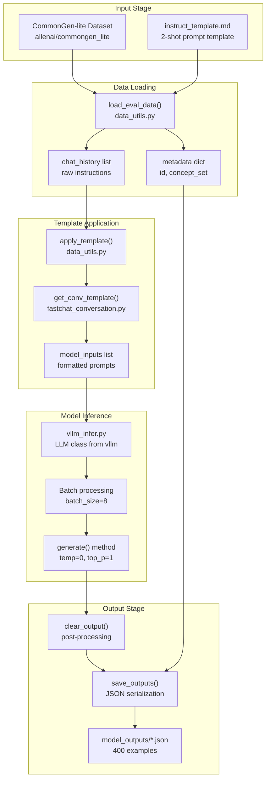
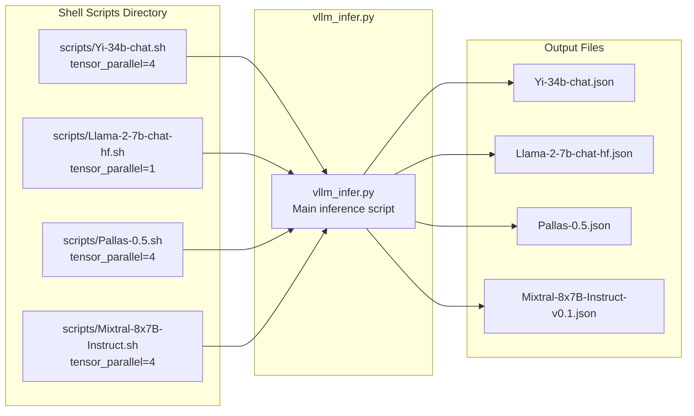
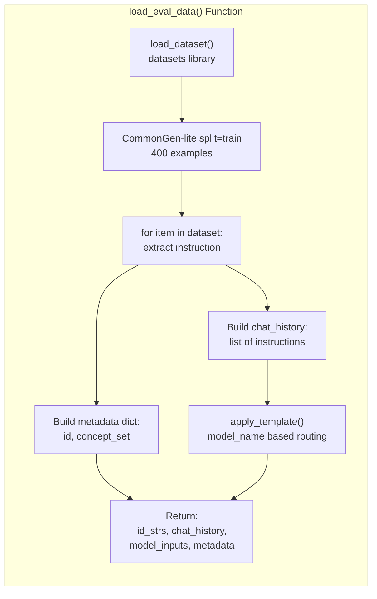
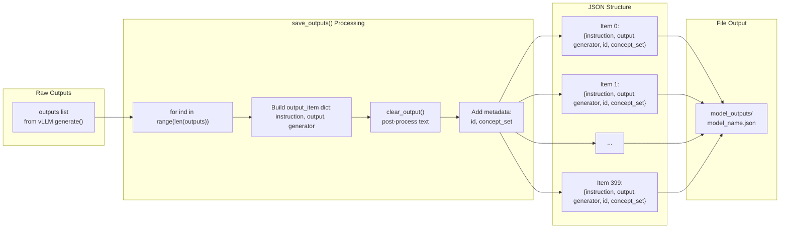

<!-- source: DeepWiki mcp.deepwiki.com · repo allenai/CommonGen-Eval · page 4 Running Model Inference · fetched 2026-10-26 -->

# Running Model Inference

<details>
<summary>Relevant source files</summary>

The following files were used as context for generating this wiki page:

- [README.md](README.md)
- [data_utils.py](data_utils.py)
- [instruct_template.md](instruct_template.md)
- [scripts/Pallas-0.5.sh](scripts/Pallas-0.5.sh)

</details>


This page describes how to run model inference to generate sentences from concept sets using the CommonGen-lite dataset. It covers the command-line interface, configuration options, and the overall inference pipeline that produces model outputs for later evaluation.

For details about the data loading and formatting functions, see [Data Utilities](#4.1). For information about conversation templates for different models, see [Conversation Templates](#4.2). For running evaluation on generated outputs, see [Running Evaluation](#5).

## Purpose and Scope

The model inference system takes concept sets from the CommonGen-lite dataset and generates natural language sentences using various large language models (LLMs). The system supports 50+ model architectures through model-specific conversation templates and uses vLLM for efficient batch inference.

**Sources:** [README.md:55-69]()

## Inference Pipeline Overview

The inference process follows a structured pipeline from data loading through model output generation:



**Sources:** [data_utils.py:34-57](), [data_utils.py:6-32](), [README.md:55-96]()

## Command-Line Interface

The primary entry point for model inference is `vllm_infer.py`, which is invoked through shell scripts with model-specific parameters.

### Basic Command Structure

```bash
CUDA_VISIBLE_DEVICES=0,1,2,3 \
python vllm_infer.py \
    --data_name "commongen" \
    --model_name 01-ai/Yi-34b-chat \
    --tensor_parallel_size 4 \
    --dtype bfloat16 \
    --output_folder "model_outputs/" \
    --top_p 1 \
    --temperature 0 \
    --batch_size 8 \
    --max_tokens 128
```

### Key Command-Line Arguments

| Argument | Purpose | Example Values |
|----------|---------|----------------|
| `--data_name` | Dataset identifier | `"commongen"` |
| `--model_name` | HuggingFace model path or name | `"01-ai/Yi-34b-chat"`, `"meta-llama/Llama-2-7b-chat-hf"` |
| `--tensor_parallel_size` | Number of GPUs for model parallelism | `1`, `2`, `4` |
| `--dtype` | Model precision format | `"bfloat16"`, `"float16"` |
| `--output_folder` | Directory for output JSON files | `"model_outputs/"` |
| `--top_p` | Nucleus sampling parameter | `1` |
| `--temperature` | Sampling temperature (0=greedy) | `0` |
| `--batch_size` | Number of examples per batch | `8` |
| `--max_tokens` | Maximum tokens per generation | `128` |
| `--download_dir` | Optional model cache directory | `"/path/to/cache/"` |

**Sources:** [README.md:62-69](), [scripts/Pallas-0.5.sh:1-7]()

## Model-Specific Shell Scripts

Each evaluated model has a corresponding shell script in the `scripts/` directory that configures model-specific parameters:



**Example script structure** (Pallas-0.5):

```bash
CUDA_VISIBLE_DEVICES=0,1,2,3 \
python vllm_infer.py \
    --download_dir /net/nfs/s2-research/llama2/ \
    --data_name "commongen" \
    --model_name Mihaiii/Pallas-0.5 \
    --tensor_parallel_size 4 \
    --dtype bfloat16 \
    --output_folder "model_outputs/" \
    --top_p 1 --temperature 0 --batch_size 8 --max_tokens 128
```

**Sources:** [scripts/Pallas-0.5.sh:1-7]()

## Data Loading and Formatting

The inference system loads data through `load_eval_data()` in `data_utils.py`, which performs the following transformations:



The `apply_template()` function routes to the appropriate conversation template based on model name pattern matching:

| Model Pattern | Template Name | Matching Logic |
|---------------|---------------|----------------|
| `"tulu"` | `"tulu"` | `if "tulu" in model_name.lower()` |
| `"zephyr"` | `"zephyr"` | `if "zephyr" in model_name.lower()` |
| `"llama-2"` | `"llama-2"` | `if "llama-2" in model_name.lower()` |
| `"mixtral"` or `"mistral"` | `"mistral"` | `if "mixtral" or "mistral" in model_name.lower()` |
| `"yi"` + `"chat"` | `"Yi-34b-chat"` | `if "yi" and "chat" in model_name.lower()` |
| `"vicuna"` | `"vicuna_v1.1"` | `if "vicuna" in model_name.lower()` |
| `"pallas"` | `"vicuna_v1.1"` | `if "pallas" in model_name.lower()` |
| `"gpt-"` | No template (direct use) | `if "gpt-" in model_name.lower()` |

**Sources:** [data_utils.py:34-57](), [data_utils.py:6-32]()

## Instruction Template

All models receive the same task instruction formatted using `instruct_template.md`, which provides a 2-shot prompt:

### Template Structure

```markdown
# Instruction

Given several concepts (i.e., nouns or verbs), write a short and simple sentence 
that contains *all* the required words. The sentence should describe a common 
scene in daily life, and the concepts should be used in a natural way.

# Examples

## Example 1
- Concepts: "dog(noun), frisbee(noun), catch(verb), throw(verb)"
- Sentence: The dog catches the frisbee when the boy throws it into the air.

## Example 2
- Concepts: "apple(noun), place(verb), tree(noun), pick(verb)"
- Sentence: A girl picks some apples from a tree and places them into her basket.

# Your Task 

- Concepts: "{$concept_list}"
- Sentence: 
```

The `{$concept_list}` placeholder is replaced with the actual concepts for each example, formatted by `concept_list_str()` which converts tags like `_N` to `(noun)` and `_V` to `(verb)`.

**Sources:** [instruct_template.md:1-19](), [data_utils.py:90-94]()

## Output Format and Storage

Model outputs are saved to `model_outputs/{model_name}.json` through the `save_outputs()` function:



### Output JSON Schema

Each output file contains a JSON array of objects with the following fields:

| Field | Type | Description |
|-------|------|-------------|
| `instruction` | string | The full prompt sent to the model |
| `output` | string or list | Generated sentence(s) from the model |
| `generator` | string | The model name that generated the output |
| `id` | string | Unique identifier for the example |
| `concept_set` | list | Array of concept strings with POS tags (e.g., `["dog_N", "catch_V"]`) |

**Sources:** [data_utils.py:72-88]()

## Post-Processing

The `clear_output()` function applies model-specific post-processing to clean up generated text:

```python
# Llama-2-7b specific cleaning
if "llama-2-7b" in model_name.lower():
    if "\n\n" in output:
        output = output[output.index("\n\n"):].strip()
```

This function handles model-specific artifacts and formatting issues. Additional post-processing can be added for new models as needed.

**Sources:** [data_utils.py:62-69]()

## Adding a New Model

To add inference support for a new model:

1. **Create a shell script** in `scripts/{model_name}.sh` with appropriate parameters:
   ```bash
   CUDA_VISIBLE_DEVICES=0 \
   python vllm_infer.py \
       --data_name "commongen" \
       --model_name your/model-name \
       --tensor_parallel_size 1 \
       --dtype bfloat16 \
       --output_folder "model_outputs/" \
       --top_p 1 --temperature 0 --batch_size 8 --max_tokens 128
   ```

2. **Add template routing** in `apply_template()` if the model requires a specific conversation format (see [Conversation Templates](#4.2))

3. **Add post-processing** in `clear_output()` if the model produces artifacts that need cleaning

4. **Run inference** using the shell script:
   ```bash
   bash scripts/{model_name}.sh
   ```

5. **Verify output** in `model_outputs/{model_name}.json`

**Sources:** [data_utils.py:6-32](), [data_utils.py:62-69](), [scripts/Pallas-0.5.sh:1-7]()

## Inference Parameters

The system uses conservative inference parameters to ensure deterministic, high-quality outputs:

| Parameter | Value | Rationale |
|-----------|-------|-----------|
| `temperature` | `0` | Greedy decoding for deterministic outputs |
| `top_p` | `1` | No nucleus sampling (greedy mode) |
| `max_tokens` | `128` | Sufficient for single sentences (avg ~15 words) |
| `batch_size` | `8` | Balances throughput and memory usage |

These parameters ensure that model outputs are reproducible and comparable across different runs.

**Sources:** [README.md:68](), [scripts/Pallas-0.5.sh:7]()

---

