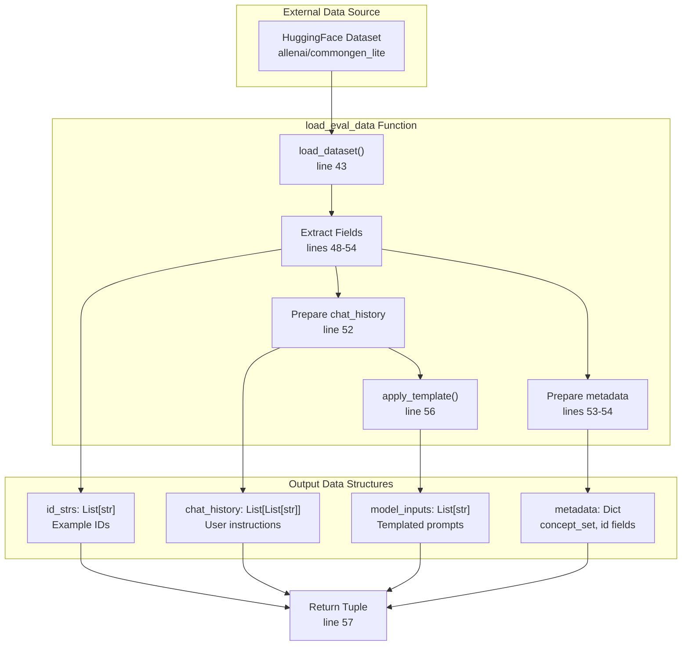
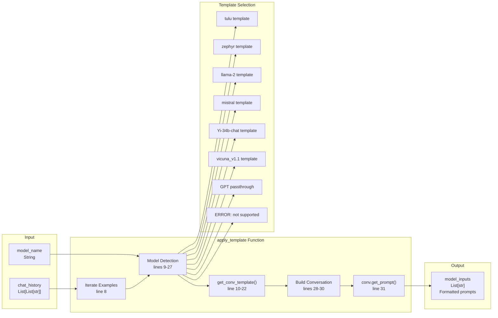
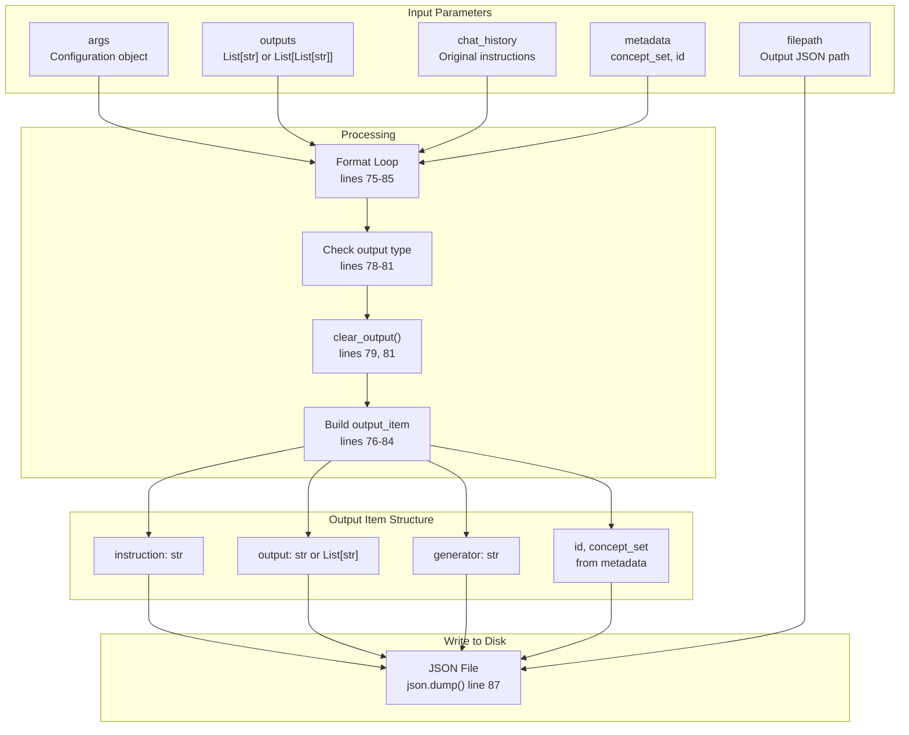
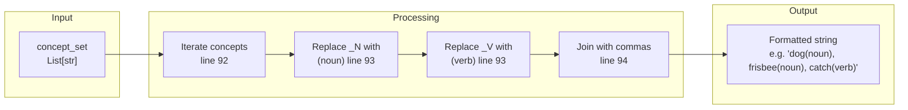
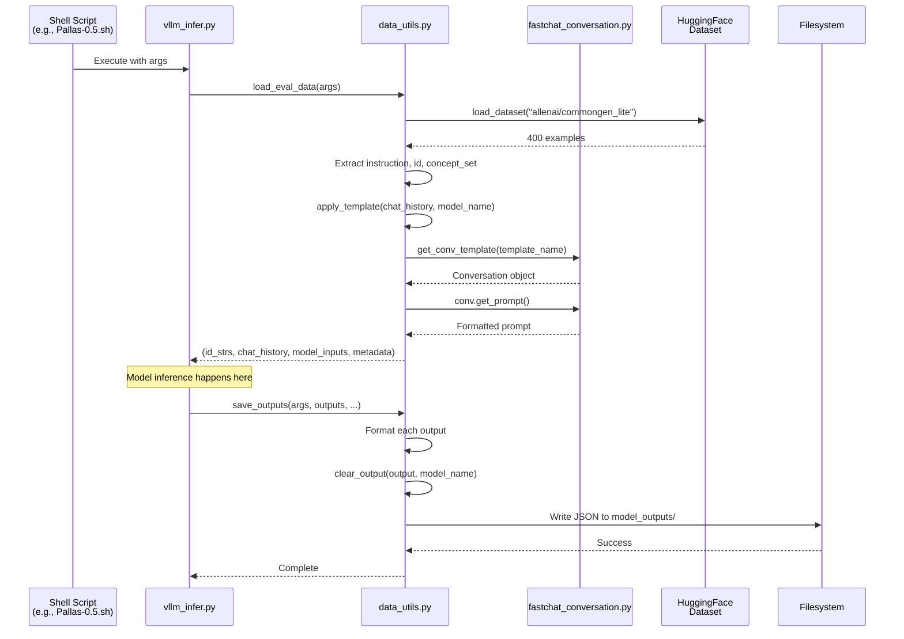

<!-- source: DeepWiki mcp.deepwiki.com · repo allenai/CommonGen-Eval · page 4.1 Data Utilities · fetched 2026-10-26 -->

# Data Utilities

<details>
<summary>Relevant source files</summary>

The following files were used as context for generating this wiki page:

- [data_utils.py](data_utils.py)
- [fastchat_conversation.py](fastchat_conversation.py)
- [scripts/Pallas-0.5.sh](scripts/Pallas-0.5.sh)

</details>


## Purpose and Scope

This document covers the `data_utils.py` module, which provides essential data loading, formatting, and output management functions for the CommonGen-Eval inference pipeline. These utilities handle dataset loading from HuggingFace, application of model-specific conversation templates, and standardization of model outputs.

For information about the conversation template system itself, see [Conversation Templates](#4.2). For the full inference pipeline that uses these utilities, see [Inference System](#3.2).

**Sources:** [data_utils.py:1-94]()

## Module Overview

The `data_utils.py` module serves as the data preparation layer between raw datasets and the model inference engine. It provides five core functions:

| Function | Purpose | Input | Output |
|----------|---------|-------|--------|
| `load_eval_data()` | Loads dataset from HuggingFace and prepares for inference | Arguments object, data name, model name | ID strings, chat history, model inputs, metadata |
| `apply_template()` | Applies model-specific conversation templates | Chat history, model name | Formatted model input strings |
| `save_outputs()` | Saves model outputs in standardized JSON format | Arguments, outputs, metadata, file path | JSON file on disk |
| `clear_output()` | Post-processes model outputs | Output string, model name | Cleaned output string |
| `concept_list_str()` | Formats concept sets for human readability | Concept set list | Formatted string |

**Sources:** [data_utils.py:1-94]()

## Data Loading Pipeline



**Sources:** [data_utils.py:34-57]()

### load_eval_data Function

The `load_eval_data()` function is the entry point for data loading. It loads the CommonGen-lite dataset from HuggingFace and prepares it for model inference.

**Function Signature:**
```python
def load_eval_data(args, data_name=None, model_name=None)
```

**Parameters:**
- `args` - Arguments object containing configuration
- `data_name` - Dataset identifier (default: from args, only "commongen" supported)
- `model_name` - Model name for template selection (default: from args)

**Return Values:**
```python
(id_strs, chat_history, model_inputs, metadata)
```
- `id_strs` - List of example IDs from the dataset
- `chat_history` - List of chat turns (single user message per example)
- `model_inputs` - List of templated prompts ready for model inference
- `metadata` - Dictionary with keys `"id"` and `"concept_set"`

**Dataset Loading:**

The function loads data from the HuggingFace dataset repository at line 43:
```python
dataset = load_dataset("allenai/commongen_lite", split="train")
```

**Field Extraction:**

For each item in the dataset, the function extracts:
- `instruction` field - Contains the formatted prompt with concepts
- `id` field - Example identifier
- `concept_set` field - List of concepts for metadata tracking

**Sources:** [data_utils.py:34-57]()

## Template Application System



**Sources:** [data_utils.py:6-32]()

### apply_template Function

The `apply_template()` function maps model names to their appropriate conversation templates and formats chat histories into model-ready prompts.

**Function Signature:**
```python
def apply_template(chat_history, model_name)
```

**Model Detection Logic:**

The function uses string matching on the `model_name` to select the appropriate template:

| Model Pattern | Template Used | Line Reference |
|--------------|---------------|----------------|
| `"tulu"` (case-insensitive) | `"tulu"` | [data_utils.py:9-10]() |
| `"zephyr"` (case-insensitive) | `"zephyr"` | [data_utils.py:11-12]() |
| `"llama-2"` (case-insensitive) | `"llama-2"` | [data_utils.py:13-14]() |
| `"mixtral"` or `"mistral"` | `"mistral"` | [data_utils.py:15-16]() |
| `"yi"` and `"chat"` | `"Yi-34b-chat"` | [data_utils.py:17-18]() |
| `"vicuna"` | `"vicuna_v1.1"` | [data_utils.py:19-20]() |
| `"pallas"` | `"vicuna_v1.1"` | [data_utils.py:21-22]() |
| `"gpt-"` | Direct passthrough | [data_utils.py:23-25]() |
| No match | Error raised | [data_utils.py:26-27]() |

**Template Integration:**

For non-GPT models, the function:
1. Retrieves the conversation template using `get_conv_template()` from `fastchat_conversation.py`
2. Appends each chat turn to the conversation object using alternating roles
3. Appends a final empty assistant message to prompt generation
4. Calls `conv.get_prompt()` to produce the formatted string

**GPT Model Handling:**

For GPT models (detected by `"gpt-"` in the model name), the function bypasses template formatting and directly uses the first element of the chat history, as GPT models handle their own conversation formatting through the OpenAI API.

**Sources:** [data_utils.py:6-32]()

## Output Processing

### save_outputs Function



**Sources:** [data_utils.py:72-88]()

The `save_outputs()` function standardizes model outputs into a consistent JSON format. It handles both single-generation and multi-generation outputs (when sampling multiple responses per prompt).

**Output Item Schema:**

Each item in the output JSON array contains:
```python
{
  "instruction": str,      # Original prompt
  "output": str or list,   # Model generation(s)
  "generator": str,        # Model name
  "id": str,              # Example ID
  "concept_set": list     # Concepts used
}
```

**Processing Steps:**

1. **Iterate through outputs** - Process each example in sequence
2. **Clear output** - Call `clear_output()` to post-process generation
3. **Handle output types** - Support both single strings and lists of strings
4. **Copy metadata** - Attach `id` and `concept_set` from metadata dictionary
5. **Write JSON** - Save formatted outputs with indentation for readability

**Sources:** [data_utils.py:72-88]()

### clear_output Function

The `clear_output()` function performs model-specific post-processing to clean generated text.

**Function Signature:**
```python
def clear_output(output, model_name)
```

**Current Implementation:**

The function currently has a commented-out section for Tulu/Zephyr models and one active cleaning rule:

- **Llama-2-7B specific**: If the model name contains `"llama-2-7b"` and the output contains `"\n\n"`, the function strips everything before the first double newline occurrence.

This addresses a known issue where Llama-2-7B sometimes includes preamble text before the actual generated sentence.

**Sources:** [data_utils.py:62-69]()

## Helper Functions

### concept_list_str Function



**Sources:** [data_utils.py:90-94]()

The `concept_list_str()` function formats concept sets from the dataset's internal representation to human-readable strings.

**Transformation Rules:**
- `"_N"` suffix → `"(noun)"` annotation
- `"_V"` suffix → `"(verb)"` annotation
- Concepts joined with `", "` separator

**Example:**
```python
Input:  ["dog_N", "frisbee_N", "catch_V"]
Output: "dog(noun), frisbee(noun), catch(verb)"
```

This function is used when displaying concept sets in prompts or visualizations to make part-of-speech information explicit.

**Sources:** [data_utils.py:90-94]()

## Integration with Inference Pipeline



**Sources:** [data_utils.py:1-94](), [scripts/Pallas-0.5.sh:1-7]()

## Data Structures

### Input Data Structure (from HuggingFace)

Each example in the CommonGen-lite dataset contains:

| Field | Type | Description | Example |
|-------|------|-------------|---------|
| `id` | `str` | Unique example identifier | `"commongen_lite_000"` |
| `instruction` | `str` | Formatted prompt with concepts | See below |
| `concept_set` | `List[str]` | List of concepts with POS tags | `["dog_N", "frisbee_N", "catch_V"]` |

**Instruction Format:**

The instruction field contains a 2-shot prompt with the concept set:
```
Below is a list of concepts, please compose a sentence using all the concepts.

Concept set: dog(noun), frisbee(noun)
Sentence: The dog catches the frisbee in the park.

Concept set: apple(noun), tree(noun), grow(verb)  
Sentence: Red apples grow on the tree in the garden.

Concept set: [current example concepts]
Sentence:
```

**Sources:** [data_utils.py:42-54]()

### Output Data Structure (to JSON file)

The standardized output format saved to `model_outputs/`:

```json
[
  {
    "instruction": "Below is a list of concepts...",
    "output": "The generated sentence using all concepts.",
    "generator": "Mihaiii/Pallas-0.5",
    "id": "commongen_lite_000",
    "concept_set": ["dog_N", "frisbee_N", "catch_V"]
  }
]
```

For multi-generation sampling, the `output` field becomes a list:
```json
{
  "output": [
    "First generated sentence.",
    "Second generated sentence.",
    "Third generated sentence."
  ]
}
```

**Sources:** [data_utils.py:72-87]()

## Usage Example

The typical usage pattern in the inference pipeline:

1. **Shell script invocation:**
   ```bash
   python vllm_infer.py \
       --data_name "commongen" \
       --model_name Mihaiii/Pallas-0.5 \
       --output_folder "model_outputs/"
   ```

2. **Data loading in vllm_infer.py:**
   ```python
   # Inside vllm_infer.py
   id_strs, chat_history, model_inputs, metadata = load_eval_data(args)
   ```

3. **Model inference occurs** (not shown, handled by vllm)

4. **Output saving:**
   ```python
   # After inference completes
   save_outputs(args, outputs, chat_history, metadata, filepath)
   ```

**Sources:** [data_utils.py:34-88](), [scripts/Pallas-0.5.sh:1-7]()

## Error Handling

The module includes minimal error handling:

1. **Unsupported data names:** If `data_name` is not `"commongen"`, the function prints an error message and continues, which may cause downstream failures.

2. **Unsupported model names:** If the model name doesn't match any known patterns in `apply_template()`, the function prints `"ERROR: model_name not supported"` but does not raise an exception.

These design choices suggest the module expects valid inputs from the caller and relies on the inference script to validate configuration.

**Sources:** [data_utils.py:26-27, 45-46]()

---

