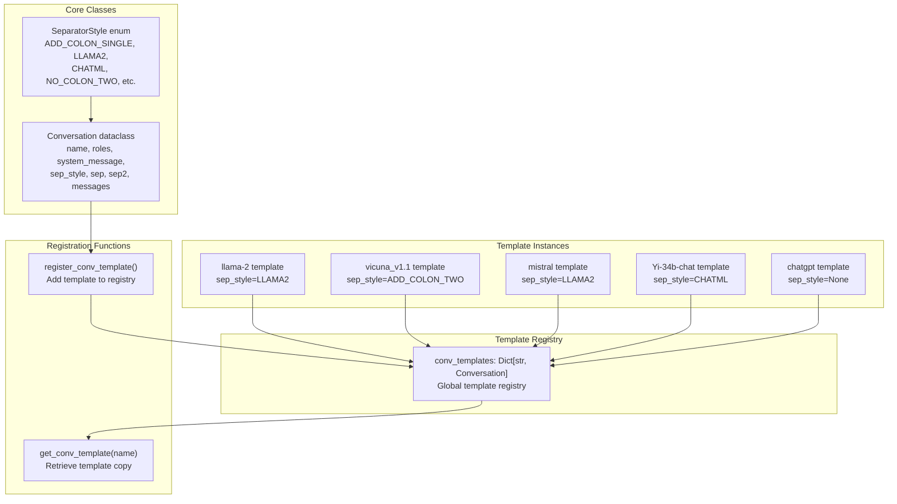
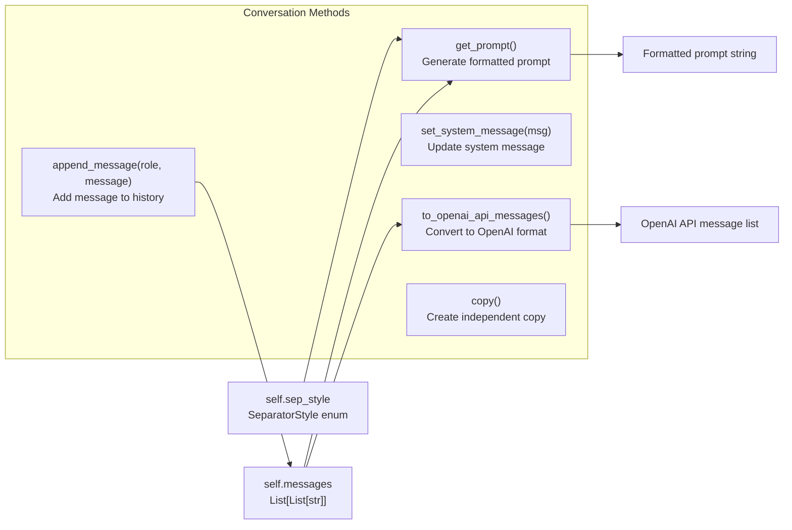
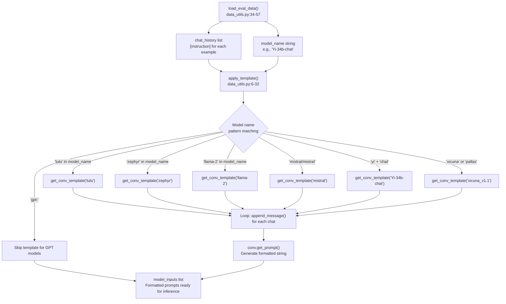
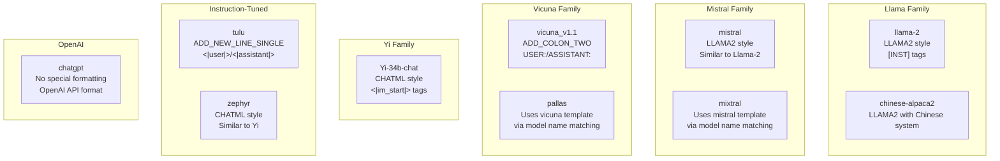
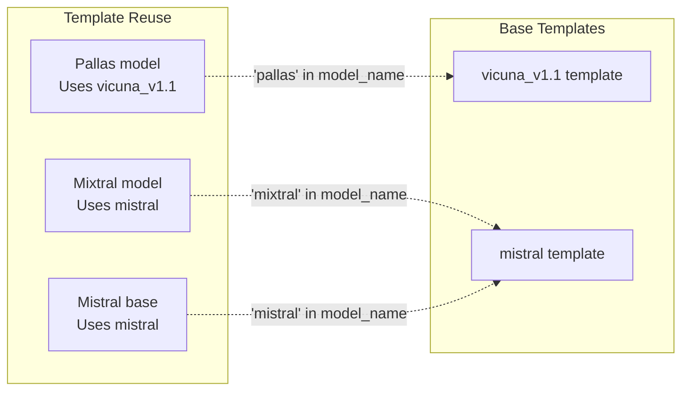

<!-- source: DeepWiki mcp.deepwiki.com · repo allenai/CommonGen-Eval · page 4.2 Conversation Templates · fetched 2026-10-26 -->

# Conversation Templates

<details>
<summary>Relevant source files</summary>

The following files were used as context for generating this wiki page:

- [data_utils.py](data_utils.py)
- [fastchat_conversation.py](fastchat_conversation.py)
- [scripts/Pallas-0.5.sh](scripts/Pallas-0.5.sh)

</details>


This page documents the conversation template system used to format prompts for different language models during inference. The template system, implemented in [fastchat_conversation.py](), provides 50+ pre-configured templates that handle model-specific prompt formatting requirements.

For information about how templates are used within the broader inference pipeline, see [Running Model Inference](#4). For details on the data loading and formatting functions that call these templates, see [Data Utilities](#4.1).

## Purpose and Scope

The conversation template system solves a critical problem in multi-model evaluation: different language models expect different prompt formats. For example:
- **Llama-2** uses `[INST]` and `[/INST]` tags with special system message formatting
- **Vicuna** uses `USER:` and `ASSISTANT:` with space separators
- **Mistral** uses the Llama-2 format but with different separators
- **ChatGPT** uses the OpenAI API message format

This system provides a unified interface to abstract these differences, allowing the inference code to work with any supported model without modification.

**Sources:** [fastchat_conversation.py:1-11](), [data_utils.py:1-32]()

## System Architecture

The template system consists of three main components: the `Conversation` dataclass that defines template structure, the `SeparatorStyle` enum that defines formatting patterns, and a global registry that stores all template instances.



**Sources:** [fastchat_conversation.py:34-328](), [fastchat_conversation.py:312-328]()

## The Conversation Class

The `Conversation` dataclass ([fastchat_conversation.py:34-310]()) is the core data structure that defines how to format prompts for a specific model. It manages conversation history and generates properly formatted prompts.

### Key Fields

| Field | Type | Purpose |
|-------|------|---------|
| `name` | `str` | Template identifier (e.g., "llama-2", "vicuna_v1.1") |
| `system_template` | `str` | Format string for system message (default: `"{system_message}"`) |
| `system_message` | `str` | Default system prompt content |
| `roles` | `Tuple[str]` | Role names (e.g., `("USER", "ASSISTANT")`) |
| `messages` | `List[List[str]]` | Conversation history as `[role, message]` pairs |
| `sep_style` | `SeparatorStyle` | Separator formatting pattern |
| `sep` | `str` | Primary separator string |
| `sep2` | `str` | Secondary separator (for alternating patterns) |
| `stop_str` | `Union[str, List[str]]` | String(s) that signal end of generation |
| `stop_token_ids` | `List[int]` | Token IDs that signal end of generation |

**Sources:** [fastchat_conversation.py:34-58]()

### Core Methods



The `get_prompt()` method ([fastchat_conversation.py:59-247]()) is the most important function, converting the conversation history into a model-specific prompt string based on the `sep_style`.

**Sources:** [fastchat_conversation.py:249-309]()

## Separator Styles

The `SeparatorStyle` enum ([fastchat_conversation.py:11-32]()) defines different patterns for formatting messages. Each style corresponds to a specific formatting convention used by different model families.

### Common Separator Styles

| Style | Pattern | Example Models | Line Reference |
|-------|---------|----------------|----------------|
| `ADD_COLON_SINGLE` | `role: message\n` | Vicuna (basic), Alpaca | [fastchat_conversation.py:62-69]() |
| `ADD_COLON_TWO` | `role: message sep1` / `role: message sep2` | Vicuna v1.1, Koala | [fastchat_conversation.py:70-78]() |
| `LLAMA2` | `[INST] message [/INST]` | Llama-2, Mistral, Mixtral | [fastchat_conversation.py:125-140]() |
| `CHATML` | `<|im_start|>role\nmessage<|im_end|>` | Yi-34b-chat, Qwen, MPT | [fastchat_conversation.py:159-166]() |
| `NO_COLON_SINGLE` | `role message\n` | Raw, StableLM | [fastchat_conversation.py:95-102]() |
| `NO_COLON_TWO` | `role message sep1` / `role message sep2` | Baichuan, CuteGPT | [fastchat_conversation.py:103-111]() |

### Llama-2 Format Example

The Llama-2 format ([fastchat_conversation.py:980-989]()) is widely used:

```
[INST] <<SYS>>
{system_message}
<</SYS>>

{user_message_1} [/INST] {assistant_message_1} </s><s>[INST] {user_message_2} [/INST]
```

**Sources:** [fastchat_conversation.py:11-32](), [fastchat_conversation.py:59-247]()

## Template Usage in Inference

During inference, templates are applied to format the instruction text before sending it to the model. The process is orchestrated by `apply_template()` in [data_utils.py:6-32]().



### Template Selection Logic

The `apply_template()` function uses string matching on the model name to select the appropriate template:

```python
# From data_utils.py:9-26
if "tulu" in model_name.lower():
    conv = get_conv_template("tulu")
elif "zephyr" in model_name.lower():
    conv = get_conv_template("zephyr")
elif "llama-2" in model_name.lower():
    conv = get_conv_template("llama-2")
elif "mixtral" in model_name.lower() or "mistral" in model_name.lower():
    conv = get_conv_template("mistral")
elif "yi" in model_name.lower() and "chat" in model_name.lower():
    conv = get_conv_template("Yi-34b-chat")
elif "vicuna" in model_name.lower():
    conv = get_conv_template("vicuna_v1.1")
elif "pallas" in model_name.lower():
    conv = get_conv_template("vicuna_v1.1")
elif "gpt-" in model_name.lower():
    model_inputs.append(chats[0])  # No template needed
    continue
```

**Sources:** [data_utils.py:6-32](), [data_utils.py:34-57]()

## Available Templates

The system provides 50+ registered templates. Below are some commonly used templates in this evaluation framework:

### Model Family Templates



### Template Examples

| Template Name | Roles | Separator | System Message |
|---------------|-------|-----------|----------------|
| `llama-2` | `("[INST]", "[/INST]")` | `sep=" "`, `sep2=" </s><s>"` | Custom via template |
| `vicuna_v1.1` | `("USER", "ASSISTANT")` | `sep=" "`, `sep2="</s>"` | "A chat between a curious user..." |
| `mistral` | `("[INST]", "[/INST]")` | `sep=" "`, `sep2="</s>"` | Via template |
| `Yi-34b-chat` | `("<|im_start|>user", "<|im_start|>assistant")` | `sep="<|im_end|>"` | None |
| `tulu` | `("<|user|>", "<|assistant|>")` | `sep="\n"` | "" |
| `zephyr` | `("<|user|>", "<|assistant|>")` | `sep="</s>"` | Via template |
| `chatgpt` | `("user", "assistant")` | `sep_style=None` | "You are a helpful assistant." |

**Sources:** [fastchat_conversation.py:980-989](), [fastchat_conversation.py:389-399](), [fastchat_conversation.py:966-975](), [fastchat_conversation.py:1102-1116](), [fastchat_conversation.py:563-570](), [fastchat_conversation.py:1314-1324](), [fastchat_conversation.py:670-678]()

## Detailed Template Examples

### Llama-2 Template

The Llama-2 template ([fastchat_conversation.py:980-989]()) is one of the most widely used formats:

```python
Conversation(
    name="llama-2",
    system_template="[INST] <<SYS>>\n{system_message}\n<</SYS>>\n\n",
    roles=("[INST]", "[/INST]"),
    sep_style=SeparatorStyle.LLAMA2,
    sep=" ",
    sep2=" </s><s>",
)
```

**Generated prompt format:**
```
[INST] <<SYS>>
You are a helpful assistant.
<</SYS>>

User message 1 [/INST] Assistant response 1 </s><s>[INST] User message 2 [/INST]
```

### Vicuna Template

The Vicuna v1.1 template ([fastchat_conversation.py:389-399]()) uses a simpler colon-based format:

```python
Conversation(
    name="vicuna_v1.1",
    system_message="A chat between a curious user and an artificial intelligence assistant. "
    "The assistant gives helpful, detailed, and polite answers to the user's questions.",
    roles=("USER", "ASSISTANT"),
    sep_style=SeparatorStyle.ADD_COLON_TWO,
    sep=" ",
    sep2="</s>",
)
```

**Generated prompt format:**
```
A chat between a curious user and an artificial intelligence assistant. The assistant gives helpful, detailed, and polite answers to the user's questions.
USER: Hello! ASSISTANT: Hi!</s>USER: How are you? ASSISTANT:
```

### Yi-34b-chat Template

The Yi template ([fastchat_conversation.py:1102-1116]()) uses the ChatML format:

```python
Conversation(
    name="Yi-34b-chat",
    roles=("<|im_start|>user", "<|im_start|>assistant"),
    sep_style=SeparatorStyle.CHATML,
    sep="<|im_end|>",
    stop_token_ids=[2, 6, 7, 8],
    stop_str="<|endoftext|>",
)
```

**Generated prompt format:**
```
<|im_start|>user
Hello!<|im_end|>
<|im_start|>assistant
Hi!<|im_end|>
<|im_start|>user
How are you?<|im_end|>
<|im_start|>assistant
```

**Sources:** [fastchat_conversation.py:980-989](), [fastchat_conversation.py:389-399](), [fastchat_conversation.py:1102-1116]()

## Adding New Models

To add support for a new model, you need to:

1. **Register a new template** (if the model requires a unique format)
2. **Update the template selection logic** in `apply_template()`
3. **Create a shell script** for running inference

### Step 1: Register a New Template

Add a new template registration in [fastchat_conversation.py]() (after existing templates):

```python
register_conv_template(
    Conversation(
        name="your-model-name",
        system_message="Your system message",
        roles=("Role1", "Role2"),
        sep_style=SeparatorStyle.ADD_COLON_TWO,  # Choose appropriate style
        sep="\n",
        sep2="</s>",
    )
)
```

### Step 2: Update Template Selection

Modify `apply_template()` in [data_utils.py:6-32]() to include your model:

```python
elif "your-model" in model_name.lower():
    conv = get_conv_template("your-model-name")
```

### Step 3: Create Inference Script

Create a shell script in `scripts/` directory (e.g., `scripts/your-model.sh`):

```bash
CUDA_VISIBLE_DEVICES=0,1,2,3 \
python vllm_infer.py \
    --model_name your-org/your-model-name \
    --data_name "commongen" \
    --output_folder "model_outputs/" \
    --tensor_parallel_size 4 \
    --dtype bfloat16 \
    --top_p 1 \
    --temperature 0 \
    --batch_size 8 \
    --max_tokens 128
```

**Sources:** [data_utils.py:6-32](), [scripts/Pallas-0.5.sh:1-7]()

## Using Existing Templates for Similar Models

Many models use the same prompt format as existing templates. Instead of creating a new template, you can map the model name to an existing template in `apply_template()`:

### Common Template Reuse Patterns



From [data_utils.py:21-22]():
```python
elif "pallas" in model_name.lower():
    conv = get_conv_template("vicuna_v1.1")
```

This approach is used when a model follows the same format as an existing template (e.g., Pallas uses the Vicuna format).

**Sources:** [data_utils.py:9-26]()

## Template Testing and Verification

The [fastchat_conversation.py]() file includes a test section ([fastchat_conversation.py:1381-1421]()) that demonstrates how to use templates:

```python
# Example from the test code
conv = get_conv_template("vicuna_v1.1")
conv.append_message(conv.roles[0], "Hello!")
conv.append_message(conv.roles[1], "Hi!")
conv.append_message(conv.roles[0], "How are you?")
conv.append_message(conv.roles[1], None)  # None indicates waiting for response
print(conv.get_prompt())
```

When adding a new template, you can test it by running the module directly:
```bash
python fastchat_conversation.py
```

**Sources:** [fastchat_conversation.py:1381-1421]()

## Special Cases

### GPT Models

GPT models (ChatGPT, GPT-4) don't use template formatting. They are detected by the `"gpt-"` prefix and skip template application entirely ([data_utils.py:23-25]()):

```python
elif "gpt-" in model_name.lower():
    model_inputs.append(chats[0])
    continue
```

The raw instruction text is used directly because these models are accessed via the OpenAI API, which handles formatting internally.

### Output Cleaning

Some models require post-processing of their outputs. The `clear_output()` function ([data_utils.py:62-69]()) handles model-specific output cleaning:

```python
def clear_output(output, model_name):
    if "llama-2-7b" in model_name.lower():
        if "\n\n" in output:
            output = output[output.index("\n\n"):].strip()
    return output
```

**Sources:** [data_utils.py:23-25](), [data_utils.py:62-69]()

## Summary

The conversation template system provides:
- **50+ pre-configured templates** for different model families
- **Unified interface** via the `Conversation` class and `get_conv_template()` function
- **Flexible separator styles** to handle diverse prompt formats
- **Easy extensibility** through template registration
- **Integration with inference pipeline** via `apply_template()` in data_utils.py

The system abstracts away prompt formatting complexity, allowing the evaluation framework to work seamlessly with any supported model by simply matching the model name to the appropriate template.

**Sources:** [fastchat_conversation.py:1-1422](), [data_utils.py:1-94]()

---

