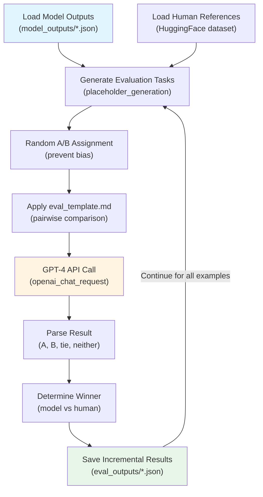
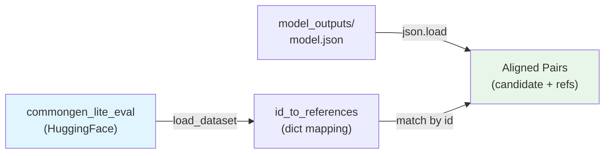
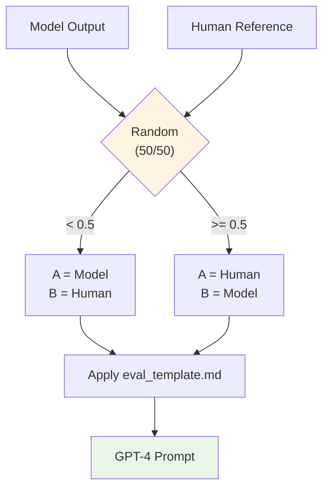
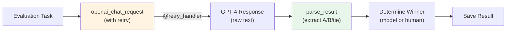
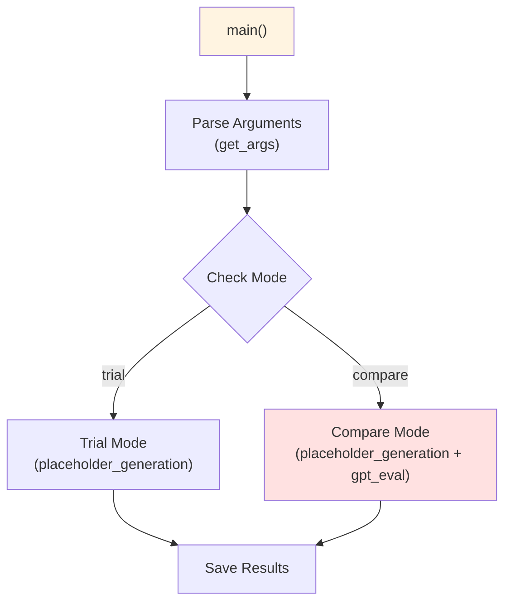

<!-- source: DeepWiki mcp.deepwiki.com · repo allenai/CommonGen-Eval · page 5 Running Evaluation · fetched 2026-10-26 -->

# Running Evaluation

<details>
<summary>Relevant source files</summary>

The following files were used as context for generating this wiki page:

- [README.md](README.md)
- [eval_template.md](eval_template.md)
- [evaluate.py](evaluate.py)

</details>


## Purpose and Scope

This page guides users through running GPT-4-based evaluation on model outputs generated from the inference stage. The evaluation system compares model-generated sentences against human-written references using GPT-4 as a judge, implementing pairwise comparison with automated metrics.

**Related pages:**
- For details on the evaluation utility functions, see [Evaluation Utilities](#5.1)
- For information about prompt templates used in evaluation, see [Prompt Templates](#5.2)
- For running model inference to generate outputs, see [Running Model Inference](#4)
- For analyzing and aggregating evaluation results, see [Analyzing Results](#6)

---

## Evaluation Overview

The evaluation system loads model outputs from the inference stage, pairs them with human reference sentences from the CommonGen-lite dataset, and uses GPT-4 to perform pairwise comparisons. The system operates in two modes: **trial** (generates evaluation tasks without calling GPT-4) and **compare** (performs actual GPT-4 evaluation).

### Evaluation Workflow



**Sources:** [evaluate.py:1-203](), [README.md:99-147]()

---

## Evaluation Modes

The evaluation system supports two operational modes controlled by the `--mode` argument:

| Mode | Purpose | GPT-4 API Calls | Output |
|------|---------|-----------------|--------|
| **trial** | Generate evaluation tasks without API calls | No | JSON file with prompts and placeholders |
| **compare** | Perform full GPT-4-based evaluation | Yes | JSON file with GPT-4 judgments and winners |

### Trial Mode

Trial mode generates evaluation tasks and saves them without making GPT-4 API calls. This is useful for:
- Verifying the evaluation setup
- Previewing prompts before spending API credits
- Debugging prompt generation logic

```bash
python evaluate.py --mode "trial" \
    --model_output_file "model_outputs/Yi-34b-chat.json" \
    --eval_output_file "eval_outputs/Yi-34b-chat.trial.json"
```

**Sources:** [evaluate.py:190-194]()

### Compare Mode

Compare mode performs the full evaluation pipeline, including GPT-4 API calls for pairwise comparison:

```bash
python evaluate.py --mode "compare" \
    --model_output_file "model_outputs/Yi-34b-chat.json" \
    --eval_output_file "eval_outputs/Yi-34b-chat.eval_result.gpt-4-1106-preview.json" \
    --model gpt-4-1106-preview
```

**Sources:** [evaluate.py:195-197](), [README.md:106-115]()

---

## Command-Line Arguments

The `evaluate.py` script accepts the following arguments:

### Required Arguments

| Argument | Type | Description |
|----------|------|-------------|
| `--mode` | string | Evaluation mode: `"trial"` or `"compare"` |
| `--eval_output_file` | string | Path to save evaluation results (JSON format) |

### Optional Arguments

| Argument | Type | Default | Description |
|----------|------|---------|-------------|
| `--model_output_file` | string | Required for both modes | Path to model inference output file |
| `--start_idx` | int | 0 | Starting index for evaluation subset |
| `--end_idx` | int | -1 | Ending index (-1 means all examples) |
| `--save_interval` | int | 3 | Save results every N examples |
| `--max_words_to_eval` | int | -1 | Maximum words to evaluate (-1 means no limit) |
| `--api_key` | string | None | OpenAI API key (uses env var if not provided) |
| `--model` | string | gpt-4-0314 | GPT model for evaluation |
| `--engine` | string | None | OpenAI engine (alternative to model) |
| `--temperature` | float | 0.0 | Temperature for GPT-4 generation |
| `--max_tokens` | int | 1024 | Maximum tokens in GPT-4 response |

**Sources:** [evaluate.py:20-44]()

---

## Evaluation Process Details

### Step 1: Loading Data

The evaluation system loads two data sources:

1. **Model outputs** from the inference stage [evaluate.py:139-140]()
2. **Human reference annotations** from the HuggingFace dataset `allenai/commongen_lite_eval` [evaluate.py:135](), [evaluate.py:141]()

The system matches model outputs to reference annotations by `id` and filters to ensure alignment [evaluate.py:142-144]().



**Sources:** [evaluate.py:135-144]()

### Step 2: Pairwise Comparison Setup

For each model output, the system creates evaluation tasks by pairing it with each human reference annotation. The key feature is **random A/B assignment** to prevent positional bias:



**Sources:** [evaluate.py:170-177]()

The assignment is tracked in the result structure [evaluate.py:173](), [evaluate.py:177]() so the system can determine the actual winner after GPT-4 responds.

### Step 3: Prompt Generation

The evaluation prompt is generated by substituting values into the `eval_template.md` template:

- `{$concept_list}`: The concept set formatted as a string
- `{$candidate_A}`: First candidate sentence (randomly assigned)
- `{$candidate_B}`: Second candidate sentence (randomly assigned)

**Sources:** [evaluate.py:136-137](), [evaluate.py:178-179](), [eval_template.md:1-24]()

### Step 4: GPT-4 Evaluation

The system calls GPT-4 via the OpenAI API with retry logic:



**Sources:** [evaluate.py:90-94](), [evaluate.py:104-114]()

The `@retry_handler` decorator provides automatic retry with exponential backoff [evaluate.py:90](). For implementation details, see [Evaluation Utilities](#5.1).

### Step 5: Result Parsing

The system parses GPT-4's response to extract the choice [evaluate.py:47-57]():

| GPT-4 Response Contains | Parsed Result |
|-------------------------|---------------|
| "A" | "A" |
| "B" | "B" |
| "tie" | "tie" |
| "neither" | "neither" |
| Other | "Not Matched" |

The parsed result is mapped back through the assignment to determine whether the model or human won [evaluate.py:110-113]().

**Sources:** [evaluate.py:47-57](), [evaluate.py:99](), [evaluate.py:108-113]()

---

## Input/Output Specifications

### Input: Model Output File

The model output file must be a JSON file containing a list of dictionaries with the following structure:

```json
[
  {
    "id": "example_id",
    "instruction": "Given several concepts...",
    "concept_set": ["word1_N", "word2_V", ...],
    "output": ["Generated sentence here."],
    "generator": "model_name"
  }
]
```

**Sources:** [evaluate.py:139-140]()

### Output: Evaluation Result File

The evaluation result file is a JSON file with detailed evaluation information:

```json
[
  {
    "id": "example_id",
    "ref_index": 0,
    "input": "Given several concepts...",
    "concept_set": ["word1_N", "word2_V", ...],
    "human_ref": {"ref": "Human sentence.", "ref_id": "ref_123"},
    "model_output": ["Generated sentence."],
    "generator": "model_name",
    "eval_config": {
      "mode": "compare",
      "gpt": "gpt-4-1106-preview",
      "max_words": -1
    },
    "assignment": {"A": "model_name", "B": "human"},
    "prompt": "Full GPT-4 prompt text...",
    "result": "GPT-4 raw response...",
    "parsed_result": "A",
    "winner": "model_name"
  }
]
```

**Sources:** [evaluate.py:160-182]()

### Checkpoint and Resume Functionality

The evaluation system automatically saves progress at regular intervals (controlled by `--save_interval`) and can resume from existing results:

1. **Incremental saving**: Results are saved every N examples [evaluate.py:120-122]()
2. **Resume capability**: If the output file exists, the system loads existing results and skips completed evaluations [evaluate.py:61-78]()
3. **Result matching**: Prompts are matched to ensure consistency [evaluate.py:68-69]()

This enables interrupting and resuming long evaluation runs without losing progress or wasting API credits.

**Sources:** [evaluate.py:61-78](), [evaluate.py:97-102](), [evaluate.py:120-124]()

---

## Batch Evaluation Example

To evaluate multiple models efficiently, use shell scripting to run evaluations in parallel:

```bash
models=("zephyr-7b-beta" "tulu-2-dpo-70b" "vicuna-13b-v1.5")
for model in "${models[@]}"
do 
    python evaluate.py --mode "compare" \
        --model_output_file "model_outputs/${model}.json" \
        --eval_output_file "eval_outputs/${model}.eval_result.gpt-4-1106-preview.json" \
        --model gpt-4-1106-preview &
done
```

The `&` at the end runs evaluations in parallel. Monitor progress via the individual output files.

**Sources:** [README.md:107-115]()

---

## Key Implementation Components

### Main Entry Point

The `main()` function [evaluate.py:186-200]() orchestrates the evaluation:



**Sources:** [evaluate.py:186-200]()

### Core Functions

| Function | Lines | Purpose |
|----------|-------|---------|
| `get_args()` | [evaluate.py:20-44]() | Parse command-line arguments |
| `placeholder_generation()` | [evaluate.py:134-183]() | Generate evaluation tasks with A/B assignment |
| `gpt_eval()` | [evaluate.py:59-125]() | Execute GPT-4 evaluation with retry logic |
| `parse_result()` | [evaluate.py:47-57]() | Extract choice from GPT-4 response |

**Sources:** [evaluate.py:20-125]()

### Error Handling

The evaluation system implements robust error handling:

1. **Retry decorator**: The `@retry_handler` decorator on the `api()` function provides automatic retry [evaluate.py:90]()
2. **Exception catching**: Failed API calls are caught and logged [evaluate.py:115-117]()
3. **Progress saving**: Regular checkpoints prevent data loss [evaluate.py:120-122]()

For detailed information on retry logic and API interaction, see [Evaluation Utilities](#5.1).

**Sources:** [evaluate.py:90-117]()

---

## Important Notes

### API Access Requirements

The evaluation script requires special access to the HuggingFace dataset `allenai/commongen_lite_eval` [evaluate.py:135](). According to the README, users should submit their inference results via GitHub issue or PR, and the maintainers will run the evaluation [README.md:101]().

### Random Seed

The evaluation uses a fixed random seed (`random.seed(42)`) [evaluate.py:187]() to ensure reproducibility of A/B assignments across runs.

### Cost Considerations

With 400 examples and an average of 2-3 human references per example, a full evaluation requires approximately 800-1200 GPT-4 API calls. At current GPT-4 pricing, this represents a significant cost. Use `--start_idx` and `--end_idx` for testing on subsets.

**Sources:** [README.md:101](), [evaluate.py:187](), [evaluate.py:26-27]()

---

