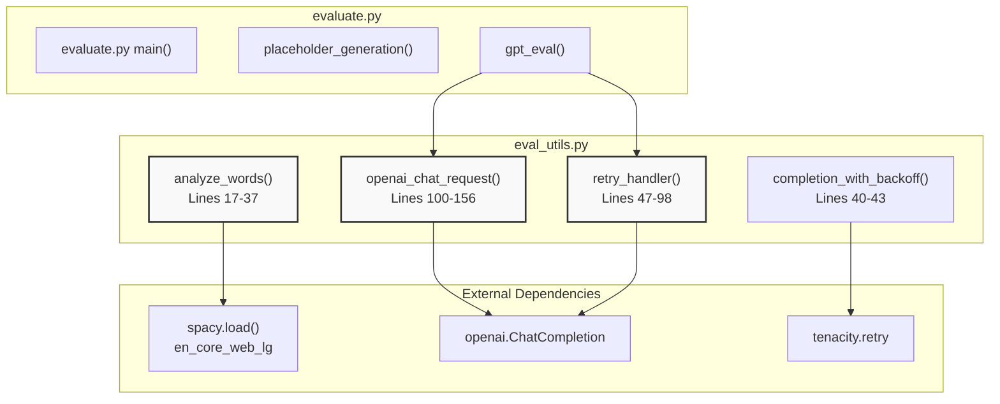
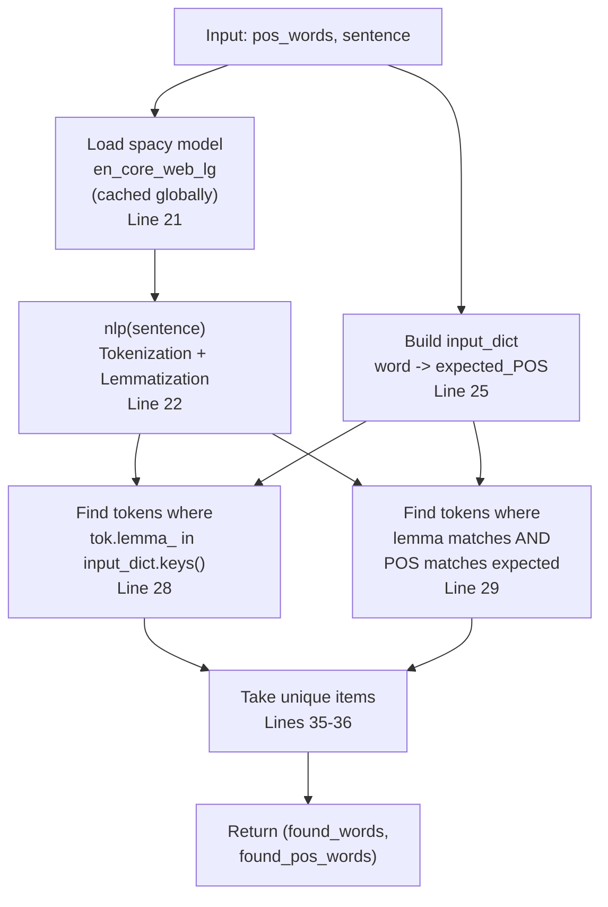
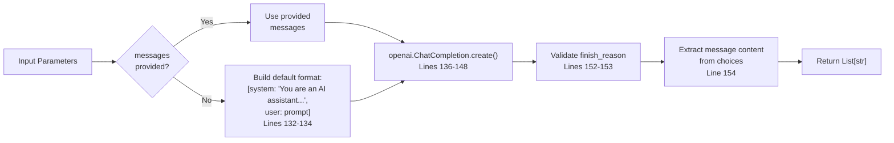
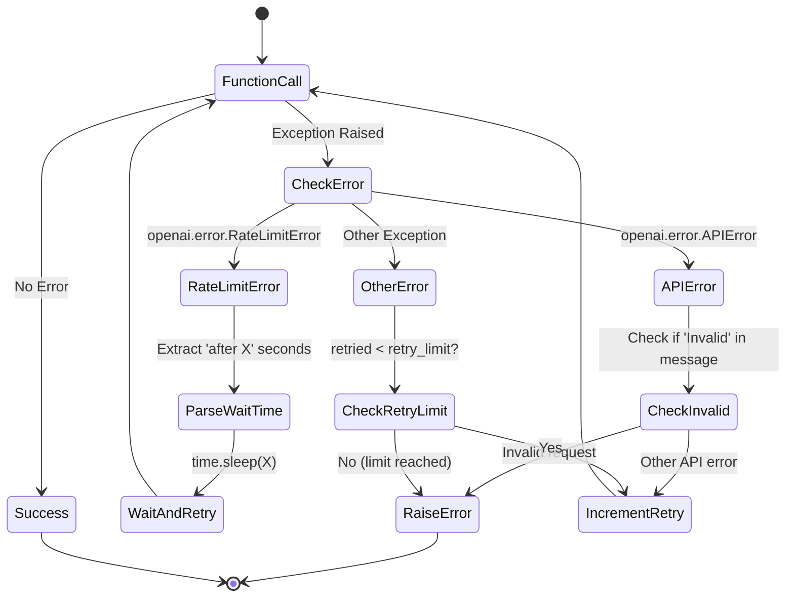
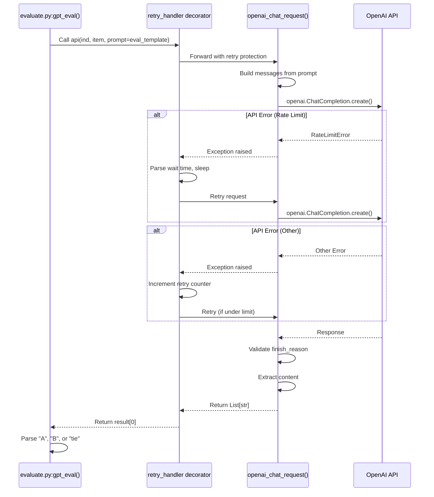

<!-- source: DeepWiki mcp.deepwiki.com · repo allenai/CommonGen-Eval · page 5.1 Evaluation Utilities · fetched 2026-10-26 -->

# Evaluation Utilities

<details>
<summary>Relevant source files</summary>

The following files were used as context for generating this wiki page:

- [eval_utils.py](eval_utils.py)
- [evaluate.py](evaluate.py)

</details>


## Purpose and Scope

This page documents the `eval_utils.py` module, which provides core utility functions for the CommonGen-Eval evaluation pipeline. The module contains two primary categories of functionality:

1. **NLP Analysis** - The `analyze_words` function for linguistic processing using spaCy
2. **OpenAI API Integration** - The `openai_chat_request` function and associated retry mechanisms for GPT-4 evaluation

For information about how these utilities are used in the complete evaluation workflow, see [Running Evaluation](#5). For details on the evaluation prompt templates that are passed to these functions, see [Prompt Templates](#5.2).

## Module Overview

The `eval_utils.py` module serves as a bridge between the evaluation orchestration in `evaluate.py` and external dependencies (spaCy and OpenAI API). It encapsulates error handling, retry logic, and NLP processing to provide reliable, reusable utility functions.



**Sources:** [eval_utils.py:1-158](), [evaluate.py:1-203]()

## NLP Analysis with `analyze_words`

The `analyze_words` function performs linguistic analysis on generated sentences to determine concept coverage and part-of-speech (POS) accuracy. It uses spaCy's `en_core_web_lg` model for lemmatization and POS tagging.

### Function Signature

```python
def analyze_words(pos_words, sentence):
    """
    Analyzes a sentence to find which concepts are covered and whether
    they match the expected part-of-speech tags.
    
    Args:
        pos_words: List of strings in format "word_POS" (e.g., ["dog_NOUN", "run_VERB"])
        sentence: String containing the generated sentence to analyze
        
    Returns:
        Tuple of (found_words, found_pos_words) where both are lists of unique lemmas
    """
```

### Processing Flow



**Sources:** [eval_utils.py:17-37]()

### Implementation Details

| Aspect | Details |
|--------|---------|
| **Model Loading** | Lazy initialization using global `nlp` variable ([eval_utils.py:16-21]()) |
| **Input Format** | Concepts as `"word_POS"` strings (e.g., `"dog_NOUN"`, `"catch_VERB"`) |
| **Lemmatization** | Uses spaCy's lemmatizer to match word forms (e.g., "caught" → "catch") |
| **POS Matching** | Case-insensitive comparison: `input_dict[tok.lemma_].lower() in tok.pos_.lower()` |
| **Deduplication** | Converts to set and back to list to ensure unique results ([eval_utils.py:35-36]()) |

### Example Usage

Given a concept set with POS tags:
```
["dog_NOUN", "frisbee_NOUN", "catch_VERB"]
```

And a generated sentence:
```
"The dog caught the frisbee in the park."
```

The function returns:
- `found_words`: `["dog", "frisbee", "catch"]` - all 3 concepts present
- `found_pos_words`: `["dog_NOUN", "frisbee_NOUN", "catch_VERB"]` - all have correct POS

**Sources:** [eval_utils.py:17-37]()

## OpenAI API Integration

The `openai_chat_request` function provides a standardized interface for making ChatGPT API calls with comprehensive error handling. It supports both prompt-based and message-based invocations.

### Function Signature and Parameters

```python
def openai_chat_request(
    model: str=None,              # e.g., "gpt-4-0314"
    engine: str=None,             # Azure-specific engine name
    temperature: float=0,         # 0 = deterministic
    max_tokens: int=512,          # Response length limit
    top_p: float=1.0,             # Nucleus sampling
    frequency_penalty: float=0,   
    presence_penalty: float=0,
    prompt: str=None,             # Simple prompt string
    n: int=1,                     # Number of completions
    messages: List[dict]=None,    # Chat format messages
    stop: List[str]=None,         # Stop sequences
    **kwargs,
) -> List[str]:
```

**Sources:** [eval_utils.py:100-156]()

### Message Format Construction

The function accepts either a simple `prompt` string or pre-formatted `messages`. When using `prompt`, it automatically constructs the message format:



**Sources:** [eval_utils.py:131-156]()

### Response Validation

The function includes strict validation of OpenAI API responses:

| Validation | Implementation | Error Handling |
|------------|---------------|----------------|
| **Finish Reason** | Must be `'stop'` or `'length'` | Raises `ValueError` if other values ([eval_utils.py:152-153]()) |
| **Multiple Choices** | Processes all `n` completions | Returns list of content strings ([eval_utils.py:150-154]()) |
| **Content Extraction** | Accesses `choice['message']['content']` | Returns as-is without post-processing |

**Sources:** [eval_utils.py:149-156]()

## Error Handling and Retry Logic

The module provides two complementary retry mechanisms for handling OpenAI API errors.

### Legacy Retry: `completion_with_backoff`

This function uses the `tenacity` library for simple exponential backoff:

```python
@retry(wait=wait_random_exponential(min=1, max=30), stop=stop_after_attempt(30))
def completion_with_backoff(**kwargs):
    completion = openai.ChatCompletion.create(**kwargs) 
    return completion.choices[0].message["content"].strip()
```

| Parameter | Value | Purpose |
|-----------|-------|---------|
| **Wait Strategy** | Exponential (1-30 seconds) | Prevents overwhelming API with retries |
| **Max Attempts** | 30 | Ensures eventual failure on persistent errors |
| **Return Value** | Single string (stripped) | Simplified interface for single completions |

**Note:** This function is less flexible than `openai_chat_request` and appears to be legacy code. The modern evaluation pipeline uses `retry_handler` instead.

**Sources:** [eval_utils.py:40-43]()

### Production Retry: `retry_handler` Decorator

The `retry_handler` is a sophisticated decorator that provides fine-grained error handling for different OpenAI API error types:



**Sources:** [eval_utils.py:47-98]()

### Error Type Handling

The decorator handles three categories of errors:

#### 1. Rate Limit Errors

```python
if isinstance(e, openai.error.RateLimitError):
    words = str(e).split(' ')
    try:
        time_to_wait = int(words[words.index('after') + 1])
    except ValueError:
        time_to_wait = 5
    time.sleep(time_to_wait)
```

- **Behavior:** Parses wait time from error message, sleeps, then retries indefinitely
- **Default Wait:** 5 seconds if parsing fails
- **Retry Limit:** None (keeps retrying until rate limit clears)

**Sources:** [eval_utils.py:72-80]()

#### 2. API Errors

```python
elif isinstance(e, openai.error.APIError):
    print("API error:", str(e))
    if "Invalid" in str(e):
        print("Invalid request, returning.")
        raise e
```

- **Behavior:** Logs error; raises immediately if "Invalid" in message
- **Use Case:** Catches content filter violations or malformed requests
- **Retry:** Not attempted for invalid requests

**Sources:** [eval_utils.py:81-86]()

#### 3. Other Errors

```python
else:
    print(e.__class__.__name__+":", str(e))
    if retried < retry_limit:
        print(f"Retrying for the {retried + 1} time..")
    else:
        print("Retry limit reached. Saving the error message and returning.")
        print(kwargs["prompt"])
        raise e
    retried += 1
```

- **Behavior:** Retries up to `retry_limit` times (default 10)
- **Debug Output:** Prints error class name, error message, and retry count
- **Final Action:** Prints the prompt before raising on failure

**Sources:** [eval_utils.py:87-96]()

### Usage Pattern in Evaluation

The `evaluate.py` script demonstrates the typical usage pattern:

```python
@retry_handler(retry_limit=10)
def api(ind, item, **kwargs):
    result = openai_chat_request(**kwargs)
    result = result[0]  
    return result
```

This wraps `openai_chat_request` with the retry handler, combining:
- Retry logic from `retry_handler`
- Message formatting and validation from `openai_chat_request`

**Sources:** [evaluate.py:90-94]()

## Integration with Evaluation Pipeline

The utilities in `eval_utils.py` support two key evaluation stages:

### Stage 1: Automated Metrics (NLP Analysis)

While `analyze_words` is defined in `eval_utils.py`, it is not directly called in the current evaluation pipeline. Instead, similar logic appears to be embedded in `show_table.py` for calculating coverage and POS metrics. The function provides the core algorithm that could be used for:

- **Coverage Calculation:** Percentage of concepts found in generated text
- **POS Accuracy:** Percentage of concepts with correct part-of-speech tags

**Sources:** [eval_utils.py:17-37]()

### Stage 2: GPT-4 Judge Evaluation

The `openai_chat_request` function is central to the GPT-4 pairwise comparison:



**Sources:** [evaluate.py:90-117](), [eval_utils.py:100-156](), [eval_utils.py:47-98]()

## Summary of Key Functions

| Function | Lines | Purpose | Key Features |
|----------|-------|---------|--------------|
| `analyze_words` | 17-37 | NLP concept analysis | spaCy lemmatization, POS matching, deduplication |
| `completion_with_backoff` | 40-43 | Legacy retry wrapper | Tenacity-based exponential backoff |
| `retry_handler` | 47-98 | Production error handling | Rate limit parsing, typed error handling, configurable retry limit |
| `openai_chat_request` | 100-156 | OpenAI API interface | Message formatting, response validation, multi-completion support |

**Sources:** [eval_utils.py:1-158]()

---

