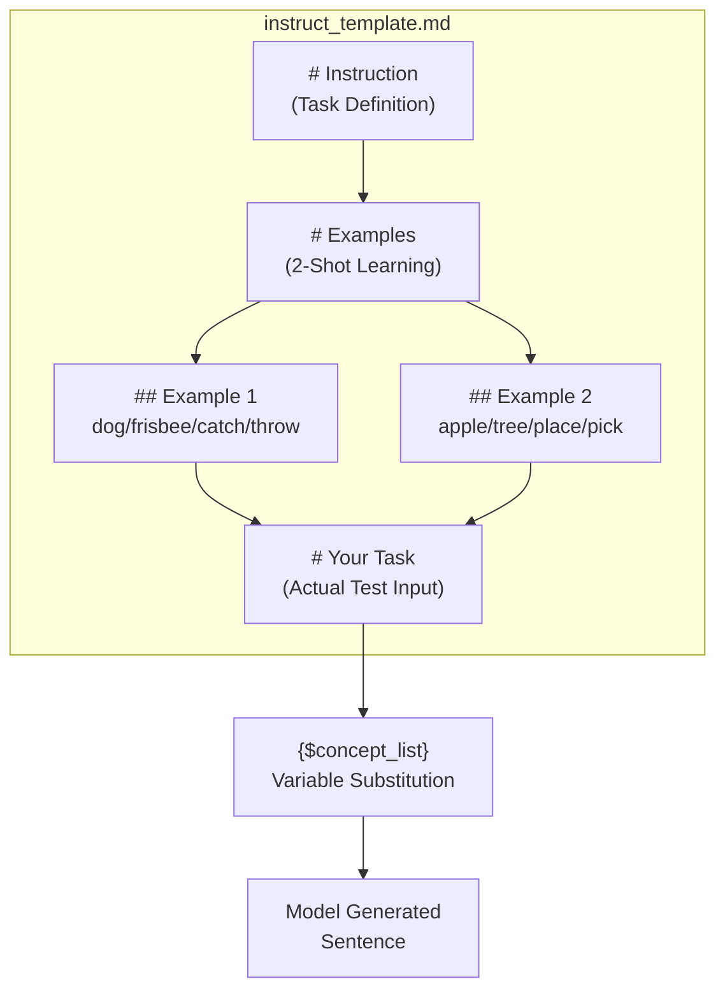
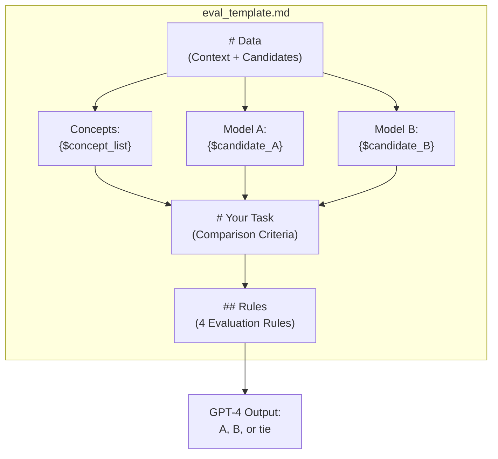
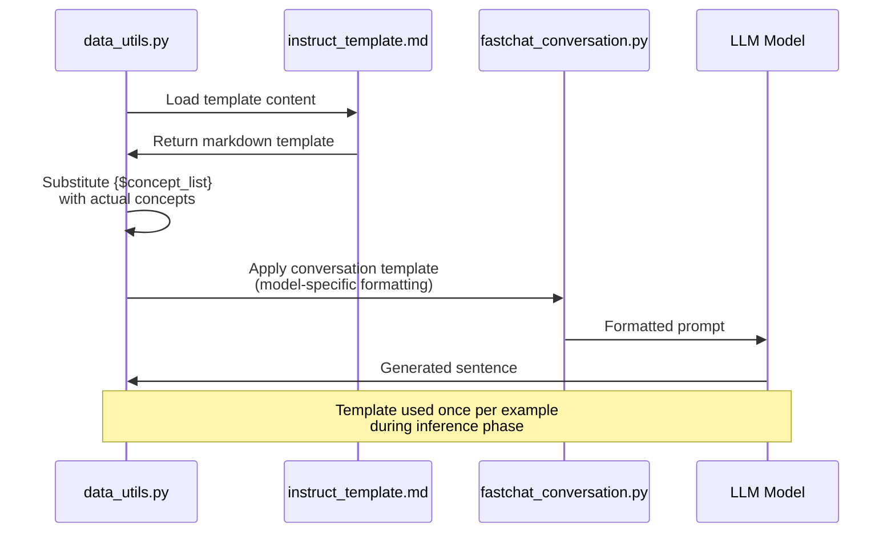
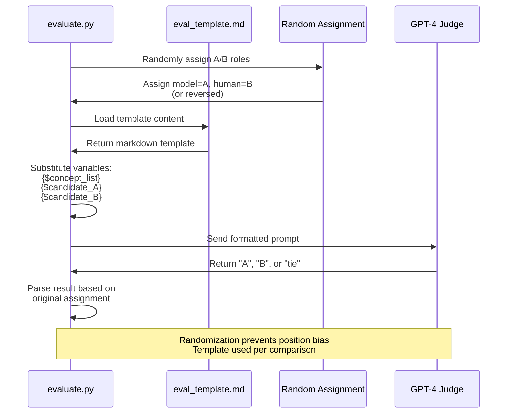
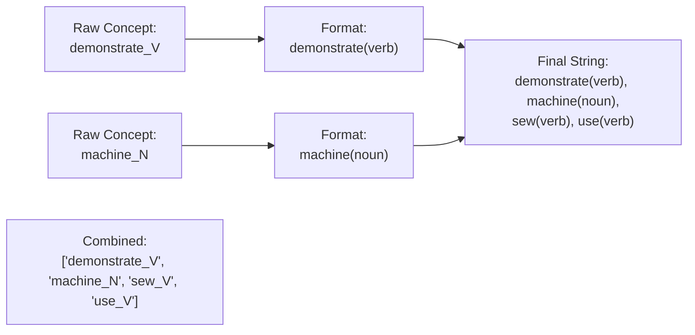
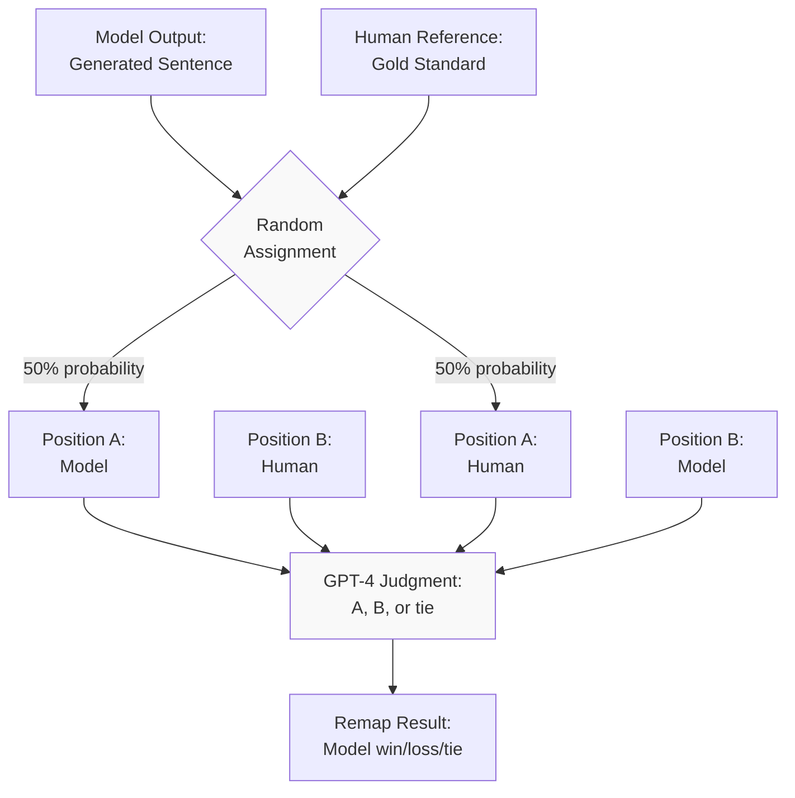

<!-- source: DeepWiki mcp.deepwiki.com · repo allenai/CommonGen-Eval · page 5.2 Prompt Templates · fetched 2026-10-26 -->

# Prompt Templates

<details>
<summary>Relevant source files</summary>

The following files were used as context for generating this wiki page:

- [README.md](README.md)
- [eval_template.md](eval_template.md)
- [instruct_template.md](instruct_template.md)

</details>


This page documents the two prompt templates used in the CommonGen-Eval system: the **instruction template** for guiding model generation and the **evaluation template** for GPT-4 judging. These templates define how models are prompted to generate sentences from concepts and how GPT-4 evaluates the quality of generated outputs.

For information about how these templates are applied during inference, see [Data Utilities](#4.1). For details on the evaluation process that uses these templates, see [Evaluation Utilities](#5.1).

---

## Template Overview

The CommonGen-Eval system uses two distinct markdown-formatted prompt templates:

| Template | File | Purpose | Used By |
|----------|------|---------|---------|
| Instruction Template | `instruct_template.md` | Guides LLMs to generate sentences from concepts | Model inference (`vllm_infer.py`) |
| Evaluation Template | `eval_template.md` | Guides GPT-4 to compare generated vs. reference sentences | Evaluation script (`evaluate.py`) |

Both templates use a consistent variable substitution syntax: `{$variable_name}` placeholders are replaced with actual values at runtime.

**Sources:** [README.md:72-95](), [README.md:117-146](), [instruct_template.md:1-19](), [eval_template.md:1-24]()

---

## Instruction Template Structure

### Template Components

The instruction template ([instruct_template.md:1-19]()) follows a structured format designed for 2-shot prompting:



**Sources:** [instruct_template.md:1-19]()

### Task Definition

The instruction section ([instruct_template.md:1-4]()) establishes the generation constraints:

```markdown
Given several concepts (i.e., nouns or verbs), write a short and simple sentence 
that contains *all* the required words.
The sentence should describe a common scene in daily life, and the concepts should 
be used in a natural way.
```

Key requirements emphasized:
- **ALL concepts must be included** (enforced with italicized emphasis)
- Sentence should be **short and simple**
- Scene should be **common in daily life**
- Concepts used in a **natural way**

**Sources:** [instruct_template.md:1-4]()

### Few-Shot Examples

The template provides two carefully selected examples ([instruct_template.md:6-14]()):

| Example | Concepts | Generated Sentence | Features Demonstrated |
|---------|----------|-------------------|----------------------|
| Example 1 | dog(noun), frisbee(noun), catch(verb), throw(verb) | The dog catches the frisbee when the boy throws it into the air. | Action sequence, temporal relationship |
| Example 2 | apple(noun), place(verb), tree(noun), pick(verb) | A girl picks some apples from a tree and places them into her basket. | Multiple actions, spatial relationships |

Both examples demonstrate:
- Correct part-of-speech usage (verbs as actions, nouns as objects)
- Natural daily life scenes
- Complete coverage of all concepts
- Simple sentence structure (12-16 words)

**Sources:** [instruct_template.md:8-14]()

### Variable Substitution

The template uses a single variable placeholder ([instruct_template.md:18]()):

- `{$concept_list}`: Replaced with the actual concept set in format `"concept1(pos), concept2(pos), ..."`

Example substitution:
```
Input: ['demonstrate_V', 'machine_N', 'sew_V', 'use_V']
After substitution: "demonstrate(verb), machine(noun), sew(verb), use(verb)"
```

**Sources:** [instruct_template.md:16-19](), [README.md:157]()

---

## Evaluation Template Structure

### Template Components

The evaluation template ([eval_template.md:1-24]()) implements pairwise comparison for GPT-4 judging:



**Sources:** [eval_template.md:1-24]()

### Data Section

The data section ([eval_template.md:1-10]()) provides context and the two candidates being compared:

```markdown
# Data

Given several concepts (i.e., nouns or verbs), we ask models to write a short and 
simple sentence that contains *all* the required words.

Concepts: "{$concept_list}"
Model A: "{$candidate_A}"
Model B: "{$candidate_B}"
```

**Variable substitutions:**
- `{$concept_list}`: Same format as instruction template
- `{$candidate_A}`: First sentence (randomly assigned model or human reference)
- `{$candidate_B}`: Second sentence (randomly assigned model or human reference)

**Sources:** [eval_template.md:1-10]()

### Evaluation Criteria

The task section ([eval_template.md:12-24]()) defines four explicit rules for comparison:

| Rule | Description | Priority |
|------|-------------|----------|
| Rule 1 | Better sentence describes **common daily scene** with **natural concept usage** | High |
| Rule 2 | Prefer sentences using **all concepts** with **correct PoS tags** | High |
| Rule 3 | Prefer **simpler and shorter** if same scene described | Medium |
| Rule 4 | Choose **"tie"** if equally good or bad | Fallback |

The template explicitly requests one of three outputs: `"A"`, `"B"`, or `"tie"`.

**Sources:** [eval_template.md:12-24]()

---

## Template Usage Flow

### Instruction Template Application



**Sources:** [README.md:55-69](), [instruct_template.md:1-19]()

### Evaluation Template Application



**Sources:** [README.md:99-115](), [eval_template.md:1-24]()

---

## Template Variable Mapping

### Complete Variable Reference

| Variable | Template(s) | Format | Example Value |
|----------|-------------|--------|---------------|
| `{$concept_list}` | Both | `"concept1(pos), concept2(pos), ..."` | `"dog(noun), frisbee(noun), catch(verb), throw(verb)"` |
| `{$candidate_A}` | Evaluation only | Plain text sentence | `"The dog catches the frisbee when the boy throws it."` |
| `{$candidate_B}` | Evaluation only | Plain text sentence | `"A dog jumps to catch a frisbee that someone threw."` |

### Concept List Formatting

The concept list format includes both the lemmatized concept and its part-of-speech tag:



**Transformation rules:**
- Suffix `_V` → `(verb)`
- Suffix `_N` → `(noun)`
- Multiple concepts joined with `", "`
- Quotes added around entire list

**Sources:** [instruct_template.md:9-13](), [eval_template.md:6](), [README.md:157]()

---

## Randomization for Bias Prevention

The evaluation system implements random A/B assignment to prevent position bias in GPT-4 judgments:



This randomization ensures that GPT-4's judgment is based on content quality rather than position preference. The `evaluate.py` script tracks the original assignment and remaps results accordingly.

**Sources:** [README.md:117-146](), [eval_template.md:8-10]()

---

## Template Design Principles

### Instruction Template Design

The instruction template is designed with specific pedagogical principles:

1. **Clear Constraints**: Uses italics (`*all*`) to emphasize the coverage requirement
2. **Minimal Examples**: Only 2 shots to avoid overfitting to specific patterns
3. **Diverse Examples**: Shows different types of scenes (action, spatial)
4. **Explicit PoS Tags**: Teaches models the correct grammatical usage
5. **Natural Language**: Avoids technical jargon to match expected output style

**Sources:** [instruct_template.md:1-19](), [README.md:72-95]()

### Evaluation Template Design

The evaluation template prioritizes objectivity and consistency:

1. **Context Repetition**: Restates the task to remind GPT-4 of requirements
2. **Explicit Rules**: Four numbered rules prevent subjective interpretation
3. **Hierarchical Criteria**: Orders rules from most to least important
4. **Tie Option**: Prevents forced choices when candidates are equal
5. **Simple Output Format**: Requests only `"A"`, `"B"`, or `"tie"` for easy parsing

**Sources:** [eval_template.md:1-24](), [README.md:117-146]()

---

## Template Relationship to Metrics

The evaluation template rules directly correspond to the automated and judged metrics:

| Template Rule | Automated Metric | Description |
|---------------|------------------|-------------|
| "use all given concepts" | `cover%` | Percentage where all concepts present |
| "correct part-of-speech tags" | `pos%` | Percentage with correct PoS for all concepts |
| "simpler and shorter" | `len` | Average word count (informational only) |
| GPT-4 judgment | `win_tie%` | Percentage where model wins or ties vs. human |

The multiplicative overall score (`cover × pos × win_tie`) ensures models must satisfy all template requirements to achieve high rankings.

**Sources:** [README.md:39-44](), [eval_template.md:16-20]()

---

## Example Template Instantiation

### Instruction Template Example

**Before substitution** ([instruct_template.md:16-19]()):
```markdown
# Your Task 
- Concepts: "{$concept_list}"
- Sentence: 
```

**After substitution**:
```markdown
# Your Task
- Concepts: "demonstrate(verb), machine(noun), sew(verb), use(verb)"
- Sentence:
```

### Evaluation Template Example

**Before substitution** ([eval_template.md:6-10]()):
```markdown
Concepts: "{$concept_list}"
Model A: "{$candidate_A}"
Model B: "{$candidate_B}"
```

**After substitution** (with randomization):
```markdown
Concepts: "car(noun), drive(verb), road(noun), water(noun)"
Model A: "The car drives down the road splashing water from the puddles."
Model B: "A man drives the car slowly because there is water on the road"
```

**Sources:** [instruct_template.md:16-19](), [eval_template.md:6-10](), [README.md:186-191]()

---

